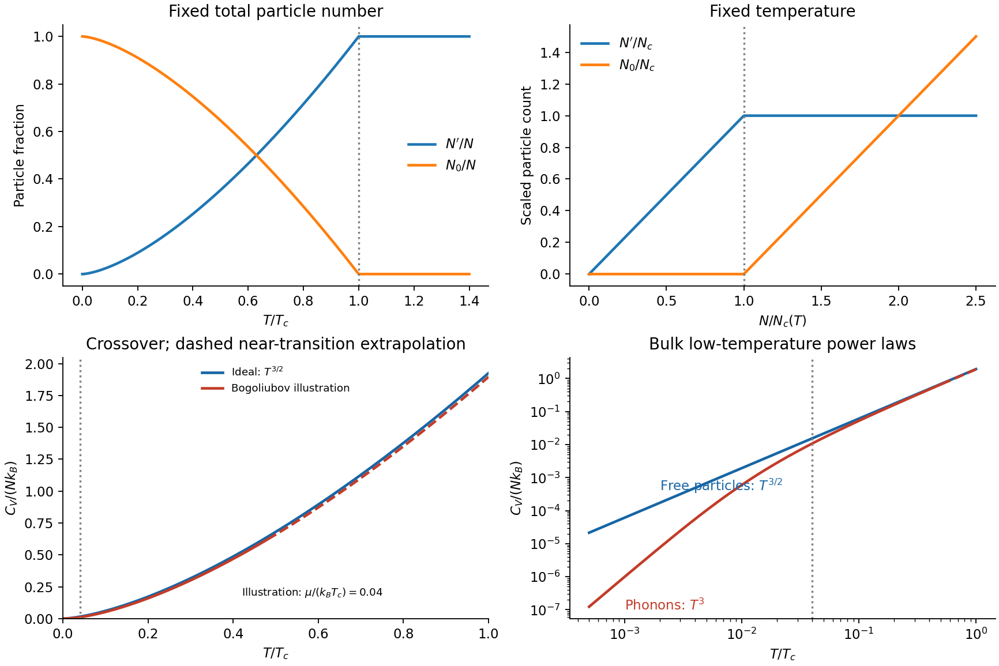

<h1 id="2/solution">Solution</h1>

↑ **Parent:** [2](../2.md)

Interpret the box as a hard-wall cube. Its one-particle levels are $\epsilon_{n_xn_yn_z}=\pi^2\hbar^2(n_x^2+n_y^2+n_z^2)/(2mL^2)$ for positive integers, giving $E_0=3\pi^2\hbar^2/(2mL^2)$. Counting lattice points in a positive octant and differentiating the large-radius count gives the supplied continuum [density of states](../../../../density-of-states.md). Expressing its prefactor through $E_0$ yields

$$
g(\epsilon)=\mathcal A E_0^{-3/2}\sqrt\epsilon,\qquad
\boxed{\mathcal A=\frac{3\sqrt3\pi}{4}.}
$$

Here $\mathcal A$ denotes the dimensionless constant requested in this question, to distinguish it from the unrelated hyperfine constant of question 1. Periodic [boundary conditions](../../../../boundary-condition.md) would have zero ground [energy](../../../../energy-split.md) and would not permit this parametrization by a nonzero $E_0$.

Separate the ground-state occupation from excited particles. The [finite-box ground-energy convention in Bose condensation](../../../../finite-box-ground-energy-convention-in-bose-condensation.md) makes the [chemical potential](../../../../chemical-potential-split.md) approach the ground [energy](../../../../energy-split.md) from below as that occupation becomes macroscopic. In the thermodynamic continuum approximation one shifts the [energy](../../../../energy-split.md) zero to the ground state and sets the limiting [chemical potential](../../../../chemical-potential-split.md) to zero in the excited-state integral. The difference between the exact shifted density and its $\sqrt\epsilon$ bulk form gives finite-size corrections; at the transition $k_BT_c/E_0\sim N^{2/3}\gg1$. Thus

$$
N'_{\max}(T)=\int_0^\infty\frac{\mathcal A E_0^{-3/2}\sqrt\epsilon}{e^{\epsilon/(k_BT)}-1}\,d\epsilon
=\mathcal A\Gamma(3/2)\zeta(3/2)\left(\frac{k_BT}{E_0}\right)^{3/2}.
$$

The identity follows by expanding $(e^x-1)^{-1}=\sum_{r\geq1}e^{-rx}$ and integrating each term. The excited states have a finite saturation capacity. Setting that capacity equal to $N$ determines condensation:

$$
\boxed{k_BT_c=\mathcal B E_0N^{2/3},\qquad
\mathcal B=[\mathcal A\Gamma(3/2)\zeta(3/2)]^{-2/3}
=\frac{4}{3\pi\zeta(3/2)^{2/3}}\simeq0.22375.}
$$

Equivalently $k_BT_c=(2\pi\hbar^2/m)[n/\zeta(3/2)]^{2/3}$, with $n=N/L^3$.

At fixed $N$, below $T_c$ the [chemical potential](../../../../chemical-potential-split.md) is pinned to its limiting value and

$$
\boxed{N'=N(T/T_c)^{3/2},\qquad N_0=N[1-(T/T_c)^{3/2}].}
$$

Above $T_c$, $N'\simeq N$ and there is no macroscopic $N_0$; the [chemical potential](../../../../chemical-potential-split.md) adjusts rather than allowing the saturation expression to exceed the available particles. At fixed $T$, put $N_c=N'_{\max}(T)$. For $N<N_c$, $N'\simeq N$ and $N_0$ is not macroscopic; for $N>N_c$, **$N'=N_c$ saturates while $N_0=N-N_c$ grows linearly**. This is [particle saturation in a homogeneous Bose gas](../../../../particle-saturation-in-a-homogeneous-bose-gas.md); the sharp threshold is a thermodynamic-limit approximation to finite-box occupations.

**[Figure 4](#2/image-ideal-box-particle-saturation-and-the-heat-capacity-crossover-from-phonons-to-particle-like-excitations). Ideal-box particle saturation and the heat-capacity crossover from phonons to particle-like excitations**.

The interaction scale compares differently with confinement and transition energies:

$$
\frac{E_I}{E_0}\sim\frac{Na}{L}\gg1,\qquad
\frac{E_I}{k_BT_c}\sim N^{1/3}\frac aL\ll1.
$$

Thus the stated range makes interactions dominate the ground-state confinement [energy](../../../../energy-split.md) while remaining small on the thermal scale controlling $T_c$. This is an [interaction-dominated ground state with nearly ideal condensation temperature](../../../../interaction-dominated-ground-state-with-nearly-ideal-condensation-temperature.md). It also gives the dilute-gas parameter $na^3=N(a/L)^3\ll1$. A contact model has $g=4\pi\hbar^2a/m$ and $\mu\simeq gn$; the question's $E_I$ suppresses order-one factors, and the uniform ground [energy](../../../../energy-split.md) per particle is $gn/2$, rather than exactly $gn$. Weak interactions can shift $T_c$ slightly, but their dimensionless strength $an^{1/3}\ll1$ makes that a small relative effect. In a hard-wall box, boundary healing layers do not overturn bulk interaction dominance when their thickness is small compared with $L$.

At $k_BT\ll\mu$, thermally occupied [Bogoliubov modes](../../../../bogoliubov-mode.md) have $E_k\simeq\hbar c_s k$, with $c_s=\sqrt{\mu/m}$. There is one acoustic branch for this spinless gas. Its thermal [energy](../../../../energy-split.md) determines the [phonon heat capacity of a dilute Bose gas](../../../../phonon-heat-capacity-of-a-dilute-bose-gas.md):

$$
U_{\rm ph}=\frac{V}{2\pi^2}\int_0^\infty\frac{\hbar c_s k^3}{e^{\hbar c_sk/(k_BT)}-1}\,dk
=\frac{\pi^2V}{30}\frac{(k_BT)^4}{\hbar^3c_s^3},
$$

$$
\boxed{C_{V,\rm ph}=\frac{2\pi^2}{15}Vk_B\left(\frac{k_BT}{\hbar c_s}\right)^3\propto T^3.}
$$

The zero-temperature interaction [energy](../../../../energy-split.md) does not itself contribute to this leading [temperature](../../../../temperature-split.md) derivative at fixed $N,V$. This bulk power law also requires $k_BT\gg\hbar c_s/L$ so that the [phonon](../../../../phonon.md) spectrum may be treated as continuous; a strictly finite box eventually has discrete-level activated behaviour.

For the noninteracting condensed [Bose gas](../../../../bose-gas.md), the [ideal Bose-gas heat capacity below condensation](../../../../ideal-bose-gas-heat-capacity-below-condensation.md) follows by integrating $\epsilon g(\epsilon)f(\epsilon)$:

$$
U=\frac32Nk_BT\frac{\zeta(5/2)}{\zeta(3/2)}(T/T_c)^{3/2},\qquad
\boxed{C_{V,\rm ideal}=\frac{15}{4}Nk_B\frac{\zeta(5/2)}{\zeta(3/2)}(T/T_c)^{3/2}\propto T^{3/2}.}
$$

Its limiting value at $T_c^-$ is about $1.926Nk_B$. At very low [temperature](../../../../temperature-split.md) the interacting [phonon](../../../../phonon.md) curve is suppressed relative to the ideal curve, has slope three on logarithmic axes, and crosses over towards particle-like $T^{3/2}$ behaviour around $k_BT\sim\mu$. Since $\mu\ll k_BT_c$, most of the interval below $T_c$ is approximately ideal at leading weak-coupling order. The figure marks a qualitative extrapolation near the transition: a zero-temperature [Bogoliubov spectrum](../../../../bogoliubov-quasiparticle-dispersion.md) does not determine precise interacting critical [heat capacity](../../../../heat-capacity.md) or its small transition shift. The illustrative fixed-$\mu$ interpolation is not claimed as a controlled critical-region calculation.

## ↑ Ancestors (13)

1. [2](../2.md)
2. [Paper 1](../../paper-1-split.md)
3. [2015](../../split.md)
4. [Past exam of the atomic and Optical Physics course of the University of Cambridge](../../../split.md)
5. [Atomic and Optical Physics course of the University of Cambridge](../../../../atomic-and-optical-physics-course-of-the-university-of-cambridge.md)
6. [Physics course of the year 4 of the natural sciences course of the University of Cambridge](../../../../physics-course-of-the-year-4-of-the-natural-sciences-course-of-the-university-of-cambridge.md)
7. [Year 4 of the natural sciences course of the University of Cambridge](../../../../year-4-of-the-natural-sciences-course-of-the-university-of-cambridge.md)
8. [Year of the natural sciences course of the University of Cambridge](../../../../year-of-the-natural-sciences-course-of-the-university-of-cambridge.md)
9. [Natural sciences course of the University of Cambridge](../../../../natural-sciences-course-of-the-university-of-cambridge.md)
10. [Course of the University of Cambridge](../../../../course-of-the-university-of-cambridge.md)
11. [University of Cambridge](../../../../university-of-cambridge-split.md)
12. [List of universities](../../../../list-of-universities.md)
13. [Codex Wiki](../../../../split.md)
