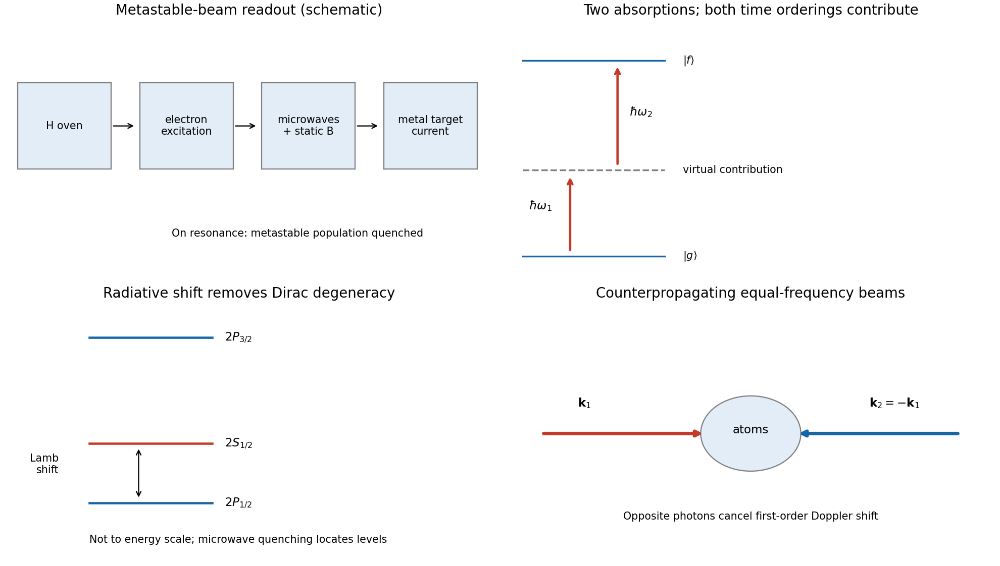

<h1 id="3/a/solution">Solution</h1>

↑ **Parent:** [A](../a.md)

In the ideal point-nucleus Dirac-Coulomb problem, hydrogen levels depend on $n$ and $j$, so $2S_{1/2}$ and $2P_{1/2}$ are degenerate despite their different orbital angular momenta. The [Lamb shift](../../../../../lamb-shift.md) removes this degeneracy: the $2S_{1/2}$ level lies about **$h\times1.06\,\mathrm{GHz}$ above $2P_{1/2}$**, an [energy](../../../../../energy-split.md) of roughly $4.4\,\mathrm{\mu eV}$. This is distinct from the much larger $2P_{3/2}-2P_{1/2}$ fine-structure splitting.

[quantum electrodynamics](../../../../../quantum-electrodynamics.md) changes the electron's interaction with the Coulomb field. [electron self-energy](../../../../../electron-self-energy.md) and [vacuum polarization](../../../../../vacuum-polarization.md) give state-dependent [radiative corrections](../../../../../radiative-correction.md); a complete prediction also keeps specified [recoil](../../../../../recoil.md) and nuclear-size contributions. An $S$ wave samples the nucleus differently from a $P$ wave, so equal $n,j$ no longer ensures equal [energy](../../../../../energy-split.md). A leading-log estimate for an $nS$ radiative contribution scales as $\alpha(Z\alpha)^4m_ec^2\ln[(Z\alpha)^{-2}]/n^3$, with a numerical prefactor and further state-dependent terms. This is a scale estimate, not a replacement for renormalized bound-state QED. The measurable shift is a difference relative to a specified reference [Hamiltonian](../../../../../hamiltonian.md), rather than an unregulated absolute vacuum [energy](../../../../../energy-split.md).[§II, definition of level contributions relative to the point-nucleus Dirac value and bound-state QED expansion](../../../../../theory-of-the-lamb-shift-in-hydrogen-and-light-hydrogen-like-ions-by-vladimir-yerokhin-and-others.md)

The original microwave experiment used a tungsten oven to dissociate hydrogen, an electron beam to populate metastable $2S$ atoms, and electron ejection from a metal target to measure surviving metastable atoms. Microwaves transferred population to rapidly decaying $2P$, reducing detector current. At a fixed microwave [frequency](../../../../../frequency.md), interruption of the radiation and a scan of static [magnetic field](../../../../../magnetic-field-split.md) revealed Zeeman-tuned resonances. Comparing resonance locations with the Dirac-level prediction showed the $S$ level shifted upward. Field calibration and homogeneity, excessive microwave intensity, unresolved [hyperfine structure](../../../../../hyperfine-structure.md) and stray-electric-field quenching limit the measurement; the signal is not direct absorption by a large equilibrium excited population.[pp. 241–243, apparatus, Fig. 1 caption and resonance-field comparison](../../../../../fine-structure-of-the-hydrogen-atom-by-a-microwave-method-by-willis-eugene-lamb-jr-and-robert-curtis-retherford.md)

**[Figure 5](#3/a/image-original-schematics-of-metastable-beam-microwave-quenching-and-doppler-free-two-photon-excitation). Original schematics of metastable-beam microwave quenching and Doppler-free two-photon excitation**.

## ↑ Ancestors (14)

1. [A](../a.md)
2. [3](../../3.md)
3. [Paper 1](../../../paper-1-split.md)
4. [2015](../../../split.md)
5. [Past exam of the atomic and Optical Physics course of the University of Cambridge](../../../../split.md)
6. [Atomic and Optical Physics course of the University of Cambridge](../../../../../atomic-and-optical-physics-course-of-the-university-of-cambridge.md)
7. [Physics course of the year 4 of the natural sciences course of the University of Cambridge](../../../../../physics-course-of-the-year-4-of-the-natural-sciences-course-of-the-university-of-cambridge.md)
8. [Year 4 of the natural sciences course of the University of Cambridge](../../../../../year-4-of-the-natural-sciences-course-of-the-university-of-cambridge.md)
9. [Year of the natural sciences course of the University of Cambridge](../../../../../year-of-the-natural-sciences-course-of-the-university-of-cambridge.md)
10. [Natural sciences course of the University of Cambridge](../../../../../natural-sciences-course-of-the-university-of-cambridge.md)
11. [Course of the University of Cambridge](../../../../../course-of-the-university-of-cambridge.md)
12. [University of Cambridge](../../../../../university-of-cambridge-split.md)
13. [List of universities](../../../../../list-of-universities.md)
14. [Codex Wiki](../../../../../split.md)
