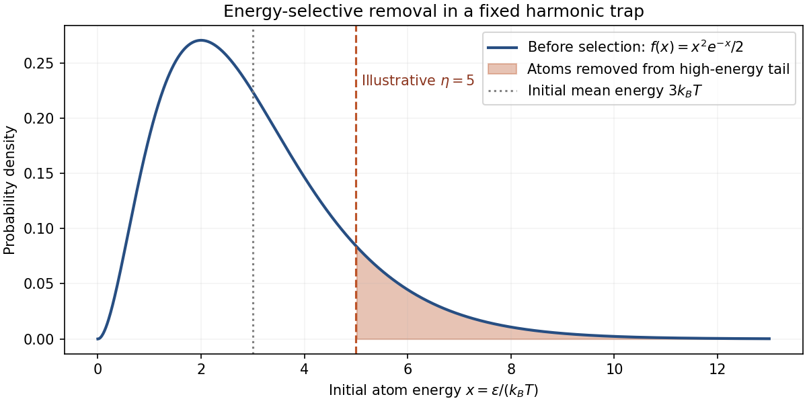

# Paper 1

↑ **Parent:** [2016](../2016.md)

Original source: [Released original, physical PDF pages 779–782](https://www.whatdotheyknow.com/request/natural_science_tripos_physics_e_2/response/2340776/attach/2/FOI%202023%20399%20Zahid%20materials.pdf?cookie_passthrough=1#page=779). All three questions and every essay option are covered.

**Table of contents**

- [1](#1)
  - [Solution](#1/solution)
- [2](#2)
  - [a](#2/a)
    - [Solution](#2/a/solution)
  - [b](#2/b)
    - [Solution](#2/b/solution)
  - [c](#2/c)
    - [Solution](#2/c/solution)
- [3](#3)
  - [Solution](#3/solution)

## 1

↑ **Parent:** [Paper 1](paper-1.md)

<h3 id="1/solution">Solution</h3>

↑ **Parent:** [1](#1)

Take the field along $z$ and write $x=\mu_BB$, with [Bohr magneton](../../electromagnetism.md#bohr-magneton) $\mu_B$. The printed [Hamiltonian](../../quantum-system.md#hamiltonian-quantum-mechanics) uses dimensionless angular-momentum operators, with [eigenvalues](../../linear-operator-theory.md#eigenvalue) $L(L+1)$ and $m_L$; physical angular [momenta](../../momentum.md) carry an additional $\hbar$. Thus $\beta$ and $x$ are [energies](../../energy.md). Assume the usual positive [spin-orbit interaction](../../atomic-physics.md#spin-orbit-interaction) coefficient $\beta>0$. Reversing its sign reverses the zero-field ordering but not the state count.

An [electron](../../physics.md#electron) has $S=1/2$. [addition of angular momentum](../../angular-momentum-operator.md#addition-of-angular-momentum) gives

$$
\boxed{J=L+\frac12,\quad L-\frac12\qquad(L>0).}
$$

The [coupled angular-momentum state count](../../angular-momentum-operator.md#coupled-angular-momentum-state-count) can be checked directly. The product [basis](../../vector-space.md#basis) contains $(2L+1)\times2=4L+2$ states. The coupled [basis](../../vector-space.md#basis) contains

$$
[2(L+\tfrac12)+1]+[2(L-\tfrac12)+1]=(2L+2)+2L=\boxed{4L+2}.
$$

Coupling therefore reorganizes the states rather than creating or losing them. There is no hyperfine multiplicity because $I=0$.

Use $\mathbf J=\mathbf L+\mathbf S$ to obtain

$$
\mathbf L\cdot\mathbf S
=\frac12(\mathbf J^2-\mathbf L^2-\mathbf S^2),\qquad
E_{\rm SO}(J)=\frac{\beta}{2}[J(J+1)-L(L+1)-3/4].
$$

The two [spin-orbit interaction](../../atomic-physics.md#spin-orbit-interaction) [energies](../../energy.md) are $\beta L/2$ and $-\beta(L+1)/2$. In a weak field, project the [Zeeman effect](../../atomic-physics.md#zeeman-splitting) onto a fixed $J$ multiplet:

$$
P_JH_ZP_J=xg_JJ_z,\qquad
\Delta E_Z=xg_Jm_J,
$$

$$
g_{L+1/2}=1+\frac1{2L+1},\qquad
g_{L-1/2}=1-\frac1{2L+1}.
$$

This is the first-order [energy](../../energy.md) formula, not a statement that $H_Z$ has no [matrix elements](../../vector-space.md#matrix-element) between different $J$ values. For a common $m=m_J$ and a conventional choice of relative phase, its complete coupled-basis block is

$$
H_Z=x\begin{pmatrix}
g_{L+1/2}m&-\dfrac{\sqrt{(L+1/2)^2-m^2}}{2L+1}\\
-\dfrac{\sqrt{(L+1/2)^2-m^2}}{2L+1}&g_{L-1/2}m
\end{pmatrix}.
$$

The [inter-multiplet Zeeman coupling](../../atomic-physics.md#inter-multiplet-zeeman-coupling) terms give second-order weak-field corrections because the two [spin-orbit interaction](../../atomic-physics.md#spin-orbit-interaction) multiplets are already separated.

In the strong-field [basis](../../vector-space.md#basis) the Zeeman part is diagonal, $E_Z=x(m_L+2m_S)$. Write

$$
H_{\rm SO}=\beta\left[L_zS_z+\frac12(L_+S_-+L_-S_+)\right].
$$

Its diagonal [matrix elements](../../vector-space.md#matrix-element) are $\beta m_Lm_S$. Its off-diagonal [matrix elements](../../vector-space.md#matrix-element) connect $(m_L,+1/2)$ to $(m_L+1,-1/2)$ with coefficient

$$
\frac{\beta}{2}\sqrt{L(L+1)-m_L(m_L+1)},
$$

and the reverse [spin](../../angular-momentum-operator.md#spin) change has $m_L+1$ replaced by $m_L-1$ in the corresponding ladder coefficient. These terms preserve $m_J$ but mix the two product states. To first order in $\beta/x$, the [energy](../../energy.md) correction is simply $\beta m_Lm_S$.

For the P state, $L=1$. Measured relative to its gross-structure centroid, the six low-field levels are

$$
\boxed{\begin{aligned}
E_{3/2,m}&=\frac{\beta}{2}+\frac43xm,\qquad m=\pm\frac32,\ \pm\frac12,\\
E_{1/2,m}&=-\beta+\frac23xm,\qquad m=\pm\frac12.
\end{aligned}}
$$

Thus the upper quartet starts at $\beta/2$ with slopes $+2,+2/3,-2/3,-2$ in a plot against $x$; the lower doublet starts at $-\beta$ with slopes $\pm1/3$. Their zero-field separation is $3\beta/2$.

At high field all six product-state [energies](../../energy.md), retaining the term linear in $\beta$, are

$$
\begin{array}{c|c|c}
m_L&m_S&E_P-E_P^{(0)}\\ \hline
-1&-1/2&-2x+\beta/2\\
-1&+1/2&-\beta/2\\
0&-1/2&-x\\
0&+1/2&+x\\
+1&-1/2&-\beta/2\\
+1&+1/2&+2x+\beta/2
\end{array}
$$

The two zero-slope levels have different $m_J$ and no mutual [matrix element](../../vector-space.md#matrix-element), so their first-order degeneracy does not require an additional degenerate perturbation. At finite field they split at order $\beta^2/x$.

An exact interpolation makes the requested whole-field sketch unambiguous. The stretched levels are

$$
E_{\pm3/2}=\frac{\beta}{2}\pm2x.
$$

For $m=\pm1/2$, use product states $|m-1/2,+1/2\rangle$ and $|m+1/2,-1/2\rangle$. Their [Hamiltonian](../../quantum-system.md#hamiltonian-quantum-mechanics) block is

$$
H_m=\left(mx-\frac{\beta}{4}\right)\mathbf1+
\frac{x+\beta m}{2}\sigma_z+\frac{\beta}{\sqrt2}\sigma_x,
$$

so

$$
\boxed{E_m^\pm=mx-\frac{\beta}{4}\pm\frac12
\sqrt{x^2+2\beta mx+\frac94\beta^2}.}
$$

These [energies](../../energy.md) reduce to the quartet and doublet at zero field and to the six strong-field expressions above. Within a fixed $m_J$, the nonzero off-diagonal element prevents a crossing of the two branches. Levels in different $m_J$ sectors can cross without hybridizing. For the S state, $L=0$ and the [spin-orbit interaction](../../atomic-physics.md#spin-orbit-interaction) term vanishes, leaving

$$
\boxed{E_{S,\pm1/2}=E_S^{(0)}\pm x}
$$

throughout this [Hamiltonian](../../quantum-system.md#hamiltonian-quantum-mechanics)'s range of validity.

**[Figure 1](#1/image-weak-field-multiplets-evolve-into-the-paschen-back-product-state-pattern). Weak-field multiplets evolve into the Paschen-Back product-state pattern**. Original exact diagonalization in units of $\beta$. P and S [energies](../../energy.md) use separate gross-structure references because their separation is not specified. Dashed high-field lines retain the correction linear in $\beta$; labels identify the asymptotic product states.

For [electric dipole transitions](../../quantum-mechanics.md#electric-dipole-transition) at low field, $\Delta J=0,\pm1$ and $\Delta m_J=0,\pm1$ apply, with the usual exclusion of $J=0\to0$. Each P state has opposite [parity](../../quantum-mechanics.md#parity) to the S state. The $P_{1/2}\to S_{1/2}$ transition has four allowed sublevel pairs. For $P_{3/2}\to S_{1/2}$, the two stretched upper states each have one destination and the other two each have two, giving six. Hence there are **10 allowed state-to-state channels at weak nonzero field**. Relative to the two zero-field transition [energies](../../energy.md), their Zeeman shifts are

$$
P_{1/2}:\quad x\left\{-\frac43,-\frac23,\frac23,\frac43\right\},\qquad
P_{3/2}:\quad x\left\{-\frac53,-1,-\frac13,\frac13,1,\frac53\right\}.
$$

In the decoupled high-field limit, an electric dipole acts on orbital coordinates, so $\Delta m_S=0$. Each of the six P product states connects to the S state with the same [spin](../../angular-momentum-operator.md#spin) and $m_L'=0$. Thus there are **6 allowed channels in the limiting product-state description**. Their [photon](../../quantum-mechanics.md#photon) [energies](../../energy.md) are

$$
\hbar\omega=\Delta_0+xm_L+\beta m_Lm_S,\qquad
\Delta_0=E_P^{(0)}-E_S^{(0)}.
$$

This [Paschen-Back transition-channel count](../../atomic-physics.md#paschen-back-transition-channel-count) is not the count of distinct frequencies: to first order in $\beta$ the two $m_L=0$ channels coincide, giving **5 distinct frequencies**, with shifts $0,\ \pm(x+\beta/2),\ \pm(x-\beta/2)$. If the residual [spin-orbit interaction](../../atomic-physics.md#spin-orbit-interaction) splitting is unresolved there are the three usual orbital Zeeman groups.

The apparent loss of four channels is a change in [eigenstate](../../energy-eigenvalue.md#eigenstate) mixing, not a change in Hilbert-space [dimension](../../vector-space.md#dimension-vector-space). At finite large field, four [weak spin-forbidden Paschen-Back lines](../../atomic-physics.md#weak-spin-forbidden-paschen-back-line) arise from small opposite-spin admixtures, with intensities vanishing as $(\beta/x)^2$. A generic finite-field calculation therefore retains ten nonzero channels; six carry finite strength in the complete-decoupling limit. Observation direction and polarization select which of these channels a detector actually receives.

## 2

↑ **Parent:** [Paper 1](paper-1.md)

<h3 id="2/a">a</h3>

↑ **Parent:** [2](#2)

<h4 id="2/a/solution">Solution</h4>

↑ **Parent:** [A](#2/a)

[evaporative cooling](../../atomic-physics.md#evaporative-cooling-atomic-physics) removes atoms selectively from the high-energy tail of a trapped gas. The remaining sample has less [energy](../../energy.md) per atom; [elastic collisions](../../classical-mechanics.md#elastic-collision) then redistribute [energy](../../energy.md) and restore a thermal distribution at lower [temperature](../../temperature.md). Random atom loss would generally remove average [energy](../../energy.md) and would not provide the same cooling mechanism. Repeated [energy](../../energy.md) selection and rethermalization, rather than one removal event, is the essential cycle.

Using the [evaporation truncation parameter](../../atomic-physics.md#evaporation-truncation-parameter) $\eta$, let the escape threshold be $\epsilon_{\rm cut}=\eta k_BT$. As the gas cools, a fixed threshold is populated by fewer atoms, so evaporation stalls. In [forced evaporative cooling](../../atomic-physics.md#forced-evaporative-cooling) the threshold is lowered during the sequence. In a magnetic trap, a [radiofrequency evaporation knife](../../atomic-physics.md#radiofrequency-evaporation-knife) flips trapped weak-field-seeking atoms into untrapped [spin](../../angular-momentum-operator.md#spin) states where the Zeeman splitting matches the [photon](../../quantum-mechanics.md#photon) [energy](../../energy.md). Energetic atoms reach that resonance surface; sweeping the radiofrequency lowers the [energy](../../energy.md) knife. In an optical dipole trap, lowering the trap depth offers a different implementation, although it usually also weakens confinement.

A simple [evaporative cooling energy balance](../../atomic-physics.md#evaporative-cooling-energy-balance) shows when atom loss is useful. For a classical gas in a three-dimensional harmonic trap of fixed frequencies, equipartition gives $E=3Nk_BT$, counting both kinetic and [potential energy](../../energy.md#potential-energy). Suppose escaping atoms remove average [energy](../../energy.md) $\epsilon_{\rm ev}=(\eta+\kappa)k_BT$, with $\kappa$ a distribution-dependent excess above the threshold. For $dN<0$,

$$
d(3Nk_BT)=\epsilon_{\rm ev}\,dN,\qquad
\alpha\equiv\frac{d\ln T}{d\ln N}=\frac{\eta+\kappa-3}{3}.
$$

Thus preferential removal cools when the removed [energy](../../energy.md) exceeds $3k_BT$. More stringently, cooling must raise the [phase-space density of an atomic gas](../../quantum-ideal-gas-statistics.md#phase-space-density-of-an-atomic-gas), not merely lower the [temperature](../../temperature.md):

$$
\mathcal D=n_{\rm peak}\lambda_T^3
=N\left(\frac{\hbar\bar\omega}{k_BT}\right)^3,\qquad
\lambda_T=\frac{h}{\sqrt{2\pi mk_BT}}.
$$

For this [harmonic-trap phase-space density](../../quantum-ideal-gas-statistics.md#harmonic-trap-phase-space-density), with fixed geometric-mean trap [frequency](../../wave.md#frequency) $\bar\omega$, $d\ln\mathcal D/d\ln N=1-3\alpha$. Therefore **phase-space density rises during atom loss if $\alpha>1/3$**. The numerical factors here belong to the stated harmonic-trap model, not every evaporative apparatus.

**[Figure 2](#2/a/image-energy-selective-loss-lowers-the-mean-energy-before-rethermalization). Energy-selective loss lowers the mean energy before rethermalization**. Original classical harmonic-trap [energy](../../energy.md) distribution, with an explicitly illustrative dimensionless cutoff. The post-cut distribution is truncated and is not yet a [thermal equilibrium](../../thermal-equilibrium.md) distribution.

There must be enough [elastic collisions](../../classical-mechanics.md#elastic-collision) to repopulate the tail: $\Gamma_{\rm el}\sim n\sigma\bar v$ should exceed damaging loss and heating rates, and the ramp should allow rethermalization. Increasing density can improve [elastic collisions](../../classical-mechanics.md#elastic-collision) but also enhances inelastic and three-body losses. Very rapid removal can leave a nonequilibrium cloud; very slow removal exposes it to background-gas losses. Lowering an optical trap can reduce density and collision rate, so a falling [temperature](../../temperature.md) is not by itself evidence of efficient evaporation.

The dilute-gas condensation experiments made this tradeoff concrete. [Eric A. Cornell](../../physicist.md#eric-a-cornell) and [Carl Wieman](../../physicist.md#carl-wieman)'s account explains how selective escape and contraction of a trapped cloud raise phase-space density, while the need for rapid two-body equilibration and slow three-body loss restricts usable density. It also describes expansion imaging as an experimental diagnostic.[pp. 876–878, equilibration, selective escape and imaging of expanded clouds](../../physics-bibliography.md#nobel-lecture-bose-einstein-condensation-in-a-dilute-gas-the-first-70-years-and-some-recent-experiments-by-eric-a-cornell-and-carl-wieman) Useful controls compare different knife ramps and hold times, measure both atom number and expansion [temperature](../../temperature.md), and check trap-frequency calibration. Pure adiabatic expansion can cool without increasing phase-space density. **Successful evaporation pays an atom-number cost to increase the remaining gas's phase-space occupancy.**

<h3 id="2/b">b</h3>

↑ **Parent:** [2](#2)

<h4 id="2/b/solution">Solution</h4>

↑ **Parent:** [B](#2/b)

For an ideal weakly driven two-level atom, opposing red-detuned beams give velocity-dependent [absorption](../../radiometry.md#absorption-electromagnetic-radiation) and a friction force near zero velocity. Random [photon](../../quantum-mechanics.md#photon) recoils also cause [momentum](../../momentum.md) diffusion. Their balance gives the minimum Doppler [temperature](../../temperature.md)

$$
\boxed{k_BT_D=\frac{\hbar\Gamma}{2}}
$$

at detuning $\Delta=-\Gamma/2$ in the low-saturation model, where $\Gamma$ is the spontaneous population-decay rate, equivalently the natural full linewidth expressed as an [angular frequency](../../lagrangian-mechanics.md#angular-frequency). This limit assumes the atom has no useful ground-state internal structure.

Real atoms possess [magnetic sublevels](../../quantum-mechanics.md#magnetic-sublevel). In a suitable multilevel transition, position-dependent polarization gives different optical couplings and different AC Stark [energy](../../energy.md) shifts for those sublevels. Counterpropagating beams with orthogonal linear polarizations have nearly uniform total [intensity](../../wave.md#intensity-physics) but a periodically varying polarization. Thus spatially varying [light shifts](../../mathematical-physics.md#ac-stark-shift) can exist even without an [intensity](../../wave.md#intensity-physics) standing wave.

In [Sisyphus cooling](../../atomic-physics.md#sisyphus-cooling), an atom on one ground-state branch climbs a light-shift hill and loses [kinetic energy](../../energy.md#kinetic-energy). Near the upper part of the hill, [optical pumping](../../atomic-physics.md#optical-pumping) tends to transfer population to a lower branch. [spontaneous emission](../../atomic-physics.md#spontaneous-emission) makes this transfer dissipative and randomizes the emitted [photon](../../quantum-mechanics.md#photon) direction. The atom can then climb another hill. Finite pumping time is essential: instantaneous local equilibration would remove the delayed internal-state response that produces friction. The original multilevel analysis relates these optical-pumping cycles to the spatially displaced [light shifts](../../mathematical-physics.md#ac-stark-shift).[§3 A, pp. 2027–2028, Figs. 3–4](../../physics-bibliography.md#laser-cooling-below-the-doppler-limit-by-polarization-gradients-simple-theoretical-models-by-jean-dalibard-and-claude-cohen-tannoudji)

**[Figure 3](#2/b/image-climbing-light-shift-hills-and-dissipative-optical-pumping). Climbing light-shift hills and dissipative optical pumping**. Original illustrative sublevel potentials. The horizontal motion converts kinetic to [potential energy](../../energy.md#potential-energy); downward transfers represent optical-pumping cycles, not coherent conservative evolution on a single potential.

For large detuning compared with the natural linewidth, useful scales are

$$
|U_{\rm ls}|\sim\frac{\hbar|\Omega|^2}{|\Delta|},\qquad
\Gamma_{\rm op}\sim\frac{\Gamma|\Omega|^2}{\Delta^2},
$$

up to angular-coupling and Rabi-frequency convention factors. Here $\Omega$ is the optical [Rabi angular frequency](../../quantum-system.md#rabi-angular-frequency). The slow-atom capture range is of order $kv\lesssim\Gamma_{\rm op}$. Typical [energies](../../energy.md) in the Sisyphus regime track the light-shift scale rather than only $\hbar\Gamma$, so reducing [intensity](../../wave.md#intensity-physics) can lower [temperature](../../temperature.md) below the Doppler limit. Capture becomes narrower, however, and recoil heating, imperfect polarization, [magnetic fields](../../magnetic-field.md) and scattered light eventually matter. Define [recoil energy](../../optics.md#recoil-energy) $E_r=(\hbar k)^2/(2m)$; this is an important scale, not a claim that every sub-Doppler method has the same universal final [temperature](../../temperature.md).[§2, Sub-Doppler cooling; §2.1, Sisyphus effect](../../physics-bibliography.md#manipulating-atoms-with-photons-by-claude-cohen-tannoudji)

The experimental test must establish a narrow velocity distribution independently of fluorescence brightness. [William D. Phillips](../../physicist.md#william-d-phillips)'s account describes moving a time-of-flight probe above and below the cloud, deliberately heating the atoms to check a previously absent signal, and release-and-recapture comparisons that included [gravity](../../physics.md#gravity) and finite beam geometry. These tests separated very cold atoms from an insensitive detector or a faulty thermometer.[pp. 731–732, Figs. 15–16; pp. 733–734, multilevel interpretation](../../physics-bibliography.md#nobel-lecture-laser-cooling-and-trapping-of-neutral-atoms-by-william-d-phillips) In a modern implementation, field cancellation and polarization checks test the mechanism, while independent expansion thermometry checks the inferred [temperature](../../temperature.md). **[sub-Doppler cooling](../../atomic-physics.md#sub-doppler-cooling) exploits internal-state dynamics omitted from the two-level Doppler model; it does not contradict that model within its assumptions.**

<h3 id="2/c">c</h3>

↑ **Parent:** [2](#2)

<h4 id="2/c/solution">Solution</h4>

↑ **Parent:** [C](#2/c)

A [two-photon transition](../../quantum-mechanics.md#two-photon-transition) transfers population through two interactions with the electric-dipole operator. For [absorption](../../radiometry.md#absorption-electromagnetic-radiation) of two [photons](../../quantum-mechanics.md#photon),

$$
E_f-E_i=\hbar(\omega_1+\omega_2).
$$

The intermediate atomic states enter a second-order amplitude rather than necessarily being populated. Suppressing field-normalization factors, its structure is

$$
\mathcal M_{fi}\propto\sum_r\left[
\frac{(\mathbf d_{fr}\cdot\boldsymbol\epsilon_2)(\mathbf d_{ri}\cdot\boldsymbol\epsilon_1)}
{E_i+\hbar\omega_1-E_r}
+
\frac{(\mathbf d_{fr}\cdot\boldsymbol\epsilon_1)(\mathbf d_{ri}\cdot\boldsymbol\epsilon_2)}
{E_i+\hbar\omega_2-E_r}
\right].
$$

Both time orderings contribute coherently. Close to a real intermediate resonance, linewidths and intermediate-state population must be treated explicitly; an off-resonant virtual-state approximation then ceases to be adequate. Well away from saturation the [absorption](../../radiometry.md#absorption-electromagnetic-radiation) rate scales as $I_1I_2$, or as $I^2$ for a single applied [frequency](../../wave.md#frequency).

Each [electric-dipole interaction](../../quantum-mechanics.md#electric-dipole-interaction) reverses [parity](../../quantum-mechanics.md#parity), so two such interactions connect states of the same [parity](../../quantum-mechanics.md#parity). The product operator contains angular tensor ranks $0,1,2$, subject to triangle and polarization [selection rules](../../atomic-physics.md#selection-rule). Under the [degenerate two-photon selection rule](../../quantum-mechanics.md#degenerate-two-photon-selection-rule), identical equal-frequency [photons](../../quantum-mechanics.md#photon) have no antisymmetric rank-one contribution cancels; ranks zero and two remain. This permits a $J=0\to0$ transition and excludes $J=0\to1$ in that degenerate E1-E1 case. It does not universally forbid every $\Delta J=1$ transition, because a rank-two tensor can also connect some such pairs. For a single orbital [electron](../../physics.md#electron), the corresponding orbital changes are $\Delta L=0,\pm2$, with [spin](../../angular-momentum-operator.md#spin) unchanged in the nonrelativistic electric-dipole approximation.

In [Doppler-free two-photon absorption](../../quantum-mechanics.md#doppler-free-two-photon-absorption), counterpropagating equal-frequency [photons](../../quantum-mechanics.md#photon) give first-order Doppler cancellation when one [photon](../../quantum-mechanics.md#photon) is absorbed from each beam:

$$
\Delta_{\rm Doppler}=(\mathbf k_1+\mathbf k_2)\cdot\mathbf v\simeq0,\qquad
\Delta\mathbf p=\hbar(\mathbf k_1+\mathbf k_2)\simeq0.
$$

The [laser](../../laser.md) [frequency](../../wave.md#frequency) is half the transition [frequency](../../wave.md#frequency). Same-beam two-photon events can still produce a broader Doppler-shifted background; residual beam-angle errors, unequal frequencies, [AC Stark shifts](../../mathematical-physics.md#ac-stark-shift) and finite transit time limit precision. Thus a narrow two-photon resonance requires control of beam geometry and [intensity](../../wave.md#intensity-physics), not just high [laser](../../laser.md) power.

A [stimulated Raman transition](../../atomic-physics.md#stimulated-raman-transition) is the absorption-emission version: the atom absorbs from one beam and emits into the other, transferring between two long-lived states through an off-resonant upper state. It instead obeys

$$
E_f-E_i=\hbar(\omega_1-\omega_2),\qquad
\Delta\mathbf p=\hbar(\mathbf k_1-\mathbf k_2).
$$

Counterpropagation now enhances [momentum](../../momentum.md) transfer rather than cancelling it. With single-photon [Hamiltonian](../../quantum-system.md#hamiltonian-quantum-mechanics) [matrix elements](../../vector-space.md#matrix-element) $\hbar\Omega_i/2$ and a common large angular detuning $\Delta$, eliminating the [excited state](../../energy-eigenvalue.md#excited-state) gives

$$
|\Omega_{\rm eff}|=\frac{|\Omega_1\Omega_2|}{2|\Delta|},\qquad
\Gamma_{\rm sc}\sim\frac{\Gamma(|\Omega_1|^2+|\Omega_2|^2)}{4\Delta^2}.
$$

The two-photon detuning must include differential AC Stark and recoil shifts. Large detuning suppresses spontaneous scattering but also reduces coherent coupling at fixed optical power.

**[Figure 4](#2/c/image-two-photon-absorption-and-stimulated-raman-transfer-have-different-energy-and-momentum-sums). two-photon absorption and stimulated Raman transfer have different energy and momentum sums**. Original level and photon-path schematics. A virtual intermediate line is not an additional stationary [eigenstate](../../energy-eigenvalue.md#eigenstate); intermediate detunings are schematic, with no assumed atomic species or numerical level spacing.

The coherent Raman route is useful for atomic beam splitters and mirrors. [Mark Kasevich](../../physicist.md#mark-kasevich) and [Steven Chu](../../physicist.md#steven-chu) demonstrated a laser-cooled sodium matter-wave interferometer using [stimulated Raman transitions](../../atomic-physics.md#stimulated-raman-transition); its controlled internal-state changes accompanied separated external wave packets.[Physical Review Letters 67, pp. 181–184 (1991), abstract and interferometer principle](../../physics-bibliography.md#atomic-interferometry-using-stimulated-raman-transitions-by-mark-kasevich-and-steven-chu) Testing this interpretation requires scanning the two-photon detuning, controlling relative [laser](../../laser.md) phase and checking output populations against pulse timing. **A two-photon process is defined by its coherent two-interaction pathway; absorption-absorption and absorption-emission have different resonance and recoil conditions.**

## 3

↑ **Parent:** [Paper 1](paper-1.md)

<h3 id="3/solution">Solution</h3>

↑ **Parent:** [3](#3)

Write $\epsilon_k=\hbar^2k^2/(2m)$, $E_k=\hbar\omega$, and take $\mu>0$. The [Bogoliubov spectrum](../../quantum-ideal-gas-statistics.md#bogoliubov-quasiparticle-dispersion) is gapless and positive for $k\ne0$. Its small- and large-momentum limits are

$$
\boxed{E_k\simeq\hbar c|k|,\qquad c=\sqrt{\mu/m}\quad(\epsilon_k\ll\mu),}
$$

$$
E_k=\epsilon_k+\mu+O(\mu^2/\epsilon_k)\qquad(\epsilon_k\gg\mu).
$$

The low-energy excitations are collective sound modes; high-energy excitations approach particles with a mean-field [energy](../../energy.md) offset. With [healing length](../../quantum-ideal-gas-statistics.md#healing-length) $\xi=\hbar/\sqrt{2m\mu}$ and $q=|k|\xi$,

$$
\frac{E_k}{\mu}=\sqrt{q^2(q^2+2)}.
$$

The crossover occurs at $q$ of order one, not at an additional [energy](../../energy.md) gap.

The [critical velocity of a homogeneous condensate](../../statistical-physics.md#critical-velocity-of-a-homogeneous-condensate) follows because the [Landau criterion](../../statistical-physics.md#landau-criterion) compares an excitation [energy](../../energy.md) with the [energy](../../energy.md) that flow can release by transferring its [momentum](../../momentum.md). Creating a mode is energetically possible when $E_k-\hbar\mathbf k\cdot\mathbf v\leq0$. For this isotropic spectrum,

$$
v_c=\inf_{k>0}\frac{E_k}{\hbar k}
=\inf_{k>0}\sqrt{\frac{\mu}{m}+\frac{\hbar^2k^2}{4m^2}}
=\boxed{\sqrt{\frac{\mu}{m}}}.
$$

The infimum is the long-wavelength [speed of sound](../../compressible-flow.md#speed-of-sound). This tests energetic stability against the stated excitations; it is not a calculation of a dissipation rate or a universal vortex-nucleation threshold.

For an external potential varying slowly on the healing scale, the [Thomas–Fermi approximation for a condensate](../../quantum-ideal-gas-statistics.md#thomas-fermi-approximation-for-a-condensate) neglects density-gradient [kinetic energy](../../energy.md#kinetic-energy) in the stationary [Gross–Pitaevskii equation](../../quantum-ideal-gas-statistics.md#gross-pitaevskii-equation). In occupied regions it gives

$$
g\rho(\mathbf r)\simeq\mu-V(\mathbf r),\qquad
c(\mathbf r)^2=\frac{g\rho(\mathbf r)}m,\qquad
\boxed{v_c(\mathbf r)\simeq\sqrt{\frac{\mu-V(\mathbf r)}m}.}
$$

Here $\rho$ is the appropriate local [number density](../../statistical-physics.md#number-density); in the ring it is a linear density and $g$ is the one-dimensional coupling. This is the [local-density sound speed of a condensate](../../quantum-ideal-gas-statistics.md#local-density-sound-speed-of-a-condensate). The formula applies where $\mu>V$, not in an empty region where its square root would be imaginary.

Normalize the condensate order parameter to the atom number:

$$
N=\int_0^{2\pi}|\psi(\theta)|^2R\,d\theta,\qquad
\boxed{\psi_0=\sqrt{\frac{N}{2\pi R}}}
$$

up to an arbitrary constant phase. A [wavefunction](../../wave-function.md) normalized to one instead has amplitude $1/\sqrt{2\pi R}$, with $N|\psi|^2$ then providing density. Acting with $L_z=-i\hbar\partial_\theta$ gives **[angular momentum](../../momentum.md#angular-momentum) $n\hbar$ per atom and $Nn\hbar$ in total** for the uniform ring. The [superfluid velocity](../../statistical-physics.md#superfluid-velocity) is

$$
v=\frac{\hbar}{mR}\partial_\theta\arg\psi=\frac{n\hbar}{mR}.
$$

The interaction [chemical potential](../../chemical-potential.md) is $\mu_0=gN/(2\pi R)$; a flowing uniform state also has the constant kinetic contribution $\hbar^2n^2/(2mR^2)$ to its total [chemical potential](../../chemical-potential.md). Its [speed of sound](../../compressible-flow.md#speed-of-sound) is set by the interaction term. Applying $|v|<\sqrt{\mu_0/m}$ gives

$$
\boxed{n^2<\frac{mR^2\mu_0}{\hbar^2}.}
$$

For a [uniform ring condensate](../../quantum-ideal-gas-statistics.md#uniform-ring-condensate), this is the continuum [phonon](../../quantum-ideal-gas-statistics.md#phonon) criterion used here. Quantization of the available excitation [wavelengths](../../wave-equation.md#wavelength) in a very small ring can modify a finite-size threshold.

For the nonrotating equilibrium with a raised left half, let $\rho_L$ and $\rho_R$ be the bulk linear densities. Within the same [Thomas–Fermi approximation for a condensate](../../quantum-ideal-gas-statistics.md#thomas-fermi-approximation-for-a-condensate),

$$
g\rho_L=\mu-V_0,\qquad g\rho_R=\mu,\qquad
N=\pi R(\rho_L+\rho_R).
$$

When both halves are occupied, normalization fixes

$$
\boxed{\mu=\mu_0+\frac{V_0}{2},\quad
N_L=\frac N2\left(1-\frac{V_0}{2\mu_0}\right),\quad
N_R=\frac N2\left(1+\frac{V_0}{2\mu_0}\right),}
$$

and therefore

$$
\boxed{\frac{N_L}{N_R}=\frac{2\mu_0-V_0}{2\mu_0+V_0}.}
$$

These expressions require $V_0<2\mu_0$. Beyond that threshold, extending them would give a negative left density and is unphysical. Instead the left bulk empties, all $N$ atoms occupy a segment of length $\pi R$, and

$$
\boxed{N_L=0,\quad N_R=N,\quad \mu=\frac{Ng}{\pi R}=2\mu_0
\qquad(V_0>2\mu_0).}
$$

At equality the left bulk just reaches zero density. [kinetic energy](../../energy.md#kinetic-energy) rounds the interface and produces tails beyond the [Thomas–Fermi approximation for a condensate](../../quantum-ideal-gas-statistics.md#thomas-fermi-approximation-for-a-condensate), so an exactly empty half is the idealized bulk result.

A nonconstant $V(\theta)$ breaks [rotational symmetry](../../linear-algebra.md#rotational-symmetry):

$$
[H,L_z]=i\hbar\,\partial_\theta V\ne0.
$$

Consequently [angular momentum](../../momentum.md#angular-momentum) is no longer a good [quantum number](../../quantum-system.md#quantum-number), and an eigenfunction need not be $e^{in\theta}$ times a constant amplitude. Nevertheless, while the order parameter is nonzero around the whole ring, single-valuedness requires

$$
\boxed{\oint d\phi=2\pi n,\qquad
\oint v\,ds=\frac{2\pi n\hbar}{m}.}
$$

The integer is a [phase winding of a condensate](../../critical-phenomenon.md#phase-winding-of-a-condensate), not an assertion that the inhomogeneous state remains an angular-momentum [eigenstate](../../energy-eigenvalue.md#eigenstate). A [superfluid phase slip](../../critical-phenomenon.md#superfluid-phase-slip) can change it if the amplitude vanishes locally.

Conservation of particles gives $\partial_t\rho+\partial_s(\rho v)=0$. For steady density the one-dimensional particle current $j=\rho v$ is constant. Since the two halves have equal lengths,

$$
\rho_Lv_L=\rho_Rv_R,\qquad
\boxed{\frac{v_L}{v_R}=\frac{\rho_R}{\rho_L}=\frac{N_R}{N_L}.}
$$

The [current bottleneck in an inhomogeneous condensate](../../statistical-physics.md#current-bottleneck-in-an-inhomogeneous-condensate) occurs because a lower-density region has faster flow at the same current; it also has a smaller [speed of sound](../../compressible-flow.md#speed-of-sound). This makes the raised half the limiting region.

For $V_0=2\mu_0/3$ the equilibrium approximation gives

$$
\mu=\frac43\mu_0,\quad g\rho_L=\frac23\mu_0,\quad
g\rho_R=\frac43\mu_0,\quad v_L=2v_R.
$$

The winding condition and equal lengths require

$$
\pi R(v_L+v_R)=\frac{2\pi n\hbar}{m},\qquad
v_R=\frac{2n\hbar}{3mR},\quad v_L=\frac{4n\hbar}{3mR}.
$$

Thus the left-hand sound-speed test is

$$
\frac{16n^2\hbar^2}{9m^2R^2}<\frac{2\mu_0}{3m}
\quad\Longleftrightarrow\quad
\boxed{n^2<\frac38\frac{mR^2\mu_0}{\hbar^2}.}
$$

The right-hand condition is only $n^2<3mR^2\mu_0/\hbar^2$, so it is less restrictive.

**[Figure 5](#3/image-phonon-stability-and-the-density-bottleneck-in-a-split-ring). phonon stability and the density bottleneck in a split ring**. Original dimensionless dispersion and piecewise bulk density/velocity profiles for the specified $V_0=2\mu_0/3$. The ring is unwrapped into its angular coordinate; no source diagram is reproduced. Narrow transition regions are omitted in the bulk approximation.

This [local sound-speed estimate for ring-flow stability](../../statistical-physics.md#local-sound-speed-estimate-for-ring-flow-stability) uses the [step-potential equilibrium in a ring condensate](../../quantum-ideal-gas-statistics.md#step-potential-equilibrium-in-a-ring-condensate) densities together with the local sound-speed test, as suggested by the preceding approximations. A quantitatively self-consistent finite-current solution also includes $mv^2/2$ and the [quantum pressure of a condensate](../../quantum-ideal-gas-statistics.md#quantum-pressure-of-a-condensate) in the stationary [Gross–Pitaevskii equation](../../quantum-ideal-gas-statistics.md#gross-pitaevskii-equation), allowing flow to change the density. Smooth steps suppress reflection but do not alone remove those terms. **The $3/8$ result is the stated local-density estimate; it should not be promoted to an exact stability theorem for every finite interacting ring.**

## ↑ Ancestors (11)

1. [2016](../2016.md)
2. [Past exam of the atomic and Optical Physics course of the University of Cambridge](../../past-exam-of-the-atomic-and-optical-physics-course-of-the-university-of-cambridge.md)
3. [Atomic and Optical Physics course of the University of Cambridge](../../university-of-cambridge.md#atomic-and-optical-physics-course-of-the-university-of-cambridge)
4. [Physics course of the year 4 of the natural sciences course of the University of Cambridge](../../university-of-cambridge.md#physics-course-of-the-year-4-of-the-natural-sciences-course-of-the-university-of-cambridge)
5. [Year 4 of the natural sciences course of the University of Cambridge](../../university-of-cambridge.md#year-4-of-the-natural-sciences-course-of-the-university-of-cambridge)
6. [Year of the natural sciences course of the University of Cambridge](../../university-of-cambridge.md#year-of-the-natural-sciences-course-of-the-university-of-cambridge)
7. [Natural sciences course of the University of Cambridge](../../university-of-cambridge.md#natural-sciences-course-of-the-university-of-cambridge)
8. [Course of the University of Cambridge](../../university-of-cambridge.md#course-of-the-university-of-cambridge)
9. [University of Cambridge](../../university-of-cambridge.md)
10. [List of universities](../../README.md#list-of-universities)
11. [Codex Wiki](../../README.md)
