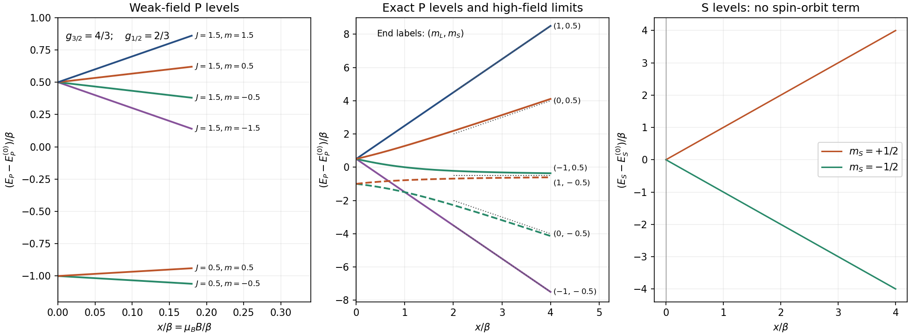

<h1 id="1/solution">Solution</h1>

↑ **Parent:** [1](../1.md)

Take the field along $z$ and write $x=\mu_BB$, with [Bohr magneton](../../../../bohr-magneton.md) $\mu_B$. The printed [Hamiltonian](../../../../hamiltonian-quantum-mechanics.md) uses dimensionless angular-momentum operators, with [eigenvalues](../../../../eigenvalue.md) $L(L+1)$ and $m_L$; physical angular [momenta](../../../../momentum-split.md) carry an additional $\hbar$. Thus $\beta$ and $x$ are [energies](../../../../energy-split.md). Assume the usual positive [spin-orbit interaction](../../../../spin-orbit-interaction.md) coefficient $\beta>0$. Reversing its sign reverses the zero-field ordering but not the state count.

An [electron](../../../../electron.md) has $S=1/2$. [addition of angular momentum](../../../../addition-of-angular-momentum.md) gives

$$
\boxed{J=L+\frac12,\quad L-\frac12\qquad(L>0).}
$$

The [coupled angular-momentum state count](../../../../coupled-angular-momentum-state-count.md) can be checked directly. The product [basis](../../../../basis.md) contains $(2L+1)\times2=4L+2$ states. The coupled [basis](../../../../basis.md) contains

$$
[2(L+\tfrac12)+1]+[2(L-\tfrac12)+1]=(2L+2)+2L=\boxed{4L+2}.
$$

Coupling therefore reorganizes the states rather than creating or losing them. There is no hyperfine multiplicity because $I=0$.

Use $\mathbf J=\mathbf L+\mathbf S$ to obtain

$$
\mathbf L\cdot\mathbf S
=\frac12(\mathbf J^2-\mathbf L^2-\mathbf S^2),\qquad
E_{\rm SO}(J)=\frac{\beta}{2}[J(J+1)-L(L+1)-3/4].
$$

The two [spin-orbit interaction](../../../../spin-orbit-interaction.md) [energies](../../../../energy-split.md) are $\beta L/2$ and $-\beta(L+1)/2$. In a weak field, project the [Zeeman effect](../../../../zeeman-splitting.md) onto a fixed $J$ multiplet:

$$
P_JH_ZP_J=xg_JJ_z,\qquad
\Delta E_Z=xg_Jm_J,
$$

$$
g_{L+1/2}=1+\frac1{2L+1},\qquad
g_{L-1/2}=1-\frac1{2L+1}.
$$

This is the first-order [energy](../../../../energy-split.md) formula, not a statement that $H_Z$ has no [matrix elements](../../../../matrix-element.md) between different $J$ values. For a common $m=m_J$ and a conventional choice of relative phase, its complete coupled-basis block is

$$
H_Z=x\begin{pmatrix}
g_{L+1/2}m&-\dfrac{\sqrt{(L+1/2)^2-m^2}}{2L+1}\\
-\dfrac{\sqrt{(L+1/2)^2-m^2}}{2L+1}&g_{L-1/2}m
\end{pmatrix}.
$$

The [inter-multiplet Zeeman coupling](../../../../inter-multiplet-zeeman-coupling.md) terms give second-order weak-field corrections because the two [spin-orbit interaction](../../../../spin-orbit-interaction.md) multiplets are already separated.

In the strong-field [basis](../../../../basis.md) the Zeeman part is diagonal, $E_Z=x(m_L+2m_S)$. Write

$$
H_{\rm SO}=\beta\left[L_zS_z+\frac12(L_+S_-+L_-S_+)\right].
$$

Its diagonal [matrix elements](../../../../matrix-element.md) are $\beta m_Lm_S$. Its off-diagonal [matrix elements](../../../../matrix-element.md) connect $(m_L,+1/2)$ to $(m_L+1,-1/2)$ with coefficient

$$
\frac{\beta}{2}\sqrt{L(L+1)-m_L(m_L+1)},
$$

and the reverse [spin](../../../../spin.md) change has $m_L+1$ replaced by $m_L-1$ in the corresponding ladder coefficient. These terms preserve $m_J$ but mix the two product states. To first order in $\beta/x$, the [energy](../../../../energy-split.md) correction is simply $\beta m_Lm_S$.

For the P state, $L=1$. Measured relative to its gross-structure centroid, the six low-field levels are

$$
\boxed{\begin{aligned}
E_{3/2,m}&=\frac{\beta}{2}+\frac43xm,\qquad m=\pm\frac32,\ \pm\frac12,\\
E_{1/2,m}&=-\beta+\frac23xm,\qquad m=\pm\frac12.
\end{aligned}}
$$

Thus the upper quartet starts at $\beta/2$ with slopes $+2,+2/3,-2/3,-2$ in a plot against $x$; the lower doublet starts at $-\beta$ with slopes $\pm1/3$. Their zero-field separation is $3\beta/2$.

At high field all six product-state [energies](../../../../energy-split.md), retaining the term linear in $\beta$, are

$$
\begin{array}{c|c|c}
m_L&m_S&E_P-E_P^{(0)}\\ \hline
-1&-1/2&-2x+\beta/2\\
-1&+1/2&-\beta/2\\
0&-1/2&-x\\
0&+1/2&+x\\
+1&-1/2&-\beta/2\\
+1&+1/2&+2x+\beta/2
\end{array}
$$

The two zero-slope levels have different $m_J$ and no mutual [matrix element](../../../../matrix-element.md), so their first-order degeneracy does not require an additional degenerate perturbation. At finite field they split at order $\beta^2/x$.

An exact interpolation makes the requested whole-field sketch unambiguous. The stretched levels are

$$
E_{\pm3/2}=\frac{\beta}{2}\pm2x.
$$

For $m=\pm1/2$, use product states $|m-1/2,+1/2\rangle$ and $|m+1/2,-1/2\rangle$. Their [Hamiltonian](../../../../hamiltonian-quantum-mechanics.md) block is

$$
H_m=\left(mx-\frac{\beta}{4}\right)\mathbf1+
\frac{x+\beta m}{2}\sigma_z+\frac{\beta}{\sqrt2}\sigma_x,
$$

so

$$
\boxed{E_m^\pm=mx-\frac{\beta}{4}\pm\frac12
\sqrt{x^2+2\beta mx+\frac94\beta^2}.}
$$

These [energies](../../../../energy-split.md) reduce to the quartet and doublet at zero field and to the six strong-field expressions above. Within a fixed $m_J$, the nonzero off-diagonal element prevents a crossing of the two branches. Levels in different $m_J$ sectors can cross without hybridizing. For the S state, $L=0$ and the [spin-orbit interaction](../../../../spin-orbit-interaction.md) term vanishes, leaving

$$
\boxed{E_{S,\pm1/2}=E_S^{(0)}\pm x}
$$

throughout this [Hamiltonian](../../../../hamiltonian-quantum-mechanics.md)'s range of validity.

**[Figure 1](#1/image-weak-field-multiplets-evolve-into-the-paschen-back-product-state-pattern). Weak-field multiplets evolve into the Paschen-Back product-state pattern**. Original exact diagonalization in units of $\beta$. P and S [energies](../../../../energy-split.md) use separate gross-structure references because their separation is not specified. Dashed high-field lines retain the correction linear in $\beta$; labels identify the asymptotic product states.

For [electric dipole transitions](../../../../electric-dipole-transition.md) at low field, $\Delta J=0,\pm1$ and $\Delta m_J=0,\pm1$ apply, with the usual exclusion of $J=0\to0$. Each P state has opposite [parity](../../../../parity.md) to the S state. The $P_{1/2}\to S_{1/2}$ transition has four allowed sublevel pairs. For $P_{3/2}\to S_{1/2}$, the two stretched upper states each have one destination and the other two each have two, giving six. Hence there are **10 allowed state-to-state channels at weak nonzero field**. Relative to the two zero-field transition [energies](../../../../energy-split.md), their Zeeman shifts are

$$
P_{1/2}:\quad x\left\{-\frac43,-\frac23,\frac23,\frac43\right\},\qquad
P_{3/2}:\quad x\left\{-\frac53,-1,-\frac13,\frac13,1,\frac53\right\}.
$$

In the decoupled high-field limit, an electric dipole acts on orbital coordinates, so $\Delta m_S=0$. Each of the six P product states connects to the S state with the same [spin](../../../../spin.md) and $m_L'=0$. Thus there are **6 allowed channels in the limiting product-state description**. Their [photon](../../../../photon.md) [energies](../../../../energy-split.md) are

$$
\hbar\omega=\Delta_0+xm_L+\beta m_Lm_S,\qquad
\Delta_0=E_P^{(0)}-E_S^{(0)}.
$$

This [Paschen-Back transition-channel count](../../../../paschen-back-transition-channel-count.md) is not the count of distinct frequencies: to first order in $\beta$ the two $m_L=0$ channels coincide, giving **5 distinct frequencies**, with shifts $0,\ \pm(x+\beta/2),\ \pm(x-\beta/2)$. If the residual [spin-orbit interaction](../../../../spin-orbit-interaction.md) splitting is unresolved there are the three usual orbital Zeeman groups.

The apparent loss of four channels is a change in [eigenstate](../../../../eigenstate.md) mixing, not a change in Hilbert-space [dimension](../../../../dimension-vector-space.md). At finite large field, four [weak spin-forbidden Paschen-Back lines](../../../../weak-spin-forbidden-paschen-back-line.md) arise from small opposite-spin admixtures, with intensities vanishing as $(\beta/x)^2$. A generic finite-field calculation therefore retains ten nonzero channels; six carry finite strength in the complete-decoupling limit. Observation direction and polarization select which of these channels a detector actually receives.

## ↑ Ancestors (13)

1. [1](../1.md)
2. [Paper 1](../../paper-1-split.md)
3. [2016](../../split.md)
4. [Past exam of the atomic and Optical Physics course of the University of Cambridge](../../../split.md)
5. [Atomic and Optical Physics course of the University of Cambridge](../../../../atomic-and-optical-physics-course-of-the-university-of-cambridge.md)
6. [Physics course of the year 4 of the natural sciences course of the University of Cambridge](../../../../physics-course-of-the-year-4-of-the-natural-sciences-course-of-the-university-of-cambridge.md)
7. [Year 4 of the natural sciences course of the University of Cambridge](../../../../year-4-of-the-natural-sciences-course-of-the-university-of-cambridge.md)
8. [Year of the natural sciences course of the University of Cambridge](../../../../year-of-the-natural-sciences-course-of-the-university-of-cambridge.md)
9. [Natural sciences course of the University of Cambridge](../../../../natural-sciences-course-of-the-university-of-cambridge.md)
10. [Course of the University of Cambridge](../../../../course-of-the-university-of-cambridge.md)
11. [University of Cambridge](../../../../university-of-cambridge-split.md)
12. [List of universities](../../../../list-of-universities.md)
13. [Codex Wiki](../../../../split.md)
