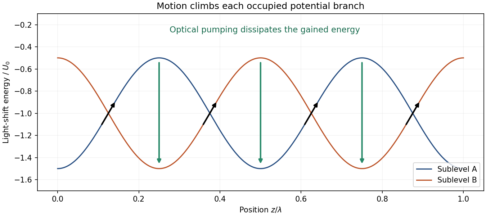

<h1 id="2/b/solution">Solution</h1>

↑ **Parent:** [B](../b.md)

For an ideal weakly driven two-level atom, opposing red-detuned beams give velocity-dependent [absorption](../../../../../absorption-electromagnetic-radiation.md) and a friction force near zero velocity. Random [photon](../../../../../photon.md) recoils also cause [momentum](../../../../../momentum-split.md) diffusion. Their balance gives the minimum Doppler [temperature](../../../../../temperature-split.md)

$$
\boxed{k_BT_D=\frac{\hbar\Gamma}{2}}
$$

at detuning $\Delta=-\Gamma/2$ in the low-saturation model, where $\Gamma$ is the spontaneous population-decay rate, equivalently the natural full linewidth expressed as an [angular frequency](../../../../../angular-frequency.md). This limit assumes the atom has no useful ground-state internal structure.

Real atoms possess [magnetic sublevels](../../../../../magnetic-sublevel.md). In a suitable multilevel transition, position-dependent polarization gives different optical couplings and different AC Stark [energy](../../../../../energy-split.md) shifts for those sublevels. Counterpropagating beams with orthogonal linear polarizations have nearly uniform total [intensity](../../../../../intensity-physics.md) but a periodically varying polarization. Thus spatially varying [light shifts](../../../../../ac-stark-shift.md) can exist even without an [intensity](../../../../../intensity-physics.md) standing wave.

In [Sisyphus cooling](../../../../../sisyphus-cooling.md), an atom on one ground-state branch climbs a light-shift hill and loses [kinetic energy](../../../../../kinetic-energy.md). Near the upper part of the hill, [optical pumping](../../../../../optical-pumping.md) tends to transfer population to a lower branch. [spontaneous emission](../../../../../spontaneous-emission.md) makes this transfer dissipative and randomizes the emitted [photon](../../../../../photon.md) direction. The atom can then climb another hill. Finite pumping time is essential: instantaneous local equilibration would remove the delayed internal-state response that produces friction. The original multilevel analysis relates these optical-pumping cycles to the spatially displaced [light shifts](../../../../../ac-stark-shift.md).[§3 A, pp. 2027–2028, Figs. 3–4](../../../../../laser-cooling-below-the-doppler-limit-by-polarization-gradients-simple-theoretical-models-by-jean-dalibard-and-claude-cohen-tannoudji.md)

**[Figure 3](#2/b/image-climbing-light-shift-hills-and-dissipative-optical-pumping). Climbing light-shift hills and dissipative optical pumping**. Original illustrative sublevel potentials. The horizontal motion converts kinetic to [potential energy](../../../../../potential-energy.md); downward transfers represent optical-pumping cycles, not coherent conservative evolution on a single potential.

For large detuning compared with the natural linewidth, useful scales are

$$
|U_{\rm ls}|\sim\frac{\hbar|\Omega|^2}{|\Delta|},\qquad
\Gamma_{\rm op}\sim\frac{\Gamma|\Omega|^2}{\Delta^2},
$$

up to angular-coupling and Rabi-frequency convention factors. Here $\Omega$ is the optical [Rabi angular frequency](../../../../../rabi-angular-frequency.md). The slow-atom capture range is of order $kv\lesssim\Gamma_{\rm op}$. Typical [energies](../../../../../energy-split.md) in the Sisyphus regime track the light-shift scale rather than only $\hbar\Gamma$, so reducing [intensity](../../../../../intensity-physics.md) can lower [temperature](../../../../../temperature-split.md) below the Doppler limit. Capture becomes narrower, however, and recoil heating, imperfect polarization, [magnetic fields](../../../../../magnetic-field-split.md) and scattered light eventually matter. Define [recoil energy](../../../../../recoil-energy.md) $E_r=(\hbar k)^2/(2m)$; this is an important scale, not a claim that every sub-Doppler method has the same universal final [temperature](../../../../../temperature-split.md).[§2, Sub-Doppler cooling; §2.1, Sisyphus effect](../../../../../manipulating-atoms-with-photons-by-claude-cohen-tannoudji.md)

The experimental test must establish a narrow velocity distribution independently of fluorescence brightness. [William D. Phillips](../../../../../william-d-phillips.md)'s account describes moving a time-of-flight probe above and below the cloud, deliberately heating the atoms to check a previously absent signal, and release-and-recapture comparisons that included [gravity](../../../../../gravity.md) and finite beam geometry. These tests separated very cold atoms from an insensitive detector or a faulty thermometer.[pp. 731–732, Figs. 15–16; pp. 733–734, multilevel interpretation](../../../../../nobel-lecture-laser-cooling-and-trapping-of-neutral-atoms-by-william-d-phillips.md) In a modern implementation, field cancellation and polarization checks test the mechanism, while independent expansion thermometry checks the inferred [temperature](../../../../../temperature-split.md). **[sub-Doppler cooling](../../../../../sub-doppler-cooling.md) exploits internal-state dynamics omitted from the two-level Doppler model; it does not contradict that model within its assumptions.**

## ↑ Ancestors (14)

1. [B](../b.md)
2. [2](../../2.md)
3. [Paper 1](../../../paper-1-split.md)
4. [2016](../../../split.md)
5. [Past exam of the atomic and Optical Physics course of the University of Cambridge](../../../../split.md)
6. [Atomic and Optical Physics course of the University of Cambridge](../../../../../atomic-and-optical-physics-course-of-the-university-of-cambridge.md)
7. [Physics course of the year 4 of the natural sciences course of the University of Cambridge](../../../../../physics-course-of-the-year-4-of-the-natural-sciences-course-of-the-university-of-cambridge.md)
8. [Year 4 of the natural sciences course of the University of Cambridge](../../../../../year-4-of-the-natural-sciences-course-of-the-university-of-cambridge.md)
9. [Year of the natural sciences course of the University of Cambridge](../../../../../year-of-the-natural-sciences-course-of-the-university-of-cambridge.md)
10. [Natural sciences course of the University of Cambridge](../../../../../natural-sciences-course-of-the-university-of-cambridge.md)
11. [Course of the University of Cambridge](../../../../../course-of-the-university-of-cambridge.md)
12. [University of Cambridge](../../../../../university-of-cambridge-split.md)
13. [List of universities](../../../../../list-of-universities.md)
14. [Codex Wiki](../../../../../split.md)
