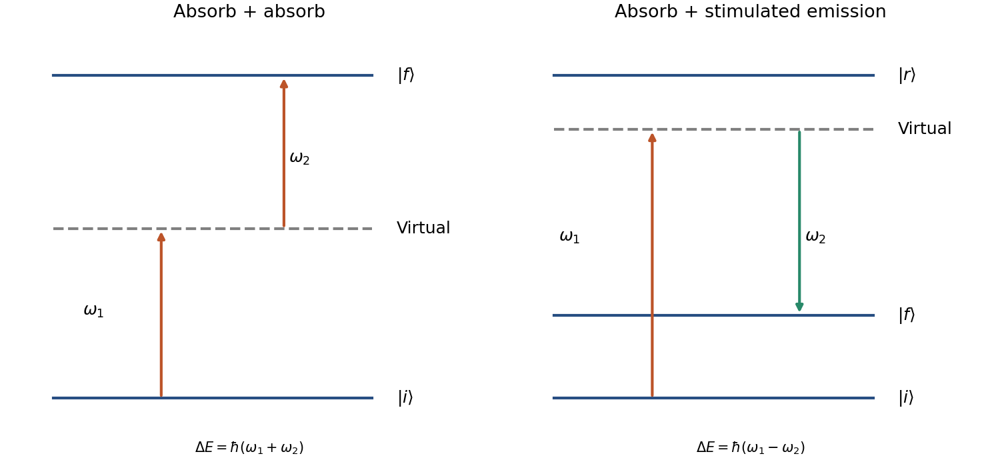

<h1 id="2/c/solution">Solution</h1>

↑ **Parent:** [C](../c.md)

A [two-photon transition](../../../../../two-photon-transition.md) transfers population through two interactions with the electric-dipole operator. For [absorption](../../../../../absorption-electromagnetic-radiation.md) of two [photons](../../../../../photon.md),

$$
E_f-E_i=\hbar(\omega_1+\omega_2).
$$

The intermediate atomic states enter a second-order amplitude rather than necessarily being populated. Suppressing field-normalization factors, its structure is

$$
\mathcal M_{fi}\propto\sum_r\left[
\frac{(\mathbf d_{fr}\cdot\boldsymbol\epsilon_2)(\mathbf d_{ri}\cdot\boldsymbol\epsilon_1)}
{E_i+\hbar\omega_1-E_r}
+
\frac{(\mathbf d_{fr}\cdot\boldsymbol\epsilon_1)(\mathbf d_{ri}\cdot\boldsymbol\epsilon_2)}
{E_i+\hbar\omega_2-E_r}
\right].
$$

Both time orderings contribute coherently. Close to a real intermediate resonance, linewidths and intermediate-state population must be treated explicitly; an off-resonant virtual-state approximation then ceases to be adequate. Well away from saturation the [absorption](../../../../../absorption-electromagnetic-radiation.md) rate scales as $I_1I_2$, or as $I^2$ for a single applied [frequency](../../../../../frequency.md).

Each [electric-dipole interaction](../../../../../electric-dipole-interaction.md) reverses [parity](../../../../../parity.md), so two such interactions connect states of the same [parity](../../../../../parity.md). The product operator contains angular tensor ranks $0,1,2$, subject to triangle and polarization [selection rules](../../../../../selection-rule.md). Under the [degenerate two-photon selection rule](../../../../../degenerate-two-photon-selection-rule.md), identical equal-frequency [photons](../../../../../photon.md) have no antisymmetric rank-one contribution cancels; ranks zero and two remain. This permits a $J=0\to0$ transition and excludes $J=0\to1$ in that degenerate E1-E1 case. It does not universally forbid every $\Delta J=1$ transition, because a rank-two tensor can also connect some such pairs. For a single orbital [electron](../../../../../electron.md), the corresponding orbital changes are $\Delta L=0,\pm2$, with [spin](../../../../../spin.md) unchanged in the nonrelativistic electric-dipole approximation.

In [Doppler-free two-photon absorption](../../../../../doppler-free-two-photon-absorption.md), counterpropagating equal-frequency [photons](../../../../../photon.md) give first-order Doppler cancellation when one [photon](../../../../../photon.md) is absorbed from each beam:

$$
\Delta_{\rm Doppler}=(\mathbf k_1+\mathbf k_2)\cdot\mathbf v\simeq0,\qquad
\Delta\mathbf p=\hbar(\mathbf k_1+\mathbf k_2)\simeq0.
$$

The [laser](../../../../../laser-split.md) [frequency](../../../../../frequency.md) is half the transition [frequency](../../../../../frequency.md). Same-beam two-photon events can still produce a broader Doppler-shifted background; residual beam-angle errors, unequal frequencies, [AC Stark shifts](../../../../../ac-stark-shift.md) and finite transit time limit precision. Thus a narrow two-photon resonance requires control of beam geometry and [intensity](../../../../../intensity-physics.md), not just high [laser](../../../../../laser-split.md) power.

A [stimulated Raman transition](../../../../../stimulated-raman-transition.md) is the absorption-emission version: the atom absorbs from one beam and emits into the other, transferring between two long-lived states through an off-resonant upper state. It instead obeys

$$
E_f-E_i=\hbar(\omega_1-\omega_2),\qquad
\Delta\mathbf p=\hbar(\mathbf k_1-\mathbf k_2).
$$

Counterpropagation now enhances [momentum](../../../../../momentum-split.md) transfer rather than cancelling it. With single-photon [Hamiltonian](../../../../../hamiltonian-quantum-mechanics.md) [matrix elements](../../../../../matrix-element.md) $\hbar\Omega_i/2$ and a common large angular detuning $\Delta$, eliminating the [excited state](../../../../../excited-state.md) gives

$$
|\Omega_{\rm eff}|=\frac{|\Omega_1\Omega_2|}{2|\Delta|},\qquad
\Gamma_{\rm sc}\sim\frac{\Gamma(|\Omega_1|^2+|\Omega_2|^2)}{4\Delta^2}.
$$

The two-photon detuning must include differential AC Stark and recoil shifts. Large detuning suppresses spontaneous scattering but also reduces coherent coupling at fixed optical power.

**[Figure 4](#2/c/image-two-photon-absorption-and-stimulated-raman-transfer-have-different-energy-and-momentum-sums). two-photon absorption and stimulated Raman transfer have different energy and momentum sums**. Original level and photon-path schematics. A virtual intermediate line is not an additional stationary [eigenstate](../../../../../eigenstate.md); intermediate detunings are schematic, with no assumed atomic species or numerical level spacing.

The coherent Raman route is useful for atomic beam splitters and mirrors. [Mark Kasevich](../../../../../mark-kasevich.md) and [Steven Chu](../../../../../steven-chu.md) demonstrated a laser-cooled sodium matter-wave interferometer using [stimulated Raman transitions](../../../../../stimulated-raman-transition.md); its controlled internal-state changes accompanied separated external wave packets.[Physical Review Letters 67, pp. 181–184 (1991), abstract and interferometer principle](../../../../../atomic-interferometry-using-stimulated-raman-transitions-by-mark-kasevich-and-steven-chu.md) Testing this interpretation requires scanning the two-photon detuning, controlling relative [laser](../../../../../laser-split.md) phase and checking output populations against pulse timing. **A two-photon process is defined by its coherent two-interaction pathway; absorption-absorption and absorption-emission have different resonance and recoil conditions.**

## ↑ Ancestors (14)

1. [C](../c.md)
2. [2](../../2.md)
3. [Paper 1](../../../paper-1-split.md)
4. [2016](../../../split.md)
5. [Past exam of the atomic and Optical Physics course of the University of Cambridge](../../../../split.md)
6. [Atomic and Optical Physics course of the University of Cambridge](../../../../../atomic-and-optical-physics-course-of-the-university-of-cambridge.md)
7. [Physics course of the year 4 of the natural sciences course of the University of Cambridge](../../../../../physics-course-of-the-year-4-of-the-natural-sciences-course-of-the-university-of-cambridge.md)
8. [Year 4 of the natural sciences course of the University of Cambridge](../../../../../year-4-of-the-natural-sciences-course-of-the-university-of-cambridge.md)
9. [Year of the natural sciences course of the University of Cambridge](../../../../../year-of-the-natural-sciences-course-of-the-university-of-cambridge.md)
10. [Natural sciences course of the University of Cambridge](../../../../../natural-sciences-course-of-the-university-of-cambridge.md)
11. [Course of the University of Cambridge](../../../../../course-of-the-university-of-cambridge.md)
12. [University of Cambridge](../../../../../university-of-cambridge-split.md)
13. [List of universities](../../../../../list-of-universities.md)
14. [Codex Wiki](../../../../../split.md)
