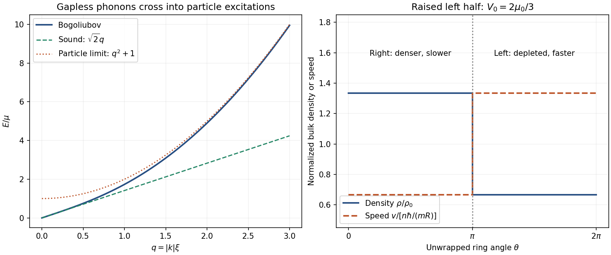

<h1 id="3/solution">Solution</h1>

↑ **Parent:** [3](../3.md)

Write $\epsilon_k=\hbar^2k^2/(2m)$, $E_k=\hbar\omega$, and take $\mu>0$. The [Bogoliubov spectrum](../../../../bogoliubov-quasiparticle-dispersion.md) is gapless and positive for $k\ne0$. Its small- and large-momentum limits are

$$
\boxed{E_k\simeq\hbar c|k|,\qquad c=\sqrt{\mu/m}\quad(\epsilon_k\ll\mu),}
$$

$$
E_k=\epsilon_k+\mu+O(\mu^2/\epsilon_k)\qquad(\epsilon_k\gg\mu).
$$

The low-energy excitations are collective sound modes; high-energy excitations approach particles with a mean-field [energy](../../../../energy-split.md) offset. With [healing length](../../../../healing-length.md) $\xi=\hbar/\sqrt{2m\mu}$ and $q=|k|\xi$,

$$
\frac{E_k}{\mu}=\sqrt{q^2(q^2+2)}.
$$

The crossover occurs at $q$ of order one, not at an additional [energy](../../../../energy-split.md) gap.

The [critical velocity of a homogeneous condensate](../../../../critical-velocity-of-a-homogeneous-condensate.md) follows because the [Landau criterion](../../../../landau-criterion.md) compares an excitation [energy](../../../../energy-split.md) with the [energy](../../../../energy-split.md) that flow can release by transferring its [momentum](../../../../momentum-split.md). Creating a mode is energetically possible when $E_k-\hbar\mathbf k\cdot\mathbf v\leq0$. For this isotropic spectrum,

$$
v_c=\inf_{k>0}\frac{E_k}{\hbar k}
=\inf_{k>0}\sqrt{\frac{\mu}{m}+\frac{\hbar^2k^2}{4m^2}}
=\boxed{\sqrt{\frac{\mu}{m}}}.
$$

The infimum is the long-wavelength [speed of sound](../../../../speed-of-sound.md). This tests energetic stability against the stated excitations; it is not a calculation of a dissipation rate or a universal vortex-nucleation threshold.

For an external potential varying slowly on the healing scale, the [Thomas–Fermi approximation for a condensate](../../../../thomas-fermi-approximation-for-a-condensate.md) neglects density-gradient [kinetic energy](../../../../kinetic-energy.md) in the stationary [Gross–Pitaevskii equation](../../../../gross-pitaevskii-equation.md). In occupied regions it gives

$$
g\rho(\mathbf r)\simeq\mu-V(\mathbf r),\qquad
c(\mathbf r)^2=\frac{g\rho(\mathbf r)}m,\qquad
\boxed{v_c(\mathbf r)\simeq\sqrt{\frac{\mu-V(\mathbf r)}m}.}
$$

Here $\rho$ is the appropriate local [number density](../../../../number-density.md); in the ring it is a linear density and $g$ is the one-dimensional coupling. This is the [local-density sound speed of a condensate](../../../../local-density-sound-speed-of-a-condensate.md). The formula applies where $\mu>V$, not in an empty region where its square root would be imaginary.

Normalize the condensate order parameter to the atom number:

$$
N=\int_0^{2\pi}|\psi(\theta)|^2R\,d\theta,\qquad
\boxed{\psi_0=\sqrt{\frac{N}{2\pi R}}}
$$

up to an arbitrary constant phase. A [wavefunction](../../../../wave-function-split.md) normalized to one instead has amplitude $1/\sqrt{2\pi R}$, with $N|\psi|^2$ then providing density. Acting with $L_z=-i\hbar\partial_\theta$ gives **[angular momentum](../../../../angular-momentum.md) $n\hbar$ per atom and $Nn\hbar$ in total** for the uniform ring. The [superfluid velocity](../../../../superfluid-velocity.md) is

$$
v=\frac{\hbar}{mR}\partial_\theta\arg\psi=\frac{n\hbar}{mR}.
$$

The interaction [chemical potential](../../../../chemical-potential-split.md) is $\mu_0=gN/(2\pi R)$; a flowing uniform state also has the constant kinetic contribution $\hbar^2n^2/(2mR^2)$ to its total [chemical potential](../../../../chemical-potential-split.md). Its [speed of sound](../../../../speed-of-sound.md) is set by the interaction term. Applying $|v|<\sqrt{\mu_0/m}$ gives

$$
\boxed{n^2<\frac{mR^2\mu_0}{\hbar^2}.}
$$

For a [uniform ring condensate](../../../../uniform-ring-condensate.md), this is the continuum [phonon](../../../../phonon.md) criterion used here. Quantization of the available excitation [wavelengths](../../../../wavelength.md) in a very small ring can modify a finite-size threshold.

For the nonrotating equilibrium with a raised left half, let $\rho_L$ and $\rho_R$ be the bulk linear densities. Within the same [Thomas–Fermi approximation for a condensate](../../../../thomas-fermi-approximation-for-a-condensate.md),

$$
g\rho_L=\mu-V_0,\qquad g\rho_R=\mu,\qquad
N=\pi R(\rho_L+\rho_R).
$$

When both halves are occupied, normalization fixes

$$
\boxed{\mu=\mu_0+\frac{V_0}{2},\quad
N_L=\frac N2\left(1-\frac{V_0}{2\mu_0}\right),\quad
N_R=\frac N2\left(1+\frac{V_0}{2\mu_0}\right),}
$$

and therefore

$$
\boxed{\frac{N_L}{N_R}=\frac{2\mu_0-V_0}{2\mu_0+V_0}.}
$$

These expressions require $V_0<2\mu_0$. Beyond that threshold, extending them would give a negative left density and is unphysical. Instead the left bulk empties, all $N$ atoms occupy a segment of length $\pi R$, and

$$
\boxed{N_L=0,\quad N_R=N,\quad \mu=\frac{Ng}{\pi R}=2\mu_0
\qquad(V_0>2\mu_0).}
$$

At equality the left bulk just reaches zero density. [kinetic energy](../../../../kinetic-energy.md) rounds the interface and produces tails beyond the [Thomas–Fermi approximation for a condensate](../../../../thomas-fermi-approximation-for-a-condensate.md), so an exactly empty half is the idealized bulk result.

A nonconstant $V(\theta)$ breaks [rotational symmetry](../../../../rotational-symmetry.md):

$$
[H,L_z]=i\hbar\,\partial_\theta V\ne0.
$$

Consequently [angular momentum](../../../../angular-momentum.md) is no longer a good [quantum number](../../../../quantum-number.md), and an eigenfunction need not be $e^{in\theta}$ times a constant amplitude. Nevertheless, while the order parameter is nonzero around the whole ring, single-valuedness requires

$$
\boxed{\oint d\phi=2\pi n,\qquad
\oint v\,ds=\frac{2\pi n\hbar}{m}.}
$$

The integer is a [phase winding of a condensate](../../../../phase-winding-of-a-condensate.md), not an assertion that the inhomogeneous state remains an angular-momentum [eigenstate](../../../../eigenstate.md). A [superfluid phase slip](../../../../superfluid-phase-slip.md) can change it if the amplitude vanishes locally.

Conservation of particles gives $\partial_t\rho+\partial_s(\rho v)=0$. For steady density the one-dimensional particle current $j=\rho v$ is constant. Since the two halves have equal lengths,

$$
\rho_Lv_L=\rho_Rv_R,\qquad
\boxed{\frac{v_L}{v_R}=\frac{\rho_R}{\rho_L}=\frac{N_R}{N_L}.}
$$

The [current bottleneck in an inhomogeneous condensate](../../../../current-bottleneck-in-an-inhomogeneous-condensate.md) occurs because a lower-density region has faster flow at the same current; it also has a smaller [speed of sound](../../../../speed-of-sound.md). This makes the raised half the limiting region.

For $V_0=2\mu_0/3$ the equilibrium approximation gives

$$
\mu=\frac43\mu_0,\quad g\rho_L=\frac23\mu_0,\quad
g\rho_R=\frac43\mu_0,\quad v_L=2v_R.
$$

The winding condition and equal lengths require

$$
\pi R(v_L+v_R)=\frac{2\pi n\hbar}{m},\qquad
v_R=\frac{2n\hbar}{3mR},\quad v_L=\frac{4n\hbar}{3mR}.
$$

Thus the left-hand sound-speed test is

$$
\frac{16n^2\hbar^2}{9m^2R^2}<\frac{2\mu_0}{3m}
\quad\Longleftrightarrow\quad
\boxed{n^2<\frac38\frac{mR^2\mu_0}{\hbar^2}.}
$$

The right-hand condition is only $n^2<3mR^2\mu_0/\hbar^2$, so it is less restrictive.

**[Figure 5](#3/image-phonon-stability-and-the-density-bottleneck-in-a-split-ring). phonon stability and the density bottleneck in a split ring**. Original dimensionless dispersion and piecewise bulk density/velocity profiles for the specified $V_0=2\mu_0/3$. The ring is unwrapped into its angular coordinate; no source diagram is reproduced. Narrow transition regions are omitted in the bulk approximation.

This [local sound-speed estimate for ring-flow stability](../../../../local-sound-speed-estimate-for-ring-flow-stability.md) uses the [step-potential equilibrium in a ring condensate](../../../../step-potential-equilibrium-in-a-ring-condensate.md) densities together with the local sound-speed test, as suggested by the preceding approximations. A quantitatively self-consistent finite-current solution also includes $mv^2/2$ and the [quantum pressure of a condensate](../../../../quantum-pressure-of-a-condensate.md) in the stationary [Gross–Pitaevskii equation](../../../../gross-pitaevskii-equation.md), allowing flow to change the density. Smooth steps suppress reflection but do not alone remove those terms. **The $3/8$ result is the stated local-density estimate; it should not be promoted to an exact stability theorem for every finite interacting ring.**

## ↑ Ancestors (13)

1. [3](../3.md)
2. [Paper 1](../../paper-1-split.md)
3. [2016](../../split.md)
4. [Past exam of the atomic and Optical Physics course of the University of Cambridge](../../../split.md)
5. [Atomic and Optical Physics course of the University of Cambridge](../../../../atomic-and-optical-physics-course-of-the-university-of-cambridge.md)
6. [Physics course of the year 4 of the natural sciences course of the University of Cambridge](../../../../physics-course-of-the-year-4-of-the-natural-sciences-course-of-the-university-of-cambridge.md)
7. [Year 4 of the natural sciences course of the University of Cambridge](../../../../year-4-of-the-natural-sciences-course-of-the-university-of-cambridge.md)
8. [Year of the natural sciences course of the University of Cambridge](../../../../year-of-the-natural-sciences-course-of-the-university-of-cambridge.md)
9. [Natural sciences course of the University of Cambridge](../../../../natural-sciences-course-of-the-university-of-cambridge.md)
10. [Course of the University of Cambridge](../../../../course-of-the-university-of-cambridge.md)
11. [University of Cambridge](../../../../university-of-cambridge-split.md)
12. [List of universities](../../../../list-of-universities.md)
13. [Codex Wiki](../../../../split.md)
