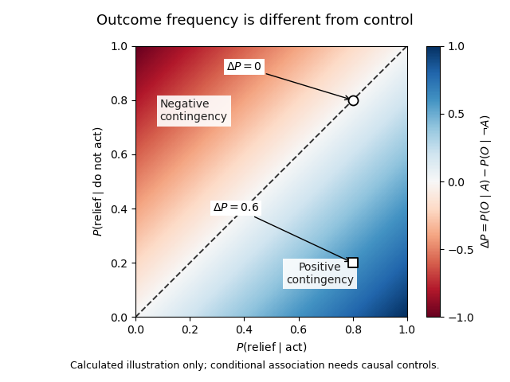
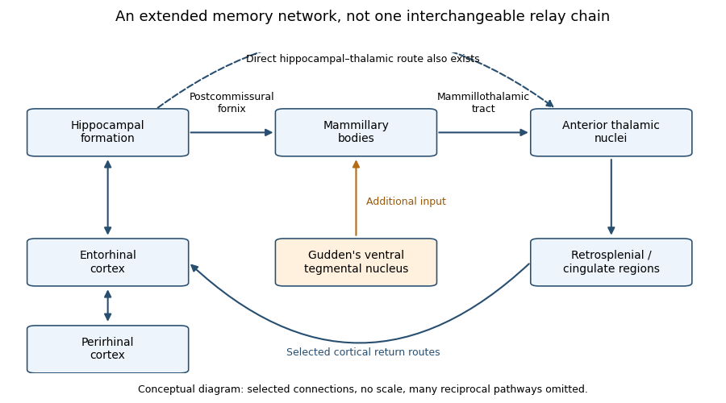

# 2022

↑ **Parent:** [Past exam of the behavioural neuroscience course of the year 2 of the psychology (experimental) course of the University of Oxford](../past-exam-of-the-behavioural-neuroscience-course-of-the-year-2-of-the-psychology-experimental-course-of-the-university-of-oxford.md)

Worked answers to all five options in the behavioural neuroscience paper of 19 April 2022. Source release: [released examination PDF](https://www.whatdotheyknow.com/request/experimental_psychology_past_exa/response/2757831/attach/3/New%20Compressed%20zipped%20Folder.zip?cookie_passthrough=1). Each answer addresses one complete source question, within the printed 1,500-word limit; the questions are not reproduced.

The scientific argument is framed using work published by the examination date. Later retrieval dates, repository deposits or portrait photographs are not later scientific evidence smuggled into the 2022 answers. Experimental models are distinguished from clinical diagnoses and treatment recommendations.

**Table of contents**

- [1](#1)
  - [Solution](#1/solution)
- [2](#2)
  - [Solution](#2/solution)
- [3](#3)
  - [Solution](#3/solution)
- [4](#4)
  - [Solution](#4/solution)
- [5](#5)
  - [Solution](#5/solution)

## 1

↑ **Parent:** [2022](2022.md)

<h3 id="1/solution">Solution</h3>

↑ **Parent:** [1](#1)

**Sleep can protect newly acquired information, actively reorganize it, and restore the capacity for subsequent learning.** These are distinct claims. [Memory consolidation](../neuroscience.md#memory-consolidation) concerns changes after acquisition; better learning the next morning concerns encoding capacity; less interference during an unoccupied interval need not imply an active sleep mechanism. The strongest explanation therefore combines behavioural comparisons with recordings and selective interventions.

A basic retention experiment compares later performance after sleep and waking, ideally relative to an immediate baseline. Yet a night-versus-day comparison also changes [circadian phase](../physiology.md#circadian-phase), interference and alertness at testing. Sleep deprivation adds [physiological stress](../physiology.md#physiological-stress) and attentional impairment. Matching acquisition, testing at comparable times, measuring vigilance, and comparing sleep with quiet waking make the inference sharper. A retention advantage after sleep remains compatible with both passive protection and active processing; distinguishing them requires manipulating what happens during the interval.

The [active systems consolidation hypothesis](../neuroscience.md#active-systems-consolidation-hypothesis) provides an active mechanism. Rapid relational encoding by the [hippocampus](../neuroscience.md#hippocampus) permits later [memory reactivation](../neuroscience.md#memory-reactivation) to modify distributed [cerebral cortex](../neuroscience.md#cerebral-cortex) representations. During [NREM sleep](../animal-behaviour.md#non-rapid-eye-movement-sleep), cortical [sleep slow oscillations](../animal-behaviour.md#sleep-slow-oscillation) can organize [sleep spindles](../animal-behaviour.md#sleep-spindle) and [hippocampal sharp-wave ripples](../neuroscience.md#hippocampal-sharp-wave-ripple), creating coordinated windows for [synaptic plasticity](../neuron.md#synaptic-plasticity). This is a timing hypothesis about communication, not proof that a complete memory is copied from one anatomical container to another. [Systems consolidation](../neuroscience.md#systems-consolidation) and [synaptic consolidation](../neuroscience.md#synaptic-consolidation) can proceed together, and some detailed [episodic memories](../neuroscience.md#episodic-memory) may continue to require hippocampal contributions.

An important recording experiment monitored ensembles of hippocampal [place cells](../neuroscience.md#place-cell) in rats during spatial behaviour and during sleep before and after it. Cells active together at particular locations became more likely to fire together in subsequent slow-wave sleep; the pre-experience recording supplied a valuable baseline. This demonstrates experience-related [memory reactivation](../neuroscience.md#memory-reactivation). Pairwise coactivation alone does not establish ordered [neural replay](../neuroscience.md#neural-replay), nor does a [correlation](../variance.md#pearson-correlation-coefficient) show that the events improve retention. An apparently memory-related pattern might otherwise be an incidental consequence of prior activity.[Abstract and pp. 676–679: simultaneous ensemble recordings and pre-/post-experience comparison](../psychology-bibliography.md#reactivation-of-hippocampal-ensemble-memories-during-sleep-by-matthew-a-wilson-and-others)

A stronger causal test interrupted [hippocampal sharp-wave ripples](../neuroscience.md#hippocampal-sharp-wave-ripple) during post-training sleep in rats learning a spatial task. An online electrical recording system detected ripple events and triggered brief disruption; a delayed-stimulation comparison helped control stimulation without abolishing the same events. Spatial performance was impaired, while gross sleep architecture was not detectably changed. This supports a functional role for ripple-associated activity beyond simply obtaining sleep. Nevertheless, disruption affects an event and its associated activity, not an experimentally isolated memory message; it does not identify the exact information transferred or establish that all [memory consolidation](../neuroscience.md#memory-consolidation) requires the same mechanism.[pp. 1222–1223; Figures 1–2: event-triggered disruption, delayed control and behaviour](../psychology-bibliography.md#selective-suppression-of-hippocampal-ripples-impairs-spatial-memory-by-gabrielle-girardeau-and-others)

Human [targeted memory reactivation](../neuroscience.md#targeted-memory-reactivation) offers complementary evidence. Participants learned object locations with an odour present, then received that odour again during polysomnographically identified slow-wave sleep. Retention improved compared with an odourless condition. Crucially, the benefit did not appear when the odour had been absent during learning, or when it was presented during waking or [REM sleep](../animal-behaviour.md#rapid-eye-movement-sleep); procedural finger-tapping did not show the same benefit. The cue–learning relationship and sleep state therefore mattered. The associated hippocampal activation is consistent with [memory reactivation](../neuroscience.md#memory-reactivation), although activation does not reveal all the represented content. This is stronger evidence for selective processing than an undifferentiated sleep/wake advantage.[pp. 1426–1429; experiments I–IV: object-location learning, unpaired odour and sleep-state controls](../psychology-bibliography.md#odor-cues-during-slow-wave-sleep-prompt-declarative-memory-consolidation-by-bjorn-rasch-and-others)

Sleep could also benefit memory by regulating the substrate for learning. The [synaptic homeostasis hypothesis](../animal-behaviour.md#synaptic-homeostasis-hypothesis) proposes that predominantly waking-associated strengthening requires compensatory renormalization, limiting saturation, energy costs and interference. Selective preservation can improve the contrast of important connections even if average strength of [synapses](../neuron.md#synapse) falls. Serial electron-microscopy reconstructions of mouse cortical synapses found smaller axon–spine interfaces after sleep, with an average decrease of roughly 18%; the largest synapses were relatively spared. The comparison included spontaneous and enforced waking. These are structural measurements consistent with selective scaling, not a direct measurement of every synapse's efficacy or proof that the measured changes caused a particular memory benefit.[pp. 507–510; Figures 1–3: three-dimensional reconstructions and size-dependent changes](../psychology-bibliography.md#ultrastructural-evidence-for-synaptic-scaling-across-the-wake-sleep-cycle-by-luisa-de-vivo-and-others)

Renormalization and selective strengthening are not mutually exclusive. A learning-related ensemble could be selectively stabilized while less useful background connections weaken. [Memory reactivation](../neuroscience.md#memory-reactivation) could help select what survives, and improved capacity after sleep could support the next episode rather than merely preserve the last one. An adequate theory must explain both specificity and restoration, rather than equate more firing or larger synapses with better memory everywhere.

The interpretation must remain task-specific. A cueing effect for [declarative memory](../neuroscience.md#declarative-memory) does not assign every [procedural memory](../neuroscience.md#procedural-memory) to [REM sleep](../animal-behaviour.md#rapid-eye-movement-sleep), and a null cueing result in one stage does not show that stage has no mnemonic function. Sleep-stage manipulations can alter other stages or awaken subjects. Rodent spatial performance provides mechanistic access but does not by itself establish human autobiographical experience. Replicated behavioural effects, adequate controls and selective circuit perturbations are most persuasive when they converge.

Thus sleep is important because it provides a state in which information can be selectively re-expressed and reorganized while conditions at [synapses](../neuron.md#synapse) are regulated. Evidence available by April 2022 supports active contributions in addition to passive protection; it does not establish a universal sleep-only route for every kind of learning.

## 2

↑ **Parent:** [2022](2022.md)

<h3 id="2/solution">Solution</h3>

↑ **Parent:** [2](#2)

**Monoamine signalling contributes to mood regulation and to the actions of several antidepressants, but a universal “low transmitter causes depression” account is not established.** Three propositions must be separated: a drug changes a molecular target; that change helps produce improvement; and the untreated disorder was caused by an opposite abnormality. Evidence for one proposition does not logically establish the next.

The [monoamine hypothesis of depression](../psychiatry.md#monoamine-hypothesis-of-depression) developed from pharmacology. [Monoamine oxidase](../enzyme.md#monoamine-oxidase) inhibition reduces transmitter metabolism, while some tricyclic antidepressants inhibit transmitter reuptake; [SSRI](../pharmacology.md#selective-serotonin-reuptake-inhibitor) principally inhibit [serotonin](../neuron.md#serotonin) reuptake. [Norepinephrine](../neuron.md#norepinephrine), [serotonin](../neuron.md#serotonin) and [dopamine](../neuron.md#dopamine) are distinct [monoamines](../chemical-substance.md#monoamine), acting through different receptors and pathways. The historical catecholamine proposal emphasized [norepinephrine](../neuron.md#norepinephrine) and already acknowledged the limitations of extrapolating from drug effects to disease mechanisms. Treating every low affective state as depletion of a single interchangeable brain substance is a substantially stronger claim.[1965 abstract and pp. 509–522: proposed catecholamine account and explicit limits on pharmacological extrapolation](../psychology-bibliography.md#the-catecholamine-hypothesis-of-affective-disorders-a-review-of-supporting-evidence-by-joseph-j-schildkraut)

Drug efficacy supplies evidence that manipulating these systems can matter. A 2018 [network meta-analysis](../statistical-inference.md#network-meta-analysis) synthesized 522 double-blind trials in adults with [major depressive disorder](../psychiatry.md#major-depressive-disorder) and found each included antidepressant more efficacious than placebo on its response outcome. This is evidence synthesis, not a direct assay of patients' transmitter levels. Average effects, trial selection, [publication bias](../statistical-inference.md#publication-bias), blinding and symptom-scale outcomes limit interpretation, and not every patient benefits. Even a perfectly demonstrated effect would show that an intervention can change a pathological state, not that it reverses its original cause. A downstream compensatory mechanism can be therapeutically useful without being the initiating lesion.[Methods, Findings and Discussion: acute adult trials, response outcome and limitations](../psychology-bibliography.md#comparative-efficacy-and-acceptability-of-21-antidepressant-drugs-for-the-acute-treatment-of-adults-with-major-depressive-disorder-by-andrea-cipriani-and-others)

Measuring the proposed deficiency is itself difficult. Peripheral [serotonin](../neuron.md#serotonin) is not a direct measurement of release at a particular central [synapse](../neuron.md#synapse). Metabolites combine synthesis, release, reuptake and degradation; receptor or transporter imaging is not simply a concentration gauge. A difference observed after illness onset might be causal, compensatory, treatment-related or associated with [physiological stress](../physiology.md#physiological-stress). Establishing a general deficiency would require convergent measures in appropriate untreated populations, temporal precedence and a relationship to well-defined symptoms, not merely one group-average biomarker.

Precursor depletion supplies a more informative intervention. In a double-blind crossover study, patients in antidepressant-induced remission underwent acute [tryptophan](../chemical-substance.md#tryptophan) depletion and a control condition. Fourteen of 21 experienced a transient depressive relapse after depletion, whereas control testing did not produce significant behavioural effects. This supports dependence of some maintained remissions on [serotonin](../neuron.md#serotonin) precursor availability. It does not show that all untreated depressed patients began with low [serotonin](../neuron.md#serotonin), that depletion is sufficient to generate the full syndrome in everyone, or that [norepinephrine](../neuron.md#norepinephrine) and [dopamine](../neuron.md#dopamine) are irrelevant. The selected, previously treated sample is central to the causal question actually tested.[Abstract and pp. 411–418: remitted sample, crossover control and 14/21 transient relapses](../psychology-bibliography.md#serotonin-function-and-the-mechanism-of-antidepressant-action-by-pedro-l-delgado-and-others)

Time course also challenges a simple replenishment story. Initial transporter inhibition can occur before substantial clinical improvement. That discrepancy motivates slower receptor, circuit, learning and plasticity changes; it does not imply that early drug effects are absent. In a randomized placebo-controlled experiment, an acute dose of a norepinephrine reuptake inhibitor changed positive emotional processing in depressed participants before subjective mood or anxiety changed. Facial-expression judgments and emotionally valenced categorization and recall supplied behavioural readouts. These observations support an [affective processing bias](../psychology.md#affective-processing-bias) account: altered experience processing could accumulate into mood change. They do not establish that the measured early shift mediates every later clinical response.[Abstract; Methods and Results, pp. 1178–1184: randomized emotional-processing battery before mood change](../psychology-bibliography.md#effect-of-acute-antidepressant-administration-on-negative-affective-bias-in-depressed-patients-by-catherine-j-harmer-and-others)

Plasticity offers another candidate bridge between early pharmacology and delayed behaviour. In mice, preventing antidepressant-associated [adult hippocampal neurogenesis](../neuroscience.md#adult-hippocampal-neurogenesis) blocked behavioural effects in particular experimental assays. The evidence included genetic and localized irradiation approaches. It supplies a mechanistic dependency within that model, rather than merely a [correlation](../variance.md#pearson-correlation-coefficient) between a drug and cell proliferation. However, the assays are not human [major depressive disorder](../psychiatry.md#major-depressive-disorder), the interventions can have additional effects, and necessity for one behavioural endpoint does not establish either sufficiency or a universal human mechanism.[Abstract and pp. 805–809: interference with neurogenesis and model-specific behavioural effects](../psychology-bibliography.md#requirement-of-hippocampal-neurogenesis-for-the-behavioral-effects-of-antidepressants-by-luca-santarelli-and-others)

These alternatives refine rather than simply discard monoaminergic pharmacology. [Serotonin](../neuron.md#serotonin) or [norepinephrine](../neuron.md#norepinephrine) could regulate plasticity and learning within distributed [neural circuits](../neuroscience.md#neural-circuit); baseline concentrations need not be uniformly low. Receptor sensitivity, pathway-specific activity and environmental experience could determine the effect of an intervention. Conversely, observing altered [dopamine](../neuron.md#dopamine)-related motivation would not prove that all [anhedonia](../psychiatry.md#anhedonia), cognitive slowing and sadness have one cause. [Major depressive disorder](../psychiatry.md#major-depressive-disorder) groups multiple symptom patterns, so a mechanism associated with one dimension can be diluted or misleading when treated as a universal disease explanation.

The strongest conclusion available at the examination date is therefore conditional. Particular [monoamine](../chemical-substance.md#monoamine) manipulations can alter affective processing and symptoms, and some treatment responses depend on monoaminergic function. The evidence does not identify a single brain-wide deficit that is necessary and sufficient for human depression. A useful successor account specifies transmitter, receptor, circuit, time scale and symptom, and tests how biological changes interact with learning and environment. This evaluation concerns explanatory evidence, not a recommendation to start, stop or choose a medication.

## 3

↑ **Parent:** [2022](2022.md)

<h3 id="3/solution">Solution</h3>

↑ **Parent:** [3](#3)

**Learned helplessness links uncontrollability to later failure to act; instrumental learning makes that proposal testable by separating outcome value, action–outcome control and the ability to perform an action.** It explains a plausible route to passivity and some depressive symptoms, but the animal phenomenon and human [major depressive disorder](../psychiatry.md#major-depressive-disorder) are not equivalent.

In [operant conditioning](../animal-behaviour.md#operant-conditioning), an action changes the probability or timing of an outcome. Escape can be maintained by [negative reinforcement](../animal-behaviour.md#negative-reinforcement): terminating an aversive event increases the action, rather than punishing it. A simple description of control is the [action-outcome contingency](../animal-behaviour.md#action-outcome-contingency)

$$
\Delta P=P(O\mid A)-P(O\mid\neg A),
$$

where $O$ can denote relief and $A$ an attempted action. Under genuine controllability this difference can be positive. In an uncontrollable setting it may be zero even when relief sometimes occurs. Outcome frequency and controllability are therefore different. Interventions on action, rather than observational [conditional probabilities](../probability-theory.md#conditional-probability) alone, are needed to establish a causal contingency.

The classic triadic experiment compared an escapable condition, a [yoked control](../design-of-experiments.md#yoked-control) receiving matched aversive events without control, and an unexposed control. Initially, a panel response in a harness could terminate the event only for the escapable subject. Later, all groups encountered a shuttle-box task in which crossing a barrier permitted escape. The uncontrollable group subsequently showed greater escape failure, whereas the escapable and unexposed groups learned more normally. Matching the physical events made control, rather than exposure alone, the crucial contrast. The historical experiment used harmful procedures; its conceptual importance is the matched-outcome design, not a protocol to repeat.[Experiment I, pp. 1–4: triadic design, panel control and transfer to shuttle-box escape](../psychology-bibliography.md#failure-to-escape-traumatic-shock-by-martin-seligman-and-others)

The original [learned helplessness](../animal-behaviour.md#learned-helplessness) hypothesis proposed that subjects learn that outcomes are independent of their responses. Generalizing that expectation reduces response initiation, impairs learning of a new contingency, and produces emotional disturbance. The motivational and cognitive effects can reinforce each other: fewer attempts provide less evidence that the new environment is controllable. That feedback offers an explanation for persistent inactivity even when opportunities improve. It does not require assuming that an animal represents a verbal proposition about its future.

For human depression, merely observing uncontrollability cannot explain who develops persistent symptoms or why self-esteem falls. An attributional reformulation distinguishes causes viewed as internal or external, stable or unstable, and global or specific. An internal explanation can undermine self-esteem; a stable explanation extends expectations into the future; a global one extends them across situations. Thus identical adverse outcomes can support different expectations depending on [attributional style](../psychology.md#attributional-style). These are hypotheses about generalization and vulnerability, not proof that a patient's interpretations caused every symptom or that circumstances are actually controllable.[pp. 49–74, especially the abstract and reformulation: personal/universal helplessness and attribution dimensions](../psychology-bibliography.md#learned-helplessness-in-humans-critique-and-reformulation-by-lyn-y-abramson-and-others)

Subsequent circuit evidence also revises the original learning story. In rats, manipulations of [medial prefrontal cortex](../neuroscience.md#medial-prefrontal-cortex) showed that its activity can suppress stress-associated [dorsal raphe nucleus](../neuroscience.md#dorsal-raphe-nucleus) activation when the stressor is controllable; disrupting that regulation removes the protective effect of control. This supports a model in which learning and expressing control actively regulates a stress response. It does not require passivity itself always to be learned as an association. The implicated [serotonin](../neuron.md#serotonin) circuit further illustrates that a transmitter's function depends on its location and regulation, rather than global amount. Translating these rodent pathways directly into human depressive beliefs would go beyond the evidence.[Abstract and Results, pp. 365–371: prefrontal interventions, controllability and raphe activity](../psychology-bibliography.md#medial-prefrontal-cortex-determines-how-stressor-controllability-affects-behavior-and-dorsal-raphe-nucleus-by-jose-amat-and-others)

[Operant conditioning](../animal-behaviour.md#operant-conditioning) also distinguishes reduced reward sensitivity from a reduced expectation of control. In an illustrative [reinforcement learning](../statistical-learning.md#reinforcement-learning) model,

$$
Q_{t+1}(a)=Q_t(a)+\alpha\bigl(r_t-Q_t(a)\bigr),\qquad 0<\alpha\leq1,
$$

the prediction error changes an action value. Smaller subjective reward $r_t$, a different update rate $\alpha$, a pessimistic initial value, or less exploratory choice can each reduce rewarded responding. Increased perceived effort can reduce action even when the expected reward is learned correctly. These are distinguishable candidate mechanisms, not fitted patient results. A low response rate alone cannot identify which parameter changed, and standard chosen-action value learning does not automatically represent causal contingency or attribution.

**[Figure 1](#3/image-outcome-frequency-and-action-outcome-contingency-in-an-illustrative-probability-space). Outcome frequency and action–outcome contingency in an illustrative probability space**. Calculated conditional-probability differences, not human or animal data. Equal outcome probabilities lie on the diagonal even when outcomes are frequent. The two marked points have the same probability after acting but different contingencies.

A human probabilistic reward task supplies a concrete example. Participants discriminated subtly different visual stimuli, with correct responses for one stimulus rewarded more often. Unmedicated depressed participants developed less of the usual bias toward the richer stimulus than controls, particularly in relation to [anhedonia](../psychiatry.md#anhedonia). Trial-history analyses indicated a problem integrating reinforcement over time rather than complete insensitivity to a single reward. This operationalizes one component of [reward learning](../animal-behaviour.md#reward-learning); it neither directly measures pleasure nor demonstrates that prior uncontrollability caused the deficit. Sensory discriminability, response bias and learning history must be distinguished.[Abstract; Methods 2.2–2.3 and Results: asymmetric reinforcement, signal detection and trial-history analyses](../psychology-bibliography.md#reduced-hedonic-capacity-in-major-depressive-disorder-evidence-from-a-probabilistic-reward-task-by-diego-a-pizzagalli-and-others)

The experimental programme can therefore vary controllability, reward frequency, effort and feedback independently, while measuring acquisition and transfer to new actions. It should include motor and attentional controls and distinguish failure to learn from failure to express learned knowledge. Prospective human data are needed to establish vulnerability rather than consequences of an episode; cross-sectional group differences cannot settle that direction. More opportunities to act are not automatically sufficient when fatigue, threat, external constraints or other symptoms remain.

[Learned helplessness](../animal-behaviour.md#learned-helplessness) is most useful as a specific causal model of how uncontrollable adversity can shape expectations and stress regulation. [Operant conditioning](../animal-behaviour.md#operant-conditioning) broadens it into testable accounts of passivity, motivational loss and some aspects of [anhedonia](../psychiatry.md#anhedonia). Neither a single animal task nor one computational parameter explains the entire depressive syndrome.

## 4

↑ **Parent:** [2022](2022.md)

<h3 id="4/solution">Solution</h3>

↑ **Parent:** [4](#4)

**Disruption of an extended hippocampal–diencephalic network explains important forms of amnesia, but a single indispensable serial loop is too strong an account.** The distinction is between a useful anatomical network hypothesis and a claim that every connection is equivalent or that all memory failures have the same cause.

The [Delay-Brion circuit](../neuroscience.md#delay-brion-circuit) links temporal-lobe and diencephalic [amnesia](../psychology.md#amnesia). Its conventional route runs from the [hippocampus](../neuroscience.md#hippocampus) through the [fornix](../neuroscience.md#fornix), [mammillary bodies](../physiology.md#mammillary-body) and [mammillothalamic tract](../neuroscience.md#mammillothalamic-tract) to the [anterior thalamic nuclei](../neuroscience.md#anterior-thalamic-nuclei), with cingulate and parahippocampal return routes. It overlaps the [Papez circuit](../neuroscience.md#papez-circuit), originally proposed for emotion, but the historical explanations are not identical. The important question is whether connected structures form a single serial relay or make differentiated contributions within a larger network.

**[Figure 2](#4/image-selected-routes-in-the-extended-hippocampal-memory-network). Selected routes in the extended hippocampal memory network**. An original conceptual schematic, not an anatomical atlas or a source figure. The upper chain shows the commonly emphasized mammillary route; the lower arrows show selected additional interactions and an extra-hippocampal input. Arrow presence does not assert equal necessity, and many reciprocal connections are omitted.

The network proposal solves a genuine localization problem. Severe new-learning deficits follow damage in anatomically separated sites, so a theory confined to one small storage centre is inadequate. Clinical surgical cases showed marked [anterograde amnesia](../psychology.md#anterograde-amnesia) after bilateral medial temporal resections, despite comparatively preserved intellect and some older knowledge. However, the original operations included neighbouring structures, so those observations cannot isolate the [hippocampus](../neuroscience.md#hippocampus) from surrounding tissue. A subsequent extensively assessed patient, R.B., had marked new-learning impairment and a bilateral lesion largely confined to hippocampal CA1 at postmortem examination, with minor pathology elsewhere. The case strengthens the hippocampal contribution while illustrating why detailed anatomical verification matters.[pp. 11–21: clinical cases and anatomical limitations of the resections](../psychology-bibliography.md#loss-of-recent-memory-after-bilateral-hippocampal-lesions-by-william-beecher-scoville-and-brenda-milner)[Abstract and pp. 2950–2967: longitudinal testing, CA1 pathology and minor extra-hippocampal abnormalities](../psychology-bibliography.md#human-amnesia-and-the-medial-temporal-region-enduring-memory-impairment-following-a-bilateral-lesion-limited-to-field-ca1-of-the-hippocampus-by-stuart-zola-morgan-and-others)

Diencephalic pathology supplies convergent evidence. In a comparative postmortem study of alcohol-related disease, mammillary and mediodorsal thalamic neuronal loss occurred in both amnesic and non-amnesic cases with relevant pathology. Consistent anterior thalamic neuronal loss differentiated the cases with [Korsakoff syndrome](../psychology.md#korsakoff-syndrome). Such pathological controls are more informative than observing a damaged [mammillary body](../physiology.md#mammillary-body) in one amnesic patient. The findings support an anterior thalamic contribution and caution against identifying mammillary damage alone as a sufficient explanation. They remain observational: co-occurring damage, uncertain premorbid abilities and incomplete measures of connectivity constrain causal localization.[Abstract and pp. 141–154: stereological comparisons and differentiating anterior thalamic loss](../psychology-bibliography.md#degeneration-of-anterior-thalamic-nuclei-differentiates-alcoholics-with-amnesia-by-a-harding-and-others)

The strong serial version makes a sharper prediction: interrupting hippocampal input to the [mammillary bodies](../physiology.md#mammillary-body) should disrupt the same memory functions as interrupting mammillary output. A direct rat comparison challenged that prediction. Selective interruption of descending postcommissural fornix input had much less effect on the tested spatial tasks than lesions of the [mammillothalamic tract](../neuroscience.md#mammillothalamic-tract) or [Gudden's ventral tegmental nucleus](../neuroscience.md#gudden-s-ventral-tegmental-nucleus). The latter two also produced remote activity changes. The mammillary contribution therefore cannot be explained simply as passive transmission of hippocampal output. Additional brainstem inputs are functionally important. These comparisons concern particular spatial tasks and selective pathways, not proof that an intact [fornix](../neuroscience.md#fornix) is irrelevant to all memory.[Abstract; Results and Discussion: postcommissural-fornix, mammillothalamic and tegmental comparisons](../psychology-bibliography.md#dismantling-the-papez-circuit-for-memory-in-rats-by-seralynne-d-vann)

This result favours an interacting network over a chain of interchangeable relays. There are direct hippocampal–thalamic connections, multiple return routes and inputs from outside the traditional loop. A lesion can deprive another region of useful input or coordination without destroying it. Conversely, residual pathways may preserve a task after one disconnection. Therefore structural preservation of a node does not guarantee functional preservation, and a lesion effect does not show that the lost tissue was the final storage site. Reversible perturbations, pathway-specific comparisons and remote physiological measurements can complement permanent-lesion evidence.

The outcome to be explained must also be specified. [Anterograde amnesia](../psychology.md#anterograde-amnesia) differs from [retrograde amnesia](../psychology.md#retrograde-amnesia), and impaired [episodic memory](../neuroscience.md#episodic-memory) is not equivalent to losing every skill, immediate span or familiar item. [Recognition memory](../neuroscience.md#recognition-memory) can draw on [recollection](../neuroscience.md#recollection) or [familiarity](../neuroscience.md#familiarity); a task allowing a strong familiarity judgment can be performed without recovery of contextual detail. Broader [medial temporal lobe](../neuroscience.md#medial-temporal-lobe) damage can affect both processes, while more selective damage can yield a different profile. Thus the circuit is most plausible as an explanation of particular relational and event-memory impairments, rather than all failures loosely called amnesia.

There are methodological traps on both sides. Human cases give direct clinical relevance but rarely offer randomized, anatomically pure lesions. Animal interventions improve causal control, yet spatial working-memory tasks do not demonstrate the entire human experience of remembering an event. Failure on a task can reflect sensory, motivational or strategic changes, so spared comparison tasks are necessary. Recovery and compensation can obscure an original contribution, while damage to fibres passing through a region can exaggerate the apparent role of its local cells. A convincing account predicts both impaired and spared functions, not merely a lesion location.

By the examination date, the defensible theory was therefore an extended, functionally differentiated hippocampal–diencephalic network. The [Delay-Brion circuit](../neuroscience.md#delay-brion-circuit) remains valuable because it unifies important temporal and diencephalic causes of [amnesia](../psychology.md#amnesia). Its explanatory power increases when it accommodates additional inputs, parallel routes and memory-process distinctions, rather than claims that all amnesia follows the breaking of one serial loop.

## 5

↑ **Parent:** [2022](2022.md)

<h3 id="5/solution">Solution</h3>

↑ **Parent:** [5](#5)

**The hippocampus and perirhinal cortex contribute to an interacting cognitive system with different representational emphases: relations and context for the hippocampus, and integrated object representations and familiarity for perirhinal cortex.** This distinction is supported by converging task dissociations, but neither “all memory” nor “memory versus perception” maps neatly onto one anatomical boundary.

Both belong to the [medial temporal lobe](../neuroscience.md#medial-temporal-lobe) and interact through [entorhinal cortex](../neuroscience.md#entorhinal-cortex) and other cortical routes. Both participate in experience-dependent changes and recognition performance. Their common location and involvement in [declarative memory](../neuroscience.md#declarative-memory) do not imply identical computations. Conversely, different predominant functions do not require independence: recognizing an object in its prior location requires information about the object and its relations to context.

The [hippocampus](../neuroscience.md#hippocampus) binds or represents relations among items, places and episodes. Hippocampal [place cells](../neuroscience.md#place-cell) provide one spatially selective population code, while episodic remembering requires more than a location signal. A comparison of a familiar object in an unfamiliar setting with the same object in its original setting can place demands on contextual relations even though the item's individual familiarity is unchanged. This makes relational complexity a better prediction than assuming every recognition response is equally hippocampal.

The [perirhinal cortex](../neuroscience.md#perirhinal-cortex) integrates information about objects, including combinations of features, and contributes strongly to item [familiarity](../neuroscience.md#familiarity). A familiar-versus-new distinction can therefore survive some hippocampal damage if a task does not require retrieving the accompanying episode. However, an old/new response can also be solved through [recollection](../neuroscience.md#recollection), so preserved or impaired [recognition memory](../neuroscience.md#recognition-memory) cannot be assigned to one process solely from the response label. [Familiarity](../neuroscience.md#familiarity) is not equivalent to weak confidence, nor [recollection](../neuroscience.md#recollection) simply to a strong familiarity signal; tests need assumptions capable of distinguishing those accounts.

An informative lesion comparison tested rats on a radial maze and a spontaneous [object recognition task](../neuroscience.md#object-recognition-task). Bilateral hippocampal lesions impaired spatial memory, whereas peri-postrhinal lesions impaired object recognition and spared the spatial comparison more effectively. The object task used a restricted Y-shaped apparatus to reduce spatial and contextual information: after inspecting two identical objects, the animal later encountered familiar and novel alternatives. This [double dissociation](../psychology.md#double-dissociation) argues against treating the two structures as interchangeable components of a homogeneous store. Importantly, the cortical lesions included [postrhinal cortex](../neuroscience.md#postrhinal-cortex), so the experiment cannot attribute every effect uniquely to [perirhinal cortex](../neuroscience.md#perirhinal-cortex).[pp. 5901–5908; Methods and Figures 1, 5–6: modified recognition apparatus, radial maze and lesion extent](../psychology-bibliography.md#double-dissociation-between-the-effects-of-peri-postrhinal-cortex-and-hippocampal-lesions-on-tests-of-object-recognition-and-spatial-memory-by-boyer-d-winters-and-others)

The interpretation depends on controls. A novel-object exploration preference requires adequate sampling, intact discrimination and motivation, not a verbal report of remembering. Position changes and environmental cues can make an apparently simple object task relational. Conversely, radial-maze performance can use nonspatial cues or learned response strategies unless these are controlled. A [double dissociation](../psychology.md#double-dissociation) is stronger than finding one impaired group on a difficult task, but different lesion sizes, task sensitivities and compensatory strategies still matter. Comparing a range of delays and feature overlaps is more informative than claiming an absolute boundary from one condition.

Clinical cases also constrain the comparison. Carefully characterized CA1 damage has produced marked [anterograde amnesia](../psychology.md#anterograde-amnesia), demonstrating an important hippocampal role in human new learning. The original report included minor pathology elsewhere, so its strength comes from the combined behavioural and neuropathological analysis rather than a claim of a perfectly isolated experimental lesion. Broader temporal resections cannot establish hippocampal specificity because they also affect nearby tissue. The severity and breadth of a patient's deficit should therefore be related to the full lesion and functional network, rather than assigned automatically to the most familiar structure.[Abstract and anatomical/behavioural analyses: R.B.'s restricted principal lesion and new-learning deficit](../psychology-bibliography.md#human-amnesia-and-the-medial-temporal-region-enduring-memory-impairment-following-a-bilateral-lesion-limited-to-field-ca1-of-the-hippocampus-by-stuart-zola-morgan-and-others)

A pure memory-system classification also faces perceptual evidence. In trial-unique human object-oddity tasks, all alternatives were displayed together and subjects selected the different object. Patients with broader medial temporal damage including [perirhinal cortex](../neuroscience.md#perirhinal-cortex) were impaired when objects shared many features, but could perform conditions solvable from simple features. Patients with more selective hippocampal damage were relatively spared. This supports a [feature-conjunction account of perirhinal cortex](../neuroscience.md#feature-conjunction-account-of-perirhinal-cortex): representing complex objects can matter during perception as well as retention. Yet the broader patient lesions prevent assigning every deficit uniquely to one cortical region, and simultaneous display minimizes rather than logically abolishes all memory or attentional demands.[Abstract and pp. 2963–2974: trial-unique object oddity, feature overlap and patient groups](../psychology-bibliography.md#the-human-medial-temporal-lobe-processes-online-representations-of-complex-objects-by-morgan-d-barense-and-others)

Representational and process accounts can be complementary. Item familiarity may emerge from experience-dependent changes in integrated object representations; binding an object to its location or temporal setting may require hippocampal relational processing. This predicts dependence on what information a task needs, rather than delay alone. At high feature interference, even immediate object discrimination can require [perirhinal cortex](../neuroscience.md#perirhinal-cortex); when context is essential, even recognizing a familiar item can require hippocampal participation. These are testable predictions, not a claim that every perceptual difficulty is already explained by one model.

The extended-system account makes an additional comparison: hippocampal interactions with the [fornix](../neuroscience.md#fornix) and [anterior thalamic nuclei](../neuroscience.md#anterior-thalamic-nuclei) support event-related remembering, whereas a perirhinal–mediodorsal thalamic system can contribute to familiarity judgments. This is a theoretical synthesis of lesion, recording and related evidence, not itself a new experiment proving strict process purity. Anatomical interaction remains compatible with functional specialization, and the proposed two-process mapping should be challenged by tasks that equate strength while changing contextual demands.[Abstract and pp. 425–444: proposed hippocampal–anterior thalamic and perirhinal–mediodorsal systems](../psychology-bibliography.md#episodic-memory-amnesia-and-the-hippocampal-anterior-thalamic-axis-by-john-p-aggleton-and-others)

The most useful contrast is consequently relational/contextual representation versus integrated item representation, with corresponding differences in [recollection](../neuroscience.md#recollection) and [familiarity](../neuroscience.md#familiarity). The evidence available in April 2022 supports specialization within an interacting network, while leaving the exact relationship between representations, memory processes and perception open to experimental refinement. Neither structure is a universal memory centre, and neither can be understood adequately from a single task label.

## ↑ Ancestors (9)

1. [Past exam of the behavioural neuroscience course of the year 2 of the psychology (experimental) course of the University of Oxford](../past-exam-of-the-behavioural-neuroscience-course-of-the-year-2-of-the-psychology-experimental-course-of-the-university-of-oxford.md)
2. [Behavioural neuroscience course of the year 2 of the psychology (experimental) course of the University of Oxford](../university-of-oxford.md#behavioural-neuroscience-course-of-the-year-2-of-the-psychology-experimental-course-of-the-university-of-oxford)
3. [Year 2 of the psychology (experimental) course of the University of Oxford](../university-of-oxford.md#year-2-of-the-psychology-experimental-course-of-the-university-of-oxford)
4. [Psychology (experimental) course of the University of Oxford](../university-of-oxford.md#psychology-experimental-course-of-the-university-of-oxford)
5. [Undergraduate course of the University of Oxford](../university-of-oxford.md#undergraduate-course-of-the-university-of-oxford)
6. [Course of the University of Oxford](../university-of-oxford.md#course-of-the-university-of-oxford)
7. [University of Oxford](../university-of-oxford.md)
8. [List of universities](../README.md#list-of-universities)
9. [Codex Wiki](../README.md)
