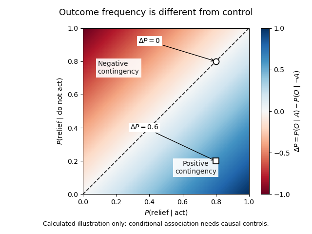

<h1 id="3/solution">Solution</h1>

↑ **Parent:** [3](../3.md)

**Learned helplessness links uncontrollability to later failure to act; instrumental learning makes that proposal testable by separating outcome value, action–outcome control and the ability to perform an action.** It explains a plausible route to passivity and some depressive symptoms, but the animal phenomenon and human [major depressive disorder](../../../major-depressive-disorder.md) are not equivalent.

In [operant conditioning](../../../operant-conditioning.md), an action changes the probability or timing of an outcome. Escape can be maintained by [negative reinforcement](../../../negative-reinforcement.md): terminating an aversive event increases the action, rather than punishing it. A simple description of control is the [action-outcome contingency](../../../action-outcome-contingency.md)

$$
\Delta P=P(O\mid A)-P(O\mid\neg A),
$$

where $O$ can denote relief and $A$ an attempted action. Under genuine controllability this difference can be positive. In an uncontrollable setting it may be zero even when relief sometimes occurs. Outcome frequency and controllability are therefore different. Interventions on action, rather than observational [conditional probabilities](../../../conditional-probability.md) alone, are needed to establish a causal contingency.

The classic triadic experiment compared an escapable condition, a [yoked control](../../../yoked-control.md) receiving matched aversive events without control, and an unexposed control. Initially, a panel response in a harness could terminate the event only for the escapable subject. Later, all groups encountered a shuttle-box task in which crossing a barrier permitted escape. The uncontrollable group subsequently showed greater escape failure, whereas the escapable and unexposed groups learned more normally. Matching the physical events made control, rather than exposure alone, the crucial contrast. The historical experiment used harmful procedures; its conceptual importance is the matched-outcome design, not a protocol to repeat.[Experiment I, pp. 1–4: triadic design, panel control and transfer to shuttle-box escape](../../../failure-to-escape-traumatic-shock-by-martin-seligman-and-others.md)

The original [learned helplessness](../../../learned-helplessness.md) hypothesis proposed that subjects learn that outcomes are independent of their responses. Generalizing that expectation reduces response initiation, impairs learning of a new contingency, and produces emotional disturbance. The motivational and cognitive effects can reinforce each other: fewer attempts provide less evidence that the new environment is controllable. That feedback offers an explanation for persistent inactivity even when opportunities improve. It does not require assuming that an animal represents a verbal proposition about its future.

For human depression, merely observing uncontrollability cannot explain who develops persistent symptoms or why self-esteem falls. An attributional reformulation distinguishes causes viewed as internal or external, stable or unstable, and global or specific. An internal explanation can undermine self-esteem; a stable explanation extends expectations into the future; a global one extends them across situations. Thus identical adverse outcomes can support different expectations depending on [attributional style](../../../attributional-style.md). These are hypotheses about generalization and vulnerability, not proof that a patient's interpretations caused every symptom or that circumstances are actually controllable.[pp. 49–74, especially the abstract and reformulation: personal/universal helplessness and attribution dimensions](../../../learned-helplessness-in-humans-critique-and-reformulation-by-lyn-y-abramson-and-others.md)

Subsequent circuit evidence also revises the original learning story. In rats, manipulations of [medial prefrontal cortex](../../../medial-prefrontal-cortex.md) showed that its activity can suppress stress-associated [dorsal raphe nucleus](../../../dorsal-raphe-nucleus.md) activation when the stressor is controllable; disrupting that regulation removes the protective effect of control. This supports a model in which learning and expressing control actively regulates a stress response. It does not require passivity itself always to be learned as an association. The implicated [serotonin](../../../serotonin.md) circuit further illustrates that a transmitter's function depends on its location and regulation, rather than global amount. Translating these rodent pathways directly into human depressive beliefs would go beyond the evidence.[Abstract and Results, pp. 365–371: prefrontal interventions, controllability and raphe activity](../../../medial-prefrontal-cortex-determines-how-stressor-controllability-affects-behavior-and-dorsal-raphe-nucleus-by-jose-amat-and-others.md)

[Operant conditioning](../../../operant-conditioning.md) also distinguishes reduced reward sensitivity from a reduced expectation of control. In an illustrative [reinforcement learning](../../../reinforcement-learning.md) model,

$$
Q_{t+1}(a)=Q_t(a)+\alpha\bigl(r_t-Q_t(a)\bigr),\qquad 0<\alpha\leq1,
$$

the prediction error changes an action value. Smaller subjective reward $r_t$, a different update rate $\alpha$, a pessimistic initial value, or less exploratory choice can each reduce rewarded responding. Increased perceived effort can reduce action even when the expected reward is learned correctly. These are distinguishable candidate mechanisms, not fitted patient results. A low response rate alone cannot identify which parameter changed, and standard chosen-action value learning does not automatically represent causal contingency or attribution.

**[Figure 1](#3/image-outcome-frequency-and-action-outcome-contingency-in-an-illustrative-probability-space). Outcome frequency and action–outcome contingency in an illustrative probability space**. Calculated conditional-probability differences, not human or animal data. Equal outcome probabilities lie on the diagonal even when outcomes are frequent. The two marked points have the same probability after acting but different contingencies.

A human probabilistic reward task supplies a concrete example. Participants discriminated subtly different visual stimuli, with correct responses for one stimulus rewarded more often. Unmedicated depressed participants developed less of the usual bias toward the richer stimulus than controls, particularly in relation to [anhedonia](../../../anhedonia.md). Trial-history analyses indicated a problem integrating reinforcement over time rather than complete insensitivity to a single reward. This operationalizes one component of [reward learning](../../../reward-learning.md); it neither directly measures pleasure nor demonstrates that prior uncontrollability caused the deficit. Sensory discriminability, response bias and learning history must be distinguished.[Abstract; Methods 2.2–2.3 and Results: asymmetric reinforcement, signal detection and trial-history analyses](../../../reduced-hedonic-capacity-in-major-depressive-disorder-evidence-from-a-probabilistic-reward-task-by-diego-a-pizzagalli-and-others.md)

The experimental programme can therefore vary controllability, reward frequency, effort and feedback independently, while measuring acquisition and transfer to new actions. It should include motor and attentional controls and distinguish failure to learn from failure to express learned knowledge. Prospective human data are needed to establish vulnerability rather than consequences of an episode; cross-sectional group differences cannot settle that direction. More opportunities to act are not automatically sufficient when fatigue, threat, external constraints or other symptoms remain.

[Learned helplessness](../../../learned-helplessness.md) is most useful as a specific causal model of how uncontrollable adversity can shape expectations and stress regulation. [Operant conditioning](../../../operant-conditioning.md) broadens it into testable accounts of passivity, motivational loss and some aspects of [anhedonia](../../../anhedonia.md). Neither a single animal task nor one computational parameter explains the entire depressive syndrome.

## ↑ Ancestors (11)

1. [3](../3.md)
2. [2022](../../2022-split.md)
3. [Past exam of the behavioural neuroscience course of the year 2 of the psychology (experimental) course of the University of Oxford](../../split.md)
4. [Behavioural neuroscience course of the year 2 of the psychology (experimental) course of the University of Oxford](../../../behavioural-neuroscience-course-of-the-year-2-of-the-psychology-experimental-course-of-the-university-of-oxford.md)
5. [Year 2 of the psychology (experimental) course of the University of Oxford](../../../year-2-of-the-psychology-experimental-course-of-the-university-of-oxford.md)
6. [Psychology (experimental) course of the University of Oxford](../../../psychology-experimental-course-of-the-university-of-oxford.md)
7. [Undergraduate course of the University of Oxford](../../../undergraduate-course-of-the-university-of-oxford.md)
8. [Course of the University of Oxford](../../../course-of-the-university-of-oxford.md)
9. [University of Oxford](../../../university-of-oxford-split.md)
10. [List of universities](../../../list-of-universities.md)
11. [Codex Wiki](../../../split.md)
