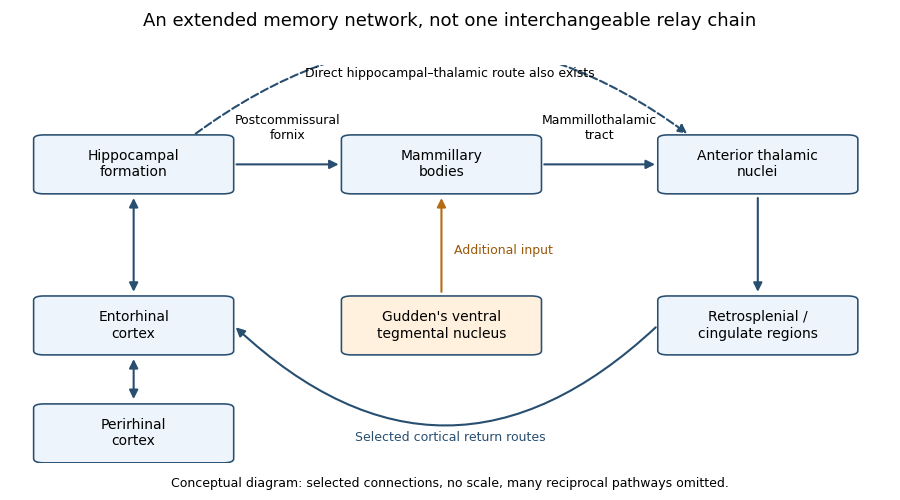

<h1 id="4/solution">Solution</h1>

↑ **Parent:** [4](../4.md)

**Disruption of an extended hippocampal–diencephalic network explains important forms of amnesia, but a single indispensable serial loop is too strong an account.** The distinction is between a useful anatomical network hypothesis and a claim that every connection is equivalent or that all memory failures have the same cause.

The [Delay-Brion circuit](../../../delay-brion-circuit.md) links temporal-lobe and diencephalic [amnesia](../../../amnesia.md). Its conventional route runs from the [hippocampus](../../../hippocampus.md) through the [fornix](../../../fornix.md), [mammillary bodies](../../../mammillary-body.md) and [mammillothalamic tract](../../../mammillothalamic-tract.md) to the [anterior thalamic nuclei](../../../anterior-thalamic-nuclei.md), with cingulate and parahippocampal return routes. It overlaps the [Papez circuit](../../../papez-circuit.md), originally proposed for emotion, but the historical explanations are not identical. The important question is whether connected structures form a single serial relay or make differentiated contributions within a larger network.

**[Figure 2](#4/image-selected-routes-in-the-extended-hippocampal-memory-network). Selected routes in the extended hippocampal memory network**. An original conceptual schematic, not an anatomical atlas or a source figure. The upper chain shows the commonly emphasized mammillary route; the lower arrows show selected additional interactions and an extra-hippocampal input. Arrow presence does not assert equal necessity, and many reciprocal connections are omitted.

The network proposal solves a genuine localization problem. Severe new-learning deficits follow damage in anatomically separated sites, so a theory confined to one small storage centre is inadequate. Clinical surgical cases showed marked [anterograde amnesia](../../../anterograde-amnesia.md) after bilateral medial temporal resections, despite comparatively preserved intellect and some older knowledge. However, the original operations included neighbouring structures, so those observations cannot isolate the [hippocampus](../../../hippocampus.md) from surrounding tissue. A subsequent extensively assessed patient, R.B., had marked new-learning impairment and a bilateral lesion largely confined to hippocampal CA1 at postmortem examination, with minor pathology elsewhere. The case strengthens the hippocampal contribution while illustrating why detailed anatomical verification matters.[pp. 11–21: clinical cases and anatomical limitations of the resections](../../../loss-of-recent-memory-after-bilateral-hippocampal-lesions-by-william-beecher-scoville-and-brenda-milner.md)[Abstract and pp. 2950–2967: longitudinal testing, CA1 pathology and minor extra-hippocampal abnormalities](../../../human-amnesia-and-the-medial-temporal-region-enduring-memory-impairment-following-a-bilateral-lesion-limited-to-field-ca1-of-the-hippocampus-by-stuart-zola-morgan-and-others.md)

Diencephalic pathology supplies convergent evidence. In a comparative postmortem study of alcohol-related disease, mammillary and mediodorsal thalamic neuronal loss occurred in both amnesic and non-amnesic cases with relevant pathology. Consistent anterior thalamic neuronal loss differentiated the cases with [Korsakoff syndrome](../../../korsakoff-syndrome.md). Such pathological controls are more informative than observing a damaged [mammillary body](../../../mammillary-body.md) in one amnesic patient. The findings support an anterior thalamic contribution and caution against identifying mammillary damage alone as a sufficient explanation. They remain observational: co-occurring damage, uncertain premorbid abilities and incomplete measures of connectivity constrain causal localization.[Abstract and pp. 141–154: stereological comparisons and differentiating anterior thalamic loss](../../../degeneration-of-anterior-thalamic-nuclei-differentiates-alcoholics-with-amnesia-by-a-harding-and-others.md)

The strong serial version makes a sharper prediction: interrupting hippocampal input to the [mammillary bodies](../../../mammillary-body.md) should disrupt the same memory functions as interrupting mammillary output. A direct rat comparison challenged that prediction. Selective interruption of descending postcommissural fornix input had much less effect on the tested spatial tasks than lesions of the [mammillothalamic tract](../../../mammillothalamic-tract.md) or [Gudden's ventral tegmental nucleus](../../../gudden-s-ventral-tegmental-nucleus.md). The latter two also produced remote activity changes. The mammillary contribution therefore cannot be explained simply as passive transmission of hippocampal output. Additional brainstem inputs are functionally important. These comparisons concern particular spatial tasks and selective pathways, not proof that an intact [fornix](../../../fornix.md) is irrelevant to all memory.[Abstract; Results and Discussion: postcommissural-fornix, mammillothalamic and tegmental comparisons](../../../dismantling-the-papez-circuit-for-memory-in-rats-by-seralynne-d-vann.md)

This result favours an interacting network over a chain of interchangeable relays. There are direct hippocampal–thalamic connections, multiple return routes and inputs from outside the traditional loop. A lesion can deprive another region of useful input or coordination without destroying it. Conversely, residual pathways may preserve a task after one disconnection. Therefore structural preservation of a node does not guarantee functional preservation, and a lesion effect does not show that the lost tissue was the final storage site. Reversible perturbations, pathway-specific comparisons and remote physiological measurements can complement permanent-lesion evidence.

The outcome to be explained must also be specified. [Anterograde amnesia](../../../anterograde-amnesia.md) differs from [retrograde amnesia](../../../retrograde-amnesia.md), and impaired [episodic memory](../../../episodic-memory.md) is not equivalent to losing every skill, immediate span or familiar item. [Recognition memory](../../../recognition-memory.md) can draw on [recollection](../../../recollection.md) or [familiarity](../../../familiarity.md); a task allowing a strong familiarity judgment can be performed without recovery of contextual detail. Broader [medial temporal lobe](../../../medial-temporal-lobe.md) damage can affect both processes, while more selective damage can yield a different profile. Thus the circuit is most plausible as an explanation of particular relational and event-memory impairments, rather than all failures loosely called amnesia.

There are methodological traps on both sides. Human cases give direct clinical relevance but rarely offer randomized, anatomically pure lesions. Animal interventions improve causal control, yet spatial working-memory tasks do not demonstrate the entire human experience of remembering an event. Failure on a task can reflect sensory, motivational or strategic changes, so spared comparison tasks are necessary. Recovery and compensation can obscure an original contribution, while damage to fibres passing through a region can exaggerate the apparent role of its local cells. A convincing account predicts both impaired and spared functions, not merely a lesion location.

By the examination date, the defensible theory was therefore an extended, functionally differentiated hippocampal–diencephalic network. The [Delay-Brion circuit](../../../delay-brion-circuit.md) remains valuable because it unifies important temporal and diencephalic causes of [amnesia](../../../amnesia.md). Its explanatory power increases when it accommodates additional inputs, parallel routes and memory-process distinctions, rather than claims that all amnesia follows the breaking of one serial loop.

## ↑ Ancestors (11)

1. [4](../4.md)
2. [2022](../../2022-split.md)
3. [Past exam of the behavioural neuroscience course of the year 2 of the psychology (experimental) course of the University of Oxford](../../split.md)
4. [Behavioural neuroscience course of the year 2 of the psychology (experimental) course of the University of Oxford](../../../behavioural-neuroscience-course-of-the-year-2-of-the-psychology-experimental-course-of-the-university-of-oxford.md)
5. [Year 2 of the psychology (experimental) course of the University of Oxford](../../../year-2-of-the-psychology-experimental-course-of-the-university-of-oxford.md)
6. [Psychology (experimental) course of the University of Oxford](../../../psychology-experimental-course-of-the-university-of-oxford.md)
7. [Undergraduate course of the University of Oxford](../../../undergraduate-course-of-the-university-of-oxford.md)
8. [Course of the University of Oxford](../../../course-of-the-university-of-oxford.md)
9. [University of Oxford](../../../university-of-oxford-split.md)
10. [List of universities](../../../list-of-universities.md)
11. [Codex Wiki](../../../split.md)
