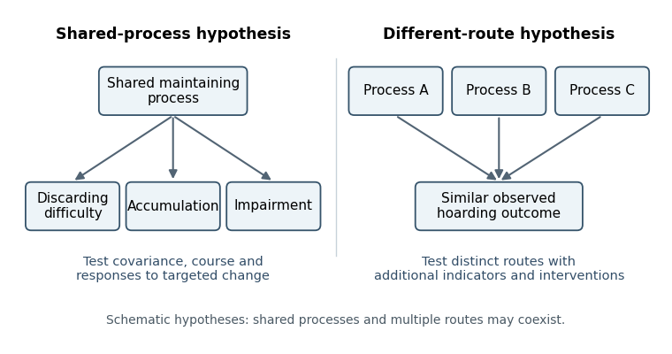
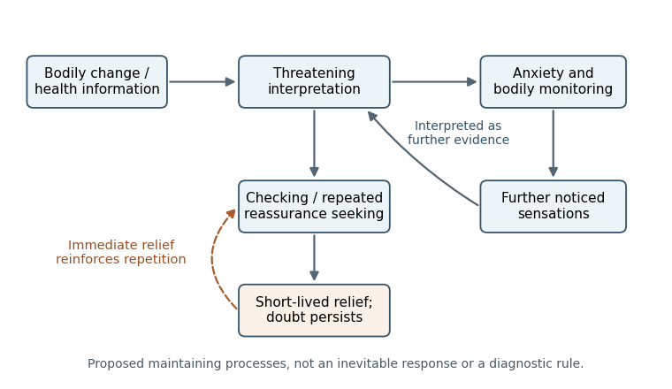

# 2022

↑ **Parent:** [Past exam of the beliefs, behaviours and biology course of the University of Oxford](../past-exam-of-the-beliefs-behaviours-and-biology-course-of-the-university-of-oxford.md)

Source release: [Oxford-released bundle, member a16859w1.pdf](https://www.whatdotheyknow.com/request/experimental_psychology_past_exa/response/2757831/attach/3/New%20Compressed%20zipped%20Folder.zip?cookie_passthrough=1).

The cover requires three answers and states a limit of 1,800 words. All six options are developed separately here, with each essay below 1,800 words. The cover does not explicitly state whether that limit applies per answer or to the submission as a whole; these are complete study solutions rather than a three-answer submission. Scientific evidence is restricted to work available by 26 May 2022.

**Table of contents**

- [1](#1)
  - [Solution](#1/solution)
- [2](#2)
  - [Solution](#2/solution)
- [3](#3)
  - [Solution](#3/solution)
- [4](#4)
  - [Solution](#4/solution)
- [5](#5)
  - [Solution](#5/solution)
- [6](#6)
  - [Solution](#6/solution)

## 1

↑ **Parent:** [2022](2022.md)

<h3 id="1/solution">Solution</h3>

↑ **Parent:** [1](#1)

**[Obsessive-compulsive disorder](../psychiatry.md#obsessive-compulsive-disorder) and [severe health anxiety](../psychology.md#severe-health-anxiety) can share a cycle of threatening interpretation, distress and short-lived relief from [safety behavior](../animal-behaviour.md#safety-behavior), while differing in the feared meaning and the function of the response. Effective treatment therefore needs both a shared [learning](../animal-behaviour.md#learning) framework and an individualized [clinical formulation](../psychology.md#clinical-formulation).** Similar-looking checking is insufficient to distinguish the problems: checking whether one has an illness and checking to prevent oneself causing harm can involve different predictions, even when both concern health.

In [obsessive-compulsive disorder](../psychiatry.md#obsessive-compulsive-disorder), [obsessions](../psychiatry.md#obsession) are recurrent intrusive thoughts, images or urges, and [compulsions](../psychiatry.md#compulsion) are repeated actions or mental acts intended to neutralize distress or avert a feared outcome. [Paul Salkovskis](../psychologist.md#paul-salkovskis)'s cognitive analysis located a maintaining problem in the appraisal of intrusive material, particularly [inflated responsibility](../psychiatry.md#inflated-responsibility), rather than in the mere occurrence of an unwanted thought. An intrusion can become significant because the person treats having it as evidence of danger or an obligation to act. Covert neutralization matters as well as visible washing or checking. This is a psychological account to test, not a claim that responsibility explains every presentation.[1985; proposed responsibility appraisal and neutralization cycle](../psychology-bibliography.md#obsessional-compulsive-problems-a-cognitive-behavioural-analysis-by-paul-salkovskis)

[Health anxiety](../psychology.md#health-anxiety) centers on perceived illness and the interpretation of bodily changes or health information. The cognitive account proposed by [Hilary Warwick](../psychology.md#hilary-warwick) and colleagues links threatening illness interpretations to selective [attention](../psychology.md#attention), [anxiety](../psychology.md#anxiety) and attempts to obtain certainty. A real sensation can be amplified by monitoring, and the resulting experience can seem to confirm the original interpretation. Medical reassurance may produce temporary relief without changing the underlying rule that uncertainty is intolerable. The target is the meaning and maintaining process, not an assertion that [symptoms](../psychology.md#symptom) are imaginary.[1990; proposed cognitive-behavioral account of development and maintenance](../psychology-bibliography.md#hypochondriasis-by-hilary-warwick-and-others)

Both formulations predict [negative reinforcement](../animal-behaviour.md#negative-reinforcement). If a ritual or request for reassurance reduces distress immediately, repetition becomes more likely even when the long-term inference is unhelpful. Avoiding a situation can also prevent [learning](../animal-behaviour.md#learning) what would happen without the precaution. The functional question is whether the person attributes safety to the behavior and therefore fails to update the feared prediction. Objectively useful precautions and proportionate medical care are different: their function and evidence must be assessed rather than classifying every precaution as pathological.

The differences are clinically consequential. [Obsessive-compulsive disorder](../psychiatry.md#obsessive-compulsive-disorder) can involve contamination, accidental harm, morality, symmetry or incompleteness, not just illness. The central concern may be causing harm through responsibility, whereas [health anxiety](../psychology.md#health-anxiety) may involve already having a disease that others have missed. Insight varies in both, so an apparently strongly held conviction does not alone establish the distinction. Likewise, unwanted thoughts can occur in [health anxiety](../psychology.md#health-anxiety) and [reassurance seeking](../animal-behaviour.md#reassurance-seeking) can be a [compulsion](../psychiatry.md#compulsion). Assessment needs the sequence of trigger, interpretation, response and consequence, with [comorbidity](../psychology.md#comorbidity) considered rather than forcing every person into a mutually exclusive category.

For [obsessive-compulsive disorder](../psychiatry.md#obsessive-compulsive-disorder), [exposure and response prevention](../psychology.md#exposure-and-response-prevention) makes the feared cue available while reducing the ritual that prevents informative [learning](../animal-behaviour.md#learning). The aim is to test predictions and develop a different relationship to uncertainty, not simply to maximize distress or demand certainty that harm is impossible. Cognitive work can clarify responsibility assumptions and identify mental rituals that would otherwise remain unnoticed. Outcome measures should assess time, interference and distress as well as the number of visible acts; suppressing one ritual while replacing it with covert neutralization would be an inadequate success criterion.

[Edna B. Foa](../psychologist.md#edna-b-foa) and colleagues' adult randomized trial compared [exposure and response prevention](../psychology.md#exposure-and-response-prevention), [clomipramine](../pharmacology.md#clomipramine), their combination and pill placebo. The exposure-containing conditions provided strong evidence of benefit, with the combination not establishing a clear advantage over [exposure and response prevention](../psychology.md#exposure-and-response-prevention) alone. This supports a treatment package, not proof that one proposed cognitive change is its exclusive active mechanism. Medication effects also need not establish that the disorder is caused by a simple [neurotransmitter](../neuron.md#neurotransmitter) deficiency.[2005; randomized exposure/ritual prevention, clomipramine, combined and placebo conditions](../psychology-bibliography.md#randomized-placebo-controlled-trial-of-exposure-and-ritual-prevention-clomipramine-and-their-combination-in-the-treatment-of-obsessive-compulsive-disorder-by-edna-b-foa-and-others)

For [health anxiety](../psychology.md#health-anxiety), [cognitive behavioral therapy](../psychology.md#cognitive-behavioral-therapy) examines competing explanations of [symptoms](../psychology.md#symptom), patterns of [attention](../psychology.md#attention) and the consequences of checking, avoidance and repeated reassurance. [Behavioral experiments](../psychology.md#behavioral-experiment) can compare a threat interpretation with an alternative maintenance explanation. A coordinated medical plan matters because genuine illness and [health anxiety](../psychology.md#health-anxiety) can coexist; reducing repetitive certainty seeking does not imply disregarding new clinically relevant information. A collaborative explanation respects the reality of the distress while making the maintenance account open to revision.

[Peter Tyrer](../psychiatry.md#peter-tyrer) and colleagues' CHAMP study randomized 444 medical outpatients to adapted [cognitive behavioral therapy](../psychology.md#cognitive-behavioral-therapy) or standard care. Concurrent physical illness was not an exclusion, and the follow-up report found an advantage in [health anxiety](../psychology.md#health-anxiety) [symptoms](../psychology.md#symptom) sustained over five years. This strengthens applicability beyond a purely psychiatric clinic. Nevertheless, improvement in the [health anxiety](../psychology.md#health-anxiety) outcome did not imply cost-effectiveness on every economic or quality-of-life endpoint, and comparison with standard care does not isolate each [treatment component](../psychology.md#treatment-component).[2017; Abstract, eligibility, health anxiety follow-up and economic outcomes](../psychology-bibliography.md#cognitive-behaviour-therapy-for-health-anxiety-in-medical-patients-champ-a-randomised-controlled-trial-with-outcomes-to-5-years-by-peter-tyrer-and-others)

Medication evidence further discourages an absolute psychological-versus-biological division. [Brian A. Fallon](../psychiatry.md#brian-a-fallon) and colleagues randomized 195 people with hypochondriasis to [fluoxetine](../pharmacology.md#fluoxetine), [cognitive behavioral therapy](../psychology.md#cognitive-behavioral-therapy), both or placebo. Individual active-treatment contrasts against placebo were not significant on the primary responder definition, although secondary continuous analyses favored [fluoxetine](../pharmacology.md#fluoxetine). Thus it would be misleading either to omit the medication signal or to describe every endpoint as proving superiority. This pattern also illustrates why a positive trial abstract needs to be read alongside its prespecified outcome.[2017; primary responder analysis versus secondary continuous outcomes at 24 weeks](../psychology-bibliography.md#a-randomized-controlled-trial-of-medication-and-cognitive-behavioral-therapy-for-hypochondriasis-by-brian-a-fallon-and-others)

The shared components are collaborative formulation, clarification of predictions, modification of maintaining [safety behaviors](../animal-behaviour.md#safety-behavior) and evaluation of [learning](../animal-behaviour.md#learning) in daily life. Their content differs with the feared catastrophe, timescale and interpretation of responsibility or illness. **Treating the functional cycle is more useful than treating checking as a uniform [symptom](../psychology.md#symptom), while diagnosis still helps organize assessment and select evidence-supported options.** Neither the overlap nor the treatment response establishes that the two problems are identical, and neither diagnosis removes the need for appropriate assessment of physical health and individual circumstances.

## 2

↑ **Parent:** [2022](2022.md)

<h3 id="2/solution">Solution</h3>

↑ **Parent:** [2](#2)

**A recognizable [hoarding](../psychology.md#hoarding) syndrome can coexist with more than one causal route. Research must test whether there is a stable, informative pattern of mechanisms and predictions beyond the visible accumulation, rather than treating either a diagnostic label or heterogeneity alone as decisive.** The two accounts make their clearest differences when they predict additional features, trajectories or responses to [interventions](../causal-inference.md#treatment). A classification can be useful without asserting one necessary biological lesion in every affected person.

[Hoarding](../psychology.md#hoarding) describes persistent retention or accumulation that can compromise the use of living space. A clinical account additionally considers difficulty discarding, distress, impairment, acquisition and the reasons for retaining objects. Mere ownership of many objects is not enough: restricted space, poverty, collecting, the preferences of other household members and access to practical support affect clutter. These contextual determinants must be measured before a behavioral appearance is interpreted as a coherent [psychopathology](../psychology.md#psychopathology).

The [equifinality](../psychology.md#equifinality) account proposes that different processes converge on a similar outcome. Retention might express feared consequences of discarding, unusually strong attachment, difficulty making decisions or a loss of the capacity to organize possessions. These are candidate routes to examine, not diagnoses that can be inferred from a photograph of a room. A more coherent-disorder account predicts that a characteristic cluster of processes covaries, persists and explains incremental impairment beyond other conditions. It need not predict that every participant has every proposed process.

[Randy O. Frost](../psychologist.md#randy-o-frost) and colleagues' original cognitive-behavioral model was explicitly multifactorial, linking information processing, attachment, avoidance and beliefs about possessions. The model therefore supplies hypotheses about processes rather than identifying one defining defect. It also shows why a simple contrast between “one disorder” and “many processes” can be misleading: a coherent account can include interacting mechanisms. The discriminating question is whether their joint structure has explanatory and predictive value.[1996; original four-part theoretical model](../psychology-bibliography.md#a-cognitive-behavioral-model-of-compulsive-hoarding-by-randy-o-frost-and-others)

An initial study should recruit from community, medical and specialist services, not only an [obsessive-compulsive disorder](../psychiatry.md#obsessive-compulsive-disorder) clinic. It should compare primary [hoarding](../psychology.md#hoarding) presentations, [obsessive-compulsive disorder](../psychiatry.md#obsessive-compulsive-disorder) with [hoarding](../psychology.md#hoarding), [obsessive-compulsive disorder](../psychiatry.md#obsessive-compulsive-disorder) without [hoarding](../psychology.md#hoarding), relevant other clinical groups and nonclinical collectors. Blinded interviews, home observations and multiple informants would distinguish distress from household impairment and establish why objects are retained. Sampling across the severity range would help avoid making a diagnostic boundary look categorical merely because the study excluded intermediate cases.

[Alberto Pertusa](../psychiatry.md#alberto-pertusa) and colleagues compared clinical forms of [hoarding](../psychology.md#hoarding) and found that many presentations were distinguishable from [obsessive-compulsive disorder](../psychiatry.md#obsessive-compulsive-disorder), while some [hoarding](../psychology.md#hoarding) was closely tied to its characteristic [symptoms](../psychology.md#symptom). Apparent overlap with another diagnostic category could also arise from shared item content. This supports careful differential characterization and warns against assuming that all retention has the same function. Cross-sectional clinical separation, however, cannot by itself identify the developmental cause of either subgroup.[2008; clinical comparisons, OCD-related presentations and overlapping diagnostic items](../psychology-bibliography.md#compulsive-hoarding-ocd-symptom-distinct-clinical-syndrome-or-both-by-alberto-pertusa-and-others)

Measurement should distinguish accumulation, [discarding difficulty](../psychology.md#discarding-difficulty), acquiring, emotional attachment and organizational problems. [Factor analysis](../latent-variable.md#factor-analysis) can ask whether a common dimension summarizes their covariance, while a [mixture model](../statistical-modelling.md#mixture-model) can test proposed subgroups. These models require out-of-sample prediction, [measurement invariance](../psychology.md#measurement-invariance) and comparison with plausible alternatives. A factor is not automatically a common cause: correlated indicators may arise because clutter itself increases avoidance and further impairs organization. Equally, identifying several factors does not refute a coherent syndrome. Statistical structure must be connected to mechanisms through additional evidence.

**[Figure 1](#2/image-alternative-hypotheses-about-a-shared-hoarding-outcome-schematic-possibilities-rather-than-established-subtypes). Alternative hypotheses about a shared hoarding outcome; schematic possibilities rather than established subtypes**.

There is a basic [identifiability](../statistical-model.md#identifiability) limit. Suppose $Y$ records a [symptom](../psychology.md#symptom) and a hidden pathway label is $Z$. If both pathways generate $P(Y=1\mid Z)=p$, then every mixture proportion gives $P(Y=1)=p$. A [symptom](../psychology.md#symptom)-only sample has [likelihood](../maximum-likelihood-estimation.md#likelihood-function) $p^k(1-p)^{n-k}$ and cannot identify which pathway produced it. This does not prove that actual [hoarding](../psychology.md#hoarding) mechanisms are indistinguishable; it explains why [symptom equivalence does not establish mechanistic identity](../psychology.md#symptom-equivalence-does-not-establish-mechanistic-identity). Additional indicators, longitudinal observations or targeted perturbations are required to distinguish the proposed accounts.

An experimental approach can vary the ownership and emotional significance of possessions while holding perceptual features as similar as practicable. [David F. Tolin](../psychologist.md#david-f-tolin) and colleagues studied binding keep/discard decisions for participants' own paper items and control items during [functional magnetic resonance imaging](../nuclear-magnetic-resonance.md#functional-magnetic-resonance-imaging), comparing [hoarding disorder](../psychiatry.md#hoarding-disorder), [obsessive-compulsive disorder](../psychiatry.md#obsessive-compulsive-disorder) and controls. Ownership changed the pattern: [hoarding](../psychology.md#hoarding) participants showed relatively reduced activity in [insular cortex](../neuroscience.md#insular-cortex) and [anterior cingulate cortex](../neuroscience.md#anterior-cingulate-cortex) for others' items but increased responses for their own. The actual possibility of shredding made the decision consequential.[2012; task instructions, binding decisions and ownership-dependent group differences](../psychology-bibliography.md#neural-mechanisms-of-decision-making-in-hoarding-disorder-by-david-f-tolin-and-others)

This is more informative than comparing undifferentiated resting activity, but the result does not establish a unique [hoarding](../psychology.md#hoarding) mechanism. Ownership, anticipated loss, decision time and emotional significance differ together; restricting stimuli to paper limits [generalization](../statistical-learning.md#generalization-in-statistical-learning). [Reverse inference](../neuroscience.md#reverse-inference) from an active region to a particular psychological process is especially weak without task controls. A stronger extension would independently vary ownership and experimentally established beliefs about usefulness, then test whether the predicted response generalizes to everyday decisions and alternative objects.

Longitudinal studies should measure proposed mechanisms before changes in accumulation and impairment. A coherent-mechanism account predicts that those measures explain subsequent change beyond baseline severity and other difficulties; a multiple-route account predicts reproducible pathways with different sequences. Repeated measurements could distinguish a vulnerability from a consequence of years of clutter. Family or biological associations might contribute, but shared liability is neither proof of one process nor a requirement that every case have the same origin.

Treatment studies offer a further test if they manipulate theoretically distinct components. [Gail Steketee](../README.md#gail-steketee) and colleagues randomized 46 participants to multicomponent [cognitive behavioral therapy](../psychology.md#cognitive-behavioral-therapy) or wait-list, finding a treatment advantage at the randomized comparison. The [intervention](../causal-inference.md#treatment) combined motivational work, organizing and problem-solving skills, discarding/nonacquisition exposure and cognitive work. That combination supports clinical benefit but does not reveal which component was necessary or which causal route it changed. Later improvement among completers must also be separated from the original randomized contrast.[2010; 12-week randomized comparison and subsequent 26-session treatment](../psychology-bibliography.md#waitlist-controlled-trial-of-cognitive-behavior-therapy-for-hoarding-disorder-by-gail-steketee-and-others)

A [dismantling study](../design-of-experiments.md#dismantling-study) could compare matched packages with and without a hypothesized component, measuring its proposed mediator before the outcome. Prespecified treatment-by-mechanism interactions would test whether people with different retention functions require different components. Positive mediation remains vulnerable to mediator–outcome [confounding](../causal-inference.md#confounding), so improvement in a belief after treatment is weaker evidence than a manipulation that selectively changes that belief and the predicted behavior. Practical barriers and opportunity to discard must also be distinguished from psychological inability.

**The best resolution is comparative and predictive: test whether syndrome-level measures add reliable information and whether distinct mechanisms produce reproducible differential predictions.** Existing clinical, experimental and treatment evidence supports more specificity than an undifferentiated “clutter” endpoint, while leaving room for multiple routes. A useful diagnosis and an equifinal behavior are compatible; what needs testing is the scope and precision of the mechanism claimed.

## 3

↑ **Parent:** [2022](2022.md)

<h3 id="3/solution">Solution</h3>

↑ **Parent:** [3](#3)

**[Panic disorder](../psychiatry.md#panic-disorder) and [social anxiety disorder](../psychiatry.md#social-anxiety-disorder) illustrate a shared feedback architecture with different feared outcomes and sources of apparent evidence. Treatment can share collaborative cognitive behavioral methods while changing the experiments, attentional targets and [safety behaviors](../animal-behaviour.md#safety-behavior) according to the formulation.** In both, an [anxiety](../psychology.md#anxiety) response can become part of the perceived proof of danger. A diagnosis indicates a pattern of difficulty; it does not establish that all cases have an identical maintaining process.

In [panic disorder](../psychiatry.md#panic-disorder), recurrent unexpected [panic attacks](../psychiatry.md#panic-attack) are followed by concern or behavioral change related to further attacks. The cognitive account emphasizes [catastrophic misinterpretation](../psychology.md#catastrophic-misinterpretation) of bodily sensations: an acceleration of heart rate, dizziness or altered breathing may be interpreted as imminent collapse, loss of control or another catastrophe. The interpretation increases [anxiety](../psychology.md#anxiety), which generates further sensations, reinforcing the threat interpretation. Avoidance and [safety behaviors](../animal-behaviour.md#safety-behavior) can prevent [learning](../animal-behaviour.md#learning) that the sensations would have changed without the precaution. Appropriate assessment remains necessary because a cognitive formulation does not determine the medical origin of any individual [symptom](../psychology.md#symptom).

[David M. Clark](../psychologist.md#david-m-clark)'s original account specifies this feedback process rather than equating panic with generally high stress. It predicts that the meaning assigned to a sensation should matter more than its physical presence alone. The same sensation could be frightening in one interpretive context and relatively unremarkable in another. This explanatory distinction is useful because it suggests testable comparisons between predictions, rather than relying solely on relaxation or a verbal assurance that nothing dangerous will occur. The original paper is a model, not itself a randomized demonstration of every link.[1986; proposed catastrophic-interpretation feedback account](../psychology-bibliography.md#a-cognitive-approach-to-panic-by-david-m-clark)

[Social anxiety disorder](../psychiatry.md#social-anxiety-disorder) instead centers on feared scrutiny and negative evaluation. In an interaction, [self-focused attention](../psychology.md#self-focused-attention) can shift processing from the actual conversation to sensations and an imagined view of oneself. A [negative self-image](../psychiatry.md#negative-self-image) may be treated as if it were an observer's report. [Safety behaviors](../animal-behaviour.md#safety-behavior) such as mentally rehearsing every sentence or restricting engagement can reduce spontaneity, obscure the evidence needed to test a prediction and sometimes change how the interaction develops. [Post-event processing](../psychiatry.md#post-event-processing) can then select apparent failures and preserve the threatening impression for the next encounter.

The disorders therefore share an interpretive loop but differ in what would count as disconfirming evidence. In panic, the feared event may concern the immediate meaning of a bodily sensation. In [social anxiety](../psychology.md#social-anxiety), it may concern another person's appraisal, an uncertain social consequence or the belief that [anxiety](../psychology.md#anxiety) is visibly unacceptable. Simply remaining in a situation is not an adequate experimental description: someone may remain while attributing safety to a precaution, directing [attention](../psychology.md#attention) inward or interpreting an ambiguous response as rejection.

Experimental evidence tests this functional argument. [Paul Salkovskis](../psychologist.md#paul-salkovskis) and colleagues manipulated safety-seeking behavior during exposure in [panic disorder](../psychiatry.md#panic-disorder) with [agoraphobia](../psychiatry.md#agoraphobia). The study supports examining what the person does during exposure rather than treating exposure duration as its only relevant feature. It does not imply that every protective behavior is unnecessary, nor that an effect in a short task demonstrates the complete mechanism of long-term recovery. The prediction being tested and the person's explanation of the outcome remain important.[1999; experimental manipulation of safety-seeking behavior during exposure](../psychology-bibliography.md#an-experimental-investigation-of-the-role-of-safety-seeking-behaviours-in-the-maintenance-of-panic-disorder-with-agoraphobia-by-paul-salkovskis-and-others)

For [social anxiety](../psychology.md#social-anxiety), [Freda McManus](../psychologist.md#freda-mcmanus) and colleagues first assessed [safety behaviors](../animal-behaviour.md#safety-behavior) by interview and then manipulated [safety behaviors](../animal-behaviour.md#safety-behavior) and self-focus experimentally. Greater [safety behavior](../animal-behaviour.md#safety-behavior) use characterized high [social anxiety](../psychology.md#social-anxiety), and the manipulation supported adverse effects of the combined maintaining processes. The interview association alone would allow reverse causation; the experimental contrast provides stronger evidence of an immediate influence. Because [attention](../psychology.md#attention) and behavior were manipulated together, it is less decisive about their independent effects. Brief arranged interactions also cannot establish the magnitude of lasting treatment benefit.[2008; interview study and experimental safety behavior/self-focus manipulation](../psychology-bibliography.md#why-social-anxiety-persists-by-freda-mcmanus-and-others)

Both treatments can begin with a shared [clinical formulation](../psychology.md#clinical-formulation), specified predictions and [behavioral experiments](../psychology.md#behavioral-experiment). In panic, [interoceptive exposure](../psychology.md#interoceptive-exposure) can make relevant sensations available for testing while changing the [safety behavior](../animal-behaviour.md#safety-behavior) that would otherwise be credited with preventing catastrophe. The [learning](../animal-behaviour.md#learning) question concerns the predicted consequence and the meaning of the sensation, not merely whether [anxiety](../psychology.md#anxiety) eventually declines. In [social anxiety](../psychology.md#social-anxiety), experiments can redirect [attention](../psychology.md#attention) to the interaction and test predicted evaluations while reducing relevant [safety behaviors](../animal-behaviour.md#safety-behavior). The content is matched to social interpretation rather than transferred mechanically from a bodily-sensation exercise.

[Video feedback](../psychology.md#video-feedback) is particularly pertinent when a person treats a [negative self-image](../psychiatry.md#negative-self-image) as an accurate external view. Preparing a clear prediction about appearance and then comparing it with the recording creates a more interpretable test than simply asking the person to watch themselves. A recording is still a limited sample, and the person's selective interpretation of it needs examination. Social experiments may also test how others respond to ordinary imperfections rather than making perfect performance the criterion for safety. These principles follow from the proposed maintaining process and should remain open to outcome evaluation.

Treatment comparisons provide evidence at a broader level. [David M. Clark](../psychologist.md#david-m-clark) and colleagues' panic trial compared [cognitive therapy](../psychology.md#cognitive-therapy), applied relaxation and [imipramine](../pharmacology.md#imipramine), with self-exposure homework shared across conditions. The [cognitive therapy](../psychology.md#cognitive-therapy) findings support the package, but common homework means that differences cannot be attributed to exposure being present in one arm and absent in all others. Therapist effects, credibility, dose and follow-up are also relevant when interpreting comparative outcomes.[1994; treatment conditions, shared self-exposure homework and follow-up](../psychology-bibliography.md#a-comparison-of-cognitive-therapy-applied-relaxation-and-imipramine-in-the-treatment-of-panic-disorder-by-david-m-clark-and-others)

In [social phobia](../psychiatry.md#social-anxiety-disorder), [David M. Clark](../psychologist.md#david-m-clark) and colleagues randomized participants to [cognitive therapy](../psychology.md#cognitive-therapy), exposure with applied relaxation or a waiting condition. [Cognitive therapy](../psychology.md#cognitive-therapy) showed a stronger outcome than the exposure/relaxation package on the principal comparisons. This is evidence against treating all [interventions](../causal-inference.md#treatment) that contain exposure as interchangeable. It does not establish that a single feature, such as [video feedback](../psychology.md#video-feedback), explains the difference, because the packages differ on multiple dimensions. A [dismantling study](../design-of-experiments.md#dismantling-study) or a carefully specified mediation design would be needed for that narrower causal claim.[2006; randomized package comparison and follow-up](../psychology-bibliography.md#cognitive-therapy-versus-exposure-and-applied-relaxation-in-social-phobia-a-randomized-controlled-trial-by-david-m-clark-and-others)

Treatment planning also needs the person's goals, [comorbidity](../psychology.md#comorbidity) and constraints. A ritualized breathing strategy, inward monitoring or avoidance can serve different functions in different cases; its name does not determine its effect. Outcomes should include functioning and flexibility alongside [symptom](../psychology.md#symptom) scores, and tests of maintenance should examine whether feared situations can be approached without recreating the same safety rules. This is why a [transdiagnostic process](../psychology.md#transdiagnostic-process) can justify shared principles without requiring a single standardized sequence for everyone.

**The shared targets are threatening interpretation, self-confirming [attention](../psychology.md#attention) and [safety behavior](../animal-behaviour.md#safety-behavior) that obstructs updating; the specific targets depend on whether bodily catastrophe or social evaluation organizes the difficulty.** Evidence for package efficacy and evidence for a proposed mechanism answer different questions. Effective comparison requires both, with the limits of the experimental manipulation kept distinct from those of the clinical trial.

## 4

↑ **Parent:** [2022](2022.md)

<h3 id="4/solution">Solution</h3>

↑ **Parent:** [4](#4)

**Valuing health does not entail interpreting every sensation as evidence of grave disease. Intense [health anxiety](../psychology.md#health-anxiety) depends on how [probability](../probability-theory.md#probability), consequences, [coping](../psychology.md#coping) and uncertainty are appraised, and on whether [attention](../psychology.md#attention) and [safety behavior](../animal-behaviour.md#safety-behavior) create a self-confirming cycle.** Understanding ordinary calibration suggests treatment targets that preserve sensible health care while reducing disabling certainty seeking. The contrast is between ways of responding to uncertainty, not between caring about health and being indifferent to it.

Bodily signals are ambiguous. A change may have several explanations, and a very serious possible outcome can still be unlikely given a particular cue. The severity of a consequence and the [conditional probability](../probability-theory.md#conditional-probability) of its occurrence are distinct quantities. In a simple Bayesian illustration, let $D$ be an imaginary illness and $S$ an ambiguous signal. Then

$$
P(D\mid S)=\frac{P(S\mid D)P(D)}{P(S\mid D)P(D)+P(S\mid\neg D)P(\neg D)}.
$$

If, purely for illustration, $P(D)=0.001$, $P(S\mid D)=0.5$ and $P(S\mid\neg D)=0.1$, the [posterior probability](../bayesian-statistics.md#posterior-probability) is about $0.00498$. These invented values are not estimates for any actual [symptom](../psychology.md#symptom) or illness. They show why knowing that a disease can produce a signal does not establish that the signal probably means that disease.

Ordinary calibration also involves alternatives, changing information and [coping](../psychology.md#coping). People can judge a [symptom](../psychology.md#symptom) worth evaluating without assuming that only a guarantee of safety would permit normal activity. They may interpret a sensation in the context of recent activity, retain a distinction between possibility and [probability](../probability-theory.md#probability), and revise their belief when appropriate evidence arrives. These are functional contrasts, not an assertion that everyone without [severe health anxiety](../psychology.md#severe-health-anxiety) performs explicit Bayesian calculations or is always accurate. Neither realistic risk nor a prior medical experience automatically produces disabling [anxiety](../psychology.md#anxiety).

The cognitive model of [health anxiety](../psychology.md#health-anxiety) identifies a different pattern: an illness interpretation increases [anxiety](../psychology.md#anxiety) and [somatic hypervigilance](../psychology.md#somatic-hypervigilance); those responses increase the salience of sensations; further sensations are treated as corroboration. [Reassurance seeking](../animal-behaviour.md#reassurance-seeking), repeated checking or avoidance can provide immediate relief while leaving the underlying interpretation untested. [Hilary Warwick](../psychology.md#hilary-warwick) and colleagues proposed this maintenance account as an alternative to conceptualizing the difficulty merely as insufficient medical information. It explains why adding another statement of reassurance may not have the same effect as changing how evidence is interpreted.[1990; proposed attentional, interpretive and behavioral maintenance processes](../psychology-bibliography.md#hypochondriasis-by-hilary-warwick-and-others)

**[Figure 2](#4/image-a-proposed-maintenance-cycle-for-health-anxiety-arrows-represent-testable-processes-not-inevitable-responses-to-bodily-changes). A proposed maintenance cycle for health anxiety; arrows represent testable processes, not inevitable responses to bodily changes**.

[Intolerance of uncertainty](../psychology.md#intolerance-of-uncertainty) can raise the required standard of evidence beyond what medical investigation can supply. If every residual possibility demands another check, a negative result can be reinterpreted as the wrong test, the wrong time or a missed condition. This account predicts repeated doubt despite short-term relief, rather than the absence of genuine concern or comprehension. It also explains a possible paradox: a response chosen to reduce [anxiety](../psychology.md#anxiety) can maintain the demand for certainty. The person's reason for the behavior must be established; the same observable action could be proportionate care in another context.

An appropriate formulation therefore distinguishes the presence of physical illness, the degree of concern and the pattern of maintaining responses. These are not mutually exclusive categories. [Paul Salkovskis](../psychologist.md#paul-salkovskis) and colleagues developed the [Health Anxiety Inventory](../psychology.md#health-anxiety-inventory) to measure [health anxiety](../psychology.md#health-anxiety) across relevant clinical and medical samples rather than simply counting bodily [symptoms](../psychology.md#symptom). The validation studies compared several [anxiety](../psychology.md#anxiety) presentations, examined sensitivity to change and included people seeking help for physical illness. This supports measuring the psychological response separately from a conclusion about whether a disease exists. A [questionnaire](../psychology.md#questionnaire) still does not replace clinical assessment.[2002; clinical comparisons, treatment sensitivity and physical-illness samples](../psychology-bibliography.md#the-health-anxiety-inventory-development-and-validation-of-scales-for-the-measurement-of-health-anxiety-and-hypochondriasis-by-paul-salkovskis-and-others)

Treatment implications follow as hypotheses about [learning](../animal-behaviour.md#learning). Collaborative [cognitive behavioral therapy](../psychology.md#cognitive-behavioral-therapy) can identify the feared interpretation, the alternative account and what would distinguish them. A [behavioral experiment](../psychology.md#behavioral-experiment) should test a specified prediction about [attention](../psychology.md#attention) or a [safety behavior](../animal-behaviour.md#safety-behavior), rather than require the person to prove that future illness is impossible. [Attention](../psychology.md#attention) can be examined as a process that changes experience, not as a declaration that every sensation is caused by [attention](../psychology.md#attention). Likewise, reducing a repetitive reassurance cycle is different from withholding a needed explanation or discouraging appropriate medical evaluation.

The therapeutic stance is consequently important. Dismissing a [symptom](../psychology.md#symptom) can reinforce the belief that the danger has not been understood. A shared formulation can instead acknowledge the sensation, explain how [anxiety](../psychology.md#anxiety) may amplify it and leave room to revise the account. Appropriate information may be useful, but the aim is a more flexible standard for updating and [coping](../psychology.md#coping). This also makes the account falsifiable: if the predicted relationship between a response and the difficulty is not observed, the formulation should be reconsidered rather than blaming the person for failing to improve.

[Erik Hedman](../psychologist.md#erik-hedman) and colleagues randomized 81 people with [severe health anxiety](../psychology.md#severe-health-anxiety) to therapist-guided internet [cognitive behavioral therapy](../psychology.md#cognitive-behavioral-therapy) or an [attention](../psychology.md#attention)-control condition over 12 weeks. The treatment produced a substantially greater reduction in [health anxiety](../psychology.md#health-anxiety) on the study measures. This gives evidence beyond the intuitive plausibility of the model and suggests that extensive face-to-face contact is not necessary for every effective delivery format. The trial does not isolate every [treatment component](../psychology.md#treatment-component) or show that internet delivery suits every patient, and a selected trial sample limits [generalization](../statistical-learning.md#generalization-in-statistical-learning).[2011; masked-assessment randomized comparison, attention control and Health Anxiety Inventory outcome](../psychology-bibliography.md#internet-based-cognitive-behavioural-therapy-for-severe-health-anxiety-randomised-controlled-trial-by-erik-hedman-and-others)

The CHAMP medical-outpatient trial provides a complementary setting in which physical illness was permitted. Its [health anxiety](../psychology.md#health-anxiety) benefit reinforces the distinction between addressing an anxious maintenance cycle and denying medical disease. However, [symptom](../psychology.md#symptom) improvement, functioning, costs and quality of life are different outcomes and should not be collapsed into one claim of success. The model should also accommodate social circumstances and access to care: repeated concern in a setting where appropriate assessment is unavailable cannot simply be assumed to reflect an internal [cognitive bias](../psychology.md#cognitive-bias).[2017; medical eligibility, symptom follow-up and distinct economic endpoints](../psychology-bibliography.md#cognitive-behaviour-therapy-for-health-anxiety-in-medical-patients-champ-a-randomised-controlled-trial-with-outcomes-to-5-years-by-peter-tyrer-and-others)

**The useful clue from ordinary responding is the ability to combine concern with proportionate interpretation, evidence updating and tolerable uncertainty.** A mechanistic treatment account aims to restore those functions by testing interpretations and changing maintaining responses, with appropriate medical collaboration. It does not promise certainty, identify all bodily [symptoms](../psychology.md#symptom) as benign, or treat [anxiety](../psychology.md#anxiety) as evidence that a person's health concern is invalid.

## 5

↑ **Parent:** [2022](2022.md)

<h3 id="5/solution">Solution</h3>

↑ **Parent:** [5](#5)

**[Auditory verbal hallucinations](../neuroscience.md#auditory-verbal-hallucination) are associated with psychotic disorders but are neither sufficient for [schizophrenia](../psychiatry.md#schizophrenia) nor confined to people with a [mental disorder](../psychiatry.md#mental-disorder). Their clinical significance depends on the wider pattern of experience, distress, functioning, context and risk.** The distinction between an association and a diagnostic implication is essential: a high [probability](../probability-theory.md#probability) of [voice hearing](../neuroscience.md#auditory-verbal-hallucination) among people with a diagnosis does not establish the same [probability](../probability-theory.md#probability) of that diagnosis among all people who hear voices.

An [auditory verbal hallucination](../neuroscience.md#auditory-verbal-hallucination) is an experience of a voice without an ordinary corresponding external speaker. That phenomenological description does not specify its cause, the person's interpretation or a [need for care](../psychology.md#need-for-care). [Psychosis](../psychology.md#psychosis) is a broader clinical description involving disturbances such as hallucinations, delusional conviction or disorganization; [schizophrenia](../psychiatry.md#schizophrenia) requires a pattern assessed over time and in context. A single perceptual experience should therefore not be treated as a miniature diagnosis. Equally, locating an experience outside a diagnostic category does not mean that distress or support needs are unreal.

Population research illustrates the importance of context and definition. [Maurice M. Ohayon](../psychiatry.md#maurice-m-ohayon)'s surveys of 13,057 people in three European countries distinguished experiences around falling asleep or waking from daytime hallucinations. [Sleep](../animal-behaviour.md#sleep)-transition experiences were often not associated with a specific pathology, whereas daytime auditory and visual hallucinations showed stronger associations with psychiatric conditions. Thus a broad prevalence of unusual perception cannot be quoted as the prevalence of persistent daytime [voice hearing](../neuroscience.md#auditory-verbal-hallucination), and the existence of nonpathological experiences cannot justify ignoring the risk associations of other presentations.[2000; representative telephone surveys, timing and pathological associations](../psychology-bibliography.md#prevalence-of-hallucinations-and-their-pathological-associations-in-the-general-population-by-maurice-m-ohayon)

More directly, [Kirstin Daalman](../psychology.md#kirstin-daalman) and colleagues compared 118 clinical and 111 otherwise healthy people who reported recurrent [auditory verbal hallucinations](../neuroscience.md#auditory-verbal-hallucination). Perceived location, number, loudness and personification did not reliably separate the groups, whereas [emotional valence](../psychology.md#emotional-valence) of the content, frequency and perceived control differed more strongly. The comparison is important because nonclinical participants had recurrent experiences, not only a one-off event around [sleep](../animal-behaviour.md#sleep). It undermines a simple rule that an externally located or vivid voice establishes psychotic disorder.[2011; recurrent voice-hearer groups and phenomenological dimensions](../psychology-bibliography.md#the-same-or-different-a-phenomenological-comparison-of-auditory-verbal-hallucinations-in-healthy-and-psychotic-individuals-by-kirstin-daalman-and-others)

The findings do not mean that the groups are identical. Negative content, distress and reduced control can be clinically important even if loudness is shared. Selection also matters: volunteers willing to identify as healthy voice-hearers may have unusual [coping](../psychology.md#coping) resources or interpretations. A cross-sectional contrast cannot show that every currently nonclinical participant will remain well, nor that one dimension has the same predictive value in an unselected population. The in-sample classification performance of a feature should not be treated as a validated universal diagnostic test.

[Emmanuelle Peters](../psychologist.md#emmanuelle-peters) and colleagues compared people with persistent [psychotic experiences](../psychology.md#psychotic-experience) without a [need for care](../psychology.md#need-for-care), clinical participants and controls. The nonclinical group could report marked unusual experiences while differing from the clinical group in functioning, emotional problems, appraisals and social circumstances. Childhood trauma occurred in both experience groups, so its presence did not uniquely identify clinical status. This supports examining protective factors and the consequences of an experience alongside its occurrence. It does not establish that one protective factor causally prevents illness.[2016; clinical, nonclinical persistent-experience and control-group characterization](../psychology-bibliography.md#clinical-socio-demographic-and-psychological-characteristics-in-individuals-with-persistent-psychotic-experiences-with-and-without-a-need-for-care-by-emmanuelle-peters-and-others)

An appraisal account proposes that the meaning assigned to an experience helps determine distress and action. A voice interpreted as an omnipotent persecutor may have different consequences from an equally vivid experience understood as manageable. That difference should not be reduced to whether an explanation is simply “internal” or “external”: personal threat, perceived power, control and context may be more informative. Nor should culturally meaningful explanations automatically be classed as [delusions](../psychology.md#delusion) merely because they differ from a clinician's expectations.

[Emmanuelle Peters](../psychologist.md#emmanuelle-peters) and colleagues extended the comparison with experimental anomalous-experience tasks. These included computer-based apparent thought interference and manipulated headphone sounds, followed by appraisal measures. Clinical participants made more threatening interpretations than the nonclinical experience group, which was closer to controls on these tasks. Presenting comparable events strengthens the argument that interpretation contributes beyond naturally different experiences. However, the groups were not randomly assigned clinical status and the tasks were analogues; the study does not prove that appraisal alone caused later illness.[2017; three induced-experience tasks, interviews and appraisal comparisons](../psychology-bibliography.md#clinical-relevance-of-appraisals-of-persistent-psychotic-experiences-in-people-with-and-without-a-need-for-care-an-experimental-study-by-emmanuelle-peters-and-others)

Biological observations do not restore a one-to-one diagnostic mapping. [Kelly M. J. Diederen](../neuroscientist.md#kelly-m-j-diederen) and colleagues used [symptom](../psychology.md#symptom)-capture [functional magnetic resonance imaging](../nuclear-magnetic-resonance.md#functional-magnetic-resonance-imaging) while clinical and nonclinical participants indicated voice episodes by squeezing and releasing a balloon. The study found substantial similarities in hallucination-associated activity. A process can therefore have a neural correlate without being specific to a disorder. The result also does not prove identical [neural codes](../neuroscience.md#neural-code) or show that every causal pathway to [voice hearing](../neuroscience.md#auditory-verbal-hallucination) is the same; imaging resolution, sample size and comparison conditions constrain the conclusion.[2012; symptom-capture imaging, balloon-squeeze/release episode indication and group comparison](../psychology-bibliography.md#auditory-hallucinations-elicit-similar-brain-activation-in-psychotic-and-nonpsychotic-individuals-by-kelly-m-j-diederen-and-others)

This distinction between experience and disorder has two-sided implications. Defining all [voice hearing](../neuroscience.md#auditory-verbal-hallucination) as disease risks pathologizing people who function well and do not want clinical treatment, while defining it as always harmless could obscure severe distress or other problems. [Need for care](../psychology.md#need-for-care) should be evaluated through the person's difficulties, circumstances and preferences, with appropriate [attention](../psychology.md#attention) to risk and other causes. Actual service contact is an imperfect measure because access, [discrimination](../psychology.md#discrimination) and willingness to seek help affect who receives a diagnosis.

A stronger evidence base would follow representative voice-hearers over time, measure multiple dimensions separately and record changes in functioning as well as diagnostic outcomes. It would test whether appraisal predicts later distress beyond baseline severity and whether changing a proposed process improves meaningful outcomes. Cultural comparison also requires equivalent questions rather than assuming that the same word for a voice has the same interpretation everywhere. These designs could distinguish a broad continuum of experience from the more specific processes that lead to disabling difficulties.

**[Voice hearing](../neuroscience.md#auditory-verbal-hallucination) is transdiagnostic and can be nonclinical; its association with [schizophrenia](../psychiatry.md#schizophrenia) is a conditional relationship, not an identity.** The appropriate scientific task is to explain which dimensions, contexts and interacting processes make an experience distressing or disabling. This retains the value of diagnostic assessment while avoiding the inference that one unusual experience determines a person's mental health or humanity.

## 6

↑ **Parent:** [2022](2022.md)

<h3 id="6/solution">Solution</h3>

↑ **Parent:** [6](#6)

**Goffman's claim is illuminating as an account of how stigma can deny full personhood, but it should not be treated as a literal universal belief held by everyone who encounters a [psychosis](../psychology.md#psychosis) diagnosis.** Evidence supports stereotyping, social exclusion and failures to recognize agency; these are related to, but not identical with, measured [dehumanization](../README.md#dehumanization). The important implications concern how labels change relationships, expectations and opportunities, alongside the genuine benefits that assessment and diagnosis can provide.

In [Erving Goffman](../README.md#erving-goffman)'s analysis, stigma is relational: an attributed characteristic becomes discrediting within a particular social setting. Reducing a person to a marked identity can make their other qualities, perspective and ordinary claims to participation seem less important. The quoted passage captures this moral reduction. It is not a definition that people with [psychosis](../psychology.md#psychosis) are less human, nor empirical proof that every diagnostic interaction has that effect. A scientific evaluation must specify which response is being measured and avoid turning a critique of [prejudice](../psychology.md#prejudice) into a description of the person targeted.[1963; Stigma and Social Identity, including the passage identified in this examination](../psychology-bibliography.md#stigma-notes-on-the-management-of-spoiled-identity-by-erving-goffman)

Several constructs need separation. A [stereotype](../psychology.md#stereotype) attributes characteristics to a group; [prejudice](../psychology.md#prejudice) evaluates its members; [discrimination](../psychology.md#discrimination) changes their treatment. [Dehumanization](../README.md#dehumanization) more specifically withholds qualities or standing ordinarily granted to persons, such as agency, emotional depth or equal moral consideration. [Social distance](../README.md#social-distance) measures willingness to interact and is an indicator of exclusionary attitudes, not a direct assay of whether someone is literally regarded as human. The distinction matters because evidence for one construct cannot automatically be cited as decisive proof of all the others.

[Bernice A. Pescosolido](../README.md#bernice-a-pescosolido) and colleagues compared public responses to diagnostic vignettes in the 1996 and 2006 General Social Surveys. Biological understandings and treatment endorsement increased, but stigma indicators did not show corresponding improvement. For [schizophrenia](../psychiatry.md#schizophrenia), substantial unwillingness to engage in several ordinary relationships persisted. This challenges the assumption that greater recognition of a biological condition automatically dissolves social exclusion. Repeated population surveys describe change and associations; they cannot isolate the causal effect of a public campaign or a biological explanation from all concurrent social changes.[2010; repeated vignette surveys, biological attributions and social-distance outcomes](../psychology-bibliography.md#a-disease-like-any-other-a-decade-of-change-in-public-reactions-to-schizophrenia-depression-and-alcohol-dependence-by-bernice-a-pescosolido-and-others)

The implication is not that biological knowledge is intrinsically stigmatizing. A biological explanation can reduce moral blame yet be heard as evidence of permanent difference or incapacity. Whether it emphasizes change, individual variation and retained agency therefore matters. Treating a person as a malfunctioning mechanism can support [mechanistic dehumanization](../README.md#mechanistic-dehumanization), while a well-explained biological contribution can coexist with a respectful psychological and social account. The relevant empirical question concerns the framing and consequences of an explanation, rather than whether biology or psychology is the morally acceptable level of science.

[Matthew S. Lebowitz](../psychology.md#matthew-s-lebowitz) and colleagues experimentally varied biological and psychosocial explanations in descriptions assessed by mental-health clinicians. Biological explanations reduced reported [empathy](../psychology.md#empathy) in the tested conditions. Random allocation strengthens a causal conclusion about the immediate effect of the explanatory framing on that outcome. It does not establish that biological treatment causes poor care, that all clinicians respond alike, or that [dehumanization](../README.md#dehumanization) was uniquely the mediator. Self-reported [empathy](../psychology.md#empathy) is also different from observing the quality of an actual clinical encounter.[2014; explanation manipulations and clinician-reported empathy](../psychology-bibliography.md#effects-of-biological-explanations-for-mental-disorders-on-clinicians-empathy-by-matthew-s-lebowitz-and-others)

Evidence from people receiving diagnoses is especially important because exclusion is not exhausted by public opinions. [Graham Thornicroft](../psychiatry.md#graham-thornicroft) and colleagues interviewed 732 people with [schizophrenia](../psychiatry.md#schizophrenia) in 27 countries about experienced and [anticipated discrimination](../README.md#anticipated-discrimination). Reports concerned relationships, work and other ordinary domains; many participants also anticipated exclusion and felt a need to conceal their diagnosis. The study establishes the breadth of reported disadvantage and distinguishes anticipation from experience. As a service-based cross-sectional survey, it does not estimate every country's population prevalence or isolate the diagnostic label from [symptoms](../psychology.md#symptom), poverty and other causes of disadvantage.[2009; face-to-face interviews and separate experienced/anticipated discrimination measures](../psychology-bibliography.md#global-pattern-of-experienced-and-anticipated-discrimination-against-people-with-schizophrenia-a-cross-sectional-survey-by-graham-thornicroft-and-others)

Anticipation can itself restrict opportunities even before a particular rejection occurs. Concealment may protect against a real threat while making support harder to obtain. [Self-stigma](../README.md#self-stigma) can arise if a public [stereotype](../psychology.md#stereotype) is accepted as a judgment about one's own worth or capacity. These processes offer plausible routes from social attitudes to reduced participation, but an individual's withdrawal should not automatically be attributed to faulty beliefs: [discrimination](../psychology.md#discrimination) can be an accurate expectation. A formulation that ignores structural constraints risks blaming the person for adapting to an exclusionary environment.

The implications for care include listening to the person's account, distinguishing [symptoms](../psychology.md#symptom) from capacities, and explaining assessment without treating a label as a complete identity. [Diagnostic overshadowing](../README.md#diagnostic-overshadowing) is a particular risk when an existing psychiatric label substitutes for examining a separate complaint. These are testable practice concerns, not conclusions that every clinician commits those errors. A diagnosis can also validate distress, enable access to effective support and provide a shared vocabulary. Evaluating labeling therefore requires comparing both benefits and harms instead of assuming that abandoning all diagnostic language would remove stigma.

[Intervention](../causal-inference.md#treatment) evidence gives a reason to reject inevitability. [Sarah Clement](../psychology.md#sarah-clement) and colleagues randomized 216 student nurses to filmed social contact, live contact or a lecture. The contact conditions involved accounts from service users and carers; combined contact conditions improved some attitude and intended-behavior measures relative to the lecture, with the intended-behavior difference maintained at four months. The study supports contact-based approaches beyond simply adding factual information. Its self-reported outcomes and selected professional-training setting limit claims about actual [discrimination](../psychology.md#discrimination) or all public contexts.[2012; randomized contact formats, lecture comparison and four-month follow-up](../psychology-bibliography.md#filmed-v-live-social-contact-interventions-to-reduce-stigma-randomised-controlled-trial-by-sarah-clement-and-others)

An [intervention](../causal-inference.md#treatment) should consequently be judged on consequential treatment and participation as well as knowledge scores. Service-user involvement can preserve individuality and agency, but it must avoid presenting one unusually successful person as an exception who leaves the broader [stereotype](../psychology.md#stereotype) untouched. Organizational policies, accountability and access to work or housing may matter even when personal attitudes improve. Conversely, institutional rules alone may leave everyday interactions hostile. These are complementary levels for evaluation rather than alternatives to a clinical understanding of [psychosis](../psychology.md#psychosis).

**The evidence supports Goffman's warning about the reduction of personhood, while opposing a deterministic reading of it.** [Psychosis](../psychology.md#psychosis) diagnoses can attract serious exclusion, yet the form and strength of that response vary and can be changed. A humane and scientifically adequate response combines effective care with recognition of agency, individual variation and equal social standing, measuring whether those commitments alter people's actual opportunities.

## ↑ Ancestors (9)

1. [Past exam of the beliefs, behaviours and biology course of the University of Oxford](../past-exam-of-the-beliefs-behaviours-and-biology-course-of-the-university-of-oxford.md)
2. [Beliefs, behaviours and biology course of the University of Oxford](../university-of-oxford.md#beliefs-behaviours-and-biology-course-of-the-university-of-oxford)
3. [Year 3 of the psychology (experimental) course of the University of Oxford](../university-of-oxford.md#year-3-of-the-psychology-experimental-course-of-the-university-of-oxford)
4. [Psychology (experimental) course of the University of Oxford](../university-of-oxford.md#psychology-experimental-course-of-the-university-of-oxford)
5. [Undergraduate course of the University of Oxford](../university-of-oxford.md#undergraduate-course-of-the-university-of-oxford)
6. [Course of the University of Oxford](../university-of-oxford.md#course-of-the-university-of-oxford)
7. [University of Oxford](../university-of-oxford.md)
8. [List of universities](../README.md#list-of-universities)
9. [Codex Wiki](../README.md)
