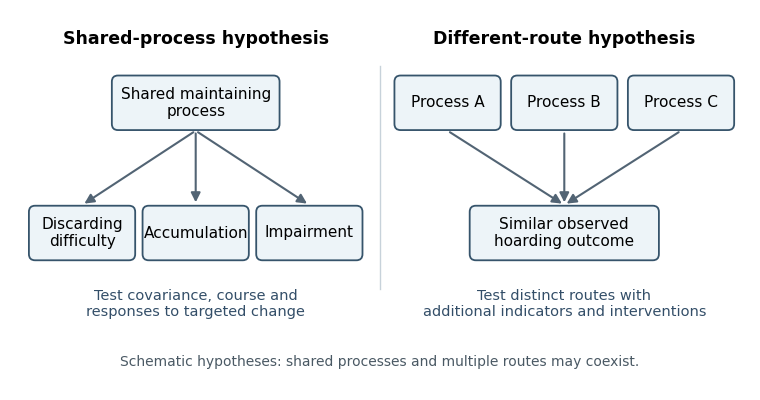

<h1 id="2/solution">Solution</h1>

↑ **Parent:** [2](../2.md)

**A recognizable [hoarding](../../../hoarding.md) syndrome can coexist with more than one causal route. Research must test whether there is a stable, informative pattern of mechanisms and predictions beyond the visible accumulation, rather than treating either a diagnostic label or heterogeneity alone as decisive.** The two accounts make their clearest differences when they predict additional features, trajectories or responses to [interventions](../../../treatment.md). A classification can be useful without asserting one necessary biological lesion in every affected person.

[Hoarding](../../../hoarding.md) describes persistent retention or accumulation that can compromise the use of living space. A clinical account additionally considers difficulty discarding, distress, impairment, acquisition and the reasons for retaining objects. Mere ownership of many objects is not enough: restricted space, poverty, collecting, the preferences of other household members and access to practical support affect clutter. These contextual determinants must be measured before a behavioral appearance is interpreted as a coherent [psychopathology](../../../psychopathology.md).

The [equifinality](../../../equifinality.md) account proposes that different processes converge on a similar outcome. Retention might express feared consequences of discarding, unusually strong attachment, difficulty making decisions or a loss of the capacity to organize possessions. These are candidate routes to examine, not diagnoses that can be inferred from a photograph of a room. A more coherent-disorder account predicts that a characteristic cluster of processes covaries, persists and explains incremental impairment beyond other conditions. It need not predict that every participant has every proposed process.

[Randy O. Frost](../../../randy-o-frost.md) and colleagues' original cognitive-behavioral model was explicitly multifactorial, linking information processing, attachment, avoidance and beliefs about possessions. The model therefore supplies hypotheses about processes rather than identifying one defining defect. It also shows why a simple contrast between “one disorder” and “many processes” can be misleading: a coherent account can include interacting mechanisms. The discriminating question is whether their joint structure has explanatory and predictive value.[1996; original four-part theoretical model](../../../a-cognitive-behavioral-model-of-compulsive-hoarding-by-randy-o-frost-and-others.md)

An initial study should recruit from community, medical and specialist services, not only an [obsessive-compulsive disorder](../../../obsessive-compulsive-disorder.md) clinic. It should compare primary [hoarding](../../../hoarding.md) presentations, [obsessive-compulsive disorder](../../../obsessive-compulsive-disorder.md) with [hoarding](../../../hoarding.md), [obsessive-compulsive disorder](../../../obsessive-compulsive-disorder.md) without [hoarding](../../../hoarding.md), relevant other clinical groups and nonclinical collectors. Blinded interviews, home observations and multiple informants would distinguish distress from household impairment and establish why objects are retained. Sampling across the severity range would help avoid making a diagnostic boundary look categorical merely because the study excluded intermediate cases.

[Alberto Pertusa](../../../alberto-pertusa.md) and colleagues compared clinical forms of [hoarding](../../../hoarding.md) and found that many presentations were distinguishable from [obsessive-compulsive disorder](../../../obsessive-compulsive-disorder.md), while some [hoarding](../../../hoarding.md) was closely tied to its characteristic [symptoms](../../../symptom.md). Apparent overlap with another diagnostic category could also arise from shared item content. This supports careful differential characterization and warns against assuming that all retention has the same function. Cross-sectional clinical separation, however, cannot by itself identify the developmental cause of either subgroup.[2008; clinical comparisons, OCD-related presentations and overlapping diagnostic items](../../../compulsive-hoarding-ocd-symptom-distinct-clinical-syndrome-or-both-by-alberto-pertusa-and-others.md)

Measurement should distinguish accumulation, [discarding difficulty](../../../discarding-difficulty.md), acquiring, emotional attachment and organizational problems. [Factor analysis](../../../factor-analysis.md) can ask whether a common dimension summarizes their covariance, while a [mixture model](../../../mixture-model.md) can test proposed subgroups. These models require out-of-sample prediction, [measurement invariance](../../../measurement-invariance.md) and comparison with plausible alternatives. A factor is not automatically a common cause: correlated indicators may arise because clutter itself increases avoidance and further impairs organization. Equally, identifying several factors does not refute a coherent syndrome. Statistical structure must be connected to mechanisms through additional evidence.

**[Figure 1](#2/image-alternative-hypotheses-about-a-shared-hoarding-outcome-schematic-possibilities-rather-than-established-subtypes). Alternative hypotheses about a shared hoarding outcome; schematic possibilities rather than established subtypes**.

There is a basic [identifiability](../../../identifiability.md) limit. Suppose $Y$ records a [symptom](../../../symptom.md) and a hidden pathway label is $Z$. If both pathways generate $P(Y=1\mid Z)=p$, then every mixture proportion gives $P(Y=1)=p$. A [symptom](../../../symptom.md)-only sample has [likelihood](../../../likelihood-function.md) $p^k(1-p)^{n-k}$ and cannot identify which pathway produced it. This does not prove that actual [hoarding](../../../hoarding.md) mechanisms are indistinguishable; it explains why [symptom equivalence does not establish mechanistic identity](../../../symptom-equivalence-does-not-establish-mechanistic-identity.md). Additional indicators, longitudinal observations or targeted perturbations are required to distinguish the proposed accounts.

An experimental approach can vary the ownership and emotional significance of possessions while holding perceptual features as similar as practicable. [David F. Tolin](../../../david-f-tolin.md) and colleagues studied binding keep/discard decisions for participants' own paper items and control items during [functional magnetic resonance imaging](../../../functional-magnetic-resonance-imaging.md), comparing [hoarding disorder](../../../hoarding-disorder.md), [obsessive-compulsive disorder](../../../obsessive-compulsive-disorder.md) and controls. Ownership changed the pattern: [hoarding](../../../hoarding.md) participants showed relatively reduced activity in [insular cortex](../../../insular-cortex.md) and [anterior cingulate cortex](../../../anterior-cingulate-cortex.md) for others' items but increased responses for their own. The actual possibility of shredding made the decision consequential.[2012; task instructions, binding decisions and ownership-dependent group differences](../../../neural-mechanisms-of-decision-making-in-hoarding-disorder-by-david-f-tolin-and-others.md)

This is more informative than comparing undifferentiated resting activity, but the result does not establish a unique [hoarding](../../../hoarding.md) mechanism. Ownership, anticipated loss, decision time and emotional significance differ together; restricting stimuli to paper limits [generalization](../../../generalization-in-statistical-learning.md). [Reverse inference](../../../reverse-inference.md) from an active region to a particular psychological process is especially weak without task controls. A stronger extension would independently vary ownership and experimentally established beliefs about usefulness, then test whether the predicted response generalizes to everyday decisions and alternative objects.

Longitudinal studies should measure proposed mechanisms before changes in accumulation and impairment. A coherent-mechanism account predicts that those measures explain subsequent change beyond baseline severity and other difficulties; a multiple-route account predicts reproducible pathways with different sequences. Repeated measurements could distinguish a vulnerability from a consequence of years of clutter. Family or biological associations might contribute, but shared liability is neither proof of one process nor a requirement that every case have the same origin.

Treatment studies offer a further test if they manipulate theoretically distinct components. [Gail Steketee](../../../gail-steketee.md) and colleagues randomized 46 participants to multicomponent [cognitive behavioral therapy](../../../cognitive-behavioral-therapy.md) or wait-list, finding a treatment advantage at the randomized comparison. The [intervention](../../../treatment.md) combined motivational work, organizing and problem-solving skills, discarding/nonacquisition exposure and cognitive work. That combination supports clinical benefit but does not reveal which component was necessary or which causal route it changed. Later improvement among completers must also be separated from the original randomized contrast.[2010; 12-week randomized comparison and subsequent 26-session treatment](../../../waitlist-controlled-trial-of-cognitive-behavior-therapy-for-hoarding-disorder-by-gail-steketee-and-others.md)

A [dismantling study](../../../dismantling-study.md) could compare matched packages with and without a hypothesized component, measuring its proposed mediator before the outcome. Prespecified treatment-by-mechanism interactions would test whether people with different retention functions require different components. Positive mediation remains vulnerable to mediator–outcome [confounding](../../../confounding.md), so improvement in a belief after treatment is weaker evidence than a manipulation that selectively changes that belief and the predicted behavior. Practical barriers and opportunity to discard must also be distinguished from psychological inability.

**The best resolution is comparative and predictive: test whether syndrome-level measures add reliable information and whether distinct mechanisms produce reproducible differential predictions.** Existing clinical, experimental and treatment evidence supports more specificity than an undifferentiated “clutter” endpoint, while leaving room for multiple routes. A useful diagnosis and an equifinal behavior are compatible; what needs testing is the scope and precision of the mechanism claimed.

## ↑ Ancestors (11)

1. [2](../2.md)
2. [2022](../../2022-split.md)
3. [Past exam of the beliefs, behaviours and biology course of the University of Oxford](../../split.md)
4. [Beliefs, behaviours and biology course of the University of Oxford](../../../beliefs-behaviours-and-biology-course-of-the-university-of-oxford.md)
5. [Year 3 of the psychology (experimental) course of the University of Oxford](../../../year-3-of-the-psychology-experimental-course-of-the-university-of-oxford.md)
6. [Psychology (experimental) course of the University of Oxford](../../../psychology-experimental-course-of-the-university-of-oxford.md)
7. [Undergraduate course of the University of Oxford](../../../undergraduate-course-of-the-university-of-oxford.md)
8. [Course of the University of Oxford](../../../course-of-the-university-of-oxford.md)
9. [University of Oxford](../../../university-of-oxford-split.md)
10. [List of universities](../../../list-of-universities.md)
11. [Codex Wiki](../../../split.md)
