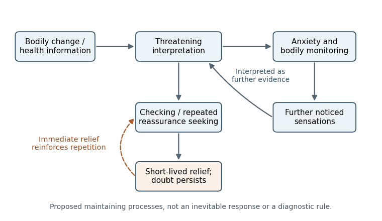

<h1 id="4/solution">Solution</h1>

↑ **Parent:** [4](../4.md)

**Valuing health does not entail interpreting every sensation as evidence of grave disease. Intense [health anxiety](../../../health-anxiety.md) depends on how [probability](../../../probability.md), consequences, [coping](../../../coping.md) and uncertainty are appraised, and on whether [attention](../../../attention.md) and [safety behavior](../../../safety-behavior.md) create a self-confirming cycle.** Understanding ordinary calibration suggests treatment targets that preserve sensible health care while reducing disabling certainty seeking. The contrast is between ways of responding to uncertainty, not between caring about health and being indifferent to it.

Bodily signals are ambiguous. A change may have several explanations, and a very serious possible outcome can still be unlikely given a particular cue. The severity of a consequence and the [conditional probability](../../../conditional-probability.md) of its occurrence are distinct quantities. In a simple Bayesian illustration, let $D$ be an imaginary illness and $S$ an ambiguous signal. Then

$$
P(D\mid S)=\frac{P(S\mid D)P(D)}{P(S\mid D)P(D)+P(S\mid\neg D)P(\neg D)}.
$$

If, purely for illustration, $P(D)=0.001$, $P(S\mid D)=0.5$ and $P(S\mid\neg D)=0.1$, the [posterior probability](../../../posterior-probability.md) is about $0.00498$. These invented values are not estimates for any actual [symptom](../../../symptom.md) or illness. They show why knowing that a disease can produce a signal does not establish that the signal probably means that disease.

Ordinary calibration also involves alternatives, changing information and [coping](../../../coping.md). People can judge a [symptom](../../../symptom.md) worth evaluating without assuming that only a guarantee of safety would permit normal activity. They may interpret a sensation in the context of recent activity, retain a distinction between possibility and [probability](../../../probability.md), and revise their belief when appropriate evidence arrives. These are functional contrasts, not an assertion that everyone without [severe health anxiety](../../../severe-health-anxiety.md) performs explicit Bayesian calculations or is always accurate. Neither realistic risk nor a prior medical experience automatically produces disabling [anxiety](../../../anxiety.md).

The cognitive model of [health anxiety](../../../health-anxiety.md) identifies a different pattern: an illness interpretation increases [anxiety](../../../anxiety.md) and [somatic hypervigilance](../../../somatic-hypervigilance.md); those responses increase the salience of sensations; further sensations are treated as corroboration. [Reassurance seeking](../../../reassurance-seeking.md), repeated checking or avoidance can provide immediate relief while leaving the underlying interpretation untested. [Hilary Warwick](../../../hilary-warwick.md) and colleagues proposed this maintenance account as an alternative to conceptualizing the difficulty merely as insufficient medical information. It explains why adding another statement of reassurance may not have the same effect as changing how evidence is interpreted.[1990; proposed attentional, interpretive and behavioral maintenance processes](../../../hypochondriasis-by-hilary-warwick-and-others.md)

**[Figure 2](#4/image-a-proposed-maintenance-cycle-for-health-anxiety-arrows-represent-testable-processes-not-inevitable-responses-to-bodily-changes). A proposed maintenance cycle for health anxiety; arrows represent testable processes, not inevitable responses to bodily changes**.

[Intolerance of uncertainty](../../../intolerance-of-uncertainty.md) can raise the required standard of evidence beyond what medical investigation can supply. If every residual possibility demands another check, a negative result can be reinterpreted as the wrong test, the wrong time or a missed condition. This account predicts repeated doubt despite short-term relief, rather than the absence of genuine concern or comprehension. It also explains a possible paradox: a response chosen to reduce [anxiety](../../../anxiety.md) can maintain the demand for certainty. The person's reason for the behavior must be established; the same observable action could be proportionate care in another context.

An appropriate formulation therefore distinguishes the presence of physical illness, the degree of concern and the pattern of maintaining responses. These are not mutually exclusive categories. [Paul Salkovskis](../../../paul-salkovskis.md) and colleagues developed the [Health Anxiety Inventory](../../../health-anxiety-inventory.md) to measure [health anxiety](../../../health-anxiety.md) across relevant clinical and medical samples rather than simply counting bodily [symptoms](../../../symptom.md). The validation studies compared several [anxiety](../../../anxiety.md) presentations, examined sensitivity to change and included people seeking help for physical illness. This supports measuring the psychological response separately from a conclusion about whether a disease exists. A [questionnaire](../../../questionnaire.md) still does not replace clinical assessment.[2002; clinical comparisons, treatment sensitivity and physical-illness samples](../../../the-health-anxiety-inventory-development-and-validation-of-scales-for-the-measurement-of-health-anxiety-and-hypochondriasis-by-paul-salkovskis-and-others.md)

Treatment implications follow as hypotheses about [learning](../../../learning.md). Collaborative [cognitive behavioral therapy](../../../cognitive-behavioral-therapy.md) can identify the feared interpretation, the alternative account and what would distinguish them. A [behavioral experiment](../../../behavioral-experiment.md) should test a specified prediction about [attention](../../../attention.md) or a [safety behavior](../../../safety-behavior.md), rather than require the person to prove that future illness is impossible. [Attention](../../../attention.md) can be examined as a process that changes experience, not as a declaration that every sensation is caused by [attention](../../../attention.md). Likewise, reducing a repetitive reassurance cycle is different from withholding a needed explanation or discouraging appropriate medical evaluation.

The therapeutic stance is consequently important. Dismissing a [symptom](../../../symptom.md) can reinforce the belief that the danger has not been understood. A shared formulation can instead acknowledge the sensation, explain how [anxiety](../../../anxiety.md) may amplify it and leave room to revise the account. Appropriate information may be useful, but the aim is a more flexible standard for updating and [coping](../../../coping.md). This also makes the account falsifiable: if the predicted relationship between a response and the difficulty is not observed, the formulation should be reconsidered rather than blaming the person for failing to improve.

[Erik Hedman](../../../erik-hedman.md) and colleagues randomized 81 people with [severe health anxiety](../../../severe-health-anxiety.md) to therapist-guided internet [cognitive behavioral therapy](../../../cognitive-behavioral-therapy.md) or an [attention](../../../attention.md)-control condition over 12 weeks. The treatment produced a substantially greater reduction in [health anxiety](../../../health-anxiety.md) on the study measures. This gives evidence beyond the intuitive plausibility of the model and suggests that extensive face-to-face contact is not necessary for every effective delivery format. The trial does not isolate every [treatment component](../../../treatment-component.md) or show that internet delivery suits every patient, and a selected trial sample limits [generalization](../../../generalization-in-statistical-learning.md).[2011; masked-assessment randomized comparison, attention control and Health Anxiety Inventory outcome](../../../internet-based-cognitive-behavioural-therapy-for-severe-health-anxiety-randomised-controlled-trial-by-erik-hedman-and-others.md)

The CHAMP medical-outpatient trial provides a complementary setting in which physical illness was permitted. Its [health anxiety](../../../health-anxiety.md) benefit reinforces the distinction between addressing an anxious maintenance cycle and denying medical disease. However, [symptom](../../../symptom.md) improvement, functioning, costs and quality of life are different outcomes and should not be collapsed into one claim of success. The model should also accommodate social circumstances and access to care: repeated concern in a setting where appropriate assessment is unavailable cannot simply be assumed to reflect an internal [cognitive bias](../../../cognitive-bias.md).[2017; medical eligibility, symptom follow-up and distinct economic endpoints](../../../cognitive-behaviour-therapy-for-health-anxiety-in-medical-patients-champ-a-randomised-controlled-trial-with-outcomes-to-5-years-by-peter-tyrer-and-others.md)

**The useful clue from ordinary responding is the ability to combine concern with proportionate interpretation, evidence updating and tolerable uncertainty.** A mechanistic treatment account aims to restore those functions by testing interpretations and changing maintaining responses, with appropriate medical collaboration. It does not promise certainty, identify all bodily [symptoms](../../../symptom.md) as benign, or treat [anxiety](../../../anxiety.md) as evidence that a person's health concern is invalid.

## ↑ Ancestors (11)

1. [4](../4.md)
2. [2022](../../2022-split.md)
3. [Past exam of the beliefs, behaviours and biology course of the University of Oxford](../../split.md)
4. [Beliefs, behaviours and biology course of the University of Oxford](../../../beliefs-behaviours-and-biology-course-of-the-university-of-oxford.md)
5. [Year 3 of the psychology (experimental) course of the University of Oxford](../../../year-3-of-the-psychology-experimental-course-of-the-university-of-oxford.md)
6. [Psychology (experimental) course of the University of Oxford](../../../psychology-experimental-course-of-the-university-of-oxford.md)
7. [Undergraduate course of the University of Oxford](../../../undergraduate-course-of-the-university-of-oxford.md)
8. [Course of the University of Oxford](../../../course-of-the-university-of-oxford.md)
9. [University of Oxford](../../../university-of-oxford-split.md)
10. [List of universities](../../../list-of-universities.md)
11. [Codex Wiki](../../../split.md)
