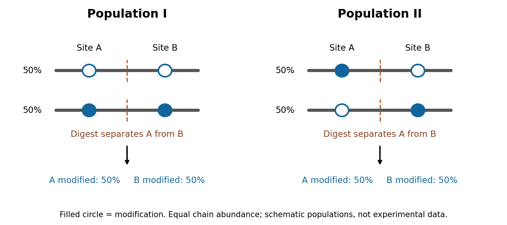

# Paper 1

↑ **Parent:** [2024](../2024.md)

[Original paper, released PDF pages 5–6](https://www.whatdotheyknow.com/request/natural_science_tripos_part_ii_p_2/response/3113356/attach/4/FOI%202025%20634%20Vongtanakiat%20materials.pdf?cookie_passthrough=1#page=5)

**Table of contents**

- [Section I](#section-i)
  - [1](#section-i/1)
    - [Solution](#section-i/1/solution)
  - [2](#section-i/2)
    - [Solution](#section-i/2/solution)
- [Section II](#section-ii)
  - [3](#section-ii/3)
    - [Solution](#section-ii/3/solution)
  - [4](#section-ii/4)
    - [Solution](#section-ii/4/solution)
  - [5](#section-ii/5)
    - [Solution](#section-ii/5/solution)
  - [6](#section-ii/6)
    - [Solution](#section-ii/6/solution)
  - [7](#section-ii/7)
    - [Solution](#section-ii/7/solution)

## Section I

↑ **Parent:** [Paper 1](paper-1.md)

<h3 id="section-i/1">1</h3>

↑ **Parent:** [Section I](#section-i)

<h4 id="section-i/1/solution">Solution</h4>

↑ **Parent:** [1](#section-i/1)

**These pathways are tractable at several distinct levels, but selective [target engagement](../../biology.md#target-engagement) and a useful [therapeutic window](../../biology.md#therapeutic-window) must both be demonstrated.** A [G protein-coupled receptor](../../protein.md#g-protein-coupled-receptor) acts as a [guanine nucleotide exchange factor](../../protein.md#guanine-nucleotide-exchange-factor) for a [heterotrimeric G protein](../../protein.md#heterotrimeric-g-protein): release of [GDP](../../molecule.md#guanosine-diphosphate) permits [GTP](../../molecule.md#guanosine-triphosphate) binding, changing the interactions of both the [G protein alpha subunit](../../protein.md#g-protein-alpha-subunit) and [Gβγ](../../protein.md#g-protein-beta-gamma-complex) with effectors. [GTPase-activating proteins](../../protein.md#gtpase-activating-protein), including regulators of [G protein](../../protein.md#g-protein) signalling, accelerate return to the [GDP](../../molecule.md#guanosine-diphosphate)-bound state. [Gαs](../../protein.md#g-alpha-s) can stimulate [adenylyl cyclase](../../enzyme.md#adenylyl-cyclase), [Gαi](../../protein.md#g-alpha-i) can inhibit it, and [Gαq](../../protein.md#g-alpha-q) can activate [phospholipase C](../../enzyme.md#phospholipase-c), linking receptor occupancy to different intracellular responses. The related [small GTPases](../../protein.md#small-gtpase), such as [Ras](../../protein.md#ras), also alternate between [GDP](../../molecule.md#guanosine-diphosphate)- and [GTP](../../molecule.md#guanosine-triphosphate)-bound states, but are monomeric switches with different activators and effectors. Strategies effective against one family cannot simply be assumed to work against the other.

The receptor is often the most accessible intervention point. An [orthosteric antagonist](../../protein.md#orthosteric-antagonist) competes with the endogenous [ligand](../../protein.md#ligand-biochemistry); an [agonist](../../protein.md#agonist) activates a deficient response, while a [partial agonist](../../protein.md#partial-agonist) can produce an intermediate response and antagonize a higher-efficacy [agonist](../../protein.md#agonist). For example, [beta-adrenergic receptor](../../protein.md#beta-adrenergic-receptor) blockade reduces adrenergic stimulation of the heart. However, conserved binding pockets make receptor-subtype selectivity difficult, and the same receptor can have useful and harmful functions in different tissues. An [allosteric modulator](../../protein.md#allosteric-modulator) binds elsewhere and changes the affinity or efficacy of the endogenous [ligand](../../protein.md#ligand-biochemistry). This can exploit a less conserved pocket and preserve the timing of endogenous release; it does not automatically confer tissue specificity or a ceiling on toxicity. Structural studies of the [beta-2 adrenergic receptor](../../protein.md#beta-2-adrenergic-receptor) show why stabilizing particular receptor conformations can change coupling rather than merely change occupancy.[Conformational intermediates examined by spectroscopy](../../biology-bibliography.md#structural-insights-into-the-dynamic-process-of-beta-2-adrenergic-receptor-signaling-by-aashish-manglik-and-others)

[biased agonism](../../protein.md#biased-agonism) aims to favour one signalling output over another, for example [G protein](../../protein.md#g-protein) activation relative to [arrestin](../../protein.md#arrestin) recruitment. An opioid study found that [TRV130](../../protein.md#trv130) combined analgesia with reduced respiratory and gastrointestinal effects in rodent comparisons with morphine.[Preclinical signalling and equianalgesic comparisons](../../biology-bibliography.md#a-g-protein-biased-ligand-at-the-mu-opioid-receptor-is-potently-analgesic-with-reduced-gastrointestinal-and-respiratory-dysfunction-compared-with-morphine-by-scott-m-dewire-and-others) The inference that bias itself causes improved safety requires caution: different assays have different amplification and [receptor reserve](../../protein.md#receptor-reserve). Later direct measurements showed that low intrinsic [G protein](../../protein.md#g-protein) efficacy can explain favourable profiles of several proposed biased opioids.[Comparison of intrinsic efficacy and apparent bias](../../biology-bibliography.md#low-intrinsic-efficacy-for-g-protein-activation-can-explain-the-improved-side-effect-profiles-of-new-opioid-agonists-by-alexander-gillis-and-others) A convincing experiment therefore compares [ligands](../../protein.md#ligand-biochemistry) with a common reference, matched receptor abundance and time courses, and proximal measurements of both pathways; it then tests benefit and toxicity at comparable effective exposures. An [arrestin](../../protein.md#arrestin) recruitment assay alone cannot predict an entire clinical adverse-effect profile.

Direct inhibition of the switch is also possible. Competing at a nucleotide-binding site is difficult because intracellular [nucleotides](../../molecule.md#nucleotide) are abundant and binding is tight. Nevertheless, an alternative pocket can trap a particular state. [YM-254890](../../protein.md#ym-254890) binds an interdomain cleft of [Gαq](../../protein.md#g-alpha-q) and inhibits nucleotide exchange by stabilizing the [GDP](../../molecule.md#guanosine-diphosphate)-bound arrangement. Structural analysis, exchange measurements and tests against other [G protein](../../protein.md#g-protein) families connect binding to mechanism, rather than inferring [Gαq](../../protein.md#g-alpha-q) inhibition from a fall in a distant calcium response.[Structure and biochemical inhibition of GDP release](../../biology-bibliography.md#structural-basis-for-the-specific-inhibition-of-heterotrimeric-gq-protein-by-a-small-molecule-by-akiyuki-nishimura-and-others) This illustrates chemical tractability, although inhibiting a widely used Gα family could impair normal signalling in many tissues. Targeting an interaction with a particular receptor, exchange factor or effector may give greater contextual selectivity.

A complementary example is covalent inhibition of mutant [Ras](../../protein.md#ras). [AMG 510](../../protein.md#amg-510) exploits a pocket adjacent to cysteine 12 in [KRAS G12C](../../protein.md#kras-g12c-protein) and favours the inactive [GDP](../../molecule.md#guanosine-diphosphate)-bound [protein](../../protein.md). Its mutant-selective chemistry avoids requiring a nucleotide competitor, and biochemical, cellular and animal experiments connected the compound with suppression of signalling and tumour growth.[Mutant-selective binding and antitumour experiments](../../biology-bibliography.md#the-clinical-kras-g12c-inhibitor-amg-510-drives-anti-tumour-immunity-by-jude-canon-and-others) This solution depends on the reactive cysteine and the accessibility of the trapped state; it is not a universal inhibitor of all [Ras](../../protein.md#ras) [mutations](../../genetics.md#mutation). Exchange activity, pathway feedback, alternative signalling and additional [mutations](../../genetics.md#mutation) can change sensitivity. Moreover, a monomeric [Ras](../../protein.md#ras) inhibitor is evidence about a broader GTPase strategy, not evidence that all [heterotrimeric G proteins](../../protein.md#heterotrimeric-g-protein) have equivalent pockets.

Other possible interventions include blocking selected [Gβγ](../../protein.md#g-protein-beta-gamma-complex)–effector contacts, enhancing a suitable [GTPase-activating protein](../../protein.md#gtpase-activating-protein), preventing [cell membrane](../../cell-membrane.md) recruitment, or inhibiting a downstream [enzyme](../../enzyme.md). Each trades accessibility against specificity: a downstream convergence point can bypass an inaccessible upstream lesion, but may suppress useful signals from many receptors. To select between these strategies, establish the disease-dependent molecular state, measure direct binding and exchange or [hydrolysis](../../chemical-reaction.md#hydrolysis), and confirm the predicted proximal output. Use an inhibitor-resistant rescue allele, an isogenic target-negative control, and counterscreens against related switches and unrelated cytotoxicity. Follow this with [target engagement](../../biology.md#target-engagement) in the relevant tissue and measurements of normal physiological responses. **The strongest therapeutic case combines a drug-accessible pocket or interface with a disease-specific dependence; pathway membership alone is insufficient.**

<h3 id="section-i/2">2</h3>

↑ **Parent:** [Section I](#section-i)

<h4 id="section-i/2/solution">Solution</h4>

↑ **Parent:** [2](#section-i/2)

**[weak biomolecular binding](../../protein.md#weak-biomolecular-binding) is useful because it makes molecular recognition reversible, responsive to concentration and compatible with rapid exchange.** Here “weak” describes a relatively high [dissociation constant](../../chemical-potential.md#dissociation-constant) for an individual biomolecular contact, not the fundamental weak force. For a simple reversible association $A+B\rightleftharpoons AB$,

$$
K_d=\frac{[A][B]}{[AB]}=\frac{k_{\mathrm{off}}}{k_{\mathrm{on}}},\qquad f_A=\frac{[B]}{K_d+[B]},\qquad \tau=\frac{1}{k_{\mathrm{off}}}.
$$

Here $k_{\mathrm{on}}$ is the [association rate constant](../../chemical-kinetics.md#association-rate-constant) and $k_{\mathrm{off}}$ is the [dissociation rate constant](../../chemical-kinetics.md#dissociation-rate-constant). The bound fraction assumes free $B$ is known and binding sites are equivalent and independent; the lifetime assumes a single exponentially dissociating state without rebinding. A contact with $K_d=10\,\mu\mathrm M$ is half occupied at a free partner concentration of $10\,\mu\mathrm M$, but only about 1% occupied at $0.1\,\mu\mathrm M$. Recruiting the partners to a [cell membrane](../../cell-membrane.md) or scaffold can therefore turn binding on locally without changing their chemistry. Importantly, the same $K_d$ can result from different on- and off-rates: weak equilibrium binding does not by itself prove rapid dissociation.

This responsiveness supports signalling. Short recognition motifs in [disordered regions](../../protein.md#intrinsically-disordered-region) can bind adaptor domains with modest affinity. A [phosphorylation](../../chemical-reaction.md#phosphorylation) event can create a docking motif; subsequent dephosphorylation removes it. Partners can then exchange rather than remain permanently trapped in one complex. Several individually selective contacts allow the same [protein](../../protein.md) to be recruited in different combinations and at different times. Sequence-specific [hydrogen bonding](../../chemical-bond.md#hydrogen-bonding), electrostatic complementarity and shape recognition still discriminate between partners, even when total binding [free energy](../../thermodynamic-potential.md#thermodynamic-free-energy) is modest. Conversely, nonspecific contacts can be useful during a search: reversible association with [DNA](../../polymer.md#deoxyribonucleic-acid) confines a [DNA-binding protein](../../protein.md#dna-binding-protein) near possible targets, provided escape is fast enough to avoid sequestration on incorrect sites.

Weak contacts also solve turnover problems. An [enzyme](../../enzyme.md) must stabilize a productive [substrate](../../enzyme.md#substrate-biochemistry) arrangement and the [transition state](../../chemical-kinetics.md#transition-state), yet release its product. Excessively tight ground-state or product binding can slow the overall cycle. A [chaperone](../../protein.md#chaperone-protein) must capture exposed hydrophobic surfaces but subsequently release a client for folding or transfer. Thus maximal affinity is generally not the design objective; relative affinities and switching kinetics must match the sequence of tasks. Energy-consuming cycles can bias capture and release, while each individual binding step remains reversible.

Several weak contacts can collectively give strong, selective attachment through [avidity](../../protein.md#avidity). Once the first contact forms, tethering presents a second partner at an [effective local concentration](../../protein.md#effective-local-concentration) $C_{\mathrm{eff}}$. In a simple two-contact model, the relative statistical weight of the doubly bound state contains a factor $C_{\mathrm{eff}}/K_{d,2}$. Geometry, linker flexibility and accessibility determine this factor, so affinities cannot simply be added. Breaking one contact need not release the whole assembly; rapid local rebinding can stabilize an otherwise short-lived complex. Yet removing a modification or changing geometry can disassemble it. This is useful for a reversible scaffold, [cell](../../biological-cell.md) attachment or recognition of a particular pattern of modifications.

The yeast inhibitor [Sic1](../../cell-cycle.md#sic1) gives a particularly instructive example of weak recognition creating a regulatory threshold. Multiple [phosphodegrons](../../biochemistry.md#phosphodegron) contribute to recognition by [Cdc4](../../protein.md#cdc4), the [substrate](../../enzyme.md#substrate-biochemistry) receptor of a [ubiquitin ligase](../../protein.md#ubiquitin-ligase). Accumulation of [phosphorylation](../../chemical-reaction.md#phosphorylation) can make degradation strongly responsive to [cyclin-dependent kinase](../../enzyme.md#cyclin-dependent-kinase) activity, whereas replacing the distributed weak recognition system by an overly strong motif can compromise appropriate timing.[Sic1 phosphodegrons, Cdc4 binding and cell-cycle threshold](../../biology-bibliography.md#multisite-phosphorylation-of-a-cdk-inhibitor-sets-a-threshold-for-the-onset-of-dna-replication-by-piers-nash-and-others) The benefit is therefore a controlled decision, not merely stronger binding after adding more sites. The mechanism also illustrates why affinity measurements on one isolated [peptide](../../protein.md#peptide) need not predict full-length [substrate](../../enzyme.md#substrate-biochemistry) behaviour.

Multivalent weak interactions can additionally produce a collective assembly transition. Experiments with [nephrin](../../cell-membrane.md#nephrin), the adaptor [Nck](../../protein.md#nck) and [N-WASP](../../protein.md#n-wasp) showed concentration- and valency-dependent assembly coupled to [actin](../../protein.md#actin) regulation.[Reconstitution of multivalent signalling assemblies](../../biology-bibliography.md#phase-transitions-in-the-assembly-of-multivalent-signalling-proteins-by-pilong-li-and-others) [biomolecular phase separation](../../critical-phenomenon.md#biomolecular-phase-separation) can locally concentrate reaction partners while allowing exchange with the surroundings. However, visible droplets or [fluorescence](../../fluorescence.md) recovery alone do not establish that a cellular structure is a functional liquid phase. Reconstitution should vary concentration and valency, measure partitioning and reversibility, and include binding-defective mutants. Cellular tests must establish the relevant endogenous concentrations and show that disrupting the proposed contacts changes function without simply destroying the [protein](../../protein.md).

Experimentally, [isothermal titration calorimetry](../../biology.md#isothermal-titration-calorimetry) can estimate binding thermodynamics, while [surface plasmon resonance](../../biology.md#surface-plasmon-resonance) or solution kinetic measurements can resolve association and dissociation. For weak contacts, high concentrations make aggregation, nonspecific surface binding and [ligand](../../protein.md#ligand-biochemistry) depletion important controls; a failure to retain a complex during purification is not proof that it never forms. Measurements in dilute solution should be compared with full-length partners, [cell membranes](../../cell-membrane.md) or scaffolds where appropriate. **Weak interactions provide adjustable, combinatorial recognition; localization, [multivalency](../../protein.md#multivalency) and regulated modification convert that flexibility into reliable biological behaviour.**

## Section II

↑ **Parent:** [Paper 1](paper-1.md)

<h3 id="section-ii/3">3</h3>

↑ **Parent:** [Section II](#section-ii)

<h4 id="section-ii/3/solution">Solution</h4>

↑ **Parent:** [3](#section-ii/3)

**A defensible answer is a measured lower bound for a specified biological sample, accompanied by detection limits and unresolved ambiguities.** A [proteoform](../../biochemistry.md#proteoform) is a molecular form of a [protein](../../protein.md) defined by its [amino acid](../../chemical-substance.md#amino-acid) sequence and covalent modifications, including processing. It is not simply a [gene](../../genetics.md#gene), a [peptide](../../protein.md#peptide), a charge state in a mass spectrum or a conformational state. The number in one [cell](../../biological-cell.md) type at one time differs from the union across [cell](../../biological-cell.md) types, developmental stages, diseases and human genotypes. Before counting, specify whether rare molecular damage, incompletely processed intermediates and very low abundance species are included, and whether the question concerns individual [cells](../../biological-cell.md) or a pooled population.

A theoretical inventory starts with the [genome](../../molecular-genetics.md#genome), phased sequence variants and transcript structures. [whole-genome sequencing](../../molecular-genetics.md#whole-genome-sequencing) identifies coding variation; [RNA sequencing](../../molecular-genetics.md#rna-sequencing), especially full-length [long-read sequencing](../../molecular-genetics.md#long-read-sequencing), can connect alternative exons within individual transcripts. [ribosome profiling](../../biology.md#ribosome-profiling) supplies evidence that candidate [reading frames](../../molecular-genetics.md#reading-frame) are translated. However, an [RNA](../../polymer.md#ribonucleic-acid) isoform is not proof of a stable [protein](../../protein.md), and none of these methods alone establishes the combination of [post-translational modifications](../../protein.md#post-translational-modification) on the mature chain. A schematic upper bound is

$$
N_{\mathrm{possible}}=\sum_i\prod_{j=1}^{m_i}(1+r_{ij}),
$$

where $i$ indexes distinct sequence forms and site $j$ permits an unmodified state plus $r_{ij}$ mutually exclusive modified states. This assumes independence between sites and that every combination is realizable. Steric constraints, processing, mutually exclusive pathways and low occupancy invalidate that assumption in real [cells](../../biological-cell.md). Multiplying all documented sites therefore estimates a possible space, not the number that exists.

[bottom-up proteomics](../../biochemistry.md#bottom-up-proteomics) provides a broad experimental survey. Extract [proteins](../../protein.md) under conditions that minimize [proteolysis](../../biochemistry.md#proteolysis) and preserve labile modifications; fractionate, digest with complementary [proteases](../../enzyme.md#protease), and analyse [peptides](../../protein.md#peptide) by [liquid chromatography-mass spectrometry](../../chemistry.md#liquid-chromatography-mass-spectrometry) and [tandem mass spectrometry](../../chemistry.md#tandem-mass-spectrometry). Search against a sample-specific sequence database and relevant modification hypotheses, then validate sites with diagnostic fragments and, where needed, synthetic standards. Modification-specific enrichment increases sensitivity but changes the sampled population and cannot supply an unbiased count by itself. Control peptide- and protein-level [false discovery rates](../../statistical-hypothesis-test.md#false-discovery-rate), distinguish unique from shared [peptides](../../protein.md#peptide), and report ambiguously localized modifications explicitly. Enlarging a search to every possible modification greatly increases the chance of a convincing but incorrect match.

The central limitation is loss of linkage. Suppose sites A and B occur on different digestion products. A mixture containing equal amounts of unmodified and doubly modified chains gives 50% modification at each site. A different mixture containing equal amounts of A-only and B-only chains gives exactly the same site occupancies, but contains different intact forms. No amount of more precise measurement of these two isolated [peptides](../../protein.md#peptide) distinguishes the populations. A spanning [peptide](../../protein.md#peptide), a larger linked fragment or intact-chain evidence is required.

**[Figure 1](#section-ii/3/image-different-intact-proteoform-populations-can-give-identical-modification-frequencies-after-digestion). Different intact proteoform populations can give identical modification frequencies after digestion**.

[top-down proteomics](../../biochemistry.md#top-down-proteomics) addresses this by separating and measuring intact [proteins](../../protein.md) before fragmenting their selected ions. High-resolution intact mass constrains the total composition, while sequence fragments connect modifications to the same molecule and localize them. Electron-based fragmentation can help retain modifications lost during energetic fragmentation. [middle-down proteomics](../../biochemistry.md#middle-down-proteomics) uses larger fragments to recover partial linkage when complete intact-chain characterization is difficult. [John C. Tran](../../biochemistry.md#john-c-tran) and colleagues demonstrated discovery-scale intact-protein analysis, illustrating that sequence variants and modification patterns can be mapped together rather than reconstructed solely from disconnected [peptides](../../protein.md#peptide).[Intact-protein fractionation and identification of linked isoforms](../../biology-bibliography.md#mapping-intact-protein-isoforms-in-discovery-mode-using-top-down-proteomics-by-john-c-tran-and-others) Intact mass alone remains insufficient: positional [isomers](../../chemistry.md#isomer) with the same mass require informative fragmentation or additional separation, and one envelope can contain unresolved forms.

A practical programme would combine these measurements across well-defined human [cell](../../biological-cell.md) populations, using biological replicates, standardized handling and a documented range of physiological perturbations. It would use sequence-resolved [RNA](../../polymer.md#ribonucleic-acid) data to constrain searches, broad bottom-up data to locate promising variation, and targeted top-down or middle-down analysis to establish co-occurrence. Spike-in [proteins](../../protein.md) spanning abundances and sizes would measure extraction loss and detection sensitivity. Time courses, immediate [protein denaturation](../../protein.md#denaturation-biochemistry), [protease](../../enzyme.md#protease) and [phosphatase](../../enzyme.md#phosphatase) inhibition, and processing blanks would help distinguish cellular modification from [oxidation](../../chemical-reaction.md#oxidation), [protein deamidation](../../protein.md#protein-deamidation) or cleavage during preparation. Very large, hydrophobic and scarce [proteins](../../protein.md) require specific extraction and separation strategies; their absence from a spectrum cannot be treated as biological absence.

Bulk and single-cell measurements answer different questions. A bulk sample may show two [proteoforms](../../biochemistry.md#proteoform) expressed in different [cells](../../biological-cell.md); it does not show that both occur in each [cell](../../biological-cell.md). Conversely, detecting two modifications in one [cell](../../biological-cell.md) does not demonstrate that they occupy the same [protein](../../protein.md) molecule. Single-cell sensitivity and molecular linkage must therefore be evaluated separately. Quantitative standards and targeted follow-up can establish whether a new low-abundance assignment is reproducible rather than a one-off incorrect match.

Finally, merge identifications by molecular identity rather than by [peptide](../../protein.md#peptide) count, search-engine entry or ion charge. Record fully characterized forms separately from groups sharing an unresolved mass or site pattern, and control identification error at the [proteoform](../../biochemistry.md#proteoform) level. Plot discovery against sampling depth, tissues and perturbations; any extrapolation to unseen forms requires explicit assumptions about abundance and sampling heterogeneity. **Sequence prediction supplies candidates, [peptide](../../protein.md#peptide) analysis supplies coverage, and intact or linked-fragment evidence establishes combinations. A universal exact count cannot be inferred by multiplying modification sites or summing database entries.**

<h3 id="section-ii/4">4</h3>

↑ **Parent:** [Section II](#section-ii)

<h4 id="section-ii/4/solution">Solution</h4>

↑ **Parent:** [4](#section-ii/4)

**I would increase the supply of correctly matured [translation elongation factor P](../../biological-cell.md#translation-elongation-factor-p) in a bacterial production system whose target [proteins](../../protein.md) contain [EF-P](../../biological-cell.md#translation-elongation-factor-p)-sensitive [proline](../../chemical-substance.md#proline) motifs.** This is a concrete proposal to relieve a catalytic bottleneck while preserving the machinery that selects the correct [aminoacyl-tRNA](../../polymer.md#aminoacyl-trna). Its benefit should be tested for the chosen products rather than asserted for every [protein](../../protein.md) or organism.

The rationale is that adjacent [prolines](../../chemical-substance.md#proline) are difficult [substrates](../../enzyme.md#substrate-biochemistry) for peptide-bond formation. [EF-P](../../biological-cell.md#translation-elongation-factor-p) binds the [ribosome](../../biological-cell.md#ribosome) near the [peptidyl-tRNA](../../polymer.md#peptidyl-trna) and assists productive peptide-bond formation at susceptible sequences. [Lili K. Doerfel](../../biochemistry.md#lili-k-doerfel) and colleagues used defined [biological translation](../../molecular-genetics.md#translation-biology) reactions and engineered [substrates](../../enzyme.md#substrate-biochemistry) to connect [EF-P](../../biological-cell.md#translation-elongation-factor-p) with rapid synthesis through consecutive [prolines](../../chemical-substance.md#proline); [Susanne Ude](../../biochemistry.md#susanne-ude) and colleagues showed relief of polyproline-dependent stalling and physiological regulation of the bacterial [protein](../../protein.md) [CadC](../../protein.md#cadc).[Defined peptide-bond formation and proline-containing substrates](../../biology-bibliography.md#ef-p-is-essential-for-rapid-synthesis-of-proteins-containing-consecutive-proline-residues-by-lili-k-doerfel-and-others)[Polyproline stalls and CadC expression](../../biology-bibliography.md#translation-elongation-factor-ef-p-alleviates-ribosome-stalling-at-polyproline-stretches-by-susanne-ude-and-others) Increasing functional [EF-P](../../biological-cell.md#translation-elongation-factor-p) is therefore mechanistically different from weakening decoding discrimination or accelerating rejection-sensitive steps indiscriminately.

I would first establish the limiting step in a reconstituted bacterial [biological translation](../../molecular-genetics.md#translation-biology) system, holding the [mRNA](../../polymer.md#messenger-rna), [ribosome](../../biological-cell.md#ribosome) concentration, initiation factors, charged tRNA supply and energy regeneration constant. Titrate correctly modified [EF-P](../../biological-cell.md#translation-elongation-factor-p) against the unmodified or inactive factor. For an [Escherichia coli](../../organism.md#escherichia-coli) production strain, coordinate [EF-P](../../biological-cell.md#translation-elongation-factor-p) expression with its native maturation [enzymes](../../enzyme.md): increasing an inactive, insufficiently modified pool may add burden without relieving stalls. Introduce the change in a tunable manner and verify both [EF-P](../../biological-cell.md#translation-elongation-factor-p) abundance and its modification state by targeted [mass spectrometry](../../chemistry.md#mass-spectrometry). This is an engineering proposal based on demonstrated factor function; the cited experiments do not establish that overexpression will improve every industrial production strain.

A simple throughput calculation makes the scope explicit. If a [ribosome](../../biological-cell.md#ribosome) needs $T_0$ for ordinary elongation and termination, and an additional $T_s$ at susceptible stalls, the completion capacity of $R$ productive [ribosomes](../../biological-cell.md#ribosome) is approximately

$$
J_{\mathrm{good}}=\frac{R}{T_0+T_s}\,p_{\mathrm{full}}\,p_{\mathrm{correct}}\,p_{\mathrm{folded}}.
$$

This neglects initiation limitation, traffic and variation between [ribosomes](../../biological-cell.md#ribosome). As an illustrative calculation, reducing stall time from 20 s to 2 s when the remaining cycle takes 30 s raises the capacity by $50/32=1.56$ at unchanged quality. A product without substantial [EF-P](../../biological-cell.md#translation-elongation-factor-p)-sensitive stalls would show little direct benefit. Moreover, extra [ribosomes](../../biological-cell.md#ribosome) do not necessarily increase output if they collide behind a slow site; relief of the bottleneck may free [ribosomes](../../biological-cell.md#ribosome) as well as accelerate individual chains.

Preserving error control requires more than measuring total [protein](../../protein.md). [aminoacyl-tRNA synthetase editing](../../enzyme.md#aminoacyl-trna-synthetase-editing) controls charging identity, while ribosomal initial selection and [kinetic proofreading](../../molecular-genetics.md#kinetic-proofreading) help discriminate cognate from near-cognate [tRNAs](../../polymer.md#transfer-rna). These should remain intact. If an independent per-residue missense probability is $\epsilon$ for a chain of length $L$, the error-free fraction is approximately $(1-\epsilon)^L$; even a small per-residue deterioration can matter for a long [protein](../../protein.md). [EF-P](../../biological-cell.md#translation-elongation-factor-p) acts principally on difficult [peptidyl transfer](../../biological-cell.md#peptidyl-transfer), but altered dwell times can still change [ribosomal frameshifting](../../molecular-genetics.md#ribosomal-frameshifting), folding and quality control. The proposal promises a testable route to low-error acceleration, not an automatic absence of side effects.

The central controls would use the same target sequence, promoter and untranslated regions with or without added active [EF-P](../../biological-cell.md#translation-elongation-factor-p). An inactive or maturation-defective factor tests whether catalytic assistance, rather than nonspecific [protein](../../protein.md) overexpression, accounts for the gain. A motif-free reporter tests specificity. A proline-substitution reporter can test the mechanism, but cannot substitute for testing the unchanged production target because it changes the product itself. Measure growth and resource burden and include several [EF-P](../../biological-cell.md#translation-elongation-factor-p) doses: excessive factor supply may become inhibitory or wasteful. Use matched biological replicates and establish that [mRNA](../../polymer.md#messenger-rna) abundance or stability has not changed enough to explain the result.

Measure elongation using time-resolved synthesis and normalized [ribosome profiling](../../biology.md#ribosome-profiling), looking for relief at the predicted stall sites and reduced collisions. Profiling alone does not measure completed [protein](../../protein.md) flux. Pulse–chase measurements and calibrated [mass spectrometry](../../chemistry.md#mass-spectrometry) of full-length products should establish completion, while an activity assay tests correct folding. [fluorescence](../../fluorescence.md) alone is inadequate because fluorophore maturation and degradation also affect signal. Separate assays should quantify missense incorporation, [stop-codon readthrough](../../molecular-genetics.md#stop-codon-readthrough) and frameshifts, with positive error controls and detection limits. Mass-spectrometric error measurements require standards because erroneous and correct [peptides](../../protein.md#peptide) need not ionize equally.

Finally, compare soluble active yield, not just synthesis speed: some pauses aid [cotranslational folding](../../protein.md#cotranslational-folding), and relieving them can lower useful output. If [substrate](../../enzyme.md#substrate-biochemistry) or charged tRNA supply becomes limiting, rebalance those components rather than weakening [kinetic proofreading](../../molecular-genetics.md#kinetic-proofreading). **A successful result is a reproducible increase in completed, correctly folded target molecules per unit time, with no material increase in independently measured error classes.** Extension to other sequence bottlenecks would require their own mechanistic diagnosis.

<h3 id="section-ii/5">5</h3>

↑ **Parent:** [Section II](#section-ii)

<h4 id="section-ii/5/solution">Solution</h4>

↑ **Parent:** [5](#section-ii/5)

**[NMR](../../nuclear-magnetic-resonance.md) of [membrane proteins](../../cell-membrane.md#membrane-protein) became practical through coordinated improvements in sample preparation, [isotope labelling](../../biology.md#isotope-labelling), relaxation control, instrumentation and solid-state methods.** The obstacle is not simply that [cell membranes](../../cell-membrane.md) are insoluble. Hydrophobic surfaces must remain shielded, while the [protein](../../protein.md) must retain function and form a sufficiently homogeneous sample. In solution, the [protein](../../protein.md) plus its detergent or lipid assembly tumbles slowly; rapid [transverse relaxation](../../density-matrix.md#transverse-relaxation) then broadens resonances until assignments and structural restraints become difficult to obtain.

Recombinant expression and controlled [isotope labelling](../../biology.md#isotope-labelling) allow selective observation of the [protein](../../protein.md) against its environment. Uniform [nitrogen-15](../../chemical-substance.md#nitrogen-15) and [carbon-13](../../chemical-substance.md#carbon-13) labelling supports multidimensional assignments. [deuteration](../../biology.md#deuteration) reduces much proton–proton dipolar relaxation; reintroducing selected protons or labelled methyl groups retains sensitive reporters while limiting the relaxation network. [selective methyl labelling](../../biology.md#selective-methyl-labelling) is particularly useful for large complexes, but the sparse reporters do not automatically supply enough restraints for a unique complete structure. Exchangeable amide protons may also need back-exchange after growth in deuterated medium, and buried sites can exchange incompletely. Sample production, rather than the spectrometer alone, is therefore a central technical development.

The [membrane mimic](../../cell-membrane.md#membrane-mimic) must balance biological fidelity and spectroscopic tractability. Detergent [micelles](../../physical-chemistry.md#micelle) shield hydrophobic surfaces and can produce relatively small assemblies; inappropriate detergents may alter packing, activity or oligomeric state. [bicelles](../../mathematical-biology.md#bicelle) combine bilayer-forming lipids with components that stabilize their edges, and [lipid bilayer nanodiscs](../../mathematical-biology.md#lipid-bilayer-nanodisc) use a scaffold to enclose a bilayer patch. Smaller, well-defined [nanodiscs](../../mathematical-biology.md#lipid-bilayer-nanodisc) reduce the additional rotational burden. [Franz Hagn](../../biochemistry.md#franz-hagn) and colleagues engineered optimized small [nanodiscs](../../mathematical-biology.md#lipid-bilayer-nanodisc) and obtained high-resolution [NMR](../../nuclear-magnetic-resonance.md) information on the [membrane protein](../../cell-membrane.md#membrane-protein) [OmpX](../../cell-membrane.md#ompx), connecting scaffold design with a more tractable lipid-embedded sample.[Small scaffold design and OmpX structure determination](../../biology-bibliography.md#optimized-phospholipid-bilayer-nanodiscs-facilitate-high-resolution-structure-determination-of-membrane-proteins-by-franz-hagn-and-others) No mimic is automatically native: compare [ligand binding](../../protein.md#ligand-binding), transport or catalytic activity with an appropriate [cell membrane](../../cell-membrane.md) preparation, and check concentration-dependent aggregation and oligomerization.

[transverse relaxation-optimized spectroscopy](../../nuclear-magnetic-resonance.md#transverse-relaxation-optimized-spectroscopy) selects a slowly relaxing component of a coupled spin system. For suitable nuclei and fields, dipolar and [chemical shift anisotropy](../../nuclear-magnetic-resonance.md#chemical-shift-anisotropy) contributions partly cancel for one component while reinforcing others. Combined with [deuteration](../../biology.md#deuteration), this preserves narrower lines in systems that would otherwise be inaccessible. The original [TROSY](../../nuclear-magnetic-resonance.md#transverse-relaxation-optimized-spectroscopy) experiments established the relaxation-interference principle rather than merely increasing signal by averaging longer.[Theory and experimental demonstration of relaxation interference](../../biology-bibliography.md#attenuated-t2-relaxation-by-mutual-cancellation-of-dipole-dipole-coupling-and-chemical-shift-anisotropy-indicates-an-avenue-to-nmr-structures-of-very-large-biological-macromolecules-in-solution-by-konstantin-pervushin-and-others) Methyl-based variants exploit favourable methyl relaxation properties and selective labelling. Increasing magnetic field improves sensitivity and frequency dispersion, but also changes relaxation contributions; it is not correct to assume that every resonance becomes narrower at every higher field.

High-field magnets, stable radiofrequency electronics and cryogenic detection probes increase accessible sensitivity and resolution. Three-dimensional and higher-dimensional experiments spread overlapping signals and connect resonances through known covalent pathways. Once assignments are secure, [nuclear Overhauser effects](../../nuclear-magnetic-resonance.md#nuclear-overhauser-effect) provide distance information, while [residual dipolar couplings](../../nuclear-magnetic-resonance.md#residual-dipolar-coupling) and [paramagnetic relaxation enhancement](../../nuclear-magnetic-resonance.md#paramagnetic-relaxation-enhancement) can add orientational and longer-range constraints. [chemical shift](../../nuclear-magnetic-resonance.md#chemical-shift) perturbations report changes in local environment on [ligand binding](../../protein.md#ligand-binding), but do not by themselves determine a contact geometry. Each additional measurement restricts the structural model in a different way, which is particularly valuable when only a sparse set of membrane-protein resonances remains visible.

[solid-state nuclear magnetic resonance](../../nuclear-magnetic-resonance.md#solid-state-nuclear-magnetic-resonance) provides a complementary route that does not require rapid overall tumbling. [proteins](../../protein.md) can be studied in bilayers or other immobilized assemblies, using pulse sequences and sample orientation or [magic angle spinning](../../nuclear-magnetic-resonance.md#magic-angle-spinning) to control anisotropic interactions. The magic angle satisfies $3\cos^2\theta-1=0$, giving $\theta\simeq54.74^\circ$. Spinning averages appropriate orientation-dependent terms, while decoupling, [isotope](../../chemical-substance.md#isotope) dilution or [deuteration](../../biology.md#deuteration) and fast spinning reduce broadening from dense spin networks. Proton detection at very high spinning rates improves sensitivity; [Loren B. Andreas](../../biochemistry.md#loren-b-andreas) and colleagues demonstrated structures of fully protonated [proteins](../../protein.md) using fast-spinning proton-detected experiments, an important general methodological advance rather than a demonstration that every [cell membrane](../../cell-membrane.md) sample is thereby solved.[Proton detection with approximately 100 kHz magic-angle spinning](../../biology-bibliography.md#structure-of-fully-protonated-proteins-by-proton-detected-magic-angle-spinning-nmr-by-loren-b-andreas-and-others) [dynamic nuclear polarization](../../nuclear-magnetic-resonance.md#dynamic-nuclear-polarization) can additionally enhance signal through electron-to-nuclear polarization transfer, although radicals and cryogenic conditions can affect line widths and the conformational states observed.

The outcome is both structural and functional information. Spectra can distinguish conformations, map [ligand](../../protein.md#ligand-biochemistry) responses and measure exchange even when no single static structure describes the system. Empty [micelles](../../physical-chemistry.md#micelle) or scaffold-only [nanodiscs](../../mathematical-biology.md#lipid-bilayer-nanodisc) help identify environmental signals; unlabelled samples, independent assignments and distance-restraint validation guard against incorrect peaks and overfitting. Compare preparations and activity before and after long acquisitions, because aggregation or degradation can selectively remove signals. A missing peak may reflect exchange broadening or overlap, not an absent residue. **The enabling combination is a functional and homogeneous [cell membrane](../../cell-membrane.md) environment with an [isotope](../../chemical-substance.md#isotope) and pulse-sequence strategy matched to the size and dynamics of the assembly; solution and solid-state [NMR](../../nuclear-magnetic-resonance.md) cover complementary regimes.**

<h3 id="section-ii/6">6</h3>

↑ **Parent:** [Section II](#section-ii)

<h4 id="section-ii/6/solution">Solution</h4>

↑ **Parent:** [6](#section-ii/6)

**Biophysical measurements show that [enzymes](../../enzyme.md) occupy [enzyme conformational ensembles](../../protein.md#enzyme-conformational-ensemble); establishing which motions control function requires linking those ensembles to particular kinetic steps.** Motions range from picosecond side-chain fluctuations to microsecond–millisecond loop rearrangements and slower domain transitions. They can govern [substrate](../../enzyme.md#substrate-biochemistry) access, productive alignment, chemistry or product release. These roles must be distinguished: the steady-state turnover rate $k_{\mathrm{cat}}$ describes the entire catalytic cycle and need not equal the rate of bond making or breaking.

[crystallography](../../physical-chemistry.md#crystallography) identifies the structural framework and can reveal alternative loop positions or ligand-dependent states. Room-temperature measurements and time-resolved experiments can capture changes hidden by a single cryogenic model. Nevertheless, a displacement parameter combines motion, static disorder and modelling uncertainty, and a series of structures is not itself a trajectory or a rate measurement. Spectroscopic measurements in solution are particularly useful because they measure fluctuations and exchange while the [enzyme](../../enzyme.md) remains in a defined chemical state.

[nuclear magnetic resonance](../../nuclear-magnetic-resonance.md) resolves dynamics at individual sites. [longitudinal nuclear spin relaxation](../../nuclear-magnetic-resonance.md#longitudinal-nuclear-spin-relaxation) and [transverse relaxation](../../density-matrix.md#transverse-relaxation) and heteronuclear [nuclear Overhauser effects](../../nuclear-magnetic-resonance.md#nuclear-overhauser-effect) constrain fast fluctuations; a model-based [protein NMR order parameter](../../protein.md#protein-nmr-order-parameter) $S^2$ describes the amplitude of bond-vector motion after accounting for overall tumbling. [NMR relaxation dispersion](../../nuclear-magnetic-resonance.md#nmr-relaxation-dispersion) measures how exchange contributes to relaxation as refocusing conditions change. A two-state analysis can constrain an exchange rate $k_{\mathrm{ex}}=k_{AB}+k_{BA}$, state populations and a [chemical shift](../../nuclear-magnetic-resonance.md#chemical-shift) difference. Measurements at multiple fields and temperatures help separate these parameters, but alternative models and insensitive time windows remain limitations. The inferred minor-state [chemical shifts](../../nuclear-magnetic-resonance.md#chemical-shift) can be compared with separately characterized ligand-bound structures; one should not equate a dispersion curve with a fully resolved molecular movie.

In [dihydrofolate reductase](../../enzyme.md#dihydrofolate-reductase), relaxation measurements detected sparsely populated states related to other intermediates of the catalytic cycle, supporting a pre-existing landscape from which [ligand binding](../../protein.md#ligand-binding) can select conformations.[Relaxation dispersion across catalytic intermediates](../../biology-bibliography.md#the-dynamic-energy-landscape-of-dihydrofolate-reductase-catalysis-by-david-d-boehr-and-others) This connects [conformational selection](../../enzyme.md#conformational-selection) with enzymatic progression without excluding subsequent [induced fit](../../enzyme.md#induced-fit). In [cyclophilin A](../../enzyme.md#cyclophilin-a), comparison of the free [enzyme](../../enzyme.md) and catalytic conditions showed an intrinsic network of conformational exchange whose rates were associated with turnover.[NMR comparison of free enzyme and catalytic exchange](../../biology-bibliography.md#intrinsic-dynamics-of-an-enzyme-underlies-catalysis-by-elan-z-eisenmesser-and-others) Matching rates is informative but not sufficient to prove that a particular motion limits chemistry: the measured exchange may be a coupled consequence, or another step can occur on a similar timescale.

Kinetic methods provide the essential bridge. [stopped-flow](../../mathematical-biology.md#stopped-flow) mixing follows a rapid [fluorescence](../../fluorescence.md) or absorbance response after [substrate](../../enzyme.md#substrate-biochemistry) addition; [rapid quench-flow](../../mathematical-biology.md#rapid-quench-flow) terminates reactions at selected delays and measures chemical products. Binding, conformational change and chemical conversion can thus be fitted to competing kinetic schemes rather than all assigned to a single observed exponential. A [pre-steady-state burst](../../mathematical-biology.md#pre-steady-state-burst) can reveal fast chemistry followed by slower release, although its amplitude also depends on the active [enzyme](../../enzyme.md) fraction and mechanism. [temperature jumps](../../chemical-kinetics.md#temperature-jump) perturb an existing equilibrium on shorter timescales and expose relaxation back toward it. [isotope](../../chemical-substance.md#isotope) substitution can help identify a chemical step, but changes in observed [isotope effects](../../chemical-kinetics.md#isotope-effect) must be interpreted within the complete kinetic scheme.

Single-molecule [Förster resonance energy transfer](../../biology.md#forster-resonance-energy-transfer) adds information lost in population averages. A donor–acceptor pair reports a distance-sensitive efficiency,

$$
E=\frac{1}{1+(r/R_0)^6},
$$

where the characteristic distance $R_0$ depends on the dyes and their photophysical environment. Trajectories can reveal state dwell times, heterogeneous pathways and ordering of domain transitions relative to a turnover reporter. Labels must preserve activity; donor-only and acceptor controls, corrections for detection efficiencies, and tests for blinking or bleaching are necessary. A [FRET](../../biology.md#forster-resonance-energy-transfer) change can arise from dye orientation or local quenching, so corroborating distances or structural data are required before assigning a specific domain movement. A mean efficiency also cannot simply be converted into the mean molecular distance because the relation is nonlinear.

[hydrogen-deuterium exchange mass spectrometry](../../chemistry.md#hydrogen-deuterium-exchange-mass-spectrometry) maps changes in protection and solvent accessibility across an [enzyme](../../enzyme.md), usefully locating regions altered by [substrate](../../enzyme.md#substrate-biochemistry) binding or [mutation](../../genetics.md#mutation). Exchange also depends on [hydrogen bonding](../../chemical-bond.md#hydrogen-bonding), local opening equilibria and chemical conditions, so it is not a direct universal clock for internal motion. [molecular dynamics](../../molecule.md#molecular-dynamics) can connect observed sites to candidate atomic pathways and predict further tests. Its force field, sampling and treatment of chemistry limit inference; a conventional classical trajectory does not demonstrate bond-breaking kinetics by itself.

Causal perturbation is stronger than correlation when coupled to these measurements. In the DHFR “dynamic knockout” study, the N23PP/S148A variant retained a closely similar [active site](../../enzyme.md#active-site) ground-state structure but lost much [active site](../../enzyme.md#active-site) millisecond exchange and showed slower hydride transfer. The S148A comparison was especially informative: it also altered the large closed-to-occluded transition yet retained more exchange and much faster chemistry.[Figures 3–4 and mutant comparison of hydride-transfer rates](../../biology-bibliography.md#a-dynamic-knockout-reveals-that-conformational-fluctuations-influence-the-chemical-step-of-enzyme-catalysis-by-gira-bhabha-and-others) This argues against identifying the gross loop transition itself as the obligatory chemical event. Controls must still examine stability, binding, [active site](../../enzyme.md#active-site) geometry and altered electrostatic or solvation ensembles: a [mutation](../../genetics.md#mutation) is not an isolated dial for “motion”.

A coherent mechanistic account therefore combines structural states, populations, exchange rates, independently resolved [chemical kinetics](../../chemical-kinetics.md) and perturbations that make successful predictions. In an activated-rate description $k\sim(k_BT/h)\exp(-\Delta G^\ddagger/RT)$, changing access to productive arrangements can alter the relevant free-energy barrier or pre-equilibrium population. Motions do not provide a new energy source outside thermal fluctuations and chemical [free energy](../../thermodynamic-potential.md#thermodynamic-free-energy). **Internal motions can gate access, organize reactive configurations and permit release; which role matters is an experimental question for each [enzyme](../../enzyme.md) and each step.**

<h3 id="section-ii/7">7</h3>

↑ **Parent:** [Section II](#section-ii)

<h4 id="section-ii/7/solution">Solution</h4>

↑ **Parent:** [7](#section-ii/7)

**A [DNA library](../../molecular-genetics.md#dna-library) synthesis method determines which variants can be reached, how often they are sampled, and which evolutionary paths remain available.** The nominal number of [DNA](../../polymer.md#deoxyribonucleic-acid) molecules is less informative than the distribution of functional [amino acid](../../chemical-substance.md#amino-acid) sequences presented to the assay. [directed evolution](../../protein.md#directed-evolution) couples diversification to a [genotype-phenotype linkage](../../genetics.md#genotype-phenotype-linkage), screening or selection, and recovery of successful genotypes. Construction controls the accessible moves through [protein sequence space](../../protein.md#protein-sequence-space) and therefore interacts with assay capacity, starting sequence and [epistasis](../../genetics.md#epistasis); it is part of the evolutionary strategy rather than an interchangeable preliminary step.

[error-prone PCR](../../molecular-genetics.md#error-prone-pcr) explores substitutions throughout an existing [gene](../../genetics.md#gene) without requiring prior structural knowledge. [R. Craig Cadwell](../../biochemistry.md#r-craig-cadwell) and [Gerald F. Joyce](../../biochemistry.md#gerald-f-joyce) demonstrated controlled PCR [mutagenesis](../../molecular-genetics.md#mutagenesis) using a ribozyme sequence, establishing a general route for generating variant templates.[Altered PCR fidelity and distribution of mutations](../../biology-bibliography.md#randomization-of-genes-by-pcr-mutagenesis-by-r-craig-cadwell-and-gerald-f-joyce) For [protein](../../protein.md) evolution, polymerase preferences, sequence context and the [genetic code](../../molecular-genetics.md#genetic-code) make [amino acid](../../chemical-substance.md#amino-acid) changes uneven: a substitution requiring two nucleotide changes is less accessible than a single-base neighbour. Increasing the [mutation](../../genetics.md#mutation) rate reaches more distant variants but often increases inactive products and makes attribution difficult. Insertions and deletions can also change the [reading frame](../../molecular-genetics.md#reading-frame). Existing useful sequence combinations are usually retained at a low [mutation load](../../molecular-genetics.md#mutation-load), but extensive remodelling is hard to reach by successive selections if intermediate genotypes are deleterious.

An idealized [Poisson distribution](../../discrete-probability-distribution.md#poisson-distribution) with mean [mutation](../../genetics.md#mutation) count $\lambda$ makes this trade-off quantitative:

$$
P(m)=e^{-\lambda}\frac{\lambda^m}{m!}.
$$

At $\lambda=1$, about 37% of molecules have no change and 37% have one; at $\lambda=3$, only about 5% are unchanged and about 80% contain two or more changes. This is a planning model, not a guarantee that a real PCR [DNA library](../../molecular-genetics.md#dna-library) is unbiased or independent at every site. Early PCR events can generate many related descendants, and the number of nucleotide [mutations](../../genetics.md#mutation) is not the number of distinct [amino acid](../../chemical-substance.md#amino-acid) substitutions.

Oligonucleotide-directed [saturation mutagenesis](../../molecular-genetics.md#saturation-mutagenesis) concentrates the assay budget at specified sites, for example an [active site](../../enzyme.md#active-site) pocket or an interface. [degenerate codons](../../molecular-genetics.md#degenerate-codon) are convenient but biased. [NNK](../../molecular-genetics.md#nnk-codon) and [NNS](../../molecular-genetics.md#nns-codon) each encode 32 [codons](../../molecular-genetics.md#codon), including one [stop codon](../../molecular-genetics.md#stop-codon), with unequal multiplicities for different [amino acids](../../chemical-substance.md#amino-acid). At $k$ independently synthesized sites the ideal fraction lacking these introduced stops is $(31/32)^k$, even before assembly errors or deleterious substitutions. A [DNA library](../../molecular-genetics.md#dna-library) of $20^k$ [amino acid](../../chemical-substance.md#amino-acid) combinations can therefore contain many redundant [codons](../../molecular-genetics.md#codon) and uneven representation. Trinucleotide mixtures assemble complete chosen [codons](../../molecular-genetics.md#codon) and can exclude stops, equalize [amino acid](../../chemical-substance.md#amino-acid) sampling, or deliberately favour a chemically relevant subset. [Bernhard Virnekas](../../biochemistry.md#bernhard-virnekas) and colleagues developed such [trinucleotide phosphoramidites](../../molecular-genetics.md#trinucleotide-phosphoramidite) for mixed-oligonucleotide synthesis.[Whole-codon synthesis for controlled amino-acid mixtures](../../biology-bibliography.md#trinucleotide-phosphoramidites-ideal-reagents-for-the-synthesis-of-mixed-oligonucleotides-for-random-mutagenesis-by-bernhard-virnekas-and-others) Controlled diversity is valuable, but restricting sites according to an incomplete structural model can miss beneficial remote [mutations](../../genetics.md#mutation).

[DNA shuffling](../../protein.md#dna-shuffling) offers a different move: [genetic recombination](../../genetics.md#genetic-recombination) among already useful or homologous sequences. Random fragmentation followed by annealing and polymerase extension reconstructs [genes](../../genetics.md#gene) from overlapping parental fragments. [Willem P. C. Stemmer](../../biochemistry.md#willem-p-c-stemmer) demonstrated reassembly and [genetic recombination](../../genetics.md#genetic-recombination), including chimeric sequences, providing a practical route to combine sequence blocks rather than relying only on isolated substitutions.[Fragmentation, gene reassembly and recombinant products](../../biology-bibliography.md#dna-shuffling-by-random-fragmentation-and-reassembly-in-vitro-recombination-for-molecular-evolution-by-willem-p-c-stemmer) This can unite improvements acquired in separate lineages and remove unwanted changes by [genetic recombination](../../genetics.md#genetic-recombination) with a parent. However, crossovers favour compatible homologous regions, closely related parents may add little diversity, and breaking a coadapted combination can lower fitness. Positive or negative [epistasis](../../genetics.md#epistasis) means the fitness of a recombinant cannot be predicted by adding the effects of its parental substitutions.

Designed synthetic [genes](../../genetics.md#gene) and pooled oligonucleotide assembly can specify more extensive combinations, deletions, insertions or carefully chosen paths between distant sequences. This can test combinations inaccessible to single-base steps and explicitly balance beneficial candidates against exploratory variants. The cost is that synthesis, assembly and amplification introduce errors and abundance differences; a designed sequence is not necessarily a correctly constructed or well represented molecule. Long constructs may need assembly from overlapping fragments, and different fragment yields can skew the [DNA library](../../molecular-genetics.md#dna-library). A finite screen also prevents exhaustive exploration simply by purchasing a larger pool.

Sampling makes these differences concrete. If a target variant has [DNA library](../../molecular-genetics.md#dna-library) frequency $p$, screening $n$ independent clones finds it with probability

$$
P(\mathrm{hit})=1-(1-p)^n.
$$

For $M$ equally frequent variants, the expected number of distinct variants observed is $M[1-(1-1/M)^n]$. Screening 1000 clones from a uniform two-site [amino acid](../../chemical-substance.md#amino-acid) [DNA library](../../molecular-genetics.md#dna-library) with $M=400$ visits about 92% of the variants on average; from a three-site [DNA library](../../molecular-genetics.md#dna-library) with $M=8000$, it visits only about 12%. These are expected fractions, not probabilities that every variant has been sampled. Roughly $3/p$ clones give a 95% chance of observing one specified rare variant when $p$ is small. Synthesis bias and clonal duplication can make the effective coverage substantially worse.

The course of evolution should therefore be planned alongside screening. Begin with a [mutation load](../../molecular-genetics.md#mutation-load) or site set that the assay can actually cover, sequence the unselected [DNA library](../../molecular-genetics.md#dna-library) to measure [mutation](../../genetics.md#mutation) spectra, stop frequency, parental carry-over and representation, and compare those frequencies with selected output. Use matched expression conditions and retain [genotype-phenotype linkage](../../genetics.md#genotype-phenotype-linkage): selection for growth, expression or display can otherwise enrich a variant that performs poorly as a purified [enzyme](../../enzyme.md). Reconstruct hits independently, sequence the complete [gene](../../genetics.md#gene), measure soluble [protein](../../protein.md) and validate the desired activity or specificity at controlled [protein](../../protein.md) concentration. Include parental and known inactive controls and, where relevant, more than one [substrate](../../enzyme.md#substrate-biochemistry) or environmental condition. Subsequent rounds can recombine verified hits, adjust [mutation load](../../molecular-genetics.md#mutation-load) or target sites suggested by the first round. **The best synthesis method maximizes useful, testable diversity under the assay budget and enables appropriate paths through the [fitness landscape](../../biology.md#fitness-landscape); maximal random diversity alone is not the objective.**

## ↑ Ancestors (10)

1. [2024](../2024.md)
2. [Past exam of the biochemistry course of the University of Cambridge](../../past-exam-of-the-biochemistry-course-of-the-university-of-cambridge.md)
3. [Biochemistry course of the University of Cambridge](../../university-of-cambridge.md#biochemistry-course-of-the-university-of-cambridge)
4. [Year 3 of the natural sciences course of the University of Cambridge](../../university-of-cambridge.md#year-3-of-the-natural-sciences-course-of-the-university-of-cambridge)
5. [Year of the natural sciences course of the University of Cambridge](../../university-of-cambridge.md#year-of-the-natural-sciences-course-of-the-university-of-cambridge)
6. [Natural sciences course of the University of Cambridge](../../university-of-cambridge.md#natural-sciences-course-of-the-university-of-cambridge)
7. [Course of the University of Cambridge](../../university-of-cambridge.md#course-of-the-university-of-cambridge)
8. [University of Cambridge](../../university-of-cambridge.md)
9. [List of universities](../../README.md#list-of-universities)
10. [Codex Wiki](../../README.md)
