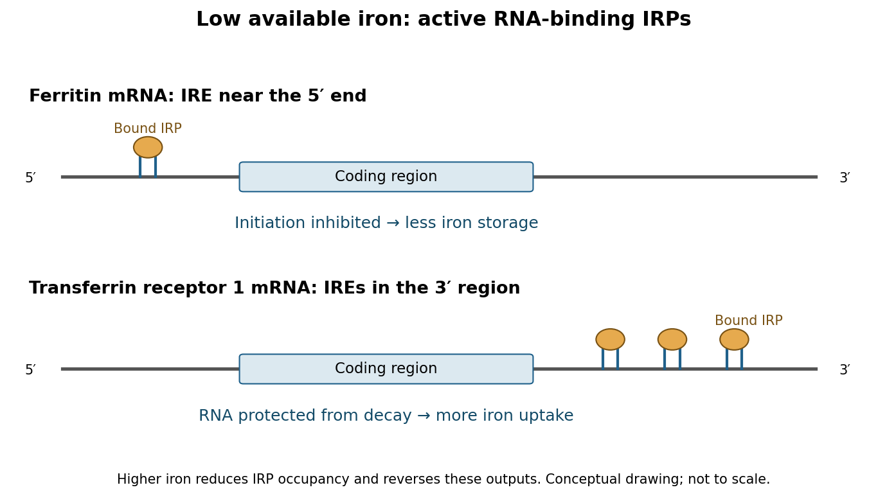

# Paper 2

↑ **Parent:** [2024](../2024.md)

[Original paper, released PDF pages 229–230](https://www.whatdotheyknow.com/request/past_exam_information_of_nst_ib_2/response/3538010/attach/2/FOI%202026%20642%20Cui%20materials%20Part2.pdf?cookie_passthrough=1#page=229)

**Table of contents**

- [Section I](#section-i)
  - [1](#section-i/1)
    - [Solution](#section-i/1/solution)
  - [2](#section-i/2)
    - [Solution](#section-i/2/solution)
- [Section II](#section-ii)
  - [3](#section-ii/3)
    - [Solution](#section-ii/3/solution)
  - [4](#section-ii/4)
    - [Solution](#section-ii/4/solution)
  - [5](#section-ii/5)
    - [Solution](#section-ii/5/solution)
  - [6](#section-ii/6)
    - [Solution](#section-ii/6/solution)
  - [7](#section-ii/7)
    - [Solution](#section-ii/7/solution)

## Section I

↑ **Parent:** [Paper 2](paper-2.md)

<h3 id="section-i/1">1</h3>

↑ **Parent:** [Section I](#section-i)

<h4 id="section-i/1/solution">Solution</h4>

↑ **Parent:** [1](#section-i/1)

**Artificial recruitment separates recognition of an [RNA](../../polymer.md#ribonucleic-acid) target from the activity of the recruited regulator.** In an [RNA tethering assay](../../molecular-genetics.md#rna-tethering-assay), a reporter carries binding hairpins for a defined RNA-binding module, such as [MS2 coat protein](../../protein.md#ms2-coat-protein). Fusing the candidate regulator to that module places it on the reporter without requiring its normal sequence-recognition mechanism. The experiment asks whether recruitment is sufficient to change [RNA](../../polymer.md#ribonucleic-acid) processing, localization, stability or [biological translation](../../molecular-genetics.md#translation-biology), and which parts of the regulator produce that change. It does not establish that the endogenous [protein](../../protein.md) normally finds that [RNA](../../polymer.md#ribonucleic-acid) or that artificial occupancy has a physiological affinity.

A basic design compares a reporter with and without intact hairpins, expressing either the coat [protein](../../protein.md) alone or the fusion at matched levels. Measure reporter [RNA](../../polymer.md#ribonucleic-acid) and [protein](../../protein.md) separately, with an untethered reporter as an internal control. [protein](../../protein.md) output alone is ambiguous: a reduction can reflect fewer [RNA](../../polymer.md#ribonucleic-acid) molecules, lower [biological translation](../../molecular-genetics.md#translation-biology) per molecule, altered [protein](../../protein.md) stability or general toxicity. In a simple constant-rate model,

$$
\frac{dM}{dt}=s-k_dM,\qquad \frac{dP}{dt}=k_tM-k_pP,\qquad P^*=\frac{s k_t}{k_d k_p},
$$

where $M$ and $P$ are [RNA](../../polymer.md#ribonucleic-acid) and [protein](../../protein.md) amounts, $s$ is [RNA](../../polymer.md#ribonucleic-acid) synthesis, and the other coefficients describe [RNA decay](../../molecular-genetics.md#rna-decay), [biological translation](../../molecular-genetics.md#translation-biology) and [protein](../../protein.md) loss. Thus one [protein](../../protein.md) endpoint cannot identify which rate changed. Time-resolved [RNA](../../polymer.md#ribonucleic-acid) measurements, poly(A)-tail analysis and a direct synthesis assay discriminate these possibilities. Place hairpins in several non-disruptive positions and vary their number, because an array can change [RNA](../../polymer.md#ribonucleic-acid) structure, sterically impede machinery or create nonphysiological [multivalency](../../protein.md#multivalency). Confirm fusion integrity, localization and [RNA](../../polymer.md#ribonucleic-acid) association; a nonfunctional fusion is not evidence that the candidate lacks regulatory activity.

A foundational application concerned [poly(A)-binding protein](../../protein.md#poly-a-binding-protein). [Jeffery M. Coller](../../biochemistry.md#jeffery-m-coller) and colleagues tethered yeast Pab1p to a reporter's 3′ region and showed stabilization even without a [poly(A) tail](../../polymer.md#poly-a-tail). Domain analysis separated the stabilization activity from the domains required for normal poly(A) recognition, while [biological translation](../../molecular-genetics.md#translation-biology) dependence showed that protection was coupled to the translated state.[Tethered Pab1p, tail-independent stabilization and domain tests](../../biology-bibliography.md#mrna-stabilization-by-poly-a-binding-protein-is-independent-of-poly-a-and-requires-translation-by-jeffery-m-coller-and-others) The important inference is that an [RNA](../../polymer.md#ribonucleic-acid) element can act by recruiting an effector: the poly(A) sequence is not intrinsically required for every downstream stabilizing action. This is stronger mechanistic information than a correlation between long tails and stable [RNA](../../polymer.md#ribonucleic-acid), although artificial recruitment does not imply that natural [poly(A) tails](../../polymer.md#poly-a-tail) have no other functions.

Tethering also revealed positional logic in [nonsense-mediated decay](../../molecular-genetics.md#nonsense-mediated-decay). [Jens Lykke-Andersen](../../biochemistry.md#jens-lykke-andersen) and colleagues recruited human [UPF proteins](../../molecular-genetics.md#upf-protein) to a β-globin reporter downstream of its termination [codon](../../molecular-genetics.md#codon) and induced [RNA decay](../../molecular-genetics.md#rna-decay). Pulse–chase measurements established decay, and dependence on [biological translation](../../molecular-genetics.md#translation-biology), downstream positioning and functional UPF machinery connected the effect with surveillance rather than nonspecific destruction.[Reporter decay, position controls and UPF dependence](../../biology-bibliography.md#human-upf-proteins-target-an-mrna-for-nonsense-mediated-decay-when-bound-downstream-of-a-termination-codon-by-jens-lykke-andersen-and-others) Recruitment can therefore supply an otherwise missing recognition signal. Together with association of [UPF proteins](../../molecular-genetics.md#upf-protein) with spliced [RNA](../../polymer.md#ribonucleic-acid), the result helped connect a nuclear processing history to cytoplasmic interpretation of termination. It does not show that every natural surveillance substrate requires an [exon junction complex](../../biology.md#exon-junction-complex) or that tethered [UPF proteins](../../molecular-genetics.md#upf-protein) act without other factors.

A further use is to order the steps of [microRNA](../../polymer.md#microrna) silencing. Natural recognition involves a guide-loaded [Argonaute](../../protein.md#argonaute) complex and recruitment of [GW182](../../protein.md#gw182). Tethering [GW182](../../protein.md#gw182) or its silencing domain bypasses guide–target pairing; mutating interaction surfaces or depleting downstream complexes then tests whether recruited [GW182](../../protein.md#gw182) can promote repression and [deadenylation](../../polymer.md#deadenylation). Biochemical interaction and functional analyses showed direct recruitment of cytoplasmic deadenylase complexes, including [CCR4-NOT complex](../../polymer.md#ccr4-not-complex), by [GW182](../../protein.md#gw182).[Direct deadenylase interactions and silencing requirements](../../biology-bibliography.md#gw182-proteins-directly-recruit-cytoplasmic-deadenylase-complexes-to-mirna-targets-by-joerg-e-braun-and-others) Combined evidence distinguishes deadenylase recruitment from a model in which tail shortening occurs only indirectly after translational arrest. Nevertheless, repression and decay can be coupled, and their order must be measured rather than inferred from one endpoint.

Domain deletions, catalytic mutants and interaction-defective variants make the approach particularly informative. If removing an RNA-binding domain destroys natural regulation but tethering restores it, that domain may chiefly mediate recruitment. If an effector-domain [mutation](../../genetics.md#mutation) remains inactive despite confirmed tethering, it identifies a post-recruitment requirement. Recruitment of an upstream component that fails when a downstream component is depleted provides an [epistasis](../../genetics.md#epistasis) test; rescue with a depletion-resistant downstream factor strengthens the ordering. Expression and folding controls are essential because a deletion can destabilize the entire [protein](../../protein.md). Conversely, a tethered factor may simply recruit an endogenous partner, so sufficiency of a fusion does not establish autonomous catalytic action.

The strongest interpretation combines these manipulations with endogenous binding maps, [mutation](../../genetics.md#mutation) of natural [RNA](../../polymer.md#ribonucleic-acid) sites and physiological loss-of-function/rescue experiments. The resulting contribution is a modular view of regulation: [RNA](../../polymer.md#ribonucleic-acid) recognition chooses the substrate, while separable interaction or catalytic domains determine the outcome, and [RNA](../../polymer.md#ribonucleic-acid) position can change that outcome. **Tethering establishes conditional sufficiency after recruitment; native targeting and physiological necessity require complementary experiments.**

<h3 id="section-i/2">2</h3>

↑ **Parent:** [Section I](#section-i)

<h4 id="section-i/2/solution">Solution</h4>

↑ **Parent:** [2](#section-i/2)

**TFx induction makes it a candidate regulator, not yet a cause of [neuronal differentiation](../../biology.md#neuronal-differentiation).** I would test when and where it acts, whether it is necessary or sufficient for a specific developmental transition, and which directly regulated [genes](../../genetics.md#gene) explain the [phenotype](../../genetics.md#phenotype). The initial time-course result could instead reflect increasing neuronal abundance, selective survival, a response to differentiation, or expression of an inactive isoform.

First validate the observation in independent differentiations using quantitative [RNA](../../polymer.md#ribonucleic-acid) measurements and a specificity-validated [protein](../../protein.md) assay. Examine transcript isoforms, [protein](../../protein.md) abundance and nuclear localization over time, comparing neural precursors, differentiating [neurons](../../neuroscience.md#neuron) and other [biological cell](../../biological-cell.md) populations. [single-cell RNA sequencing](../../molecular-genetics.md#single-cell-rna-sequencing) combined with imaging can determine whether TFx increases within a lineage or merely marks a population that becomes more common. Actual sampling times and lineage labels should anchor the analysis: a [pseudotime](../../molecular-genetics.md#pseudotime) ordering alone does not establish chronology or ancestry. Use independent donors or clones and differentiation batches as [biological replicates](../../design-of-experiments.md#biological-replicate), while tracking [biological cell](../../biological-cell.md) number, proliferation and [apoptosis](../../biological-cell.md#apoptosis). A bulk increase caused by loss of another population is different from TFx activation within surviving precursors.

For necessity, reduce TFx using at least two independent perturbations, for example [CRISPR interference](../../molecular-genetics.md#crispr-interference) and an independent guide or [RNA interference](../../molecular-genetics.md#rna-interference) reagent, or generate a verified [gene knockout](../../molecular-genetics.md#gene-knockout) where viable. Rescue with a perturbation-resistant TFx expressed near its normal level. An [inducible degron](../../protein.md#inducible-degron) would provide faster and more sharply timed [protein](../../protein.md) depletion than waiting for an existing pool to disappear after transcriptional inhibition. Perturb before commitment, during neuronal maturation and after maturation, using matched induction controls. A defect confined to the early window suggests a role in commitment; a late defect could instead concern maturation or maintenance. Constitutive loss followed by a late endpoint cannot distinguish these possibilities and can select compensatory [biological cells](../../biological-cell.md).

The readout must define the affected transition. Count precursor and neuronal states, measure cell-cycle exit, [neurite](../../neuroscience.md#neurite) architecture and subtype markers, and assess mature physiology with patch-clamp recording and synaptic assays where appropriate. A marker-positive [biological cell](../../biological-cell.md) is not necessarily a functional [neuron](../../neuroscience.md#neuron). Measure survival alongside fate: fewer [neurons](../../neuroscience.md#neuron) after TFx depletion could arise because [neurons](../../neuroscience.md#neuron) die rather than because precursors fail to differentiate. Track labelled starting [biological cells](../../biological-cell.md) through the transition and compare proportions as well as absolute output. If TFx changes only a particular neuronal subtype, a generic pan-neuronal assay could miss or misclassify its function.

For sufficiency, induce TFx at controlled levels in competent precursors under subthreshold differentiation conditions, and test whether it accelerates or redirects the transition. Include an empty-vector control, a DNA-binding-defective TFx variant and, if the domain architecture permits, a transcriptional-effector-defective variant. Test a second cellular context rather than assuming that all [biological cells](../../biological-cell.md) possess the required cofactors. Defined transcription-factor combinations can convert mouse fibroblasts into functional [neurons](../../neuroscience.md#neuron), as demonstrated by [Thomas Vierbuchen](../../biochemistry.md#thomas-vierbuchen) and colleagues, but this is an experimental precedent rather than evidence that the unspecified TFx is one of those factors.[Factor-combination screen and physiological neuronal validation](../../biology-bibliography.md#direct-conversion-of-fibroblasts-to-functional-neurons-by-defined-factors-by-thomas-vierbuchen-and-others) Failure of TFx alone to induce [neurons](../../neuroscience.md#neuron) would not exclude an essential combinatorial role; strong overexpression could also create an activity absent at endogenous levels.

Next identify the direct regulatory programme. Map TFx-associated [DNA](../../polymer.md#deoxyribonucleic-acid) with an endogenous epitope tag and [CUT&RUN](../../biology.md#cut-and-run) or [chromatin immunoprecipitation](../../biology.md#chromatin-immunoprecipitation), validating [antibody](../../protein.md#antibody) specificity against TFx-depleted [biological cells](../../biological-cell.md) and including appropriate background controls. The targeted nuclease strategy underlying [CUT&RUN](../../biology.md#cut-and-run) provides a route to map protein-associated genomic regions at low background.[Targeted nuclease mapping of protein-associated DNA](../../biology-bibliography.md#an-efficient-targeted-nuclease-strategy-for-high-resolution-mapping-of-dna-binding-sites-by-peter-j-skene-and-steven-henikoff) Combine binding with short-interval nascent-RNA measurements after acute TFx removal, before a large fate or survival shift occurs. Occupancy plus an early expression response prioritizes direct candidates; binding alone does not prove regulation, and a response without detected binding may be indirect or reflect an undetected distal site.

[ATAC-seq](../../molecular-genetics.md#atac-seq) before and after perturbation can test whether TFx changes accessibility, while histone-mark measurements and cofactor interaction assays refine the mechanism. Work on [ASCL1](../../molecular-genetics.md#ascl1) reprogramming showed hierarchical factor action and context-dependent [chromatin](../../molecular-genetics.md#chromatin) engagement, motivating tests of whether TFx acts as a [pioneer transcription factor](../../molecular-genetics.md#pioneer-transcription-factor) or requires already accessible [DNA](../../polymer.md#deoxyribonucleic-acid).[Chromatin engagement and hierarchical transcription-factor activity](../../biology-bibliography.md#hierarchical-mechanisms-for-direct-reprogramming-of-fibroblasts-to-neurons-by-orly-l-wapinski-and-others) Increased accessibility after TFx expression alone does not prove direct opening; first establish binding and an early response at that locus.

Finally edit a candidate TFx-binding motif at an endogenous [enhancer](../../molecular-genetics.md#enhancer), quantify target expression and differentiation, and compare with a matched neutral edit. Rescue a TFx-loss [phenotype](../../genetics.md#phenotype) with the proposed downstream target or programme, while testing whether that target is required for TFx-induced differentiation. Such genetic ordering connects a molecular target to the biological effect; a plasmid reporter alone omits the native [chromatin](../../molecular-genetics.md#chromatin) context. **A justified conclusion would specify the transition, [biological cell](../../biological-cell.md) type, timing and direct targets supported by perturbation and rescue, while distinguishing differentiation from survival and maturation.**

## Section II

↑ **Parent:** [Paper 2](paper-2.md)

<h3 id="section-ii/3">3</h3>

↑ **Parent:** [Section II](#section-ii)

<h4 id="section-ii/3/solution">Solution</h4>

↑ **Parent:** [3](#section-ii/3)

**[RNA](../../polymer.md#ribonucleic-acid) couples [iron](../../chemical-substance.md#iron) availability to the production of [proteins](../../protein.md) that acquire, store, export and use [iron](../../chemical-substance.md#iron).** The clearest mammalian mechanism uses structured [iron-responsive elements](../../polymer.md#iron-responsive-element) in untranslated regions and iron-regulated binding [proteins](../../protein.md). The [RNA](../../polymer.md#ribonucleic-acid) element encodes a regulatory address and its position determines the response; the main sensing machinery is protein-based, so this system should not be described as an autonomous iron-binding [RNA](../../polymer.md#ribonucleic-acid) riboswitch.

An [iron-responsive element](../../polymer.md#iron-responsive-element) is a [stem-loop](../../polymer.md#stem-loop) with conserved sequence and structural features recognized by [iron regulatory proteins](../../biology.md#iron-regulatory-protein). At low available [iron](../../chemical-substance.md#iron), RNA-binding [IRP1](../../biology.md#irp1) and [IRP2](../../biology.md#irp2) are active. [IRP1](../../biology.md#irp1) is bifunctional: an iron–sulfur-cluster-containing form acts as cytosolic [aconitase](../../enzyme.md#aconitase), whereas loss of the functional cluster permits high-affinity [RNA](../../polymer.md#ribonucleic-acid) binding. Biochemical disassembly of its cluster connected these two activities directly.[Cluster state and RNA-binding activity](../../biology-bibliography.md#cellular-regulation-of-the-iron-responsive-element-binding-protein-disassembly-of-the-cubane-iron-sulfur-cluster-results-in-high-affinity-rna-binding-by-david-j-haile-and-others) [IRP2](../../biology.md#irp2) does not use the same [aconitase](../../enzyme.md#aconitase) switch. Under iron- and oxygen-replete conditions, the [FBXL5](../../protein.md#fbxl5) ubiquitin-ligase pathway promotes [IRP2](../../biology.md#irp2) degradation; instability of the iron-sensitive [FBXL5](../../protein.md#fbxl5) regulator during [iron](../../chemical-substance.md#iron) depletion helps preserve [IRP2](../../biology.md#irp2).[FBXL5 sensing, stability and IRP2 degradation](../../biology-bibliography.md#an-e3-ligase-possessing-an-iron-responsive-hemerythrin-domain-is-a-regulator-of-iron-homeostasis-by-ameen-a-salahudeen-and-others) Redox and oxygen conditions can therefore modify the relation between total cellular [iron](../../chemical-substance.md#iron) and RNA-binding activity.

The canonical 5′ example is [ferritin](../../protein.md#ferritin) [mRNA](../../polymer.md#messenger-rna). Binding of an [IRP](../../biology.md#iron-regulatory-protein) near the cap prevents efficient recruitment of the translation-initiation machinery, lowering [ferritin](../../protein.md#ferritin) synthesis when [iron](../../chemical-substance.md#iron) is scarce. This avoids committing a limited resource to storage. When [iron](../../chemical-substance.md#iron) is plentiful, reduced [IRP](../../biology.md#iron-regulatory-protein) occupancy releases repression, allowing more [ferritin](../../protein.md#ferritin) to store [iron](../../chemical-substance.md#iron) and limit its reactive pool. Deletion analysis and transfer of a synthetic [ferritin](../../protein.md#ferritin) element to another reporter established a cis-acting signal sufficient to confer iron-responsive [biological translation](../../molecular-genetics.md#translation-biology).[Ferritin leader deletion and synthetic-element transfer](../../biology-bibliography.md#identification-of-the-iron-responsive-element-for-the-translational-regulation-of-human-ferritin-mrna-by-matthias-w-hentze-and-others) This response can change [biological translation](../../molecular-genetics.md#translation-biology) before a major change in transcript abundance occurs.

At the 3′ end of [transferrin receptor 1](../../cell-membrane.md#transferrin-receptor-1) [mRNA](../../polymer.md#messenger-rna), multiple IREs participate in a stability-control region. [IRP](../../biology.md#iron-regulatory-protein) binding during [iron](../../chemical-substance.md#iron) shortage protects the message from destabilization, increasing receptor production and [iron](../../chemical-substance.md#iron) uptake. At higher [iron](../../chemical-substance.md#iron), loss of protection permits more rapid decay and reduces uptake. [John L. Casey](../../biochemistry.md#john-l-casey) and colleagues showed that the transferrin-receptor 3′ region conferred iron-regulated [RNA](../../polymer.md#ribonucleic-acid) abundance and that isolated elements placed in a 5′ reporter context instead conferred translational control.[Context-dependent reporter regulation by ferritin-like stem-loops](../../biology-bibliography.md#iron-responsive-elements-regulatory-rna-sequences-that-control-mrna-levels-and-translation-by-john-l-casey-and-others) Thus similar recognition chemistry supports opposite outputs through different transcript positions and associated machinery.

**[Figure 1](#section-ii/3/image-low-iron-produces-coordinated-but-opposite-outputs-from-5′-and-3′-iron-responsive-elements). Low iron produces coordinated but opposite outputs from 5′ and 3′ iron-responsive elements**.

The network also adjusts use and release. A 5′ [IRE](../../polymer.md#iron-responsive-element) in erythroid [ALAS2](../../enzyme.md#alas2) [mRNA](../../polymer.md#messenger-rna) couples synthesis of a haem-pathway enzyme to [iron](../../chemical-substance.md#iron) availability, helping limit production of [porphyrin](../../chemical-substance.md#porphyrin) precursors when metal incorporation is restricted.[Erythroid ALAS leader element and iron-dependent translation](../../biology-bibliography.md#identification-of-a-novel-iron-responsive-element-in-murine-and-human-erythroid-delta-aminolevulinic-acid-synthase-mrna-by-thomas-dandekar-and-others) IRE-containing [ferroportin](../../cell-membrane.md#ferroportin) transcripts can reduce [iron](../../chemical-substance.md#iron) export through translational repression during deficiency.[IRE deletion reporters distinguish protein-output regulation from RNA abundance](../../biology-bibliography.md#the-role-of-the-iron-responsive-element-in-the-control-of-ferroportin1-ireg1-mtp1-gene-expression-by-athina-lymboussaki-and-others) These are transcript-specific rules, not universal predictions from a [gene](../../genetics.md#gene) name: alternative transcripts can lack an [IRE](../../polymer.md#iron-responsive-element), and [ferroportin](../../cell-membrane.md#ferroportin) is also regulated at the [protein](../../protein.md) level by systemic signals. The central [RNA](../../polymer.md#ribonucleic-acid) logic coordinates uptake with conservation, rather than simply maximizing the expression of every iron-related [protein](../../protein.md).

Regulation beyond the mammalian [IRE](../../polymer.md#iron-responsive-element) system illustrates a broader eukaryotic principle. In budding yeast, [iron](../../chemical-substance.md#iron) deficiency induces the RNA-binding regulator [Cth2](../../protein.md#cth2), which recognizes AU-rich elements in selected 3′ regions and accelerates degradation of messages encoding iron-consuming metabolic functions. This remodels resource allocation rather than protecting an uptake message. [Sergi Puig](../../biochemistry.md#sergi-puig) and colleagues combined expression and RNA-turnover analysis with RNA-element recognition to establish targeted degradation during deficiency.[Cth2-dependent turnover of iron-utilization transcripts](../../biology-bibliography.md#coordinated-remodeling-of-cellular-metabolism-during-iron-deficiency-through-targeted-mrna-degradation-by-sergi-puig-and-others) It is therefore misleading to generalize that [iron](../../chemical-substance.md#iron) shortage always stabilizes iron-related [RNA](../../polymer.md#ribonucleic-acid): the direction depends on the transcript and its physiological role.

To establish these mechanisms experimentally, compare [iron](../../chemical-substance.md#iron) chelation with [iron](../../chemical-substance.md#iron) restoration, measuring available [iron](../../chemical-substance.md#iron), IRP–RNA binding, transcript half-life and newly synthesized [protein](../../protein.md) separately. Match reporter [transcription](../../molecular-genetics.md#transcription-biology) and mutate recognition features without inadvertently changing general [RNA](../../polymer.md#ribonucleic-acid) stability. For a [stem-loop](../../polymer.md#stem-loop), a compensatory paired [mutation](../../genetics.md#mutation) helps distinguish loss of structure from loss of a specific sequence contact. Electrophoretic binding assays with purified [protein](../../protein.md), cellular crosslinking and rescue with functional versus binding-defective [IRP](../../biology.md#iron-regulatory-protein) variants connect recognition to regulation. RNA-abundance measurements alone cannot establish translational repression, and chelators can cause broad stress, so unrelated control reporters and viability measurements are needed. **The decisive principle is position-dependent [RNA](../../polymer.md#ribonucleic-acid) control: low [iron](../../chemical-substance.md#iron) can repress storage and export [biological translation](../../molecular-genetics.md#translation-biology) while preserving uptake [RNA](../../polymer.md#ribonucleic-acid) and reducing expendable iron-consuming programmes.**

<h3 id="section-ii/4">4</h3>

↑ **Parent:** [Section II](#section-ii)

<h4 id="section-ii/4/solution">Solution</h4>

↑ **Parent:** [4](#section-ii/4)

**Shared preference for pyrimidine-rich [RNA](../../polymer.md#ribonucleic-acid) does not prescribe one splicing outcome: position, multivalent binding and interactions with the [spliceosome](../../biology.md#spliceosome) determine the regulated step.** [Sex-lethal](../../protein.md#sex-lethal) acts in the Drosophila sex-determination programme, whereas [PTBP1](../../protein.md#ptbp1) regulates many mammalian precursor RNAs in a cell-type-dependent manner. Their effects must be interpreted against competing [splice sites](../../biology.md#splice-site) and the [proteins](../../protein.md) normally recognizing them.

During early [spliceosome](../../biology.md#spliceosome) assembly, [U1 snRNP](../../biology.md#u1-snrnp) recognizes a 5′ [splice site](../../biology.md#splice-site), while factors including [U2AF](../../biology.md#u2af) help recognize a [polypyrimidine tract](../../biology.md#polypyrimidine-tract) and 3′ splice-site region and promote assembly around the branch point. Alternative sites compete within this context. Binding of another [RNA-binding protein](../../protein.md#rna-binding-protein) can occlude an essential interaction, organize a repressive complex or favour use of a competing site; recognition need not be determined solely by an isolated site's consensus strength.

A particularly clear [SXL](../../protein.md#sex-lethal) mechanism operates on precursor [RNA](../../polymer.md#ribonucleic-acid) encoding [Transformer protein](../../protein.md#transformer-protein). In the absence of [SXL](../../protein.md#sex-lethal), [U2AF](../../biology.md#u2af) recognizes a strong default 3′ site, producing an unproductive transcript. In female [biological cells](../../biological-cell.md), [SXL](../../protein.md#sex-lethal) binds the pyrimidine-rich region at that site and competes with [U2AF](../../biology.md#u2af). The weaker alternative female site can then be used, producing functional [Transformer protein](../../protein.md#transformer-protein). Reconstituted splicing experiments showed the antagonism, and adding a [U2AF](../../biology.md#u2af) effector domain to [SXL](../../protein.md#sex-lethal) converted its activity from repression toward activation.[In vitro splice-site switch and effector-domain fusion](../../biology-bibliography.md#the-protein-sex-lethal-antagonizes-the-splicing-factor-u2af-to-regulate-alternative-splicing-of-transformer-pre-mrna-by-juan-valcarcel-and-others) The domain-fusion result is important: related [RNA](../../polymer.md#ribonucleic-acid) recognition can direct different outcomes because the [proteins](../../protein.md) recruit different downstream activities. [SXL](../../protein.md#sex-lethal) need not directly activate the female acceptor to shift usage toward it; repression of the stronger competitor is sufficient in this substrate.

[SXL](../../protein.md#sex-lethal) also maintains its own productive expression through exclusion of a male-specific [exon](../../biology.md#exon) containing a premature stop. This provides positive feedback in female [biological cells](../../biological-cell.md). It is not adequately described as another instance of simple [U2AF](../../biology.md#u2af) displacement. Work on the [SXL](../../protein.md#sex-lethal) autoregulatory substrate identified a specialized arrangement of AG dinucleotides and a pyrimidine tract: [U2AF](../../biology.md#u2af) and [SPF45](../../biology.md#spf45) recognize different features, and interaction with [SXL](../../protein.md#sex-lethal) inhibits SPF45-dependent progression at the second catalytic step.[Autoregulatory exon 3 and second-step inhibition](../../biology-bibliography.md#splicing-regulation-at-the-second-catalytic-step-by-sex-lethal-involves-3′-splice-site-recognition-by-spf45-by-maria-jose-lallena-and-others) [SXL](../../protein.md#sex-lethal) can consequently alter site selection after early assembly has occurred. Accumulation of a first-step intermediate in an appropriate biochemical assay distinguishes such a block from failure to recruit the [spliceosome](../../biology.md#spliceosome) initially. The same regulator can use different mechanisms on different RNAs.

[PTBP1](../../protein.md#ptbp1) has four [RNA recognition motifs](../../protein.md#rna-recognition-motif) and commonly binds CU-rich sequences at more than one position. Structural work showed distinct RNA-recognition arrangements and an organization of its third and fourth domains compatible with bridging separated [RNA](../../polymer.md#ribonucleic-acid) segments.[RNA-bound domain structures and implications for recognition](../../biology-bibliography.md#structure-of-ptb-bound-to-rna-specific-binding-and-implications-for-splicing-regulation-by-florian-c-oberstrass-and-others) [Förster resonance energy transfer](../../biology.md#forster-resonance-energy-transfer), [NMR](../../nuclear-magnetic-resonance.md) and splicing assays subsequently supported [RNA looping](../../polymer.md#rna-looping) by these domains: contacts on either side of a segment can organize an [RNA](../../polymer.md#ribonucleic-acid) geometry that disfavors [exon](../../biology.md#exon) use.[Looping measurements and functional tests](../../biology-bibliography.md#rna-looping-by-ptb-evidence-using-fret-and-nmr-spectroscopy-for-a-role-in-splicing-repression-by-rajan-lamichhane-and-others) These observations support a physical repression mechanism, but a short model [RNA](../../polymer.md#ribonucleic-acid) loop does not prove that every endogenous PTBP1-regulated [exon](../../biology.md#exon) is looped out.

Other [PTBP1](../../protein.md#ptbp1) arrangements can interfere with early assembly or communication between sites without directly replacing [U2AF](../../biology.md#u2af) at the same tract. Binding near or within an alternative [exon](../../biology.md#exon) can impair its definition, whereas in another arrangement [PTBP1](../../protein.md#ptbp1) can favour [exon](../../biology.md#exon) inclusion, including by suppressing a competing event. Genome-wide perturbation and positional analyses revealed both activation and repression associated with different binding contexts.[Global splicing responses and position-dependent activity](../../biology-bibliography.md#position-dependent-alternative-splicing-activity-revealed-by-global-profiling-of-alternative-splicing-events-regulated-by-ptb-by-miriam-llorian-and-others) Thus neither “all pyrimidine binders are repressors” nor “[PTBP1](../../protein.md#ptbp1) always causes skipping” is a valid general rule. [protein](../../protein.md) abundance, [RNA](../../polymer.md#ribonucleic-acid) architecture, neighbouring factors and related PTBP family members change the effective regulatory complex.

To discriminate mechanisms, map direct contacts by [crosslinking and immunoprecipitation](../../biology.md#crosslinking-and-immunoprecipitation), measure exon-junction usage after acute depletion, and rescue with wild-type or selected RNA-binding/interface mutants. Use a [minigene splicing reporter](../../biology.md#minigene-splicing-reporter) to mutate individual tracts, change their spacing or move them relative to a regulated [exon](../../biology.md#exon), then confirm important effects at the endogenous locus. Assays of [U2AF](../../biology.md#u2af) or [U1 snRNP](../../biology.md#u1-snrnp) association and native spliceosomal assembly can reveal an early block; time-resolved splicing-intermediate analysis can reveal a late one. Control reporter [transcription](../../molecular-genetics.md#transcription-biology) and precursor abundance, and account for [nonsense-mediated decay](../../molecular-genetics.md#nonsense-mediated-decay), because an unstable mature isoform can conceal the splice choice that generated it. Mutants must retain expression and the intended remaining contacts. **[SXL](../../protein.md#sex-lethal) supplies examples of both competition and late catalytic control; [PTBP1](../../protein.md#ptbp1) illustrates multivalent, context-dependent organization of splice-site recognition. [RNA](../../polymer.md#ribonucleic-acid) affinity is only one part of specificity.**

<h3 id="section-ii/5">5</h3>

↑ **Parent:** [Section II](#section-ii)

<h4 id="section-ii/5/solution">Solution</h4>

↑ **Parent:** [5](#section-ii/5)

**I would test three separable claims: that a distinct assembly exists, that particular mRNAs are recruited or retained there, and that this recruitment causally alters their [biological translation](../../molecular-genetics.md#translation-biology).** Establishing one claim does not establish the others. In particular, a fluorescent punctum need not be a phase-separated liquid, and enrichment of untranslated [RNA](../../polymer.md#ribonucleic-acid) need not mean that the assembly caused repression.

Begin by tagging a candidate resident at its endogenous locus, verifying that the tagged [protein](../../protein.md) retains its normal abundance and function. Identify additional resident [proteins](../../protein.md) and RNAs with independent probes, assess ultrastructure or [cell membrane](../../cell-membrane.md) exclusion where necessary, and follow assembly and dissolution over physiological time courses. Measure [concentration](../../mathematical-physics.md#concentration) dependence, partitioning and exchange rather than classifying the structure from roundness alone. [fluorescence recovery after photobleaching](../../fluorescence.md#fluorescence-recovery-after-photobleaching) reports mobility and exchange, but recovery can occur in non-liquid assemblies; fusion and rapid recovery are supporting observations rather than decisive tests. Avoid interpreting dissolution by 1,6-hexanediol as specific evidence, because it can perturb other cellular structures and processes. If phase separation is proposed, purified-component reconstitution should establish appropriate [concentration](../../mathematical-physics.md#concentration), salt and [RNA](../../polymer.md#ribonucleic-acid) dependences, including sequence and valency controls and comparison with estimated cellular concentrations.

To identify recruited mRNAs, combine granule enrichment with [RNA sequencing](../../molecular-genetics.md#rna-sequencing), controlling nonspecific recovery and input transcript abundance. Validate candidates by [single-molecule fluorescence in situ hybridization](../../biology.md#single-molecule-fluorescence-in-situ-hybridization) using endogenous RNAs, negative-control RNAs and probes spanning different transcript regions. Three-dimensional segmentation and randomized spatial controls help distinguish genuine enrichment from chance overlap in a crowded [cytoplasm](../../biological-cell.md#cytoplasm). A useful [RNA partition coefficient](../../molecular-genetics.md#rna-partition-coefficient) is $K_p=c_{\mathrm{in}}/c_{\mathrm{out}}$, estimated from molecule numbers and accessible volumes rather than uncorrected total intensity. A small assembly can have high [concentration](../../mathematical-physics.md#concentration) but contain only a small fraction of the cellular transcript, so report both enrichment and the fraction of molecules recruited.

Live imaging using an MS2- or PP7-tagged [RNA](../../polymer.md#ribonucleic-acid) can measure entry, exit, dwell time and transport relative to the assembly. Compare the labelled transcript with the untagged endogenous distribution: repeated hairpins, coat-protein binding and fluorescent-protein expression can alter processing or mobility. Track whole particles in three dimensions where possible to separate actual residence from transient passage through an imaging plane. A localization element identified in a candidate 3′ region can be deleted or transferred to a neutral reporter, with matched [RNA](../../polymer.md#ribonucleic-acid) abundance and integrity, to test sequence-dependent targeting. [crosslinking and immunoprecipitation](../../biology.md#crosslinking-and-immunoprecipitation) of the proposed recruitment factor then tests direct contact rather than mere colocalization.

[biological translation](../../molecular-genetics.md#translation-biology) should be measured on the same [RNA](../../polymer.md#ribonucleic-acid) molecules wherever possible. A reporter bearing RNA-label sites and an N-terminal repeated peptide tag, such as [SunTag](../../biology.md#suntag), makes an [mRNA](../../polymer.md#messenger-rna) visible separately from its nascent chains. A bright nascent-chain focus at an [RNA](../../polymer.md#ribonucleic-acid) can report ongoing [biological translation](../../molecular-genetics.md#translation-biology), while completed [proteins](../../protein.md) diffuse away. Puromycin-mediated release and initiation-block/run-off controls validate the translation-dependent signal; tag maturation, antibody-fragment availability and altered peptide behaviour need controls. Fixed-cell [protein](../../protein.md) abundance or a ribosomal-protein stain is inadequate: either can be present without active [biological translation](../../molecular-genetics.md#translation-biology) at the identified [RNA](../../polymer.md#ribonucleic-acid).

This caution has experimental force. Single-molecule work by [Daniel Mateju](../../biochemistry.md#daniel-mateju) and colleagues showed that some stress-granule-associated mRNAs undergo [biological translation](../../molecular-genetics.md#translation-biology), including complete [biological translation](../../molecular-genetics.md#translation-biology) cycles, rather than being obligatorily silent.[Simultaneous RNA tracking and nascent-chain imaging](../../biology-bibliography.md#single-molecule-imaging-reveals-translation-of-mrnas-localized-to-stress-granules-by-daniel-mateju-and-others) For the proposed new assembly, compare the [probability](../../probability-theory.md#probability) and rate of [biological translation](../../molecular-genetics.md#translation-biology) before entry, during residence and after exit, with matched cytoplasmic molecules of the same transcript. If loss of [biological translation](../../molecular-genetics.md#translation-biology) consistently precedes recruitment, the assembly may sort previously repressed [RNA](../../polymer.md#ribonucleic-acid). If recruitment precedes a reproducible [biological translation](../../molecular-genetics.md#translation-biology) change, that supports a different direction of action but still requires perturbation to exclude a common upstream cause.

Causality requires a perturbation that separates recruitment or condensation from other functions. Acutely deplete an assembly scaffold and rescue with wild-type [protein](../../protein.md) or a separation-of-function variant that retains [RNA](../../polymer.md#ribonucleic-acid) binding and normal abundance but fails to assemble, or conversely assembles but cannot recruit the chosen [RNA](../../polymer.md#ribonucleic-acid). Verify those properties directly. Studies of [G3BP1](../../protein.md#g3bp1)/G3BP2-deficient [biological cells](../../biological-cell.md) showed that stress-granule assembly requirements depend on the initiating stress, motivating matched tests of the upstream [stress response](../../biological-cell.md#stress-response) rather than assuming one knockout removes every granule type.[Double-deficient cells, rescue and stress-specific assembly](../../biology-bibliography.md#g3bp-caprin1-usp10-complexes-mediate-stress-granule-condensation-and-associate-with-40s-subunits-by-nancy-kedersha-and-others) Measure global [biological translation](../../molecular-genetics.md#translation-biology), stress signalling, [RNA](../../polymer.md#ribonucleic-acid) stability and [biological cell](../../biological-cell.md) viability alongside the local reporter. Loss of a granule accompanied by wholesale loss of [biological translation](../../molecular-genetics.md#translation-biology) machinery is not a specific test of granule function.

An orthogonal manipulation could inducibly recruit the same [RNA](../../polymer.md#ribonucleic-acid) to the assembly or release it, using inert recruitment controls and a non-condensing scaffold. Artificial clustering can itself obstruct [biological translation](../../molecular-genetics.md#translation-biology), so this establishes conditional sufficiency only. Reversible manipulation and rescue, together with endogenous cis-element edits, provide stronger evidence. **A convincing result connects a defined RNA-recruitment mechanism to a reversible [biological translation](../../molecular-genetics.md#translation-biology) change while preserving [RNA](../../polymer.md#ribonucleic-acid) abundance and upstream cellular state; phase behaviour and regulatory function should be concluded separately.**

<h3 id="section-ii/6">6</h3>

↑ **Parent:** [Section II](#section-ii)

<h4 id="section-ii/6/solution">Solution</h4>

↑ **Parent:** [6](#section-ii/6)

**[chromatin](../../molecular-genetics.md#chromatin) has organization across overlapping length scales, and each assay measures a particular aspect rather than a universal “openness”.** Local [DNA](../../polymer.md#deoxyribonucleic-acid) exposure, [histone](../../protein.md#histone) occupancy, chemical state, long-range proximity and position within the nucleus are related but distinct. A strong [experimental design](../../design-of-experiments.md) chooses the relevant scale and combines a genomic assay with an independent structural or functional measurement.

At the molecular scale, [DNA](../../polymer.md#deoxyribonucleic-acid) wraps around a [histone octamer](../../molecular-genetics.md#histone-octamer) to form a [nucleosome](../../molecular-genetics.md#nucleosome) core, with roughly 147 base pairs protected; [linker DNA](../../molecular-genetics.md#linker-dna) connects neighbouring units, and linker [histones](../../protein.md#histone) can affect their organization. The core contains two copies each of H2A, H2B, H3 and H4. Crystallography established the detailed DNA–histone arrangement using a defined [nucleosome](../../molecular-genetics.md#nucleosome) core particle.[Atomic structure of the reconstituted core particle](../../biology-bibliography.md#crystal-structure-of-the-nucleosome-core-particle-at-2-8-a-resolution-by-karolin-luger-and-others) Such structures explain local contacts, but a purified core does not specify the arrangement of an entire chromosome in a living nucleus. [histone](../../protein.md#histone) variants, tail modifications and ATP-dependent remodelling change stability and access without requiring DNA-sequence changes.

For local accessibility, [ATAC-seq](../../molecular-genetics.md#atac-seq) uses transposase-mediated insertion of sequencing adapters into accessible [DNA](../../polymer.md#deoxyribonucleic-acid). It maps accessible [promoters](../../molecular-genetics.md#promoter-genetics) and regulatory elements, and its fragment-length distribution can contain signatures of nucleosome-free regions and neighbouring [nucleosomes](../../molecular-genetics.md#nucleosome). The original assay combined rapid accessibility mapping with information about [nucleosome](../../molecular-genetics.md#nucleosome) organization.[ATAC-seq development and accessible-region profiling](../../biology-bibliography.md#transposition-of-native-chromatin-for-fast-and-sensitive-epigenomic-profiling-of-open-chromatin-dna-binding-proteins-and-nucleosome-position-by-jason-d-buenrostro-and-others) DNase I hypersensitivity provides a related cleavage-based measure. Both have sequence bias and depend on preparation and enzyme exposure; a footprint can reflect enzyme preferences or protected binding, and is not a direct identification of the occupying [transcription factor](../../molecular-genetics.md#transcription-factor). Compare [biological replicates](../../design-of-experiments.md#biological-replicate), enzyme-dose controls, appropriate background and [biological cell](../../biological-cell.md) composition. Accessibility does not prove that an element regulates a particular [gene](../../genetics.md#gene).

[nucleosome mapping by MNase-seq](../../molecular-genetics.md#nucleosome-mapping-by-mnase-seq) addresses occupancy and spacing more directly: partial micrococcal-nuclease digestion preferentially removes exposed [linker DNA](../../molecular-genetics.md#linker-dna), and sequencing protected fragments maps nucleosome-associated regions. Digestion titration is essential because over-digestion can preferentially lose fragile [nucleosomes](../../molecular-genetics.md#nucleosome) and create apparent depletion; MNase also has sequence preferences and can recover other protected particles. Compare fragment sizes, [histone](../../protein.md#histone) enrichment and an independent accessibility assay. Chemical mapping or defined in vitro reconstitution can refine particular [nucleosome](../../molecular-genetics.md#nucleosome) positions, while single-molecule measurements can expose heterogeneity hidden in a population average.

Chemical states require different assays. [histone acetylation](../../molecular-genetics.md#histone-acetylation) and methylation at particular residues can correlate with distinct regulatory states; they are not interchangeable with physical accessibility. [chromatin immunoprecipitation](../../biology.md#chromatin-immunoprecipitation) followed by sequencing, or targeted [CUT&RUN](../../biology.md#cut-and-run), maps association of a [histone modification](../../protein.md#histone-modification) or [protein](../../protein.md) with genomic regions. [antibody](../../protein.md#antibody) specificity, [histone](../../protein.md#histone) abundance, input/background and calibrated normalization matter, especially when the modification changes globally. In [CUT&RUN](../../biology.md#cut-and-run), an [antibody](../../protein.md#antibody) recruits a nuclease to release nearby [DNA](../../polymer.md#deoxyribonucleic-acid), reducing some backgrounds associated with bulk [chromatin](../../molecular-genetics.md#chromatin) fragmentation.[Principle and validation of targeted chromatin cleavage](../../biology-bibliography.md#an-efficient-targeted-nuclease-strategy-for-high-resolution-mapping-of-dna-binding-sites-by-peter-j-skene-and-steven-henikoff) [DNA methylation](../../molecular-genetics.md#dna-methylation) can be measured by appropriately controlled bisulfite-based or direct-read approaches; standard bisulfite measurements do not automatically distinguish every modified cytosine species. These assays locate a chemical mark, not the geometric folding of the fibre.

At the level of [nucleosome](../../molecular-genetics.md#nucleosome) arrays, regular compact fibres can form in some reconstituted or specialized conditions. A universal hierarchy in which every interphase chromosome passes through a uniform 30-nm fibre is not supported. [electron tomography](../../optics.md#electron-tomography) and related imaging can examine the distribution and packing of [chromatin](../../molecular-genetics.md#chromatin) directly. [ChromEMT](../../optics.md#chromemt) combined DNA-selective staining with [electron tomography](../../optics.md#electron-tomography) and revealed irregular [chromatin](../../molecular-genetics.md#chromatin) chains and variable compaction in [biological cells](../../biological-cell.md).[In situ chromatin ultrastructure and compaction](../../biology-bibliography.md#chromemt-visualizing-3d-chromatin-structure-and-compaction-in-interphase-and-mitotic-cells-by-horng-d-ou-and-others) Fixation, staining, sectioning and limited sampled volumes must be considered; cryogenic and super-resolution approaches provide complementary views. Dense staining also need not imply a distinct biochemical [chromatin](../../molecular-genetics.md#chromatin) state.

Longer-range folding produces loops and domains of enhanced contact. [chromosome conformation capture](../../molecular-genetics.md#chromosome-conformation-capture) crosslinks, digests and ligates spatially associated fragments; targeted variants test selected loci, whereas [Hi-C](../../molecular-genetics.md#hi-c) samples contacts genome-wide. Contact matrices reveal local domains and broad A/B compartmentalization. High-resolution in situ [Hi-C](../../molecular-genetics.md#hi-c) mapped [chromatin loops](../../molecular-genetics.md#chromatin-loop) and their association with [CTCF](../../molecular-genetics.md#ctcf) orientation and [cohesin](../../protein.md#cohesin).[In situ contact maps, loop anchors and domain structure](../../biology-bibliography.md#a-3d-map-of-the-human-genome-at-kilobase-resolution-reveals-principles-of-chromatin-looping-by-suhas-s-p-rao-and-others) A [topologically associating domain](../../molecular-genetics.md#topologically-associating-domain) is a region with preferential internal contacts under a stated analysis, not necessarily a stable, sharply bounded object in every [biological cell](../../biological-cell.md). Contact frequency is neither an absolute distance nor proof that two sites directly interact. Restriction-site distribution, crosslinking, ligation, coverage and bin size affect resolution and interpretation.

Perturbation can distinguish mechanisms underlying similar-looking domains. Acute [cohesin](../../protein.md#cohesin) loss eliminated loop domains while compartment organization persisted, showing that local loop organization and large-scale compartmental segregation are separable.[Acute depletion, loss of loops and persistence of compartments](../../biology-bibliography.md#cohesin-loss-eliminates-all-loop-domains-by-suhas-s-p-rao-and-others) Imaging by [DNA fluorescence in situ hybridization](../../biology.md#dna-fluorescence-in-situ-hybridization) can measure distance distributions between chosen loci and test heterogeneity; live labels track dynamics but can perturb loci. Agreement between contact enrichment and a shift in distance distributions is stronger than either assay alone, although the observables still differ.

At nuclear scale, chromosomes occupy territories and regions associate preferentially with the [nuclear lamina](../../biological-cell.md#nuclear-lamina) or [nucleolus](../../game-theory.md#nucleolus). [DNA](../../polymer.md#deoxyribonucleic-acid) imaging maps territories and radial positions, while lamina-association assays such as [DamID](../../biology.md#damid) map sequences near a labelled nuclear compartment over an integration interval. The original [DamID](../../biology.md#damid) approach tethered a [DNA](../../polymer.md#deoxyribonucleic-acid) adenine methyltransferase to a [chromatin](../../molecular-genetics.md#chromatin) [protein](../../protein.md) to record nearby genomic regions.[Targeted methylation as a proximity record](../../biology-bibliography.md#identification-of-in-vivo-dna-targets-of-chromatin-proteins-using-tethered-dam-methyltransferase-by-bas-van-steensel-and-steven-henikoff) Such maps record proximity and history rather than a single fixed structure. Mitotic condensation is a distinct organization with additional constraints and chromosome-shaping machinery, not simply maximally closed interphase [chromatin](../../molecular-genetics.md#chromatin). **The appropriate pairing is exposure assays for local access, protected-fragment assays for [nucleosomes](../../molecular-genetics.md#nucleosome), [protein](../../protein.md)/mark profiling for composition, contact assays for genomic proximity and imaging for spatial organization, with perturbations to connect organization to function.**

<h3 id="section-ii/7">7</h3>

↑ **Parent:** [Section II](#section-ii)

<h4 id="section-ii/7/solution">Solution</h4>

↑ **Parent:** [7](#section-ii/7)

**[ribosome profiling](../../biology.md#ribosome-profiling) turned initiation from a small set of reporter-based examples into a genome-wide, condition-dependent map, while specialized variants extended observation from translating [ribosomes](../../biological-cell.md#ribosome) to start-site selection and scanning.** The central distinction is that ordinary footprints locate occupied [ribosomes](../../biological-cell.md#ribosome); they do not directly label every initiation event or measure the movement of a scanning small subunit.

In a typical experiment, rapidly preserve [biological translation](../../molecular-genetics.md#translation-biology) complexes, digest exposed [RNA](../../polymer.md#ribonucleic-acid), isolate [ribosome-protected fragments](../../biology.md#ribosome-protected-fragment) and sequence them alongside matched total [RNA](../../polymer.md#ribonucleic-acid). Assign each footprint to a ribosomal position using length-specific offsets calibrated on established coding regions. Enrichment over coding sequences and [three-nucleotide periodicity](../../biology.md#three-nucleotide-periodicity) support active elongation. The initial yeast work demonstrated genome-wide [biological translation](../../molecular-genetics.md#translation-biology) measurements and widespread regulation not inferable from [mRNA](../../polymer.md#messenger-rna) abundance alone.[Footprint method and translational responses in yeast](../../biology-bibliography.md#genome-wide-analysis-in-vivo-of-translation-with-nucleotide-resolution-using-ribosome-profiling-by-nicholas-t-ingolia-and-others) Counts normalized to transcript abundance provide an operational translation-efficiency measure,

$$
\mathrm{TE}_i\propto\frac{\text{normalized coding-region footprints}_i}{\text{normalized mRNA abundance}_i}.
$$

For treatment comparisons, a count model testing the interaction between assay type and treatment is preferable to unstable ratios at low counts. More occupancy can result from increased initiation or slower passage, so changes in elongation, premature termination and global normalization must be considered before assigning a TE change specifically to initiation.

A major advance was recognition of pervasive translated [upstream open reading frames](../../molecular-genetics.md#upstream-open-reading-frame) and alternative starts. Mammalian stem-cell profiling found many leader-region [biological translation](../../molecular-genetics.md#translation-biology) events, including near-cognate starts, and alternative coding products.[Mammalian footprints, leader translation and alternative initiation](../../biology-bibliography.md#ribosome-profiling-of-mouse-embryonic-stem-cells-reveals-the-complexity-and-dynamics-of-mammalian-proteomes-by-nicholas-t-ingolia-and-others) Initiation upstream of an annotated start can add an N-terminal extension; downstream in-frame initiation can remove targeting or regulatory sequences, while another frame creates a different product. This exposed a coding and regulatory landscape missed by annotation based only on a single longest [open reading frame](../../molecular-genetics.md#open-reading-frame). A footprint-supported short [ORF](../../molecular-genetics.md#open-reading-frame) is not automatically a stable functional microprotein: start-codon [mutation](../../genetics.md#mutation), peptide evidence and [phenotype](../../genetics.md#phenotype) are separate tests.

Ordinary elongation profiles often make the exact starting site ambiguous. Brief [harringtonine](../../molecular-genetics.md#harringtonine) treatment permits much ongoing elongation to run off while newly initiating [ribosomes](../../biological-cell.md#ribosome) accumulate near starts, generating start-associated peaks. [lactimidomycin](../../molecular-genetics.md#lactimidomycin)-based initiation profiling preferentially enriches early [ribosomes](../../biological-cell.md#ribosome) and, when compared with an elongation-inhibitor profile, improves discrimination of initiation sites. [Sooncheol Lee](../../biochemistry.md#sooncheol-lee) and colleagues used this strategy to map alternative mammalian start sites at high resolution.[Parallel initiation- and elongation-inhibitor profiling](../../biology-bibliography.md#global-mapping-of-translation-initiation-sites-in-mammalian-cells-at-single-nucleotide-resolution-by-sooncheol-lee-and-others) These approaches reveal that the first AUG is not invariably chosen: local sequence context, near-cognate [codons](../../molecular-genetics.md#codon) and competing upstream sites influence selection. However, drug uptake, exposure time and sequence-dependent trapping can change the observed distribution. A high peak can reflect capture efficiency or dwell time rather than a proportionate initiation flux, so compare time courses, untreated profiles and reporters with mutated candidate starts.

The regulatory significance of upstream [biological translation](../../molecular-genetics.md#translation-biology) is particularly clear during stress. In the [GCN4](../../molecular-genetics.md#gcn4) leader, [biological translation](../../molecular-genetics.md#translation-biology) of a short upstream frame can be followed by retention of a scanning small subunit. Reacquisition of the eIF2–GTP–initiator-tRNA ternary complex determines whether it reinitiates at an inhibitory upstream frame or proceeds to the main coding region. Amino-acid limitation lowers ternary-complex availability and changes that competition. Profiling measures occupancy on upstream and main regions simultaneously, testing redistribution across endogenous transcripts rather than relying only on reporter output. The reinitiation mechanism predates profiling; the advance is transcriptome-wide evidence for its deployment and condition dependence. Similarly, changes in cap-dependent recruitment can be mapped by perturbing [mTORC1](../../signal-transduction.md#mtorc1) signalling: profiling identified selectively regulated transcript programmes rather than a uniform effect on every [mRNA](../../polymer.md#messenger-rna).[mTOR perturbation and selective translational programmes](../../biology-bibliography.md#the-translational-landscape-of-mtor-signalling-steers-cancer-initiation-and-metastasis-by-andrew-c-hsieh-and-others)

An important limit is that standard 80S footprints do not directly demonstrate scanning. [translation complex profiling](../../biology.md#translation-complex-profiling) addresses this by preserving and separately profiling small-subunit-associated and 80S complexes. In yeast, [Stuart K. Archer](../../biochemistry.md#stuart-k-archer) and colleagues mapped small-subunit occupancy along leaders and around initiation and recycling transitions, providing evidence for otherwise difficult-to-trap intermediates.[Small-subunit and ribosome profiling across the translation cycle](../../biology-bibliography.md#dynamics-of-ribosome-scanning-and-recycling-revealed-by-translation-complex-profiling-by-stuart-k-archer-and-others) This makes different predictions from a model that treats every leader footprint as elongation. Nevertheless, the measurement is a distribution of captured complexes, not a movie of one subunit; crosslinking and footprint-length choices can affect which states are recovered.

Validation is therefore integral to the mechanistic conclusions. Use rapid, consistent harvesting, [biological replicates](../../design-of-experiments.md#biological-replicate), multiple footprint lengths and matched RNA-seq; inspect rRNA contamination, mapping ambiguity and frame periodicity. Test start-site edits at the endogenous locus or in reporters preserving the relevant leader. Measure the predicted N termini or [protein](../../protein.md) isoforms where possible, and use run-off or independent synthesis measurements to separate initiation changes from altered elongation. A structured [RNA](../../polymer.md#ribonucleic-acid) or another protected ribonucleoprotein can also produce a short sequencing fragment, especially in a very short proposed [ORF](../../molecular-genetics.md#open-reading-frame). [biological cell](../../biological-cell.md) mixtures and transcript-isoform changes can create apparent alternative initiation, so transcript architecture must be resolved. **Profiling has revealed the extent and plasticity of initiation-site choice and upstream [biological translation](../../molecular-genetics.md#translation-biology); perturbations and specialized capture methods are needed to turn an occupancy map into an initiation mechanism.**

## ↑ Ancestors (10)

1. [2024](../2024.md)
2. [Past exam of the biochemistry course of the University of Cambridge](../../past-exam-of-the-biochemistry-course-of-the-university-of-cambridge.md)
3. [Biochemistry course of the University of Cambridge](../../university-of-cambridge.md#biochemistry-course-of-the-university-of-cambridge)
4. [Year 3 of the natural sciences course of the University of Cambridge](../../university-of-cambridge.md#year-3-of-the-natural-sciences-course-of-the-university-of-cambridge)
5. [Year of the natural sciences course of the University of Cambridge](../../university-of-cambridge.md#year-of-the-natural-sciences-course-of-the-university-of-cambridge)
6. [Natural sciences course of the University of Cambridge](../../university-of-cambridge.md#natural-sciences-course-of-the-university-of-cambridge)
7. [Course of the University of Cambridge](../../university-of-cambridge.md#course-of-the-university-of-cambridge)
8. [University of Cambridge](../../university-of-cambridge.md)
9. [List of universities](../../README.md#list-of-universities)
10. [Codex Wiki](../../README.md)
