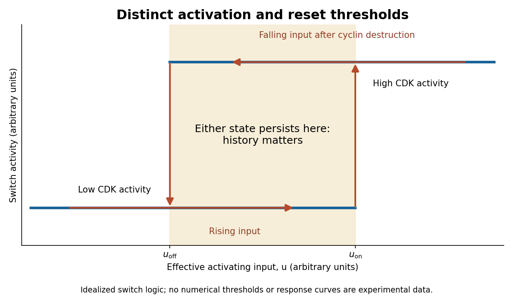

<h1 id="section-ii/5/solution">Solution</h1>

↑ **Parent:** [5](../5.md)

**Direction arises from switching between mutually incompatible states, with feedback providing memory and regulated destruction resetting the system.** Different transitions use related logic, but a steep response, a bistable switch and an irreversible molecular event are not identical. The [cell cycle](../../../../../cell-cycle-split.md) also requires checkpoints and once-per-cycle licensing so that the ordered biochemical states produce a correct sequence of physical events.

At the G1/S transition, growth signals promote [cyclin-dependent kinase](../../../../../cyclin-dependent-kinase.md) activity and relieve RB-mediated restraint on [E2F](../../../../../e2f.md). E2F-dependent expression of additional cell-cycle components can reinforce the transition. More generally, activation of a kinase together with removal of its inhibitor creates [positive feedback](../../../../../positive-feedback.md). In yeast, multisite [phosphorylation](../../../../../phosphorylation.md) of Sic1 permits recognition by the Cdc4 ubiquitin-ligase system and degradation of an inhibitor of S-phase kinase. This supplies a threshold that prevents weak or premature signals from launching the next programme.[Phosphorylation-dependent Sic1 recognition and timing](../../../../../multisite-phosphorylation-of-a-cdk-inhibitor-sets-a-threshold-for-the-onset-of-dna-replication-by-piers-nash-and-others.md) The detailed regulators vary across organisms and [biological cell](../../../../../biological-cell-split.md) types; the conserved point is a coordinated transition from an inhibited state to one that reinforces its own activation.

Mitotic entry gives an experimentally accessible example of [bistability](../../../../../bistability.md). [cyclin B](../../../../../cyclin-b.md) binding increases the available [CDK1](../../../../../cyclin-dependent-kinase-1.md) complex, but Wee1-dependent inhibitory [phosphorylation](../../../../../phosphorylation.md) can keep it inactive. [Cdc25](../../../../../cdc25.md) removes the inhibitory phosphate. Active [CDK1](../../../../../cyclin-dependent-kinase-1.md) promotes [Cdc25](../../../../../cdc25.md) activity and suppresses [Wee1](../../../../../wee1.md), giving a positive-feedback loop and a double-negative loop. Over a suitable input range, both a low-activity and a high-activity state can be stable. If cyclin input rises from interphase, activation occurs at a higher threshold than the input required to maintain a pre-existing mitotic state. These distinct thresholds constitute [hysteresis](../../../../../hysteresis.md) and prevent small fluctuations from repeatedly reversing a committed transition.

In egg extracts, nondegradable cyclin could be supplied while CDK activity was approached from different initial states. The same cyclin input then supported different persistent activities depending on history, directly distinguishing [hysteresis](../../../../../hysteresis.md) from a single steep but history-independent response.[History-dependent activity at matched nondegradable cyclin input](../../../../../building-a-cell-cycle-oscillator-hysteresis-and-bistability-in-the-activation-of-cdc2-by-joseph-r-pomerening-and-others.md) These are extract measurements, not universal numerical thresholds for every intact [biological cell](../../../../../biological-cell-split.md). A useful conceptual representation is

$$
u_{\mathrm{off}}<u_{\mathrm{on}},\qquad u_{\mathrm{off}}<u<u_{\mathrm{on}}\ \Longrightarrow\ \text{state depends on prior history},
$$

where $u$ represents effective activating input. [hysteresis](../../../../../hysteresis.md) supplies memory within this interval; it does not mean that the switch can never be reset.

**[Figure 1](#section-ii/5/image-hysteretic-activation-preserves-state-until-a-separate-reset-crosses-the-lower-threshold). Hysteretic activation preserves state until a separate reset crosses the lower threshold**.

Reset is achieved by coupling activation to delayed [negative feedback](../../../../../negative-feedback.md) and [proteolysis](../../../../../proteolysis.md). Mitotic kinase activity helps prepare activation of the [anaphase-promoting complex](../../../../../anaphase-promoting-complex.md) with [Cdc20](../../../../../cdc20.md), while the [spindle checkpoint](../../../../../spindle-checkpoint.md) prevents productive progression until attachment conditions are met. Once this restraint is satisfied, APC/C-dependent [ubiquitination](../../../../../ubiquitination.md) promotes destruction of [securin](../../../../../securin.md) and [cyclin B](../../../../../cyclin-b.md). [securin](../../../../../securin.md) loss allows [separase](../../../../../separase.md) to cleave [cohesin](../../../../../cohesin.md), making sister-chromatid separation possible. Experiments identifying [cohesin](../../../../../cohesin.md) cleavage connected regulated [proteolysis](../../../../../proteolysis.md) to a physical transition that simple reversal of a [phosphorylation](../../../../../phosphorylation.md) state cannot undo.[Cohesin cleavage and anaphase onset](../../../../../sister-chromatid-separation-at-anaphase-onset-is-promoted-by-cleavage-of-the-cohesin-subunit-scc1-by-frank-uhlmann-and-others.md) Chromatids cannot be returned to a pre-anaphase [chromosome](../../../../../chromosome.md) merely by reducing [separase](../../../../../separase.md) activity.

[cyclin B](../../../../../cyclin-b.md) destruction lowers [CDK1](../../../../../cyclin-dependent-kinase-1.md) activity, allowing phosphatases to reverse mitotic [phosphorylation](../../../../../phosphorylation.md) and promoting an interphase state. Activation of [anaphase-promoting complex](../../../../../anaphase-promoting-complex.md) with [Cdh1](../../../../../cdh1.md) at low kinase activity can help keep cyclins low, while high kinase activity opposes that state. Thus low-CDK and high-CDK programmes are mutually antagonistic. Cyclin synthesis eventually provides a new activating input. Early experiments in extracts showed the importance of cyclin synthesis and destruction, including failure of normal exit with nondegradable cyclin.[Cyclin synthesis, degradation and nondegradable variants](../../../../../the-role-of-cyclin-synthesis-and-degradation-in-the-control-of-maturation-promoting-factor-activity-by-andrew-w-murray-and-others.md) A bistable activation module combined with an appropriate delayed reset can generate an ordered oscillation; a bistable module held at constant input need not oscillate on its own.

[replication licensing](../../../../../replication-licensing.md) enforces another essential directionality. At low CDK activity, [origin recognition complex](../../../../../origin-recognition-complex.md) with [Cdc6](../../../../../cdc6.md) and [Cdt1](../../../../../cdt1.md) loads [MCM2-7](../../../../../mcm2-7.md) double hexamers, establishing competence to replicate. In [S phase](../../../../../s-phase.md), activating kinases promote origin firing while high CDK activity and additional controls prevent renewed licensing. In animal [biological cells](../../../../../biological-cell-split.md), [geminin](../../../../../geminin.md) inhibition of [Cdt1](../../../../../cdt1.md) and regulated degradation help separate these states. Purified-protein reconstitution demonstrated loading of the replication-helicase precursor as a distinct biochemical event.[Origin licensing by double-hexamer loading](../../../../../concerted-loading-of-mcm2-7-double-hexamers-around-dna-during-dna-replication-origin-licensing-by-dirk-remus-and-others.md) Separating licensing from firing allows many origins to be prepared but prevents fired regions from being copied repeatedly during the same cycle. Lowering mitotic kinase activity must eventually restore licensing competence for the next cycle, rather than permit uncontrolled rereplication during the current [S phase](../../../../../s-phase.md).

Checkpoint pathways modify or hold these switches when [DNA](../../../../../deoxyribonucleic-acid.md) is unreplicated, damaged or [chromosomes](../../../../../chromosome.md) are improperly attached; they do not supply the entire oscillator. Energy-consuming [phosphorylation](../../../../../phosphorylation.md) cycles, [ubiquitination](../../../../../ubiquitination.md), [proteolysis](../../../../../proteolysis.md) and resynthesis make the system a driven process, while feedback stabilizes distinct states. **Thresholds provide commitment, [hysteresis](../../../../../hysteresis.md) provides memory, destruction and cleavage enforce selected transitions, and licensing/checkpoints couple those transitions to one correct round of replication and segregation.**

## ↑ Ancestors (13)

1. [5](../5.md)
2. [Section II](../../section-ii.md)
3. [Paper 3](../../../paper-3-split.md)
4. [2024](../../../split.md)
5. [Past exam of the biochemistry course of the University of Cambridge](../../../../split.md)
6. [Biochemistry course of the University of Cambridge](../../../../../biochemistry-course-of-the-university-of-cambridge.md)
7. [Year 3 of the natural sciences course of the University of Cambridge](../../../../../year-3-of-the-natural-sciences-course-of-the-university-of-cambridge.md)
8. [Year of the natural sciences course of the University of Cambridge](../../../../../year-of-the-natural-sciences-course-of-the-university-of-cambridge.md)
9. [Natural sciences course of the University of Cambridge](../../../../../natural-sciences-course-of-the-university-of-cambridge.md)
10. [Course of the University of Cambridge](../../../../../course-of-the-university-of-cambridge.md)
11. [University of Cambridge](../../../../../university-of-cambridge-split.md)
12. [List of universities](../../../../../list-of-universities.md)
13. [Codex Wiki](../../../../../split.md)
