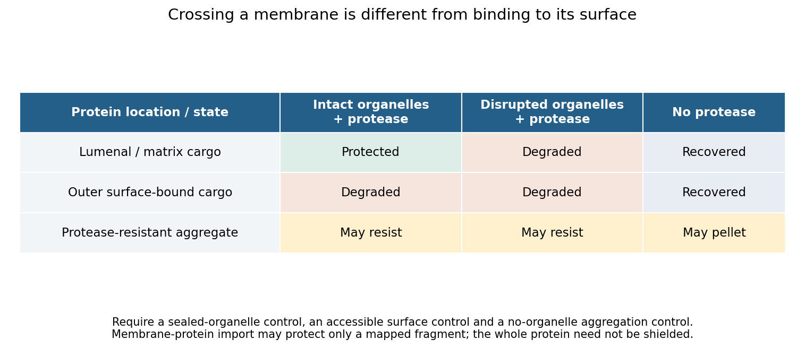

<h1 id="section-i/2/solution">Solution</h1>

↑ **Parent:** [2](../2.md)

**First establish that proteins cross the organelle boundary; then define its resident proteome and determine which residents arrive by import.** A protein detected near an organelle may be a surface binder, contaminant, transient visitor or locally synthesized product. These possibilities require different controls.

Start with an operational definition of the new [organelle](../../../../../organelle.md): its location, boundary, ultrastructure and reproducible biochemical enrichment. [Fluorescence microscopy](../../../../../fluorescence-microscopy.md) with independent markers and electron microscopy can determine whether it is membrane-bounded and whether it contacts or engulfs other compartments. A condensate without a membrane can recruit proteins by partitioning; that should not be mistaken for translocation through a membrane. Purification by [density-gradient centrifugation](../../../../../density-gradient-centrifugation.md) or affinity isolation should include markers for likely contaminants and measurements of organelle integrity. An enriched fraction is a starting material, not evidence of import by itself.

Choose candidate proteins from fractionation, imaging or sequence predictions and make minimally perturbing labeled versions. Follow newly synthesized protein using a [pulse-chase experiment](../../../../../pulse-chase-experiment.md) and independently verify its position relative to the organelle boundary. Loss of a cytosolic precursor followed by accumulation of an internal mature form is suggestive, but proteolytic processing alone does not demonstrate translocation. Tags can obscure targeting signals or change folding, so compare different tag positions and validate endogenous localization where possible.

The key biochemical test is an [organelle import assay](../../../../../organelle-import-assay.md) coupled to a [protease protection assay](../../../../../protease-protection-assay.md). Incubate isolated intact organelles with a labeled precursor, then remove externally accessible protein with protease. Imported lumenal or matrix protein should be protected in intact organelles but become sensitive after detergent disruption. Surface-bound controls must remain accessible; an independent internal marker tests organelle sealing. Include organelle-free incubations to identify protease-resistant aggregates, and verify that detergent does not simply inactivate the protease. Carbonate extraction or membrane fractionation can distinguish an integral membrane product from a soluble internal one. For membrane proteins, map protected fragments and terminal accessibility rather than demanding protection of the entire chain.

**[Figure 1](#section-i/2/image-original-control-logic-separating-protein-import-from-surface-binding-and-protease-resistant-contamination). Original control logic separating protein import from surface binding and protease-resistant contamination**.

Perturbation then tests the mechanism. Compare incubation time and temperature; deplete and restore relevant energy sources; dissipate a membrane potential only after confirming that this treatment preserves membrane integrity; and compete with an excess of unlabeled substrate. Energy requirements must be discovered rather than assumed. Mitochondrial matrix entry, ER translocation and peroxisomal import use different machinery. In particular, stable folding is not a universal barrier: primary peroxisome experiments demonstrated import of stably folded substrates.[Import tests challenging a universal unfolding requirement](../../../../../import-of-stably-folded-proteins-into-peroxisomes-by-p-a-walton-and-others.md)

Mutating a candidate targeting signal should reduce import, while appending that signal to a suitable reporter can test sufficiency. Disrupting a candidate receptor or translocation component, followed by rescue with the wild-type protein, tests necessity. Because a blocked pathway may destroy the organelle indirectly, pair import measurements with morphology, membrane integrity and the import of unrelated controls. An import-defective allele that leaves the compartment otherwise functional is more informative than complete organelle loss. A negative isolated-organelle result does not exclude import if purification removed a required factor; compare with an intact-cell assay. Conversely, protection shows internalization but does not alone distinguish direct protein translocation from delivery inside a vesicle or engulfed compartment. Route-specific perturbations and topology measurements must resolve that distinction.

For the protein complement, combine quantitative [spatial proteomics](../../../../../spatial-proteomics.md) with complementary methods. Measure protein abundance across an entire fractionation gradient and identify proteins with reproducible localization profiles, rather than accepting every protein in a single pellet. Compare intact-organelle protease treatment with disrupted controls, and compare wild type with an import-defective condition. Analyze both soluble and membrane fractions. [Liquid chromatography-mass spectrometry](../../../../../liquid-chromatography-mass-spectrometry.md) identifies peptides, but poorly soluble, scarce or unusual proteins may escape detection, so fractionation and acquisition strategies should be varied.

An internally localized [TurboID](../../../../../turboid.md) or other [proximity labeling](../../../../../proximity-labeling.md) enzyme can reveal proteins accessible in the relevant compartment in living cells. A cytosolic control, a catalytically inactive labeling construct and matched expression levels help identify background. Proximity labeling establishes accessibility and neighborhood, not translocation or stable residency by itself; labeling radius, reagent access and perturbation by the enzyme must be considered.[Targeted proximity-labeling methodology](../../../../../efficient-proximity-labeling-in-living-cells-and-organisms-with-turboid-by-tess-c-branon-and-others.md)

Finally distinguish **resident**, **imported** and **all imported**. A resident may have been synthesized by an organelle genome; an imported protein may only transit through the compartment. Time-resolved labeling, precursor processing, localization and dependence on a defined import pathway can classify these cases. Report coverage across growth conditions, detection limits and a confidence tier for each candidate. No single proteomic experiment proves absolute completeness, but convergent topology, kinetic and genetic evidence can produce a well-supported import catalogue.

## ↑ Ancestors (13)

1. [2](../2.md)
2. [Section I](../../section-i.md)
3. [Paper 4](../../../paper-4-split.md)
4. [2024](../../../split.md)
5. [Past exam of the biochemistry course of the University of Cambridge](../../../../split.md)
6. [Biochemistry course of the University of Cambridge](../../../../../biochemistry-course-of-the-university-of-cambridge.md)
7. [Year 3 of the natural sciences course of the University of Cambridge](../../../../../year-3-of-the-natural-sciences-course-of-the-university-of-cambridge.md)
8. [Year of the natural sciences course of the University of Cambridge](../../../../../year-of-the-natural-sciences-course-of-the-university-of-cambridge.md)
9. [Natural sciences course of the University of Cambridge](../../../../../natural-sciences-course-of-the-university-of-cambridge.md)
10. [Course of the University of Cambridge](../../../../../course-of-the-university-of-cambridge.md)
11. [University of Cambridge](../../../../../university-of-cambridge-split.md)
12. [List of universities](../../../../../list-of-universities.md)
13. [Codex Wiki](../../../../../split.md)
