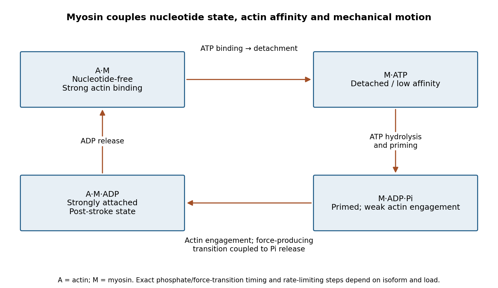

<h1 id="section-ii/4/solution">Solution</h1>

↑ **Parent:** [4](../4.md)

**Myosins convert a nucleotide-driven actin-binding cycle into movement, force or anchoring. Their different cellular roles arise from variations in motor kinetics, directionality, lever-arm geometry, oligomerization and cargo binding.** A class name alone does not specify a universal stepping speed or duty ratio.

A [myosin](../../../../../myosin.md) usually contains an actin-binding motor domain with an ATPase active site, a neck associated with light chains, and a tail involved in cargo association or assembly. The [myosin lever arm](../../../../../myosin-lever-arm.md) amplifies small motor-domain rearrangements. The tail can connect the motor to a membrane, receptor, organelle or another myosin molecule. Some isoforms are autoinhibited until cargo binding, calcium-dependent regulation or phosphorylation favours an active conformation.

The mechanochemical cycle can be organized around actin affinity. In a strongly bound nucleotide-free state, ATP binding weakens actin attachment and promotes detachment. ATP hydrolysis prepares a detached or weakly bound ADP–phosphate state. Subsequent actin interaction and transitions around phosphate release stabilize strong binding and generate the [myosin power stroke](../../../../../myosin-power-stroke.md). ADP release and the next ATP-binding event complete the cycle. The exact ordering and rates of structural transitions and phosphate release depend on isoform and load; the cycle should not be reduced to a claim that ATP cleavage itself is the instantaneous mechanical stroke.

**[Figure 2](#section-ii/4/image-original-myosin-actin-affinity-and-nucleotide-cycle-separating-atp-binding-hydrolysis-and-the-force-producing-transition). Original myosin actin-affinity and nucleotide cycle, separating ATP binding, hydrolysis and the force-producing transition**.

Directionality depends on motor geometry and the polarity of [actin](../../../../../actin.md). Most characterized myosins move toward the barbed end, but [Myosin VI](../../../../../myosin-vi.md) moves toward the pointed end. Motor assays established this reversed direction directly, showing that “myosin” does not imply a single transport direction.[Directionality assays on polarized actin](../../../../../myosin-vi-is-an-actin-based-motor-that-moves-backwards-by-a-l-wells-and-others.md) In a cortex with complex actin architecture, filament orientation must therefore be known before predicting net cargo movement.

The [myosin duty ratio](../../../../../myosin-duty-ratio.md) is the fraction of a cycle spent strongly bound. A single low-duty motor repeatedly loses its track, whereas an assembly of many such motors can maintain collective contact. [Myosin II](../../../../../myosin-ii.md) illustrates this strategy: bipolar filaments bind oppositely oriented actin arrays and generate sliding or tension. In muscle, ordered filament geometry converts sliding into contraction. In nonmuscle cells, related contractile networks contribute to the division furrow, junction remodeling, migration and cortical tension. If the network is anchored, the same sliding mechanism can produce an approximately isometric force rather than large displacement.

Cargo transport poses a different requirement. Dimeric [Myosin V](../../../../../myosin-v.md) motors coordinate their heads so that one remains attached while the other advances. A high-duty coordinated cycle supports [myosin processivity](../../../../../myosin-processivity.md), enabling repeated steps before dissociation. Single-fluorophore localization followed one labeled head moving by roughly twice the centre-of-mass step, supporting alternating hand-over-hand motion rather than equal short advances of both heads.[Single-head localization distinguishing walking mechanisms](../../../../../myosin-v-walks-hand-over-hand-single-fluorophore-imaging-with-1-5-nm-localization-by-ahmet-yildiz-and-others.md) The approximate 36 nm centre-of-mass repeat reflects the actin track and motor geometry; it is not a step size shared by all myosins.

Transport and tension holding overlap. Load can slow nucleotide release and prolong strong binding, allowing some motors to act as dynamic anchors. [Myosin VI](../../../../../myosin-vi.md) can participate in endocytic membrane organization or cargo movement, depending on its partners and assembly state. Class-I myosins couple membranes to cortical actin and can regulate membrane tension and local transport. Specialized myosins organize sensory structures or long-range organelle positioning. These roles depend as much on tail-associated adaptors and local actin arrangement as on the catalytic head.

Regulation matches activity to demand. Light-chain phosphorylation can promote nonmuscle [myosin II](../../../../../myosin-ii.md) activation and filament assembly. Calcium-sensitive light chains, including [calmodulin](../../../../../calmodulin.md) in appropriate classes, alter motor regulation or lever-arm organization. Cargo-associated adaptors can relieve autoinhibition and assemble transport complexes. Motor number, opposing loads, actin turnover and competition with other transport systems further determine the outcome.

Useful experiments separate these contributions. Actin-gliding assays establish direction and movement, single-molecule tracking measures stepping and run length, and force measurements reveal load-dependent kinetics. ATPase assays alone establish chemical turnover but not productive movement. In cells, rescue with a motor-defective or cargo-binding-defective protein can distinguish catalytic force production from a structural scaffolding role. **The unifying mechanism is a coordinated affinity-and-conformation cycle; the biological output can be motion, sustained tension or controlled coupling of membranes to the cytoskeleton.**

## ↑ Ancestors (13)

1. [4](../4.md)
2. [Section II](../../section-ii.md)
3. [Paper 4](../../../paper-4-split.md)
4. [2024](../../../split.md)
5. [Past exam of the biochemistry course of the University of Cambridge](../../../../split.md)
6. [Biochemistry course of the University of Cambridge](../../../../../biochemistry-course-of-the-university-of-cambridge.md)
7. [Year 3 of the natural sciences course of the University of Cambridge](../../../../../year-3-of-the-natural-sciences-course-of-the-university-of-cambridge.md)
8. [Year of the natural sciences course of the University of Cambridge](../../../../../year-of-the-natural-sciences-course-of-the-university-of-cambridge.md)
9. [Natural sciences course of the University of Cambridge](../../../../../natural-sciences-course-of-the-university-of-cambridge.md)
10. [Course of the University of Cambridge](../../../../../course-of-the-university-of-cambridge.md)
11. [University of Cambridge](../../../../../university-of-cambridge-split.md)
12. [List of universities](../../../../../list-of-universities.md)
13. [Codex Wiki](../../../../../split.md)
