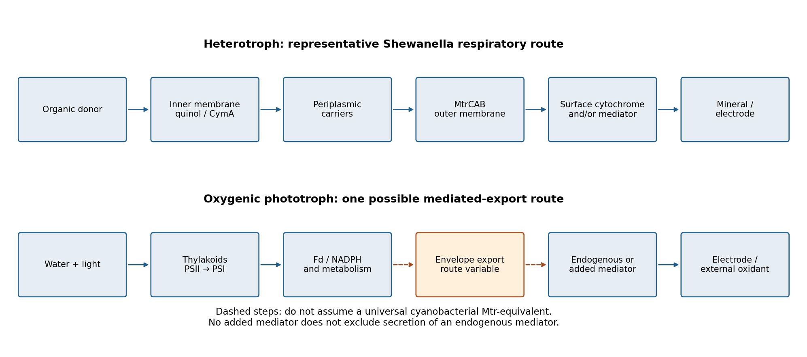

<h1 id="section-iii/8/solution">Solution</h1>

↑ **Parent:** [8](../8.md)

**Both heterotrophic bacteria and oxygenic phototrophs must connect intracellular reducing power to an external acceptor across insulating cell-envelope layers. The best-characterized heterotrophic systems use dedicated respiratory redox conduits, whereas cyanobacterial export often involves mediators and incompletely resolved routes whose activity competes with photosynthetic metabolism.**

In a Gram-negative heterotroph, oxidation of organic substrates supplies electrons to intracellular carriers and the inner-membrane quinone pool. An insoluble iron oxide or an electrode cannot enter the cytoplasm or simply accept an electron through the lipid phase. [Extracellular electron transfer](../../../../../extracellular-electron-transfer.md) must bridge the inner membrane, periplasm and outer membrane before reaching the mineral or electrode surface. This is a sequence of chemically coupled steps, not unrestricted electronic conductivity through the whole cell.

[Shewanella oneidensis](../../../../../shewanella-oneidensis.md) provides a useful mechanistic example. Quinol oxidation connects through [CymA](../../../../../cyma.md) and periplasmic carriers to the outer-membrane [MtrCAB](../../../../../mtrcab.md) assembly. Its cytochromes place redox-active haem groups on the inward and outward sides of a porin-associated structure; surface [MtrC](../../../../../mtrc.md) can exchange electrons with external acceptors. Reconstitution of oriented MtrCAB in proteoliposomes demonstrated transfer from an internal electron-carrier pool to external Fe(III) oxides, directly testing the membrane-crossing function rather than inferring it from a mutant phenotype alone.[Oriented proteoliposome electron-transfer experiment](../../../../../rapid-electron-exchange-between-surface-exposed-bacterial-cytochromes-and-fe-iii-minerals-by-gaye-f-white-and-others.md)

**[Figure 3](#section-iii/8/image-original-comparison-of-a-characterized-heterotrophic-outer-membrane-conduit-with-alternative-phototrophic-electron-export-routes). Original comparison of a characterized heterotrophic outer-membrane conduit with alternative phototrophic electron-export routes**.

Direct contact is one strategy. Surface cytochromes can reduce a mineral that is close enough, and extracellular conductive structures can extend electron transfer beyond the cell body. Some [microbial nanowires](../../../../../microbial-nanowire.md) are cytochrome-rich filaments or membrane-associated structures; the mechanism should be assigned to the organism and structure actually characterized. Calling every extracellular appendage a conducting pilus is unwarranted. Contact area, attachment and the conductivity of the surrounding biofilm can limit current even when the intracellular respiratory route is functional.

A second strategy uses a [redox mediator](../../../../../redox-mediator.md). The cell reduces a soluble compound, which diffuses to a distant acceptor, transfers its electrons and returns in an oxidized form. Flavin-mediated transfer in Shewanella and phenazine-mediated transfer in some other bacteria illustrate how diffusible chemistry can complement direct contact. Some mediators also associate with proteins rather than remaining entirely free in solution. Mediator availability, diffusion, side reactions and loss into the environment therefore affect efficiency. A poised electrode and an insoluble mineral are not interchangeable acceptors: their accessible potentials, surface chemistry and spatial distribution differ.

For oxygenic phototrophs, light supplies a different upstream route. [Photosystem II](../../../../../photosystem-ii.md) extracts electrons from water, and [photosystem I](../../../../../photosystem-i.md) generates reduced [ferredoxin](../../../../../ferredoxin.md) and downstream reducing power. In many [cyanobacteria](../../../../../cyanobacteria.md), these reactions occur on internal [thylakoid](../../../../../thylakoid.md) membranes; an electron collected outside must therefore pass through additional metabolic and envelope steps. In eukaryotic algae, the chloroplast envelope and plasma membrane add further compartmental barriers. One should not transplant a Shewanella Mtr diagram into these organisms merely because both produce an electrode current.

The evidence for cyanobacterial export includes mediator-dependent reduction and sensitivity to envelope permeability. In one [Synechocystis](../../../../../synechocystis.md) study, weakening outer-membrane attachment increased photocurrent, while replacing the culture supernatant with fresh medium removed that current under the tested conditions. Ferricyanide reduction provided a complementary readout. These results support a role for extracellular redox-active compounds and an envelope barrier, not identification of one universal cyanobacterial electron-export protein.[Outer-membrane perturbation, supernatant replacement and ferricyanide-reduction controls](../../../../../order-of-magnitude-enhancement-in-photocurrent-generation-of-synechocystis-sp-pcc-6803-by-outer-membrane-deprivation-by-shoko-kusama-and-others.md)

The energetic roles also differ. Mineral-reducing heterotrophs can use an external acceptor in respiratory energy metabolism. A phototroph must retain enough reducing power for carbon fixation, nutrient assimilation and repair; maximal export is not automatically advantageous. Current can persist in darkness through metabolism of stored carbon, and secreted organic material can support heterotrophs that generate part of a measured community current. Oxygen evolution also changes local redox chemistry and can divert electrons away from the electrode.

Mechanistic experiments should separate these possibilities. Compare axenic cultures with mixed communities, light and dark conditions, intact and damaged cells, and cell-free supernatants. Use electrode-potential controls, viability assays, electron-transfer mutants and rescue, together with oxygen and carbon balances. Ferricyanide access must be interpreted relative to its membrane permeability. Most importantly, **“no added mediator” does not prove direct transfer**: cells can secrete their own mediator. The comparison is therefore between a relatively well-defined family of respiratory conduits and several phototrophic routes requiring organism-specific evidence, with the same general requirements of redox compatibility, envelope crossing and an accessible external sink.

## ↑ Ancestors (13)

1. [8](../8.md)
2. [Section III](../../section-iii.md)
3. [Paper 4](../../../paper-4-split.md)
4. [2024](../../../split.md)
5. [Past exam of the biochemistry course of the University of Cambridge](../../../../split.md)
6. [Biochemistry course of the University of Cambridge](../../../../../biochemistry-course-of-the-university-of-cambridge.md)
7. [Year 3 of the natural sciences course of the University of Cambridge](../../../../../year-3-of-the-natural-sciences-course-of-the-university-of-cambridge.md)
8. [Year of the natural sciences course of the University of Cambridge](../../../../../year-of-the-natural-sciences-course-of-the-university-of-cambridge.md)
9. [Natural sciences course of the University of Cambridge](../../../../../natural-sciences-course-of-the-university-of-cambridge.md)
10. [Course of the University of Cambridge](../../../../../course-of-the-university-of-cambridge.md)
11. [University of Cambridge](../../../../../university-of-cambridge-split.md)
12. [List of universities](../../../../../list-of-universities.md)
13. [Codex Wiki](../../../../../split.md)
