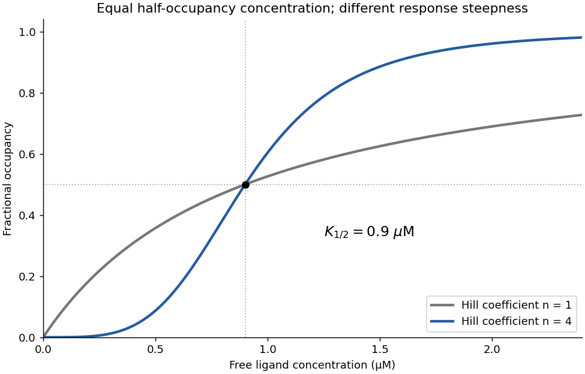

<h1 id="section-2/2/m/solution">Solution</h1>

↑ **Parent:** [M](../m.md)

**Yes: the binding data support strong positive cooperativity.** On the linear [concentration](../../../../../../concentration.md) axis, occupancy rises sigmoidally, with reported [Hill coefficient](../../../../../../hill-coefficient.md) $n=3.97\pm0.13$, far above the noncooperative value one. The [Hill equation](../../../../../../hill-equation.md) gives the useful empirical description

$$
\theta=\frac{[L]^n}{K_{1/2}^{\,n}+[L]^n},\qquad K_{1/2}\simeq0.90\,\mu\mathrm M.
$$

The steep response is consistent with the independent evidence for a four-subunit assembly. The fitted half-occupancy [concentration](../../../../../../concentration.md) is not automatically the microscopic [dissociation constant](../../../../../../dissociation-constant.md) of one isolated site.

Binding alone does not demonstrate which conformational change is coupled to occupancy. Here the microscopy supplies the complementary structural evidence, so together the observations support a cooperative ligand-dependent switch. A [Hill coefficient](../../../../../../hill-coefficient.md) near four is consistent with strongly coupled binding in a tetramer, but is not an independent exact count of [ligands](../../../../../../ligand-biochemistry.md).

**[Figure 1](#section-2/2/m/image-illustrative-binding-curves-showing-how-a-hill-coefficient-near-four-sharpens-the-response). Illustrative binding curves showing how a Hill coefficient near four sharpens the response**.

## ↑ Ancestors (14)

1. [M](../m.md)
2. [2](../../2.md)
3. [Section 2](../../../section-2.md)
4. [Paper 5](../../../../paper-5-split.md)
5. [2025](../../../../split.md)
6. [Past exam of the biochemistry course of the University of Cambridge](../../../../../split.md)
7. [Biochemistry course of the University of Cambridge](../../../../../../biochemistry-course-of-the-university-of-cambridge.md)
8. [Year 3 of the natural sciences course of the University of Cambridge](../../../../../../year-3-of-the-natural-sciences-course-of-the-university-of-cambridge.md)
9. [Year of the natural sciences course of the University of Cambridge](../../../../../../year-of-the-natural-sciences-course-of-the-university-of-cambridge.md)
10. [Natural sciences course of the University of Cambridge](../../../../../../natural-sciences-course-of-the-university-of-cambridge.md)
11. [Course of the University of Cambridge](../../../../../../course-of-the-university-of-cambridge.md)
12. [University of Cambridge](../../../../../../university-of-cambridge-split.md)
13. [List of universities](../../../../../../list-of-universities.md)
14. [Codex Wiki](../../../../../../split.md)
