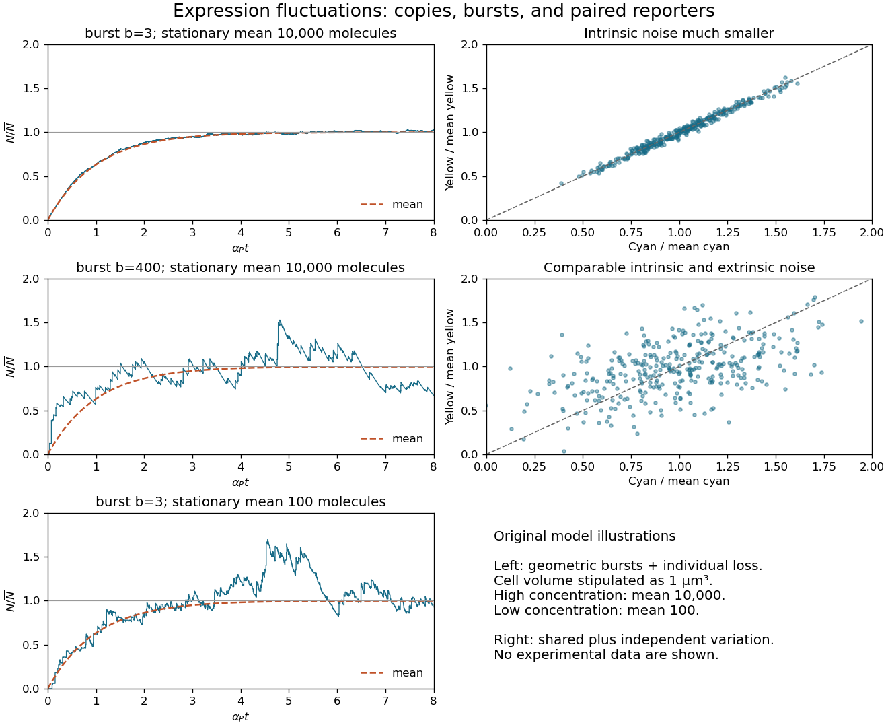
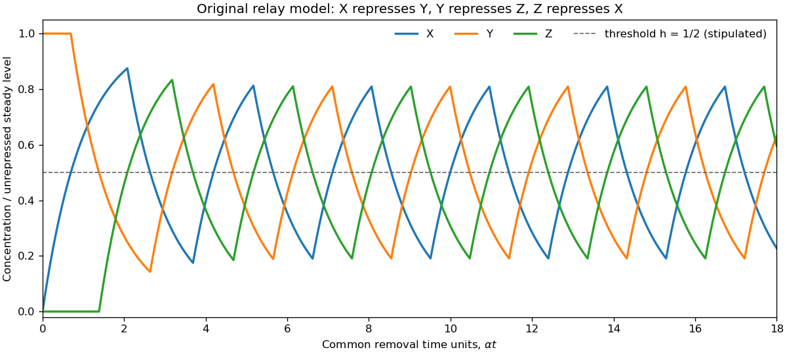
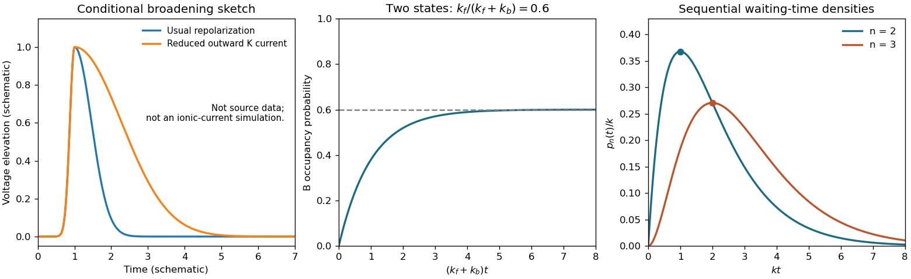
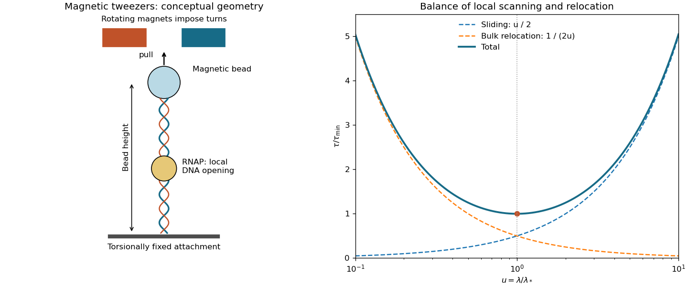

# 2015

↑ **Parent:** [Past exam of the biological physics course of the University of Oxford](../past-exam-of-the-biological-physics-course-of-the-university-of-oxford.md)

Source paper: [https://www.whatdotheyknow.com/request/oxford_physics_past_papers_2/response/2340696/attach/3/Physics%20Papers%202014.pdf?cookie_passthrough=1](https://www.whatdotheyknow.com/request/oxford_physics_past_papers_2/response/2340696/attach/3/Physics%20Papers%202014.pdf?cookie_passthrough=1)

The dated cover identifies the June 2015 sitting; the archive filename says 2014. Lettered scopes below separate independently marked blocks where the source supplies no letters. All three alternatives in Question 8 are covered. Missing source illustrations are identified at the affected solutions.

**Table of contents**

- [1](#1)
  - [a](#1/a)
    - [Solution](#1/a/solution)
  - [b](#1/b)
    - [Solution](#1/b/solution)
  - [c](#1/c)
    - [Solution](#1/c/solution)
  - [d](#1/d)
    - [Solution](#1/d/solution)
  - [e](#1/e)
    - [Solution](#1/e/solution)
- [2](#2)
  - [a](#2/a)
    - [Solution](#2/a/solution)
  - [b](#2/b)
    - [Solution](#2/b/solution)
  - [c](#2/c)
    - [Solution](#2/c/solution)
  - [d](#2/d)
    - [Solution](#2/d/solution)
  - [e](#2/e)
    - [Solution](#2/e/solution)
- [3](#3)
  - [a](#3/a)
    - [Solution](#3/a/solution)
  - [b](#3/b)
    - [Solution](#3/b/solution)
  - [c](#3/c)
    - [Solution](#3/c/solution)
- [4](#4)
  - [a](#4/a)
    - [Solution](#4/a/solution)
  - [b](#4/b)
    - [Solution](#4/b/solution)
  - [c](#4/c)
    - [Solution](#4/c/solution)
- [5](#5)
  - [a](#5/a)
    - [Solution](#5/a/solution)
  - [b](#5/b)
    - [Solution](#5/b/solution)
  - [c](#5/c)
    - [Solution](#5/c/solution)
  - [d](#5/d)
    - [Solution](#5/d/solution)
- [6](#6)
  - [a](#6/a)
    - [Solution](#6/a/solution)
  - [b](#6/b)
    - [Solution](#6/b/solution)
  - [c](#6/c)
    - [Solution](#6/c/solution)
  - [d](#6/d)
    - [Solution](#6/d/solution)
- [7](#7)
  - [a](#7/a)
    - [Solution](#7/a/solution)
  - [b](#7/b)
    - [Solution](#7/b/solution)
  - [c](#7/c)
    - [Solution](#7/c/solution)
- [8](#8)
  - [i](#8/i)
    - [Solution](#8/i/solution)
  - [ii](#8/ii)
    - [Solution](#8/ii/solution)
  - [iii](#8/iii)
    - [Solution](#8/iii/solution)

## 1

↑ **Parent:** [2015](2015.md)

<h3 id="1/a">a</h3>

↑ **Parent:** [1](#1)

<h4 id="1/a/solution">Solution</h4>

↑ **Parent:** [A](#1/a)

The [messenger RNA](../polymer.md#messenger-rna) has [steady state](../dynamical-systems.md#steady-state) $X_{R,*}=\beta_R/\alpha_R$. Since [biological translation](../molecular-genetics.md#translation-biology) produces [proteins](../protein.md) at rate $rX_R$, setting the [protein degradation](../protein.md#protein-degradation) rate equal to this production rate gives

$$
\boxed{X_{P,*}=\frac{r\beta_R}{\alpha_P\alpha_R}=\frac{b\beta_R}{\alpha_P},\qquad b=\frac r{\alpha_R}.}
$$

The [translational burst size](../molecular-genetics.md#translational-burst-size) is the expected number of [proteins](../protein.md) made during one [messenger RNA](../polymer.md#messenger-rna) lifetime, whose [expected value](../expected-value.md) is $1/\alpha_R$. It is dimensionless, rather than a production rate. With independent [Poisson process](../poisson-process.md) translation and an [exponential distribution](../continuous-probability-distribution.md#exponential-distribution) for the lifetime, the resulting count has a [geometric distribution](../discrete-probability-distribution.md#geometric-distribution) on nonnegative integers with [expected value](../expected-value.md) $b$ and [variance](../variance.md) $b(1+b)$.

<h3 id="1/b">b</h3>

↑ **Parent:** [1](#1)

<h4 id="1/b/solution">Solution</h4>

↑ **Parent:** [B](#1/b)

With zero initial [messenger RNA](../polymer.md#messenger-rna) and [protein concentration](../mathematical-physics.md#protein-concentration), solving the two linear [ordinary differential equations](../differential-equation.md#ordinary-differential-equation) in sequence gives

$$
\frac{\mathbb E X_P(t)}{X_{P,*}}=1-\frac{\alpha_R e^{-\alpha_Pt}-\alpha_Pe^{-\alpha_Rt}}{\alpha_R-\alpha_P}
\simeq1-e^{-\alpha_Pt}.
$$

The last expression applies after the short [messenger RNA](../polymer.md#messenger-rna) transient when $\alpha_R\gg\alpha_P$. All three mean curves have this shape. At a fixed [steady state](../dynamical-systems.md#steady-state), a larger [translational burst size](../molecular-genetics.md#translational-burst-size) requires fewer [transcription](../molecular-genetics.md#transcription-biology) events: $\beta_R=\alpha_PX_{P,*}/b$. Thus $b=400$ gives infrequent large upward jumps followed by [protein degradation](../protein.md#protein-degradation), whereas $b=3$ gives many smaller jumps and a smoother trace.

Noise depends on molecule counts. If the fixed cell [volume](../geometry-and-topology.md#volume) is $V$, write $\bar N=VX_{P,*}$. In the instantaneous-burst limit, independent [Poisson process](../poisson-process.md) arrivals of geometrically distributed bursts, with count arrival rate $\lambda=V\beta_R$, and unit [protein degradation](../protein.md#protein-degradation) give

$$
\boxed{\operatorname{var}N=\bar N(1+b),\qquad \mathrm{CV}=\sqrt{\frac{1+b}{VX_{P,*}}}.}
$$

Indeed, the [moment equations](../mathematical-biology.md#moment-equation) are $d\mathbb EN/dt=\lambda b-\alpha_P\mathbb EN$ and $d\operatorname{var}N/dt=\lambda b(1+2b)+\alpha_P\mathbb EN-2\alpha_P\operatorname{var}N$. With zero initial counts the [variance](../variance.md) becomes $\bar N[(1+b)-e^{-\alpha_Pt}-be^{-2\alpha_Pt}]$. These equations explain both the approach to the [steady state](../dynamical-systems.md#steady-state) and the scatter about it.

For illustration only, $V=1\,\mu\mathrm m^3$ gives $\bar N=10^4$ at the higher [concentration](../mathematical-physics.md#concentration): the two values of the [coefficient of variation](../variance.md#coefficient-of-variation) are $0.020$ and $0.200$. At the lower [concentration](../mathematical-physics.md#concentration), $\bar N=100$ and $b=3$ gives $0.200$. Decreasing the [concentration](../mathematical-physics.md#concentration) by a factor of 100 therefore increases relative fluctuations tenfold, despite keeping small bursts. Absolute fluctuation sizes cannot be inferred without a cell [volume](../geometry-and-topology.md#volume). The original sketches below stipulate that [volume](../geometry-and-topology.md#volume); they are model realizations, not source data.[Derivation of the transient and stationary variance](../molecular-genetics.md#transient-protein-count-variance-in-the-instantaneous-burst-model)

**[Figure 1](#1/b/image-translational-burst-size-relative-expression-fluctuations-and-paired-fluorescent-reporters). Translational burst size, relative expression fluctuations, and paired fluorescent reporters**.

<h3 id="1/c">c</h3>

↑ **Parent:** [1](#1)

<h4 id="1/c/solution">Solution</h4>

↑ **Parent:** [C](#1/c)

Normalize both [fluorescent reporter](../protein.md#fluorescent-reporter) intensities by their respective means, correcting unequal brightness and background, and denote them $c,y$. [Extrinsic gene-expression noise](../molecular-genetics.md#extrinsic-gene-expression-noise) changes shared cellular conditions and moves both signals together: the scatter is a long narrow cloud around $y=c$. [Intrinsic gene-expression noise](../molecular-genetics.md#intrinsic-gene-expression-noise) comes from distinct random expression events in the two [genes](../genetics.md#gene) and broadens the cloud across that diagonal. Comparable contributions therefore give a noticeably wider, still positively correlated cloud. The two right-hand panels in the preceding original illustration show these two cases.

For matched [fluorescent reporters](../protein.md#fluorescent-reporter) with conditionally independent intrinsic fluctuations and corrected measurement noise,

$$
\eta_{\rm int}^2=\frac12\mathbb E(c-y)^2,\qquad
\eta_{\rm ext}^2=\mathbb E(cy)-1.
$$

The first quantity measures differential variation; the second measures common variation. A clone's successive observations can remain correlated in time, so they need not be independent samples. Shared activation transients should also be separated from the fluctuations of interest.[Science 297 (2002), pp. 1183–1186: dual-reporter discrimination of intrinsic and extrinsic variation](../biochemistry-and-biophysics-bibliography.md#stochastic-gene-expression-in-a-single-cell-by-michael-b-elowitz-and-others)

<h3 id="1/d">d</h3>

↑ **Parent:** [1](#1)

<h4 id="1/d/solution">Solution</h4>

↑ **Parent:** [D](#1/d)

Let $S=\beta/\alpha$ be the unrepressed [steady state](../dynamical-systems.md#steady-state), $x=X/S,y=Y/S,z=Z/S$, $h=K/S$, and $\tau=\alpha t$. The [logic approximation for gene regulation](../mathematical-biology.md#logic-approximation-for-gene-regulation) gives the [repressilator](../mathematical-biology.md#repressilator) equations

$$
\boxed{x'=H(h-z)-x,\qquad y'=H(h-x)-y,\qquad z'=H(h-y)-z.}
$$

An active production term makes its [concentration](../mathematical-physics.md#concentration) approach one exponentially; an inactive term makes it decay exponentially. Oscillations require an accessible threshold, $0<h<1$. Equal thresholds and rate constants alone do not specify a numerical period.

Initially $(x,y,z)=(0,1,0)$, so $x=1-e^{-\tau}$, $y=1$, $z=0$ until $x$ reaches $h$ at $\tau_1=-\log(1-h)$. Then $Y$ production stops and $y=e^{-(\tau-\tau_1)}$. It reaches $h$ after another $\log(1/h)$, allowing $Z$ production. When $z$ rises through $h$, $X$ production stops. As $x$ falls through $h$, $Y$ production resumes; its next upward crossing represses $Z$. The downward crossing of $z$ then restarts $X$. This ordered sequence repeats, giving displaced pulses and rounded exponential rises and falls.

Every event can be constructed without a numerical differential-equation solver: a rising variable starting at $v_0<h$ takes $\log[(1-v_0)/(1-h)]$ to reach $h$, while a decaying variable starting at $v_0>h$ takes $\log(v_0/h)$. Advance all three variables with their current production terms to the earliest such event, switch the affected production term, and continue. The original plot uses the explicitly illustrative choice $h=1/2$. If $h\ge1$, the unrepressed levels cannot cross the threshold and this oscillatory sequence does not follow.

**[Figure 2](#1/d/image-original-logic-approximation-for-gene-regulation-trajectory-of-the-repressilator-with-threshold-one-half-of-the-unrepressed-level). Original logic approximation for gene regulation trajectory of the repressilator, with threshold one half of the unrepressed level**.

<h3 id="1/e">e</h3>

↑ **Parent:** [1](#1)

<h4 id="1/e/solution">Solution</h4>

↑ **Parent:** [E](#1/e)

A [green fluorescent protein](../protein.md#green-fluorescent-protein) readout follows the corresponding periodically regulated expression, so an individual cell has repeated peaks in [fluorescence](../fluorescence.md). [Biological translation](../molecular-genetics.md#translation-biology), fluorophore maturation, and [protein degradation](../protein.md#protein-degradation) introduce a delay and smooth the peaks. For a simple mature [fluorescent reporter](../protein.md#fluorescent-reporter) with periodic production $s(t)$, $\dot G=s(t)-\gamma G$ gives $G(t)=G(0)e^{-\gamma t}+\int_0^t e^{-\gamma(t-u)}s(u)\,du$. A long lifetime therefore makes the modulation weak about an accumulated background. [Intrinsic gene-expression noise](../molecular-genetics.md#intrinsic-gene-expression-noise) makes successive peak heights and periods irregular; averaging cells with unrelated oscillation phases can hide the single-cell oscillations.

## 2

↑ **Parent:** [2015](2015.md)

<h3 id="2/a">a</h3>

↑ **Parent:** [2](#2)

<h4 id="2/a/solution">Solution</h4>

↑ **Parent:** [A](#2/a)

[Alan Hodgkin](../physiology.md#alan-hodgkin) and [Andrew Huxley](../physiology.md#andrew-huxley) recorded the [membrane potential](../membrane-potential.md) directly between the inside of a squid axon and the external solution. The crucial result was an [action potential](../neuron.md#action-potential) that passed through zero: the interior became positive, rather than merely losing its negative resting [membrane potential](../membrane-potential.md). A theory in which excitation simply abolishes membrane selectivity and shorts out the resting [membrane potential](../membrane-potential.md) cannot account for that reversal. Their original report establishes the historical interpretation independently of the unavailable examination picture.[Nature 144 (1939), pp. 710–711: intracellular recording and reversal of the potential difference](../neuroscience-bibliography.md#action-potentials-recorded-from-inside-a-nerve-fibre-by-alan-hodgkin-and-andrew-huxley)

The later [Hodgkin-Huxley model](../neuroscience.md#hodgkin-huxley-model) explains the rising phase through increased [sodium](../chemical-substance.md#sodium) permeability and the falling phase through [sodium](../chemical-substance.md#sodium) [ion-channel inactivation](../membrane-potential.md#ion-channel-inactivation) and increased [potassium](../chemical-substance.md#potassium) permeability. Distinct [Nernst equilibrium potentials](../membrane-potential.md#nernst-equilibrium-potential) make a selective conductance change capable of reversing the [membrane potential](../membrane-potential.md). The recording established the phenomenon; it did not by itself reveal individual [ion channel](../cell-membrane.md#ion-channel) structures or all their gating kinetics.

**Source illustration TODO:** the source page's recording is missing in both the held PDF and its archive parent. No amplitudes, time intervals, or trace layout are reconstructed here; the surviving historical request is answered above.

<h3 id="2/b">b</h3>

↑ **Parent:** [2](#2)

<h4 id="2/b/solution">Solution</h4>

↑ **Parent:** [B](#2/b)

Here $V_m$ is the inside-minus-outside [membrane potential](../membrane-potential.md), $V_K$ is the [potassium](../chemical-substance.md#potassium) [Nernst equilibrium potential](../membrane-potential.md#nernst-equilibrium-potential), and $\bar g_K$ is the maximum [potassium](../chemical-substance.md#potassium) conductance, or conductance per area if $I_K$ is a [current density](../electric-charge.md#current-density). The factor $n\in[0,1]$ is the permissive-state [probability](../probability-theory.md#probability) of an activation gate. Four [independent permissive gates in an ion channel](../membrane-potential.md#independent-permissive-gates-in-an-ion-channel) give the open fraction $n^4$, hence

$$
I_K=n^4\bar g_K(V_m-V_K).
$$

The model assumes identical independent gating units, additive currents from many [ion channels](../cell-membrane.md#ion-channel), an approximately ohmic open-pore current, and fixed ionic activities setting $V_K$. Outward positive [electric current](../electric-charge.md#electric-current) is obtained for $V_m>V_K$. The original delayed-rectifier term omits rapid [ion-channel inactivation](../membrane-potential.md#ion-channel-inactivation). The fourth power is a successful phenomenological gating description, rather than a deduction of the molecular structure from this equation alone.

<h3 id="2/c">c</h3>

↑ **Parent:** [2](#2)

<h4 id="2/c/solution">Solution</h4>

↑ **Parent:** [C](#2/c)

For [two-state ion-channel gating](../membrane-potential.md#two-state-ion-channel-gating), let $\alpha_n(V)$ and $\beta_n(V)$ be the rates of entering and leaving the permissive state. Gain minus loss gives

$$
\dot n=\alpha_n(1-n)-\beta_n n=(\alpha_n+\beta_n)(n_\infty-n),\qquad
n_\infty=\frac{\alpha_n}{\alpha_n+\beta_n},\quad
\tau_n=\frac1{\alpha_n+\beta_n}.
$$

At fixed [membrane potential](../membrane-potential.md), these coefficients are constant. The deviation $w=n-n_\infty$ obeys $\dot w=-w/\tau_n$, so the initial condition $n(0)=n_0$ yields

$$
\boxed{n(t)=n_\infty-(n_\infty-n_0)e^{-t/\tau_n}.}
$$

This approaches the fixed-voltage limit monotonically and stays between $n_0$ and $n_\infty$, as a valid [probability](../probability-theory.md#probability) must.

**Convention qualification:** the displayed single [exponential function](../calculus.md#exponential-function) describes a voltage-clamp step, not an arbitrary time-dependent [action potential](../neuron.md#action-potential). For example, a second imposed voltage step changes both coefficients and requires a new exponential segment. For general $V(t)$ the integrating-factor solution is $n(t)=e^{-A(t)}[n_0+\int_0^t\alpha_n(V(s))e^{A(s)}\,ds]$, with $A(t)=\int_0^t[\alpha_n(V(s))+\beta_n(V(s))]\,ds$.

<h3 id="2/d">d</h3>

↑ **Parent:** [2](#2)

<h4 id="2/d/solution">Solution</h4>

↑ **Parent:** [D](#2/d)

Fast [ion-channel inactivation](../membrane-potential.md#ion-channel-inactivation) would reduce the outward [potassium](../chemical-substance.md#potassium) [electric current](../electric-charge.md#electric-current) just when it normally repolarizes the axon. Since $C_m\dot V_m=I_{\rm applied}-I_{\rm Na}-I_K-I_{\rm leak}$, a reduction of positive $I_K$ makes the falling slope less negative. With other mechanisms unchanged, the [action potential](../neuron.md#action-potential) is generally broader and its after-hyperpolarization is weaker. A plateau or slow return is possible until [sodium](../chemical-substance.md#sodium) [ion-channel inactivation](../membrane-potential.md#ion-channel-inactivation), leakage, or another outward conductance restores the resting [membrane potential](../membrane-potential.md). The precise trace depends on those remaining currents; rapid [potassium](../chemical-substance.md#potassium) inactivation alone does not determine a unique waveform.

**[Figure 3](#2/d/image-original-schematic-action-potential-broadening-and-two-state-relaxation-and-sequential-transition-probability-densities). Original schematic action potential broadening and two-state relaxation and sequential-transition probability densities**.

The left panel is a qualitative sketch of this comparison, not a fit or a reconstruction of the missing historical recording.

<h3 id="2/e">e</h3>

↑ **Parent:** [2](#2)

<h4 id="2/e/solution">Solution</h4>

↑ **Parent:** [E](#2/e)

In classical [ball-and-chain inactivation](../membrane-potential.md#ball-and-chain-inactivation), a cytoplasmic N-terminal part of the [voltage-gated potassium channel](../membrane-potential.md#voltage-gated-potassium-channel) acts as a tethered blocking particle. Once the pore opens, this particle reaches and occludes its intracellular entrance. The flexible connecting segment allows access; removal of the block permits recovery. Thus opening and subsequent loss of conduction can occur even while the activating voltage remains applied.

Several independent observations support this mechanism. Removing or disrupting the N-terminal inactivation segment suppresses fast [ion-channel inactivation](../membrane-potential.md#ion-channel-inactivation) while leaving activation possible. An appropriate soluble peptide applied from the cytoplasmic side restores an open-channel block in otherwise noninactivating channels. Changes in the blocking segment alter block kinetics, while changing its access or tether can alter how rapidly it finds the pore. Rescue in trans is particularly informative: the blocking particle need not remain covalently attached to produce the effect.[Science 250 (1990), pp. 568–571: restoration of inactivation by the cytoplasmic peptide](../biochemistry-and-biophysics-bibliography.md#restoration-of-inactivation-in-mutants-of-shaker-potassium-channels-by-a-peptide-derived-from-shb-by-william-n-zagotta-and-others)[Science 250 (1990), pp. 533–538: molecular perturbations of rapid inactivation](../biochemistry-and-biophysics-bibliography.md#biophysical-and-molecular-mechanisms-of-shaker-potassium-channel-inactivation-by-toshinori-hoshi-and-others)

This mechanism is [N-type inactivation](../membrane-potential.md#ball-and-chain-inactivation). It should not be generalized to every [potassium](../chemical-substance.md#potassium) [ion channel](../cell-membrane.md#ion-channel): [C-type inactivation](../membrane-potential.md#c-type-inactivation) instead involves changes associated with the outer pore and [selectivity filter](../cell-membrane.md#selectivity-filter).

## 3

↑ **Parent:** [2015](2015.md)

<h3 id="3/a">a</h3>

↑ **Parent:** [3](#3)

<h4 id="3/a/solution">Solution</h4>

↑ **Parent:** [A](#3/a)

Write $e=q>0$ for the [elementary charge](../electric-charge.md#elementary-charge) and $\epsilon=\epsilon_0\epsilon_r$ for the [permittivity](../permittivity.md). Taking the bulk [electric potential](../electric-field.md#electric-potential) as zero, the [Boltzmann distribution](../thermodynamics.md#boltzmann-distribution) of point [ions](../chemistry.md#ion) gives $c_i(x)=c_i^\infty\exp[-ez_i\phi(x)/(k_BT)]$. Here $c_i$ is a [number density](../statistical-physics.md#number-density), not a molar [concentration](../mathematical-physics.md#concentration). Combining this with [Poisson's equation](../partial-differential-equation.md#poisson-s-equation) gives the planar [Poisson-Boltzmann equation](../electrostatics.md#poisson-boltzmann-equation)

$$
\phi''(x)=-\frac e\epsilon\sum_i z_ic_i^\infty e^{-ez_i\phi(x)/(k_BT)}.
$$

Multiplying by $\phi'$ and integrating from the neutral bulk, where $\phi=\phi'=0$, yields

$$
\frac\epsilon2(\phi')^2=k_BT\sum_i c_i^\infty\left(e^{-ez_i\phi/(k_BT)}-1\right).
$$

For the solution occupying $x>0$, with the field on the other side neglected, [Gauss's law](../maxwell-equations.md#gauss-s-law) gives $\sigma=-\epsilon\phi'(0)$. On the branch that decays to zero without crossing it,

$$
\boxed{\sigma=\operatorname{sgn}(\phi_0)\sqrt{2\epsilon k_BT\sum_i c_i^\infty\left(e^{-ez_i\phi_0/(k_BT)}-1\right)}.}
$$

**Source sign qualification:** the unsigned square root printed in the paper gives $|\sigma|$. A negative wall [electric potential](../electric-field.md#electric-potential), such as the next part's $-73\,\mathrm{mV}$, has $\phi'(0)>0$ and hence $\sigma<0$, providing a concrete counterexample to interpreting that printed expression as signed [surface charge density](../electrostatics.md#surface-charge-density). This is the planar [Grahame equation](../electrostatics.md#grahame-equation), with an explicit sign convention.

<h3 id="3/b">b</h3>

↑ **Parent:** [3](#3)

<h4 id="3/b/solution">Solution</h4>

↑ **Parent:** [B](#3/b)

Full dissociation gives bulk [concentrations](../mathematical-physics.md#concentration) in $\mathrm{mM}$ of $155$ for [sodium](../chemical-substance.md#sodium), $5$ for [potassium](../chemical-substance.md#potassium), $2$ for [calcium](../chemical-substance.md#calcium), $114$ for chloride, and $25$ for hydrogen phosphate. The positive and negative charge concentrations are both $164\,\mathrm{mM}$, so the bulk is electrically neutral. At $T=298.15\,\mathrm K$,

$$
V_T=\frac{k_BT}{e}=25.6926\,\mathrm{mV},\qquad
u=-\frac{\phi_0}{V_T}=2.84129.
$$

The [Boltzmann distribution](../thermodynamics.md#boltzmann-distribution) then gives

$$
\boxed{c_{1+}(0)=160e^\nu=2742.05\,\mathrm{mM},\qquad
c_{2+}(0)=2e^{2\nu}=587.409\,\mathrm{mM}.}
$$

For completeness the coion [concentrations](../mathematical-physics.md#concentration) are $114e^{-\nu}=6.65196\,\mathrm{mM}$ and $25e^{-2\nu}=0.0851195\,\mathrm{mM}$. They are depleted, not zero. Using $1\,\mathrm{mM}=1\,\mathrm{mol\,m^{-3}}$ and multiplying molar [concentrations](../mathematical-physics.md#concentration) by the [Avogadro constant](../physics.md#avogadro-constant) in the [Grahame equation](../electrostatics.md#grahame-equation) gives

$$
\boxed{\sigma=-0.103243\,\mathrm{C\,m^{-2}}.}
$$

This calculation retains every species. Since $|\phi_0|/V_T=2.84$, a linear [Debye–Hückel approximation](../electrostatics.md#debye-huckel-approximation) is not justified. The large accumulation, especially of divalent counterions, follows from the valence in the [Boltzmann factor](../canonical-ensemble.md#boltzmann-factor). However, multi-molar local [concentrations](../mathematical-physics.md#concentration) also warn that point-ion [mean-field theory](../statistical-physics.md#mean-field-theory) neglects finite ion size, hydration, specific adsorption, correlations, and changes in local [permittivity](../permittivity.md). These are predictions of the stated idealized model, not precise measured interfacial [concentrations](../mathematical-physics.md#concentration).

<h3 id="3/c">c</h3>

↑ **Parent:** [3](#3)

<h4 id="3/c/solution">Solution</h4>

↑ **Parent:** [C](#3/c)

Assume the structural [surface charge density](../electrostatics.md#surface-charge-density) stays fixed while a divalent chloride is added, without changing $T$ or $\epsilon$. Let $v=e\phi_0/(k_BT)$ and $\delta c$ be the increment of the bulk divalent [concentration](../mathematical-physics.md#concentration). Electroneutral addition also increases bulk chloride by $2\delta c$. Varying the squared [Grahame equation](../electrostatics.md#grahame-equation) at fixed $\sigma$ gives

$$
0=\delta c(e^{-2v}+2e^v-3)-\frac e{k_BT}\left[c_{1+}(0)+2c_{2+}(0)-c_{1-}(0)-2c_{2-}(0)\right]\delta\phi_0.
$$

At a strongly negative wall, coions are small. Dropping their contribution to the denominator and $2e^v$ in the numerator gives the requested leading approximation

$$
\boxed{\delta\phi_0\simeq\frac{k_BT}{e}\frac{\delta c(e^{-2v}-3)}{c_{1+}(0)+2c_{2+}(0)}.}
$$

The $-3$ includes the change in bulk osmotic concentration of one added divalent counterion and its two monovalent coions. The numerator's increment is a **bulk** [concentration](../mathematical-physics.md#concentration); the denominator contains **surface** [concentrations](../mathematical-physics.md#concentration).[Full differential response before the counterion approximation](../electrostatics.md#fixed-charge-response-to-added-divalent-chloride) Extra counterions screen the wall and make its negative [electric potential](../electric-field.md#electric-potential) less negative. At fixed bulk [calcium](../chemical-substance.md#calcium), $c_{\rm Ca}(0)=c_{\rm Ca}^\infty e^{-2\phi_0/V_T}$ therefore decreases. Under the stipulated proportionality, synaptic activity decreases as well; this argument isolates electrostatic accumulation rather than assuming a separate specific magnesium effect on the [ion channels](../cell-membrane.md#ion-channel).

For $\delta c=5\,\mathrm{mM}$, the printed linear approximation gives $\delta\phi_0=9.53434\,\mathrm{mV}$. Linearizing the activity too gives $\delta A/A=-2\delta\phi_0/V_T=-0.7422$, or approximately a $74\%$ reduction. Exponentiating this approximate voltage instead gives $A'/A=0.4761$. **Neither is a controlled finite-increment prediction:** the added divalent [concentration](../mathematical-physics.md#concentration) is 2.5 times its initial value.

A consistent finite-change calculation is possible within the same [Poisson-Boltzmann equation](../electrostatics.md#poisson-boltzmann-equation). Define, using $\mathrm{mM}$ throughout,

$$
S_m(u)=160(e^u-1)+(2+m)(e^{2u}-1)+(114+2m)(e^{-u}-1)+25(e^{-2u}-1).
$$

Fixed $\sigma$ requires $S_5(u')=S_0(2.84129)$. The physical positive root is $u'=2.58241$, giving

$$
\boxed{\phi'_0=-66.3488\,\mathrm{mV},\quad
\Delta\phi_0=6.65122\,\mathrm{mV},\quad
\frac{A'}A=e^{2(u'-u)}=0.595857.}
$$

Thus the self-consistent finite-change estimate is about a **40.4% reduction**. Both estimates rely on fixed surface charge, ideal ionic activities, and unchanged bulk [calcium](../chemical-substance.md#calcium); the limitations of the large local [concentrations](../mathematical-physics.md#concentration) remain.

## 4

↑ **Parent:** [2015](2015.md)

<h3 id="4/a">a</h3>

↑ **Parent:** [4](#4)

<h4 id="4/a/solution">Solution</h4>

↑ **Parent:** [A](#4/a)

In [single-molecule force spectroscopy](../molecule.md#single-molecule-force-spectroscopy) of [titin](../protein.md#titin), one end of the [protein](../protein.md) is attached to a surface and the other to an [atomic force microscope](../engineering.md#atomic-force-microscope) cantilever. Moving the support stretches the molecule; a calibrated cantilever deflection measures the [force](../force.md) through $f=k_c\delta$. The molecular extension is the imposed separation minus cantilever deflection and other instrumental offsets, rather than the uncorrected support displacement.

At first, increasing extension removes conformational slack from unstructured segments. Their [conformational entropy](../protein.md#conformational-entropy) decreases and the resisting [force](../force.md) rises. A folded [protein domain](../protein.md#protein-domain) then unfolds when a thermally activated transition becomes likely under load. Its residues join the stretched chain, increasing the available [polymer contour length](../polymer.md#polymer-contour-length). At almost the same imposed separation, the newly released segment has slack: the [force](../force.md) drops. Further pulling straightens this longer chain until another domain unfolds. Repetition produces a sawtooth sequence; each rising branch mainly measures stretching between unfolding events, and a peak marks the end of such a branch.

The peak height measures the resistance to unfolding under the particular loading history, not a direct equilibrium [free energy](../thermodynamic-potential.md#thermodynamic-free-energy) or an invariant breaking [force](../force.md). Random unfolding times, loading rate, domain identity, attachments, and cantilever compliance affect the record. Releasing tension can allow [protein folding](../protein.md#protein-folding), but refolding has its own kinetics and need not retrace the loading curve. Distinct unfolding events explain how a long [protein](../protein.md) can absorb extension in steps rather than failing at a single threshold.

**Source illustration TODO:** Figures A and B are absent in the held source and archive parent. This explanation uses the surviving sawtooth description; it supplies no recovered peak heights, spacings, or domain counts.

<h3 id="4/b">b</h3>

↑ **Parent:** [4](#4)

<h4 id="4/b/solution">Solution</h4>

↑ **Parent:** [B](#4/b)

Fit each pre-unfolding branch with its own [polymer contour length](../polymer.md#polymer-contour-length) $L$ and a [persistence length](../mathematical-biology.md#persistence-length) $L_p$, allowing for the measured extension zero. The [worm-like chain force-extension interpolation](../mathematical-biology.md#worm-like-chain-force-extension-interpolation) has the limits

$$
f=\frac{k_BT}{L_p}\left[\frac1{4(1-x/L)^2}-\frac14+\frac xL\right]
\sim\frac{3k_BT}{2L_pL}x\quad(x/L\ll1),\qquad
f\sim\frac{k_BT}{4L_p(1-x/L)^2}\quad(x/L\to1).
$$

Thus the low-extension slope and the high-extension curvature constrain the flexible segment's length and bending stiffness. The [persistence length](../mathematical-biology.md#persistence-length) is related to the bending modulus by $\kappa=k_BT L_p$. Successive increases in fitted $L$ measure contour released by unfolding, after subtracting the original folded domain's projected length. With an independently known contour increment per residue, this also estimates how many residues became available. A common fitted $L_p$ across branches supports a common type of unfolded chain; a systematic change can signal altered interactions or a poor model.

For a thermal [worm-like chain](../mathematical-biology.md#worm-like-chain), $\langle\mathbf t(s)\cdot\mathbf t(0)\rangle=e^{-s/L_p}$. Consequently $s=L_p$ gives $\langle\cos\theta\rangle=1/e$, and $\arccos(1/e)=68.4^\circ$. The latter is an angle associated with the **mean cosine**, not generally the mean angle itself. For example, angles $0$ and $90^\circ$ with equal probabilities have mean angle $45^\circ$, but the inverse cosine of their mean cosine is $60^\circ$. This distinction makes the source's informal angular description precise.

Without Figure B, no numerical fit parameters can be read. The requested physical interpretation of those parameters follows without its numerical data.

<h3 id="4/c">c</h3>

↑ **Parent:** [4](#4)

<h4 id="4/c/solution">Solution</h4>

↑ **Parent:** [C](#4/c)

An inextensible [worm-like chain](../mathematical-biology.md#worm-like-chain) describes [entropic elasticity](../mathematical-biology.md#entropic-elasticity) and diverges as $x\to L$. Real [protein](../protein.md) backbones and folded [protein domains](../protein.md#protein-domain) also deform energetically under large [forces](../force.md). For an axial stretch modulus $K_s$, a simple extensible-chain correction is

$$
\frac xL\simeq1-\frac12\sqrt{\frac{k_BT}{fL_p}}+\frac f{K_s}.
$$

The last term supplies extension through bond and structural deformation that the inextensible model excludes. It becomes especially noticeable on the high-force ends of rising branches.[High-force entropic and energetic extension terms](../mathematical-biology.md#energetic-extension-of-a-strongly-stretched-worm-like-chain) An unfolding transition itself is also outside a single equilibrium fixed-$L$ branch. These mechanisms explain why the source explicitly distinguishes energetic and [entropic elasticity](../mathematical-biology.md#entropic-elasticity).

**Source-dependent TODO:** the arrows and actual deviations at the first four peaks in Figure B are unavailable. Energetic stretching is the natural explanation of a high-force excess-extension deviation, but its direction, onset, and uniqueness cannot be checked against the missing curves. No particular arrow-marked feature or numerical stretch modulus is invented. This source-dependent identification remains incomplete; the recoverable model limitation is explained above.

## 5

↑ **Parent:** [2015](2015.md)

<h3 id="5/a">a</h3>

↑ **Parent:** [5](#5)

<h4 id="5/a/solution">Solution</h4>

↑ **Parent:** [A](#5/a)

At [thermal equilibrium](../thermal-equilibrium.md), [detailed balance](../markov-chain.md#detailed-balance) equates the opposing transition fluxes: $k_f p_A^{\rm eq}=k_b p_B^{\rm eq}$. Define the state [free energy](../thermodynamic-potential.md#thermodynamic-free-energy) difference explicitly by $\Delta G_{AB}=G_B-G_A$. The equilibrium [Boltzmann distribution](../thermodynamics.md#boltzmann-distribution) then gives

$$
\boxed{\frac{k_f}{k_b}=\frac{p_B^{\rm eq}}{p_A^{\rm eq}}=e^{-\Delta G_{AB}/(k_BT)}.}
$$

Any state degeneracy is included in the state [free energies](../thermodynamic-potential.md#thermodynamic-free-energy). Detailed balance is stronger than simply requiring a time-independent total occupancy: it equates each pair of equilibrium transition fluxes.

**Source illustration TODO:** the source's [reaction coordinate](../chemical-kinetics.md#reaction-coordinate) diagram is missing. The definition above fixes the sign independently; no barrier heights or ordering of drawn energy levels are inferred. Below, a large _forward free-energy drop_ means $G_A-G_B\gg k_BT$. If instead $\Delta G_{AB}=G_B-G_A\gg k_BT$, forward transitions are unfavorable: for example $\Delta G_{AB}=10k_BT$ gives $k_f/k_b=e^{-10}$, so neglecting reverse transitions would be wrong.

<h3 id="5/b">b</h3>

↑ **Parent:** [5](#5)

<h4 id="5/b/solution">Solution</h4>

↑ **Parent:** [B](#5/b)

Conservation of total [probability](../probability-theory.md#probability) gives $A(t)=1-B(t)$. The two-state [master equation](../continuous-time-markov-chain.md#master-equation) is therefore

$$
\dot B=k_f(1-B)-k_bB=k_f-(k_f+k_b)B,\qquad B(0)=0.
$$

Solving this linear [ordinary differential equation](../differential-equation.md#ordinary-differential-equation) gives

$$
\boxed{B(t)=\frac{k_f}{k_f+k_b}\left(1-e^{-(k_f+k_b)t}\right).}
$$

The middle panel in [d](#2/d) sketches this solution for the explicitly illustrative ratio $k_f/(k_f+k_b)=0.6$. The curve starts at zero with slope $k_f$, is increasing and concave down, and approaches the horizontal limit $B_\infty=k_f/(k_f+k_b)$ on [time constant](../analysis.md#time-constant) $(k_f+k_b)^{-1}$. Its initial tangent meets the asymptote at that [time constant](../analysis.md#time-constant). The complementary limit is $A_\infty=k_b/(k_f+k_b)$, so $B_\infty/A_\infty=k_f/k_b=e^{-\Delta G_{AB}/(k_BT)}$, the [Boltzmann distribution](../thermodynamics.md#boltzmann-distribution) ratio. These are occupancy [probabilities](../probability-theory.md#probability); $B(t)$ is not the cumulative first-passage probability when reverse transitions remain possible.

<h3 id="5/c">c</h3>

↑ **Parent:** [5](#5)

<h4 id="5/c/solution">Solution</h4>

↑ **Parent:** [C](#5/c)

Interpret the irreversible limit as a large favorable drop for **each forward step**, so backward transitions during the observation can be neglected. Let the distinct forward rates be $k_1,k_2>0$. The first waiting time has [probability density](../wave-function.md#probability-density) $k_1e^{-k_1t_1}$; conditional on its completion, the second has independent [probability density](../wave-function.md#probability-density) $k_2e^{-k_2(t-t_1)}$. Integrating over the first completion time gives the [convolution](../fourier-analysis.md#convolution)

$$
p_{1,2}(t)=\int_0^t k_1e^{-k_1t_1}k_2e^{-k_2(t-t_1)}\,dt_1
=\frac{k_1k_2}{k_2-k_1}\left(e^{-k_1t}-e^{-k_2t}\right),\quad t\ge0.
$$

Hence

$$
\boxed{\Pr(t<T_1+T_2<t+dt)=p_{1,2}(t)\,dt+o(dt).}
$$

The expression is symmetric under interchanging the rates, positive for either ordering, and integrates to one. Reverse rate constants do not enter this approximation; merely making all four constants different would not justify eliminating them without the downhill condition.

<h3 id="5/d">d</h3>

↑ **Parent:** [5](#5)

<h4 id="5/d/solution">Solution</h4>

↑ **Parent:** [D](#5/d)

Taking $k_2\to k_1=k$ in the preceding [probability density](../wave-function.md#probability-density) gives $p_2(t)=k^2te^{-kt}$. Convolving once more with an independent [exponential distribution](../continuous-probability-distribution.md#exponential-distribution) gives

$$
p_3(t)=\int_0^t k^2s e^{-ks}ke^{-k(t-s)}\,ds=\frac{k^3t^2}{2}e^{-kt}.
$$

More generally, suppose $p_n(s)=k^ns^{n-1}e^{-ks}/(n-1)!$. Then

$$
p_{n+1}(t)=\frac{k^{n+1}e^{-kt}}{(n-1)!}\int_0^t s^{n-1}\,ds
=\frac{k^{n+1}t^n e^{-kt}}{n!}.
$$

Since $p_1(t)=ke^{-kt}$, this proves the [Erlang distribution](../continuous-probability-distribution.md#erlang-distribution) formula by [mathematical induction](../foundations-of-mathematics.md#mathematical-induction). Normalization follows either from the [convolution](../fourier-analysis.md#convolution) or $\int_0^\infty t^{n-1}e^{-kt}\,dt=(n-1)!/k^n$.

$$
\boxed{p_n(t)=\frac{k^nt^{n-1}e^{-kt}}{(n-1)!},\qquad
\Pr(t<T<t+dt)=p_n(t)dt+o(dt),\qquad
 t_{\rm mode}=\frac{n-1}{k}.}
$$

For $n>1$, differentiating $\log p_n$ gives $(n-1)/t-k=0$, and the derivative changes from positive to negative. For $n=1$ the maximum occurs at the boundary $t=0$. **Source dimensional qualification:** the printed expression without $dt$ is a [probability density](../wave-function.md#probability-density), with units of inverse time; it cannot itself be a dimensionless interval [probability](../probability-theory.md#probability).

In the right panel of the original illustration in [d](#2/d), $p_2/k$ rises linearly near zero and peaks at $kt=1$ with height $1/e$. The curve $p_3/k$ rises quadratically and peaks later, at $kt=2$, with lower height $2e^{-2}$. Both have exponential tails, but the latter has the larger [expected value](../expected-value.md) $3/k$ and [variance](../variance.md) $3/k^2$, compared with $2/k$ and $2/k^2$. This distinguishes both the onset and the width of the requested sketches.

## 6

↑ **Parent:** [2015](2015.md)

<h3 id="6/a">a</h3>

↑ **Parent:** [6](#6)

<h4 id="6/a/solution">Solution</h4>

↑ **Parent:** [A](#6/a)

[RNA polymerase](../molecular-genetics.md#rna-polymerase) first recognizes and binds a [gene promoter](../molecular-genetics.md#promoter-genetics) to form a closed complex with the local [DNA](../polymer.md#deoxyribonucleic-acid) duplex still paired. Local strand separation then produces a [transcription bubble](../molecular-genetics.md#transcription-bubble) in an [open promoter complex](../molecular-genetics.md#open-promoter-complex), making the template available for [RNA](../polymer.md#ribonucleic-acid) synthesis. Recognition, binding, and opening are distinct events; observing binding alone does not demonstrate strand opening.

In [magnetic tweezers](../electromagnetism.md#magnetic-tweezers), a [DNA](../polymer.md#deoxyribonucleic-acid) tether joins a fixed surface to a magnetic bead, with attachments that prevent free swivelling. The magnets pull upward and can impose turns; the bead height reports tether extension. For a torsionally constrained tether, [linking number](../knot-theory.md#linking-number) is partitioned into twist and writhe, $Lk=Tw+Wr$. If opening the [transcription bubble](../molecular-genetics.md#transcription-bubble) removes helical twist while $Lk$ is fixed, compensating twist or writhe appears elsewhere. In a supercoiled regime, changes in writhe change the extension, making an opening event visible as a bead-height step.

The sign provides an important control. On a positively supercoiled tether, local unwinding requires more positive compensating writhe and generally shortens the tether. On a negatively supercoiled tether, the same unwinding removes some negative writhe and generally lengthens it. A bending or compaction contribution can have the same sign in both cases, whereas the torsional contribution reverses. Comparing signs, together with an extension-versus-turns response measured for the tether, distinguishes local unwinding from mere binding-induced bending. These claims assume the tether remains torsionally constrained and lies in the calibrated supercoiled regime, rather than an arbitrary stretched-DNA regime.

**[Figure 4](#6/a/image-original-magnetic-tweezers-schematic-and-the-competing-time-contributions-in-facilitated-target-search). Original magnetic tweezers schematic and the competing time contributions in facilitated target search**.

<h3 id="6/b">b</h3>

↑ **Parent:** [6](#6)

<h4 id="6/b/solution">Solution</h4>

↑ **Parent:** [B](#6/b)

For a fixed perfectly absorbing spherical target, steady [diffusion](../thermodynamics.md#diffusion) outside radius $r_0$ obeys $\nabla^2c=0$, $c(r_0)=0$, and $c(\infty)=c_\infty$. Spherical symmetry gives $c=A+B/r$, hence $c(r)=c_\infty(1-r_0/r)$. The inward [diffusion](../thermodynamics.md#diffusion) flux integrated over the target is $4\pi r_0^2D_A c'(r_0)=4\pi r_0D_Ac_\infty$. Consequently the number-density rate constant is

$$
\boxed{k_a=4\pi r_0D_A.}
$$

This [Smoluchowski association rate](../biology.md#smoluchowski-association-rate) has units $\mathrm{m^3\,s^{-1}}$, as required by the given number-density rate law. If both partners moved independently, their relative [diffusion coefficient](../brownian-motion.md#diffusion-coefficient) would be the sum; the chromosomal target is treated as fixed here.

For a spherical [RNA polymerase](../molecular-genetics.md#rna-polymerase) of radius $a=10\,\mathrm{nm}$, the [Stokes–Einstein relation](../stokes-flow.md#stokes-einstein-relation) gives

$$
D_A=\frac{k_BT}{6\pi\eta a}\simeq2.18\times10^{-12}\,\mathrm{m^2\,s^{-1}}\quad(T=298.15\,\mathrm K).
$$

For $N=6000$ free independent, approximately well-mixed searchers in a [volume](../geometry-and-topology.md#volume) $V$, the small-target encounter hazard is approximately $Nk_a/V$. Thus

$$
\boxed{\tau_3\simeq\frac{V}{6000\,4\pi r_0D_A}
=0.304\,\mathrm{ms}\left(\frac{V}{1\,\mu\mathrm m^3}\right)
\left(\frac{20\,\mathrm{nm}}{r_0}\right)
\left(\frac{298.15\,\mathrm K}{T}\right).}
$$

The numerical coefficient explicitly uses a typical illustrative cell [volume](../geometry-and-topology.md#volume) and an illustrative effective capture radius, **not dimensions supplied by the source**. A 60-base-pair B-form [DNA](../polymer.md#deoxyribonucleic-acid) segment has a contour length of about $20\,\mathrm{nm}$, motivating an encounter size of this order, but its contour length does not uniquely determine an absorbing sphere's radius. Taking $r_0=10\,\mathrm{nm}$ instead doubles the estimate. A unique numerical answer requires $V$, $T$, and a capture-geometry convention, none specified in this block.

The estimate also treats all 6000 molecules as freely available and every encounter as productive. Crowding, nonspecific binding, orientation constraints, imperfect reaction, and finite-domain initial transients can alter it. In particular, an arbitrary first-passage distribution's mean does not divide by $N$ exactly; the division follows from the approximate exponential-hazard description.[Small-target well-mixed limit and its assumptions](../biology.md#earliest-diffusive-target-encounter-among-independent-searchers)

<h3 id="6/c">c</h3>

↑ **Parent:** [6](#6)

<h4 id="6/c/solution">Solution</h4>

↑ **Parent:** [C](#6/c)

The given [facilitated target search](../biology.md#facilitated-target-search) time contains a rising term $L\lambda/D_1$ and a falling term $V/(D_3\lambda)$. Longer sliding explores more neighbouring [DNA](../polymer.md#deoxyribonucleic-acid) without another bulk encounter, reducing the cost of three-dimensional relocation; but it also spends longer revisiting local contour. Roughly $L/\lambda$ local scans, each taking time of order $\lambda^2/D_1$, give the first term. The second represents the bulk encounter cost for an effective capturable contour range of order $\lambda$, with a [Smoluchowski association rate](../biology.md#smoluchowski-association-rate) scaling as $D_3\lambda$. Numerical geometrical factors are already absorbed in the stipulated scaling formula.

Differentiating at fixed positive $L,V,D_1,D_3$ gives

$$
\frac{d\tau_{1+3}}{d\lambda}=\frac L{D_1}-\frac V{D_3\lambda^2},\qquad
\boxed{\lambda_* =\sqrt{\frac{VD_1}{LD_3}},\qquad
\tau_{\min}=2\sqrt{\frac{LV}{D_1D_3}}.}
$$

The second derivative $2V/(D_3\lambda^3)>0$ proves the minimum is unique. The two contributions are equal there. The formal curve diverges at both zero and infinite $\lambda$; real sliding lengths are bounded, for example by the available contour, so an inaccessible optimum must be replaced by the nearest physical boundary. In dimensionless form, $\tau/\tau_{\min}=(u+u^{-1})/2$ with $u=\lambda/\lambda_*$. The right panel of the original illustration shows its minimum and the two contributing terms. The supplied expression does not include a factor of 6000; it should not silently be identified with the preceding earliest-encounter estimate.

<h3 id="6/d">d</h3>

↑ **Parent:** [6](#6)

<h4 id="6/d/solution">Solution</h4>

↑ **Parent:** [D](#6/d)

[Single-molecule fluorescence microscopy](../fluorescence.md#single-molecule-fluorescence-microscopy) can localize isolated [fluorescent proteins](../protein.md#fluorescent-protein) and link successive positions into trajectories. For ideal free [Brownian motion](../brownian-motion.md) projected into two dimensions, [mean squared displacement](../brownian-motion.md#mean-squared-displacement) satisfies $\langle|\mathbf r(t+\Delta t)-\mathbf r(t)|^2\rangle=4D\Delta t$. A fit of the short-lag slope therefore estimates the [diffusion coefficient](../brownian-motion.md#diffusion-coefficient).

If each measured coordinate has independent localization error of [variance](../variance.md) $s^2$, two measured positions give a constant offset $4s^2$ in the two-dimensional [mean squared displacement](../brownian-motion.md#mean-squared-displacement). Finite exposure averages the motion and biases that relation too. Estimates should therefore account for localization error, motion blur, missed links, and confinement. Bound [RNA polymerase](../molecular-genetics.md#rna-polymerase) and freely moving [RNA polymerase](../molecular-genetics.md#rna-polymerase) can form distinct displacement populations, so pooling them into one straight line can hide binding. Short-lag trajectories and state-dependent fits distinguish rapid motion from slow or chromosomally bound states; a long-lag plateau can reflect confinement rather than a vanishing microscopic [diffusion coefficient](../brownian-motion.md#diffusion-coefficient).

## 7

↑ **Parent:** [2015](2015.md)

<h3 id="7/a">a</h3>

↑ **Parent:** [7](#7)

<h4 id="7/a/solution">Solution</h4>

↑ **Parent:** [A](#7/a)

[ATP synthase](../enzyme.md#atp-synthase) couples a membrane-embedded rotary motor to a soluble catalytic head. Its membrane sector contains a rotating ring of c subunits and a stationary a subunit providing offset proton-access pathways. Its catalytic sector contains an $\alpha_3\beta_3$ head with catalytic sites primarily on the $\beta$ subunits, a central rotating shaft, and a peripheral stator that prevents the head simply co-rotating.

A [proton-motive force](../chemical-potential.md#proton-motive-force), combining a [membrane potential](../membrane-potential.md) and a proton [chemical potential](../chemical-potential.md) difference, drives directional proton passage and ring rotation. Rotation of the central shaft changes the conformations and binding affinities of successive catalytic sites, allowing [ADP](../molecule.md#adenosine-diphosphate) and inorganic phosphate to bind, form [ATP](../molecule.md#adenosine-triphosphate), and release it in a coordinated cycle. The [ATP synthase rotary mechanism](../enzyme.md#atp-synthase-rotary-mechanism) therefore couples ion transport, torque, and chemical work rather than requiring a proton to react directly at every catalytic site.

The motor is reversible: sufficiently favorable [ATP](../molecule.md#adenosine-triphosphate) hydrolysis can drive proton pumping against its [electrochemical potential](../chemical-potential.md#electrochemical-potential) gradient. In [mitochondria](../biological-cell.md#mitochondria), the respiratory chain establishes the gradient used for oxidative [ATP](../molecule.md#adenosine-triphosphate) production; analogous coupling operates in bacterial membranes and in chloroplast photophosphorylation. The number of protons per revolution depends on the c-ring stoichiometry, whereas a full catalytic rotation normally produces three [ATP](../molecule.md#adenosine-triphosphate) molecules. It is therefore inappropriate to assign one universal integer proton-to-ATP ratio to all organisms. Transport and leakage can increase the whole-cell energetic cost beyond the motor's ideal ratio.

<h3 id="7/b">b</h3>

↑ **Parent:** [7](#7)

<h4 id="7/b/solution">Solution</h4>

↑ **Parent:** [B](#7/b)

The lipid [cell membrane](../cell-membrane.md) separates ionic solutions and has selective [ion channels](../cell-membrane.md#ion-channel), ion pumps, and a finite [capacitance](../electromagnetism.md#capacitance). Ionic gradients and unequal permeability allow a small charge separation to generate a [membrane potential](../membrane-potential.md). The bulk compartments can remain almost electrically neutral even when the narrow interfacial layers carry opposite [electric charges](../electric-charge.md).

For one permeant ionic species with valence $z$, its [electrochemical potential](../chemical-potential.md#electrochemical-potential) is $\widetilde\mu=\mu^0+k_BT\log a+ze\phi$, where $a$ is its activity. With no applied drive and no net ionic current, electrochemical equilibrium across a permeable membrane gives

$$
k_BT\log a_{\rm in}+ze\phi_{\rm in}
=k_BT\log a_{\rm out}+ze\phi_{\rm out}.
$$

Hence, with the inside-minus-outside convention,

$$
\boxed{\Psi_m=\phi_{\rm in}-\phi_{\rm out}=\frac{k_BT}{ze}\log\frac{a_{\rm out}}{a_{\rm in}}.}
$$

For dilute ideal solutions the activities may be replaced by [concentrations](../mathematical-physics.md#concentration). At $25^\circ\mathrm C$ this is $(59.16\,\mathrm{mV}/z)\log_{10}(c_{\rm out}/c_{\rm in})$. The resulting [Nernst equilibrium potential](../membrane-potential.md#nernst-equilibrium-potential) balances diffusive and electrical driving, not necessarily equal [concentrations](../mathematical-physics.md#concentration). Physically there must be countercharge, such as impermeant counterions; the single-species idealization concerns the permeant current. With multiple permeant species, zero total current need not mean zero current of each species, and the resting [membrane potential](../membrane-potential.md) is not generally any single species' [Nernst equilibrium potential](../membrane-potential.md#nernst-equilibrium-potential).

<h3 id="7/c">c</h3>

↑ **Parent:** [7](#7)

<h4 id="7/c/solution">Solution</h4>

↑ **Parent:** [C](#7/c)

Including both flat ends of the cylindrical cell, its membrane [surface area](../differential-geometry.md#surface-area) is

$$
A=2\pi r\ell+2\pi r^2
=2\pi(10^{-6})(100\times10^{-6})+2\pi(10^{-6})^2
=6.34602\times10^{-10}\,\mathrm{m^2}.
$$

The [capacitance](../electromagnetism.md#capacitance) is $C=(0.01\,\mathrm{F\,m^{-2}})A=6.34602\,\mathrm{pF}$. The [electric charge](../electric-charge.md) needed for the specified [depolarization](../membrane-potential.md#depolarization) is therefore

$$
\Delta Q=C\Delta\Psi=5.39411\times10^{-13}\,\mathrm C,\qquad
\boxed{N=\frac{|\Delta Q|}{e}=3.36674\times10^6\text{ monovalent ions}.}
$$

Ignoring the ends gives $3.33\times10^6$, only about one percent smaller. Inward movement of positive [ions](../chemistry.md#ion), or outward movement of negative [ions](../chemistry.md#ion), produces the stated positive change in the inside-minus-outside [membrane potential](../membrane-potential.md).

The cell [volume](../geometry-and-topology.md#volume) is $\pi r^2\ell=3.14159\times10^{-16}\,\mathrm{m^3}$. Distributed over this [volume](../geometry-and-topology.md#volume), the transferred number would correspond to only $0.0177955\,\mathrm{mM}$. Relative to an **illustrative**, not source-specified, $100\,\mathrm{mM}$ internal ionic pool, that is a fraction $1.78\times10^{-4}$. Thus a substantial change in [membrane potential](../membrane-potential.md) requires movement of only a tiny fraction of bulk [ions](../chemistry.md#ion); it does not require wholesale depletion of the intracellular solution. The separated [electric charge](../electric-charge.md) is concentrated near the two membrane surfaces.

## 8

↑ **Parent:** [2015](2015.md)

<h3 id="8/i">i</h3>

↑ **Parent:** [8](#8)

<h4 id="8/i/solution">Solution</h4>

↑ **Parent:** [I](#8/i)

A time-calibrated [phylogenetic tree](../evolution.md#phylogenetic-tree) combines evidence about ancestry with evidence about elapsed time. First identify homologous [RNA](../polymer.md#ribonucleic-acid) or [protein sequences](../protein.md#protein-sequence), preferably orthologous loci whose splits reflect the species divergences of interest. A [multiple sequence alignment](../molecular-genetics.md#multiple-sequence-alignment) proposes corresponding ancestral positions. Conserved [ribosomal RNA](../polymer.md#ribosomal-rna) can compare distant lineages, whereas faster-evolving regions help resolve recent splits; [amino acid](../chemical-substance.md#amino-acid) alignments can retain useful deep information after many nucleotide sites have changed repeatedly.

A [phylogenetics](../evolution.md#phylogenetics) model estimates a topology and branch lengths in substitutions per site, using explicit substitution probabilities rather than treating every observed mismatch as one historical change. Repeated substitutions, unequal rates among sites, selection, and compositional bias can make observed mismatch fractions underestimate the amount of change. Multiple loci help test consistency; a single gene tree can disagree with the species history through duplication, incomplete lineage sorting, or horizontal transfer.

A [molecular clock](../evolution.md#molecular-clock) converts branch change to time through an evolutionary rate. For two equally evolving lineages, an expected distance $d$ and rate $\mu$ give a divergence time $t=d/(2\mu)$, but sequence information alone usually identifies a rate-time product, not its two factors separately. A fossil securely assigned to a descendant clade supplies a dated constraint: the ancestral split must be at least as old as that fossil. The oldest known fossil is normally a minimum age, not proof that the lineage originated exactly then.

Several independent fossil constraints, their dating and placement uncertainty, and a [relaxed molecular clock](../evolution.md#relaxed-molecular-clock) permit rates to vary while estimating divergence times with uncertainty intervals. Geological absence alone is a weak upper bound when preservation or sampling is poor. Conflicting loci, uncertain alignments, saturation, model misspecification, and uncertain fossil assignments should be investigated rather than hidden by a precise-looking time axis. The resulting [phylogenetic tree](../evolution.md#phylogenetic-tree) is a joint inference from sequences, evolutionary assumptions, and geological evidence.

<h3 id="8/ii">ii</h3>

↑ **Parent:** [8](#8)

<h4 id="8/ii/solution">Solution</h4>

↑ **Parent:** [Ii](#8/ii)

An [ion channel](../cell-membrane.md#ion-channel) is a selective permeation pathway, not simply an aqueous hole of fixed diameter. A hydrated [ion](../chemistry.md#ion) entering a narrow [selectivity filter](../cell-membrane.md#selectivity-filter) must lose or reorganize some hydration water. The energetic cost can be offset by interactions with charged or polar groups in the pore. Different ionic radii, valences, hydration [free energies](../thermodynamic-potential.md#thermodynamic-free-energy), and coordination geometries therefore produce different permeation barriers and binding affinities.

A classical [potassium](../chemical-substance.md#potassium) [selectivity filter](../cell-membrane.md#selectivity-filter) presents oxygen ligands that stabilize relatively dehydrated [potassium](../chemical-substance.md#potassium) in configurations resembling its aqueous coordination. Smaller [sodium](../chemical-substance.md#sodium) does not automatically pass more easily: its hydration is stronger and the filter need not provide a compensating configuration at equally low [free energy](../thermodynamic-potential.md#thermodynamic-free-energy). Filter flexibility and multi-ion occupancy matter, so the explanation is an energetic balance, not the assertion that a rigid hole simply blocks every larger or smaller sphere. Ion-ion interactions and coupled displacement can permit rapid conduction while maintaining selectivity.[Science 280 (1998), pp. 69–77: structural basis of potassium coordination and selective permeation](../biochemistry-and-biophysics-bibliography.md#the-structure-of-the-potassium-channel-molecular-basis-of-k-plus-conduction-and-selectivity-by-declan-a-doyle-and-others)

Other [ion channels](../cell-membrane.md#ion-channel) use different arrangements. Fixed negative groups can strongly favor divalent [calcium](../chemical-substance.md#calcium) over monovalent [ions](../chemistry.md#ion); occupancy and competition then influence both selectivity and throughput. Selectivity is distinct from activation or [ion-channel inactivation](../membrane-potential.md#ion-channel-inactivation), which control access or availability. Selective passive flux follows an [electrochemical potential](../chemical-potential.md#electrochemical-potential) gradient; it does not by itself pump [ions](../chemistry.md#ion) uphill. Selectivity allows cells to establish particular [membrane potentials](../membrane-potential.md), generate [action potentials](../neuron.md#action-potential), regulate [calcium](../chemical-substance.md#calcium) signals, and control solute balance without dissipating every ionic gradient whenever one pathway opens.

<h3 id="8/iii">iii</h3>

↑ **Parent:** [8](#8)

<h4 id="8/iii/solution">Solution</h4>

↑ **Parent:** [Iii](#8/iii)

[Single-molecule experiments](../molecule.md#single-molecule-experiment) expose distributions and ordered events that an ensemble average can hide. Several distinct biological systems make this advantage concrete.

- In [titin](../protein.md#titin) [single-molecule force spectroscopy](../molecule.md#single-molecule-force-spectroscopy), individual sawtooth drops reveal sequential domain unfolding and contour release. An ensemble stretching curve can smooth away that sequence and obscure variation in unfolding thresholds. Force-dependent waiting-time distributions also distinguish stochastic transitions from a single deterministic breaking strength.
- In a [patch clamp](../neuroscience.md#patch-clamp) recording of one [ion channel](../cell-membrane.md#ion-channel), discrete open-current levels and closed intervals reveal single-channel conductance, gating dwell times, and [ion-channel open probability](../cell-membrane.md#ion-channel-open-probability). An ensemble current alone cannot distinguish a few frequently open channels from many rarely open ones, or reveal a brief intermediate state with the same clarity.
- In [Single-molecule observation of F1 rotation](../enzyme.md#single-molecule-observation-of-f1-rotation), a probe on the motor shaft reports angular progression and pauses associated with the catalytic cycle. Rotation demonstrates mechanical coupling directly; individual stepping and dwell-time statistics can connect chemical turnover to angular motion, whereas bulk [ATP](../molecule.md#adenosine-triphosphate) consumption alone cannot establish the motor's trajectory.
- In [DNA unwinding measured by magnetic tweezers](../electromagnetism.md#dna-unwinding-measured-by-magnetic-tweezers), individual extension changes resolve the waiting time and extent of [open promoter complex](../molecular-genetics.md#open-promoter-complex) formation by [RNA polymerase](../molecular-genetics.md#rna-polymerase). Separate binding, opening, and later movements can otherwise merge into one population-averaged response.

These methods also have limitations: the attached probe or applied load may perturb the molecule, inactive or heterogeneous molecules may be overrepresented, and finite temporal resolution can hide fast steps. Repeated independent trajectories and appropriate controls are needed to connect a single observed event to a reproducible mechanism. The gain is access to trajectories and heterogeneity, rather than an assumption that one molecule alone represents every molecule.

## ↑ Ancestors (9)

1. [Past exam of the biological physics course of the University of Oxford](../past-exam-of-the-biological-physics-course-of-the-university-of-oxford.md)
2. [Biological physics course of the University of Oxford](../university-of-oxford.md#biological-physics-course-of-the-university-of-oxford)
3. [Year 4 of the physics course of the University of Oxford](../university-of-oxford.md#year-4-of-the-physics-course-of-the-university-of-oxford)
4. [Physics course of the University of Oxford](../university-of-oxford.md#physics-course-of-the-university-of-oxford)
5. [Undergraduate course of the University of Oxford](../university-of-oxford.md#undergraduate-course-of-the-university-of-oxford)
6. [Course of the University of Oxford](../university-of-oxford.md#course-of-the-university-of-oxford)
7. [University of Oxford](../university-of-oxford.md)
8. [List of universities](../README.md#list-of-universities)
9. [Codex Wiki](../README.md)
