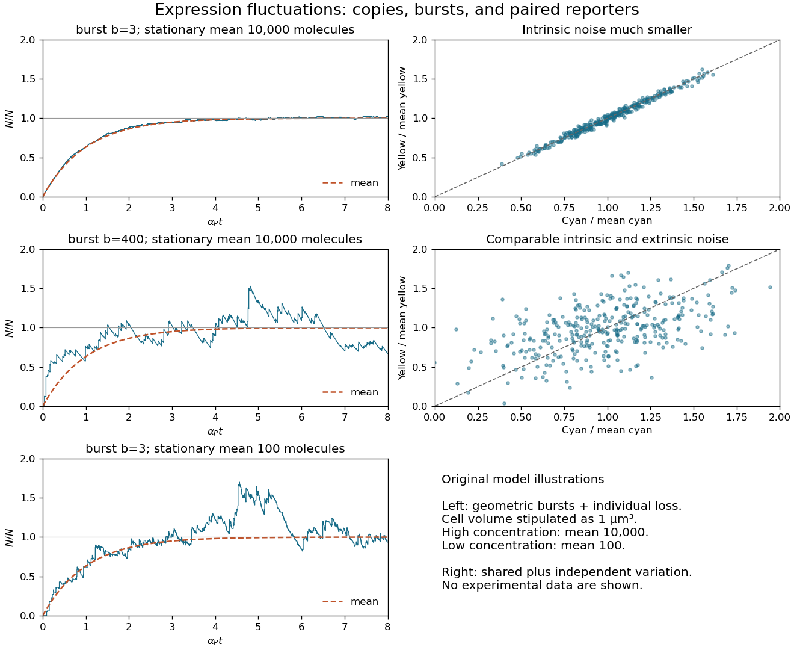

<h1 id="1/b/solution">Solution</h1>

↑ **Parent:** [B](../b.md)

With zero initial [messenger RNA](../../../../messenger-rna.md) and [protein concentration](../../../../protein-concentration.md), solving the two linear [ordinary differential equations](../../../../ordinary-differential-equation.md) in sequence gives

$$
\frac{\mathbb E X_P(t)}{X_{P,*}}=1-\frac{\alpha_R e^{-\alpha_Pt}-\alpha_Pe^{-\alpha_Rt}}{\alpha_R-\alpha_P}
\simeq1-e^{-\alpha_Pt}.
$$

The last expression applies after the short [messenger RNA](../../../../messenger-rna.md) transient when $\alpha_R\gg\alpha_P$. All three mean curves have this shape. At a fixed [steady state](../../../../steady-state.md), a larger [translational burst size](../../../../translational-burst-size.md) requires fewer [transcription](../../../../transcription-biology.md) events: $\beta_R=\alpha_PX_{P,*}/b$. Thus $b=400$ gives infrequent large upward jumps followed by [protein degradation](../../../../protein-degradation.md), whereas $b=3$ gives many smaller jumps and a smoother trace.

Noise depends on molecule counts. If the fixed cell [volume](../../../../volume.md) is $V$, write $\bar N=VX_{P,*}$. In the instantaneous-burst limit, independent [Poisson process](../../../../poisson-process-split.md) arrivals of geometrically distributed bursts, with count arrival rate $\lambda=V\beta_R$, and unit [protein degradation](../../../../protein-degradation.md) give

$$
\boxed{\operatorname{var}N=\bar N(1+b),\qquad \mathrm{CV}=\sqrt{\frac{1+b}{VX_{P,*}}}.}
$$

Indeed, the [moment equations](../../../../moment-equation.md) are $d\mathbb EN/dt=\lambda b-\alpha_P\mathbb EN$ and $d\operatorname{var}N/dt=\lambda b(1+2b)+\alpha_P\mathbb EN-2\alpha_P\operatorname{var}N$. With zero initial counts the [variance](../../../../variance-split.md) becomes $\bar N[(1+b)-e^{-\alpha_Pt}-be^{-2\alpha_Pt}]$. These equations explain both the approach to the [steady state](../../../../steady-state.md) and the scatter about it.

For illustration only, $V=1\,\mu\mathrm m^3$ gives $\bar N=10^4$ at the higher [concentration](../../../../concentration.md): the two values of the [coefficient of variation](../../../../coefficient-of-variation.md) are $0.020$ and $0.200$. At the lower [concentration](../../../../concentration.md), $\bar N=100$ and $b=3$ gives $0.200$. Decreasing the [concentration](../../../../concentration.md) by a factor of 100 therefore increases relative fluctuations tenfold, despite keeping small bursts. Absolute fluctuation sizes cannot be inferred without a cell [volume](../../../../volume.md). The original sketches below stipulate that [volume](../../../../volume.md); they are model realizations, not source data.[Derivation of the transient and stationary variance](../../../../transient-protein-count-variance-in-the-instantaneous-burst-model.md)

**[Figure 1](#1/b/image-translational-burst-size-relative-expression-fluctuations-and-paired-fluorescent-reporters). Translational burst size, relative expression fluctuations, and paired fluorescent reporters**.

## ↑ Ancestors (12)

1. [B](../b.md)
2. [1](../../1.md)
3. [2015](../../../2015-split.md)
4. [Past exam of the biological physics course of the University of Oxford](../../../split.md)
5. [Biological physics course of the University of Oxford](../../../../biological-physics-course-of-the-university-of-oxford.md)
6. [Year 4 of the physics course of the University of Oxford](../../../../year-4-of-the-physics-course-of-the-university-of-oxford.md)
7. [Physics course of the University of Oxford](../../../../physics-course-of-the-university-of-oxford.md)
8. [Undergraduate course of the University of Oxford](../../../../undergraduate-course-of-the-university-of-oxford.md)
9. [Course of the University of Oxford](../../../../course-of-the-university-of-oxford.md)
10. [University of Oxford](../../../../university-of-oxford-split.md)
11. [List of universities](../../../../list-of-universities.md)
12. [Codex Wiki](../../../../split.md)
