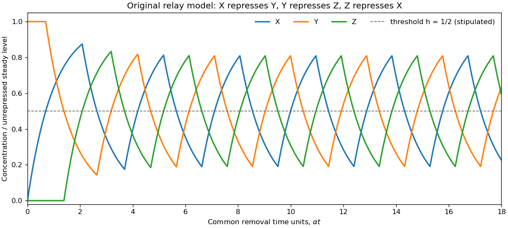

<h1 id="1/d/solution">Solution</h1>

↑ **Parent:** [D](../d.md)

Let $S=\beta/\alpha$ be the unrepressed [steady state](../../../../steady-state.md), $x=X/S,y=Y/S,z=Z/S$, $h=K/S$, and $\tau=\alpha t$. The [logic approximation for gene regulation](../../../../logic-approximation-for-gene-regulation.md) gives the [repressilator](../../../../repressilator.md) equations

$$
\boxed{x'=H(h-z)-x,\qquad y'=H(h-x)-y,\qquad z'=H(h-y)-z.}
$$

An active production term makes its [concentration](../../../../concentration.md) approach one exponentially; an inactive term makes it decay exponentially. Oscillations require an accessible threshold, $0<h<1$. Equal thresholds and rate constants alone do not specify a numerical period.

Initially $(x,y,z)=(0,1,0)$, so $x=1-e^{-\tau}$, $y=1$, $z=0$ until $x$ reaches $h$ at $\tau_1=-\log(1-h)$. Then $Y$ production stops and $y=e^{-(\tau-\tau_1)}$. It reaches $h$ after another $\log(1/h)$, allowing $Z$ production. When $z$ rises through $h$, $X$ production stops. As $x$ falls through $h$, $Y$ production resumes; its next upward crossing represses $Z$. The downward crossing of $z$ then restarts $X$. This ordered sequence repeats, giving displaced pulses and rounded exponential rises and falls.

Every event can be constructed without a numerical differential-equation solver: a rising variable starting at $v_0<h$ takes $\log[(1-v_0)/(1-h)]$ to reach $h$, while a decaying variable starting at $v_0>h$ takes $\log(v_0/h)$. Advance all three variables with their current production terms to the earliest such event, switch the affected production term, and continue. The original plot uses the explicitly illustrative choice $h=1/2$. If $h\ge1$, the unrepressed levels cannot cross the threshold and this oscillatory sequence does not follow.

**[Figure 2](#1/d/image-original-logic-approximation-for-gene-regulation-trajectory-of-the-repressilator-with-threshold-one-half-of-the-unrepressed-level). Original logic approximation for gene regulation trajectory of the repressilator, with threshold one half of the unrepressed level**.

## ↑ Ancestors (12)

1. [D](../d.md)
2. [1](../../1.md)
3. [2015](../../../2015-split.md)
4. [Past exam of the biological physics course of the University of Oxford](../../../split.md)
5. [Biological physics course of the University of Oxford](../../../../biological-physics-course-of-the-university-of-oxford.md)
6. [Year 4 of the physics course of the University of Oxford](../../../../year-4-of-the-physics-course-of-the-university-of-oxford.md)
7. [Physics course of the University of Oxford](../../../../physics-course-of-the-university-of-oxford.md)
8. [Undergraduate course of the University of Oxford](../../../../undergraduate-course-of-the-university-of-oxford.md)
9. [Course of the University of Oxford](../../../../course-of-the-university-of-oxford.md)
10. [University of Oxford](../../../../university-of-oxford-split.md)
11. [List of universities](../../../../list-of-universities.md)
12. [Codex Wiki](../../../../split.md)
