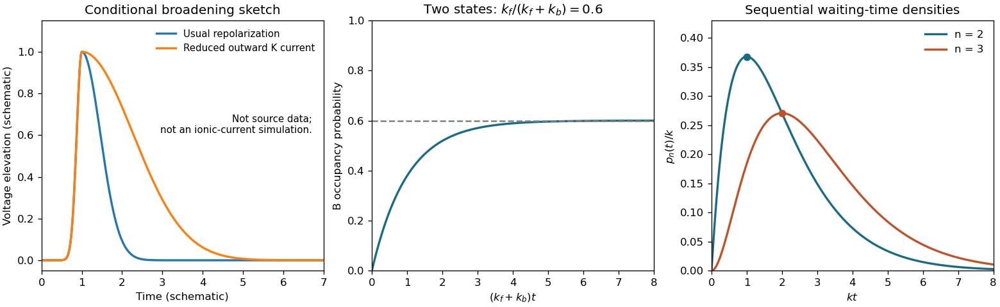

<h1 id="2/d/solution">Solution</h1>

↑ **Parent:** [D](../d.md)

Fast [ion-channel inactivation](../../../../ion-channel-inactivation.md) would reduce the outward [potassium](../../../../potassium.md) [electric current](../../../../electric-current.md) just when it normally repolarizes the axon. Since $C_m\dot V_m=I_{\rm applied}-I_{\rm Na}-I_K-I_{\rm leak}$, a reduction of positive $I_K$ makes the falling slope less negative. With other mechanisms unchanged, the [action potential](../../../../action-potential.md) is generally broader and its after-hyperpolarization is weaker. A plateau or slow return is possible until [sodium](../../../../sodium.md) [ion-channel inactivation](../../../../ion-channel-inactivation.md), leakage, or another outward conductance restores the resting [membrane potential](../../../../membrane-potential-split.md). The precise trace depends on those remaining currents; rapid [potassium](../../../../potassium.md) inactivation alone does not determine a unique waveform.

**[Figure 3](#2/d/image-original-schematic-action-potential-broadening-and-two-state-relaxation-and-sequential-transition-probability-densities). Original schematic action potential broadening and two-state relaxation and sequential-transition probability densities**.

The left panel is a qualitative sketch of this comparison, not a fit or a reconstruction of the missing historical recording.

## ↑ Ancestors (12)

1. [D](../d.md)
2. [2](../../2.md)
3. [2015](../../../2015-split.md)
4. [Past exam of the biological physics course of the University of Oxford](../../../split.md)
5. [Biological physics course of the University of Oxford](../../../../biological-physics-course-of-the-university-of-oxford.md)
6. [Year 4 of the physics course of the University of Oxford](../../../../year-4-of-the-physics-course-of-the-university-of-oxford.md)
7. [Physics course of the University of Oxford](../../../../physics-course-of-the-university-of-oxford.md)
8. [Undergraduate course of the University of Oxford](../../../../undergraduate-course-of-the-university-of-oxford.md)
9. [Course of the University of Oxford](../../../../course-of-the-university-of-oxford.md)
10. [University of Oxford](../../../../university-of-oxford-split.md)
11. [List of universities](../../../../list-of-universities.md)
12. [Codex Wiki](../../../../split.md)
