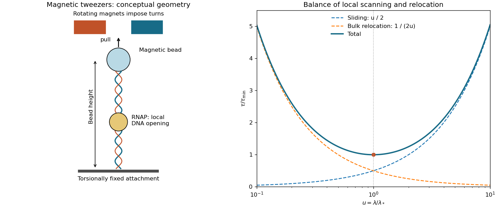

<h1 id="6/a/solution">Solution</h1>

↑ **Parent:** [A](../a.md)

[RNA polymerase](../../../../rna-polymerase.md) first recognizes and binds a [gene promoter](../../../../promoter-genetics.md) to form a closed complex with the local [DNA](../../../../deoxyribonucleic-acid.md) duplex still paired. Local strand separation then produces a [transcription bubble](../../../../transcription-bubble.md) in an [open promoter complex](../../../../open-promoter-complex.md), making the template available for [RNA](../../../../ribonucleic-acid.md) synthesis. Recognition, binding, and opening are distinct events; observing binding alone does not demonstrate strand opening.

In [magnetic tweezers](../../../../magnetic-tweezers.md), a [DNA](../../../../deoxyribonucleic-acid.md) tether joins a fixed surface to a magnetic bead, with attachments that prevent free swivelling. The magnets pull upward and can impose turns; the bead height reports tether extension. For a torsionally constrained tether, [linking number](../../../../linking-number.md) is partitioned into twist and writhe, $Lk=Tw+Wr$. If opening the [transcription bubble](../../../../transcription-bubble.md) removes helical twist while $Lk$ is fixed, compensating twist or writhe appears elsewhere. In a supercoiled regime, changes in writhe change the extension, making an opening event visible as a bead-height step.

The sign provides an important control. On a positively supercoiled tether, local unwinding requires more positive compensating writhe and generally shortens the tether. On a negatively supercoiled tether, the same unwinding removes some negative writhe and generally lengthens it. A bending or compaction contribution can have the same sign in both cases, whereas the torsional contribution reverses. Comparing signs, together with an extension-versus-turns response measured for the tether, distinguishes local unwinding from mere binding-induced bending. These claims assume the tether remains torsionally constrained and lies in the calibrated supercoiled regime, rather than an arbitrary stretched-DNA regime.

**[Figure 4](#6/a/image-original-magnetic-tweezers-schematic-and-the-competing-time-contributions-in-facilitated-target-search). Original magnetic tweezers schematic and the competing time contributions in facilitated target search**.

## ↑ Ancestors (12)

1. [A](../a.md)
2. [6](../../6.md)
3. [2015](../../../2015-split.md)
4. [Past exam of the biological physics course of the University of Oxford](../../../split.md)
5. [Biological physics course of the University of Oxford](../../../../biological-physics-course-of-the-university-of-oxford.md)
6. [Year 4 of the physics course of the University of Oxford](../../../../year-4-of-the-physics-course-of-the-university-of-oxford.md)
7. [Physics course of the University of Oxford](../../../../physics-course-of-the-university-of-oxford.md)
8. [Undergraduate course of the University of Oxford](../../../../undergraduate-course-of-the-university-of-oxford.md)
9. [Course of the University of Oxford](../../../../course-of-the-university-of-oxford.md)
10. [University of Oxford](../../../../university-of-oxford-split.md)
11. [List of universities](../../../../list-of-universities.md)
12. [Codex Wiki](../../../../split.md)
