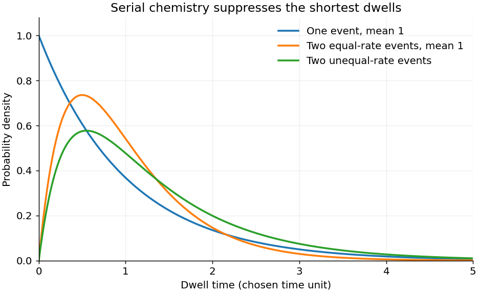
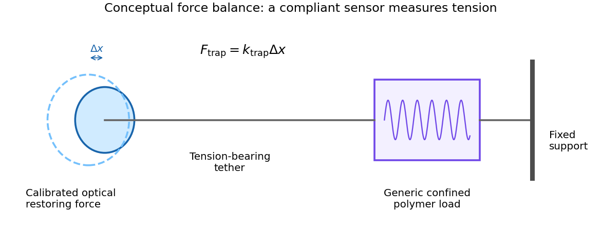
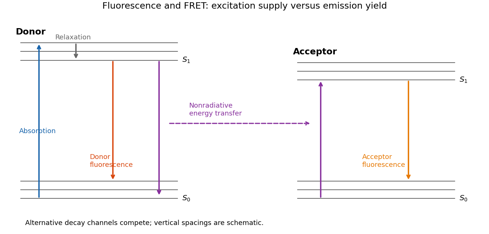
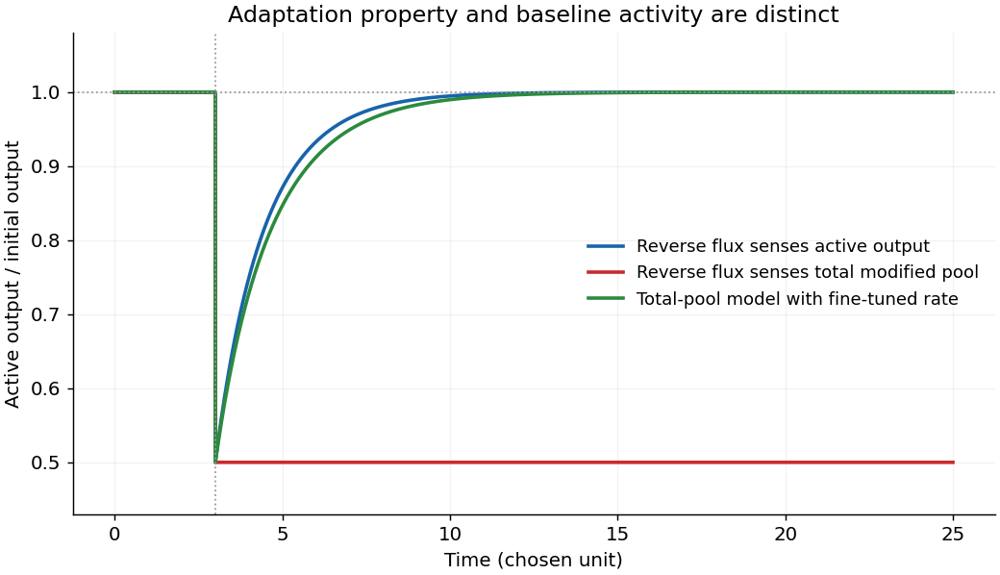
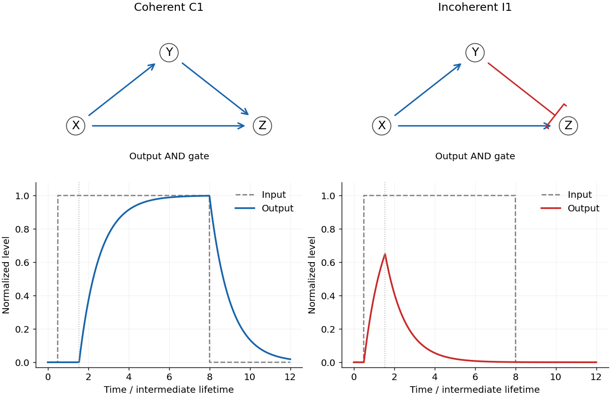

# 2016

↑ **Parent:** [Past exam of the biological physics course of the University of Oxford](../past-exam-of-the-biological-physics-course-of-the-university-of-oxford.md)

Source paper: [https://www.whatdotheyknow.com/request/physics_past_exam_papers_2015_16/response/973997/attach/3/Cowell%20Attachment.zip?cookie_passthrough=1](https://www.whatdotheyknow.com/request/physics_past_exam_papers_2015_16/response/973997/attach/3/Cowell%20Attachment.zip?cookie_passthrough=1)

**Table of contents**

- [1](#1)
  - [a](#1/a)
    - [Solution](#1/a/solution)
  - [b](#1/b)
    - [Solution](#1/b/solution)
  - [c](#1/c)
    - [Solution](#1/c/solution)
  - [d](#1/d)
    - [Solution](#1/d/solution)
- [2](#2)
  - [a](#2/a)
    - [Solution](#2/a/solution)
  - [b](#2/b)
    - [Solution](#2/b/solution)
  - [c](#2/c)
    - [Solution](#2/c/solution)
- [3](#3)
  - [a](#3/a)
    - [Solution](#3/a/solution)
  - [b](#3/b)
    - [Solution](#3/b/solution)
  - [c](#3/c)
    - [Solution](#3/c/solution)
  - [d](#3/d)
    - [Solution](#3/d/solution)
- [4](#4)
  - [a](#4/a)
    - [Solution](#4/a/solution)
  - [b](#4/b)
    - [Solution](#4/b/solution)
  - [c](#4/c)
    - [Solution](#4/c/solution)
- [5](#5)
  - [a](#5/a)
    - [Solution](#5/a/solution)
  - [b](#5/b)
    - [Solution](#5/b/solution)
  - [c](#5/c)
    - [Solution](#5/c/solution)
- [6](#6)
  - [a](#6/a)
    - [Solution](#6/a/solution)
  - [b](#6/b)
    - [Solution](#6/b/solution)
  - [c](#6/c)
    - [Solution](#6/c/solution)
  - [d](#6/d)
    - [Solution](#6/d/solution)
- [7](#7)
  - [a](#7/a)
    - [Solution](#7/a/solution)
  - [b](#7/b)
    - [Solution](#7/b/solution)
  - [c](#7/c)
    - [Solution](#7/c/solution)
  - [d](#7/d)
    - [Solution](#7/d/solution)
- [8](#8)
  - [a](#8/a)
    - [Solution](#8/a/solution)
  - [b](#8/b)
    - [Solution](#8/b/solution)
  - [c](#8/c)
    - [Solution](#8/c/solution)

## 1

↑ **Parent:** [2016](2016.md)

<h3 id="1/a">a</h3>

↑ **Parent:** [1](#1)

<h4 id="1/a/solution">Solution</h4>

↑ **Parent:** [A](#1/a)

Treat the membrane as a [capacitor](../electromagnetism.md#capacitor), and count the additional positive charge on its inner surface. With radius $r=10^{-6}$ m and length $\ell=10^{-4}$ m, including both end caps gives

$$
A=2\pi r\ell+2\pi r^2=6.3460\times10^{-10}\ \mathrm{m^2},\qquad
\mathcal V=\pi r^2\ell=3.1416\times10^{-16}\ \mathrm{m^3}.
$$

The [membrane capacitance](../neuroscience.md#membrane-capacitance) is $C=C_mA=6.3460$ pF. Thus $\Delta Q=C\Delta V=5.3941\times10^{-13}$ C, corresponding to $\Delta N=\Delta Q/e=3.3667\times10^6$ monovalent [sodium](../chemical-substance.md#sodium) [ions](../chemistry.md#ion). Converting charge to [amount of substance](../physics.md#amount-of-substance) using the [Faraday constant](../physics.md#faraday-constant),

$$
\boxed{\Delta c_{\rm Na}=\frac{C_m A\Delta V}{F\mathcal V}
=0.01780\ \mathrm{mol\,m^{-3}}=0.01780\ \mathrm{mM},\qquad
\frac{\Delta c_{\rm Na}}{15\ \mathrm{mM}}=1.186\times10^{-3}.}
$$

Omitting the ends changes the answer to $0.01762$ mM, a one-percent correction. A large [membrane potential](../membrane-potential.md) change therefore requires only about $0.12\%$ of the intracellular [sodium](../chemical-substance.md#sodium) population to enter. The bulk liquid remains nearly electrically neutral; excess charge resides chiefly near the [cell membrane](../cell-membrane.md). This explains why an [action potential](../neuron.md#action-potential) need not exhaust the [concentration](../mathematical-physics.md#concentration) difference that drives it, and why fixed [reversal potentials](../membrane-potential.md#reversal-potential) are a useful approximation during one spike. This [membrane capacitive ion budget](../neuroscience.md#membrane-capacitive-ion-budget) assumes [sodium](../chemical-substance.md#sodium) supplies the **minimum net charging requirement**. Simultaneous opposing [electric currents](../electric-charge.md#electric-current) can require more [sodium](../chemical-substance.md#sodium) entry; repeated spikes eventually require the [sodium-potassium ATPase](../cell-membrane.md#sodium-potassium-atpase) to maintain the gradients.

<h3 id="1/b">b</h3>

↑ **Parent:** [1](#1)

<h4 id="1/b/solution">Solution</h4>

↑ **Parent:** [B](#1/b)

A typical [voltage-gated potassium channel](../membrane-potential.md#voltage-gated-potassium-channel) has four subunits, each with six membrane-spanning segments. S1–S4 form a [voltage-sensing domain](../membrane-potential.md#voltage-sensing-domain); S5–S6 and their intervening loop form the pore and [selectivity filter](../cell-membrane.md#selectivity-filter). Conserved positively charged side chains along S4 move through part of the membrane electric field when the [voltage](../random-walk.md#voltage) changes. Countercharges and hydrated crevices in the surrounding sensor help make this movement possible. Coupling between the sensor and pore, including the S4–S5 region and S6 gate, changes the [probability](../probability-theory.md#probability) of opening. A [voltage-gated sodium channel](../membrane-potential.md#voltage-gated-sodium-channel) usually combines four related domains in one large [protein](../protein.md), rather than four identical independent [proteins](../protein.md).

The evidence separates charge movement, structural arrangement and functional coupling. A transient [ion-channel gating current](../membrane-potential.md#ion-channel-gating-current) can persist when permeating ionic [electric current](../electric-charge.md#electric-current) is suppressed: some charged parts of the channel itself move. Comparing integrated [ion-channel gating charge](../membrane-potential.md#ion-channel-gating-charge) with channel opening tests their coupling. Charge-neutralization experiments change both total moved charge and [voltage](../random-walk.md#voltage) dependence, implicating S4 basic residues and countercharges elsewhere; they do not show that S4 alone supplies every charge. [1996 primary abstract: neutralization identifies contributions from S2 and S4](../biochemistry-and-biophysics-bibliography.md#voltage-sensing-residues-in-the-s2-and-s4-segments-of-the-shaker-k-plus-channel-by-s-a-seoh-and-others)

[Crystal structure of a mammalian voltage-dependent Shaker family K+ channel by Stephen B. Long and others](../biochemistry-and-biophysics-bibliography.md#crystal-structure-of-a-mammalian-voltage-dependent-shaker-family-k-plus-channel-by-stephen-b-long-and-others) supplies structural evidence for the arrangement. Voltage-dependent accessibility and optical reports of sensor motion provide complementary functional tests. No one static structure is a movie of gating, and a perturbation that abolishes current can disrupt folding or pore function rather than selectively remove voltage sensing. Agreement between structural, electrical and motion-sensitive measurements supports the mechanism more strongly than any one observation alone.

<h3 id="1/c">c</h3>

↑ **Parent:** [1](#1)

<h4 id="1/c/solution">Solution</h4>

↑ **Parent:** [C](#1/c)

Write the instantaneous [electrical conductance](../electric-charge.md#electrical-conductance) as $g_K(t)=\bar g_K n(t)^4$. Here $\bar g_K$ is the maximal [electrical conductance](../electric-charge.md#electrical-conductance) of the recorded membrane, $n$ is the activation variable, $V_m$ is inside-minus-outside [membrane potential](../membrane-potential.md), and $V_K$ is the [potassium](../chemical-substance.md#potassium) [Nernst equilibrium potential](../membrane-potential.md#nernst-equilibrium-potential). The factor $V_m-V_K$ is the electrochemical driving [voltage](../random-walk.md#voltage); positive $I_K$ conventionally denotes outward positive charge. For an [electric current](../electric-charge.md#electric-current) density, $\bar g_K$ must instead be an [electrical conductance](../electric-charge.md#electrical-conductance) per area.

In the [Hodgkin-Huxley model](../neuroscience.md#hodgkin-huxley-model), four equivalent independent activation gates must all be permissive, each with [probability](../probability-theory.md#probability) $n$, so their joint opening [probability](../probability-theory.md#probability) is $n^4$. At fixed [voltage](../random-walk.md#voltage) each gate obeys

$$
\dot n=\alpha_n(V_m)(1-n)-\beta_n(V_m)n,\qquad
n_\infty=\frac{\alpha_n}{\alpha_n+\beta_n},\quad
\tau_n=\frac1{\alpha_n+\beta_n}.
$$

The model assumes approximately Ohmic open-channel conduction, a well-defined population-average [electrical conductance](../electric-charge.md#electrical-conductance), and an almost constant [potassium](../chemical-substance.md#potassium) [reversal potential](../membrane-potential.md#reversal-potential) during a brief recording. Four phenomenological gates should not be mistaken for a proof of four physically independent molecular transitions. The simple delayed-rectifier description also omits [ion-channel inactivation](../membrane-potential.md#ion-channel-inactivation).

Reducing the available [electrical conductance](../electric-charge.md#electrical-conductance) can weaken [repolarization](../membrane-potential.md#repolarization), broaden an [action potential](../neuron.md#action-potential) and alter repetitive firing. Depending on channel class and tissue, excess excitability or impaired recovery can follow; persistent depolarization can also reduce [voltage-gated sodium channel](../membrane-potential.md#voltage-gated-sodium-channel) availability. Cardiac potassium-current reductions can prolong the [action potential](../neuron.md#action-potential) and contribute to [Long QT syndrome](../biology.md#long-qt-syndrome). These are conditional physiological consequences, not a claim that every potassium-current reduction has the same clinical effect.

<h3 id="1/d">d</h3>

↑ **Parent:** [1](#1)

<h4 id="1/d/solution">Solution</h4>

↑ **Parent:** [D](#1/d)

The average [electric current](../electric-charge.md#electric-current) is the number of channels times their [ion-channel open probability](../cell-membrane.md#ion-channel-open-probability) times the [electric current](../electric-charge.md#electric-current) carried by an open channel:

$$
I=N P_O\gamma_K(V_m-V_K),\qquad
\frac{I}{NP_O}=\frac{9\ \mathrm{nA}}{3000\times0.6}=5.0\ \mathrm{pA}.
$$

Consequently the identifiable answer is

$$
\boxed{\gamma_K=\frac{5.0\ \mathrm{pA}}{(-50\ \mathrm{mV})-V_K}.}
$$

**TODO (missing input):** The source does not supply $V_K$ or the [potassium](../chemical-substance.md#potassium) [thermodynamic activities](../chemical-potential.md#thermodynamic-activity) for this experiment. A unique numerical [electrical conductance](../electric-charge.md#electrical-conductance) cannot follow from the listed [electric current](../electric-charge.md#electric-current), count and [ion-channel open probability](../cell-membrane.md#ion-channel-open-probability) alone. For the explicitly additional choice $V_K=-90$ mV, $\gamma_K=125$ pS. Taking $V_K=-100$ mV instead gives $100$ pS: both match the measured [electric current](../electric-charge.md#electric-current). The table in question 3 describes a skeletal-muscle resting state, and cannot silently supply the conditions of this separate recording.

Rapid permeation is possible because the hydrated pore and coordinating groups of the [selectivity filter](../cell-membrane.md#selectivity-filter) provide a favorable free-energy landscape for repeated [ion](../chemistry.md#ion) transit. Several [ions](../chemistry.md#ion) can occupy the filter and their interactions favor onward passage, while the channel remains open for many successive transits. Selectivity need not mean that each transported [ion](../chemistry.md#ion) remains tightly trapped for a long time. This is passive downhill transport; it does not consume one [ATP](../molecule.md#adenosine-triphosphate) [molecule](../molecule.md) per [ion](../chemistry.md#ion) crossing.

## 2

↑ **Parent:** [2016](2016.md)

<h3 id="2/a">a</h3>

↑ **Parent:** [2](#2)

<h4 id="2/a/solution">Solution</h4>

↑ **Parent:** [A](#2/a)

A useful organizing principle is [Gibbs free energy](../thermodynamic-potential.md#gibbs-free-energy): at specified [temperature](../temperature.md) and [pressure](../pressure.md) a coupled process is favorable when its total $\Delta G$ is negative. For each [chemical species](../mathematical-biology.md#chemical-species),

$$
\mu_i=\mu_i^\circ+RT\ln a_i,\qquad
\Delta G=\Delta G^\circ+RT\ln Q.
$$

The relative amounts of [chemical substances](../chemical-substance.md) determine the available [Gibbs free energy](../thermodynamic-potential.md#gibbs-free-energy), beyond counting [energy](../energy.md) in individual bonds. Nutrient oxidation and light-driven chemistry can maintain nonequilibrium compositions. [ATP hydrolysis](../chemical-reaction.md#atp-hydrolysis) can drive biosynthesis, transport and motion of [molecular motors](../biology.md#molecular-motor) when reactions are coupled so that their total free-energy change is favorable. Breaking an [inorganic phosphate](../chemical-substance.md#inorganic-phosphate) bond itself costs [energy](../energy.md); the favorable net [hydrolysis](../chemical-reaction.md#hydrolysis) includes formation and solvation of the products and depends on their [thermodynamic activities](../chemical-potential.md#thermodynamic-activity).

[Redox](../chemical-reaction.md#redox) [Gibbs free energy](../thermodynamic-potential.md#gibbs-free-energy) comes from transferring electrons between donors and acceptors: $\Delta G=-nF\Delta E$. Electron transfer in respiration or photosynthesis can help establish an [electrochemical gradient](../chemical-potential.md#electrochemical-gradient). For a mole of [ions](../chemistry.md#ion) moving from side 1 to side 2,

$$
\Delta\widetilde\mu=RT\ln(a_2/a_1)+zF(\psi_2-\psi_1).
$$

The [concentration](../mathematical-physics.md#concentration) and electrical terms together drive transport and can power [ATP synthase](../enzyme.md#atp-synthase). ATP-driven pumps can conversely build gradients. [Chemiosmosis](../biochemistry.md#chemiosmosis) is the coupling between this gradient and chemical synthesis, not the creation of [Gibbs free energy](../thermodynamic-potential.md#gibbs-free-energy) by an [enzyme](../enzyme.md).

Mechanical [work](../energy.md#work) and elastic storage are other forms: a motor can do $\int F\,dx$ or $\int\tau\,d\theta$, and an approximately Hookean element stores $kx^2/2$. ATP-driven motors convert [Gibbs free energy](../thermodynamic-potential.md#gibbs-free-energy) into motion, while externally forced reverse motion can sometimes drive chemical synthesis. A [photon](../quantum-mechanics.md#photon) brings [energy](../energy.md) $h\nu$; light [photon absorption](../quantum-mechanics.md#photon-absorption) initiates chemistry in photosynthesis and light-driven pumps, with some [energy](../energy.md) inevitably dissipated. Living cells use these conversions for structure, movement, homeostasis and synthesis, while releasing [heat](../heat.md) and exporting [entropy](../entropy.md). At a single uniform [temperature](../temperature.md), dissipated [heat](../heat.md) cannot be completely recycled into useful work.

<h3 id="2/b">b</h3>

↑ **Parent:** [2](#2)

<h4 id="2/b/solution">Solution</h4>

↑ **Parent:** [B](#2/b)

At saturating [ATP](../molecule.md#adenosine-triphosphate), binding need no longer dominate the observed dwell, but **saturation alone does not determine a dwell-time distribution**. The standard interpretation of a distribution that rises from zero is that at least two sequential events remain rate limiting. Model a dwell as $T=T_1+T_2$, where the independent waiting times are distributed according to [exponential distributions](../continuous-probability-distribution.md#exponential-distribution) with rates $k_1,k_2$. Their [convolution](../fourier-analysis.md#convolution) is

$$
p(t)=\int_0^t k_1e^{-k_1u}k_2e^{-k_2(t-u)}\,du
=\boxed{\frac{k_1k_2}{k_2-k_1}(e^{-k_1t}-e^{-k_2t})},\quad t\geq0.
$$

This [hypoexponential distribution](../continuous-probability-distribution.md#hypoexponential-distribution) starts at zero, rises to a mode $\ln(k_2/k_1)/(k_2-k_1)$, then has an exponential tail. When the rates are equal, the continuous limit is the two-stage [Erlang distribution](../continuous-probability-distribution.md#erlang-distribution),

$$
\boxed{p(t)=k^2t e^{-kt},\qquad \langle T\rangle=2/k,\quad
\operatorname{var}(T)=2/k^2,\quad t_{\rm mode}=1/k.}
$$

A single slow memoryless event instead gives $ke^{-kt}$, maximal at zero. Three 120-degree steps per revolution specify rotational [stoichiometry](../chemical-reaction.md#stoichiometry), **not three slow reactions within every dwell**. The two-event interpretation is supported by the resolved catalytic-dwell [chemical kinetics](../chemical-kinetics.md) in the primary F1 experiment.[2001, abstract and Figure 8: two reactions occupy the catalytic dwell](../biochemistry-and-biophysics-bibliography.md#resolution-of-distinct-rotational-substeps-by-submillisecond-kinetic-analysis-of-f1-atpase-by-ryohei-yasuda-and-others)

The fit assumes sequential approximately irreversible events, constant rates during each dwell, negligible ATP-binding delay, negligible mechanical transit time, and detection of all relevant steps. Parallel pathways, backward transitions, inhibited states, probe drag and missed short dwells can change the histogram. The mathematical fit alone does not identify each event chemically or prove that two [ATP](../molecule.md#adenosine-triphosphate) [molecules](../molecule.md) are hydrolyzed per step.

**[Figure 1](#2/b/image-one-event-and-two-event-dwell-time-models). One-event and two-event dwell-time models**. Original normalized probability densities. A serial two-event model has zero density at zero time and a nonzero mode; no experimental histogram has been copied.

<h3 id="2/c">c</h3>

↑ **Parent:** [2](#2)

<h4 id="2/c/solution">Solution</h4>

↑ **Parent:** [C](#2/c)

Let $r=a_{\rm ADP}/a_{\rm ATP}$ and use a one-molar [standard state](../chemical-potential.md#standard-state), so the [inorganic phosphate](../chemical-substance.md#inorganic-phosphate) activity is approximately $a_P=0.006$. With the source's stated standard [hydrolysis](../chemical-reaction.md#hydrolysis) value,

$$
\Delta G_{\rm hyd}=-50{,}000+RT\ln(0.006r)\quad\mathrm{J\,mol^{-1}}.
$$

The downhill proton-transfer [Gibbs free energy](../thermodynamic-potential.md#gibbs-free-energy) is $F\Delta p$ for the signed driving [force](../force.md) $\Delta p=-0.150$ V. Ideal reversible balance of one complete turn requires

$$
-3\Delta G_{\rm hyd}+10F\Delta p=0,
\qquad \Delta G_{\rm hyd}=\frac{10}{3}F\Delta p=-48.243\ \mathrm{kJ\,mol^{-1}}.
$$

Solving yields

$$
\boxed{r=\frac1{0.006}\exp\!\left[\frac{50{,}000+(10/3)F\Delta p}{RT}\right]
\simeq3.29\times10^2\quad(T=310.15\ \mathrm K).}
$$

At 298.15 K the estimate is $3.39\times10^2$. [Temperature](../temperature.md) is not specified in this paragraph; the first value explicitly adopts physiological [temperature](../temperature.md) rather than pretending it is supplied. The unexpectedly large [ADP](../molecule.md#adenosine-diphosphate)/[ATP](../molecule.md#adenosine-triphosphate) ratio follows from using the **printed standard** value $-50$ kJ/mol with the stated dilute [inorganic phosphate](../chemical-substance.md#inorganic-phosphate). One must not silently replace that value by another convention or treat it as the already concentration-corrected cellular [hydrolysis](../chemical-reaction.md#hydrolysis) [Gibbs free energy](../thermodynamic-potential.md#gibbs-free-energy).

This estimate assumes ideal [thermodynamic activities](../chemical-potential.md#thermodynamic-activity), consistent [pH](../acid-base-chemistry.md#ph) and [magnesium](../chemical-substance.md#magnesium) conventions, tight coupling of ten [protons](../physics.md#proton) to three [ATP](../molecule.md#adenosine-triphosphate), no leak or transport overhead, and operation close to reversible balance. A working cell is not in global equilibrium. Net synthesis at this fixed driving [force](../force.md) requires $\Delta G_{\rm turn}<0$, hence $r$ **above** this reversible-balance threshold; finite [chemical kinetics](../chemical-kinetics.md) and dissipation prevent the [stoichiometry](../chemical-reaction.md#stoichiometry) alone from determining an exact physiological ratio.

## 3

↑ **Parent:** [2016](2016.md)

<h3 id="3/a">a</h3>

↑ **Parent:** [3](#3)

<h4 id="3/a/solution">Solution</h4>

↑ **Parent:** [A](#3/a)

Use signed [ion](../chemistry.md#ion) valence $z$ and define $V=\psi_1-\psi_2$. The molar [electrochemical potential](../chemical-potential.md#electrochemical-potential) in side $i$ of an ideal dilute solution is

$$
\widetilde\mu_i=\mu^\circ+RT\ln(c_i/c^\circ)+zF\psi_i.
$$

Transfer of an infinitesimal amount $dn$ from side 1 to side 2 changes the total [Gibbs free energy](../thermodynamic-potential.md#gibbs-free-energy) by $(\widetilde\mu_2-\widetilde\mu_1)dn$. At equilibrium this derivative is zero, so

$$
RT\ln(c_1/c_2)+zF(\psi_1-\psi_2)=0,
\qquad\boxed{V=\frac{RT}{zF}\ln\frac{c_2}{c_1}.}
$$

For a cell with side 1 inside, this is $E_i=(RT/z_iF)\ln(c_{i,\rm out}/c_{i,\rm in})$. The [concentrations](../mathematical-physics.md#concentration) are **equilibrium free-ion [concentrations](../mathematical-physics.md#concentration)**, not automatically their exact initial values. For nonideal solutions the ratio must be a ratio of [thermodynamic activities](../chemical-potential.md#thermodynamic-activity). The [temperature](../temperature.md) and solvent must be common to both reservoirs, and an [ion](../chemistry.md#ion) must actually be able to exchange for this equilibrium condition to be dynamically established.

Equal compartment volumes are unnecessary for deriving the [voltage](../random-walk.md#voltage) law, but help specify number conservation if [concentration](../mathematical-physics.md#concentration) changes are appreciable. For equal [volume](../geometry-and-topology.md#volume) $\mathcal V$ and a monovalent cation transfer $n$ from side 1 to 2, $c_1=c_1^0-n/\mathcal V$, $c_2=c_2^0+n/\mathcal V$. Combined with the [membrane capacitance](../neuroscience.md#membrane-capacitance), this gives an implicit finite-reservoir equilibrium rather than treating both [concentrations](../mathematical-physics.md#concentration) as externally clamped.

<h3 id="3/b">b</h3>

↑ **Parent:** [3](#3)

<h4 id="3/b/solution">Solution</h4>

↑ **Parent:** [B](#3/b)

Suppose initially $c_1>c_2$. Positive [ions](../chemistry.md#ion) initially move by [diffusion](../thermodynamics.md#diffusion) from side 1 to side 2. Since negative [counterions](../chemistry.md#counterion) cannot cross, side 1 acquires a negative interfacial charge and side 2 a positive one. The resulting electrical [force](../force.md) opposes further positive-ion transfer. The two contributions balance when the [electrochemical potentials](../chemical-potential.md#electrochemical-potential) are equal; individual [ions](../chemistry.md#ion) still cross in both directions, but there is no net [electric current](../electric-charge.md#electric-current) of the permeant [chemical species](../mathematical-biology.md#chemical-species).

A simple [capacitor](../electromagnetism.md#capacitor) model makes the feedback quantitative. If $n$ moles of monovalent positive [ions](../chemistry.md#ion) move from initially neutral side 1 to side 2, the charge on side 1 is $-Fn$, hence $V=-Fn/C$. The free-energy stationarity condition is

$$
RT\ln\frac{c_1^0-n/\mathcal V}{c_2^0+n/\mathcal V}-\frac{F^2n}{C}=0.
$$

As $n$ increases, both the [concentration](../mathematical-physics.md#concentration) imbalance and the [voltage](../random-walk.md#voltage) drive toward reversal diminish the original [diffusion](../thermodynamics.md#diffusion) tendency. The equilibrium lies before the bulk [concentrations](../mathematical-physics.md#concentration) become equal. This demonstrates why a nonzero [Nernst potential](../membrane-potential.md#nernst-equilibrium-potential) can coexist with very little change in bulk composition and approximate bulk [electroneutrality](../electrochemistry.md#electroneutrality). A [concentration](../mathematical-physics.md#concentration) difference alone does not maintain an electrical [voltage](../random-walk.md#voltage) if both [counterions](../chemistry.md#counterion) can freely follow each other; **[selective permeability](../cell-membrane.md#selective-permeability)** is essential to this model.

<h3 id="3/c">c</h3>

↑ **Parent:** [3](#3)

<h4 id="3/c/solution">Solution</h4>

↑ **Parent:** [C](#3/c)

At $T=310.15$ K, $RT/F=26.72666$ mV. Always retain the valence sign. For the two monovalent positive [ions](../chemistry.md#ion),

$$
\boxed{E_K=26.72666\ln(4/155)=-97.74\ \mathrm{mV},\qquad
E_{\rm Na}=26.72666\ln(145/12)=+66.60\ \mathrm{mV}.}
$$

For [calcium](../chemical-substance.md#calcium), $z=2$ and the specified [voltage](../random-walk.md#voltage) is positive:

$$
\boxed{c_{{\rm Ca},\rm in}=1.5\exp[-2(130)/26.72666]\ \mathrm{mM}
=8.938\times10^{-5}\ \mathrm{mM}\simeq89.4\ \mathrm{nM}.}
$$

For chloride, $z=-1$ reverses the sign in the [Nernst equation](../electrochemistry.md#nernst-equation):

$$
-90=-26.72666\ln(c_{{\rm Cl},\rm out}/4),\qquad
\boxed{c_{{\rm Cl},\rm out}=116.0\ \mathrm{mM}.}
$$

These values use [thermodynamic activities](../chemical-potential.md#thermodynamic-activity) approximated by the given [concentrations](../mathematical-physics.md#concentration). [Calcium](../chemical-substance.md#calcium) is the **free** [concentration](../mathematical-physics.md#concentration) relevant to its [electrochemical potential](../chemical-potential.md#electrochemical-potential), rather than total bound plus free intracellular [calcium](../chemical-substance.md#calcium). Ratios use matching [concentration](../mathematical-physics.md#concentration) units, so a ratio of millimolar values is already dimensionless. Failure to include the factor of two for [calcium](../chemical-substance.md#calcium) or the negative charge of chloride would change the answer substantially.

<h3 id="3/d">d</h3>

↑ **Parent:** [3](#3)

<h4 id="3/d/solution">Solution</h4>

↑ **Parent:** [D](#3/d)

At a common membrane [voltage](../random-walk.md#voltage), an [ion](../chemistry.md#ion) is in electrochemical equilibrium only if its own [Nernst potential](../membrane-potential.md#nernst-equilibrium-potential) equals that [voltage](../random-walk.md#voltage). The four independently calculated equilibrium voltages are

$$
\boxed{E_K=-97.74\ \mathrm{mV},\quad E_{\rm Na}=+66.60\ \mathrm{mV},\quad
E_{\rm Ca}=+130\ \mathrm{mV},\quad E_{\rm Cl}=-90\ \mathrm{mV}.}
$$

Thus at $V_m=-90$ mV only chloride is at its listed equilibrium [voltage](../random-walk.md#voltage). [Potassium](../chemical-substance.md#potassium) has an outward positive-current driving [voltage](../random-walk.md#voltage) $V_m-E_K=+7.74$ mV. [Sodium](../chemical-substance.md#sodium) and [calcium](../chemical-substance.md#calcium) have negative driving voltages, $-156.60$ and $-220$ mV respectively, favoring inward positive-ion movement when their channels are open. Chloride has zero net electrochemical drive under these ideal conditions.

A resting potential is not a claim that every permeant [chemical species](../mathematical-biology.md#chemical-species) is in [thermodynamic equilibrium](../thermodynamics.md#thermodynamic-equilibrium). A membrane with several [electrical conductances](../electric-charge.md#electrical-conductance) can have zero **total** [electric current](../electric-charge.md#electric-current) even though individual ionic [electric currents](../electric-charge.md#electric-current) flow and cancel. Pumps maintain the [concentration](../mathematical-physics.md#concentration) differences by consuming [Gibbs free energy](../thermodynamic-potential.md#gibbs-free-energy). Conversely, a closed channel can prevent substantial [ion](../chemistry.md#ion) flux even when the [ion](../chemistry.md#ion)'s [electrochemical potential](../chemical-potential.md#electrochemical-potential) difference is nonzero: absence of flux due to impermeability is not the same as electrochemical equilibrium. The listed [concentrations](../mathematical-physics.md#concentration) could not all be passive equilibrium distributions at one [voltage](../random-walk.md#voltage) because their [Nernst potentials](../membrane-potential.md#nernst-equilibrium-potential) differ.

## 4

↑ **Parent:** [2016](2016.md)

<h3 id="4/a">a</h3>

↑ **Parent:** [4](#4)

<h4 id="4/a/solution">Solution</h4>

↑ **Parent:** [A](#4/a)

A rising [force](../force.md) branch means that an already exposed [polypeptide](../protein.md#polypeptide) segment is being stretched while the remaining structure resists further extraction. At a [force](../force.md) peak a structural barrier is crossed; [protein denaturation](../protein.md#denaturation-biochemistry) or release of additional chain increases the available [polymer contour length](../polymer.md#polymer-contour-length), so the [force](../force.md) falls at almost the same imposed separation. Stretching then loads the next remaining barrier. The sawtooth pattern therefore reports a sequence of mechanically resistant intermediates, not a regular [spring](../elasticity-physics.md#spring) oscillation. The [cantilever](../elasticity-physics.md#cantilever) deflection gives [force](../force.md), while its own deformation must be removed from the imposed separation to infer molecular extension.

A [membrane protein](../cell-membrane.md#membrane-protein) also requires work to disrupt membrane anchoring, helix packing and contacts with [lipids](../chemical-substance.md#lipid) or neighboring [molecules](../molecule.md). The retinal-containing interior contributes a bulky, specifically packed scaffold; exposing chain must overcome these [steric hindrance](../stereochemistry.md#steric-hindrance) as well as [hydrogen bond](../chemical-bond.md#hydrogen-bond) and [electrostatic interactions](../electrostatics.md#electrostatic-interaction). A [force](../force.md) peak need not correspond one-to-one to one complete helix, and its height depends on loading rate and pathway, not just an equilibrium folding [Gibbs free energy](../thermodynamic-potential.md#gibbs-free-energy).

Salt changes [electrostatic screening](../electrostatics.md#electrostatic-screening) and specific [ion](../chemistry.md#ion) binding. Screening can reduce either repulsion or attraction, so “more salt always weakens the [protein](../protein.md)” is false. The primary study underlying these kinds of traces identifies relatively salt-insensitive [steric hindrance](../stereochemistry.md#steric-hindrance) around the [retinal](../molecule.md#retinal) and additional salt-sensitive barriers. Its interpretation associates some added barriers with screening of destabilizing electrostatic repulsion. The supplied traces likewise show a changed set of intermediate peaks, rather than a uniform rescaling of one curve.[2007 primary study, Results: Unfolding bR from PM cytoplasmic side; Discussion: steric and electrostatic contributions](https://pmc.ncbi.nlm.nih.gov/articles/PMC1959538/)

Exact assignment of every arrow to a residue requires structural and statistical information beyond one representative trace. No such assignment is inferred here. The printed reference to **[titin](../protein.md#titin)** in the following paragraph is inconsistent with the stated specimen and the membrane-protein traces; the physical interpretation here concerns [bacteriorhodopsin](../cell-membrane.md#bacteriorhodopsin), while the worm-like-chain expression is a generic [polymer](../polymer.md) approximation.

<h3 id="4/b">b</h3>

↑ **Parent:** [4](#4)

<h4 id="4/b/solution">Solution</h4>

↑ **Parent:** [B](#4/b)

On each branch the [worm-like chain force-extension interpolation](../mathematical-biology.md#worm-like-chain-force-extension-interpolation) relates [force](../force.md) to the extension of the already released chain. Fitting a sufficiently long branch estimates its [polymer contour length](../polymer.md#polymer-contour-length) $L$ and, if the data constrain it independently, its [persistence length](../mathematical-biology.md#persistence-length) $L_p$. In practice $L_p$ may be fixed across branches so that the changes in $L$ are better identified. Consecutive fitted [polymer contour lengths](../polymer.md#polymer-contour-length) reveal how much additional chain became available at an [protein denaturation](../protein.md#denaturation-biochemistry) event; using a justified [polymer contour length](../polymer.md#polymer-contour-length) per residue can then estimate residue counts. A projected folded length and the pulling geometry must be included before assigning a structural boundary.

Writing $u=x/L$, expansion at small extension gives

$$
f=\frac{k_BT}{L_p}\left(\frac32u+\frac34u^2+\cdots\right),\qquad
k_{\rm eff}=\left.\frac{df}{dx}\right|_0=\frac{3k_BT}{2L_pL}.
$$

Near full extension, $f\sim k_BT/[4L_p(1-x/L)^2]$. Larger $L$ shifts a branch toward larger extension at fixed [force](../force.md). The effective [flexural rigidity](../elasticity-physics.md#bending-stiffness) is $\kappa=k_BT L_p$, with units of [force](../force.md) times length squared. This is entropic straightening of a [worm-like chain](../mathematical-biology.md#worm-like-chain); bond stretching and barrier rupture themselves are not included in the formula.

**The persistence-length wording requires care.** The three-dimensional model gives $\langle\mathbf t(s)\cdot\mathbf t(0)\rangle=e^{-s/L_p}$. At $s=L_p$, $\arccos\langle\cos\theta\rangle=\arccos(e^{-1})=68.4^\circ$. This is not a statement that $\langle\theta\rangle=68.4^\circ$. For example, angles zero and $90^\circ$ with equal [probabilities](../probability-theory.md#probability) have mean angle $45^\circ$, but $\arccos\langle\cos\theta\rangle=60^\circ$. The distinction prevents a false literal interpretation of the printed definition.

<h3 id="4/c">c</h3>

↑ **Parent:** [4](#4)

<h4 id="4/c/solution">Solution</h4>

↑ **Parent:** [C](#4/c)

The earliest branch is close to the membrane and the point of tip contact. Little flexible chain has yet been exposed, so a long homogeneous continuum chain with purely [entropic elasticity](../mathematical-biology.md#entropic-elasticity) is a poor description. Tip–surface interactions, membrane deformation, steric obstruction, and extraction of tightly anchored structure can contribute strongly to the measured [force](../force.md). The retinal-associated structure and local electrostatic contacts can still be mechanically active at these small separations.

The worm-like-chain formula assumes that the measured extension chiefly stretches an already available flexible segment with an identifiable [polymer contour length](../polymer.md#polymer-contour-length). It does not model detachment of the tip from a surface or the energetic rupture of a short structured segment. That explains why fitting these first peaks is unreliable even if later branches admit reasonable fits. A single trace cannot distinguish uniquely among these short-range effects; claiming that one particular arrow proves a specific [retinal](../molecule.md#retinal) bond rupture would exceed the available evidence.

## 5

↑ **Parent:** [2016](2016.md)

<h3 id="5/a">a</h3>

↑ **Parent:** [5](#5)

<h4 id="5/a/solution">Solution</h4>

↑ **Parent:** [A](#5/a)

The main generic costs of strongly confining a charged semiflexible [polymer](../polymer.md) are bending it away from its preferred straight shape, crowding neighboring segments, and reducing its available configurations. Closely approaching charged strands also repel through electrostatic and hydration interactions; mobile [ions](../chemistry.md#ion) screen or modify these interactions, while counterion organization contributes to the free-energy balance. The bending cost is especially large in regions of high [curvature](../differential-geometry.md#curvature). A [pressure](../pressure.md) on the confining wall and a [force](../force.md) resisting further insertion are related thermodynamic responses, but are not identical quantities with the same units.

At the level of measurement principles, an [optical tweezers](../optics.md#optical-tweezers) apparatus acts as a calibrated compliant [force](../force.md) sensor. A displaced trapped bead experiences approximately $F_{\rm trap}=k_{\rm trap}\Delta x$. A tether transmits [tension](../force.md#tension) between that sensor and the material under load; the opposing support fixes the other end. The conceptual [force balance](../force.md#force-balance) is

$$
\text{compliant sensor}\ \longleftrightarrow\ \text{tension-bearing tether}\ \longleftrightarrow\ \text{confined polymer system}.
$$

The extension and restoring [force](../force.md) supply a mechanical record of the load. This is a force-sensing schematic, not a biological preparation or packaging protocol. The measured [tension](../force.md#tension) can include bending, interstrand interactions, dissipation and any other mechanically coupled contribution; it cannot be identified with only the bending term without additional assumptions. In a reversible generic model $F_{\rm conf}=\partial G/\partial L$ at specified geometry, while an internal [pressure](../pressure.md) is $-\partial G/\partial\mathcal V$ at specified [polymer](../polymer.md) content. These derivatives clarify what a [force](../force.md) measurement can and cannot determine.

**[Figure 2](#5/a/image-a-compliant-optical-force-sensor-and-a-generic-confined-polymer-load). A compliant optical force sensor and a generic confined-polymer load**. Original force-balance schematic. The sensor displacement reports transmitted tension; the drawing supplies no biological preparation or packaging procedure.

<h3 id="5/b">b</h3>

↑ **Parent:** [5](#5)

<h4 id="5/b/solution">Solution</h4>

↑ **Parent:** [B](#5/b)

Use the elastic-rod bending functional for an abstract inextensible [worm-like chain](../mathematical-biology.md#worm-like-chain),

$$
G_b=\frac{\kappa}{2}\int C(s')^2\,ds',\qquad\kappa=l_pk_BT.
$$

A circular ring of radius $R$ has [curvature](../differential-geometry.md#curvature) $1/R$ and length $2\pi R$, hence [energy](../energy.md) $\pi\kappa/R$. With $n(R_i)$ rings of each radius, add their energies:

$$
\boxed{G_b=\pi l_pk_BT\sum_i\frac{n(R_i)}{R_i}.}
$$

For a cylindrical annulus of height $h$, choose neighboring rings separated vertically by $s$. Then $n=h/s$, while adjacent radial layers are separated by $\sqrt3s/2$. Replacing the radial sum by its continuum integral gives

$$
L=\frac{2}{\sqrt3s}\int_{R_{\rm in}}^{R_{\rm out}}2\pi R\frac hs\,dR
=\frac{2\pi h}{\sqrt3s^2}(R_{\rm out}^2-R_{\rm in}^2),
$$

and

$$
G_b=\frac{2\pi l_pk_BTh}{\sqrt3s^2}\int_{R_{\rm in}}^{R_{\rm out}}\frac{dR}{R}
=\frac{2\pi l_pk_BTh}{\sqrt3s^2}\ln\frac{R_{\rm out}}{R_{\rm in}}.
$$

Eliminate the inner radius to obtain

$$
\boxed{G_b=\frac{\pi l_pk_BTh}{\sqrt3s^2}
\ln\!\left[\frac{R_{\rm out}^2}{R_{\rm out}^2-\sqrt3Ls^2/(2\pi h)}\right].}
$$

The dimensions are [energy](../energy.md), and the expression is positive for $0<L<2\pi hR_{\rm out}^2/(\sqrt3s^2)$. It tends to zero with $L$ and diverges as the inner hole closes in this continuum model. The divergence signals the growing cost of forcing an inextensible chain to zero radius; it is not a physical prediction at arbitrarily small molecular scales. Interstrand, hydration and configurational contributions have been excluded, and disconnected ideal rings represent local [curvature](../differential-geometry.md#curvature) without modeling the connections between them.

<h3 id="5/c">c</h3>

↑ **Parent:** [5](#5)

<h4 id="5/c/solution">Solution</h4>

↑ **Parent:** [C](#5/c)

Use the given spherical-shell [force balance](../force.md#force-balance) directly; $R_{\rm out}=30$ nm is the **loaded** radius. The radial enlargement is

$$
\Delta R=R_{\rm out}-R_0=\frac{2\pi R_{\rm out}^2p}{k}.
$$

Since $1\ \mathrm{pN\,nm^{-2}}=10^6$ Pa, the [pressure](../pressure.md) is $p=40\times101325\ \mathrm{Pa}=4.053\ \mathrm{pN\,nm^{-2}}$. Therefore

$$
\boxed{\Delta R=\frac{2\pi(30\ \mathrm{nm})^2(4.053\ \mathrm{pN\,nm^{-2}})}
{5\times10^5\ \mathrm{pN\,nm^{-1}}}=0.04584\ \mathrm{nm}.}
$$

The diameter increases by $2\Delta R=0.09168$ nm, and $R_0=29.95416$ nm. The relative radial or diametral enlargement is about $1.53\times10^{-3}$, only $0.153\%$. Under this stipulated shell model the container is therefore very stiff despite the substantial internal [pressure](../pressure.md).

The factor of two follows from the particular [elastic energy](../elasticity-physics.md#elastic-energy) convention implicit in the question: differentiating $k(R-R_0)^2$ gives $2k(R-R_0)$. Replacing it by the derivative of $k(R-R_0)^2/2$ would change the answer incorrectly. The calculation treats the wall by an effective spherical radius; local deformation or discrete facets of an icosahedral shell are not resolved by this one-coordinate model.

## 6

↑ **Parent:** [2016](2016.md)

<h3 id="6/a">a</h3>

↑ **Parent:** [6](#6)

<h4 id="6/a/solution">Solution</h4>

↑ **Parent:** [A](#6/a)

A [Jablonski diagram](../fluorescence.md#jablonski-diagram) distinguishes [electronic excitation](../atomic-physics.md#electronic-excitation) from subsequent relaxation. [Photon absorption](../quantum-mechanics.md#photon-absorption) takes a [molecule](../molecule.md) from the electronic [ground state](../quantum-mechanics.md#ground-state) $S_0$ to a vibrationally excited level of $S_1$ or a higher [singlet state](../angular-momentum-operator.md#singlet-state). Rapid [vibrational relaxation](../molecule.md#vibrational-relaxation) and internal conversion usually populate the lowest vibrational levels of $S_1$. [Fluorescence](../fluorescence.md) then emits a [photon](../quantum-mechanics.md#photon) on a transition to $S_0$, often ending in one of its excited vibrational levels. Nonradiative relaxation competes with emission; [intersystem crossing](../energy-eigenvalue.md#intersystem-crossing) can also populate triplet states. [Energy](../energy.md) lost to relaxation and solvent reorganization commonly makes the [fluorescence](../fluorescence.md) maximum occur at lower [photon energy](../quantum-mechanics.md#photon-energy), hence longer wavelength, than the [photon absorption](../quantum-mechanics.md#photon-absorption) maximum: the [Stokes shift](../fluorescence.md#stokes-shift).

The intrinsic [fluorescence quantum yield](../fluorescence.md#fluorescence-quantum-yield) is the number of [photons](../quantum-mechanics.md#photon) emitted by [fluorescence](../fluorescence.md) per absorbed excitation. For a simple [excited state](../energy-eigenvalue.md#excited-state) with radiative rate $k_r$ and other decay rate $k_{nr}$,

$$
Q_D^0=\frac{k_r}{k_r+k_{nr}}.
$$

A nearby acceptor adds a nonradiative **energy-transfer** channel, not an emitted [photon](../quantum-mechanics.md#photon) flying from donor to acceptor. The [electric dipole-dipole interaction](../electrostatics.md#electric-dipole-dipole-interaction) transfers the donor excitation while returning the donor toward its [ground state](../quantum-mechanics.md#ground-state) and exciting the acceptor. The acceptor then relaxes and may fluoresce. The donor yield becomes

$$
\boxed{Q_D^{DA}=\frac{k_r}{k_r+k_{nr}+k_T}=Q_D^0(1-E).}
$$

For the acceptor, distinguish its intrinsic yield per acceptor excitation, $Q_A=k_{r,A}/(k_{r,A}+k_{nr,A})$, from the number of acceptor [photons](../quantum-mechanics.md#photon) per **donor** excitation. Transfer increases the supply of acceptor excitations, giving sensitized emission $E Q_A$ per donor excitation in the ideal model. It does not by itself change $Q_A$ if the acceptor's own decay rates remain unchanged. Environmental changes, saturation or additional quenching can change those rates, but increased acceptor intensity alone does not establish an increased intrinsic [fluorescence quantum yield](../fluorescence.md#fluorescence-quantum-yield).

**[Figure 3](#6/a/image-relaxation-fluorescence-and-donor-acceptor-energy-transfer). Relaxation, fluorescence and donor–acceptor energy transfer**. Original schematic electronic and vibrational levels. Transfer supplies an acceptor excitation without a photon between the molecules; the acceptor quantum yield and the excitation supply are separate quantities.

<h3 id="6/b">b</h3>

↑ **Parent:** [6](#6)

<h4 id="6/b/solution">Solution</h4>

↑ **Parent:** [B](#6/b)

Let $k_D=k_r+k_{nr}$, so the lifetime without transfer is $\tau_D=1/k_D$. For a fixed isolated donor–acceptor pair, the specified transfer rate is $k_T=k_D(R_0/R)^6$. Inserting this rate into the definition of [FRET efficiency](../biophysical-measurement.md#fret-efficiency) gives

$$
E=\frac{k_D(R_0/R)^6}{k_D[1+(R_0/R)^6]}
=\boxed{\frac1{1+(R/R_0)^6}}.
$$

The donor population in the presence of the acceptor obeys $\dot N_D=-(k_D+k_T)N_D$, so its [fluorescence](../fluorescence.md) decays exponentially with lifetime $\tau_{DA}=1/(k_D+k_T)$. Therefore

$$
\frac{\tau_{DA}}{\tau_D}=\frac{k_D}{k_D+k_T}=1-E,
\qquad\boxed{E=1-\frac{\tau_{DA}}{\tau_D}.}
$$

Both relations assume the donor's nontransfer rates are unchanged by adding the acceptor, a single approximately fixed separation during each excited-state lifetime, and an available acceptor. The transfer law also presumes the usual weak-coupling dipole approximation and the spectral and orientation conditions contained in $R_0$. If the reference donor is differently quenched, the lifetime difference cannot all be attributed to transfer. Heterogeneous mixtures or a fluctuating separation can produce multiexponential decay, in which case blindly substituting an arbitrary fitted average lifetime into the single-pair formula need not give the ensemble's mean efficiency.

<h3 id="6/c">c</h3>

↑ **Parent:** [6](#6)

<h4 id="6/c/solution">Solution</h4>

↑ **Parent:** [C](#6/c)

For independent available acceptors at equal distance, the [multiple-acceptor FRET efficiency](../biophysical-measurement.md#multiple-acceptor-fret-efficiency) follows by adding the $n$ parallel exit rates. Each contributes the same rate $k_T$, so the total rate is $nk_T$, rather than $n$ times the single-pair transfer [probability](../probability-theory.md#probability). Hence

$$
E_n=\frac{nk_T}{k_D+nk_T},\qquad
\frac{k_T}{k_D}=\frac{E}{1-E},
\qquad\boxed{E_n=\frac{nE}{1+(n-1)E}.}
$$

Equivalently, $E_n=n/[n+(R/R_0)^6]$. Inverting gives

$$
\boxed{R=R_0\left[\frac{n(1-E_n)}{E_n}\right]^{1/6}.}
$$

With $n=3$ and $E_n=0.75$, the bracket is exactly one and $R=R_0=6.5$ nm. Each isolated pair would have efficiency $1/2$; the three transfer rates together give $3/(1+3)=3/4$. Multiplying $1/2$ by three would violate the [probability](../probability-theory.md#probability) bound and is not a valid calculation.

This model assumes one donor excitation, identical pairwise transfer rates, no coherent coupling between acceptors, no acceptor saturation and no change in donor photophysics or orientation on adding labels. Different separations instead require summing $k_{T,j}$ individually. Acceptor-to-acceptor transfer can alter which acceptor emits; it does not automatically change the donor's first-transfer [probability](../probability-theory.md#probability) when the donor exit rates remain those specified.

<h3 id="6/d">d</h3>

↑ **Parent:** [6](#6)

<h4 id="6/d/solution">Solution</h4>

↑ **Parent:** [D](#6/d)

Assume distinct positive separations, and first label them so $A<B$. Let $x=R_0^6$, $a=A^6$ and $b=B^6$. The positive contrast is

$$
\Delta E=E(A)-E(B)=\frac{x}{x+a}-\frac{x}{x+b}
=\frac{x(b-a)}{(x+a)(x+b)}.
$$

Its derivative has a particularly simple sign:

$$
\frac{d\Delta E}{dx}=\frac{(b-a)(ab-x^2)}{(x+a)^2(x+b)^2}.
$$

It is positive below $x=\sqrt{ab}$ and negative above, so this is the global maximum. Both end limits $x\to0$ and $x\to\infty$ give zero contrast. Thus

$$
\boxed{R_{0,\rm opt}=\sqrt{AB},\qquad
\Delta E_{\max}=\frac{B^3-A^3}{B^3+A^3}.}
$$

To recover the printed expression, factor its sixth-power radicand:

$$
\frac{A^6-(AB)^3}{(A/B)^3-1}
=\frac{A^3(A^3-B^3)}{(A^3-B^3)/B^3}=A^3B^3.
$$

Its sixth root is indeed $\sqrt{AB}$. The cancellation requires $A\ne B$. If $A=B$, every choice gives zero contrast and there is no unique optimum; the printed expression then has a removable algebraic $0/0$ without a unique maximization conclusion. For unordered $A,B$, maximize **absolute** contrast and replace the numerator of the maximum by $|B^3-A^3|$. A negative signed difference for $A>B$ is minimized, not maximized, by the same interior point. These qualifications are needed to make the statement precise.

## 7

↑ **Parent:** [2016](2016.md)

<h3 id="7/a">a</h3>

↑ **Parent:** [7](#7)

<h4 id="7/a/solution">Solution</h4>

↑ **Parent:** [A](#7/a)

The bacterium samples its surroundings in time. A sustained increase in [chemoattractant](../mathematical-biology.md#chemoattractant) makes a favorable run persist by reducing the chance of tumbling; declining [chemoattractant](../mathematical-biology.md#chemoattractant) makes reorientation more likely. Individual tumbles need not point up the gradient. Biasing **run durations** can generate net migration even if reorientation itself is random. This is temporal comparison, not a direct measurement of a [concentration](../mathematical-physics.md#concentration) gradient across the short cell body.

Compare the swimming time over length $\ell$, $t_a=\ell/v$, with [diffusion](../thermodynamics.md#diffusion) over the same scale, $t_D\sim\ell^2/D$. Their ratio is the [Péclet number](../fluid-mechanics.md#peclet-number) $\mathrm{Pe}=v\ell/D$. The crossover estimate is

$$
\boxed{\ell\sim D/v=\frac{10^3}{30}\ \mathrm{\mu m}\simeq33\ \mathrm{\mu m},
\qquad t_{\rm run}\sim\ell/v\simeq1.1\ \mathrm s.}
$$

Order-one factors depend on the chosen diffusion-distance convention. A hypothetical stirrer of extent $d$ must instead have $Ud/D$ of order one, giving

$$
\boxed{U\sim D/d=10^3\ \mathrm{\mu m\,s^{-1}}=1\ \mathrm{mm\,s^{-1}}.}
$$

These are transport-scale estimates, not a proof of a particular increase in uptake. Around a one-micrometre body, $v d/D\simeq0.03$: local diffusive supply is already rapid. Actual uptake enhancement depends on the nutrient field and the cell's uptake boundary condition, neither supplied. The long run can help the organism reach a better nutrient region without implying that it greatly increases the flux from a uniform bath. [E. coli](../organism.md#escherichia-coli) normally uses [bacterial flagella](../biological-cell.md#bacterial-flagellum); the [cilium](../biological-cell.md#cilium) in this comparison is a hypothetical generic stirring appendage, not its actual locomotor organelle.

<h3 id="7/b">b</h3>

↑ **Parent:** [7](#7)

<h4 id="7/b/solution">Solution</h4>

↑ **Parent:** [B](#7/b)

Write $m=[E_m]$, $r=V_R[R]$ and $b=V_B[B]$. Saturated [receptor methylation](../signal-transduction.md#receptor-methylation) provides a constant positive flux, so the complete balance is

$$
\dot m=r-\frac{bm}{K_B+m}.
$$

At a finite [steady state](../dynamical-systems.md#steady-state), $r(K_B+m_*)=bm_*$ and therefore

$$
\boxed{m_* =\frac{K_Br}{b-r},\qquad b>r.}
$$

The derivative of the right side is $-bK_B/(K_B+m)^2<0$, so this fixed point is stable in the scalar model. With total [receptor](../protein.md#receptor-biochemistry) [concentration](../mathematical-physics.md#concentration) $E_T$, it must additionally lie between zero and $E_T$ and leave sufficient [substrate](../enzyme.md#substrate-biochemistry) for the assumed saturated [receptor methylation](../signal-transduction.md#receptor-methylation). If $r\geq b$, the formal equation has no finite positive fixed point: finite [receptor](../protein.md#receptor-biochemistry) capacity then matters.

For an [chemoattractant](../mathematical-biology.md#chemoattractant) step, activity and hence tumbling frequency fall rapidly before [receptor methylation](../signal-transduction.md#receptor-methylation) can change appreciably. Slower chemical modification can then restore [receptor](../protein.md#receptor-biochemistry) signaling and make the tumbling frequency rise toward a new steady value. **[Perfect adaptation](../signal-transduction.md#perfect-adaptation)** means return of that output to its original baseline despite the persistent [chemoattractant](../mathematical-biology.md#chemoattractant) step; it does not mean that [receptor](../protein.md#receptor-biochemistry) [receptor methylation](../signal-transduction.md#receptor-methylation) also returns to its original level.

The balance written here alone does not specify how ligand changes activity or [receptor demethylation](../signal-transduction.md#receptor-demethylation), and does not yet establish [perfect adaptation](../signal-transduction.md#perfect-adaptation). If activity is simply multiplied by a ligand-dependent fraction while this $m$ balance remains unchanged, $m_*$ is unchanged and the activity remains reduced. The following two models add different mechanisms that can compensate for that direct activity reduction.

<h3 id="7/c">c</h3>

↑ **Parent:** [7](#7)

<h4 id="7/c/solution">Solution</h4>

↑ **Parent:** [C](#7/c)

Let [chemoattractant](../mathematical-biology.md#chemoattractant) reduce the activity per methylated [receptor](../protein.md#receptor-biochemistry) by a factor $f$, with $0<f\leq1$, taking the initial factor as one. The active output is $a=fm$. If $V_B$ changes to $V_B'$ but [receptor demethylation](../signal-transduction.md#receptor-demethylation) still acts on total methylated [receptor](../protein.md#receptor-biochemistry), the new output is

$$
a_*'=f\frac{K_Br}{V_B'[B]-r}.
$$

Demanding $a_*'=a_* =K_Br/(V_B[B]-r)$ gives

$$
\boxed{V_B'[B]=fV_B[B]+(1-f)r,
\qquad V_B'=fV_B+(1-f)\frac{V_R[R]}{[B]}.}
$$

Reduced [receptor demethylation](../signal-transduction.md#receptor-demethylation) lets methylated [receptors](../protein.md#receptor-biochemistry) accumulate to $m_*'=m_*/f$, compensating exactly for their reduced activity. During the transition the activity first falls, then rises as [receptor methylation](../signal-transduction.md#receptor-methylation) accumulates. This compensation works only if the required methylated [concentration](../mathematical-physics.md#concentration) is accessible; in particular $m_*/f<E_T$ in a finite [receptor](../protein.md#receptor-biochemistry) pool.

The required relation contains both [enzyme](../enzyme.md) [concentrations](../mathematical-physics.md#concentration). At fixed rates, increasing [CheR](../signal-transduction.md#cher) raises the baseline [receptor methylation](../signal-transduction.md#receptor-methylation) and tumbling output, while increasing [CheB](../signal-transduction.md#cheb) lowers them. After such a change, the previous fine tuning generally no longer gives [perfect adaptation](../signal-transduction.md#perfect-adaptation). For example the required reverse capacity is $b'=fb+(1-f)r$, so changing $r$ without retuning $b'$ changes the adapted output ratio. It is the **precision of adaptation** that is fragile here, in addition to the baseline itself changing. Changing all relevant capacities together in a way preserving the relation is a special exception, not generic robustness.

<h3 id="7/d">d</h3>

↑ **Parent:** [7](#7)

<h4 id="7/d/solution">Solution</h4>

↑ **Parent:** [D](#7/d)

Separate total methylated [receptor](../protein.md#receptor-biochemistry) $m$ from its active portion $a=f(c)m$, where ligand-bound [receptor](../protein.md#receptor-biochemistry) is inactive and the unbound fraction supplies $f(c)>0$ at finite ligand [concentration](../mathematical-physics.md#concentration). In the [Barkai-Leibler model](../signal-transduction.md#barkai-leibler-model), [receptor demethylation](../signal-transduction.md#receptor-demethylation) depends on the **active** portion:

$$
\dot m=r-\frac{ba}{K_B+a}.
$$

Every accessible stable [steady state](../dynamical-systems.md#steady-state) therefore obeys

$$
\boxed{a_* =\frac{K_Br}{b-r},\qquad m_* =a_*/f(c).}
$$

The output is independent of [chemoattractant](../mathematical-biology.md#chemoattractant) even though the methylated pool changes. A ligand step first lowers $a$, reducing its own reverse modification. Constant [receptor methylation](../signal-transduction.md#receptor-methylation) continues until $a$ recovers. Local stability follows from $\partial\dot m/\partial m=-bfK_B/(K_B+a)^2<0$. This is output-dependent [negative feedback](../signal-transduction.md#negative-feedback). [1997, model mechanism and adaptation precision](../biochemistry-and-biophysics-bibliography.md#robustness-in-simple-biochemical-networks-by-naama-barkai-and-stanislas-leibler)

Changing [CheR](../signal-transduction.md#cher) or [CheB](../signal-transduction.md#cheb) changes $a_*$ and the recovery time, but the return to each new pre-step baseline remains exact over the model's operating range. [Robust perfect adaptation](../signal-transduction.md#robust-perfect-adaptation) does **not** mean invariant tumbling frequency under changes in [enzyme](../enzyme.md) abundance. Nor does it extend to $f=0$, $b\leq r$ or saturation of the finite [receptor methylation](../signal-transduction.md#receptor-methylation) capacity. If every [receptor](../protein.md#receptor-biochemistry) is permanently inactive, $a=0$ and the reverse flux cannot restore a positive baseline. The literal phrase that binding reduces activity to zero applies to bound [receptors](../protein.md#receptor-biochemistry), not to every [receptor](../protein.md#receptor-biochemistry) under every finite stimulus.

If [CheR](../signal-transduction.md#cher) instead follows [Michaelis-Menten kinetics](../mathematical-biology.md#michaelis-menten-kinetics) on unmethylated [substrate](../enzyme.md#substrate-biochemistry), $u=E_T-m$, then

$$
\dot m=\frac{r_0(E_T-m)}{K_R+E_T-m}-\frac{ba}{K_B+a},\qquad a=f(c)m.
$$

At [steady state](../dynamical-systems.md#steady-state) the forward flux becomes $r_0(E_T-a/f)/(K_R+E_T-a/f)$ and generally depends on ligand through $f$. Thus ligand-independent output is lost. Near-perfect adaptation can remain when $E_T-m\gg K_R$ so that [CheR](../signal-transduction.md#cher) is effectively saturated, but Michaelis–Menten behavior outside that limit does not guarantee [perfect adaptation](../signal-transduction.md#perfect-adaptation). [2000, analysis of ligand-independent bound CheR and the saturation assumption](../microbiology-and-infectious-disease-bibliography.md#robust-perfect-adaptation-in-bacterial-chemotaxis-through-integral-feedback-control-by-tau-mu-yi-and-others)

**[Figure 4](#7/d/image-fine-tuning-and-output-dependent-adaptation). Fine tuning and output-dependent adaptation**. Original numerical solutions of the stated mathematical models. The ligand activity factor changes from one to one half; saturated output-dependent feedback restores activity, while a total-pool reverse reaction requires fine tuning.

## 8

↑ **Parent:** [2016](2016.md)

<h3 id="8/a">a</h3>

↑ **Parent:** [8](#8)

<h4 id="8/a/solution">Solution</h4>

↑ **Parent:** [A](#8/a)

The central prediction of the [ATP synthase](../enzyme.md#atp-synthase) [ATP synthase rotary mechanism](../enzyme.md#atp-synthase-rotary-mechanism) is relative motion of the central shaft and catalytic head, not simply a change in bulk [ATP](../molecule.md#adenosine-triphosphate) [concentration](../mathematical-physics.md#concentration). In the foundational single-molecule experiment, a visible marker coupled to the central gamma shaft reported its angular position relative to the immobilized catalytic head. Sustained directional rotations during [ATP hydrolysis](../chemical-reaction.md#atp-hydrolysis) demonstrated rotary motion directly. The catalytic head contains three beta sites within an alpha-three beta-three assembly; their changing nucleotide affinities motivate the [binding-change mechanism](../enzyme.md#binding-change-mechanism). [1997 primary study, direct shaft-marker rotation](../biochemistry-and-biophysics-bibliography.md#direct-observation-of-the-rotation-of-f1-atpase-by-hiroyuki-noji-and-others)

An angular trajectory gives more information than an average rotational speed. At low [ATP](../molecule.md#adenosine-triphosphate), pauses before roughly 120-degree advances become longer as [ATP](../molecule.md#adenosine-triphosphate) falls, supporting an ATP-binding-limited wait. Reducing marker drag and improving temporal resolution reveals substeps and ATP-independent catalytic dwells. The early high-speed study resolved approximately 90-degree and 30-degree substeps, with more than one slow event during the catalytic dwell. Numerical angles vary with preparation and operational definition, so these observations should not be imposed as exact universal geometric increments.[2001 primary abstract and Figures 4–8](../biochemistry-and-biophysics-bibliography.md#resolution-of-distinct-rotational-substeps-by-submillisecond-kinetic-analysis-of-f1-atpase-by-ryohei-yasuda-and-others)

The dwell-time model in [b](#2/b) tests serial [chemical kinetics](../chemical-kinetics.md); the angle histogram tests preferred positions. Comparing probe loads checks whether viscous drag limits the observed speed. Measuring [torque](../momentum.md#torque) and [angular displacement](../classical-mechanics.md#angular-displacement) estimates mechanical [work](../energy.md#work), while a separate [hydrolysis](../chemical-reaction.md#hydrolysis) readout tests chemical coupling. With one [ATP](../molecule.md#adenosine-triphosphate) per 120-degree step, the chemical budget per revolution is three [ATP](../molecule.md#adenosine-triphosphate), but rotation alone does not count every chemical event or establish unity efficiency.

A probe can perturb the very process it reports, and inhibited pauses or unresolved reversals can bias averages. Isolated F1 observed during [hydrolysis](../chemical-reaction.md#hydrolysis) also does not demonstrate proton-driven [ATP](../molecule.md#adenosine-triphosphate) synthesis by intact membrane F0F1. Testing reverse synthesis requires evidence for chemical [gene expression](../molecular-genetics.md#gene-expression) under the corresponding driving conditions; a rotation movie by itself is insufficient. These distinctions connect the single-molecule motion to the free-energy balance without overinterpreting it.

<h3 id="8/b">b</h3>

↑ **Parent:** [8](#8)

<h4 id="8/b/solution">Solution</h4>

↑ **Parent:** [B](#8/b)

[Ion-channel deactivation](../membrane-potential.md#ion-channel-deactivation) and [ion-channel inactivation](../membrane-potential.md#ion-channel-inactivation) are different. [Ion-channel deactivation](../membrane-potential.md#ion-channel-deactivation) closes an activation gate when the [voltage](../random-walk.md#voltage) returns toward rest. [Ion-channel inactivation](../membrane-potential.md#ion-channel-inactivation) makes a channel unavailable even while depolarization remains favorable for activation. A minimal kinetic picture is a closed state, an open state and an unavailable state, with recovery required before reopening. This helps terminate inward [electric current](../electric-charge.md#electric-current) and produces a [neuronal refractory period](../neuron.md#neuronal-refractory-period).

In rapid [voltage-gated potassium channel](../membrane-potential.md#voltage-gated-potassium-channel) [N-type inactivation](../membrane-potential.md#ball-and-chain-inactivation), a cytoplasmic terminal segment, sometimes supplied by an auxiliary subunit, blocks the open inner pore. The classic [ball-and-chain inactivation](../membrane-potential.md#ball-and-chain-inactivation) picture is supported by loss of rapid [ion-channel inactivation](../membrane-potential.md#ion-channel-inactivation) after removing the relevant terminal segment and restoration by an appropriate soluble [peptide](../protein.md#peptide). This links a mobile structural element to open-pore blockade; it does not imply that all [potassium](../chemical-substance.md#potassium) channels use that mechanism.[1990 primary study, restoration of rapid inactivation](../biochemistry-and-biophysics-bibliography.md#restoration-of-inactivation-in-mutants-of-shaker-potassium-channels-by-a-peptide-derived-from-shb-by-william-n-zagotta-and-others)

Slower [C-type inactivation](../membrane-potential.md#c-type-inactivation) involves rearrangement near the [selectivity filter](../cell-membrane.md#selectivity-filter) and external pore. Dependence on pore structure, [ion](../chemistry.md#ion) occupancy and extracellular [ions](../chemistry.md#ion) distinguishes it from a simple cytoplasmic plugging particle. Different channels can combine several unavailable states, so a single recovery [time constant](../analysis.md#time-constant) need not describe every trace.

Fast [ion-channel inactivation](../membrane-potential.md#ion-channel-inactivation) in canonical animal voltage-gated [sodium](../chemical-substance.md#sodium) channels involves the intracellular linker between domains III and IV, including its hydrophobic IFM motif, and is coupled to domain-IV voltage-sensor activation. The modern structural interpretation is an allosteric latch acting on the gate, rather than a universal literal particle sitting in the [ion](../chemistry.md#ion) pathway. The older hinged-lid analogy is useful only with that qualification.[2022 primary structural study, discussion distinguishes IFM-mediated allosteric inactivation from an observed alternative N-terminal pore block](https://www.nature.com/articles/s41467-022-30400-w/)

Functionally, a [voltage clamp](../neuroscience.md#voltage-clamp) trace shows [electric current](../electric-charge.md#electric-current) declining during a maintained step; a second test pulse measures recovery of availability. Holding-potential dependence separates an altered fraction of available channels from a mere change in maximal open [electrical conductance](../electric-charge.md#electrical-conductance). Persistent [electric current](../electric-charge.md#electric-current) after defective [ion-channel inactivation](../membrane-potential.md#ion-channel-inactivation), or delayed recovery that reduces subsequent responses, illustrates why both entry into and exit from unavailable states matter for excitability. A decaying macroscopic [electric current](../electric-charge.md#electric-current) alone does not uniquely identify the molecular mechanism.

<h3 id="8/c">c</h3>

↑ **Parent:** [8](#8)

<h4 id="8/c/solution">Solution</h4>

↑ **Parent:** [C](#8/c)

Both motifs have a direct path $X\to Z$ and an indirect path $X\to Y\to Z$. [C1 coherent feed-forward loop](../mathematical-biology.md#c1-coherent-feed-forward-loop) uses three activating edges. [I1 incoherent feed-forward loop](../mathematical-biology.md#i1-incoherent-feed-forward-loop) activates $Y$ and $Z$ from $X$, but lets $Y$ repress $Z$. The AND condition means that the direct input must be active and the intermediate input must permit output: present for an activator, absent for a repressor. [2003, AND-gated coherent and incoherent motifs](../molecular-biology-and-genetics-bibliography.md#structure-and-function-of-the-feed-forward-loop-network-motif-by-shmoolik-mangan-and-uri-alon)

For a simple threshold model let

$$
\dot Y=\beta_Y H(X-K_{XY})-\alpha_Y Y,\qquad Y_\infty=\beta_Y/\alpha_Y.
$$

The coherent output obeys $\dot Z=\beta_ZH(X-K_{XZ})H(Y-K_{YZ})-\alpha_ZZ$. Starting from $Y=0$ under a sustained high input, $Y=Y_\infty(1-e^{-\alpha_Yt})$. Provided $0<K_{YZ}<Y_\infty$, the [gene expression](../molecular-genetics.md#gene-expression) delay is

$$
\boxed{t_d=-\alpha_Y^{-1}\ln(1-K_{YZ}/Y_\infty).}
$$

Shorter input pulses do not turn on output [gene expression](../molecular-genetics.md#gene-expression). This is a [persistence detector](../mathematical-biology.md#persistence-detector): it rejects brief positive inputs. Removing $X$ immediately removes the direct permission for [gene expression](../molecular-genetics.md#gene-expression), even if $Y$ remains high. The [concentration](../mathematical-physics.md#concentration) of $Z$ subsequently decays with its own lifetime rather than vanishing instantly.

The incoherent output instead obeys $\dot Z=\beta_ZH(X-K_{XZ})H(K_{YZ}-Y)-\alpha_ZZ$. [Gene expression](../molecular-genetics.md#gene-expression) begins immediately, then stops when accumulated repressor crosses threshold at $t_d$. With zero initial output,

$$
\boxed{Z(t)=\frac{\beta_Z}{\alpha_Z}(1-e^{-\alpha_Zt})\quad(0<t<t_d),\qquad
Z(t)=Z(t_d)e^{-\alpha_Z(t-t_d)}\quad(t>t_d).}
$$

A maintained stimulus therefore generates a pulse in this ideal Boolean model. Delayed inhibition can accelerate an early response and limit its duration. The ideal final zero output is conditional on crossing the repression threshold; graded response laws or basal [gene expression](../molecular-genetics.md#gene-expression) can give a nonzero final level and need not adapt perfectly. If $Y_\infty\leq K_{YZ}$, the coherent circuit does not activate, while the incoherent circuit fails to terminate its [gene expression](../molecular-genetics.md#gene-expression). These boundary cases show why regulatory signs alone do not fix function.

**[Figure 5](#8/c/image-and-gated-coherent-and-incoherent-type-1-feed-forward-loops). AND-gated coherent and incoherent type-1 feed-forward loops**. Original regulatory graphs and threshold-model responses. The coherent motif delays production until an activator accumulates; the incoherent motif produces a pulse before a repressor accumulates. Output concentrations retain their finite decay times.

## ↑ Ancestors (9)

1. [Past exam of the biological physics course of the University of Oxford](../past-exam-of-the-biological-physics-course-of-the-university-of-oxford.md)
2. [Biological physics course of the University of Oxford](../university-of-oxford.md#biological-physics-course-of-the-university-of-oxford)
3. [Year 4 of the physics course of the University of Oxford](../university-of-oxford.md#year-4-of-the-physics-course-of-the-university-of-oxford)
4. [Physics course of the University of Oxford](../university-of-oxford.md#physics-course-of-the-university-of-oxford)
5. [Undergraduate course of the University of Oxford](../university-of-oxford.md#undergraduate-course-of-the-university-of-oxford)
6. [Course of the University of Oxford](../university-of-oxford.md#course-of-the-university-of-oxford)
7. [University of Oxford](../university-of-oxford.md)
8. [List of universities](../README.md#list-of-universities)
9. [Codex Wiki](../README.md)
