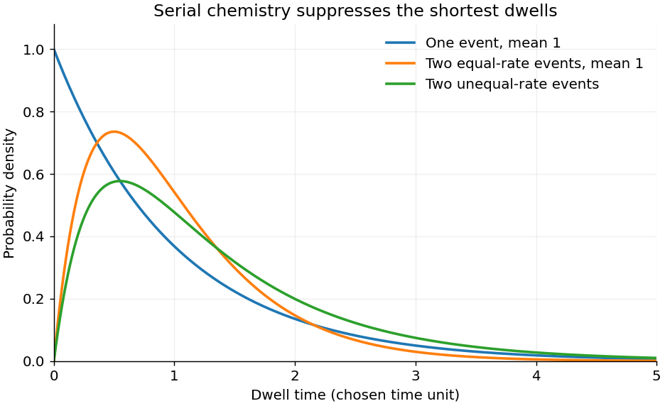

<h1 id="2/b/solution">Solution</h1>

↑ **Parent:** [B](../b.md)

At saturating [ATP](../../../../adenosine-triphosphate.md), binding need no longer dominate the observed dwell, but **saturation alone does not determine a dwell-time distribution**. The standard interpretation of a distribution that rises from zero is that at least two sequential events remain rate limiting. Model a dwell as $T=T_1+T_2$, where the independent waiting times are distributed according to [exponential distributions](../../../../exponential-distribution.md) with rates $k_1,k_2$. Their [convolution](../../../../convolution.md) is

$$
p(t)=\int_0^t k_1e^{-k_1u}k_2e^{-k_2(t-u)}\,du
=\boxed{\frac{k_1k_2}{k_2-k_1}(e^{-k_1t}-e^{-k_2t})},\quad t\geq0.
$$

This [hypoexponential distribution](../../../../hypoexponential-distribution.md) starts at zero, rises to a mode $\ln(k_2/k_1)/(k_2-k_1)$, then has an exponential tail. When the rates are equal, the continuous limit is the two-stage [Erlang distribution](../../../../erlang-distribution.md),

$$
\boxed{p(t)=k^2t e^{-kt},\qquad \langle T\rangle=2/k,\quad
\operatorname{var}(T)=2/k^2,\quad t_{\rm mode}=1/k.}
$$

A single slow memoryless event instead gives $ke^{-kt}$, maximal at zero. Three 120-degree steps per revolution specify rotational [stoichiometry](../../../../stoichiometry.md), **not three slow reactions within every dwell**. The two-event interpretation is supported by the resolved catalytic-dwell [chemical kinetics](../../../../chemical-kinetics-split.md) in the primary F1 experiment.[2001, abstract and Figure 8: two reactions occupy the catalytic dwell](../../../../resolution-of-distinct-rotational-substeps-by-submillisecond-kinetic-analysis-of-f1-atpase-by-ryohei-yasuda-and-others.md)

The fit assumes sequential approximately irreversible events, constant rates during each dwell, negligible ATP-binding delay, negligible mechanical transit time, and detection of all relevant steps. Parallel pathways, backward transitions, inhibited states, probe drag and missed short dwells can change the histogram. The mathematical fit alone does not identify each event chemically or prove that two [ATP](../../../../adenosine-triphosphate.md) [molecules](../../../../molecule-split.md) are hydrolyzed per step.

**[Figure 1](#2/b/image-one-event-and-two-event-dwell-time-models). One-event and two-event dwell-time models**. Original normalized probability densities. A serial two-event model has zero density at zero time and a nonzero mode; no experimental histogram has been copied.

## ↑ Ancestors (12)

1. [B](../b.md)
2. [2](../../2.md)
3. [2016](../../../2016-split.md)
4. [Past exam of the biological physics course of the University of Oxford](../../../split.md)
5. [Biological physics course of the University of Oxford](../../../../biological-physics-course-of-the-university-of-oxford.md)
6. [Year 4 of the physics course of the University of Oxford](../../../../year-4-of-the-physics-course-of-the-university-of-oxford.md)
7. [Physics course of the University of Oxford](../../../../physics-course-of-the-university-of-oxford.md)
8. [Undergraduate course of the University of Oxford](../../../../undergraduate-course-of-the-university-of-oxford.md)
9. [Course of the University of Oxford](../../../../course-of-the-university-of-oxford.md)
10. [University of Oxford](../../../../university-of-oxford-split.md)
11. [List of universities](../../../../list-of-universities.md)
12. [Codex Wiki](../../../../split.md)
