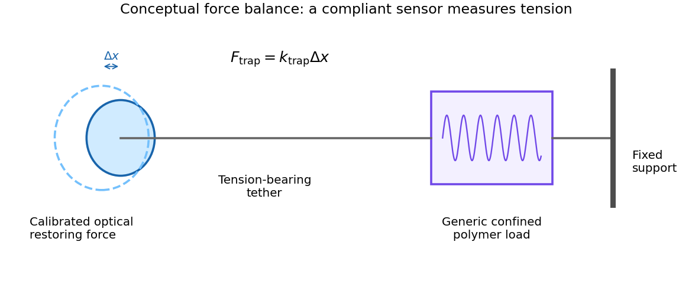

<h1 id="5/a/solution">Solution</h1>

↑ **Parent:** [A](../a.md)

The main generic costs of strongly confining a charged semiflexible [polymer](../../../../polymer-split.md) are bending it away from its preferred straight shape, crowding neighboring segments, and reducing its available configurations. Closely approaching charged strands also repel through electrostatic and hydration interactions; mobile [ions](../../../../ion.md) screen or modify these interactions, while counterion organization contributes to the free-energy balance. The bending cost is especially large in regions of high [curvature](../../../../curvature.md). A [pressure](../../../../pressure-split.md) on the confining wall and a [force](../../../../force-split.md) resisting further insertion are related thermodynamic responses, but are not identical quantities with the same units.

At the level of measurement principles, an [optical tweezers](../../../../optical-tweezers.md) apparatus acts as a calibrated compliant [force](../../../../force-split.md) sensor. A displaced trapped bead experiences approximately $F_{\rm trap}=k_{\rm trap}\Delta x$. A tether transmits [tension](../../../../tension.md) between that sensor and the material under load; the opposing support fixes the other end. The conceptual [force balance](../../../../force-balance.md) is

$$
\text{compliant sensor}\ \longleftrightarrow\ \text{tension-bearing tether}\ \longleftrightarrow\ \text{confined polymer system}.
$$

The extension and restoring [force](../../../../force-split.md) supply a mechanical record of the load. This is a force-sensing schematic, not a biological preparation or packaging protocol. The measured [tension](../../../../tension.md) can include bending, interstrand interactions, dissipation and any other mechanically coupled contribution; it cannot be identified with only the bending term without additional assumptions. In a reversible generic model $F_{\rm conf}=\partial G/\partial L$ at specified geometry, while an internal [pressure](../../../../pressure-split.md) is $-\partial G/\partial\mathcal V$ at specified [polymer](../../../../polymer-split.md) content. These derivatives clarify what a [force](../../../../force-split.md) measurement can and cannot determine.

**[Figure 2](#5/a/image-a-compliant-optical-force-sensor-and-a-generic-confined-polymer-load). A compliant optical force sensor and a generic confined-polymer load**. Original force-balance schematic. The sensor displacement reports transmitted tension; the drawing supplies no biological preparation or packaging procedure.

## ↑ Ancestors (12)

1. [A](../a.md)
2. [5](../../5.md)
3. [2016](../../../2016-split.md)
4. [Past exam of the biological physics course of the University of Oxford](../../../split.md)
5. [Biological physics course of the University of Oxford](../../../../biological-physics-course-of-the-university-of-oxford.md)
6. [Year 4 of the physics course of the University of Oxford](../../../../year-4-of-the-physics-course-of-the-university-of-oxford.md)
7. [Physics course of the University of Oxford](../../../../physics-course-of-the-university-of-oxford.md)
8. [Undergraduate course of the University of Oxford](../../../../undergraduate-course-of-the-university-of-oxford.md)
9. [Course of the University of Oxford](../../../../course-of-the-university-of-oxford.md)
10. [University of Oxford](../../../../university-of-oxford-split.md)
11. [List of universities](../../../../list-of-universities.md)
12. [Codex Wiki](../../../../split.md)
