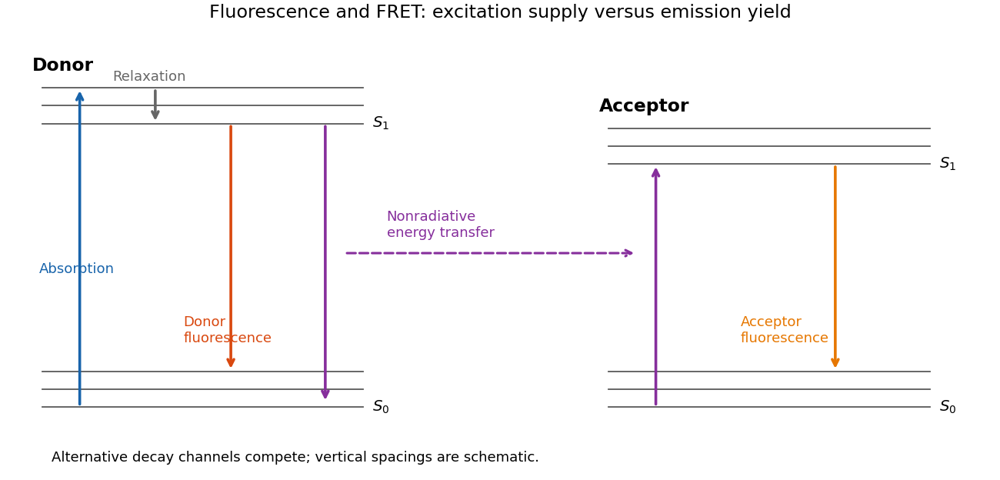

<h1 id="6/a/solution">Solution</h1>

↑ **Parent:** [A](../a.md)

A [Jablonski diagram](../../../../jablonski-diagram.md) distinguishes [electronic excitation](../../../../electronic-excitation.md) from subsequent relaxation. [Photon absorption](../../../../photon-absorption.md) takes a [molecule](../../../../molecule-split.md) from the electronic [ground state](../../../../ground-state.md) $S_0$ to a vibrationally excited level of $S_1$ or a higher [singlet state](../../../../singlet-state.md). Rapid [vibrational relaxation](../../../../vibrational-relaxation.md) and internal conversion usually populate the lowest vibrational levels of $S_1$. [Fluorescence](../../../../fluorescence-split.md) then emits a [photon](../../../../photon.md) on a transition to $S_0$, often ending in one of its excited vibrational levels. Nonradiative relaxation competes with emission; [intersystem crossing](../../../../intersystem-crossing.md) can also populate triplet states. [Energy](../../../../energy-split.md) lost to relaxation and solvent reorganization commonly makes the [fluorescence](../../../../fluorescence-split.md) maximum occur at lower [photon energy](../../../../photon-energy.md), hence longer wavelength, than the [photon absorption](../../../../photon-absorption.md) maximum: the [Stokes shift](../../../../stokes-shift.md).

The intrinsic [fluorescence quantum yield](../../../../fluorescence-quantum-yield.md) is the number of [photons](../../../../photon.md) emitted by [fluorescence](../../../../fluorescence-split.md) per absorbed excitation. For a simple [excited state](../../../../excited-state.md) with radiative rate $k_r$ and other decay rate $k_{nr}$,

$$
Q_D^0=\frac{k_r}{k_r+k_{nr}}.
$$

A nearby acceptor adds a nonradiative **energy-transfer** channel, not an emitted [photon](../../../../photon.md) flying from donor to acceptor. The [electric dipole-dipole interaction](../../../../electric-dipole-dipole-interaction.md) transfers the donor excitation while returning the donor toward its [ground state](../../../../ground-state.md) and exciting the acceptor. The acceptor then relaxes and may fluoresce. The donor yield becomes

$$
\boxed{Q_D^{DA}=\frac{k_r}{k_r+k_{nr}+k_T}=Q_D^0(1-E).}
$$

For the acceptor, distinguish its intrinsic yield per acceptor excitation, $Q_A=k_{r,A}/(k_{r,A}+k_{nr,A})$, from the number of acceptor [photons](../../../../photon.md) per **donor** excitation. Transfer increases the supply of acceptor excitations, giving sensitized emission $E Q_A$ per donor excitation in the ideal model. It does not by itself change $Q_A$ if the acceptor's own decay rates remain unchanged. Environmental changes, saturation or additional quenching can change those rates, but increased acceptor intensity alone does not establish an increased intrinsic [fluorescence quantum yield](../../../../fluorescence-quantum-yield.md).

**[Figure 3](#6/a/image-relaxation-fluorescence-and-donor-acceptor-energy-transfer). Relaxation, fluorescence and donor–acceptor energy transfer**. Original schematic electronic and vibrational levels. Transfer supplies an acceptor excitation without a photon between the molecules; the acceptor quantum yield and the excitation supply are separate quantities.

## ↑ Ancestors (12)

1. [A](../a.md)
2. [6](../../6.md)
3. [2016](../../../2016-split.md)
4. [Past exam of the biological physics course of the University of Oxford](../../../split.md)
5. [Biological physics course of the University of Oxford](../../../../biological-physics-course-of-the-university-of-oxford.md)
6. [Year 4 of the physics course of the University of Oxford](../../../../year-4-of-the-physics-course-of-the-university-of-oxford.md)
7. [Physics course of the University of Oxford](../../../../physics-course-of-the-university-of-oxford.md)
8. [Undergraduate course of the University of Oxford](../../../../undergraduate-course-of-the-university-of-oxford.md)
9. [Course of the University of Oxford](../../../../course-of-the-university-of-oxford.md)
10. [University of Oxford](../../../../university-of-oxford-split.md)
11. [List of universities](../../../../list-of-universities.md)
12. [Codex Wiki](../../../../split.md)
