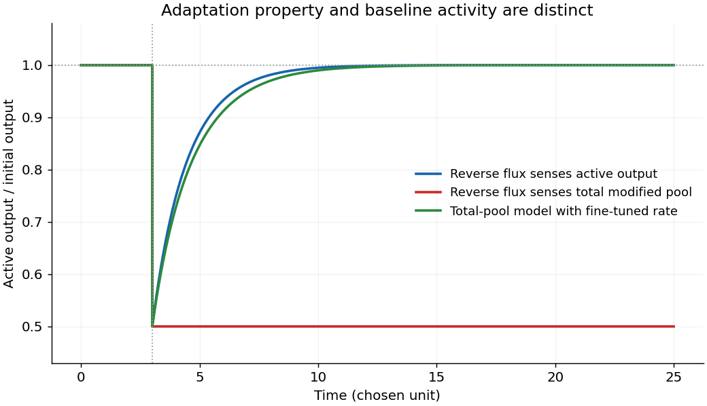

<h1 id="7/d/solution">Solution</h1>

↑ **Parent:** [D](../d.md)

Separate total methylated [receptor](../../../../receptor-biochemistry.md) $m$ from its active portion $a=f(c)m$, where ligand-bound [receptor](../../../../receptor-biochemistry.md) is inactive and the unbound fraction supplies $f(c)>0$ at finite ligand [concentration](../../../../concentration.md). In the [Barkai-Leibler model](../../../../barkai-leibler-model.md), [receptor demethylation](../../../../receptor-demethylation.md) depends on the **active** portion:

$$
\dot m=r-\frac{ba}{K_B+a}.
$$

Every accessible stable [steady state](../../../../steady-state.md) therefore obeys

$$
\boxed{a_* =\frac{K_Br}{b-r},\qquad m_* =a_*/f(c).}
$$

The output is independent of [chemoattractant](../../../../chemoattractant.md) even though the methylated pool changes. A ligand step first lowers $a$, reducing its own reverse modification. Constant [receptor methylation](../../../../receptor-methylation.md) continues until $a$ recovers. Local stability follows from $\partial\dot m/\partial m=-bfK_B/(K_B+a)^2<0$. This is output-dependent [negative feedback](../../../../negative-feedback.md). [1997, model mechanism and adaptation precision](../../../../robustness-in-simple-biochemical-networks-by-naama-barkai-and-stanislas-leibler.md)

Changing [CheR](../../../../cher.md) or [CheB](../../../../cheb.md) changes $a_*$ and the recovery time, but the return to each new pre-step baseline remains exact over the model's operating range. [Robust perfect adaptation](../../../../robust-perfect-adaptation.md) does **not** mean invariant tumbling frequency under changes in [enzyme](../../../../enzyme-split.md) abundance. Nor does it extend to $f=0$, $b\leq r$ or saturation of the finite [receptor methylation](../../../../receptor-methylation.md) capacity. If every [receptor](../../../../receptor-biochemistry.md) is permanently inactive, $a=0$ and the reverse flux cannot restore a positive baseline. The literal phrase that binding reduces activity to zero applies to bound [receptors](../../../../receptor-biochemistry.md), not to every [receptor](../../../../receptor-biochemistry.md) under every finite stimulus.

If [CheR](../../../../cher.md) instead follows [Michaelis-Menten kinetics](../../../../michaelis-menten-kinetics.md) on unmethylated [substrate](../../../../substrate-biochemistry.md), $u=E_T-m$, then

$$
\dot m=\frac{r_0(E_T-m)}{K_R+E_T-m}-\frac{ba}{K_B+a},\qquad a=f(c)m.
$$

At [steady state](../../../../steady-state.md) the forward flux becomes $r_0(E_T-a/f)/(K_R+E_T-a/f)$ and generally depends on ligand through $f$. Thus ligand-independent output is lost. Near-perfect adaptation can remain when $E_T-m\gg K_R$ so that [CheR](../../../../cher.md) is effectively saturated, but Michaelis–Menten behavior outside that limit does not guarantee [perfect adaptation](../../../../perfect-adaptation.md). [2000, analysis of ligand-independent bound CheR and the saturation assumption](../../../../robust-perfect-adaptation-in-bacterial-chemotaxis-through-integral-feedback-control-by-tau-mu-yi-and-others.md)

**[Figure 4](#7/d/image-fine-tuning-and-output-dependent-adaptation). Fine tuning and output-dependent adaptation**. Original numerical solutions of the stated mathematical models. The ligand activity factor changes from one to one half; saturated output-dependent feedback restores activity, while a total-pool reverse reaction requires fine tuning.

## ↑ Ancestors (12)

1. [D](../d.md)
2. [7](../../7.md)
3. [2016](../../../2016-split.md)
4. [Past exam of the biological physics course of the University of Oxford](../../../split.md)
5. [Biological physics course of the University of Oxford](../../../../biological-physics-course-of-the-university-of-oxford.md)
6. [Year 4 of the physics course of the University of Oxford](../../../../year-4-of-the-physics-course-of-the-university-of-oxford.md)
7. [Physics course of the University of Oxford](../../../../physics-course-of-the-university-of-oxford.md)
8. [Undergraduate course of the University of Oxford](../../../../undergraduate-course-of-the-university-of-oxford.md)
9. [Course of the University of Oxford](../../../../course-of-the-university-of-oxford.md)
10. [University of Oxford](../../../../university-of-oxford-split.md)
11. [List of universities](../../../../list-of-universities.md)
12. [Codex Wiki](../../../../split.md)
