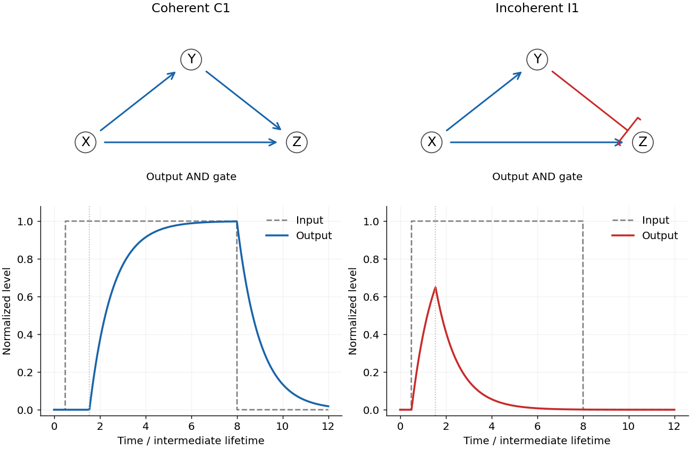

<h1 id="8/c/solution">Solution</h1>

↑ **Parent:** [C](../c.md)

Both motifs have a direct path $X\to Z$ and an indirect path $X\to Y\to Z$. [C1 coherent feed-forward loop](../../../../c1-coherent-feed-forward-loop.md) uses three activating edges. [I1 incoherent feed-forward loop](../../../../i1-incoherent-feed-forward-loop.md) activates $Y$ and $Z$ from $X$, but lets $Y$ repress $Z$. The AND condition means that the direct input must be active and the intermediate input must permit output: present for an activator, absent for a repressor. [2003, AND-gated coherent and incoherent motifs](../../../../structure-and-function-of-the-feed-forward-loop-network-motif-by-shmoolik-mangan-and-uri-alon.md)

For a simple threshold model let

$$
\dot Y=\beta_Y H(X-K_{XY})-\alpha_Y Y,\qquad Y_\infty=\beta_Y/\alpha_Y.
$$

The coherent output obeys $\dot Z=\beta_ZH(X-K_{XZ})H(Y-K_{YZ})-\alpha_ZZ$. Starting from $Y=0$ under a sustained high input, $Y=Y_\infty(1-e^{-\alpha_Yt})$. Provided $0<K_{YZ}<Y_\infty$, the [gene expression](../../../../gene-expression.md) delay is

$$
\boxed{t_d=-\alpha_Y^{-1}\ln(1-K_{YZ}/Y_\infty).}
$$

Shorter input pulses do not turn on output [gene expression](../../../../gene-expression.md). This is a [persistence detector](../../../../persistence-detector.md): it rejects brief positive inputs. Removing $X$ immediately removes the direct permission for [gene expression](../../../../gene-expression.md), even if $Y$ remains high. The [concentration](../../../../concentration.md) of $Z$ subsequently decays with its own lifetime rather than vanishing instantly.

The incoherent output instead obeys $\dot Z=\beta_ZH(X-K_{XZ})H(K_{YZ}-Y)-\alpha_ZZ$. [Gene expression](../../../../gene-expression.md) begins immediately, then stops when accumulated repressor crosses threshold at $t_d$. With zero initial output,

$$
\boxed{Z(t)=\frac{\beta_Z}{\alpha_Z}(1-e^{-\alpha_Zt})\quad(0<t<t_d),\qquad
Z(t)=Z(t_d)e^{-\alpha_Z(t-t_d)}\quad(t>t_d).}
$$

A maintained stimulus therefore generates a pulse in this ideal Boolean model. Delayed inhibition can accelerate an early response and limit its duration. The ideal final zero output is conditional on crossing the repression threshold; graded response laws or basal [gene expression](../../../../gene-expression.md) can give a nonzero final level and need not adapt perfectly. If $Y_\infty\leq K_{YZ}$, the coherent circuit does not activate, while the incoherent circuit fails to terminate its [gene expression](../../../../gene-expression.md). These boundary cases show why regulatory signs alone do not fix function.

**[Figure 5](#8/c/image-and-gated-coherent-and-incoherent-type-1-feed-forward-loops). AND-gated coherent and incoherent type-1 feed-forward loops**. Original regulatory graphs and threshold-model responses. The coherent motif delays production until an activator accumulates; the incoherent motif produces a pulse before a repressor accumulates. Output concentrations retain their finite decay times.

## ↑ Ancestors (12)

1. [C](../c.md)
2. [8](../../8.md)
3. [2016](../../../2016-split.md)
4. [Past exam of the biological physics course of the University of Oxford](../../../split.md)
5. [Biological physics course of the University of Oxford](../../../../biological-physics-course-of-the-university-of-oxford.md)
6. [Year 4 of the physics course of the University of Oxford](../../../../year-4-of-the-physics-course-of-the-university-of-oxford.md)
7. [Physics course of the University of Oxford](../../../../physics-course-of-the-university-of-oxford.md)
8. [Undergraduate course of the University of Oxford](../../../../undergraduate-course-of-the-university-of-oxford.md)
9. [Course of the University of Oxford](../../../../course-of-the-university-of-oxford.md)
10. [University of Oxford](../../../../university-of-oxford-split.md)
11. [List of universities](../../../../list-of-universities.md)
12. [Codex Wiki](../../../../split.md)
