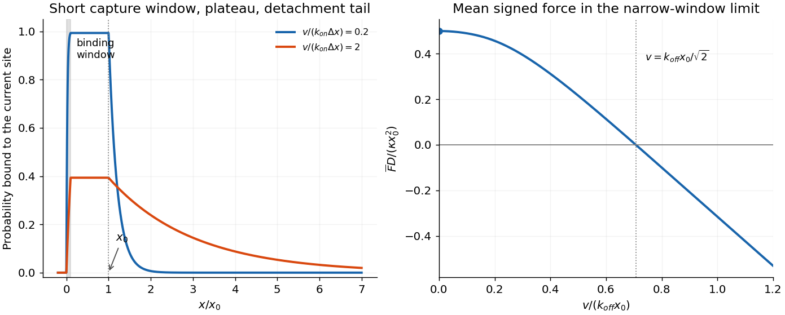
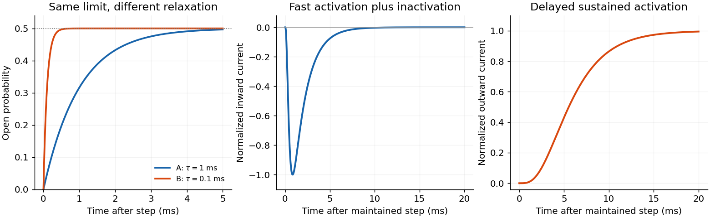
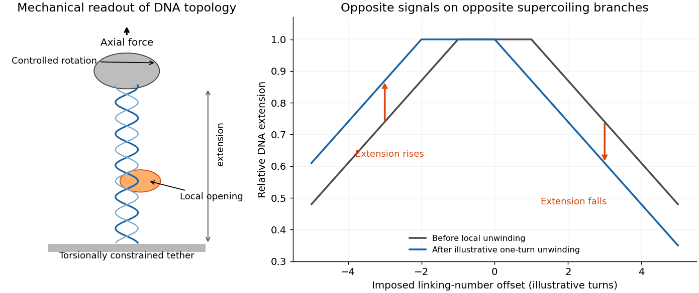
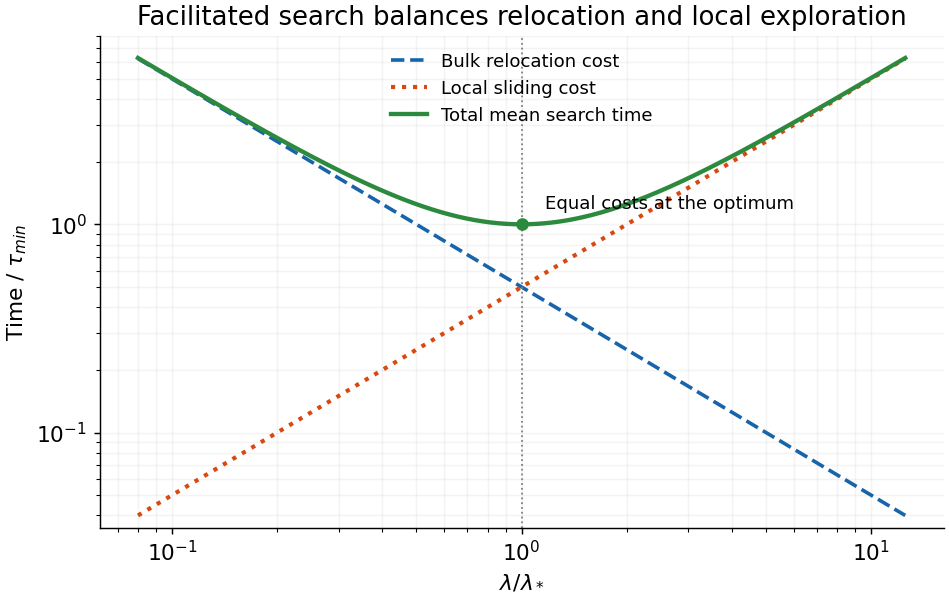
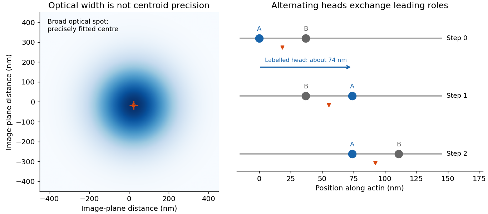

# 2017

↑ **Parent:** [Past exam of the biological physics course of the University of Oxford](../past-exam-of-the-biological-physics-course-of-the-university-of-oxford.md)

Source paper: [https://www.whatdotheyknow.com/request/oxford_physics_past_papers_2/response/2340696/attach/5/Physics%20Papers%202016.pdf?cookie_passthrough=1](https://www.whatdotheyknow.com/request/oxford_physics_past_papers_2/response/2340696/attach/5/Physics%20Papers%202016.pdf?cookie_passthrough=1)

**Table of contents**

- [1](#1)
  - [a](#1/a)
    - [Solution](#1/a/solution)
  - [b](#1/b)
    - [Solution](#1/b/solution)
  - [c](#1/c)
    - [Solution](#1/c/solution)
  - [d](#1/d)
    - [Solution](#1/d/solution)
  - [e](#1/e)
    - [Solution](#1/e/solution)
- [2](#2)
  - [a](#2/a)
    - [Solution](#2/a/solution)
  - [b](#2/b)
    - [Solution](#2/b/solution)
  - [c](#2/c)
    - [Solution](#2/c/solution)
- [3](#3)
  - [a](#3/a)
    - [Solution](#3/a/solution)
  - [b](#3/b)
    - [Solution](#3/b/solution)
  - [c](#3/c)
    - [Solution](#3/c/solution)
- [4](#4)
  - [a](#4/a)
    - [Solution](#4/a/solution)
  - [b](#4/b)
    - [Solution](#4/b/solution)
  - [c](#4/c)
    - [Solution](#4/c/solution)
  - [d](#4/d)
    - [Solution](#4/d/solution)
  - [e](#4/e)
    - [Solution](#4/e/solution)
- [5](#5)
  - [a](#5/a)
    - [Solution](#5/a/solution)
  - [b](#5/b)
    - [Solution](#5/b/solution)
  - [c](#5/c)
    - [Solution](#5/c/solution)
  - [d](#5/d)
    - [Solution](#5/d/solution)
- [6](#6)
  - [a](#6/a)
    - [Solution](#6/a/solution)
  - [b](#6/b)
    - [Solution](#6/b/solution)
  - [c](#6/c)
    - [Solution](#6/c/solution)

## 1

↑ **Parent:** [2017](2017.md)

<h3 id="1/a">a</h3>

↑ **Parent:** [1](#1)

<h4 id="1/a/solution">Solution</h4>

↑ **Parent:** [A](#1/a)

Start both systems from zero and compare their times to reach half of their **own** [steady concentrations](../dynamical-systems.md#steady-state). Without regulation,

$$
Y(t)=\frac\beta\alpha(1-e^{-\alpha t}),\qquad
Y_{\rm st}^{(0)}=\frac\beta\alpha,\qquad T_{1/2}^{(0)}=\frac{\log2}{\alpha}.
$$

In the strong [logic approximation for gene regulation](../mathematical-biology.md#logic-approximation-for-gene-regulation), [production](../molecular-genetics.md#gene-expression) is initially fully on and the [concentration](../mathematical-physics.md#concentration) rises towards the repression threshold. The regulated level is pinned near $Y_{\rm st}\simeq K$, so it reaches $K/2$ before switching:

$$
\boxed{T_{1/2}^{\rm logic}=-\frac1\alpha\log\left(1-\frac{\alpha K}{2\beta}\right),\qquad
\frac{T_{1/2}^{\rm logic}}{T_{1/2}^{(0)}}=
\frac{-\log[1-\alpha K/(2\beta)]}{\log2}
\simeq\frac{\alpha K}{2\beta\log2}\ll1.}
$$

The faster relative response comes from allowing high initial [production](../molecular-genetics.md#gene-expression) while keeping the final abundance low. [Negative autoregulation](../mathematical-biology.md#negative-autoregulation) can reduce response delays and [sensitivity](../probability-and-statistics.md#sensitivity-analysis) to [production](../molecular-genetics.md#gene-expression) fluctuations, and can reduce unnecessary accumulation of a [protein](../protein.md). It does not suppress every possible noise source at every frequency.

A perfectly discontinuous on/off right-hand side has a threshold-switching ambiguity rather than an ordinary smooth equilibrium at $K$. Here threshold pinning means the limiting rapid-switching or steep smooth-response idealization. A continuous repression law resolves that idealization. Comparing half of the same prescribed [concentration](../mathematical-physics.md#concentration), rather than half of each model's final [concentration](../mathematical-physics.md#concentration), would be a different response-time comparison.

<h3 id="1/b">b</h3>

↑ **Parent:** [1](#1)

<h4 id="1/b/solution">Solution</h4>

↑ **Parent:** [B](#1/b)

For the [strong Hill autorepression response](../mathematical-biology.md#strong-hill-autorepression-response), in the requested approximation, $\dot Y=\beta K^nY^{-n}-\alpha Y$. Put $z=Y^{n+1}$. Then

$$
\dot z=(n+1)(\beta K^n-\alpha z),\qquad
z(t)=\frac{\beta K^n}{\alpha}[1-e^{-(n+1)\alpha t}],
$$

so the formal zero-initial-concentration solution is

$$
\boxed{Y(t)=\left(\frac{\beta K^n}{\alpha}\right)^{1/(n+1)}
[1-e^{-(n+1)\alpha t}]^{1/(n+1)},\qquad
Y_{\rm st}=\left(\frac{\beta K^n}{\alpha}\right)^{1/(n+1)}.}
$$

Setting $Y(T_{1/2})=Y_{\rm st}/2$ gives

$$
\boxed{T_{1/2}=\frac{-\log(1-2^{-(n+1)})}{(n+1)\alpha},\qquad
\frac{T_{1/2}}{T_{1/2}^{(0)}}=
\frac{-\log(1-2^{-(n+1)})}{(n+1)\log2}.}
$$

The formal ratio decreases with positive $n$; for $n=1$ it is about $0.208$, and for $n=2$ about $0.0642$. Its large-$n$ asymptote is $2^{-(n+1)}/[(n+1)\log2]$. This is a [nonlinear](../differential-equation.md#nonlinear-ordinary-differential-equation) half-response time, not simply the near-equilibrium [relaxation time](../analysis.md#time-constant) $1/[(n+1)\alpha]$.

**Approximation qualification.** The omitted initial layer is precisely the one the source permits us to ignore: the approximate derivative diverges at $Y=0$, whereas the full [Hill equation](../protein.md#hill-equation) has initial slope $\beta$. The approximation is not uniform as $n\to\infty$ at fixed $R=\beta/(\alpha K)$. Strong repression already at half of the final [concentration](../mathematical-physics.md#concentration) needs $R^{1/(n+1)}/2\gg1$. The actual [Hill equation](../protein.md#hill-equation) obeys $\dot Y\le\beta$, so $T_{1/2}\ge Y_{\rm st}/(2\beta)$. Its steep-switch limit approaches the logic-response scale in [a](#1/a); the formal vanishing large-$n$ result above cannot be extrapolated past its regime of validity.

<h3 id="1/c">c</h3>

↑ **Parent:** [1](#1)

<h4 id="1/c/solution">Solution</h4>

↑ **Parent:** [C](#1/c)

For the [parameter sensitivity of autorepressed expression](../mathematical-biology.md#parameter-sensitivity-of-autorepressed-expression), unregulated [production](../molecular-genetics.md#gene-expression) has $Y_{\rm st}=\beta/\alpha$, so its logarithmic [sensitivity](../probability-and-statistics.md#sensitivity-analysis) is one. In the strong Hill approximation, $Y_{\rm st}=(\beta K^n/\alpha)^{1/(n+1)}$, with $K,\alpha,n$ held fixed. Hence

$$
\boxed{S(Y_{\rm st},\beta)=1\quad\text{without feedback},\qquad
S(Y_{\rm st},\beta)=\frac1{n+1}\quad\text{with strong Hill repression}.}
$$

The ideal logic level $Y_{\rm st}\simeq K$ instead gives $S\simeq0$, because changing [production](../molecular-genetics.md#gene-expression) primarily changes the switching duty fraction, not the threshold. Finite Hill repression has a residual [production](../molecular-genetics.md#gene-expression) [sensitivity](../probability-and-statistics.md#sensitivity-analysis).

The exact Hill [steady-state](../dynamical-systems.md#steady-state) relation makes the comparison continuous. Write $s=(Y_{\rm st}/K)^n$; then $\beta=\alpha Y_{\rm st}(1+s)$ and $d\beta/dY_{\rm st}=\alpha[1+(n+1)s]$. Thus

$$
\boxed{S(Y_{\rm st},\beta)=\frac{1+s}{1+(n+1)s}.}
$$

It tends to one for weak repression and to $1/(n+1)$ for strong repression. The calculation concerns a local relative parameter change, not the response to an arbitrary large [production](../molecular-genetics.md#gene-expression) perturbation.

<h3 id="1/d">d</h3>

↑ **Parent:** [1](#1)

<h4 id="1/d/solution">Solution</h4>

↑ **Parent:** [D](#1/d)

Use steady or initial-rate conditions with effectively clamped [substrate](../enzyme.md#substrate-biochemistry) [concentrations](../mathematical-physics.md#concentration). For either [substrate](../enzyme.md#substrate-biochemistry) $X\in\{S,R\}$, put $U_X=[AX]$ and $V_X=[AX^*]$. The intermediate balances are

$$
0=k_+^X[A][X]-(k_-^X+m)U_X,\qquad
0=mU_X-(l_-^{X*}+V_A)V_X.
$$

The [product flux](../chemical-kinetics.md#reaction-rate) is therefore

$$
J_X=V_AV_X=
\frac{k_+^X[A][X]\,mV_A}{(k_-^X+m)(l_-^{X*}+V_A)}.
$$

The [free enzyme](../enzyme.md) [concentration](../mathematical-physics.md#concentration) is common to the two competing pathways, so it cancels even when [enzyme](../enzyme.md) sequestration changes its magnitude. Consequently

$$
\boxed{F=\frac{J_R}{J_S}=
\frac{[R]}{[S]}\frac{k_+^R}{k_+^S}
\frac{k_-^S+m}{k_-^R+m}
\frac{l_-^{S*}+V_A}{l_-^{R*}+V_A}.}
$$

Each post-binding factor is the ratio of [probabilities](../probability-theory.md#probability) of proceeding rather than dissociating at that stage. The expression assumes positive common forward rates and no significant product back reaction. Without the steady/intermediate-balance or initial-rate assumption, the ratio can depend on intermediate populations and observation time; binding and [dissociation](../chemical-kinetics.md#dissociation-rate-constant) constants alone would not determine a unique transient ratio.

<h3 id="1/e">e</h3>

↑ **Parent:** [1](#1)

<h4 id="1/e/solution">Solution</h4>

↑ **Parent:** [E](#1/e)

With equal [substrate](../enzyme.md#substrate-biochemistry) abundance and association rates, let $a=k_-^S<b=k_-^R$ and $c=l_-^{S*}<d=l_-^{R*}$. Then

$$
F(m,V_A)=\frac{a+m}{b+m}\frac{c+V_A}{d+V_A}.
$$

Both factors increase with their forward rate: for example $\partial_m[(a+m)/(b+m)]=(b-a)/(b+m)^2>0$. Thus maximum discrimination requires enough waiting at each stage for the less stable incorrect complex to be rejected. In the slow-forward limit,

$$
\boxed{m\ll k_-^S,k_-^R,\quad V_A\ll l_-^{S*},l_-^{R*},\qquad
F\longrightarrow\frac{k_-^S}{k_-^R}\frac{l_-^{S*}}{l_-^{R*}}.}
$$

The two rejection stages multiply their discrimination. Fast modification or fast product formation bypasses the corresponding [dissociation](../chemical-kinetics.md#dissociation-rate-constant) test and drives that factor towards one.

There is a [kinetic proofreading fidelity-throughput tradeoff](../molecular-genetics.md#kinetic-proofreading-fidelity-throughput-tradeoff): taking either forward rate literally to zero gives zero [product flux](../chemical-kinetics.md#reaction-rate), not a useful finite-output optimum. If [dissociation](../chemical-kinetics.md#dissociation-rate-constant) rates are well separated, a practical high-yield discrimination window is $k_-^S\ll m\ll k_-^R$ and $l_-^{S*}\ll V_A\ll l_-^{R*}$. Correct complexes then usually pass both stages while incorrect complexes usually dissociate; its fidelity is not the mathematical infimum obtained with vanishing forward rates. The irreversible modification represents a driven, energy-consuming step, permitting successive nonequilibrium checks rather than merely repeating one equilibrium binding comparison. No finite positive optimum can be selected from minimization of $F$ alone without a speed or yield requirement.

## 2

↑ **Parent:** [2017](2017.md)

<h3 id="2/a">a</h3>

↑ **Parent:** [2](#2)

<h4 id="2/a/solution">Solution</h4>

↑ **Parent:** [A](#2/a)

A skeletal-muscle fibre contains parallel [myofibrils](../anatomy.md#myofibril) assembled from repeating [sarcomeres](../biological-cell.md#sarcomere) between Z discs. Thin [actin filaments](../protein.md#actin-filament) extend from the Z discs; bipolar thick [myosin II](../protein.md#myosin-ii) [filaments](../biological-cell.md#myofilament) occupy the central region. Overlap between them allows many [myosin heads](../protein.md#myosin) to interact with [actin](../protein.md#actin) in parallel.

A rise in cytosolic [calcium](../chemical-substance.md#calcium) exposes [actin](../protein.md#actin) binding sites through the [troponin](../biological-cell.md#troponin)–[tropomyosin](../biological-cell.md#tropomyosin) regulatory system. [ATP](../molecule.md#adenosine-triphosphate) binding releases a strongly attached [myosin](../protein.md#myosin) head; hydrolysis primes its [lever arm](../protein.md#myosin-lever-arm), attachment and product release permit a force-generating stroke, and another [ATP](../molecule.md#adenosine-triphosphate) allows detachment. The cycle converts [chemical free energy](../thermodynamic-potential.md#gibbs-free-energy) into [mechanical work](../energy.md#work) rather than consuming [actin](../protein.md#actin) or shortening the [filaments](../biological-cell.md#myofilament) themselves.

Relative filament [sliding](../biology.md#facilitated-target-search) draws the Z discs together. The I band and H zone shorten as overlap increases, whereas the thick-filament A-band length is approximately unchanged. [Calcium](../chemical-substance.md#calcium) removal restores inhibition and permits relaxation. The many-head ensemble sustains [force](../force.md) even though individual cross-bridges repeatedly attach and detach. This sliding-filament description concerns [myosin II](../protein.md#myosin-ii) in [muscle](../anatomy.md#muscle); the processive two-head walking of [Myosin V](../protein.md#myosin-v) in [a](#6/a) is a related but distinct motor arrangement.

<h3 id="2/b">b</h3>

↑ **Parent:** [2](#2)

<h4 id="2/b/solution">Solution</h4>

↑ **Parent:** [B](#2/b)

In [spatially gated myosin attachment](../biological-cell.md#spatially-gated-myosin-attachment), for a freshly available head encountering an isolated site, take $P=0$ before the attachment window. Converting time derivatives to position derivatives with $dx/dt=v$ gives $vP'=k_{on}(1-P)$ in the binding window, $P'=0$ in the protected bound region, and $vP'=-k_{off}P$ after detachment becomes allowed. Continuity gives

$$
\boxed{P(x)=\begin{cases}
0,&x<0,\\
1-e^{-k_{on}x/v},&0\le x\le\Delta x,\\
p_b,&\Delta x<x\le x_0,\\
p_b e^{-k_{off}(x-x_0)/v},&x>x_0,
\end{cases}\qquad p_b=1-e^{-k_{on}\Delta x/v}.}
$$

For $v<k_{on}\Delta x$, the plateau exceeds $1-e^{-1}$ and approaches one for much slower motion. For $v>k_{on}\Delta x$, the [binding probability](../probability-theory.md#probability) is lower, becoming $k_{on}\Delta x/v$ at very high speed. The spatial detachment tail has length $v/k_{off}$, so faster [sliding](../biology.md#facilitated-target-search) makes a longer low-probability tail. The following is an original calculation of those profiles; the [force](../force.md) panel is derived in [c](#2/c).

**[Figure 1](#2/b/image-spatial-attachment-probability-and-force-in-the-prescribed-velocity-myosin-model). Spatial attachment probability and force in the prescribed-velocity myosin model**. Original profiles compare velocities below and above the binding-window crossing-rate scale. Binding rises only inside the narrow window, remains constant up to the detachment threshold, and then decays. The second panel shows the resulting signed mean force in the narrow-window approximation.

**Reset condition.** Geometric separation $D\gg x_0$ does not alone guarantee detachment before the next site: independently available encounters also need $(D-x_0)k_{off}/v\gg1$. Without that extra timescale separation the head may still be attached to an earlier site.

For completeness, the periodic [steady-state](../dynamical-systems.md#steady-state) correction can be written explicitly. Put $a=k_{on}/v$, $b=k_{off}/v$, $A_0=1-e^{-a\Delta x}$ and

$$
C=\frac a{a-b}(e^{-b\Delta x}-e^{-a\Delta x}),\qquad
Q_0=\frac{A_0e^{-b(D-x_0)}}{1-e^{-bD}+Ce^{-b(D-x_0)}}.
$$

Here $Q_0$ is the [probability](../probability-theory.md#probability) of entering the new window still attached to an earlier site. In the window the new-site [probability](../probability-theory.md#probability) is $P(x)=1-e^{-ax}-Q_0a(e^{-bx}-e^{-ax})/(a-b)$; after it, use its value $p_b=P(\Delta x)$ in the plateau and tail above. For $a=b$, replace $a(e^{-bx}-e^{-ax})/(a-b)$ by $ax e^{-ax}$. This follows from the old-site [probability](../probability-theory.md#probability) $Q(x)=Q_0e^{-bx}$ and new attachment rate $a[1-P-Q]$. The isolated-site result is recovered as $Q_0\to0$.

<h3 id="2/c">c</h3>

↑ **Parent:** [2](#2)

<h4 id="2/c/solution">Solution</h4>

↑ **Parent:** [C](#2/c)

For the [work of a spatially gated myosin head](../biological-cell.md#work-of-a-spatially-gated-myosin-head), the mechanical [force](../force.md) exerted by an attached head in the increasing-$x$ direction is $f(x)=-dU/dx=\kappa(x_0-x)$. It assists motion before $x_0$ and resists it afterwards. For one site encounter the expected work is

$$
W=\int_0^\infty P(x)\kappa(x_0-x)\,dx.
$$

In the narrow binding-window limit, retain the capture [probability](../probability-theory.md#probability) $p_b=1-e^{-k_{on}\Delta x/v}$ but neglect the attachment [displacement](../classical-mechanics.md#displacement) compared with $x_0$. The positive work is $p_b\kappa x_0^2/2$. After $x_0$, use $s=x-x_0$ to obtain the negative contribution $-p_b\kappa\int_0^\infty se^{-k_{off}s/v}ds=-p_b\kappa(v/k_{off})^2$. Hence

$$
\boxed{W\simeq\kappa(1-e^{-k_{on}\Delta x/v})
\left[\frac{x_0^2}{2}-\left(\frac v{k_{off}}\right)^2\right].}
$$

An independent [energy](../energy.md) calculation gives the same factor: binding near zero loads [energy](../energy.md) $\kappa x_0^2/2$, while an [exponentially distributed](../continuous-probability-distribution.md#exponential-distribution) post-threshold attachment time has $\langle t^2\rangle=2/k_{off}^2$, leaving mean [elastic energy](../elasticity-physics.md#elastic-energy) $\kappa v^2/k_{off}^2$ to be lost upon detachment. The factor of two in that [second moment](../expected-value.md#second-moment) is essential.

One site passes every distance $D$, so average work per distance, or power divided by $v$, gives

$$
\boxed{\overline F(v)=\frac{W}{D}\simeq
\frac\kappa D(1-e^{-k_{on}\Delta x/v})
\left[\frac{x_0^2}{2}-\frac{v^2}{k_{off}^2}\right].}
$$

The [force](../force.md) tends to $\kappa x_0^2/(2D)$ as $v\downarrow0$ and changes sign at $v=k_{off}x_0/\sqrt2$ in this idealized model. Above that speed forced [sliding](../biology.md#facilitated-target-search) is resisted on average. The formula uses the reset condition in [b](#2/b), as well as $\Delta x\ll x_0$; if reset fails, replace $p_b$ by the periodic capture [probability](../probability-theory.md#probability) to leading order in $\Delta x/x_0$. For arbitrary window width, the isolated-site work is exactly $\int_0^{\Delta x}(k_{on}/v)e^{-k_{on}x/v}[\kappa(x_0-x)^2/2-\kappa v^2/k_{off}^2]dx$. The loaded [spring](../elasticity-physics.md#spring) [energy](../energy.md) must be supplied by the binding/power-stroke chemistry; this model does not specify an [ATP](../molecule.md#adenosine-triphosphate) efficiency. Real force-dependent transition rates and [energy](../energy.md) budgets limit extrapolation of the toy [force-velocity](../biological-cell.md#work-of-a-spatially-gated-myosin-head) law.

## 3

↑ **Parent:** [2017](2017.md)

<h3 id="3/a">a</h3>

↑ **Parent:** [3](#3)

<h4 id="3/a/solution">Solution</h4>

↑ **Parent:** [A](#3/a)

In [spectrin unfolding by force spectroscopy](../biological-cell.md#spectrin-unfolding-by-force-spectroscopy), the [cantilever](../elasticity-physics.md#cantilever) measures [tension](../force.md#tension) through its calibrated deflection, while [displacement](../classical-mechanics.md#displacement) of the pulling point increases the separation of the [protein](../protein.md) attachments. The [protein](../protein.md) extension is obtained after allowing for [cantilever](../elasticity-physics.md#cantilever) compliance and any linker extension; it is not simply the commanded [displacement](../classical-mechanics.md#displacement).

A folded [spectrin](../biological-cell.md#spectrin) repeat stores much of its backbone in a compact domain. Between [unfolding](../protein.md#denaturation-biochemistry) events, the already released chain is stretched: increasingly straight conformations have fewer accessible configurations, and the resisting [entropic force](../force.md#entropic-force) rises nonlinearly. A peak is reached when a still-folded domain crosses an [unfolding](../protein.md#denaturation-biochemistry) barrier on the timescale of the imposed loading. Its released backbone increases the available [contour length](../polymer.md#polymer-contour-length) abruptly. At nearly the same end-to-end distance the fractional extension $x/L$ is then smaller, so [tension](../force.md#tension) drops. Pulling resumes on the next, longer-chain elastic branch. Repeated release of domains produces the saw-tooth sequence.

The record is therefore evidence for sequential mechanical [unfolding](../protein.md#denaturation-biochemistry) of modular structure, not repeated stretching of a fixed-length rod. For the nominal eight-domain construct, successive branches correspond to increasing numbers of unfolded repeats. The order and rupture [forces](../force.md) can fluctuate because barrier crossing is thermally activated and depends on loading rate, structural heterogeneity and pulling geometry; equivalent repeats need not rupture at identical [force](../force.md).

The horizontal separation between worm-like-chain fits at the same [force](../force.md) estimates the added [contour length](../polymer.md#polymer-contour-length), whereas the vertical [force](../force.md) drop at one extension reflects redistribution of [tension](../force.md#tension). These are distinct measurements. A repeat increment near the specified $31.7\,\mathrm{nm}$ is consistent with repeated similar structural units. The gain is a net release relative to the folded span and attachment geometry; $31.7/106\,\mathrm{nm}$ is not automatically the universal [contour length](../polymer.md#polymer-contour-length) of a [peptide](../protein.md#peptide) residue.

During unloading, relaxation and possible refolding can restore compact domains. [Hysteresis](../critical-phenomenon.md#hysteresis) would indicate dissipative or kinetically delayed processes. Neither the peak [force](../force.md) alone nor an arbitrary saw-tooth area directly equals an equilibrium [unfolding](../protein.md#denaturation-biochemistry) [free energy](../thermodynamic-potential.md#gibbs-free-energy): one must separate chain [elasticity](../elasticity-physics.md), [cantilever](../elasticity-physics.md#cantilever) storage, irreversible loss and pulling-rate effects. The worm-like-chain branches describe released-chain [elasticity](../elasticity-physics.md), not the molecular transition state responsible for a rupture peak.

<h3 id="3/b">b</h3>

↑ **Parent:** [3](#3)

<h4 id="3/b/solution">Solution</h4>

↑ **Parent:** [B](#3/b)

Write $u=x/L$ and $A=k_BT L_p$. The [worm-like chain force-extension interpolation](../mathematical-biology.md#worm-like-chain-force-extension-interpolation) is

$$
f=\frac{k_BT}{L_p}\left[\frac1{4(1-u)^2}-\frac14+u\right].
$$

A fit to an elastic rising branch estimates its [contour length](../polymer.md#polymer-contour-length) $L$ and, if not fixed independently, its [persistence length](../mathematical-biology.md#persistence-length) $L_p$. Comparing successive fitted [contour lengths](../polymer.md#polymer-contour-length) gives the length released by a domain and helps distinguish whole-repeat [unfolding](../protein.md#denaturation-biochemistry) from partial events. $L_p$ estimates the flexibility of the unfolded chain and the [bending rigidity](../elasticity-physics.md#bending-stiffness) $A$; at a stated [temperature](../temperature.md), $A=k_BT L_p$.

For small extension, expansion gives $f\simeq[3k_BT/(2L_pL)]x$, so the effective entropic [spring constant](../elasticity-physics.md#spring-constant) is $3k_BT/(2L_pL)$. Close to full extension, $f\sim k_BT/[4L_p(1-x/L)^2]$, giving strong strain [stiffening](../elasticity-physics.md). These regimes constrain the fit differently and correlate its parameters if the measured interval is short. The fit does not by itself identify a unique folding barrier or [unfolding](../protein.md#denaturation-biochemistry) kinetic rate.

**Persistence-length convention.** In a three-dimensional isotropic [worm-like chain](../mathematical-biology.md#worm-like-chain) the standard definition is $\langle\mathbf t(s)\cdot\mathbf t(0)\rangle=e^{-s/L_p}$. Thus at $s=L_p$, $\arccos\langle\cos\theta\rangle=\arccos(e^{-1})\simeq68.4^\circ$. This is not literally the mean angle $\langle\theta\rangle$. For a simple counterexample, equally probable angles $0^\circ$ and $90^\circ$ have mean angle $45^\circ$ but $\arccos\langle\cos\theta\rangle=60^\circ$. The source's angle description is shorthand for the tangent-correlation convention.

<h3 id="3/c">c</h3>

↑ **Parent:** [3](#3)

<h4 id="3/c/solution">Solution</h4>

↑ **Parent:** [C](#3/c)

After a domain unfolds, its backbone joins the same continuous chain as previously unfolded material. The new branch differs mainly by an added [contour length](../polymer.md#polymer-contour-length), while the local backbone bending statistics remain similar. It is therefore consistent to fit successive branches with different $L_j$ and one common $L_p\simeq0.8\,\mathrm{nm}$. [Tension](../force.md#tension) is transmitted through serial portions of the same chain; one should not add their tensile [forces](../force.md) as though they were independent parallel springs.

The [persistence length](../mathematical-biology.md#persistence-length) is short compared with the contour increment per repeat, so each released domain contributes many flexible bending segments. Stretching suppresses those thermal modes and raises [free energy](../thermodynamic-potential.md#gibbs-free-energy) through loss of [entropy](../entropy.md), which is precisely the worm-like-chain mechanism. The common $L_p$ is a property of the unfolded backbone under the measurement conditions, not the [folded domain](../protein.md#protein-domain)'s axial length or the number of domains already released. With $T=300\,\mathrm K$ only as an illustrative value, $k_BT L_p\simeq3.3\,\mathrm{pN\,nm^2}$.

A common persistence-length fit is evidence for approximately repeat-independent chain flexibility over the observed branches; it is not proof that a continuum inextensible model describes every molecular scale. Residual folded structure, heterogeneous linkers, force-induced backbone stretching, and very short-chain effects can cause deviations. The formal [force](../force.md) divergence at $x=L$ signals the model's inextensibility assumption, not a physical infinite tensile [force](../force.md).

## 4

↑ **Parent:** [2017](2017.md)

<h3 id="4/a">a</h3>

↑ **Parent:** [4](#4)

<h4 id="4/a/solution">Solution</h4>

↑ **Parent:** [A](#4/a)

The [sodium](../chemical-substance.md#sodium) trace is a rapid inward current after depolarization, followed by loss of current even while [voltage](../random-walk.md#voltage) remains depolarized. A [voltage-gated sodium channel](../membrane-potential.md#voltage-gated-sodium-channel) therefore activates rapidly and then becomes unavailable through [inactivation](../membrane-potential.md#ion-channel-inactivation). Under ordinary cardiac ionic gradients, the test potential is below the [sodium](../chemical-substance.md#sodium) [reversal potential](../membrane-potential.md#reversal-potential), so opening carries inward positive charge. Rapid [sodium](../chemical-substance.md#sodium) entry supports the fast action-potential upstroke and propagation in working myocardium; [inactivation](../membrane-potential.md#ion-channel-inactivation) and subsequent recovery contribute to [refractoriness](../neuron.md#neuronal-refractory-period).

The [potassium](../chemical-substance.md#potassium) trace develops more slowly, is outward during the positive step, and remains approximately sustained until repolarization. It is consistent with a delayed outward [potassium](../chemical-substance.md#potassium) [conductance](../electric-charge.md#electrical-conductance): activation counteracts depolarization, and deactivation follows the return towards the holding [voltage](../random-walk.md#voltage). [Potassium](../chemical-substance.md#potassium) currents contribute to repolarization and stable diastolic [voltage](../random-walk.md#voltage). The trace does not identify a unique cardiac [potassium-channel](../membrane-potential.md#voltage-gated-potassium-channel) subtype, and not all [potassium](../chemical-substance.md#potassium) channels lack [inactivation](../membrane-potential.md#ion-channel-inactivation).

Together, fast inward activation initiates excitation and slower outward activation terminates it. Current direction is set by electrochemical driving [force](../force.md) as well as gating: $I=N_{\rm ch}g_{\rm single}p_o(V_m-E_{\rm ion})$ in an ohmic approximation. A [voltage clamp](../neuroscience.md#voltage-clamp) fixes $V_m$ and reveals those currents; in a freely firing cell the currents instead jointly determine the [voltage](../random-walk.md#voltage) through the membrane-capacitance equation. [Calcium](../chemical-substance.md#calcium) current is also important for the cardiac plateau, so these two traces alone are not a complete ventricular action-potential model. The sodium-potassium pump maintains long-term gradients but is not the fast gating mechanism seen in these recordings.

<h3 id="4/b">b</h3>

↑ **Parent:** [4](#4)

<h4 id="4/b/solution">Solution</h4>

↑ **Parent:** [B](#4/b)

[Voltage](../random-walk.md#voltage) gating and [ion](../chemistry.md#ion) selectivity are different structural functions. A typical [voltage-gated potassium channel](../membrane-potential.md#voltage-gated-potassium-channel) has four pore-forming subunits; their [voltage-sensing](../membrane-potential.md#voltage-sensing-domain) regions move charged residues in the membrane electric field and couple that motion to a pore gate. Carbonyl coordination in the [selectivity filter](../cell-membrane.md#selectivity-filter) compensates [potassium](../chemical-substance.md#potassium) dehydration in an ion-specific geometry. The smaller [sodium](../chemical-substance.md#sodium) [ion](../chemistry.md#ion) is not automatically passed more readily: its hydration and coordination energetics differ. Structural work on a mammalian Kv channel resolves the sensor/pore architecture and an open activation gate.[Kv1.2 structural study, abstract and open-pore/voltage-sensor architecture](../biochemistry-and-biophysics-bibliography.md#crystal-structure-of-a-mammalian-voltage-dependent-shaker-family-k-plus-channel-by-stephen-b-long-and-others)

A [sodium-channel](../membrane-potential.md#voltage-gated-sodium-channel) alpha subunit contains four [homologous](../evolution.md#biological-homology) domains assembled into one pore, with separate [voltage sensors](../membrane-potential.md#voltage-sensing-domain). Rapid activation and fast [inactivation](../membrane-potential.md#ion-channel-inactivation) are distinguishable conformational transitions; an intracellular [inactivation](../membrane-potential.md#ion-channel-inactivation) apparatus stabilizes nonconducting states after activation. Repolarization favours recovery of availability. A channel can therefore be closed but activatable, or inactivated and temporarily unavailable, despite zero current in both cases.

Several types of evidence test these ideas. Ionic [reversal potentials](../membrane-potential.md#reversal-potential) shift when ionic gradients are changed, establishing selectivity and driving [force](../force.md). Single-channel recordings show discrete conducting levels and stochastic dwell times; whole-cell current changes often reflect changed [open probability](../membrane-potential.md#two-state-ion-channel-gating) rather than a continuously varying single-channel current. Small [gating-charge](../membrane-potential.md#ion-channel-gating-current) transients can remain when ionic permeation is blocked, demonstrating sensor movement rather than [ion](../chemistry.md#ion) flux. Conditioning and paired-pulse records separate activation, [inactivation](../membrane-potential.md#ion-channel-inactivation) and recovery. Structural perturbations of [voltage sensors](../membrane-potential.md#voltage-sensing-domain) and of [inactivation](../membrane-potential.md#ion-channel-inactivation) machinery alter different kinetic properties, supporting their functional distinction.

These observations constrain models but do not make an individual macroscopic trace a unique structural reconstruction. Different distributions of closed and inactivated states can produce similar averages. In particular, the sustained [potassium](../chemical-substance.md#potassium) trace supports little [inactivation](../membrane-potential.md#ion-channel-inactivation) on the displayed interval; it does not justify assigning every [potassium channel](../membrane-potential.md#voltage-gated-potassium-channel) a universal absence of an [inactivation](../membrane-potential.md#ion-channel-inactivation) mechanism.

<h3 id="4/c">c</h3>

↑ **Parent:** [4](#4)

<h4 id="4/c/solution">Solution</h4>

↑ **Parent:** [C](#4/c)

An increased late inward [sodium](../chemical-substance.md#sodium) current can delay repolarization if fast [inactivation](../membrane-potential.md#ion-channel-inactivation) is incomplete or slowed, if channels reopen excessively, or if the [voltage](../random-walk.md#voltage) range of persistent/window current is enlarged. A larger brief peak current alone is not equivalent to a sustained depolarizing current. Conversely, reduced outward [potassium](../chemical-substance.md#potassium) current can prolong the [action potential](../neuron.md#action-potential) through fewer functional surface channels, reduced [conductance](../electric-charge.md#electrical-conductance), slower or less favourable activation, or altered deactivation/availability. Either change shifts the balance towards inward current during repolarization.

These are distinct biophysical routes to [Long QT syndrome](../biology.md#long-qt-syndrome), not claims that every subtype has the same channel defect.[GeneReviews, Long QT Syndrome Overview, updated 2024: sodium gain-of-function and potassium loss-of-function mechanisms](https://www.ncbi.nlm.nih.gov/books/NBK1129/) The experimental association of [sodium-channel](../membrane-potential.md#voltage-gated-sodium-channel) abnormalities with inherited disease supports the inward-current mechanism.[1995 human genetic study linking cardiac sodium-channel defects to inherited long-QT syndrome](../biochemistry-and-biophysics-bibliography.md#cardiac-sodium-channel-mutations-in-patients-with-long-qt-syndrome-an-inherited-cardiac-arrhythmia-by-qing-wang-and-others)

<h3 id="4/d">d</h3>

↑ **Parent:** [4](#4)

<h4 id="4/d/solution">Solution</h4>

↑ **Parent:** [D](#4/d)

At fixed [voltage](../random-walk.md#voltage) let $a$ and $b$ be opening and closing rates. The [open probability](../membrane-potential.md#two-state-ion-channel-gating) obeys

$$
\dot p=a(1-p)-bp,\qquad
\boxed{p_\infty=\frac a{a+b},\quad\tau=\frac1{a+b},\quad
p(t)=p_\infty+[p(0)-p_\infty]e^{-t/\tau}.}
$$

This illustrates [equal open probability with unequal ion-channel relaxation times](../membrane-potential.md#equal-open-probability-with-unequal-ion-channel-relaxation-times): both channels have $p_\infty=1/2$, but channel A has $\tau_A=1\,\mathrm{ms}$ and channel B has $\tau_B=0.1\,\mathrm{ms}$. Starting closed, $p_A(t)=\tfrac12(1-e^{-t/(1\,\mathrm{ms})})$ and $p_B(t)=\tfrac12(1-e^{-t/(0.1\,\mathrm{ms})})$. If channel number, unitary [conductance](../electric-charge.md#electrical-conductance) and driving [force](../force.md) agree, both have the same steady macroscopic current; B approaches it ten times faster.

An individual channel remains either open or closed. Its mean closed and open dwell times are $1/a$ and $1/b$, respectively: both are $2\,\mathrm{ms}$ in A and $0.2\,\mathrm{ms}$ in B. Thus identical [equilibrium open probability](../membrane-potential.md#two-state-ion-channel-gating) does not imply identical [kinetics](../chemical-kinetics.md) or noise correlation time. Ensemble [probability](../probability-theory.md#probability) relaxation depends on the sum of rates, while the mean dwell in a given state depends on its exit rate.

**[Figure 2](#4/d/image-equal-equilibrium-opening-probabilities-can-conceal-different-channel-kinetics). Equal equilibrium opening probabilities can conceal different channel kinetics**. Original calculations show the specified two-state rates giving relaxation times of one and one tenth of a millisecond. Separate illustrative activation-inactivation and delayed-activation curves explain transient inward sodium current and sustained outward potassium current; those illustrative curves are not fits to the source recordings.

<h3 id="4/e">e</h3>

↑ **Parent:** [4](#4)

<h4 id="4/e/solution">Solution</h4>

↑ **Parent:** [E](#4/e)

A [two-state](../membrane-potential.md#two-state-ion-channel-gating) closed–open scheme at fixed [voltage](../random-walk.md#voltage) relaxes monotonically and cannot by itself produce a sodium-current transient during a maintained step with constant driving [force](../force.md). A minimal [sodium](../chemical-substance.md#sodium) scheme therefore includes an unavailable state: $C\rightleftarrows O\rightleftarrows I$, with voltage-dependent activation, [inactivation](../membrane-potential.md#ion-channel-inactivation) and recovery; closed-state recovery pathways may be added when needed. Opening is initially rapid, occupancy then accumulates in $I$, and recovery on repolarization restores an activatable population.

For the illustrated [potassium](../chemical-substance.md#potassium) current, a closed–open model gives sustained opening, but several activation steps can account for its initial delay. A conventional illustrative coarse-grained description is

$$
I_{\rm Na}=\overline g_{\rm Na}m^3h(V-E_{\rm Na}),\qquad
I_{\rm K}=\overline g_{\rm K}n^4(V-E_{\rm K}),
$$

with each gate following $\dot q=\alpha_q(V)(1-q)-\beta_q(V)q$. Fast $m$ activation, subsequent decrease of $h$, and slower increase of $n$ produce the two qualitative records. The powers are phenomenological gate assumptions, not values uniquely inferred from these traces or an exact structural count for every cardiac channel.

A 1-Hz cardiac rhythm has about a second between successive activations, whereas a 100-Hz neuronal rhythm has only $10\,\mathrm{ms}$; the available resting interval is shorter still after subtracting the [action potential](../neuron.md#action-potential). Recovery or deactivation with a timescale comparable to that interval can then leave residual [inactivation](../membrane-potential.md#ion-channel-inactivation) or [potassium](../chemical-substance.md#potassium) activation, giving use-dependent changes and [refractoriness](../neuron.md#neuronal-refractory-period). Millisecond or faster relaxation usually completes much more readily during a long diastolic interval. The particular [two-state](../membrane-potential.md#two-state-ion-channel-gating) A and B in [d](#4/d) would both nearly equilibrate over a full $10\,\mathrm{ms}$ at their stipulated constant rates; their values alone do not demonstrate high-frequency failure. Real comparison requires voltage-dependent recovery rates and the different cardiac and neuronal waveforms. A frozen-rate model cannot quantitatively predict either firing pattern from frequency alone.

## 5

↑ **Parent:** [2017](2017.md)

<h3 id="5/a">a</h3>

↑ **Parent:** [5](#5)

<h4 id="5/a/solution">Solution</h4>

↑ **Parent:** [A](#5/a)

At initiation, [RNA polymerase](../molecular-genetics.md#rna-polymerase) recognizes a [promoter](../molecular-genetics.md#promoter-genetics) and forms a closed bound complex; bacterial [promoter](../molecular-genetics.md#promoter-genetics) recognition involves its specificity factor. Local strand opening exposes the template in an [open complex](../molecular-genetics.md#open-promoter-complex), after which initial [RNA](../polymer.md#ribonucleic-acid) synthesis can precede [promoter escape](../molecular-genetics.md#promoter-escape) into elongation. Binding, opening and productive escape are distinct transitions.

For [DNA unwinding measured by magnetic tweezers](../electromagnetism.md#dna-unwinding-measured-by-magnetic-tweezers), [magnetic tweezers](../electromagnetism.md#magnetic-tweezers) report the mechanics of a torsionally constrained [DNA tether](../polymer.md#deoxyribonucleic-acid) through the position of an attached magnetic bead. Axial magnetic [force](../force.md) extends the tether, while imposed rotation controls its linking constraint. Video localization measures extension changes. The important physical relation is

$$
\boxed{Lk=Tw+Wr,\qquad \Delta Tw+\Delta Wr=0\quad\text{at fixed linking number}.}
$$

Opening a small helical region decreases twist, so the rest of the tether acquires compensating positive [writhe](../knot-theory.md#writhe). On a negatively [supercoiled](../polymer.md#dna-supercoiling) tether this removes some [writhe](../knot-theory.md#writhe) magnitude and raises its extension; on a positively [supercoiled](../polymer.md#dna-supercoiling) tether it increases [writhe](../knot-theory.md#writhe) magnitude and lowers extension. A change with opposite signs under the two torsional conditions therefore distinguishes unwinding from simple compaction, which would shorten both tethers. Calibrating extension against imposed turns converts a mechanical step into a change in helical winding. This is a conceptual readout of local opening, rather than a direct optical image of separated bases.[2004 study, linking-number argument and opposite extension responses for positive and negative supercoiling](../biochemistry-and-biophysics-bibliography.md#promoter-unwinding-and-promoter-clearance-by-rna-polymerase-detection-by-single-molecule-dna-nanomanipulation-by-andrey-revyakin-and-others)

**[Figure 3](#5/a/image-torsional-constraint-converts-local-dna-opening-into-a-bead-extension-signal). Torsional constraint converts local DNA opening into a bead-extension signal**. An original conceptual magnetic-tweezers schematic is paired with illustrative extension-versus-turns curves. Local unwinding shifts the curve and produces opposite extension changes on its negatively and positively supercoiled branches. The diagram does not reproduce the source experiment or specify a laboratory protocol.

<h3 id="5/b">b</h3>

↑ **Parent:** [5](#5)

<h4 id="5/b/solution">Solution</h4>

↑ **Parent:** [B](#5/b)

Model the target as a perfectly absorbing sphere of reaction radius $r_0$, with a fixed target and a dilute far-field polymerase density $c_\infty$. Steady radial [diffusion](../thermodynamics.md#diffusion) satisfies $\nabla^2c=0$, $c(r_0)=0$, $c(\infty)=c_\infty$, hence

$$
c(r)=c_\infty(1-r_0/r),\qquad
J=4\pi r_0^2D_A\left.\frac{dc}{dr}\right|_{r_0}=4\pi D_Ar_0c_\infty.
$$

Therefore, for a rate law multiplying [number densities](../statistical-physics.md#number-density),

$$
\boxed{k_a=4\pi D_Ar_0,\qquad [k_a]=\mathrm{m^3\,s^{-1}}.}
$$

For the [earliest diffusive target encounter among independent searchers](../biology.md#earliest-diffusive-target-encounter-among-independent-searchers), with $N_p$ independent well-mixed searchers in [volume](../geometry-and-topology.md#volume) $V$, the approximate first-arrival rate is $N_pk_a/V$, giving $\tau_3\simeq V/(N_pk_a)$. The target's effective reaction radius includes encounter geometry and is not uniquely determined by its [contour length](../polymer.md#polymer-contour-length).

A numerical estimate needs [temperature](../temperature.md), cell [volume](../geometry-and-topology.md#volume) and a capture-geometry convention, none of which is fixed numerically in the source. State representative estimates $T=300\,\mathrm K$ and $V=1\,\mathrm{\mu m^3}$. The [Stokes–Einstein](../stokes-flow.md#stokes-einstein-relation) estimate for a sphere of radius $15\,\mathrm{nm}$ in the stipulated [viscosity](../dynamic-viscosity.md) is

$$
D_A=\frac{k_BT}{6\pi\eta(15\,\mathrm{nm})}
\simeq1.46\times10^{-12}\,\mathrm{m^2\,s^{-1}}.
$$

Using the target contour scale $40\times0.34\,\mathrm{nm}=13.6\,\mathrm{nm}$ as an order-of-magnitude $r_0$ gives $k_a\simeq2.50\times10^{-19}\,\mathrm{m^3\,s^{-1}}$ and

$$
\boxed{\tau_3\simeq1.33\times10^{-2}\,\mathrm s\,
\frac{V}{1\,\mathrm{\mu m^3}}\frac{300}{N_p}
\frac{13.6\,\mathrm{nm}}{r_0}\frac{300\,\mathrm K}{T}.}
$$

This is an idealized $10^{-2}$-second-scale estimate, not a unique geometric prediction. Finite cell shape, crowded motion, accessibility and orientational restrictions can reduce the ideal capture rate.

If nonspecific binding merely sequesters searchers and their free fraction is $0.2$, the three-dimensional capture hazard is reduced fivefold: $\tau\simeq\tau_3/0.2\simeq0.067\,\mathrm s$ for those estimates. If bound molecules instead search productively by [sliding](../biology.md#facilitated-target-search), a free-time fraction alone cannot determine the total arrival time or its sign of change. That is the distinct [facilitated-search](../biology.md#facilitated-target-search) mechanism treated in [c](#5/c).

<h3 id="5/c">c</h3>

↑ **Parent:** [5](#5)

<h4 id="5/c/solution">Solution</h4>

↑ **Parent:** [C](#5/c)

Write $A=V/D_3$ and $B=L/D_1$. The given mean-search scaling is $\tau=A/\lambda+B\lambda$. Three-dimensional relocation sees an effective capture length of order $\lambda$, giving a bulk encounter time $V/(D_3\lambda)$. A [sliding](../biology.md#facilitated-target-search) excursion explores length of order $\lambda$ in time of order $\lambda^2/D_1$; sampling order $L/\lambda$ contour segments gives a total [sliding](../biology.md#facilitated-target-search) cost of order $L\lambda/D_1$. Prefactors, correlations and repeated visits are coarse-grained in this scaling model.

Small [sliding](../biology.md#facilitated-target-search) lengths make relocation inefficient; very long [sliding](../biology.md#facilitated-target-search) wastes time revisiting a local [DNA](../polymer.md#deoxyribonucleic-acid) region rather than relocating to another. The optimum balances both contributions:

$$
\frac{d\tau}{d\lambda}=-\frac{V}{D_3\lambda^2}+\frac L{D_1}=0,
\qquad
\boxed{\lambda_* =\sqrt{\frac{VD_1}{LD_3}},\qquad
\tau_{\min}=2\sqrt{\frac{VL}{D_1D_3}}.}
$$

Since $d^2\tau/d\lambda^2=2V/(D_3\lambda^3)>0$, it is the unique minimum for unrestricted positive $\lambda$. At the optimum, bulk and [sliding](../biology.md#facilitated-target-search) times are equal. With $s=\lambda/\lambda_*$,

$$
\boxed{\tau/\tau_{\min}=\tfrac12(s^{-1}+s).}
$$

**[Figure 4](#5/c/image-bulk-relocation-and-local-sliding-impose-opposing-search-time-costs). Bulk relocation and local sliding impose opposing search-time costs**. The original dimensionless plot shows a decreasing inverse-sliding-length contribution and an increasing sliding contribution. Their sum has a minimum where the two costs agree, at a sliding length equal to the analytic optimum.

The model is meaningful only over an accessible range between molecular steps and the available chromosome length. An optimum outside that range is replaced by a boundary choice; the unphysical divergences at arbitrarily small or large $\lambda$ describe limits of the scaling expression. A common multiplicative searcher-number factor would not change the optimum, but an exact many-searcher first-arrival mean is not generally obtained by dividing an arbitrary single-searcher mean by their number without a waiting-time assumption.

<h3 id="5/d">d</h3>

↑ **Parent:** [5](#5)

<h4 id="5/d/solution">Solution</h4>

↑ **Parent:** [D](#5/d)

A conceptual single-molecule measurement follows a labelled bound molecule along an independently mapped [DNA](../polymer.md#deoxyribonucleic-acid) contour. Project fitted positions onto contour distance and estimate the [mean-squared displacement](../brownian-motion.md#mean-squared-displacement) at several lag times. For unbiased [one-dimensional diffusion](../thermodynamics.md#diffusion),

$$
\langle[s(t+\Delta t)-s(t)]^2\rangle=2D_1\Delta t.
$$

Independent localization errors of [variance](../variance.md) $\sigma_{\rm loc}^2$ add an intercept $2\sigma_{\rm loc}^2$. Finite exposure adds motion blur, and [drift](../electric-charge.md#drift-velocity), binding transitions and the finite [DNA](../polymer.md#deoxyribonucleic-acid) contour must be distinguished from free [sliding](../biology.md#facilitated-target-search). A slope fit with those limitations can estimate $D_1$; simply fitting all observed [displacements](../classical-mechanics.md#displacement) to a noiseless line can bias it.

**Retain the printed coefficient.** The original PDF really prints $D_1=5\times10^{10}\,\mathrm{m^2\,s^{-1}}$, not a negative exponent. In [sliding diffusivity with per-step dissociation](../biology.md#sliding-diffusivity-with-per-step-dissociation), for a basepair step $a\simeq0.34\,\mathrm{nm}$, an [unbiased nearest-neighbour walk](../random-walk.md) has step interval $a^2/(2D_1)$. If the [dissociation](../chemical-kinetics.md#dissociation-rate-constant) [probability](../probability-theory.md#probability) per step is $P$, the mean number of steps is approximately $1/P$, giving

$$
\boxed{\tau_{\rm bound}\simeq\frac{a^2}{2D_1P},\qquad
\ell_{\rm rms}\simeq\frac a{\sqrt P}.}
$$

For the printed values, $\tau_{\rm bound}\simeq1.16\times10^{-24}\,\mathrm s$ and $\ell_{\rm rms}\simeq0.34\,\mathrm{\mu m}$. The latter is a random-walk [displacement](../classical-mechanics.md#displacement), not the contour distance travelled in a million steps. The step interval is about $1.16\times10^{-30}\,\mathrm s$, even shorter than the light-travel time across a basepair by many orders of magnitude. This is an unphysical extrapolation for a [protein](../protein.md), not a meaningful experimentally measurable [diffusivity](../brownian-motion.md#diffusion-coefficient).

Consequently no [fluorescence](../fluorescence.md) camera could temporally resolve trajectories under the stated formal values, regardless of the spatial excursion's length. An actual corrected exponent cannot be inferred uniquely from the paper. If a physically plausible $D_1$ were supplied instead, resolving [sliding](../biology.md#facilitated-target-search) would require exposures substantially shorter than $\tau_{\rm bound}$ and [diffusion](../thermodynamics.md#diffusion) [displacements](../classical-mechanics.md#displacement) larger than [localization error](../probability-and-statistics.md#measurement-error), with enough detected [photons](../quantum-mechanics.md#photon). The dependence on $D_1$ is explicit above, so no guessed source correction is needed.

## 6

↑ **Parent:** [2017](2017.md)

<h3 id="6/a">a</h3>

↑ **Parent:** [6](#6)

<h4 id="6/a/solution">Solution</h4>

↑ **Parent:** [A](#6/a)

A single [fluorophore](../fluorescence.md#fluorophore) creates a diffraction-broadened [point-spread function](../point-spread-function.md), but its centre can be fitted much more precisely than that function's width. With Gaussian width $s$ and $N_\gamma$ detected independent [photons](../quantum-mechanics.md#photon), the [shot-noise](../optical-instrument.md#photon-shot-noise) limit is $\sigma_{\rm loc}\simeq s/\sqrt{N_\gamma}$. Pixelation, background [photons](../quantum-mechanics.md#photon), dye orientation, motion blur, [drift](../electric-charge.md#drift-velocity) and label-to-target geometry impose additional uncertainty and systematic error. [Localization precision](../fluorescence.md#fluorescence-localization-precision) is therefore not identical to either optical resolution or position accuracy.[2002 localization analysis, photon-number scaling and effects of pixelation/background](../biochemistry-and-biophysics-bibliography.md#precise-nanometer-localization-analysis-for-individual-fluorescent-probes-by-russell-e-thompson-and-others)

In myosin-V tracking, localizing a label on one head or its [lever arm](../protein.md#myosin-lever-arm) distinguishes the paths of individual motor parts from the average motion of the whole motor. A trailing head that becomes the leading head travels roughly twice the stalk advance: about $74\,\mathrm{nm}$ versus a roughly $37\,\mathrm{nm}$ motor stride. A near-head label can therefore alternate a large movement with a pause while the partner head advances. Other lever-arm label positions give unequal alternating steps whose sum is approximately twice the stride. Those patterns support hand-over-hand walking rather than a simple inchworm model in which the same head remains in front. The label geometry is needed when interpreting individual step sizes.[2003 study, labelled lever-arm step patterns and hand-over-hand versus inchworm discrimination](../cell-biology-bibliography.md#myosin-v-walks-hand-over-hand-single-fluorophore-imaging-with-1-5-nm-localization-by-ahmet-yildiz-and-others)

**[Figure 5](#6/a/image-a-fitted-diffraction-spot-can-locate-alternating-myosin-heads-beyond-its-optical-width). A fitted diffraction spot can locate alternating myosin heads beyond its optical width**. An original Gaussian spot illustrates the distinction between point-spread width and centre precision. A separate schematic shows a labelled head alternating a roughly 74-nanometre movement and a pause while the two-head motor advances in roughly 37-nanometre strides. It is a conceptual calculation, not copied tracking data.

[Super-resolution](../optics.md#super-resolution-microscopy) [localization microscopy](../optics.md#super-resolution-microscopy) extends the same principle to a map containing many molecules by separating otherwise overlapping emitters in time. Sparse activation, blinking or transient binding yields individually fitted positions, which are accumulated. Dense sampling, registration and labelling specificity determine the final structural resolution; merely taking more [photons](../quantum-mechanics.md#photon) from an unresolved simultaneous pair does not make it a single isolated emitter.

In [PAINT](../optics.md#point-accumulation-for-imaging-in-nanoscale-topography), [fluorescent](../fluorescence.md) probes bind transiently so that separated binding events can be localized and accumulated. [DNA-PAINT](../optics.md#dna-paint) uses reversible complementary-strand recognition at docking sites on a [DNA](../polymer.md#deoxyribonucleic-acid) nanostructure. The bound probe supplies a localized spot while freely diffusing probes contribute background; repeated visits build up a positional map, with replenishment rather than permanent reliance on one [fluorophore](../fluorescence.md#fluorophore). This is an imaging principle, not a requirement for a particular target sequence or preparation protocol.[2010 primary report, transient DNA binding and accumulated localization imaging of DNA nanostructures](../biochemistry-and-biophysics-bibliography.md#single-molecule-kinetics-and-super-resolution-microscopy-by-fluorescence-imaging-of-transient-binding-on-dna-origami-by-ralf-jungmann-and-others)

<h3 id="6/b">b</h3>

↑ **Parent:** [6](#6)

<h4 id="6/b/solution">Solution</h4>

↑ **Parent:** [B](#6/b)

Usable biological [free energy](../thermodynamic-potential.md#gibbs-free-energy) has several interconvertible forms. At approximately fixed [temperature](../temperature.md) and pressure, [chemical reactions](../chemical-reaction.md) are described by [chemical potentials](../chemical-potential.md), $\mu_i=\mu_i^\circ+RT\log a_i$, and $\Delta_rG=\sum_i\nu_i\mu_i$. [ATP hydrolysis](../chemical-reaction.md#atp-hydrolysis), for example, has $\Delta_rG=\Delta_rG^{\circ\prime}+RT\log(a_{\rm ADP}a_{\rm Pi}/a_{\rm ATP})$ under the specified biochemical standard-state convention. The [activities](../chemical-potential.md#thermodynamic-activity) and [proton](../physics.md#proton)/[ion](../chemistry.md#ion) convention matter. Breaking a bond alone costs [energy](../energy.md); the net free-energy change includes the products, solvent and all bond changes, not a store released simply by snapping one bond.

[Redox reactions](../chemical-reaction.md#redox) provide [free energy](../thermodynamic-potential.md#gibbs-free-energy) when electrons move between donors and acceptors with a favourable potential difference: $\Delta G=-nF\Delta E$. Electron-transfer chains can couple that drop to [ion transport](../cell-membrane.md#membrane-transport), building an [electrochemical gradient](../chemical-potential.md#electrochemical-gradient). For transfer from an outer to an inner reservoir,

$$
\Delta\widetilde\mu=RT\log\frac{a_{\rm in}}{a_{\rm out}}+zF(V_{\rm in}-V_{\rm out}).
$$

Both [concentration](../mathematical-physics.md#concentration) difference and [electrical potential](../electric-field.md#electric-potential) contribute. [ATP synthase](../enzyme.md#atp-synthase) couples downhill [ion](../chemistry.md#ion) flow to nucleotide [free energy](../thermodynamic-potential.md#gibbs-free-energy); driven pumps can perform the reverse conversion and maintain gradients used by transporters and excitability.

[Mechanical work](../energy.md#work) appears as $F\,dx$ or torque times angle, and can be stored elastically, for example $\kappa x^2/2$. Molecular motors convert [chemical free energy](../thermodynamic-potential.md#gibbs-free-energy) into movement or [force](../force.md); mechanically driven reactions can conversely reshape chemical transitions. Electrical [energy](../energy.md) can also be stored in [membrane capacitance](../neuroscience.md#membrane-capacitance), while bulk ionic [concentration](../mathematical-physics.md#concentration) gradients store additional [chemical free energy](../thermodynamic-potential.md#gibbs-free-energy). Light supplies photon [energy](../energy.md) $h\nu$, which photosynthetic machinery can convert into redox and [chemical potential](../chemical-potential.md) differences.

Coupling is essential: an overall favourable reaction can drive an unfavourable one only when their processes are linked, rather than merely present in the same cell. At fixed conditions the extracted work is bounded by the consumed free-energy decrease. Dissipation produces [heat](../heat.md) and [entropy](../entropy.md), so [energy](../energy.md) conservation does not mean all [energy](../energy.md) remains available for work. [Thermal fluctuations](../statistical-physics.md#thermal-fluctuation) can drive random motion, but a persistent directional cycle requires a nonequilibrium free-energy source; an equilibrium asymmetric structure alone is not a free motor.

<h3 id="6/c">c</h3>

↑ **Parent:** [6](#6)

<h4 id="6/c/solution">Solution</h4>

↑ **Parent:** [C](#6/c)

A [point mutation](../genetics.md#point-mutation) changes a nucleotide at one genomic position. Replication errors and chemical damage can generate [substitutions](../genetics.md#nucleotide-substitution); repair and other proofreading processes influence the retained [mutation rate](../genetics.md#mutation-rate). A coding change may be synonymous or alter an [amino acid](../chemical-substance.md#amino-acid), while a noncoding change can affect regulation. Its evolutionary effect depends on context, so [mutation](../genetics.md#mutation), functional consequence and eventual [fixation](../genetics.md#fixation-probability) are distinct events.

[Mutation](../genetics.md#mutation) supplies new variants, while [genetic drift](../population-genetics.md#genetic-drift), [selection](../evolution.md#natural-selection) and population history determine their persistence. Under a simple neutral model, increasing population size raises the number of new variants but lowers each one's [fixation](../genetics.md#fixation-probability) [probability](../probability-theory.md#probability); the neutral [substitution](../genetics.md#nucleotide-substitution) rate is approximately the [mutation rate](../genetics.md#mutation-rate). Selective constraint, generation time and lineage-specific processes can therefore complicate a universal [molecular clock](../evolution.md#molecular-clock). Molecular evolution is not directed towards anticipated needs.

To infer a [phylogeny](../evolution.md#phylogenetic-tree), compare [homologous](../evolution.md#biological-homology) positions in appropriately chosen [orthologous](../molecular-genetics.md#orthology) sequences and estimate the tree and branch lengths under a [substitution](../genetics.md#nucleotide-substitution) model. Shared derived characters support [common ancestry](../evolution.md#common-descent), but reversals and parallel [substitutions](../genetics.md#nucleotide-substitution) mean raw mismatches underestimate evolutionary distance. In a simple equal-rates four-state illustration, a mismatch fraction $p$ gives corrected pairwise distance $d=-(3/4)\log(1-4p/3)$. The formula's strong divergence as $p\to3/4$ reflects saturation and loss of reliable historical information, not arbitrarily precise evidence for an ancient split.

The [molecular-clock calibration and rate-time identifiability](../evolution.md#molecular-clock-calibration-and-rate-time-identifiability) issue is fundamental: branch lengths first measure expected [substitutions](../genetics.md#nucleotide-substitution) per site. A clock relates them to time by $d_i=r_it_i$; for two equal-rate lineages separated for time $t$, pairwise distance is $d=2rt$, so $t=d/(2r)$. Absolute times require external information, such as independently dated fossils or geological constraints, or informative sampling dates when the data contain a temporal signal. Sequence differences alone generally identify only rate-times-time, not both quantities separately.

Time-calibrated inference should propagate uncertainty in topology, [substitution](../genetics.md#nucleotide-substitution) rates, ancestral-state reconstruction and calibration bounds. Relaxed clocks permit different lineage rates. Fossil minima are not automatically exact split dates; orthology mistakes, [incomplete lineage sorting](../evolution.md#incomplete-lineage-sorting), [recombination](../genetics.md#genetic-recombination), [horizontal transfer](../evolution.md#horizontal-gene-transfer) and [selection](../evolution.md#natural-selection) can cause discordance between one [gene tree](../evolution.md#phylogenetic-tree) and [species](../biology.md#species) history. Multiple independent loci and well-justified calibrations make a stronger historical argument than a single uncalibrated sequence comparison. No unique numerical tree or date can be constructed here without actual sequence observations and calibration data.

## ↑ Ancestors (9)

1. [Past exam of the biological physics course of the University of Oxford](../past-exam-of-the-biological-physics-course-of-the-university-of-oxford.md)
2. [Biological physics course of the University of Oxford](../university-of-oxford.md#biological-physics-course-of-the-university-of-oxford)
3. [Year 4 of the physics course of the University of Oxford](../university-of-oxford.md#year-4-of-the-physics-course-of-the-university-of-oxford)
4. [Physics course of the University of Oxford](../university-of-oxford.md#physics-course-of-the-university-of-oxford)
5. [Undergraduate course of the University of Oxford](../university-of-oxford.md#undergraduate-course-of-the-university-of-oxford)
6. [Course of the University of Oxford](../university-of-oxford.md#course-of-the-university-of-oxford)
7. [University of Oxford](../university-of-oxford.md)
8. [List of universities](../README.md#list-of-universities)
9. [Codex Wiki](../README.md)
