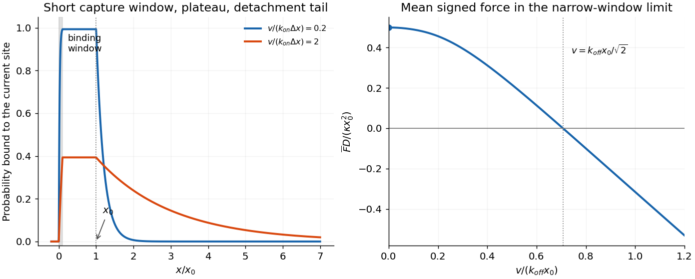

<h1 id="2/b/solution">Solution</h1>

↑ **Parent:** [B](../b.md)

In [spatially gated myosin attachment](../../../../spatially-gated-myosin-attachment.md), for a freshly available head encountering an isolated site, take $P=0$ before the attachment window. Converting time derivatives to position derivatives with $dx/dt=v$ gives $vP'=k_{on}(1-P)$ in the binding window, $P'=0$ in the protected bound region, and $vP'=-k_{off}P$ after detachment becomes allowed. Continuity gives

$$
\boxed{P(x)=\begin{cases}
0,&x<0,\\
1-e^{-k_{on}x/v},&0\le x\le\Delta x,\\
p_b,&\Delta x<x\le x_0,\\
p_b e^{-k_{off}(x-x_0)/v},&x>x_0,
\end{cases}\qquad p_b=1-e^{-k_{on}\Delta x/v}.}
$$

For $v<k_{on}\Delta x$, the plateau exceeds $1-e^{-1}$ and approaches one for much slower motion. For $v>k_{on}\Delta x$, the [binding probability](../../../../probability.md) is lower, becoming $k_{on}\Delta x/v$ at very high speed. The spatial detachment tail has length $v/k_{off}$, so faster [sliding](../../../../facilitated-target-search.md) makes a longer low-probability tail. The following is an original calculation of those profiles; the [force](../../../../force-split.md) panel is derived in [c](../c.md).

**[Figure 1](#2/b/image-spatial-attachment-probability-and-force-in-the-prescribed-velocity-myosin-model). Spatial attachment probability and force in the prescribed-velocity myosin model**. Original profiles compare velocities below and above the binding-window crossing-rate scale. Binding rises only inside the narrow window, remains constant up to the detachment threshold, and then decays. The second panel shows the resulting signed mean force in the narrow-window approximation.

**Reset condition.** Geometric separation $D\gg x_0$ does not alone guarantee detachment before the next site: independently available encounters also need $(D-x_0)k_{off}/v\gg1$. Without that extra timescale separation the head may still be attached to an earlier site.

For completeness, the periodic [steady-state](../../../../steady-state.md) correction can be written explicitly. Put $a=k_{on}/v$, $b=k_{off}/v$, $A_0=1-e^{-a\Delta x}$ and

$$
C=\frac a{a-b}(e^{-b\Delta x}-e^{-a\Delta x}),\qquad
Q_0=\frac{A_0e^{-b(D-x_0)}}{1-e^{-bD}+Ce^{-b(D-x_0)}}.
$$

Here $Q_0$ is the [probability](../../../../probability.md) of entering the new window still attached to an earlier site. In the window the new-site [probability](../../../../probability.md) is $P(x)=1-e^{-ax}-Q_0a(e^{-bx}-e^{-ax})/(a-b)$; after it, use its value $p_b=P(\Delta x)$ in the plateau and tail above. For $a=b$, replace $a(e^{-bx}-e^{-ax})/(a-b)$ by $ax e^{-ax}$. This follows from the old-site [probability](../../../../probability.md) $Q(x)=Q_0e^{-bx}$ and new attachment rate $a[1-P-Q]$. The isolated-site result is recovered as $Q_0\to0$.

## ↑ Ancestors (12)

1. [B](../b.md)
2. [2](../../2.md)
3. [2017](../../../2017-split.md)
4. [Past exam of the biological physics course of the University of Oxford](../../../split.md)
5. [Biological physics course of the University of Oxford](../../../../biological-physics-course-of-the-university-of-oxford.md)
6. [Year 4 of the physics course of the University of Oxford](../../../../year-4-of-the-physics-course-of-the-university-of-oxford.md)
7. [Physics course of the University of Oxford](../../../../physics-course-of-the-university-of-oxford.md)
8. [Undergraduate course of the University of Oxford](../../../../undergraduate-course-of-the-university-of-oxford.md)
9. [Course of the University of Oxford](../../../../course-of-the-university-of-oxford.md)
10. [University of Oxford](../../../../university-of-oxford-split.md)
11. [List of universities](../../../../list-of-universities.md)
12. [Codex Wiki](../../../../split.md)
