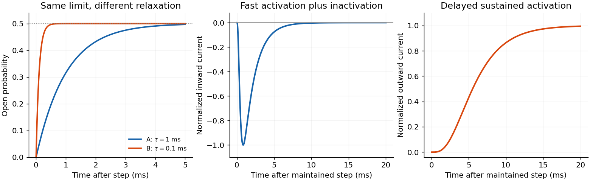

<h1 id="4/d/solution">Solution</h1>

↑ **Parent:** [D](../d.md)

At fixed [voltage](../../../../voltage.md) let $a$ and $b$ be opening and closing rates. The [open probability](../../../../two-state-ion-channel-gating.md) obeys

$$
\dot p=a(1-p)-bp,\qquad
\boxed{p_\infty=\frac a{a+b},\quad\tau=\frac1{a+b},\quad
p(t)=p_\infty+[p(0)-p_\infty]e^{-t/\tau}.}
$$

This illustrates [equal open probability with unequal ion-channel relaxation times](../../../../equal-open-probability-with-unequal-ion-channel-relaxation-times.md): both channels have $p_\infty=1/2$, but channel A has $\tau_A=1\,\mathrm{ms}$ and channel B has $\tau_B=0.1\,\mathrm{ms}$. Starting closed, $p_A(t)=\tfrac12(1-e^{-t/(1\,\mathrm{ms})})$ and $p_B(t)=\tfrac12(1-e^{-t/(0.1\,\mathrm{ms})})$. If channel number, unitary [conductance](../../../../electrical-conductance.md) and driving [force](../../../../force-split.md) agree, both have the same steady macroscopic current; B approaches it ten times faster.

An individual channel remains either open or closed. Its mean closed and open dwell times are $1/a$ and $1/b$, respectively: both are $2\,\mathrm{ms}$ in A and $0.2\,\mathrm{ms}$ in B. Thus identical [equilibrium open probability](../../../../two-state-ion-channel-gating.md) does not imply identical [kinetics](../../../../chemical-kinetics-split.md) or noise correlation time. Ensemble [probability](../../../../probability.md) relaxation depends on the sum of rates, while the mean dwell in a given state depends on its exit rate.

**[Figure 2](#4/d/image-equal-equilibrium-opening-probabilities-can-conceal-different-channel-kinetics). Equal equilibrium opening probabilities can conceal different channel kinetics**. Original calculations show the specified two-state rates giving relaxation times of one and one tenth of a millisecond. Separate illustrative activation-inactivation and delayed-activation curves explain transient inward sodium current and sustained outward potassium current; those illustrative curves are not fits to the source recordings.

## ↑ Ancestors (12)

1. [D](../d.md)
2. [4](../../4.md)
3. [2017](../../../2017-split.md)
4. [Past exam of the biological physics course of the University of Oxford](../../../split.md)
5. [Biological physics course of the University of Oxford](../../../../biological-physics-course-of-the-university-of-oxford.md)
6. [Year 4 of the physics course of the University of Oxford](../../../../year-4-of-the-physics-course-of-the-university-of-oxford.md)
7. [Physics course of the University of Oxford](../../../../physics-course-of-the-university-of-oxford.md)
8. [Undergraduate course of the University of Oxford](../../../../undergraduate-course-of-the-university-of-oxford.md)
9. [Course of the University of Oxford](../../../../course-of-the-university-of-oxford.md)
10. [University of Oxford](../../../../university-of-oxford-split.md)
11. [List of universities](../../../../list-of-universities.md)
12. [Codex Wiki](../../../../split.md)
