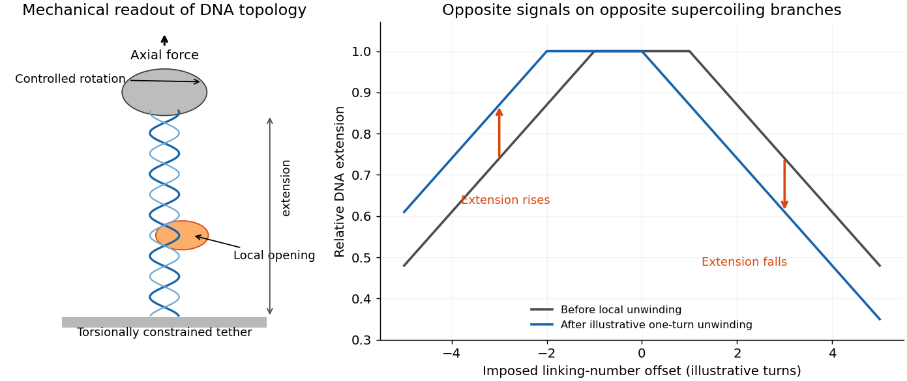

<h1 id="5/a/solution">Solution</h1>

↑ **Parent:** [A](../a.md)

At initiation, [RNA polymerase](../../../../rna-polymerase.md) recognizes a [promoter](../../../../promoter-genetics.md) and forms a closed bound complex; bacterial [promoter](../../../../promoter-genetics.md) recognition involves its specificity factor. Local strand opening exposes the template in an [open complex](../../../../open-promoter-complex.md), after which initial [RNA](../../../../ribonucleic-acid.md) synthesis can precede [promoter escape](../../../../promoter-escape.md) into elongation. Binding, opening and productive escape are distinct transitions.

For [DNA unwinding measured by magnetic tweezers](../../../../dna-unwinding-measured-by-magnetic-tweezers.md), [magnetic tweezers](../../../../magnetic-tweezers.md) report the mechanics of a torsionally constrained [DNA tether](../../../../deoxyribonucleic-acid.md) through the position of an attached magnetic bead. Axial magnetic [force](../../../../force-split.md) extends the tether, while imposed rotation controls its linking constraint. Video localization measures extension changes. The important physical relation is

$$
\boxed{Lk=Tw+Wr,\qquad \Delta Tw+\Delta Wr=0\quad\text{at fixed linking number}.}
$$

Opening a small helical region decreases twist, so the rest of the tether acquires compensating positive [writhe](../../../../writhe.md). On a negatively [supercoiled](../../../../dna-supercoiling.md) tether this removes some [writhe](../../../../writhe.md) magnitude and raises its extension; on a positively [supercoiled](../../../../dna-supercoiling.md) tether it increases [writhe](../../../../writhe.md) magnitude and lowers extension. A change with opposite signs under the two torsional conditions therefore distinguishes unwinding from simple compaction, which would shorten both tethers. Calibrating extension against imposed turns converts a mechanical step into a change in helical winding. This is a conceptual readout of local opening, rather than a direct optical image of separated bases.[2004 study, linking-number argument and opposite extension responses for positive and negative supercoiling](../../../../promoter-unwinding-and-promoter-clearance-by-rna-polymerase-detection-by-single-molecule-dna-nanomanipulation-by-andrey-revyakin-and-others.md)

**[Figure 3](#5/a/image-torsional-constraint-converts-local-dna-opening-into-a-bead-extension-signal). Torsional constraint converts local DNA opening into a bead-extension signal**. An original conceptual magnetic-tweezers schematic is paired with illustrative extension-versus-turns curves. Local unwinding shifts the curve and produces opposite extension changes on its negatively and positively supercoiled branches. The diagram does not reproduce the source experiment or specify a laboratory protocol.

## ↑ Ancestors (12)

1. [A](../a.md)
2. [5](../../5.md)
3. [2017](../../../2017-split.md)
4. [Past exam of the biological physics course of the University of Oxford](../../../split.md)
5. [Biological physics course of the University of Oxford](../../../../biological-physics-course-of-the-university-of-oxford.md)
6. [Year 4 of the physics course of the University of Oxford](../../../../year-4-of-the-physics-course-of-the-university-of-oxford.md)
7. [Physics course of the University of Oxford](../../../../physics-course-of-the-university-of-oxford.md)
8. [Undergraduate course of the University of Oxford](../../../../undergraduate-course-of-the-university-of-oxford.md)
9. [Course of the University of Oxford](../../../../course-of-the-university-of-oxford.md)
10. [University of Oxford](../../../../university-of-oxford-split.md)
11. [List of universities](../../../../list-of-universities.md)
12. [Codex Wiki](../../../../split.md)
