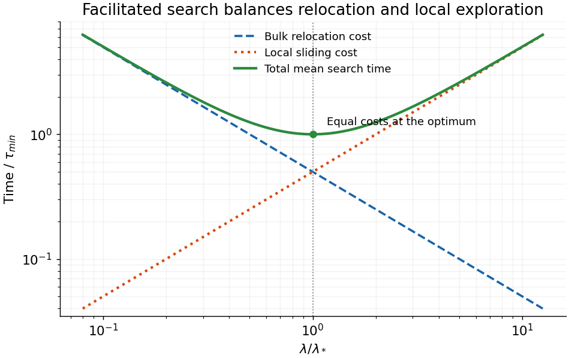

<h1 id="5/c/solution">Solution</h1>

↑ **Parent:** [C](../c.md)

Write $A=V/D_3$ and $B=L/D_1$. The given mean-search scaling is $\tau=A/\lambda+B\lambda$. Three-dimensional relocation sees an effective capture length of order $\lambda$, giving a bulk encounter time $V/(D_3\lambda)$. A [sliding](../../../../facilitated-target-search.md) excursion explores length of order $\lambda$ in time of order $\lambda^2/D_1$; sampling order $L/\lambda$ contour segments gives a total [sliding](../../../../facilitated-target-search.md) cost of order $L\lambda/D_1$. Prefactors, correlations and repeated visits are coarse-grained in this scaling model.

Small [sliding](../../../../facilitated-target-search.md) lengths make relocation inefficient; very long [sliding](../../../../facilitated-target-search.md) wastes time revisiting a local [DNA](../../../../deoxyribonucleic-acid.md) region rather than relocating to another. The optimum balances both contributions:

$$
\frac{d\tau}{d\lambda}=-\frac{V}{D_3\lambda^2}+\frac L{D_1}=0,
\qquad
\boxed{\lambda_* =\sqrt{\frac{VD_1}{LD_3}},\qquad
\tau_{\min}=2\sqrt{\frac{VL}{D_1D_3}}.}
$$

Since $d^2\tau/d\lambda^2=2V/(D_3\lambda^3)>0$, it is the unique minimum for unrestricted positive $\lambda$. At the optimum, bulk and [sliding](../../../../facilitated-target-search.md) times are equal. With $s=\lambda/\lambda_*$,

$$
\boxed{\tau/\tau_{\min}=\tfrac12(s^{-1}+s).}
$$

**[Figure 4](#5/c/image-bulk-relocation-and-local-sliding-impose-opposing-search-time-costs). Bulk relocation and local sliding impose opposing search-time costs**. The original dimensionless plot shows a decreasing inverse-sliding-length contribution and an increasing sliding contribution. Their sum has a minimum where the two costs agree, at a sliding length equal to the analytic optimum.

The model is meaningful only over an accessible range between molecular steps and the available chromosome length. An optimum outside that range is replaced by a boundary choice; the unphysical divergences at arbitrarily small or large $\lambda$ describe limits of the scaling expression. A common multiplicative searcher-number factor would not change the optimum, but an exact many-searcher first-arrival mean is not generally obtained by dividing an arbitrary single-searcher mean by their number without a waiting-time assumption.

## ↑ Ancestors (12)

1. [C](../c.md)
2. [5](../../5.md)
3. [2017](../../../2017-split.md)
4. [Past exam of the biological physics course of the University of Oxford](../../../split.md)
5. [Biological physics course of the University of Oxford](../../../../biological-physics-course-of-the-university-of-oxford.md)
6. [Year 4 of the physics course of the University of Oxford](../../../../year-4-of-the-physics-course-of-the-university-of-oxford.md)
7. [Physics course of the University of Oxford](../../../../physics-course-of-the-university-of-oxford.md)
8. [Undergraduate course of the University of Oxford](../../../../undergraduate-course-of-the-university-of-oxford.md)
9. [Course of the University of Oxford](../../../../course-of-the-university-of-oxford.md)
10. [University of Oxford](../../../../university-of-oxford-split.md)
11. [List of universities](../../../../list-of-universities.md)
12. [Codex Wiki](../../../../split.md)
