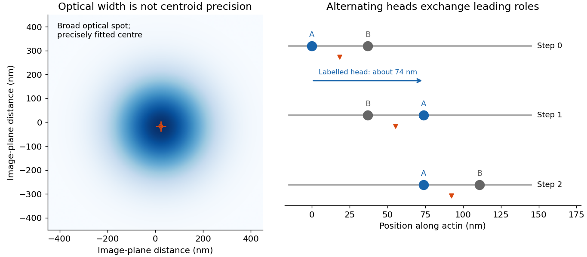

<h1 id="6/a/solution">Solution</h1>

↑ **Parent:** [A](../a.md)

A single [fluorophore](../../../../fluorophore.md) creates a diffraction-broadened [point-spread function](../../../../point-spread-function-split.md), but its centre can be fitted much more precisely than that function's width. With Gaussian width $s$ and $N_\gamma$ detected independent [photons](../../../../photon.md), the [shot-noise](../../../../photon-shot-noise.md) limit is $\sigma_{\rm loc}\simeq s/\sqrt{N_\gamma}$. Pixelation, background [photons](../../../../photon.md), dye orientation, motion blur, [drift](../../../../drift-velocity.md) and label-to-target geometry impose additional uncertainty and systematic error. [Localization precision](../../../../fluorescence-localization-precision.md) is therefore not identical to either optical resolution or position accuracy.[2002 localization analysis, photon-number scaling and effects of pixelation/background](../../../../precise-nanometer-localization-analysis-for-individual-fluorescent-probes-by-russell-e-thompson-and-others.md)

In myosin-V tracking, localizing a label on one head or its [lever arm](../../../../myosin-lever-arm.md) distinguishes the paths of individual motor parts from the average motion of the whole motor. A trailing head that becomes the leading head travels roughly twice the stalk advance: about $74\,\mathrm{nm}$ versus a roughly $37\,\mathrm{nm}$ motor stride. A near-head label can therefore alternate a large movement with a pause while the partner head advances. Other lever-arm label positions give unequal alternating steps whose sum is approximately twice the stride. Those patterns support hand-over-hand walking rather than a simple inchworm model in which the same head remains in front. The label geometry is needed when interpreting individual step sizes.[2003 study, labelled lever-arm step patterns and hand-over-hand versus inchworm discrimination](../../../../myosin-v-walks-hand-over-hand-single-fluorophore-imaging-with-1-5-nm-localization-by-ahmet-yildiz-and-others.md)

**[Figure 5](#6/a/image-a-fitted-diffraction-spot-can-locate-alternating-myosin-heads-beyond-its-optical-width). A fitted diffraction spot can locate alternating myosin heads beyond its optical width**. An original Gaussian spot illustrates the distinction between point-spread width and centre precision. A separate schematic shows a labelled head alternating a roughly 74-nanometre movement and a pause while the two-head motor advances in roughly 37-nanometre strides. It is a conceptual calculation, not copied tracking data.

[Super-resolution](../../../../super-resolution-microscopy.md) [localization microscopy](../../../../super-resolution-microscopy.md) extends the same principle to a map containing many molecules by separating otherwise overlapping emitters in time. Sparse activation, blinking or transient binding yields individually fitted positions, which are accumulated. Dense sampling, registration and labelling specificity determine the final structural resolution; merely taking more [photons](../../../../photon.md) from an unresolved simultaneous pair does not make it a single isolated emitter.

In [PAINT](../../../../point-accumulation-for-imaging-in-nanoscale-topography.md), [fluorescent](../../../../fluorescence-split.md) probes bind transiently so that separated binding events can be localized and accumulated. [DNA-PAINT](../../../../dna-paint.md) uses reversible complementary-strand recognition at docking sites on a [DNA](../../../../deoxyribonucleic-acid.md) nanostructure. The bound probe supplies a localized spot while freely diffusing probes contribute background; repeated visits build up a positional map, with replenishment rather than permanent reliance on one [fluorophore](../../../../fluorophore.md). This is an imaging principle, not a requirement for a particular target sequence or preparation protocol.[2010 primary report, transient DNA binding and accumulated localization imaging of DNA nanostructures](../../../../single-molecule-kinetics-and-super-resolution-microscopy-by-fluorescence-imaging-of-transient-binding-on-dna-origami-by-ralf-jungmann-and-others.md)

## ↑ Ancestors (12)

1. [A](../a.md)
2. [6](../../6.md)
3. [2017](../../../2017-split.md)
4. [Past exam of the biological physics course of the University of Oxford](../../../split.md)
5. [Biological physics course of the University of Oxford](../../../../biological-physics-course-of-the-university-of-oxford.md)
6. [Year 4 of the physics course of the University of Oxford](../../../../year-4-of-the-physics-course-of-the-university-of-oxford.md)
7. [Physics course of the University of Oxford](../../../../physics-course-of-the-university-of-oxford.md)
8. [Undergraduate course of the University of Oxford](../../../../undergraduate-course-of-the-university-of-oxford.md)
9. [Course of the University of Oxford](../../../../course-of-the-university-of-oxford.md)
10. [University of Oxford](../../../../university-of-oxford-split.md)
11. [List of universities](../../../../list-of-universities.md)
12. [Codex Wiki](../../../../split.md)
