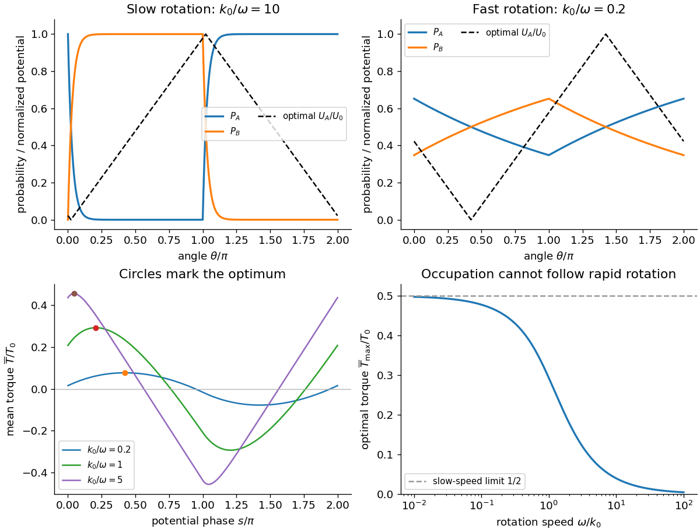
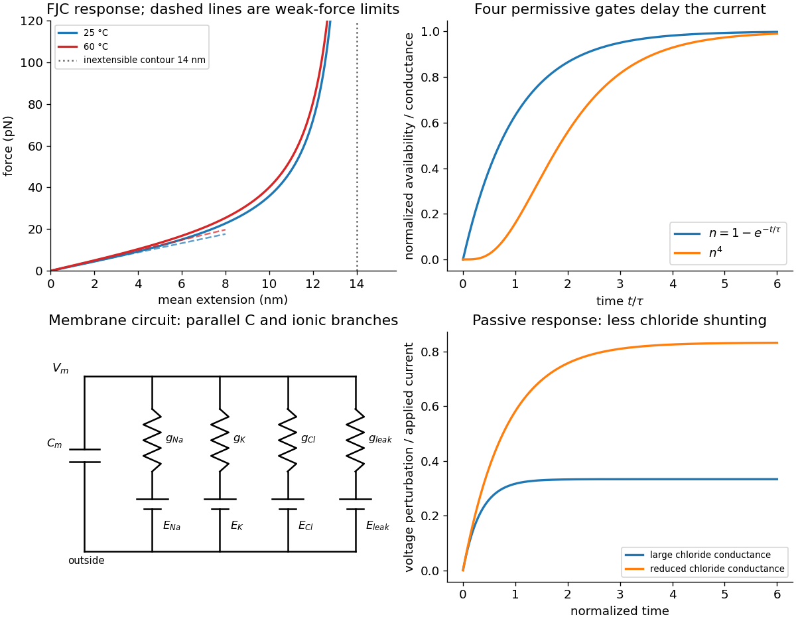
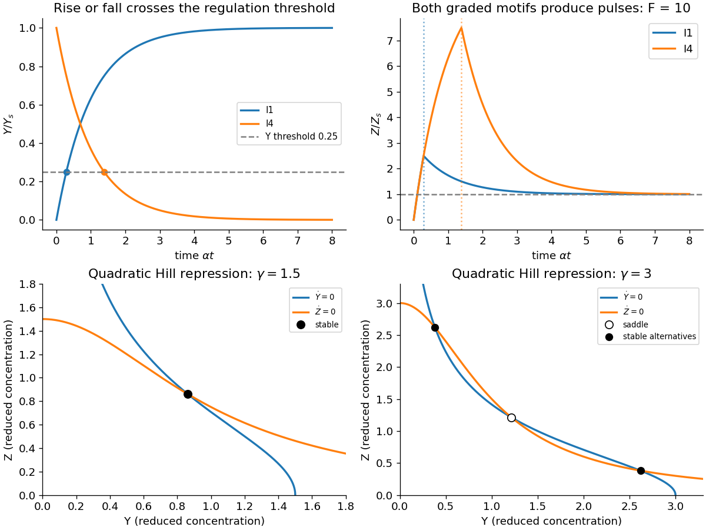
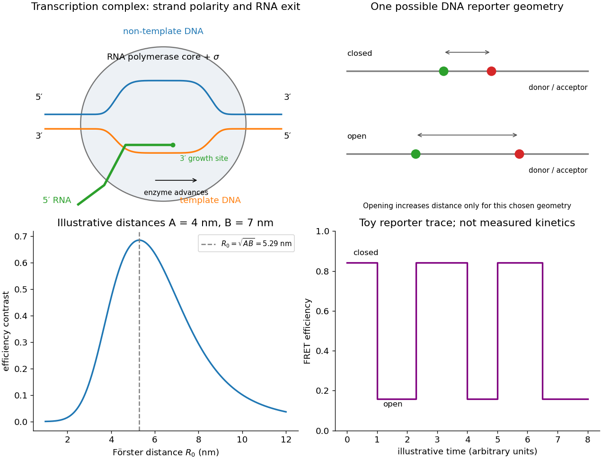

# 2018

↑ **Parent:** [Past exam of the biological physics course of the University of Oxford](../past-exam-of-the-biological-physics-course-of-the-university-of-oxford.md)

Source paper: [https://www.whatdotheyknow.com/request/oxford_physics_past_papers_2/response/2340696/attach/6/Physics%20Papers%202017.pdf?cookie_passthrough=1#page=66](https://www.whatdotheyknow.com/request/oxford_physics_past_papers_2/response/2340696/attach/6/Physics%20Papers%202017.pdf?cookie_passthrough=1#page=66)

**Table of contents**

- [1](#1)
  - [a](#1/a)
    - [Solution](#1/a/solution)
  - [b](#1/b)
    - [Solution](#1/b/solution)
- [2](#2)
  - [a](#2/a)
    - [Solution](#2/a/solution)
  - [b](#2/b)
    - [Solution](#2/b/solution)
  - [c](#2/c)
    - [Solution](#2/c/solution)
  - [d](#2/d)
    - [Solution](#2/d/solution)
  - [e](#2/e)
    - [Solution](#2/e/solution)
- [3](#3)
  - [a](#3/a)
    - [Solution](#3/a/solution)
  - [b](#3/b)
    - [Solution](#3/b/solution)
  - [c](#3/c)
    - [Solution](#3/c/solution)
  - [d](#3/d)
    - [Solution](#3/d/solution)
- [4](#4)
  - [a](#4/a)
    - [Solution](#4/a/solution)
  - [b](#4/b)
    - [Solution](#4/b/solution)
  - [c](#4/c)
    - [Solution](#4/c/solution)
  - [d](#4/d)
    - [Solution](#4/d/solution)
  - [e](#4/e)
    - [Solution](#4/e/solution)
- [5](#5)
  - [a](#5/a)
    - [Solution](#5/a/solution)
  - [b](#5/b)
    - [Solution](#5/b/solution)
  - [c](#5/c)
    - [Solution](#5/c/solution)
  - [d](#5/d)
    - [Solution](#5/d/solution)
- [6](#6)
  - [a](#6/a)
    - [Solution](#6/a/solution)
  - [b](#6/b)
    - [Solution](#6/b/solution)
  - [c](#6/c)
    - [Solution](#6/c/solution)

## 1

↑ **Parent:** [2018](2018.md)

<h3 id="1/a">a</h3>

↑ **Parent:** [1](#1)

<h4 id="1/a/solution">Solution</h4>

↑ **Parent:** [A](#1/a)

For the [driven two-state rotary motor](../cell-membrane.md#driven-two-state-rotary-motor), use positive [angular velocity](../rigid-body-dynamics.md#angular-velocity) $\omega>0$ and extend all angular functions with period $2\pi$. In the first half-turn the source figure has $k_{AB}=k_0$, $k_{BA}=0$, so the stationary equation is $\omega P_A'=-k_0P_A$. In the second half-turn the rates are interchanged, giving $\omega P_A'=k_0(1-P_A)$. Hence

$$
P_A(\theta)=\begin{cases}
\alpha e^{-\beta\theta},&0\le\theta\le\pi,\\
1-Ce^{-\beta(\theta-\pi)},&\pi\le\theta\le2\pi,
\end{cases}\qquad\beta=\frac{k_0}\omega.
$$

[Continuity](../calculus.md#continuous-function) at $\pi$ gives $1-C=\alpha e^{-\beta\pi}$, while [periodicity](../function.md#periodicity) gives $\alpha=1-Ce^{-\beta\pi}$. Solving the two linear conditions gives $C=\alpha$ and

$$
\boxed{\alpha=\frac1{1+e^{-\pi k_0/\omega}},\qquad
\beta=\frac{k_0}{\omega},\qquad
P_A(\theta+\pi)=1-P_A(\theta),\qquad P_B=1-P_A.}
$$

In particular $P_A(0)=P_A(2\pi)=\alpha$ and $P_A(\pi)=1-\alpha$, so the two pieces fill in the apparent endpoint gap in the printed piecewise formula. The [probability](../probability-theory.md#probability) decreases exponentially during the detachment half-cycle and rises exponentially during the attachment half-cycle; $P_B$ is its complement. Both remain between zero and one. They are state [probabilities](../probability-theory.md#probability) _conditional on rotor angle_, not separate angular densities normalized individually to one.

For $\omega\ll k_0$, attachment and detachment almost finish within their allotted half-turns: $P_A$ is nearly zero through most of $0<\theta<\pi$ and nearly one through most of $\pi<\theta<2\pi$, with angular [boundary layers](../continuum-mechanics.md#boundary-layer) of width $\omega/k_0$. For $\omega\gg k_0$, it stays near one half with a small nearly triangular modulation. The upper panels of the original figure in part (b) sketch both limits. At exactly zero speed the advective stationary problem is singular; these statements concern the positive-speed limit.

<h3 id="1/b">b</h3>

↑ **Parent:** [1](#1)

<h4 id="1/b/solution">Solution</h4>

↑ **Parent:** [B](#1/b)

The source potential rises from zero to $U_0$ over the half-turn from $s$ to $s+\pi$, then falls over the next half-turn. Its slopes are $\pm U_0/\pi$. [Torque](../momentum.md#torque) is minus the angular [derivative](../calculus.md#derivative) of potential; in the detached state $U_B$ is angle-independent and exerts no [torque](../momentum.md#torque). A uniform set of motor phases therefore gives

$$
\boxed{T_0=\frac{U_0}\pi,\qquad
\overline T(s)=\frac{T_0}{2\pi}
\left[-\int_s^{s+\pi}P_A(\theta)d\theta+
\int_{s+\pi}^{s+2\pi}P_A(\theta)d\theta\right].}
$$

Here $U_0$ is an [energy](../energy.md) and $T_0$ a [torque](../momentum.md#torque) because the angle is in radians. The average over a full turn divides by $2\pi$, rather than by the bound-state occupation alone.

Differentiating the moving integration limits and using [periodicity](../function.md#periodicity) gives

$$
\frac{d\overline T}{ds}=\frac{T_0}{\pi}[P_A(s)-P_A(s+\pi)]
=\frac{T_0}{\pi}[2P_A(s)-1].
$$

The [optimal phase of a two-state rotary motor](../cell-membrane.md#optimal-phase-of-a-two-state-rotary-motor) follows on $0<s<\pi$: $P_A$ decreases, so the stationary point is a maximum and satisfies

$$
\boxed{P_A(s_{\max})=P_A(s_{\max}+\pi)=\tfrac12,\qquad
s_{\max}=\frac1\beta\ln(2\alpha)
=\frac\pi2-\frac1\beta\ln\cosh\frac{\pi\beta}{2}.}
$$

The crossing displaced by $\pi$ is the corresponding minimum. For slow positive rotation, $s_{\max}\simeq(\omega/k_0)\ln2$ lies just after the detachment switch. The potential then rises mainly while the motor is detached and falls mainly while it is bound. For fast rotation, $s_{\max}\simeq\pi/2-\pi^2k_0/(8\omega)$, with only a small phase-dependent occupation available to produce [torque](../momentum.md#torque). The potential should still be shifted by this optimum, rather than aligned arbitrarily with a rate switch.

The half-turn symmetry gives $\int_s^{s+2\pi}P_A\,d\theta=\pi$. At the optimum, direct integration of the two exponential pieces gives $\int_s^{s+\pi}P_A\,d\theta=s_{\max}$. Thus a useful exact check is

$$
\boxed{\overline T_{\max}=\frac{T_0}{\pi\beta}\ln\cosh\frac{\pi\beta}{2}
\simeq\frac{T_0}{2}-\frac{T_0\ln2}{\pi\beta}\longrightarrow\frac{T_0}{2}
\quad(\omega\ll k_0).}
$$

For fast rotation, $\overline T_{\max}\simeq T_0\pi k_0/(8\omega)$ instead tends to zero. The original plots below show the calculated [probabilities](../probability-theory.md#probability) and optimized potential shapes. The imposed switching rates constitute driven kinetics: their strictly one-way windows are not [equilibrium](../dynamical-systems.md#equilibrium-point-of-a-dynamical-system) [detailed balance](../markov-chain.md#detailed-balance) at a fixed angle. Sustained work requires the motor's chemical/ion-gradient [energy](../energy.md) supply, not extraction of work from a passive single thermal bath.

**[Figure 1](#1/b/image-motor-occupation-optimal-angular-potential-phase-and-the-speed-dependence-of-available-torque). Motor occupation, optimal angular potential phase and the speed dependence of available torque**. Original solutions of the two-state advective motor model. Potential is normalized by $U_0$, torque by $T_0$, and the slow/fast profiles use illustrative values of $k_0/\omega$.

## 2

↑ **Parent:** [2018](2018.md)

<h3 id="2/a">a</h3>

↑ **Parent:** [2](#2)

<h4 id="2/a/solution">Solution</h4>

↑ **Parent:** [A](#2/a)

The [AFM](../engineering.md#atomic-force-microscopy) pulls a tethered molecule through its [cantilever](../elasticity-physics.md#cantilever). Deflection, multiplied by a calibrated [cantilever](../elasticity-physics.md#cantilever) [spring constant](../elasticity-physics.md#spring-constant), measures [force](../force.md); support motion must be corrected for that deflection and any linker compliance to obtain molecular extension. Initially folded structure can resist extension, then contacts break and more [polypeptide](../protein.md#polypeptide) [polymer contour length](../polymer.md#polymer-contour-length) becomes available. The readable trace rises with increasing extension, with fluctuations and a strongly rising large-extension part. It should not be interpreted as a direct image of individual [amino acids](../chemical-substance.md#amino-acid) or as establishing a unique microscopic unfolding pathway.

An ideal inextensible [freely jointed chain](../mathematical-biology.md#ideal-chain) with the stated segment count and length has

$$
\boxed{L_c=Nb=35(0.4\,\mathrm{nm})=14\,\mathrm{nm}.}
$$

Its mean extension is strictly below $14\,\mathrm{nm}$ at every finite [force](../force.md). Thus the quoted $15\,\mathrm{nm}$ maximum does not establish ideal [FJC](../mathematical-biology.md#ideal-chain) behaviour: if both numbers are taken literally, it exceeds the model's [polymer contour length](../polymer.md#polymer-contour-length) by about $7\%$. Finite segment stretch, inaccurate effective segment parameters, additional linkers or an extension-zero/calibration error can account for such a difference. If the numerical descriptions are approximate, the discrepancy may be within their uncertainty; even exact agreement with a [polymer contour length](../polymer.md#polymer-contour-length) would not prove freely jointed statistics. Low-[force](../force.md) fluctuations and the full [force](../force.md)–extension relation are separate tests.

<h3 id="2/b">b</h3>

↑ **Parent:** [2](#2)

<h4 id="2/b/solution">Solution</h4>

↑ **Parent:** [B](#2/b)

Let a segment of fixed length $b$ make angle $\theta$ with an applied [force](../force.md) $\mathbf f=f\hat{\mathbf z}$. Its [energy](../energy.md) contribution is $-fb\cos\theta$. Independent freely jointed orientations give the single-segment [partition function](../canonical-ensemble.md#canonical-partition-function) and chain [partition function](../canonical-ensemble.md#canonical-partition-function)

$$
Z_1=\int e^{u\cos\theta}d\Omega=4\pi\frac{\sinh u}{u},\qquad
u=\frac{fb}{k_BT},\qquad Z_N=Z_1^N.
$$

The mean end-to-end projection is the [force](../force.md) [derivative](../calculus.md#derivative) of $k_BT\ln Z_N$:

$$
\langle R_z\rangle=Nb\left(\coth u-\frac1u\right).
$$

For $|u|\ll1$, the [Langevin function](../mathematical-biology.md#langevin-function) is $u/3+O(u^3)$. [Isotropy](../continuum-mechanics.md#isotropy) therefore gives the vector response

$$
\boxed{\langle\mathbf R\rangle=\frac{Nb^2}{3k_BT}\mathbf f+O(f^3),\qquad
\mathbf f=\frac{3k_BT}{Nb^2}\langle\mathbf R\rangle\quad\text{to linear order}.}
$$

The [covariance](../variance.md#covariance) at zero [force](../force.md) provides an independent route: $\langle R_iR_j\rangle_0=Nb^2\delta_{ij}/3$, and the [Boltzmann weight](../canonical-ensemble.md#boltzmann-factor)'s first-order term yields $\langle R_i\rangle=f_j\langle R_iR_j\rangle_0/(k_BT)$. This is a relation for the [mean vector](../random-variable.md#mean-vector) or its projection. The zero-[force](../force.md) [mean vector](../random-variable.md#mean-vector) vanishes even though the chain has finite [root mean square](../analysis.md#root-mean-square) size $b\sqrt N$.

The controlled weak-[force](../force.md) condition is $fb\ll k_BT$, not merely that a short part of a measured curve looks straight. With the supplied $b$, $k_BT/b\simeq10.3\,\mathrm{pN}$ at $25^\circ\mathrm C$. A raw [force](../force.md) near $30\,\mathrm{pN}$, as in the figure's labelled low-extension portion, would give $u\simeq2.9$ and is not asymptotically weak for those literal segment parameters. A [force](../force.md) offset or different effective model might change that interpretation, but no such correction should be invented from the plot.

<h3 id="2/c">c</h3>

↑ **Parent:** [2](#2)

<h4 id="2/c/solution">Solution</h4>

↑ **Parent:** [C](#2/c)

The coefficient in the linear [force](../force.md) law is

$$
\boxed{k_{\rm chain}=\frac{3k_BT}{Nb^2}
=2.205\times10^{-3}\,\mathrm{N\,m^{-1}}
=2.205\,\mathrm{pN\,nm^{-1}}\quad(T=298.15\,\mathrm K).}
$$

Stretching suppresses the many disordered orientations available to the chain. The [Gaussian chain](../mathematical-biology.md#gaussian-chain) [free energy](../thermodynamic-potential.md#thermodynamic-free-energy) cost $\Delta\mathcal F\simeq3k_BTR^2/(2Nb^2)$ has gradient equal to this restoring [force](../force.md). This is [entropic elasticity](../mathematical-biology.md#entropic-elasticity); individual [covalent bonds](../covalent-bond.md) need not stretch to produce the weak-[force](../force.md) spring.

At moderate [force](../force.md), even an ideal [FJC](../mathematical-biology.md#ideal-chain) becomes nonlinear as its orientations align, so failure of a _linear_ fit alone need not imply nonideal chemistry. But failure of the full [FJC](../mathematical-biology.md#ideal-chain) curve can reflect backbone [spring constant](../elasticity-physics.md#spring-constant) and correlated segment angles, nonuniform effective links, remaining folded contacts, [force](../force.md)-induced conformational changes, energetic bond compliance, or tether/calibration effects. An extensible [FJC](../mathematical-biology.md#ideal-chain) or an appropriate semiflexible model includes some of these effects; their parameters require independent justification. The stated inextensible $14\,\mathrm{nm}$ [polymer contour length](../polymer.md#polymer-contour-length) already excludes a literal $15\,\mathrm{nm}$ extension.

The first panel of the original model figure below shows the full orientational response and weak-[force](../force.md) tangents without tracing the experimental data.

**[Figure 2](#2/c/image-entropic-chain-elasticity-permissive-potassium-gating-and-chloride-dependent-membrane-shunting). Entropic chain elasticity, permissive potassium gating and chloride-dependent membrane shunting**. Original model calculations and equivalent-circuit schematic. The chain uses the printed segment parameters; the gating and passive voltage examples are normalized illustrative responses, not numerical fits to the source experiment.

<h3 id="2/d">d</h3>

↑ **Parent:** [2](#2)

<h4 id="2/d/solution">Solution</h4>

↑ **Parent:** [D](#2/d)

If the ideal-chain segment count and segment length remain fixed, the [entropic spring](../mathematical-biology.md#entropic-spring) constant is proportional to absolute [temperature](../temperature.md). Therefore

$$
\boxed{k(60^\circ\mathrm C)=k(25^\circ\mathrm C)\frac{333.15}{298.15}
\simeq2.464\times10^{-3}\,\mathrm{N\,m^{-1}}
=2.464\,\mathrm{pN\,nm^{-1}}.}
$$

This is an increase by about $11.7\%$. The factor $k_BT$ multiplies the [free energy](../thermodynamic-potential.md#thermodynamic-free-energy) penalty for the loss of chain configurations; a larger [force](../force.md) is required to impose the same normalized weak extension at higher [temperature](../temperature.md).

Not degrading does not guarantee that a real [protein](../protein.md)'s folded state, effective [spring constant](../elasticity-physics.md#spring-constant) or [solvent](../mixture.md#solvent) interactions remain unchanged. Thermal unfolding and changes in [persistence length](../mathematical-biology.md#persistence-length) can occur without covalent degradation. Those changes modify the experimental curve and may invalidate a fixed-$N,b$ comparison. The boxed value is the explicit ideal-[FJC](../mathematical-biology.md#ideal-chain) prediction under fixed segment geometry, not an unconditional thermal-[stability](../numerical-analysis.md#stability-of-a-numerical-method) prediction for the [protein](../protein.md).

<h3 id="2/e">e</h3>

↑ **Parent:** [2](#2)

<h4 id="2/e/solution">Solution</h4>

↑ **Parent:** [E](#2/e)

On releasing the tensile load, the extended chain first retracts towards less aligned conformations because they have much greater configurational multiplicity. Viscous [friction](../newtonian-mechanics.md#friction) and internal relaxation determine the time course; stored [free energy](../thermodynamic-potential.md#thermodynamic-free-energy) is dissipated as [heat](../heat.md). An unconstrained [ideal chain](../mathematical-biology.md#ideal-chain) does not shrink to a point: its [mean vector](../random-variable.md#mean-vector) is zero but its [root mean square](../analysis.md#root-mean-square) end-to-end length is $b\sqrt N\simeq2.37\,\mathrm{nm}$ for the supplied ideal-chain parameters.

A real [polypeptide](../protein.md#polypeptide) also has sequence-dependent interactions. If the original native structure is the stable state in the prevailing [solvent](../mixture.md#solvent) and the molecule remains intact and capable of folding, it can subsequently refold, gaining favourable intramolecular and [solvent](../mixture.md#solvent) [free energy](../thermodynamic-potential.md#thermodynamic-free-energy). The folded state is not selected by chain [entropy](../entropy.md) alone, and formation of native contacts need not be instantaneous. Kinetic traps, [proline](../chemical-substance.md#proline) [isomerization](../chemical-reaction.md#isomerization), [protein aggregation](../protein.md#protein-aggregation), misfolding, surface attachments or chemical damage may prevent complete recovery or produce [hysteresis](../critical-phenomenon.md#hysteresis). Thus reversible refolding is a physically motivated possibility, not guaranteed simply by removal of [force](../force.md). This distinction connects the recoil of a stretched polymer to the thermodynamics discussed in Question 6(c).

## 3

↑ **Parent:** [2018](2018.md)

<h3 id="3/a">a</h3>

↑ **Parent:** [3](#3)

<h4 id="3/a/solution">Solution</h4>

↑ **Parent:** [A](#3/a)

Represent one permissive [voltage-gated potassium channel](../membrane-potential.md#voltage-gated-potassium-channel) gate by an available closed state and an activated state, with voltage-dependent [transition rates](../survival-analysis.md#transition-intensity) $\alpha_n(V)$ and $\beta_n(V)$. Gain minus loss gives

$$
\frac{dn}{dt}=\alpha_n(1-n)-\beta_nn
=(\alpha_n+\beta_n)(n_\infty-n),
\quad n_\infty=\frac{\alpha_n}{\alpha_n+\beta_n},\quad
\tau_n=\frac1{\alpha_n+\beta_n}.
$$

During a [voltage clamp](../neuroscience.md#voltage-clamp) step the imposed voltage and hence these rates are constant. Integration with $n(0)=n_0$ gives

$$
\boxed{n(t)=n_\infty-(n_\infty-n_0)e^{-t/\tau_n}.}
$$

The fourth power in the [electrical conductance](../electric-charge.md#electrical-conductance) describes four permissive activation variables in the [Hodgkin-Huxley model](../neuroscience.md#hodgkin-huxley-model) phenomenology. If all must be permissive and are statistically independent, their joint [probability](../probability-theory.md#probability) is $n^4$. Even a simple exponential rise in $n$ then gives a delayed-looking macroscopic [potassium](../chemical-substance.md#potassium) [electric current](../electric-charge.md#electric-current). The second panel of the model figure in [solution](#2/c/solution) illustrates this. A continuously changing voltage makes the rates time dependent and requires solving the differential equation along that voltage trajectory; one fixed exponential is not the general action-potential solution.

<h3 id="3/b">b</h3>

↑ **Parent:** [3](#3)

<h4 id="3/b/solution">Solution</h4>

↑ **Parent:** [B](#3/b)

**[selective permeability](../cell-membrane.md#selective-permeability)** sets the driving-[force](../force.md) term. [Potassium](../chemical-substance.md#potassium) and [sodium](../chemical-substance.md#sodium) channels provide narrow coordinating pathways whose [free energy](../thermodynamic-potential.md#thermodynamic-free-energy) balance of hydration and chemical binding favours the appropriate ion. [voltage-gated potassium channel](../membrane-potential.md#voltage-gated-potassium-channel) carbonyl coordination differs from the charged filter environment in canonical [sodium](../chemical-substance.md#sodium) channels, so selective permeation is not a pore-size ranking. Ion substitution shifts the [reversal potential](../membrane-potential.md#reversal-potential), and selective blockers or filter mutations alter the corresponding [electric current](../electric-charge.md#electric-current). An open channel conducts down the [electrochemical gradient](../chemical-potential.md#electrochemical-gradient); [ATP](../molecule.md#adenosine-triphosphate)-driven pumps maintain the gradients rather than pushing each ion through the pore.

**Voltage-dependent activation** sets channel availability. Charged residues in the S4-containing [voltage-sensing domains](../membrane-potential.md#voltage-sensing-domain) move in the membrane [electric field](../electric-field.md) and couple to pore opening. A classical [voltage-gated potassium channel](../membrane-potential.md#voltage-gated-potassium-channel) is a tetramer; a [voltage-gated sodium channel](../membrane-potential.md#voltage-gated-sodium-channel) pore-forming [polypeptide](../protein.md#polypeptide) has four homologous domains. [ion-channel gating current](../membrane-potential.md#ion-channel-gating-current) measurements and sensor-residue mutations connect [electric charge](../electric-charge.md) motion to opening, while structures separate the sensor from the permeation pathway. The historical $n^4$ and $m^3$ variables describe kinetics phenomenologically and need not map one-to-one onto individual resolved structural movements.[Sensor perturbations and measured gating charge](../biochemistry-and-biophysics-bibliography.md#voltage-sensing-residues-in-the-s2-and-s4-segments-of-the-shaker-k-plus-channel-by-s-a-seoh-and-others)[Voltage-sensor and pore architecture](../biochemistry-and-biophysics-bibliography.md#crystal-structure-of-a-mammalian-voltage-dependent-shaker-family-k-plus-channel-by-stephen-b-long-and-others)

**Time dependence, especially [ion-channel inactivation](../membrane-potential.md#ion-channel-inactivation)**, explains the different [electric current](../electric-charge.md#electric-current) waveforms. [Sodium](../chemical-substance.md#sodium) activation is rapid, but sustained [depolarization](../membrane-potential.md#depolarization) reduces the availability variable $h$, so the [sodium](../chemical-substance.md#sodium) [electric current](../electric-charge.md#electric-current) decays despite maintained driving voltage. Fast [sodium](../chemical-substance.md#sodium) [ion-channel inactivation](../membrane-potential.md#ion-channel-inactivation) involves intracellular machinery including the interdomain III–IV region. [Potassium](../chemical-substance.md#potassium) activation is slower, supplying delayed outward [electric current](../electric-charge.md#electric-current); the classical delayed rectifier is relatively sustained on this time scale. Some [voltage-gated potassium channel](../membrane-potential.md#voltage-gated-potassium-channel) variants do show rapid N-terminal pore-blocking [ion-channel inactivation](../membrane-potential.md#ion-channel-inactivation) or slower filter-associated [ion-channel inactivation](../membrane-potential.md#ion-channel-inactivation), which should not be assumed identical to [sodium](../chemical-substance.md#sodium)'s mechanism. [voltage clamp](../neuroscience.md#voltage-clamp) steps separate activation from decay; recovery protocols, single-channel recordings and targeted perturbations distinguish gating, [ion-channel inactivation](../membrane-potential.md#ion-channel-inactivation) and ion conduction. Removal of the Shaker N-terminal blocker and restoration by a free peptide are particularly direct evidence for one [voltage-gated potassium channel](../membrane-potential.md#voltage-gated-potassium-channel) mechanism.[N-terminal perturbations separate rapid inactivation from activation](../biochemistry-and-biophysics-bibliography.md#biophysical-and-molecular-mechanisms-of-shaker-potassium-channel-inactivation-by-toshinori-hoshi-and-others)[Cytoplasmic peptide restores the missing blocking process](../biochemistry-and-biophysics-bibliography.md#restoration-of-inactivation-in-mutants-of-shaker-potassium-channels-by-a-peptide-derived-from-shb-by-william-n-zagotta-and-others)

Together these properties produce $n^4\bar g_K(V-E_K)$ and $m^3h\bar g_{Na}(V-E_{Na})$: selectivity fixes [reversal potential](../membrane-potential.md#reversal-potential), maximal [electrical conductance](../electric-charge.md#electrical-conductance) fixes scale, and activation/inactivation variables supply voltage- and history-dependent open [probability](../probability-theory.md#probability).

<h3 id="3/c">c</h3>

↑ **Parent:** [3](#3)

<h4 id="3/c/solution">Solution</h4>

↑ **Parent:** [C](#3/c)

Including both end faces of the perfect cylinder, with $r=1\,\mu\mathrm m$ and $\ell=100\,\mu\mathrm m$,

$$
\mathcal A=2\pi r\ell+2\pi r^2=6.346\times10^{-10}\,\mathrm{m^2},\qquad
\mathcal V=\pi r^2\ell=3.142\times10^{-16}\,\mathrm{m^3}
=3.142\times10^{-13}\,\mathrm L.
$$

The [membrane capacitance](../neuroscience.md#membrane-capacitance) is $C=0.01\mathcal A=6.346\times10^{-12}\,\mathrm F$. The required net inward [electric charge](../electric-charge.md) is $Q=C\Delta V=5.394\times10^{-13}\,\mathrm C$, or $Q/e\simeq3.37\times10^6$ monovalent ions. If [sodium](../chemical-substance.md#sodium) supplies that net [electric charge](../electric-charge.md), [Faraday constant](../physics.md#faraday-constant) $F=N_Ae$ gives

$$
\boxed{\Delta[\mathrm{Na}^+]=\frac{C\Delta V}{F\mathcal V}
=1.780\times10^{-5}\,\mathrm{mol\,L^{-1}}
=0.0178\,\mathrm{mM}=17.8\,\mu\mathrm M.}
$$

The final [concentration](../mathematical-physics.md#concentration) is about $15.0178\,\mathrm{mM}$, only $0.119\%$ above the starting value. Neglecting the end faces changes the estimate by $1\%$, giving about $17.6\,\mu\mathrm M$. Over $2\,\mathrm{ms}$ the capacitive [electric charge](../electric-charge.md) corresponds to mean net [electric current](../electric-charge.md#electric-current) $Q/\Delta t\simeq0.270\,\mathrm{nA}$; the duration does not otherwise enter the total [electric charge](../electric-charge.md).

This is a net capacitive estimate, not a measurement of total [sodium](../chemical-substance.md#sodium) influx. Simultaneous outward [potassium](../chemical-substance.md#potassium) [electric current](../electric-charge.md#electric-current) makes actual [sodium](../chemical-substance.md#sodium) entry larger, and most bulk ions remain near their original [concentrations](../mathematical-physics.md#concentration) during one spike. Long-term pumps restore gradients after repeated firing; they are not required to replace the entire intracellular [sodium](../chemical-substance.md#sodium) pool during the two-millisecond voltage rise.

<h3 id="3/d">d</h3>

↑ **Parent:** [3](#3)

<h4 id="3/d/solution">Solution</h4>

↑ **Parent:** [D](#3/d)

The equivalent circuit has [membrane capacitance](../neuroscience.md#membrane-capacitance) in parallel with [electrical conductance](../electric-charge.md#electrical-conductance)–battery branches: voltage-dependent [sodium](../chemical-substance.md#sodium) and [potassium](../chemical-substance.md#potassium) conductances in series with their [reversal potentials](../membrane-potential.md#reversal-potential), a [chloride](../chemistry.md#chloride) [electrical conductance](../electric-charge.md#electrical-conductance) in series with $E_{Cl}$, and other leak conductances. For externally supplied [electric current](../electric-charge.md#electric-current),

$$
C_m\dot V=I_{\rm ext}-g_{Na}(V,t)(V-E_{Na})-g_K(V,t)(V-E_K)
-g_{Cl}(V-E_{Cl})-g_L(V-E_L).
$$

The model figure in [solution](#2/c/solution) includes this circuit and an illustrative passive response. Although [chloride](../chemistry.md#chloride) [electric current](../electric-charge.md#electric-current) is small when $V\simeq E_{Cl}$, a perturbation produces the restoring [electric current](../electric-charge.md#electric-current) $\delta I_{Cl}=g_{Cl}\delta V$. A large [chloride](../chemistry.md#chloride) [electrical conductance](../electric-charge.md#electrical-conductance) therefore shunts perturbations, lowers input resistance and shortens the passive [time constant](../analysis.md#time-constant), $R_{\rm in}\simeq1/\sum g_j$ and $\tau_m\simeq C_m/\sum g_j$.

Reducing that [electrical conductance](../electric-charge.md#electrical-conductance) increases the voltage response to a given [electric current](../electric-charge.md#electric-current) or extracellular-[potassium](../chemical-substance.md#potassium) disturbance and weakens stabilization near rest, making repeated excitation easier. There need not be an instantaneous shift of resting voltage if $E_{Cl}$ equals the old rest exactly. In skeletal muscle, loss of ClC-1-mediated stabilization is associated with myotonic hyperexcitability.[Channel defects associated with inherited muscle hyperexcitability](../biochemistry-and-biophysics-bibliography.md#the-skeletal-muscle-chloride-channel-in-dominant-and-recessive-human-myotonia-by-manuela-c-koch-and-others)

Later cessation of contraction can be explained by sustained [depolarization](../membrane-potential.md#depolarization) causing [voltage-gated sodium channel](../membrane-potential.md#voltage-gated-sodium-channel) [ion-channel inactivation](../membrane-potential.md#ion-channel-inactivation) and failure to recover: fewer available channels support progressively smaller or less frequent spikes until [depolarization](../membrane-potential.md#depolarization) block occurs. Accumulated extracellular [potassium](../chemical-substance.md#potassium) in restricted spaces and incomplete recovery between spikes can promote that [depolarization](../membrane-potential.md#depolarization). This requires the nonlinear voltage-gating dynamics; a passive [chloride](../chemistry.md#chloride) resistor and capacitor alone cannot generate or terminate an action-potential train. The stated [membrane permeability](../cell-membrane.md#membrane-permeability) change does not uniquely determine the time to block or prove one particular ionic accumulation history.

## 4

↑ **Parent:** [2018](2018.md)

<h3 id="4/a">a</h3>

↑ **Parent:** [4](#4)

<h4 id="4/a/solution">Solution</h4>

↑ **Parent:** [A](#4/a)

Use the source's explicit graded production rules. X is already present at a constant [concentration](../mathematical-physics.md#concentration); the input at zero activates it rather than starting accumulation of X. Assume its active level exceeds both relevant X thresholds, put $\alpha_x=\alpha_y=\alpha_z=\alpha$, let $Y_s=\beta_y/\alpha$, and take $0<h=K_{yz}/Y_s<1$. Before the input Z is not produced, so use the initial steady value $Z(0)=0$.

For [I1 incoherent feed-forward loop](../mathematical-biology.md#i1-incoherent-feed-forward-loop), activation of X starts Y production; for [I4 incoherent feed-forward loop](../mathematical-biology.md#i4-incoherent-feed-forward-loop) it stops Y production. Consequently

$$
\boxed{Y_1(t)=Y_s(1-e^{-\alpha t}),\quad d_1=-\alpha^{-1}\ln(1-h);\qquad
Y_4(t)=Y_se^{-\alpha t},\quad d_4=-\alpha^{-1}\ln h.}
$$

The two delays are the times for Y to cross its output-regulation threshold. In [I1 incoherent feed-forward loop](../mathematical-biology.md#i1-incoherent-feed-forward-loop), initially absent Y permits the high output rate, then accumulated Y represses it. In [I4 incoherent feed-forward loop](../mathematical-biology.md#i4-incoherent-feed-forward-loop), initially abundant Y activates the high output rate, then Y's decay removes that activation. Thus _both_ have production $\beta_{\rm high}$ before their respective delay and $\beta_{\rm low}$ afterwards.

With $Z_s=\beta_{\rm low}/\alpha$ and $F=\beta_{\rm high}/\beta_{\rm low}$, their common piecewise response, with $d=d_1$ or $d_4$, is

$$
\boxed{\frac{Z(t)}{Z_s}=\begin{cases}
F(1-e^{-\alpha t}),&0\le t\le d,\\
1+\left[F(1-e^{-\alpha d})-1\right]e^{-\alpha(t-d)},&t\ge d.
\end{cases}}
$$

The output is continuous at the production switch. There is an overshoot precisely when $F(1-e^{-\alpha d})>1$; otherwise it rises monotonically to $Z_s$. For a threshold not extremely close to its limiting values and the supplied $F\gg1$, a rapid pulse followed by relaxation to a lower nonzero level is expected. This can provide fast initial response or a transient strong signal, but it is not perfect adaptation to the original zero output.

The original plots below use the illustrative values $h=1/4$ and $F=10$. At $h=1/2$ the two Y curves are complementary and their output delays and Z curves are identical. These threshold values are examples, not extra source data. “AND” here must be read with the stipulated graded rates: replacing them by an ordinary all-or-nothing AND rule would give a different response.

**[Figure 3](#4/a/image-graded-incoherent-feed-forward-pulses-and-the-change-from-one-to-two-attracting-toggle-states). Graded incoherent feed-forward pulses and the change from one to two attracting toggle states**. Original model trajectories and nullclines. Pulse panels use illustrative $h=1/4$, $F=10$ and dimensionless time $\alpha t$; switch panels use $n=2$ with the explicitly labelled reduced production strengths.

<h3 id="4/b">b</h3>

↑ **Parent:** [4](#4)

<h4 id="4/b/solution">Solution</h4>

↑ **Parent:** [B](#4/b)

For the final low steady value $Z_s=\beta_{\rm low}/\alpha$, the first crossing of $Z_s/2$ occurs during high production if $F(1-e^{-\alpha d})\ge1/2$. Solving $F(1-e^{-\alpha t_{1/2}})=1/2$ then gives, for either motif,

$$
\boxed{t_{1/2}=\frac1\alpha\ln\frac{2F}{2F-1}
\simeq\frac1{2\alpha F}\quad(F\gg1).}
$$

This [half-final response of a graded incoherent feed-forward loop](../mathematical-biology.md#half-final-response-of-a-graded-incoherent-feed-forward-loop) is a first-crossing measure. A simple output produced at the final low rate from zero would instead take $(\ln2)/\alpha$. This comparison explains the acceleration of the first half-final response, not the time needed to settle after a potentially large overshoot.

The condition matters because the source does not fix $K_{yz}/Y_s$. Define $\delta=1-e^{-\alpha d}$, equal to $h$ for [I1 incoherent feed-forward loop](../mathematical-biology.md#i1-incoherent-feed-forward-loop) and $1-h$ for [I4 incoherent feed-forward loop](../mathematical-biology.md#i4-incoherent-feed-forward-loop). If the high phase ends before half-final output is reached, solve the second branch of part (a) instead:

$$
\boxed{t_{1/2}=\begin{cases}
\alpha^{-1}\ln[2F/(2F-1)],&F\delta\ge1/2,\\
d+\alpha^{-1}\ln[2(1-F\delta)],&F\delta<1/2.
\end{cases}}
$$

The expressions agree at the boundary. The $F$-only answer is therefore valid for both motifs when $F\min(h,1-h)\ge1/2$, as holds for large F and a fixed interior threshold. Merely saying $F\gg1$ does not cover a threshold that approaches zero or one even faster. If the Y threshold is never crossed, the assumed final low state itself changes and one must reconsider the [steady state](../dynamical-systems.md#steady-state) before using this response-time definition.

<h3 id="4/c">c</h3>

↑ **Parent:** [4](#4)

<h4 id="4/c/solution">Solution</h4>

↑ **Parent:** [C](#4/c)

At the final [steady state](../dynamical-systems.md#steady-state), the [ligands](../protein.md#ligand-biochemistry) control activity as well as the amount of each factor. Assuming active X exceeds its thresholds and the high Y level exceeds $K_{yz}$, the normalized output production rates are

$$
\boxed{\begin{array}{cc|cc}
S_x&S_y&\text{I1 output rate}&\text{I4 output rate}\\
0&0&0&0\\
0&1&0&0\\
1&0&\beta_{\rm high}&\beta_{\rm low}\\
1&1&\beta_{\rm low}&\beta_{\rm low}
\end{array}}
$$

For [I1 incoherent feed-forward loop](../mathematical-biology.md#i1-incoherent-feed-forward-loop), active X makes Y abundant, but Y can repress Z only if its own activating [ligand](../protein.md#ligand-biochemistry) is present. Without $S_y$, Y is inactive and the output remains high. For [I4 incoherent feed-forward loop](../mathematical-biology.md#i4-incoherent-feed-forward-loop), active X represses Y to below its threshold, so the output is low regardless of $S_y$. If X is inactive, the direct permissive arm is absent and both outputs are zero even when Y is active.

Thus [I1 incoherent feed-forward loop](../mathematical-biology.md#i1-incoherent-feed-forward-loop) can retain two-input combinatorial control at [steady state](../dynamical-systems.md#steady-state) as well as generate the transient in part (a). [I4 incoherent feed-forward loop](../mathematical-biology.md#i4-incoherent-feed-forward-loop) loses steady-state sensitivity to $S_y$ once X has suppressed Y, under these particular assumptions. That gives a functional reason the first motif may be more useful in many regulatory contexts. It is not a proof of an evolutionary frequency: [promoter](../molecular-genetics.md#promoter-genetics) implementation, thresholds, noise, costs and other functions also influence how common a motif is. The argument follows the supplied rate table, including its nonzero $\beta_{\rm low}$, rather than a generic Boolean AND truth table.

<h3 id="4/d">d</h3>

↑ **Parent:** [4](#4)

<h4 id="4/d/solution">Solution</h4>

↑ **Parent:** [D](#4/d)

Use Y and Z as the variables appearing in the equations; the introductory reference to X and Y is a naming mismatch. With $\gamma>0$, $n>0$, a symmetric [equilibrium](../dynamical-systems.md#equilibrium-point-of-a-dynamical-system) has $Y=Z=x$ and

$$
\boxed{x(1+x^n)=\gamma.}
$$

The left side increases continuously from zero to infinity because its [derivative](../calculus.md#derivative) is $1+(n+1)x^n>0$. Thus there is exactly one positive symmetric solution for every allowed parameter pair, which verifies the implicit steady-state expression.

For $\gamma\gg1$ and $n\gg1$, look for one high component and one low component. If $Y\sim\gamma$, the other equation gives $Z=\gamma/(1+Y^n)\sim\gamma^{1-n}\ll1$; that small value in turn gives $Y=\gamma/(1+Z^n)\sim\gamma$. Exchanging the components gives the alternative state:

$$
\boxed{(Y,Z)\sim(\gamma,\gamma^{1-n})
\quad\text{and}\quad(\gamma^{1-n},\gamma).}
$$

For example the relative correction to the high value is of order $\gamma^{-n(n-1)}$, while the low value first has the ordinary denominator correction of relative order $\gamma^{-n}$. The sharply repressive [Hill function](../protein.md#hill-function) is therefore consistent with two alternatives, one factor high and the other low, which can encode a switch. [Mutual repression](../mathematical-biology.md#mutual-repression) makes a [positive feedback](../signal-transduction.md#positive-feedback) loop: a high Y suppresses Z and thereby relieves repression of Y. Existence of alternative equilibria alone does not establish their [stability](../numerical-analysis.md#stability-of-a-numerical-method); the explicit quadratic-Hill case in part (e) also permits that check.

<h3 id="4/e">e</h3>

↑ **Parent:** [4](#4)

<h4 id="4/e/solution">Solution</h4>

↑ **Parent:** [E](#4/e)

The [quadratic-Hill mutual repression switch](../mathematical-biology.md#quadratic-hill-mutual-repression-switch) is explicit: for $n=2$, [steady state](../dynamical-systems.md#steady-state) requires $Y(1+Z^2)=\gamma$ and $Z(1+Y^2)=\gamma$. Subtraction gives

$$
(Y-Z)(1-YZ)=0.
$$

Thus either $Y=Z=x$, giving the unique positive cubic root $x^3+x-\gamma=0$, or $YZ=1$. In the latter case, $Y+1/Y=\gamma$, hence

$$
\boxed{Y_\pm=\frac{\gamma\pm\sqrt{\gamma^2-4}}2,\qquad
Z_\pm=\frac1{Y_\pm}=Y_\mp.}
$$

The non-symmetric pair is real, positive and distinct exactly when $\gamma>2$. For $0<\gamma<2$ only the symmetric solution exists. Eliminating one variable gives the source's hinted factorization,

$$
(Y^3+Y-\gamma)(Y^2-\gamma Y+1)=0,
$$

with no singular denominator for real [concentrations](../mathematical-physics.md#concentration). The cubic is strictly increasing since $3Y^2+1>0$, so it contributes only the symmetric state.

One can verify the switch interpretation without a lengthy [stability](../numerical-analysis.md#stability-of-a-numerical-method) analysis. At symmetry the [Jacobian matrix](../multivariable-calculus.md#jacobian-matrix) [eigenvalues](../linear-operator-theory.md#eigenvalue) are $-1\pm2x^2/(1+x^2)$: symmetry is stable for $x<1$ and becomes a saddle for $x>1$, corresponding to $\gamma<2$ and $\gamma>2$. At either asymmetric [equilibrium](../dynamical-systems.md#equilibrium-point-of-a-dynamical-system) the [eigenvalues](../linear-operator-theory.md#eigenvalue) are $-1\pm2/\gamma$, both negative when $\gamma>2$. Therefore

$$
\boxed{\gamma>2:\ \text{two attracting alternatives and a separating saddle};\qquad
0<\gamma<2:\ \text{one attracting symmetric state}.}
$$

At $\gamma=2$, all three branches meet at $(1,1)$ with a zero linear [eigenvalue](../linear-operator-theory.md#eigenvalue), the switching threshold rather than two distinct robust memory states. The lower panels of the original figure in [solution](#4/a/solution) show representative [nullclines](../dynamical-systems.md#nullcline) on either side.

## 5

↑ **Parent:** [2018](2018.md)

<h3 id="5/a">a</h3>

↑ **Parent:** [5](#5)

<h4 id="5/a/solution">Solution</h4>

↑ **Parent:** [A](#5/a)

In a bacterial [transcription](../molecular-genetics.md#transcription-biology) complex, [RNA polymerase](../molecular-genetics.md#rna-polymerase) binds a [promoter](../molecular-genetics.md#promoter-genetics) and locally separates the [DNA](../polymer.md#deoxyribonucleic-acid) strands into a [transcription](../molecular-genetics.md#transcription-biology) bubble. The template enters the active site in the $3'$ to $5'$ direction, while the complementary [RNA](../polymer.md#ribonucleic-acid) grows $5'$ to $3'$. The displaced non-template strand passes around the bubble, downstream [DNA](../polymer.md#deoxyribonucleic-acid) re-forms a duplex, and the nascent [RNA](../polymer.md#ribonucleic-acid) exits through a separate channel. A short [RNA](../polymer.md#ribonucleic-acid)–[DNA](../polymer.md#deoxyribonucleic-acid) hybrid is maintained in an elongating complex; the first few [nucleotides](../molecule.md#nucleotide) of an initiating complex do not yet make a full elongation-length hybrid.

The core [enzyme](../enzyme.md) has subunit composition $\alpha_2\beta\beta'\omega$; association with a [sigma factor](../molecular-genetics.md#sigma-factor) forms a [promoter](../molecular-genetics.md#promoter-genetics)-selective holoenzyme. Sigma recognizes [promoter](../molecular-genetics.md#promoter-genetics) features and assists steps leading from a closed bound complex to the open complex. Different [sigma factors](../molecular-genetics.md#sigma-factor) redirect [transcription](../molecular-genetics.md#transcription-biology) towards different [promoter](../molecular-genetics.md#promoter-genetics) classes. The familiar $-10$ and $-35$ elements are examples for a major bacterial sigma family, not a universal sequence rule for all [sigma factors](../molecular-genetics.md#sigma-factor). [Promoter](../molecular-genetics.md#promoter-genetics) escape changes these contacts, but complete sigma dissociation at one exact transcript length should not be assumed for every complex.

For the supplied non-template sequence, assuming its first base is the first transcribed position, the complementary template runs $3'$-TCAGTAAGC-$5'$. The [RNA](../polymer.md#ribonucleic-acid) has the coding-strand order with [uracil](../molecule.md#uracil) replacing [thymine](../molecule.md#thymine). Therefore the first five [nucleotides](../molecule.md#nucleotide) are

$$
\boxed{5'\text{-AGUCA-}3'.}
$$

The top-left panel of the original schematic in part (d) shows the strand polarities and polymerase organisation; it is not a copied experimental illustration.

<h3 id="5/b">b</h3>

↑ **Parent:** [5](#5)

<h4 id="5/b/solution">Solution</h4>

↑ **Parent:** [B](#5/b)

The [single-block DNA zipper partition function](../mathematical-biology.md#single-block-dna-zipper-partition-function) retains one contiguous paired block and ignores multiple separated bubbles. A block of $j\ge1$ paired bases can start at any of $N-j+1$ positions. Its first pair has initiation weight $\kappa$, and the remaining $j-1$ pairs each have propagation weight $s$. Thus

$$
\boxed{q=\kappa\sum_{j=1}^N(N-j+1)s^{j-1}.}
$$

The source's symbol $k$ in the displayed expressions denotes the same initiation constant as $\kappa$, not Boltzmann's constant. Association and other reference-state factors are absorbed into that statistical weight; the model treats the propagation weights as uniform despite the actual sequence's different bases.

Put $r=j-1$. Since $N-r$ counts how many terms of a finite [geometric series](../sequence-and-series.md#geometric-series) contain $s^r$,

$$
\sum_{r=0}^{N-1}(N-r)s^r=\sum_{\ell=0}^{N-1}\sum_{r=0}^{\ell}s^r
=\frac1{s-1}\left[\frac{s(s^N-1)}{s-1}-N\right].
$$

Consequently

$$
\boxed{q=\frac{\kappa[s^{N+1}-(N+1)s+N]}{(s-1)^2}\quad(s\ne1).}
$$

The apparent singularity is removable: at $s=1$, the original sum gives $q=\kappa N(N+1)/2$, which is $45\kappa$ for these nine bases.

At $s\gg1$, the longest block dominates:

$$
\boxed{q\simeq\kappa s^{N-1}\left(1+\frac2s+\frac3{s^2}+\cdots\right),\qquad
q_{N=9}\simeq\kappa s^8.}
$$

Conditional on at least one pair, the fully paired [probability](../probability-theory.md#probability) approaches one, with leading correction of order $2/s$. If a fully unpaired reference state of weight one is included, the full [partition function](../canonical-ensemble.md#canonical-partition-function) is $Q=1+q$, so a large propagation constant alone does not guarantee predominant duplex if $\kappa s^{N-1}$ is still very small.

The given sequence contains five A–T and four G–C pairs when fully complementary. Real duplex [stability](../numerical-analysis.md#stability-of-a-numerical-method) also depends strongly on stacking, sequence context, [salt](../ionic-bonding.md#salt-chemistry) and [temperature](../temperature.md); it cannot be calculated just by counting two versus three [hydrogen bonds](../chemical-bond.md#hydrogen-bond). All else comparable, sequences with greater duplex propagation [stability](../numerical-analysis.md#stability-of-a-numerical-method) resist bubble opening more strongly, while easier-to-open, often A–T-rich start-site regions facilitate initiation. The homogeneous-$s$ zipper demonstrates that principle but does not resolve a quantitative sequence-specific melting profile or polymerase's active stabilization of the open state.

<h3 id="5/c">c</h3>

↑ **Parent:** [5](#5)

<h4 id="5/c/solution">Solution</h4>

↑ **Parent:** [C](#5/c)

To find the [optimal Förster distance for two-state contrast](../biophysical-measurement.md#optimal-forster-distance-for-two-state-contrast), take positive distinct distances $A,B$ and put $x=R_0^6>0$. The magnitude of the efficiency change is

$$
\Delta E=\left|\frac{x}{x+A^6}-\frac{x}{x+B^6}\right|
=\frac{x|B^6-A^6|}{(x+A^6)(x+B^6)}.
$$

Its [derivative](../calculus.md#derivative) has the sign of $A^6B^6-x^2$. It rises from zero, has a single maximum at $x=(AB)^3$, then falls back to zero. Hence

$$
\boxed{R_{0,\rm opt}=\sqrt{AB}.}
$$

The printed form is equivalent, since

$$
\frac{A^6-(AB)^3}{(A/B)^3-1}
=\frac{A^3(A^3-B^3)}{(A^3-B^3)/B^3}=A^3B^3.
$$

At this optimum the two efficiencies sum to one and the maximal contrast is $|B^3-A^3|/(B^3+A^3)$. If $A=B$, there is no distance change and the contrast is zero for every $R_0$; the source's unsimplified expression is then $0/0$ and does not specify a unique optimum. For example $A=B=5\,\mathrm{nm}$ yields zero contrast regardless of the fluorophore pair. The geometrical-mean result is a design criterion for distinct distances within the assumed fixed-orientation/photophysics [FRET](../biophysical-measurement.md#forster-resonance-energy-transfer) law, not a correction for dye-orientation changes.

<h3 id="5/d">d</h3>

↑ **Parent:** [5](#5)

<h4 id="5/d/solution">Solution</h4>

↑ **Parent:** [D](#5/d)

Place a [FRET donor](../biophysical-measurement.md#fret-donor) and [FRET acceptor](../biophysical-measurement.md#fret-acceptor) on [DNA](../polymer.md#deoxyribonucleic-acid) positions whose separation reports start-site opening, using an independently calibrated closed/open geometry and a pair whose [Förster distance](../biophysical-measurement.md#forster-distance) is near the geometric mean from part (c). Opening may increase or decrease the measured separation depending on where the dyes are placed; anticorrelated donor/acceptor changes need structural and photophysical controls before being assigned to bubble formation.

Single molecules can be observed by low-background [fluorescence microscopy](../fluorescence.md#fluorescence-microscopy) while recording [FRET donor](../biophysical-measurement.md#fret-donor) and sensitized [FRET acceptor](../biophysical-measurement.md#fret-acceptor) [photons](../quantum-mechanics.md#photon). Correct background, spectral leakage, direct [FRET acceptor](../biophysical-measurement.md#fret-acceptor) excitation and unequal detection/quantum-yield factors before calculating efficiency, for example $E=I_A/(I_A+\gamma I_D)$ with the corrected intensities. Alternating excitation or independent [FRET acceptor](../biophysical-measurement.md#fret-acceptor) observation checks that a low-[FRET](../biophysical-measurement.md#forster-resonance-energy-transfer) interval is not simply a dark or bleached [FRET acceptor](../biophysical-measurement.md#fret-acceptor). Intensity anticorrelation, [FRET donor](../biophysical-measurement.md#fret-donor) lifetime and suitable inactive/closed-state controls strengthen the assignment. The original figure below separates the mechanistic schematic from a purely illustrative model trace.

For the [binding-plus-opening first-passage time](../molecular-genetics.md#binding-plus-opening-first-passage-time), a minimal kinetic scheme is $U\rightleftarrows C\rightleftarrows O$, for unbound, closed bound and open bound states. A binding rate $a=k_{\rm on}[\mathrm{RNAP}]$, dissociation rate $b=k_{\rm off}$ and opening rate $c=k_{\rm open}$ already produce multiple waiting-time contributions. With O treated as absorbing during the measurement and starting from U, the mean first-opening time is

$$
\boxed{\langle t_{U\to O}\rangle=\frac{a+b+c}{ac},}
$$

not simply $1/k_{\rm open}$. This follows from $T_U=1/a+T_C$ and $T_C=1/(b+c)+bT_U/(b+c)$. A bound-state marker, or measurements over [concentration](../mathematical-physics.md#concentration) and a justified kinetic model, helps distinguish binding from opening when unbound and closed [DNA](../polymer.md#deoxyribonucleic-acid) share a [FRET](../biophysical-measurement.md#forster-resonance-energy-transfer) level.

Fit transitions and dwell distributions with finite time resolution, missed short states, bleaching and censoring included. An open-state exponential dwell can estimate its exit rate under a simple Markov model, while competing closing and dissociation channels require separate observables or additional assumptions. Starting from a defined bound closed state can isolate opening more directly, but dissociation still competes if appreciable. Resolving repeated opening and closing gives forward and reverse kinetics; irreversibility should only be assumed over a demonstrated observation window. The experiment measures a conformational reporter, so a two-level trace alone does not uniquely prove every microscopic step of open-complex formation.

**[Figure 4](#5/d/image-transcription-complex-organisation-and-a-calibrated-fret-reporter-of-dna-opening). Transcription-complex organisation and a calibrated FRET reporter of DNA opening**. Original schematic and FRET-law calculations. Distances of 4 and 7 nm and the state trace are illustrative, not source measurements; labels distinguish the template, non-template and nascent RNA.

## 6

↑ **Parent:** [2018](2018.md)

<h3 id="6/a">a</h3>

↑ **Parent:** [6](#6)

<h4 id="6/a/solution">Solution</h4>

↑ **Parent:** [A](#6/a)

[PALM](../optics.md#photoactivated-localization-microscopy) separates emitters in time. A sparse subset of photoactivatable or photoconvertible labels is switched on so that its diffraction-broadened images can be fitted individually; repeated activation, imaging and localization builds a map from many isolated detections. The positional uncertainty can be much smaller than the [point spread function](../point-spread-function.md) width because many [photons](../quantum-mechanics.md#photon) estimate one image centre: ideally $\sigma_{\rm loc}\sim s/\sqrt{N_\gamma}$ for image width $s$ and detected [photon](../quantum-mechanics.md#photon) number $N_\gamma$.

That is [fluorescence localization precision](../fluorescence.md#fluorescence-localization-precision), not automatically the structural resolution of the reconstructed cell. Pixelation, background, imperfect optics, drift, label linkage, blinking and labelling density matter. Repeated localizations of one molecule cannot fill unlabelled gaps; a crowded frame with overlapping images cannot simply be treated as many isolated emitters. For a static structural map, the structure must remain sufficiently stable while the many frames are accumulated, or its time dependence must be reconstructed explicitly.

For mobility in living cells, keep activated [proteins](../protein.md) observable for successive frames and link isolated positions into trajectories before bleaching. Repeating this for successive sparse subsets yields many trajectories without making the entire [protein](../protein.md) population simultaneously fluorescent. This is the [sptPALM](../optics.md#single-particle-tracking-palm) strategy.[Combination of sparse photoactivation and live-cell single-particle tracking](../biochemistry-and-biophysics-bibliography.md#high-density-mapping-of-single-molecule-trajectories-with-photoactivated-localization-microscopy-by-suliana-manley-and-others)

For free isotropic two-dimensional [diffusion](../thermodynamics.md#diffusion) with per-coordinate localization error $\sigma_{\rm loc}$ and instantaneous exposures,

$$
\boxed{\langle|\mathbf r(t+\Delta t)-\mathbf r(t)|^2\rangle
=4D\Delta t+4\sigma_{\rm loc}^2.}
$$

Fit several lags or a full trajectory [likelihood](../maximum-likelihood-estimation.md#likelihood-function) to infer D and its uncertainty. Finite exposure causes [motion blur](../optics.md#motion-blur); for a uniform shutter of duration $t_E\le\Delta t$, a simple correction is $4D(\Delta t-t_E/3)+4\sigma_{\rm loc}^2$. Confinement, directed motion and switching binding states change the lag dependence. Short tracks, missed detections and false linking in crowded regions can mimic apparent heterogeneity, so mobility classes require explicit measurement-error and tracking controls. A trajectory map recovers dynamics; it is not identical to a static [PALM](../optics.md#photoactivated-localization-microscopy) density map.

<h3 id="6/b">b</h3>

↑ **Parent:** [6](#6)

<h4 id="6/b/solution">Solution</h4>

↑ **Parent:** [B](#6/b)

The [RNA world hypothesis](../polymer.md#rna-world-hypothesis) proposes an early stage in which [RNA](../polymer.md#ribonucleic-acid)-like molecules carried heritable sequence information and also performed important catalytic functions, before the present division of labour among [DNA](../polymer.md#deoxyribonucleic-acid), [RNA](../polymer.md#ribonucleic-acid) and [proteins](../protein.md). Complementary [base pairing](../polymer.md#base-pairing) supplies a route to template-directed information copying, while sequence-dependent [RNA](../polymer.md#ribonucleic-acid) folding can create catalytic structures. This helps address the apparent circularity of requiring [protein](../protein.md) [enzymes](../enzyme.md) to copy [genes](../genetics.md#gene) whose expression already requires an elaborate [protein](../protein.md)-synthesis apparatus.

Modern biology supplies evidence for the necessary capacities. [Ribozymes](../enzyme.md#ribozyme) catalyse reactions, and [self-splicing introns](../biology.md#self-splicing-intron) demonstrate [RNA](../polymer.md#ribonucleic-acid)-dependent processing without a dedicated [protein](../protein.md) [enzyme](../enzyme.md) for that chemistry. The [ribosome](../biological-cell.md#ribosome)'s peptidyl-transferase centre is built principally from [RNA](../polymer.md#ribonucleic-acid), with catalytic geometry located in its [RNA](../polymer.md#ribonucleic-acid) core; structural work provides direct evidence that this central [protein](../protein.md)-synthesis chemistry is [RNA](../polymer.md#ribonucleic-acid) based.[Structures and substrate-analogue complexes identify an RNA-based peptidyl-transferase active site](../biochemistry-and-biophysics-bibliography.md#the-structural-basis-of-ribosome-activity-in-peptide-bond-synthesis-by-poul-nissen-and-others) [RNA](../polymer.md#ribonucleic-acid) also remains central as messenger, adaptor and regulatory material. These observations make [RNA](../polymer.md#ribonucleic-acid) [catalysis](../chemical-kinetics.md#catalysis) and information storage physically plausible rather than assuming that all [catalysts](../chemical-kinetics.md#catalyst) must be [proteins](../protein.md).

They do not prove a complete historical sequence. A viable early system still needs plausible [nucleotide](../molecule.md#nucleotide) supply and activation, polymerization, template copying with sufficient fidelity, product-strand separation, compatibility of catalytic and copying conditions, an [energy](../energy.md) source and some means of maintaining useful combinations. [RNA](../polymer.md#ribonucleic-acid)'s chemical lability and the challenge of separating paired products are constraints, not details supplied automatically by [base pairing](../polymer.md#base-pairing). The first hereditary chemistry might also have involved related polymers or cooperative [RNA](../polymer.md#ribonucleic-acid)–peptide systems rather than an exclusively [RNA](../polymer.md#ribonucleic-acid) organism.

The later advantages of [DNA](../polymer.md#deoxyribonucleic-acid) as a relatively stable storage medium and [proteins](../protein.md) as [catalysts](../chemical-kinetics.md#catalyst) with chemically varied side chains help explain the present division of labour. The hypothesis is therefore a testable family of evolutionary scenarios supported by molecular capabilities and biological relics, not a direct observation of prebiotic life or proof that an isolated modern [RNA](../polymer.md#ribonucleic-acid) already self-replicates autonomously.

<h3 id="6/c">c</h3>

↑ **Parent:** [6](#6)

<h4 id="6/c/solution">Solution</h4>

↑ **Parent:** [C](#6/c)

A stable native conformation is favoured when its [Gibbs free energy](../thermodynamic-potential.md#gibbs-free-energy), including the [protein](../protein.md) and its surrounding [solvent](../mixture.md#solvent), is lower than that of competing conformational ensembles under the specified conditions:

$$
\boxed{\Delta G_{\rm fold}=\Delta H_{\rm fold}-T\Delta S_{\rm total}<0.}
$$

Folding greatly reduces the chain's [conformational entropy](../protein.md#conformational-entropy), an unfavourable contribution. It can nevertheless gain favourable hydrogen-bonding and packing interactions, van der Waals contacts, screened [electrostatic interactions](../electrostatics.md#electrostatic-interaction) and [solvent](../mixture.md#solvent) [free energy](../thermodynamic-potential.md#thermodynamic-free-energy). In aqueous globular [proteins](../protein.md), burying nonpolar surface reduces the cost of exposing it to [water](../chemical-substance.md#water); the [hydrophobic effect](../physical-chemistry.md#hydrophobic-effect) is not an extra covalent attraction between all hydrophobic residues. [Hydrogen bonds](../chemical-bond.md#hydrogen-bond) and ionic contacts must be judged relative to the interactions those groups made with [solvent](../mixture.md#solvent) before folding, so merely counting bonds in the folded structure does not determine [stability](../numerical-analysis.md#stability-of-a-numerical-method).

The [protein primary structure](../protein.md#protein-primary-structure) determines which contacts and [protein secondary structures](../protein.md#protein-secondary-structure) can cooperate. A [free-energy landscape](../statistical-physics.md#free-energy-landscape) biased towards compatible contacts permits many routes towards the native ensemble, rather than an exhaustive random search through every conformation. [Folding funnels](../protein.md#folding-funnel) describe this bias, while barriers explain metastability and folding rates. Reversible denaturation/refolding experiments show that some [proteins](../protein.md) can recover native structure and activity when suitable conditions are restored, supporting a sequence-encoded thermodynamic tendency without asserting that every [protein folds](../protein.md#protein-fold) unaided.

“Stable” means an [equilibrium](../dynamical-systems.md#equilibrium-point-of-a-dynamical-system) preference and a useful lifetime, not one perfectly rigid shape. Native [proteins](../protein.md) fluctuate and can have several functional conformations; the unfolded ensemble remains populated with relative weight depending on its full [free energy](../thermodynamic-potential.md#thermodynamic-free-energy). Changes of [temperature](../temperature.md), [pH](../acid-base-chemistry.md#ph), [salt](../ionic-bonding.md#salt-chemistry), [solvent](../mixture.md#solvent), [ligands](../protein.md#ligand-biochemistry) or [pressure](../pressure.md) alter the balance, and [molecular chaperones](../protein.md#chaperone-protein) can prevent [protein aggregation](../protein.md#protein-aggregation) or assist kinetic access without supplying a different primary sequence. Membrane [proteins](../protein.md) require their appropriate environment, and [intrinsically disordered proteins](../protein.md#intrinsically-disordered-protein) need not possess one stable folded state in isolation.

Thus a released stretched chain can gain configurational [entropy](../entropy.md) on first recoiling yet later favour a more ordered native structure because the _total_ [free energy](../thermodynamic-potential.md#thermodynamic-free-energy) balance, including [solvent](../mixture.md#solvent), is different. [Equilibrium](../dynamical-systems.md#equilibrium-point-of-a-dynamical-system) [stability](../numerical-analysis.md#stability-of-a-numerical-method), barriers to unfolding and resistance to irreversible [protein aggregation](../protein.md#protein-aggregation) are distinct properties. The existence of a native minimum alone does not guarantee rapid, reversible folding under every experimental condition.

## ↑ Ancestors (9)

1. [Past exam of the biological physics course of the University of Oxford](../past-exam-of-the-biological-physics-course-of-the-university-of-oxford.md)
2. [Biological physics course of the University of Oxford](../university-of-oxford.md#biological-physics-course-of-the-university-of-oxford)
3. [Year 4 of the physics course of the University of Oxford](../university-of-oxford.md#year-4-of-the-physics-course-of-the-university-of-oxford)
4. [Physics course of the University of Oxford](../university-of-oxford.md#physics-course-of-the-university-of-oxford)
5. [Undergraduate course of the University of Oxford](../university-of-oxford.md#undergraduate-course-of-the-university-of-oxford)
6. [Course of the University of Oxford](../university-of-oxford.md#course-of-the-university-of-oxford)
7. [University of Oxford](../university-of-oxford.md)
8. [List of universities](../README.md#list-of-universities)
9. [Codex Wiki](../README.md)
