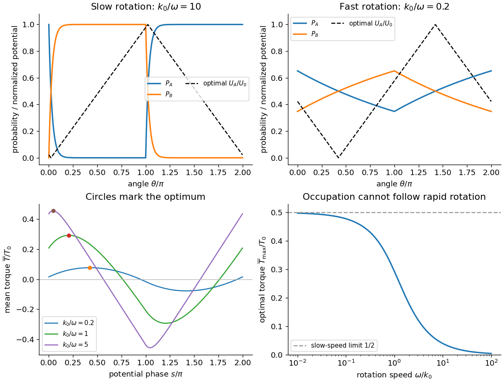

<h1 id="1/b/solution">Solution</h1>

↑ **Parent:** [B](../b.md)

The source potential rises from zero to $U_0$ over the half-turn from $s$ to $s+\pi$, then falls over the next half-turn. Its slopes are $\pm U_0/\pi$. [Torque](../../../../torque.md) is minus the angular [derivative](../../../../derivative.md) of potential; in the detached state $U_B$ is angle-independent and exerts no [torque](../../../../torque.md). A uniform set of motor phases therefore gives

$$
\boxed{T_0=\frac{U_0}\pi,\qquad
\overline T(s)=\frac{T_0}{2\pi}
\left[-\int_s^{s+\pi}P_A(\theta)d\theta+
\int_{s+\pi}^{s+2\pi}P_A(\theta)d\theta\right].}
$$

Here $U_0$ is an [energy](../../../../energy-split.md) and $T_0$ a [torque](../../../../torque.md) because the angle is in radians. The average over a full turn divides by $2\pi$, rather than by the bound-state occupation alone.

Differentiating the moving integration limits and using [periodicity](../../../../periodicity.md) gives

$$
\frac{d\overline T}{ds}=\frac{T_0}{\pi}[P_A(s)-P_A(s+\pi)]
=\frac{T_0}{\pi}[2P_A(s)-1].
$$

The [optimal phase of a two-state rotary motor](../../../../optimal-phase-of-a-two-state-rotary-motor.md) follows on $0<s<\pi$: $P_A$ decreases, so the stationary point is a maximum and satisfies

$$
\boxed{P_A(s_{\max})=P_A(s_{\max}+\pi)=\tfrac12,\qquad
s_{\max}=\frac1\beta\ln(2\alpha)
=\frac\pi2-\frac1\beta\ln\cosh\frac{\pi\beta}{2}.}
$$

The crossing displaced by $\pi$ is the corresponding minimum. For slow positive rotation, $s_{\max}\simeq(\omega/k_0)\ln2$ lies just after the detachment switch. The potential then rises mainly while the motor is detached and falls mainly while it is bound. For fast rotation, $s_{\max}\simeq\pi/2-\pi^2k_0/(8\omega)$, with only a small phase-dependent occupation available to produce [torque](../../../../torque.md). The potential should still be shifted by this optimum, rather than aligned arbitrarily with a rate switch.

The half-turn symmetry gives $\int_s^{s+2\pi}P_A\,d\theta=\pi$. At the optimum, direct integration of the two exponential pieces gives $\int_s^{s+\pi}P_A\,d\theta=s_{\max}$. Thus a useful exact check is

$$
\boxed{\overline T_{\max}=\frac{T_0}{\pi\beta}\ln\cosh\frac{\pi\beta}{2}
\simeq\frac{T_0}{2}-\frac{T_0\ln2}{\pi\beta}\longrightarrow\frac{T_0}{2}
\quad(\omega\ll k_0).}
$$

For fast rotation, $\overline T_{\max}\simeq T_0\pi k_0/(8\omega)$ instead tends to zero. The original plots below show the calculated [probabilities](../../../../probability.md) and optimized potential shapes. The imposed switching rates constitute driven kinetics: their strictly one-way windows are not [equilibrium](../../../../equilibrium-point-of-a-dynamical-system.md) [detailed balance](../../../../detailed-balance.md) at a fixed angle. Sustained work requires the motor's chemical/ion-gradient [energy](../../../../energy-split.md) supply, not extraction of work from a passive single thermal bath.

**[Figure 1](#1/b/image-motor-occupation-optimal-angular-potential-phase-and-the-speed-dependence-of-available-torque). Motor occupation, optimal angular potential phase and the speed dependence of available torque**. Original solutions of the two-state advective motor model. Potential is normalized by $U_0$, torque by $T_0$, and the slow/fast profiles use illustrative values of $k_0/\omega$.

## ↑ Ancestors (12)

1. [B](../b.md)
2. [1](../../1.md)
3. [2018](../../../2018-split.md)
4. [Past exam of the biological physics course of the University of Oxford](../../../split.md)
5. [Biological physics course of the University of Oxford](../../../../biological-physics-course-of-the-university-of-oxford.md)
6. [Year 4 of the physics course of the University of Oxford](../../../../year-4-of-the-physics-course-of-the-university-of-oxford.md)
7. [Physics course of the University of Oxford](../../../../physics-course-of-the-university-of-oxford.md)
8. [Undergraduate course of the University of Oxford](../../../../undergraduate-course-of-the-university-of-oxford.md)
9. [Course of the University of Oxford](../../../../course-of-the-university-of-oxford.md)
10. [University of Oxford](../../../../university-of-oxford-split.md)
11. [List of universities](../../../../list-of-universities.md)
12. [Codex Wiki](../../../../split.md)
