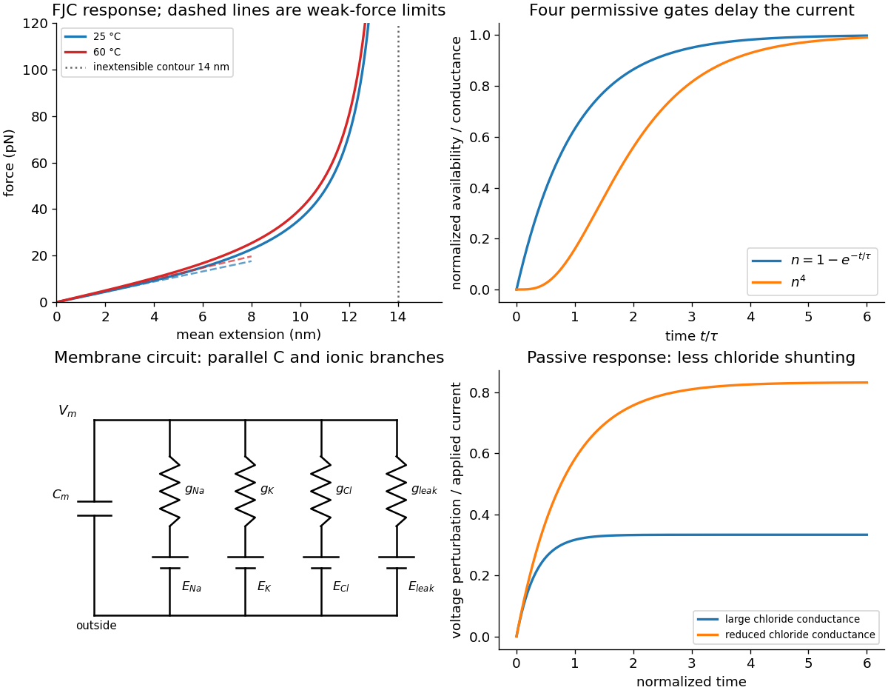

<h1 id="2/c/solution">Solution</h1>

↑ **Parent:** [C](../c.md)

The coefficient in the linear [force](../../../../force-split.md) law is

$$
\boxed{k_{\rm chain}=\frac{3k_BT}{Nb^2}
=2.205\times10^{-3}\,\mathrm{N\,m^{-1}}
=2.205\,\mathrm{pN\,nm^{-1}}\quad(T=298.15\,\mathrm K).}
$$

Stretching suppresses the many disordered orientations available to the chain. The [Gaussian chain](../../../../gaussian-chain.md) [free energy](../../../../thermodynamic-free-energy.md) cost $\Delta\mathcal F\simeq3k_BTR^2/(2Nb^2)$ has gradient equal to this restoring [force](../../../../force-split.md). This is [entropic elasticity](../../../../entropic-elasticity.md); individual [covalent bonds](../../../../covalent-bond-split.md) need not stretch to produce the weak-[force](../../../../force-split.md) spring.

At moderate [force](../../../../force-split.md), even an ideal [FJC](../../../../ideal-chain.md) becomes nonlinear as its orientations align, so failure of a _linear_ fit alone need not imply nonideal chemistry. But failure of the full [FJC](../../../../ideal-chain.md) curve can reflect backbone [spring constant](../../../../spring-constant.md) and correlated segment angles, nonuniform effective links, remaining folded contacts, [force](../../../../force-split.md)-induced conformational changes, energetic bond compliance, or tether/calibration effects. An extensible [FJC](../../../../ideal-chain.md) or an appropriate semiflexible model includes some of these effects; their parameters require independent justification. The stated inextensible $14\,\mathrm{nm}$ [polymer contour length](../../../../polymer-contour-length.md) already excludes a literal $15\,\mathrm{nm}$ extension.

The first panel of the original model figure below shows the full orientational response and weak-[force](../../../../force-split.md) tangents without tracing the experimental data.

**[Figure 2](#2/c/image-entropic-chain-elasticity-permissive-potassium-gating-and-chloride-dependent-membrane-shunting). Entropic chain elasticity, permissive potassium gating and chloride-dependent membrane shunting**. Original model calculations and equivalent-circuit schematic. The chain uses the printed segment parameters; the gating and passive voltage examples are normalized illustrative responses, not numerical fits to the source experiment.

## ↑ Ancestors (12)

1. [C](../c.md)
2. [2](../../2.md)
3. [2018](../../../2018-split.md)
4. [Past exam of the biological physics course of the University of Oxford](../../../split.md)
5. [Biological physics course of the University of Oxford](../../../../biological-physics-course-of-the-university-of-oxford.md)
6. [Year 4 of the physics course of the University of Oxford](../../../../year-4-of-the-physics-course-of-the-university-of-oxford.md)
7. [Physics course of the University of Oxford](../../../../physics-course-of-the-university-of-oxford.md)
8. [Undergraduate course of the University of Oxford](../../../../undergraduate-course-of-the-university-of-oxford.md)
9. [Course of the University of Oxford](../../../../course-of-the-university-of-oxford.md)
10. [University of Oxford](../../../../university-of-oxford-split.md)
11. [List of universities](../../../../list-of-universities.md)
12. [Codex Wiki](../../../../split.md)

## ← Incoming links (2)

- [Solution](../../3/a/solution.md)
- [Solution](../../3/d/solution.md)
