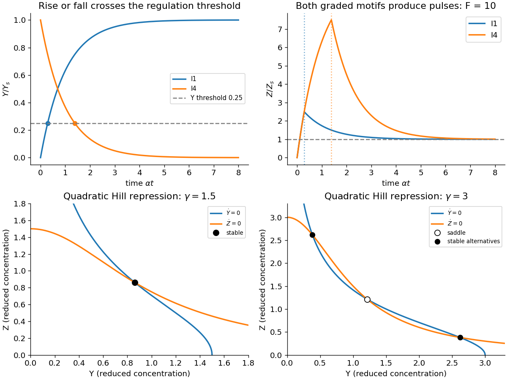

<h1 id="4/a/solution">Solution</h1>

↑ **Parent:** [A](../a.md)

Use the source's explicit graded production rules. X is already present at a constant [concentration](../../../../concentration.md); the input at zero activates it rather than starting accumulation of X. Assume its active level exceeds both relevant X thresholds, put $\alpha_x=\alpha_y=\alpha_z=\alpha$, let $Y_s=\beta_y/\alpha$, and take $0<h=K_{yz}/Y_s<1$. Before the input Z is not produced, so use the initial steady value $Z(0)=0$.

For [I1 incoherent feed-forward loop](../../../../i1-incoherent-feed-forward-loop.md), activation of X starts Y production; for [I4 incoherent feed-forward loop](../../../../i4-incoherent-feed-forward-loop.md) it stops Y production. Consequently

$$
\boxed{Y_1(t)=Y_s(1-e^{-\alpha t}),\quad d_1=-\alpha^{-1}\ln(1-h);\qquad
Y_4(t)=Y_se^{-\alpha t},\quad d_4=-\alpha^{-1}\ln h.}
$$

The two delays are the times for Y to cross its output-regulation threshold. In [I1 incoherent feed-forward loop](../../../../i1-incoherent-feed-forward-loop.md), initially absent Y permits the high output rate, then accumulated Y represses it. In [I4 incoherent feed-forward loop](../../../../i4-incoherent-feed-forward-loop.md), initially abundant Y activates the high output rate, then Y's decay removes that activation. Thus _both_ have production $\beta_{\rm high}$ before their respective delay and $\beta_{\rm low}$ afterwards.

With $Z_s=\beta_{\rm low}/\alpha$ and $F=\beta_{\rm high}/\beta_{\rm low}$, their common piecewise response, with $d=d_1$ or $d_4$, is

$$
\boxed{\frac{Z(t)}{Z_s}=\begin{cases}
F(1-e^{-\alpha t}),&0\le t\le d,\\
1+\left[F(1-e^{-\alpha d})-1\right]e^{-\alpha(t-d)},&t\ge d.
\end{cases}}
$$

The output is continuous at the production switch. There is an overshoot precisely when $F(1-e^{-\alpha d})>1$; otherwise it rises monotonically to $Z_s$. For a threshold not extremely close to its limiting values and the supplied $F\gg1$, a rapid pulse followed by relaxation to a lower nonzero level is expected. This can provide fast initial response or a transient strong signal, but it is not perfect adaptation to the original zero output.

The original plots below use the illustrative values $h=1/4$ and $F=10$. At $h=1/2$ the two Y curves are complementary and their output delays and Z curves are identical. These threshold values are examples, not extra source data. “AND” here must be read with the stipulated graded rates: replacing them by an ordinary all-or-nothing AND rule would give a different response.

**[Figure 3](#4/a/image-graded-incoherent-feed-forward-pulses-and-the-change-from-one-to-two-attracting-toggle-states). Graded incoherent feed-forward pulses and the change from one to two attracting toggle states**. Original model trajectories and nullclines. Pulse panels use illustrative $h=1/4$, $F=10$ and dimensionless time $\alpha t$; switch panels use $n=2$ with the explicitly labelled reduced production strengths.

## ↑ Ancestors (12)

1. [A](../a.md)
2. [4](../../4.md)
3. [2018](../../../2018-split.md)
4. [Past exam of the biological physics course of the University of Oxford](../../../split.md)
5. [Biological physics course of the University of Oxford](../../../../biological-physics-course-of-the-university-of-oxford.md)
6. [Year 4 of the physics course of the University of Oxford](../../../../year-4-of-the-physics-course-of-the-university-of-oxford.md)
7. [Physics course of the University of Oxford](../../../../physics-course-of-the-university-of-oxford.md)
8. [Undergraduate course of the University of Oxford](../../../../undergraduate-course-of-the-university-of-oxford.md)
9. [Course of the University of Oxford](../../../../course-of-the-university-of-oxford.md)
10. [University of Oxford](../../../../university-of-oxford-split.md)
11. [List of universities](../../../../list-of-universities.md)
12. [Codex Wiki](../../../../split.md)

## ← Incoming links (1)

- [Solution](../e/solution.md)
