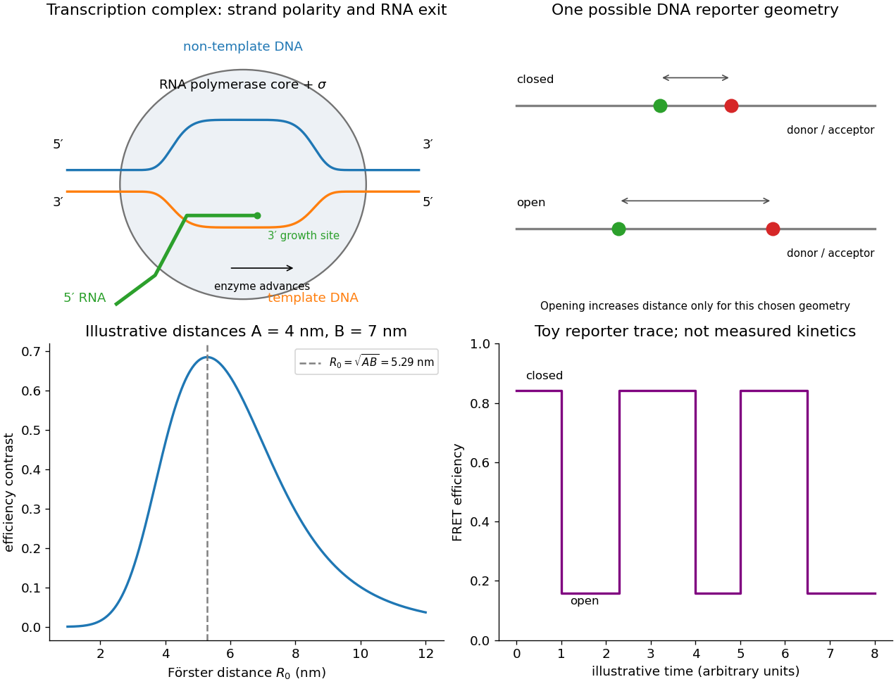

<h1 id="5/d/solution">Solution</h1>

↑ **Parent:** [D](../d.md)

Place a [FRET donor](../../../../fret-donor.md) and [FRET acceptor](../../../../fret-acceptor.md) on [DNA](../../../../deoxyribonucleic-acid.md) positions whose separation reports start-site opening, using an independently calibrated closed/open geometry and a pair whose [Förster distance](../../../../forster-distance.md) is near the geometric mean from part (c). Opening may increase or decrease the measured separation depending on where the dyes are placed; anticorrelated donor/acceptor changes need structural and photophysical controls before being assigned to bubble formation.

Single molecules can be observed by low-background [fluorescence microscopy](../../../../fluorescence-microscopy.md) while recording [FRET donor](../../../../fret-donor.md) and sensitized [FRET acceptor](../../../../fret-acceptor.md) [photons](../../../../photon.md). Correct background, spectral leakage, direct [FRET acceptor](../../../../fret-acceptor.md) excitation and unequal detection/quantum-yield factors before calculating efficiency, for example $E=I_A/(I_A+\gamma I_D)$ with the corrected intensities. Alternating excitation or independent [FRET acceptor](../../../../fret-acceptor.md) observation checks that a low-[FRET](../../../../forster-resonance-energy-transfer.md) interval is not simply a dark or bleached [FRET acceptor](../../../../fret-acceptor.md). Intensity anticorrelation, [FRET donor](../../../../fret-donor.md) lifetime and suitable inactive/closed-state controls strengthen the assignment. The original figure below separates the mechanistic schematic from a purely illustrative model trace.

For the [binding-plus-opening first-passage time](../../../../binding-plus-opening-first-passage-time.md), a minimal kinetic scheme is $U\rightleftarrows C\rightleftarrows O$, for unbound, closed bound and open bound states. A binding rate $a=k_{\rm on}[\mathrm{RNAP}]$, dissociation rate $b=k_{\rm off}$ and opening rate $c=k_{\rm open}$ already produce multiple waiting-time contributions. With O treated as absorbing during the measurement and starting from U, the mean first-opening time is

$$
\boxed{\langle t_{U\to O}\rangle=\frac{a+b+c}{ac},}
$$

not simply $1/k_{\rm open}$. This follows from $T_U=1/a+T_C$ and $T_C=1/(b+c)+bT_U/(b+c)$. A bound-state marker, or measurements over [concentration](../../../../concentration.md) and a justified kinetic model, helps distinguish binding from opening when unbound and closed [DNA](../../../../deoxyribonucleic-acid.md) share a [FRET](../../../../forster-resonance-energy-transfer.md) level.

Fit transitions and dwell distributions with finite time resolution, missed short states, bleaching and censoring included. An open-state exponential dwell can estimate its exit rate under a simple Markov model, while competing closing and dissociation channels require separate observables or additional assumptions. Starting from a defined bound closed state can isolate opening more directly, but dissociation still competes if appreciable. Resolving repeated opening and closing gives forward and reverse kinetics; irreversibility should only be assumed over a demonstrated observation window. The experiment measures a conformational reporter, so a two-level trace alone does not uniquely prove every microscopic step of open-complex formation.

**[Figure 4](#5/d/image-transcription-complex-organisation-and-a-calibrated-fret-reporter-of-dna-opening). Transcription-complex organisation and a calibrated FRET reporter of DNA opening**. Original schematic and FRET-law calculations. Distances of 4 and 7 nm and the state trace are illustrative, not source measurements; labels distinguish the template, non-template and nascent RNA.

## ↑ Ancestors (12)

1. [D](../d.md)
2. [5](../../5.md)
3. [2018](../../../2018-split.md)
4. [Past exam of the biological physics course of the University of Oxford](../../../split.md)
5. [Biological physics course of the University of Oxford](../../../../biological-physics-course-of-the-university-of-oxford.md)
6. [Year 4 of the physics course of the University of Oxford](../../../../year-4-of-the-physics-course-of-the-university-of-oxford.md)
7. [Physics course of the University of Oxford](../../../../physics-course-of-the-university-of-oxford.md)
8. [Undergraduate course of the University of Oxford](../../../../undergraduate-course-of-the-university-of-oxford.md)
9. [Course of the University of Oxford](../../../../course-of-the-university-of-oxford.md)
10. [University of Oxford](../../../../university-of-oxford-split.md)
11. [List of universities](../../../../list-of-universities.md)
12. [Codex Wiki](../../../../split.md)
