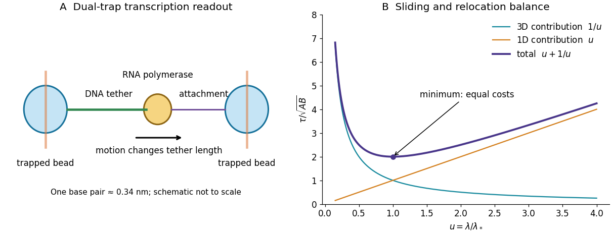
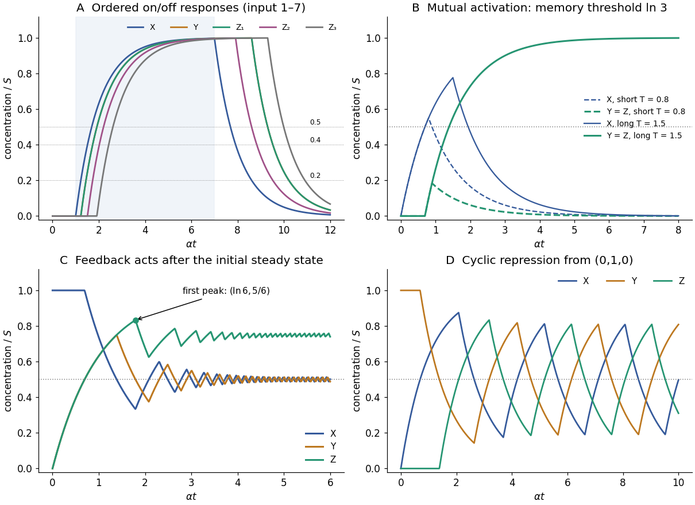
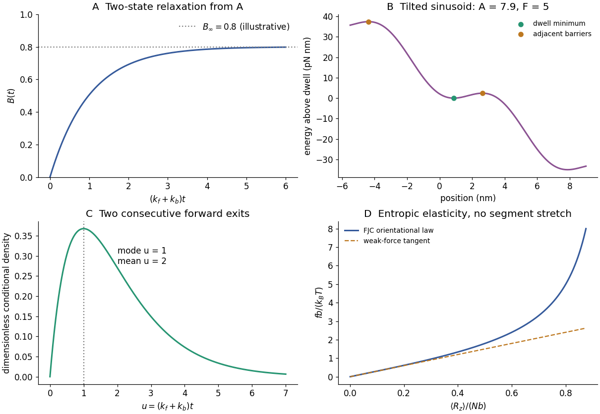

# 2019

↑ **Parent:** [Past exam of the biological physics course of the University of Oxford](../past-exam-of-the-biological-physics-course-of-the-university-of-oxford.md)

Source paper: [https://www.whatdotheyknow.com/request/oxford_physics_past_papers_2/response/2340696/attach/7/Physics%20Papers%202018.pdf?cookie_passthrough=1#page=58](https://www.whatdotheyknow.com/request/oxford_physics_past_papers_2/response/2340696/attach/7/Physics%20Papers%202018.pdf?cookie_passthrough=1#page=58)

The dated cover identifies 22 June 2019 despite the public bundle filename. All optional branches are solved. Graph readings are approximate; conflicting printed chain parameters and kinetic assumptions are distinguished explicitly below.

**Table of contents**

- [1](#1)
  - [a](#1/a)
    - [Solution](#1/a/solution)
  - [b](#1/b)
    - [i](#1/b/i)
      - [Solution](#1/b/i/solution)
    - [ii](#1/b/ii)
      - [Solution](#1/b/ii/solution)
    - [iii](#1/b/iii)
      - [Solution](#1/b/iii/solution)
  - [c](#1/c)
    - [i](#1/c/i)
      - [Solution](#1/c/i/solution)
    - [ii](#1/c/ii)
      - [Solution](#1/c/ii/solution)
  - [d](#1/d)
    - [Solution](#1/d/solution)
- [2](#2)
  - [a](#2/a)
    - [i](#2/a/i)
      - [Solution](#2/a/i/solution)
    - [ii](#2/a/ii)
      - [Solution](#2/a/ii/solution)
  - [b](#2/b)
    - [Solution](#2/b/solution)
  - [c](#2/c)
    - [i](#2/c/i)
      - [Solution](#2/c/i/solution)
    - [ii](#2/c/ii)
      - [Solution](#2/c/ii/solution)
  - [d](#2/d)
    - [Solution](#2/d/solution)
- [3](#3)
  - [a](#3/a)
    - [Solution](#3/a/solution)
  - [b](#3/b)
    - [Solution](#3/b/solution)
  - [c](#3/c)
    - [Solution](#3/c/solution)
  - [d](#3/d)
    - [Solution](#3/d/solution)
  - [e](#3/e)
    - [Solution](#3/e/solution)
- [4](#4)
  - [a](#4/a)
    - [Solution](#4/a/solution)
  - [b](#4/b)
    - [Solution](#4/b/solution)
  - [c](#4/c)
    - [Solution](#4/c/solution)
  - [d](#4/d)
    - [Solution](#4/d/solution)
- [5](#5)
  - [a](#5/a)
    - [Solution](#5/a/solution)
  - [b](#5/b)
    - [Solution](#5/b/solution)
  - [c](#5/c)
    - [Solution](#5/c/solution)
  - [d](#5/d)
    - [Solution](#5/d/solution)
  - [e](#5/e)
    - [Solution](#5/e/solution)
  - [f](#5/f)
    - [Solution](#5/f/solution)
- [6](#6)
  - [i](#6/i)
    - [Solution](#6/i/solution)
  - [ii](#6/ii)
    - [Solution](#6/ii/solution)
  - [iii](#6/iii)
    - [Solution](#6/iii/solution)

## 1

↑ **Parent:** [2019](2019.md)

<h3 id="1/a">a</h3>

↑ **Parent:** [1](#1)

<h4 id="1/a/solution">Solution</h4>

↑ **Parent:** [A](#1/a)

In bacterial [transcription initiation](../molecular-genetics.md#transcription-initiation), the [RNA polymerase](../molecular-genetics.md#rna-polymerase) holoenzyme uses a [promoter](../molecular-genetics.md#promoter-genetics)-specific [sigma factor](../molecular-genetics.md#sigma-factor) to recognize [promoter](../molecular-genetics.md#promoter-genetics) elements and form a closed [DNA](../polymer.md#deoxyribonucleic-acid)-bound complex. Subsequent local [DNA melting](../polymer.md#dna-melting) opens a [transcription](../molecular-genetics.md#transcription-biology) bubble, positioning the template strand in the active site: this is an [open promoter complex](../molecular-genetics.md#open-promoter-complex). The enzyme can then initiate [RNA](../polymer.md#ribonucleic-acid) synthesis and escape into elongation. [LacI](../molecular-genetics.md#laci), the lac repressor, binds the [lac operator](../molecular-genetics.md#lac-operator) overlapping or close to the [promoter](../molecular-genetics.md#promoter-genetics) and can prevent productive [promoter](../molecular-genetics.md#promoter-genetics) binding or its progression to an open complex; operator arrangement and [DNA](../polymer.md#deoxyribonucleic-acid) looping can strengthen repression. One should not assume every repressor acts at exactly the same microscopic step.

A high-resolution [optical tweezers](../optics.md#optical-tweezers) assay mechanically connects one trapped bead to [RNA polymerase](../molecular-genetics.md#rna-polymerase) and another bead to an upstream or downstream [DNA](../polymer.md#deoxyribonucleic-acid) handle. Polymerase motion changes the tether length; measuring bead displacement and the calibrated restoring [force](../force.md) reports elongation under a known load. A feedback [force](../force.md) clamp can keep that load approximately constant. Reversing the tether geometry permits assisting and opposing loads. The left panel below shows the mechanical arrangement rather than a copied apparatus image.

A base-pair advance is only about $0.34\,\mathrm{nm}$ along B-form [DNA](../polymer.md#deoxyribonucleic-acid). Resolving that increment requires exceptional mechanical stability, suppression of drift and laser-pointing noise, calibration of trap and tether compliance, and sufficient temporal sampling to separate steps from thermal bead fluctuations. Position histograms, dwell detection and their spatial correlations can expose a repeated increment; one should also test [nucleotide](../molecule.md#nucleotide)-dependent motion, pauses and backtracking. Stabilized dual-trap measurements combined with [transcription](../molecular-genetics.md#transcription-biology)-product analysis established approximately one base-pair advance per incorporated [nucleotide](../molecule.md#nucleotide).[Single-molecule displacement measurement and independent gel analysis supporting one-base-pair stepping](../biochemistry-and-biophysics-bibliography.md#direct-observation-of-base-pair-stepping-by-rna-polymerase-by-elio-a-abbondanzieri-and-others)

**[Figure 1](#1/a/image-optical-trapping-of-a-transcription-complex-and-the-competing-terms-of-a-facilitated-target-search). Optical trapping of a transcription complex and the competing terms of a facilitated target search**. Original mechanical schematic and dimensionless search-time model. The stepping scale is a physical scale, while the illustrated normalized search curve is not experimental data.

<h3 id="1/b">b</h3>

↑ **Parent:** [1](#1)

<h4 id="1/b/i">i</h4>

↑ **Parent:** [B](#1/b)

<h5 id="1/b/i/solution">Solution</h5>

↑ **Parent:** [I](#1/b/i)

Treat the target as a stationary perfectly absorbing sphere of reaction radius $r_0$, surrounded by an effectively uniform reservoir of [protein](../protein.md) [number density](../statistical-physics.md#number-density) $C_A$. At [steady state](../dynamical-systems.md#steady-state) the radial [diffusion equation](../diffusion-equation.md) gives

$$
\nabla^2c=0,\quad c(r_0)=0,\quad c(\infty)=C_A,\qquad c(r)=C_A\left(1-\frac{r_0}r\right).
$$

The inward capture rate per target is the [integral](../integral.md) of the [Fick's first law](../diffusion-equation.md#fick-s-first-law):

$$
J=4\pi r_0^2D_A\left.\frac{dc}{dr}\right|_{r_0}=4\pi D_Ar_0C_A.
$$

For dilute independent targets of [number density](../statistical-physics.md#number-density) $C_B$, the volume association rate is $JC_B$, so

$$
\boxed{k_a=4\pi D_Ar_0.}
$$

This is the [Smoluchowski association rate](../biology.md#smoluchowski-association-rate), in volume per time because the [concentrations](../mathematical-physics.md#concentration) are number densities. If the target also diffuses, use the relative [diffusion coefficient](../brownian-motion.md#diffusion-coefficient) $D_A+D_B$. Orientation constraints, incomplete absorption and [chromosome](../genetics.md#chromosome) geometry can reduce the actual association rate relative to this ideal collision limit.

<h4 id="1/b/ii">ii</h4>

↑ **Parent:** [B](#1/b)

<h5 id="1/b/ii/solution">Solution</h5>

↑ **Parent:** [Ii](#1/b/ii)

The given sphere has radius $a=5\,\mathrm{nm}$. The [Stokes–Einstein relation](../stokes-flow.md#stokes-einstein-relation) at an illustrative $T=300\,\mathrm K$ gives

$$
D_A=\frac{k_BT}{6\pi\eta a}=4.39\times10^{-12}\,\mathrm{m^2\,s^{-1}}=4.39\,\mu\mathrm m^2\,\mathrm{s^{-1}}.
$$

For $N=30$ well-mixed independent searchers in cell volume $V$, the target-arrival rate is $Nk_a/V$. The corresponding mean first arrival time is

$$
\boxed{\tau_3\simeq\frac{V}{30\,4\pi D_Ar_0}
=0.121\,\mathrm s\left(\frac{V}{1\,\mu\mathrm m^3}\right)\left(\frac{5\,\mathrm{nm}}{r_0}\right)\left(\frac{300\,\mathrm K}{T}\right).}
$$

The source does not fix $V$, the reaction radius or [temperature](../temperature.md). For an order-of-magnitude estimate, a bacterial volume around $1\,\mu\mathrm m^3$ and reaction radius $5$–$10\,\mathrm{nm}$ give about $0.06$–$0.12\,\mathrm s$. A 20-base-pair B-form site is about $6.8\,\mathrm{nm}$ long, supporting a nanometre-scale capture radius but not uniquely defining its spherical value. The estimate is the ideal [diffusion](../thermodynamics.md#diffusion)-limited time, not a measured intracellular search time: nonspecific binding, orientational matching, crowding and limited accessibility are excluded.

<h4 id="1/b/iii">iii</h4>

↑ **Parent:** [B](#1/b)

<h5 id="1/b/iii/solution">Solution</h5>

↑ **Parent:** [Iii](#1/b/iii)

If the outcome is the first successful binding to _any_ operator, ten well-separated functionally independent unoccupied targets give ten times the total capture rate. Hence

$$
\boxed{\tau_{3,10}\simeq\frac{V}{30\times10\times k_a}=\frac{\tau_3}{10},}
$$

or roughly $6$–$12\,\mathrm{ms}$ for the estimates above. This assumes nonoverlapping capture zones and no significant depletion before the first event. The first-arrival time at one designated operator is not divided by ten merely because other sites are added, and filling all ten sites is a different occupancy problem.

<h3 id="1/c">c</h3>

↑ **Parent:** [1](#1)

<h4 id="1/c/i">i</h4>

↑ **Parent:** [C](#1/c)

<h5 id="1/c/i/solution">Solution</h5>

↑ **Parent:** [I](#1/c/i)

The term $V/(D_3\lambda)$ is the bulk-[diffusion](../thermodynamics.md#diffusion) search cost: increasing the effective length of [DNA](../polymer.md#deoxyribonucleic-acid) searched after each encounter enlarges the useful capture region and reduces this contribution. The term $L\lambda/D_1$ is the accumulated sliding cost. Approximately $L/\lambda$ [DNA](../polymer.md#deoxyribonucleic-acid) landing-and-sliding episodes, each taking order $\lambda^2/D_1$, give $L\lambda/D_1$. These are scaling estimates; geometric constants and correlated revisits are omitted by the supplied model.

Thus the [facilitated target search](../biology.md#facilitated-target-search) is slow as $\lambda\to0$, because too little sequence is examined per encounter, and slow at very large $\lambda$, because sliding and repeated local exploration take too long. A finite intermediate minimum balances 1D scanning against 3D relocation. The right panel of the figure in [solution](#1/a/solution) shows the two contributions and their sum. The model requires a useful range of sliding lengths below the full [chromosome](../genetics.md#chromosome) length, finite positive [diffusion coefficients](../brownian-motion.md#diffusion-coefficient) and effective relocation between episodes; it is not a claim that arbitrarily large $\lambda$ is physically available.

<h4 id="1/c/ii">ii</h4>

↑ **Parent:** [C](#1/c)

<h5 id="1/c/ii/solution">Solution</h5>

↑ **Parent:** [Ii](#1/c/ii)

Write $A=V/D_3$ and $B=L/D_1$. Then $\tau=A/\lambda+B\lambda$, so

$$
\tau'=-\frac A{\lambda^2}+B=0,\qquad \tau''=\frac{2A}{\lambda^3}>0.
$$

Therefore

$$
\boxed{\lambda_*=\sqrt{\frac{VD_1}{LD_3}},\qquad
\tau_{\min}=2\sqrt{\frac{VL}{D_1D_3}}.}
$$

At the optimum, the two contributions are equal. Expressing the optimal sliding length directly in terms of the minimum time gives

$$
\boxed{\lambda_*=\frac{D_1\tau_{\min}}{2L}=\frac{2V}{D_3\tau_{\min}}.}
$$

These relations concern the optimal point; a general nonminimal time can correspond to two different sliding lengths. A geometric or kinetic restriction on the allowed sliding length can instead place the optimum at a boundary.

<h3 id="1/d">d</h3>

↑ **Parent:** [1](#1)

<h4 id="1/d/solution">Solution</h4>

↑ **Parent:** [D](#1/d)

Use a short inducer pulse to release [DNA](../polymer.md#deoxyribonucleic-acid)-bound fluorescent [LacI](../molecular-genetics.md#laci), then remove extracellular [IPTG](../molecular-genetics.md#isopropyl-beta-d-1-thiogalactopyranoside) rapidly and start the search clock after washout. The supplied entry, binding and dissociation times imply a synchronization uncertainty of order a few tenths of a second, which must be measured and separated from the search latency. If rebinding is faster than that dead time, the protocol alone cannot resolve the true mean without a kinetic correction or faster triggering.

Image individual cells rapidly enough to distinguish freely diffusing [proteins](../protein.md) from a persistent immobilized fluorescent spot at the single operator. Prelocate that locus from an independent position marker or a previous binding event. Score the first specific capture after each reset; controls lacking a functional target distinguish stable operator binding from nonspecific [DNA](../polymer.md#deoxyribonucleic-acid) residence. Correct for localization error, [bleaching](../fluorescence.md#photobleaching), blinking, missed brief events and target motion, and verify that the fluorescent tag does not substantially change the search kinetics.

With four independent freely searching [molecules](../molecule.md), each having an approximately exponential single-[molecule](../molecule.md) target-arrival time of mean $\tau_1$, the first-arrival survival is

$$
S(t)=e^{-4t/\tau_1},\qquad\boxed{\tau_1=4\langle t_{\rm first}\rangle.}
$$

Thus report both the observed first capture among four and the inferred mean for one searcher. If the number of visible available [molecules](../molecule.md) varies, use $S(t)=\exp[-\int_0^t n(s)ds/\tau_1]$ and account for censoring rather than blindly multiplying by four. Repeated resets and many cells estimate the distribution; deviations from an exponential test the independent well-mixed approximation. The rapid inducer manipulation defines a synchronization strategy, not an assumption that all subsequent intracellular search paths are identical.

## 2

↑ **Parent:** [2019](2019.md)

<h3 id="2/a">a</h3>

↑ **Parent:** [2](#2)

<h4 id="2/a/i">i</h4>

↑ **Parent:** [A](#2/a)

<h5 id="2/a/i/solution">Solution</h5>

↑ **Parent:** [I](#2/a/i)

Take $V=V_{\rm inside}-V_{\rm outside}$. Equality of [electrochemical potentials](../chemical-potential.md#electrochemical-potential) for a monovalent cation gives the [Nernst equilibrium potential](../membrane-potential.md#nernst-equilibrium-potential)

$$
E=\frac{RT}{F}\ln\frac{c_{\rm outside}}{c_{\rm inside}}.
$$

At $T=293.15\,\mathrm K$, $RT/F=25.26\,\mathrm{mV}$. Therefore

$$
\boxed{E_{\rm Na}=25.26\ln(120/15)=+52.5\,\mathrm{mV},\qquad
E_{\rm K}=25.26\ln(5/100)=-75.7\,\mathrm{mV}.}
$$

The signs refer to the stated electrode convention, not to the direction of current at every voltage. Activities are approximated by [concentrations](../mathematical-physics.md#concentration) and the bulk ionic [concentrations](../mathematical-physics.md#concentration) are treated as fixed during a single spike.

<h4 id="2/a/ii">ii</h4>

↑ **Parent:** [A](#2/a)

<h5 id="2/a/ii/solution">Solution</h5>

↑ **Parent:** [Ii](#2/a/ii)

The intracellular recording by [Alan Hodgkin](../physiology.md#alan-hodgkin) and [Andrew Huxley](../physiology.md#andrew-huxley) shows the membrane voltage rising from a negative resting value to a positive overshoot, with the outside held at zero reference. The [action potential](../neuron.md#action-potential) therefore does more than transiently abolish a resting polarization: it reverses the sign across the membrane. A simple hypothesis that excitation only makes an otherwise [potassium](../chemical-substance.md#potassium)-dominated membrane equally leaky cannot explain that positive overshoot.

The result helped motivate a transient, selective change in membrane permeability, later resolved into rapid inward [sodium](../chemical-substance.md#sodium) current followed by outward [potassium](../chemical-substance.md#potassium) current. The positive [sodium](../chemical-substance.md#sodium) [equilibrium](../dynamical-systems.md#equilibrium-point-of-a-dynamical-system) potential calculated above makes the overshoot physically plausible, while [potassium](../chemical-substance.md#potassium) conductance favours a negative resting voltage and [repolarization](../membrane-potential.md#repolarization). The 1939 voltage trace itself did not identify individual channel [proteins](../protein.md) or establish the full later voltage-dependent gating mechanism; those conclusions required ionic substitution and [voltage-clamp](../neuroscience.md#voltage-clamp) evidence.[1939 intracellular recording and reversal of membrane voltage during excitation](../neuroscience-bibliography.md#action-potentials-recorded-from-inside-a-nerve-fibre-by-alan-hodgkin-and-andrew-huxley)

<h3 id="2/b">b</h3>

↑ **Parent:** [2](#2)

<h4 id="2/b/solution">Solution</h4>

↑ **Parent:** [B](#2/b)

Panel B steps the membrane from approximately $-80$ to $-40\,\mathrm{mV}$ and holds it there. The [sodium](../chemical-substance.md#sodium) current becomes inward, peaks rapidly, and decays almost to zero despite maintained [depolarization](../membrane-potential.md#depolarization). At $-40\,\mathrm{mV}$ the [sodium](../chemical-substance.md#sodium) driving [force](../force.md) $V-E_{\rm Na}$ is negative, consistent with the negative current convention. A conductance description is

$$
I_{\rm Na}=N\gamma p_O(V-E_{\rm Na}),
$$

where $N$ is channel number, $\gamma$ single-channel conductance and $p_O$ the open [probability](../probability-theory.md#probability). The trace requires rapid voltage-dependent activation followed by slower [inactivation](../membrane-potential.md#ion-channel-inactivation), rather than a passive pore whose only response is an instantaneous constant current. Recovery normally requires [repolarization](../membrane-potential.md#repolarization), helping produce a refractory period and directional propagation of excitation.

A typical eukaryotic [voltage-gated sodium channel](../membrane-potential.md#voltage-gated-sodium-channel) contains four homologous membrane-spanning domains in one large pore-forming [protein](../protein.md). Charged S4 helices sense voltage; pore-associated regions form a selective pathway and activation gate. Fast [inactivation](../membrane-potential.md#ion-channel-inactivation) involves intracellular machinery coupled to the pore, classically the interdomain III–IV region, and should not be identified automatically with the tethered [potassium](../chemical-substance.md#potassium)-channel blocker. The pore permits rapid downhill electrochemical transport while maintaining selectivity against other [ions](../chemistry.md#ion).

Evidence separates these properties: clamp-step experiments distinguish voltage dependence and activation from decay at a fixed voltage; changing extracellular [sodium](../chemical-substance.md#sodium) shifts reversal potential; selective blockers isolate [sodium](../chemical-substance.md#sodium) current; [patch-clamp](../neuroscience.md#patch-clamp) records resolve stochastic single-channel openings; and [mutations](../genetics.md#mutation) of sensors, filter residues or the fast-[inactivation](../membrane-potential.md#ion-channel-inactivation) machinery alter the corresponding function. A single macroscopic trace alone cannot uniquely determine all microscopic [rate constants](../chemical-kinetics.md#rate-constant).

<h3 id="2/c">c</h3>

↑ **Parent:** [2](#2)

<h4 id="2/c/i">i</h4>

↑ **Parent:** [C](#2/c)

<h5 id="2/c/i/solution">Solution</h5>

↑ **Parent:** [I](#2/c/i)

Add an unavailable nonconducting inactivated state to the two-state gating scheme, for example

$$
C\mathrel{\mathop{\rightleftarrows}^{k_o(V)}_{k_c(V)}}O
\mathrel{\mathop{\rightleftarrows}^{k_i(V)}_{k_r(V)}}I.
$$

The probabilities obey

$$
\dot p_O=k_op_C-(k_c+k_i)p_O+k_rp_I,\qquad
\dot p_I=k_ip_O-k_rp_I,\qquad p_C+p_O+p_I=1.
$$

[Depolarization](../membrane-potential.md#depolarization) increases activation, initially raising $p_O$; subsequent transfer to $I$ reduces current while voltage is held constant. Slow recovery at the depolarized voltage permits most channels to become unavailable. [Repolarization](../membrane-potential.md#repolarization) promotes recovery and deactivation. More closed states and closed-state [inactivation](../membrane-potential.md#ion-channel-inactivation) may be needed for quantitative data, but this minimal extension already explains the rise followed by decay that fixed-rate $C\leftrightarrow O$ gating cannot produce from a closed population.

<h4 id="2/c/ii">ii</h4>

↑ **Parent:** [C](#2/c)

<h5 id="2/c/ii/solution">Solution</h5>

↑ **Parent:** [Ii](#2/c/ii)

A [sodium](../chemical-substance.md#sodium)-channel gain-of-function mechanism in [Long QT syndrome](../biology.md#long-qt-syndrome) can reduce the [inactivation](../membrane-potential.md#ion-channel-inactivation) rate $k_i$ or increase recovery/reopening from inactivated states, leaving a small persistent open population. The resulting late inward [sodium](../chemical-substance.md#sodium) current opposes repolarizing outward currents while $V<E_{\rm Na}$, prolonging the cardiac [action potential](../neuron.md#action-potential). Slower entry into $I$ would also extend the typical conducting episode relative to its normal duration. The altered effect is prolonged [sodium](../chemical-substance.md#sodium) entry, not reversal of [sodium](../chemical-substance.md#sodium)'s charge or a pump-driven uphill flux through the channel.

The precise rate change depends on the [mutation](../genetics.md#mutation): the clinical label alone does not uniquely specify one transition constant. Long QT syndromes also include other channel mechanisms; the question here concerns its stated [sodium](../chemical-substance.md#sodium)-channel variant.[Sodium-channel defects associated with the inherited repolarization phenotype](../biochemistry-and-biophysics-bibliography.md#cardiac-sodium-channel-mutations-in-patients-with-long-qt-syndrome-an-inherited-cardiac-arrhythmia-by-qing-wang-and-others)

<h3 id="2/d">d</h3>

↑ **Parent:** [2](#2)

<h4 id="2/d/solution">Solution</h4>

↑ **Parent:** [D](#2/d)

The original Panel A is readable: the baseline is roughly $-45\,\mathrm{mV}$ and the peak about $+40\,\mathrm{mV}$, giving a voltage excursion near $85\,\mathrm{mV}$. Using the specific [membrane capacitance](../neuroscience.md#membrane-capacitance) and surface area,

$$
C=0.01\times10^{-9}=10^{-11}\,\mathrm F,\quad
Q=C\Delta V\simeq8.5\times10^{-13}\,\mathrm C,
\quad\boxed{N_{\rm Na,net}=\frac{Q}{e}\simeq5.3\times10^6\text{ ions}.}
$$

A coarser $100\,\mathrm{mV}$ spike estimate gives $6.2\times10^6$ [ions](../chemistry.md#ion), illustrating the precision appropriate to the graph. These are the net monovalent charges needed to charge the [capacitor](../electromagnetism.md#capacitor) if [sodium](../chemical-substance.md#sodium) supplies the inward charge; simultaneous opposing currents can make the actual [sodium](../chemical-substance.md#sodium) influx larger.

The cell contains $0.015\,\mathrm{mol\,L^{-1}}\times3\times10^{-13}\,\mathrm L\times N_A\simeq2.71\times10^9$ intracellular [sodium](../chemical-substance.md#sodium) [ions](../chemistry.md#ion). The capacitive estimate adds only about $0.20\%$, or $0.029\,\mathrm{mM}$. Thus a spike does not equilibrate bulk [concentrations](../mathematical-physics.md#concentration). The [sodium-potassium ATPase](../cell-membrane.md#sodium-potassium-atpase) maintains the [gradients](../multivariable-calculus.md#gradient) over many spikes, exporting three [sodium](../chemical-substance.md#sodium) [ions](../chemistry.md#ion) per two [potassium](../chemical-substance.md#potassium) [ions](../chemistry.md#ion) imported per [ATP](../molecule.md#adenosine-triphosphate); the estimated [sodium](../chemical-substance.md#sodium) load alone corresponds to at least about $1.8\times10^6$ pump cycles. Rapid [repolarization](../membrane-potential.md#repolarization) itself comes mainly from changing channel conductances, while sustained fast firing requires adequate energy supply and [gradient](../multivariable-calculus.md#gradient) restoration. The small stated volume and large area are used as supplied, without assuming a particular cell geometry.

## 3

↑ **Parent:** [2019](2019.md)

<h3 id="3/a">a</h3>

↑ **Parent:** [3](#3)

<h4 id="3/a/solution">Solution</h4>

↑ **Parent:** [A](#3/a)

Let the common production and removal constants be $\beta$ and $\alpha$, so an unrepressed [protein](../protein.md) approaches $S=\beta/\alpha$. A simple constructive motif is

$$
X\longrightarrow Y,\qquad X\longrightarrow Z_1,\qquad
X\longrightarrow Z_2,\qquad Y\longrightarrow Z_3.
$$

Choose thresholds $K_{XY}=K_{XZ_1}=0.2S$, $K_{XZ_2}=0.4S$, and $K_{YZ_3}=0.5S$. The [logic approximation for gene regulation](../mathematical-biology.md#logic-approximation-for-gene-regulation) gives $\dot Y=\beta H(X-0.2S)-\alpha Y$, $\dot Z_1=\beta H(X-0.2S)-\alpha Z_1$, $\dot Z_2=\beta H(X-0.4S)-\alpha Z_2$, and $\dot Z_3=\beta H(Y-0.5S)-\alpha Z_3$. These unequal thresholds are permitted in this part; the production and degradation rates remain equal.

After input onset, $X=S[1-e^{-\alpha(t-T_1)}]$. Production of $Z_1$ and $Y$ begins at $T_1+0.2231/\alpha$, $Z_2$ at $T_1+0.5108/\alpha$, and $Z_3$ at $T_1+(0.2231+\ln2)/\alpha=T_1+0.9163/\alpha$. Thus the required on-order is obtained. Take an input long enough that all these events occur, for example $T_2-T_1=6/\alpha$.

At input termination, $X=X_2e^{-\alpha(t-T_2)}$, where $X_2=S[1-e^{-\alpha(T_2-T_1)}]$. The higher direct threshold is crossed first: $Z_2$ production stops at $t_2=T_2+\alpha^{-1}\ln[X_2/(0.4S)]$, and $Z_1$ and $Y$ production stop at $t_1=T_2+\alpha^{-1}\ln[X_2/(0.2S)]$. At that instant $Y_1=S\{1-e^{-\alpha[t_1-T_1-0.2231/\alpha]}\}$, so $Z_3$ stops later at $t_3=t_1+\alpha^{-1}\ln[Y_1/(0.5S)]$. For the example, the delays after $T_2$ are approximately $0.914$, $1.607$ and $2.300$ in units of $\alpha^{-1}$:

$$
\boxed{Z_1\ \hbox{on before}\ Z_2\ \hbox{on before}\ Z_3;\qquad
Z_2\ \hbox{off before}\ Z_1\ \hbox{off before}\ Z_3.}
$$

[Protein](../protein.md) [concentrations](../mathematical-physics.md#concentration) rise or decay continuously after these switches; “off” denotes cessation of production, not instantaneous disappearance. The first panel below marks the thresholds and the resulting [concentrations](../mathematical-physics.md#concentration).

**[Figure 2](#3/a/image-threshold-circuits-implement-ordered-responses-persistent-memory-a-first-output-peak-and-cyclic-repression). Threshold circuits implement ordered responses, persistent memory, a first output peak and cyclic repression**. Original normalized solutions of the logic models in question 3. All concentrations are divided by $S=\beta/\alpha$ and time by $\alpha^{-1}$; illustrative common thresholds in panels B–D are $K/S=1/2$.

<h3 id="3/b">b</h3>

↑ **Parent:** [3](#3)

<h4 id="3/b/solution">Solution</h4>

↑ **Parent:** [B](#3/b)

Put $h=K/S$, require $0<h<1$, and use the dimensionless time $s=\alpha t$. While X is produced, $X/S=1-e^{-s}$; afterwards $X/S=(1-e^{-\alpha T})e^{-\alpha(t-T)}$. X crosses the activation threshold on its rising branch at

$$
t_a=\frac{-\ln(1-h)}\alpha.
$$

Symmetry keeps $Y=Z$. They initially receive production through X alone and need another interval $t_a$ of active input to reach $K$. If this happens while X is still above threshold, their mutual OR activation sustains production permanently. X remains above $K$ until

$$
t_b=T+\frac1\alpha\ln\frac{1-e^{-\alpha T}}h
=\frac1\alpha\ln\frac{e^{\alpha T}-1}h.
$$

The [persistence correction to a gene-circuit pulse threshold](../mathematical-biology.md#persistence-correction-to-a-gene-circuit-pulse-threshold) uses the limiting latch condition is $t_b=2t_a$, yielding

$$
\boxed{T_{\min}=\frac1\alpha\ln\left(1+\frac{h}{(1-h)^2}\right).}
$$

For $T>T_{\min}$, $Y$ and $Z$ cross their common threshold and approach $S$ even after X decays away. For $T<T_{\min}$ they either remain zero or make a subthreshold pulse and return to zero. Exact equality is sensitive to the convention for the ideal threshold, so robust switching requires a strict excess. At $h=1/2$, $T_{\min}=\ln3/\alpha$, whereas $Y$ and $Z$ cross at $2\ln2/\alpha$ in absolute time.

The shorter required _production duration_ reflects X's persistence after production stops. Requiring $T\ge2t_a$ would incorrectly discard that tail when all activating [ligands](../protein.md#ligand-biochemistry) remain present. If $K\ge S$, no finite pulse reaches the required feedback-active state. The second panel of the figure in [solution](#3/a/solution) contrasts pulses shorter and longer than $\ln3/\alpha$.

<h3 id="3/c">c</h3>

↑ **Parent:** [3](#3)

<h4 id="3/c/solution">Solution</h4>

↑ **Parent:** [C](#3/c)

For the dynamically regulated interpretation, take $X(0)=S$, $Y(0)=Z(0)=0$, and let X production respond to Y repression after the [ligand](../protein.md#ligand-biochemistry) appears. Define $h=K/S\in(0,1)$. Initially active X drives both Y and Z, giving $Y=Z=S(1-e^{-\alpha t})$. Y reaches $K$ at $t_1=-\ln(1-h)/\alpha$ and switches X production off. X then decays from $S$ to $K$, reaching it at

$$
t_2=t_1+\frac{\ln(1/h)}\alpha=\frac1\alpha\ln\frac1{h(1-h)}.
$$

Until $t_2$, X remains active and Y keeps being produced. Thus $Y_2=S(1-h+h^2)$. At $t_2$, Y production stops, but Y still activates Z. Its subsequent decay crosses $K$ at

$$
\boxed{t_{\max1}=t_3=t_2+\frac1\alpha\ln\frac{Y_2}{K}
=\frac1\alpha\ln\frac{1-h+h^2}{h^2(1-h)}.}
$$

Immediately afterwards both inputs to the Z OR gate are below threshold, so Z production stops and its [derivative](../calculus.md#derivative) changes from positive to negative. Since Z has been continuously produced from zero until $t_3$,

$$
\boxed{Z_{\max1}=S(1-e^{-\alpha t_3})
=S\left[1-\frac{h^2(1-h)}{1-h+h^2}\right].}
$$

For $h=1/2$, $t_{\max1}=\ln6/\alpha$ and $Z_{\max1}=5S/6$. Y repression is lifted at $t_3$, but X must first rebuild from a subthreshold value, so Z has a genuine first local maximum before any later response.

**Wording qualification:** if “X is always present at its [steady state](../dynamical-systems.md#steady-state) [concentration](../mathematical-physics.md#concentration)” is read as an external clamp maintaining $X=S$ _after_ [ligand](../protein.md#ligand-biochemistry) arrival, it overrides Y's repression and changes the problem. Then $Z=S(1-e^{-\alpha t})$ rises monotonically, with no finite first maximum. The finite-peak result uses the consistent initial-steady-state interpretation in which the stated [negative feedback](../signal-transduction.md#negative-feedback) can act.

<h3 id="3/d">d</h3>

↑ **Parent:** [3](#3)

<h4 id="3/d/solution">Solution</h4>

↑ **Parent:** [D](#3/d)

Write $x=X/S$, $y=Y/S$, $z=Z/S$, $h=K/S$ and $s=\alpha t$. The [repressilator](../mathematical-biology.md#repressilator) in the stated [logic approximation](../mathematical-biology.md#logic-approximation-for-gene-regulation) is

$$
\boxed{\frac{dx}{ds}=H(h-z)-x,\quad
\frac{dy}{ds}=H(h-x)-y,\quad
\frac{dz}{ds}=H(h-y)-z,\quad(x,y,z)(0)=(0,1,0).}
$$

Assume $0<h<1$. Initially low Z allows X production; high Y blocks Z; and Y is initially at its unrepressed steady level. X first rises through $h$ at $s_1=a=-\ln(1-h)$, turning Y production off. Y then decays through $h$ at $s_2=a+b$, where $b=-\ln h$, allowing Z to rise. Z reaches $h$ at $s_3=2a+b$ and switches X production off. At this point $x_3=1-h(1-h)^2$, so X falls through $h$ at $s_4=s_3+\ln(x_3/h)$ and releases Y production.

Y's rise then switches Z off, Z's fall releases X again, and the sequence repeats. Every segment is exponential relaxation towards one if its production gate is on, or towards zero if off. For a rising segment starting at $v_0<h$, the next threshold time is $\ln[(1-v_0)/(1-h)]$; for a falling segment starting at $v_0>h$, it is $\ln(v_0/h)$. These rules determine the whole trace without pretending the [concentrations](../mathematical-physics.md#concentration) are square waves. X, Z and Y peak in sequence after the stated initial condition; the last panel of the figure in [solution](#3/a/solution) gives an illustrative $h=1/2$ trajectory.

The delayed sequence of three inhibitory links supplies [negative feedback](../signal-transduction.md#negative-feedback) with finite response times. Equal rates make the cycling symmetric after the initial transient, not simultaneous. If $h\ge1$, repression is never reliably engaged and the [proteins](../protein.md) approach their unrepressed levels instead; oscillation is not implied for arbitrary thresholds or for every smooth regulatory law replacing the ideal relay.

<h3 id="3/e">e</h3>

↑ **Parent:** [3](#3)

<h4 id="3/e/solution">Solution</h4>

↑ **Parent:** [E](#3/e)

A fluorescent reporter associated with one phase of the [repressilator](../mathematical-biology.md#repressilator) should show repeated rises and falls in a tracked cell, with the same underlying oscillatory period but generally delayed and smoothed relative to instantaneous [promoter](../molecular-genetics.md#promoter-genetics) activity. If mature [GFP](../protein.md#green-fluorescent-protein) is fused to a repressor and is sufficiently fast to mature, [fluorescence](../fluorescence.md) approximately tracks that [protein](../protein.md)'s abundance. If [GFP](../protein.md#green-fluorescent-protein) is a separately expressed reporter, its own production, maturation, degradation and dilution introduce an additional filter.

For example, $\dot G=\beta_Gg(t)-\delta_GG$ converts a periodic gate $g(t)$ into a periodic, phase-lagged [concentration](../mathematical-physics.md#concentration). Very stable [GFP](../protein.md#green-fluorescent-protein) can accumulate a large baseline and obscure oscillations rather than reproducing the regulator trace exactly; maturation delay and [bleaching](../fluorescence.md#photobleaching) also matter. Biological noise and cell-to-cell phase differences can make individual cycles irregular and wash out oscillations in a population average. The appropriate sketch is therefore a delayed, rounded oscillatory [fluorescence](../fluorescence.md) trace, with amplitude and baseline depending on reporter turnover, rather than an unqualified copy of a Boolean gate.

## 4

↑ **Parent:** [2019](2019.md)

<h3 id="4/a">a</h3>

↑ **Parent:** [4](#4)

<h4 id="4/a/solution">Solution</h4>

↑ **Parent:** [A](#4/a)

At [equilibrium](../dynamical-systems.md#equilibrium-point-of-a-dynamical-system), [detailed balance](../markov-chain.md#detailed-balance) requires zero net [probability](../probability-theory.md#probability) current along each reversible link: $k_fp_A^{\rm eq}=k_bp_B^{\rm eq}$. The [equilibrium](../dynamical-systems.md#equilibrium-point-of-a-dynamical-system) probabilities satisfy $p_i^{\rm eq}\propto e^{-G_i/(k_BT)}$, where each state [free energy](../thermodynamic-potential.md#thermodynamic-free-energy) includes its internal degeneracy. Therefore

$$
\boxed{\frac{k_f}{k_b}=\frac{p_B^{\rm eq}}{p_A^{\rm eq}}
=e^{-(G_B-G_A)/(k_BT)}.}
$$

In the source sketch B is lower, and the labelled vertical drop is naturally $\Delta G_{AB}=G_A-G_B>0$. With that drop convention the ratio is $\boxed{k_f/k_b=e^{\Delta G_{AB}/(k_BT)}}$. If instead $\Delta G_{AB}$ means the conventional reaction change $G_B-G_A$, the exponent has the minus sign. For example a drop of $2k_BT$ gives a forward/backward ratio $e^2$, not $e^{-2}$.

<h3 id="4/b">b</h3>

↑ **Parent:** [4](#4)

<h4 id="4/b/solution">Solution</h4>

↑ **Parent:** [B](#4/b)

Write $B(t)$ for the [probability](../probability-theory.md#probability) of state B, so $A(t)=1-B(t)$. Gain minus loss gives

$$
\dot B=k_f(1-B)-k_bB=k_f-(k_f+k_b)B.
$$

With $B(0)=0$, the solution is

$$
\boxed{B(t)=\frac{k_f}{k_f+k_b}\left[1-e^{-(k_f+k_b)t}\right].}
$$

It rises monotonically from zero, initially with slope $k_f$, towards $B_{\rm eq}=k_f/(k_f+k_b)$ on time scale $(k_f+k_b)^{-1}$. The first panel of the original figure below shows this shape for illustrative [equilibrium](../dynamical-systems.md#equilibrium-point-of-a-dynamical-system) [probability](../probability-theory.md#probability) $0.8$.

The other [equilibrium](../dynamical-systems.md#equilibrium-point-of-a-dynamical-system) [probability](../probability-theory.md#probability) is $A_{\rm eq}=k_b/(k_f+k_b)$, and their ratio is $k_f/k_b$. Applying [detailed balance](../markov-chain.md#detailed-balance) from part (a) gives

$$
\frac{B_{\rm eq}}{A_{\rm eq}}=e^{-(G_B-G_A)/(k_BT)},
$$

which is precisely the two-state [Boltzmann distribution](../thermodynamics.md#boltzmann-distribution). It fixes the ratio but not the sum of the rates, so [equilibrium](../dynamical-systems.md#equilibrium-point-of-a-dynamical-system) measurements alone do not determine the relaxation time.

**[Figure 3](#4/b/image-two-state-equilibration-a-tilted-periodic-motor-sequential-step-times-and-freely-jointed-chain-elasticity). Two-state equilibration, a tilted periodic motor, sequential-step times and freely jointed chain elasticity**. Original model plots, not reconstructions of the source graphs. The motor potential uses sinusoidal coefficient $A=7.9\,\mathrm{pN\,nm}$ and forward tilt $F=5\,\mathrm{pN}$; other panels use dimensionless axes.

<h3 id="4/c">c</h3>

↑ **Parent:** [4](#4)

<h4 id="4/c/solution">Solution</h4>

↑ **Parent:** [C](#4/c)

Take forward as increasing $x$, and specify the sinusoidal amplitude convention by

$$
U(x)=A[1-\cos(2\pi x/d)]-Fx.
$$

Thus the unforced barrier is $2A$, not $A$. Let $s=Fd/(2\pi A)=0.7051$ and $\theta=\arcsin s$. Stationary points exist because $F<2\pi A/d=7.09\,\mathrm{pN}$. A minimum is at $x_m=d\theta/(2\pi)$ and its forward saddle at $x_+=d(\pi-\theta)/(2\pi)$. The distances and activation barriers are

$$
\ell_+=\frac d2-\frac{d\theta}\pi=1.756\,\mathrm{nm},\quad
\ell_-=d-\ell_+=5.244\,\mathrm{nm},
$$

$$
\Delta U_+=2A\sqrt{1-s^2}-F\ell_+=2.422\,\mathrm{pN\,nm},\qquad
\Delta U_-=2A\sqrt{1-s^2}+F\ell_-=37.422\,\mathrm{pN\,nm}.
$$

Use an [Arrhenius estimate](../chemical-kinetics.md#arrhenius-equation) with the supplied distance-squared waiting-time scaling, $\tau\propto\ell^2e^{\Delta U/(k_BT)}$. Calibrate at $F=0$ with $\ell_0=d/2$ and rate $k_0=1\,\mathrm{s^{-1}}$ in each direction. At the explicit room-[temperature](../temperature.md) estimate $T=300\,\mathrm K$, $k_BT=4.142\,\mathrm{pN\,nm}$, giving

$$
\boxed{k_+\simeq k_0\left(\frac{d/2}{\ell_+}\right)^2e^{(2A-\Delta U_+)/(k_BT)}\simeq100\,\mathrm{s^{-1}}.}
$$

Applying the same distance rule separately backwards gives $k_-\simeq0.00241\,\mathrm{s^{-1}}$ and hence the literal scaling-model estimate

$$
\boxed{f_-^{\rm distance\ rule}=\frac{k_-}{k_++k_-}\simeq2.4\times10^{-5}.}
$$

**Thermodynamic qualification:** for isothermal [diffusion](../thermodynamics.md#diffusion) in this translated tilted potential, adjacent wells differ by $Fd=35\,\mathrm{pN\,nm}$, so [local detailed balance](../stochastic-thermodynamics.md#local-detailed-balance) instead requires $k_+/k_-=e^{Fd/(k_BT)}$. The two separate distance prefactors introduce an extra factor $(\ell_-/\ell_+)^2\simeq8.91$, inconsistent with that requirement. Keeping the forward estimate while enforcing the proper ratio gives

$$
\boxed{k_-^{\rm DB}\simeq0.0215\,\mathrm{s^{-1}},\qquad
f_-^{\rm DB}=\frac1{1+e^{Fd/(k_BT)}}\simeq2.14\times10^{-4}.}
$$

Both interpretations are shown because the supplied distance heuristic is not, by itself, a thermodynamically consistent prescription for both directional prefactors. Additional hidden chemical driving would require its own affinity, not an unexplained prefactor asymmetry. A common transition-state prefactor, as in a consistent [Kramers model](../stochastic-calculus.md#kramers-escape-rate), preserves the [Boltzmann rate ratio](../stochastic-thermodynamics.md#local-detailed-balance). Moreover the forward barrier is only about $0.58k_BT$, so rare-escape exponential dwell kinetics and the numerical rate should be regarded as rough estimates. If “amplitude” meant the entire unforced barrier height, the maximum restoring [force](../force.md) would be only $\pi A/d=3.55\,\mathrm{pN}$ and no dwell wells would survive at $5\,\mathrm{pN}$; the amplitude convention is therefore essential.

<h3 id="4/d">d</h3>

↑ **Parent:** [4](#4)

<h4 id="4/d/solution">Solution</h4>

↑ **Parent:** [D](#4/d)

Assume identical dwell states and memoryless forward/backward exits with constant rates $k_+$ and $k_-$; put $K=k_++k_-$. The [probability](../probability-theory.md#probability) density for the first exit to be forward at $t_1$ is $k_+e^{-Kt_1}$. For the very next exit also to be forward at time $t$, multiply by $k_+e^{-K(t-t_1)}$ and integrate over the unobserved first time:

$$
\boxed{\Pr(\hbox{next two exits forward, total time in }dt)
=\int_0^t k_+e^{-Kt_1}k_+e^{-K(t-t_1)}dt_1\,dt
=k_+^2t e^{-Kt}\,dt.}
$$

This density integrates to $(k_+/K)^2$, the [probability](../probability-theory.md#probability) that both directions are forward. Conditional on that event, the normalized total-time density is the [Erlang distribution](../continuous-probability-distribution.md#erlang-distribution)

$$
\boxed{p(t\mid++)=K^2t e^{-Kt},\qquad t_{\rm mode}=\frac1K\simeq0.010\,\mathrm s.}
$$

Its mean is $2/K$, so the most probable time is not the mean. Since both backward-rate conventions in part (c) have $k_-\ll k_+$, neglecting backwards steps gives the usual approximation $p(t)=k_+^2te^{-k_+t}$ and mode $1/k_+$. If “two forward steps” instead permits intervening backwards events, thinning independent Poisson exits gives that latter rate-$k_+$ distribution directly; it describes a different conditioning. The low barrier noted in part (c) limits the physical accuracy of all these memoryless dwell assumptions.

## 5

↑ **Parent:** [2019](2019.md)

<h3 id="5/a">a</h3>

↑ **Parent:** [5](#5)

<h4 id="5/a/solution">Solution</h4>

↑ **Parent:** [A](#5/a)

In a tensile [atomic force microscopy](../engineering.md#atomic-force-microscopy) measurement, a [DNA](../polymer.md#deoxyribonucleic-acid) tether connects the [cantilever](../elasticity-physics.md#cantilever) tip and a surface. Moving the support stretches the [molecule](../molecule.md), and calibrated [cantilever](../elasticity-physics.md#cantilever) deflection supplies the tensile [force](../force.md); extension must be corrected for [cantilever](../elasticity-physics.md#cantilever) deflection and any linkers. At low [force](../force.md), extension mainly straightens an initially fluctuating coil, giving approximately linear [entropic elasticity](../mathematical-biology.md#entropic-elasticity). At higher [force](../force.md) the available conformations become increasingly aligned, so additional extension costs progressively greater [force](../force.md). The readable source curve then continues beyond the nominal inextensible-model contour length, which signals a failure of that simple model or of the stated parameter interpretation, rather than negative elasticity.

<h3 id="5/b">b</h3>

↑ **Parent:** [5](#5)

<h4 id="5/b/solution">Solution</h4>

↑ **Parent:** [B](#5/b)

An inextensible [freely jointed chain](../mathematical-biology.md#ideal-chain) of $N$ links of [Kuhn length](../mathematical-biology.md#kuhn-length) $b$ has contour length $L_c=Nb$ and cannot be extended beyond it at any finite [force](../force.md). There is an explicit numerical contradiction in the printed parameters:

$$
\boxed{186\times7\,\mathrm{nm}=1302\,\mathrm{nm}=1.302\,\mu\mathrm m,\quad\text{not }26\,\mu\mathrm m.}
$$

The discrepancy is present in the original page, not introduced by digitization. To obtain $26\,\mu\mathrm m$ with $186$ links requires $b\simeq140\,\mathrm{nm}$; to obtain it with $b=7\,\mathrm{nm}$ requires $N\simeq3714$. No single inextensible FJC can satisfy all three stated numbers. The graph's much larger extension is an immediate counterexample to treating the literal $N,b$ as an accurate global fit.

Separately, accepting the graph's nominal $26\,\mu\mathrm m$ contour as an effective low-[force](../force.md) model, its continuation to $32.7\,\mu\mathrm m$ is about $26\%$ beyond that contour. An inextensible [ideal chain](../mathematical-biology.md#ideal-chain) contains orientational [entropy](../entropy.md) only; it excludes stretching of segments, energetic compliance of bonds, changes in helix structure or [base pairing](../polymer.md#base-pairing), and heterogeneous attachments. An [extensible freely jointed chain](../mathematical-biology.md#extensible-freely-jointed-chain) or a semiflexible-chain model with appropriate energetic terms can describe some departures. Calibration or contour-length assignment can also be wrong. The graph alone does not identify which mechanism contributes, and its displayed moderate [forces](../force.md) do not justify assigning a specific high-[force](../force.md) [DNA](../polymer.md#deoxyribonucleic-acid) structural transition. Arithmetic inconsistency in $Nb$ is not explained away by these physical mechanisms.

<h3 id="5/c">c</h3>

↑ **Parent:** [5](#5)

<h4 id="5/c/solution">Solution</h4>

↑ **Parent:** [C](#5/c)

Let the applied [force](../force.md) be $\mathbf f=f\hat{\mathbf z}$. A segment with polar angle $\theta$ has energy $-fb\cos\theta$. Independent 3D orientations give the one-link [partition function](../canonical-ensemble.md#canonical-partition-function)

$$
Z_1=\int e^{fb\cos\theta/(k_BT)}d\Omega
=4\pi\frac{\sinh u}{u},\qquad u=\frac{fb}{k_BT},\qquad Z_N=Z_1^N.
$$

Taking the [force](../force.md) [derivative](../calculus.md#derivative) of $k_BT\ln Z_N$ yields the mean end-to-end projection,

$$
\langle R_z\rangle=Nb\left(\coth u-\frac1u\right).
$$

For $u\ll1$, $\coth u-1/u=u/3+O(u^3)$, so

$$
\boxed{\langle\mathbf R\rangle=\frac{Nb^2}{3k_BT}\mathbf f+O(f^3),\qquad
\mathbf f=\frac{3k_BT}{Nb^2}\langle\mathbf R\rangle.}
$$

[Isotropy](../continuum-mechanics.md#isotropy) supplies the [vector](../vector-space.md#vector) relation. It is the mean [vector](../vector-space.md#vector) or its projection, not the mean magnitude of a fluctuating chain; at zero [force](../force.md) $\langle\mathbf R\rangle=0$ while $\langle R^2\rangle=Nb^2$ remains positive. The last panel of the model figure in [solution](#4/b/solution) shows the exact orientational response and its weak-[force](../force.md) tangent.

<h3 id="5/d">d</h3>

↑ **Parent:** [5](#5)

<h4 id="5/d/solution">Solution</h4>

↑ **Parent:** [D](#5/d)

The weak-[force](../force.md) [spring constant](../elasticity-physics.md#spring-constant) is

$$
\boxed{k_{\rm chain}=\frac{3k_BT}{Nb^2}.}
$$

Using the literal printed $N=186$, $b=7\,\mathrm{nm}$ at $25^\circ\mathrm C=298.15\,\mathrm K$ gives

$$
\boxed{k_{\rm literal}=1.355\times10^{-6}\,\mathrm{N\,m^{-1}}=1.355\,\mathrm{pN\,\mu m^{-1}}.}
$$

This is a calculation with the quoted parameters, not a self-consistent fit to the plotted $26\,\mu\mathrm m$ contour. If instead $N=186$ and $L_c=26\,\mu\mathrm m$ are retained, then $b=L_c/N$ and $k=3.40\times10^{-9}\,\mathrm{N\,m^{-1}}$. Retaining $b=7\,\mathrm{nm}$ and $L_c=26\,\mu\mathrm m$ gives $k=6.79\times10^{-8}\,\mathrm{N\,m^{-1}}$. These distinct alternatives quantify the unresolved parameter inconsistency rather than silently choosing a correction.

The restoring [force](../force.md) is entropic. Stretching selects a small fraction of the many disordered orientations, reducing [conformational entropy](../protein.md#conformational-entropy). The [Gaussian chain](../mathematical-biology.md#gaussian-chain) [free-energy](../thermodynamic-potential.md#thermodynamic-free-energy) cost is $\Delta\mathcal F\simeq3k_BTR^2/(2Nb^2)$, whose [gradient](../multivariable-calculus.md#gradient) gives the Hooke-law coefficient above. In an ideal inextensible chain, individual bonds need not change their length to generate this [force](../force.md).

<h3 id="5/e">e</h3>

↑ **Parent:** [5](#5)

<h4 id="5/e/solution">Solution</h4>

↑ **Parent:** [E](#5/e)

At fixed $N$ and $b$, the [entropic spring](../mathematical-biology.md#entropic-spring) constant is proportional to absolute [temperature](../temperature.md), because the [free-energy](../thermodynamic-potential.md#thermodynamic-free-energy) penalty for a given loss of [conformational entropy](../protein.md#conformational-entropy) is $-T\Delta S$. Therefore

$$
\boxed{k(10^\circ\mathrm C)=k(25^\circ\mathrm C)\frac{283.15}{298.15}=0.94969\,k(25^\circ\mathrm C).}
$$

For the literal printed chain this is $\boxed{1.287\times10^{-6}\,\mathrm{N\,m^{-1}}}$. The same factor multiplies either alternative contour-consistent [spring constant](../elasticity-physics.md#spring-constant) from part (d), provided its [Kuhn length](../mathematical-biology.md#kuhn-length) is held fixed. Real [DNA](../polymer.md#deoxyribonucleic-acid)'s [persistence length](../mathematical-biology.md#persistence-length), [base pairing](../polymer.md#base-pairing) and solvent interactions can themselves vary with [temperature](../temperature.md) and salt; then $b(T)$ contributes through $k\propto T/b(T)^2$ at fixed segment count, or $k\propto T/[L_cb(T)]$ if the physical contour is instead held fixed. The simple linear [temperature](../temperature.md) result belongs to the specified ideal-chain model.

<h3 id="5/f">f</h3>

↑ **Parent:** [5](#5)

<h4 id="5/f/solution">Solution</h4>

↑ **Parent:** [F](#5/f)

After the load is removed, a reversibly stretched [DNA](../polymer.md#deoxyribonucleic-acid) [molecule](../molecule.md) relaxes towards a thermally fluctuating coil, releasing stored [free energy](../thermodynamic-potential.md#thermodynamic-free-energy) as [heat](../heat.md) through the surrounding fluid. There are many more disordered chain conformations than strongly aligned ones, so [entropy](../entropy.md) favours retraction; viscous drag sets how rapidly it occurs. At long times an unconstrained [ideal chain](../mathematical-biology.md#ideal-chain) has zero mean end-to-end [vector](../vector-space.md#vector) but a nonzero typical size, $R_{\rm rms}=b\sqrt N$; it does not contract to a point.

At finite [temperature](../temperature.md) the chain continues fluctuating, and an anchored or otherwise constrained [molecule](../molecule.md) need not regain an isotropic ensemble. If stretching broke attachments, denatured the [DNA](../polymer.md#deoxyribonucleic-acid) or caused irreversible structural changes, recovery can be incomplete or hysteretic. Those outcomes cannot be decided from the ideal FJC alone.

## 6

↑ **Parent:** [2019](2019.md)

<h3 id="6/i">i</h3>

↑ **Parent:** [6](#6)

<h4 id="6/i/solution">Solution</h4>

↑ **Parent:** [I](#6/i)

The hydrophobic core of a [lipid bilayer](../mathematical-biology.md#lipid-bilayer) makes transfer of a hydrated [ion](../chemistry.md#ion) into bare lipid energetically costly. An [ion channel](../cell-membrane.md#ion-channel) supplies a water-accessible route across that barrier. Its narrow [selectivity filter](../cell-membrane.md#selectivity-filter) presents coordinating chemical groups that compensate for loss or rearrangement of the [ion](../chemistry.md#ion)'s [hydration shell](../ionic-bonding.md#hydration-shell). Selectivity depends on the [free-energy](../thermodynamic-potential.md#thermodynamic-free-energy) balance of hydration, coordination, [electrostatics](../electrostatics.md) and geometry, rather than a sieve that passes all smaller [ions](../chemistry.md#ion).

A [potassium](../chemical-substance.md#potassium)-channel filter presents backbone carbonyl oxygens in a geometry favourable for [potassium](../chemical-substance.md#potassium); smaller [sodium](../chemical-substance.md#sodium) does not automatically gain the same energetic compensation. [Sodium](../chemical-substance.md#sodium) and [calcium](../chemical-substance.md#calcium) channels use different filter architectures: charged side chains and their coordination environments favour particular [ions](../chemistry.md#ion), with [ion](../chemistry.md#ion) occupancy and competing species also affecting permeation. In canonical vertebrate [voltage-gated sodium channels](../membrane-potential.md#voltage-gated-sodium-channel), the DEKA selectivity ring illustrates chemical discrimination distinct from [potassium](../chemical-substance.md#potassium)-channel carbonyl coordination. The precise mechanism therefore depends on the channel family.

Rapid flux requires low _successive_ [free-energy](../thermodynamic-potential.md#thermodynamic-free-energy) barriers, not permanent binding of the preferred [ion](../chemistry.md#ion). Several occupied sites, nearby water and [ion](../chemistry.md#ion)–[ion](../chemistry.md#ion) interactions can facilitate passage without requiring the [ion](../chemistry.md#ion) to cross the lipid. For scale, a $100\,\mathrm{pS}$ open channel driven by $100\,\mathrm{mV}$ carries $10\,\mathrm{pA}$, approximately $6\times10^7$ monovalent [ions](../chemistry.md#ion) per second. A nanometre-scale route with favourable coordination can support such rapid, thermally driven motion. An [ion channel](../cell-membrane.md#ion-channel) is not an [ATP](../molecule.md#adenosine-triphosphate)-driven pump: net flux follows the [electrochemical potential](../chemical-potential.md#electrochemical-potential) difference,

$$
\boxed{\Delta\mu= k_BT\ln\frac{c_{\rm in}}{c_{\rm out}}+ze(V_{\rm in}-V_{\rm out}),}
$$

which vanishes at the species' [Nernst equilibrium potential](../membrane-potential.md#nernst-equilibrium-potential). [ATP](../molecule.md#adenosine-triphosphate)-consuming pumps maintain the [gradients](../multivariable-calculus.md#gradient) that make sustained channel currents possible.

Permeation selectivity and opening [probability](../probability-theory.md#probability) are separate properties. Voltage-sensor movement, [ligand](../protein.md#ligand-biochemistry) binding or mechanical tension can regulate access to the pore, while [inactivation](../membrane-potential.md#ion-channel-inactivation) can terminate conduction during a maintained stimulus. [Patch-clamp](../neuroscience.md#patch-clamp) unitary currents establish discrete conducting states; reversal potentials under changed ionic compositions quantify selectivity. Structure determination locates the filter and gates, and [mutations](../genetics.md#mutation) or specific blockers test their functional roles. Agreement between these measurements is stronger evidence than structure or current shape alone.

<h3 id="6/ii">ii</h3>

↑ **Parent:** [6](#6)

<h4 id="6/ii/solution">Solution</h4>

↑ **Parent:** [Ii](#6/ii)

A charged biological [molecule](../molecule.md) attracts counterions and repels [ions](../chemistry.md#ion) of the same sign. Thermal [diffusion](../thermodynamics.md#diffusion) opposes complete localization, producing a mobile ionic atmosphere whose charge partly cancels the [molecule](../molecule.md)'s [electric field](../electric-field.md) at larger distances. Solvent polarization also reduces the field through its [permittivity](../permittivity.md), but that dielectric response is distinct from the mobile-[ion](../chemistry.md#ion) screening cloud.

For an ideal [electrolyte](../electrochemistry.md#electrolyte) in [equilibrium](../dynamical-systems.md#equilibrium-point-of-a-dynamical-system) at [temperature](../temperature.md) $T$, an [ion](../chemistry.md#ion) of valence $z_i$ has local [number density](../statistical-physics.md#number-density)

$$
n_i(\mathbf r)=n_i^{\infty}\exp\left[-\frac{z_ie\phi(\mathbf r)}{k_BT}\right].
$$

For $|z_ie\phi|\ll k_BT$, linearization about an electroneutral bulk gives

$$
\rho_{\rm ions}\simeq-\phi\frac{\sum_i n_i^{\infty}z_i^2e^2}{k_BT},\qquad
\nabla^2\phi=\kappa^2\phi,\qquad
\boxed{\lambda_D=\kappa^{-1}=\sqrt{\frac{\epsilon k_BT}{e^2\sum_i n_i^{\infty}z_i^2}}.}
$$

This is the [Debye length](../physics.md#debye-length). Here $n_i^{\infty}$ counts _each species separately_ and $\epsilon$ is the absolute solvent [permittivity](../permittivity.md). For a point charge $Q$, outside its immediate molecular environment the linearized solution is

$$
\boxed{\phi(r)=\frac{Q}{4\pi\epsilon r}e^{-r/\lambda_D}.}
$$

It is a screened potential, not a claim that the molecular charge has disappeared.

In terms of [ionic strength](../mixture.md#ionic-strength) $I=\tfrac12\sum_i c_i z_i^2$ with $c_i$ in $\mathrm{mol\,L^{-1}}$, the density sum is $2N_A10^3I$, so

$$
\lambda_D=\sqrt{\frac{\epsilon k_BT}{2e^2N_A10^3I}}.
$$

In water near $298\,\mathrm K$, $\lambda_D\simeq0.304\,\mathrm{nm}/\sqrt{I/(1\,\mathrm{mol\,L^{-1}})}$: about $9.6\,\mathrm{nm}$ at $1\,\mathrm{mM}$ and $0.79\,\mathrm{nm}$ at $0.15\,\mathrm M$. Increasing [ion](../chemistry.md#ion) density or valence shortens the range; [temperature](../temperature.md) and solvent [permittivity](../permittivity.md) also matter. The displayed [temperature](../temperature.md) dependence holds at fixed [permittivity](../permittivity.md), which itself changes with [temperature](../temperature.md) in water.

The derivation assumes dilute mobile [ions](../chemistry.md#ion), a continuum uniform dielectric and weak potentials. Near highly charged [DNA](../polymer.md#deoxyribonucleic-acid) or [protein](../protein.md) surfaces, nonlinear [Poisson-Boltzmann equation](../electrostatics.md#poisson-boltzmann-equation) behaviour, [counterion condensation](../electrostatics.md#counterion-condensation), finite [ion](../chemistry.md#ion) sizes, specific binding and correlations can matter. At physiological salt the predicted length approaches molecular scales, so the formula is a useful far-field scale with limited microscopic accuracy, rather than a complete account of the first hydration layer.

<h3 id="6/iii">iii</h3>

↑ **Parent:** [6](#6)

<h4 id="6/iii/solution">Solution</h4>

↑ **Parent:** [Iii](#6/iii)

[Fluorescence localization precision](../fluorescence.md#fluorescence-localization-precision) can be much finer than the image width: a fluorescent [molecule](../molecule.md) produces a [diffraction](../quantum-scattering.md#diffraction)-broadened [point spread function](../point-spread-function.md), but the centre of that distribution can be estimated much more precisely than its width. Fit the measured camera counts to a calibrated point-spread model with position, brightness and background parameters. For an ideal [Gaussian](../calculus.md#gaussian-function) image of [standard deviation](../variance.md#standard-deviation) $s$ and $N$ independent detected [photons](../quantum-mechanics.md#photon), the centroid precision scales as

$$
\boxed{\sigma_{\rm loc}\simeq\frac{s}{\sqrt N}.}
$$

Pixelation and background worsen this limit. A useful approximate [variance](../variance.md) for square pixels of width $a$ and background rms noise $b$ [photons](../quantum-mechanics.md#photon) per pixel is

$$
\sigma_{\rm loc}^2\simeq\frac{s^2+a^2/12}{N}+\frac{8\pi s^4b^2}{a^2N^2}.
$$

This estimate requires a correctly specified isolated image and appropriate noise model. Drift, optical aberration, dye motion, linkage offset, [bleaching](../fluorescence.md#photobleaching) and [motion blur](../optics.md#motion-blur) introduce further errors; localization precision alone does not guarantee absolute positional accuracy.[Photon number, pixel size and background dependence of localization uncertainty](../biochemistry-and-biophysics-bibliography.md#precise-nanometer-localization-analysis-for-individual-fluorescent-probes-by-russell-e-thompson-and-others)

In the [Myosin V](../protein.md#myosin-v) measurements, [total internal reflection fluorescence microscopy](../fluorescence.md#total-internal-reflection-fluorescence-microscopy) reduced background and a two-dimensional [Gaussian](../calculus.md#gaussian-function) fit localized a single dye attached to a light chain with roughly $1.5\,\mathrm{nm}$ precision. The motor's centre advances about $37\,\mathrm{nm}$ per cycle. A [hand-over-hand mechanism](../biology.md#hand-over-hand-motion-of-a-two-headed-motor) instead moves the rear head about $74\,\mathrm{nm}$ past the stationary front head, exchanging their roles. A label displaced by $x$ from the midpoint therefore gives alternating displacements $37+2x$ and $37-2x$ nm; near a head this tends towards alternating $74$ and $0$ nm. An [inchworm model](../biology.md#inchworm-motion-of-a-two-headed-motor) would give approximately uniform $37$ nm label displacements. Resolved unequal alternating steps therefore distinguish the mechanisms, with interpretation depending on the label geometry.[Single-light-chain fluorophore localization, alternating displacements and hand-over-hand interpretation; Science 300, 2061–2065 (2003)](../cell-biology-bibliography.md#myosin-v-walks-hand-over-hand-single-fluorophore-imaging-with-1-5-nm-localization-by-ahmet-yildiz-and-others)

For sub-[diffraction](../quantum-scattering.md#diffraction) imaging, arrange that only a sparse, spatially separable subset of [fluorophores](../fluorescence.md#fluorophore) emits in each frame, localize those emitters, then combine many frames into a map. Photoactivation or reversible stochastic switching provides the sparse subsets. Distinct nearby [molecules](../molecule.md) can then be localized at different times, circumventing overlap of their simultaneously emitted [diffraction](../quantum-scattering.md#diffraction) patterns. The achievable structural resolution depends on [photon](../quantum-mechanics.md#photon)-limited precision, label density and linkage, repeated blinking, drift correction and specimen motion; arbitrarily many fits to the same dye do not supply missing labels elsewhere. This is the principle behind [PALM](../optics.md#photoactivated-localization-microscopy) and [STORM](../fluorescence.md#stochastic-optical-reconstruction-microscopy), with their different switching strategies.[Sequential sparse activation and localization of fluorophores to reconstruct a super-resolution image](../biochemistry-and-biophysics-bibliography.md#sub-diffraction-limit-imaging-by-stochastic-optical-reconstruction-microscopy-storm-by-michael-j-rust-and-others)

## ↑ Ancestors (9)

1. [Past exam of the biological physics course of the University of Oxford](../past-exam-of-the-biological-physics-course-of-the-university-of-oxford.md)
2. [Biological physics course of the University of Oxford](../university-of-oxford.md#biological-physics-course-of-the-university-of-oxford)
3. [Year 4 of the physics course of the University of Oxford](../university-of-oxford.md#year-4-of-the-physics-course-of-the-university-of-oxford)
4. [Physics course of the University of Oxford](../university-of-oxford.md#physics-course-of-the-university-of-oxford)
5. [Undergraduate course of the University of Oxford](../university-of-oxford.md#undergraduate-course-of-the-university-of-oxford)
6. [Course of the University of Oxford](../university-of-oxford.md#course-of-the-university-of-oxford)
7. [University of Oxford](../university-of-oxford.md)
8. [List of universities](../README.md#list-of-universities)
9. [Codex Wiki](../README.md)
