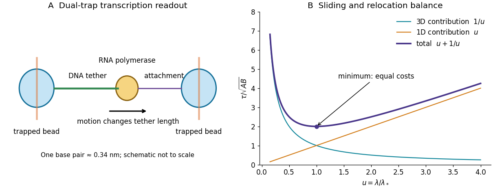

<h1 id="1/a/solution">Solution</h1>

↑ **Parent:** [A](../a.md)

In bacterial [transcription initiation](../../../../transcription-initiation.md), the [RNA polymerase](../../../../rna-polymerase.md) holoenzyme uses a [promoter](../../../../promoter-genetics.md)-specific [sigma factor](../../../../sigma-factor.md) to recognize [promoter](../../../../promoter-genetics.md) elements and form a closed [DNA](../../../../deoxyribonucleic-acid.md)-bound complex. Subsequent local [DNA melting](../../../../dna-melting.md) opens a [transcription](../../../../transcription-biology.md) bubble, positioning the template strand in the active site: this is an [open promoter complex](../../../../open-promoter-complex.md). The enzyme can then initiate [RNA](../../../../ribonucleic-acid.md) synthesis and escape into elongation. [LacI](../../../../laci.md), the lac repressor, binds the [lac operator](../../../../lac-operator.md) overlapping or close to the [promoter](../../../../promoter-genetics.md) and can prevent productive [promoter](../../../../promoter-genetics.md) binding or its progression to an open complex; operator arrangement and [DNA](../../../../deoxyribonucleic-acid.md) looping can strengthen repression. One should not assume every repressor acts at exactly the same microscopic step.

A high-resolution [optical tweezers](../../../../optical-tweezers.md) assay mechanically connects one trapped bead to [RNA polymerase](../../../../rna-polymerase.md) and another bead to an upstream or downstream [DNA](../../../../deoxyribonucleic-acid.md) handle. Polymerase motion changes the tether length; measuring bead displacement and the calibrated restoring [force](../../../../force-split.md) reports elongation under a known load. A feedback [force](../../../../force-split.md) clamp can keep that load approximately constant. Reversing the tether geometry permits assisting and opposing loads. The left panel below shows the mechanical arrangement rather than a copied apparatus image.

A base-pair advance is only about $0.34\,\mathrm{nm}$ along B-form [DNA](../../../../deoxyribonucleic-acid.md). Resolving that increment requires exceptional mechanical stability, suppression of drift and laser-pointing noise, calibration of trap and tether compliance, and sufficient temporal sampling to separate steps from thermal bead fluctuations. Position histograms, dwell detection and their spatial correlations can expose a repeated increment; one should also test [nucleotide](../../../../nucleotide.md)-dependent motion, pauses and backtracking. Stabilized dual-trap measurements combined with [transcription](../../../../transcription-biology.md)-product analysis established approximately one base-pair advance per incorporated [nucleotide](../../../../nucleotide.md).[Single-molecule displacement measurement and independent gel analysis supporting one-base-pair stepping](../../../../direct-observation-of-base-pair-stepping-by-rna-polymerase-by-elio-a-abbondanzieri-and-others.md)

**[Figure 1](#1/a/image-optical-trapping-of-a-transcription-complex-and-the-competing-terms-of-a-facilitated-target-search). Optical trapping of a transcription complex and the competing terms of a facilitated target search**. Original mechanical schematic and dimensionless search-time model. The stepping scale is a physical scale, while the illustrated normalized search curve is not experimental data.

## ↑ Ancestors (12)

1. [A](../a.md)
2. [1](../../1.md)
3. [2019](../../../2019-split.md)
4. [Past exam of the biological physics course of the University of Oxford](../../../split.md)
5. [Biological physics course of the University of Oxford](../../../../biological-physics-course-of-the-university-of-oxford.md)
6. [Year 4 of the physics course of the University of Oxford](../../../../year-4-of-the-physics-course-of-the-university-of-oxford.md)
7. [Physics course of the University of Oxford](../../../../physics-course-of-the-university-of-oxford.md)
8. [Undergraduate course of the University of Oxford](../../../../undergraduate-course-of-the-university-of-oxford.md)
9. [Course of the University of Oxford](../../../../course-of-the-university-of-oxford.md)
10. [University of Oxford](../../../../university-of-oxford-split.md)
11. [List of universities](../../../../list-of-universities.md)
12. [Codex Wiki](../../../../split.md)

## ← Incoming links (1)

- [Solution](../c/i/solution.md)
