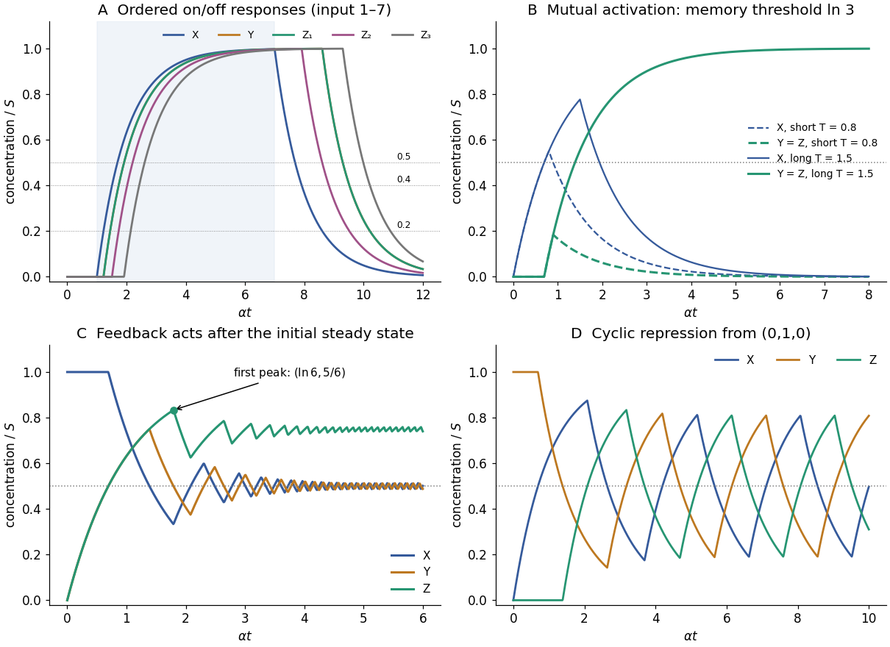

<h1 id="3/a/solution">Solution</h1>

↑ **Parent:** [A](../a.md)

Let the common production and removal constants be $\beta$ and $\alpha$, so an unrepressed [protein](../../../../protein-split.md) approaches $S=\beta/\alpha$. A simple constructive motif is

$$
X\longrightarrow Y,\qquad X\longrightarrow Z_1,\qquad
X\longrightarrow Z_2,\qquad Y\longrightarrow Z_3.
$$

Choose thresholds $K_{XY}=K_{XZ_1}=0.2S$, $K_{XZ_2}=0.4S$, and $K_{YZ_3}=0.5S$. The [logic approximation for gene regulation](../../../../logic-approximation-for-gene-regulation.md) gives $\dot Y=\beta H(X-0.2S)-\alpha Y$, $\dot Z_1=\beta H(X-0.2S)-\alpha Z_1$, $\dot Z_2=\beta H(X-0.4S)-\alpha Z_2$, and $\dot Z_3=\beta H(Y-0.5S)-\alpha Z_3$. These unequal thresholds are permitted in this part; the production and degradation rates remain equal.

After input onset, $X=S[1-e^{-\alpha(t-T_1)}]$. Production of $Z_1$ and $Y$ begins at $T_1+0.2231/\alpha$, $Z_2$ at $T_1+0.5108/\alpha$, and $Z_3$ at $T_1+(0.2231+\ln2)/\alpha=T_1+0.9163/\alpha$. Thus the required on-order is obtained. Take an input long enough that all these events occur, for example $T_2-T_1=6/\alpha$.

At input termination, $X=X_2e^{-\alpha(t-T_2)}$, where $X_2=S[1-e^{-\alpha(T_2-T_1)}]$. The higher direct threshold is crossed first: $Z_2$ production stops at $t_2=T_2+\alpha^{-1}\ln[X_2/(0.4S)]$, and $Z_1$ and $Y$ production stop at $t_1=T_2+\alpha^{-1}\ln[X_2/(0.2S)]$. At that instant $Y_1=S\{1-e^{-\alpha[t_1-T_1-0.2231/\alpha]}\}$, so $Z_3$ stops later at $t_3=t_1+\alpha^{-1}\ln[Y_1/(0.5S)]$. For the example, the delays after $T_2$ are approximately $0.914$, $1.607$ and $2.300$ in units of $\alpha^{-1}$:

$$
\boxed{Z_1\ \hbox{on before}\ Z_2\ \hbox{on before}\ Z_3;\qquad
Z_2\ \hbox{off before}\ Z_1\ \hbox{off before}\ Z_3.}
$$

[Protein](../../../../protein-split.md) [concentrations](../../../../concentration.md) rise or decay continuously after these switches; “off” denotes cessation of production, not instantaneous disappearance. The first panel below marks the thresholds and the resulting [concentrations](../../../../concentration.md).

**[Figure 2](#3/a/image-threshold-circuits-implement-ordered-responses-persistent-memory-a-first-output-peak-and-cyclic-repression). Threshold circuits implement ordered responses, persistent memory, a first output peak and cyclic repression**. Original normalized solutions of the logic models in question 3. All concentrations are divided by $S=\beta/\alpha$ and time by $\alpha^{-1}$; illustrative common thresholds in panels B–D are $K/S=1/2$.

## ↑ Ancestors (12)

1. [A](../a.md)
2. [3](../../3.md)
3. [2019](../../../2019-split.md)
4. [Past exam of the biological physics course of the University of Oxford](../../../split.md)
5. [Biological physics course of the University of Oxford](../../../../biological-physics-course-of-the-university-of-oxford.md)
6. [Year 4 of the physics course of the University of Oxford](../../../../year-4-of-the-physics-course-of-the-university-of-oxford.md)
7. [Physics course of the University of Oxford](../../../../physics-course-of-the-university-of-oxford.md)
8. [Undergraduate course of the University of Oxford](../../../../undergraduate-course-of-the-university-of-oxford.md)
9. [Course of the University of Oxford](../../../../course-of-the-university-of-oxford.md)
10. [University of Oxford](../../../../university-of-oxford-split.md)
11. [List of universities](../../../../list-of-universities.md)
12. [Codex Wiki](../../../../split.md)

## ← Incoming links (2)

- [Solution](../b/solution.md)
- [Solution](../d/solution.md)
