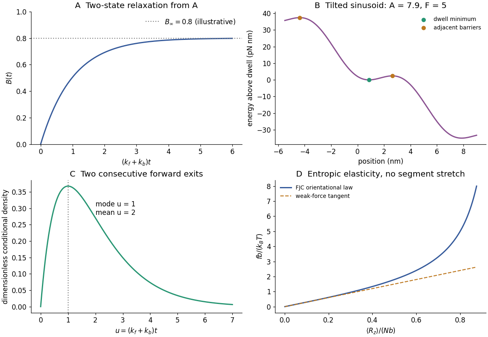

<h1 id="4/b/solution">Solution</h1>

↑ **Parent:** [B](../b.md)

Write $B(t)$ for the [probability](../../../../probability.md) of state B, so $A(t)=1-B(t)$. Gain minus loss gives

$$
\dot B=k_f(1-B)-k_bB=k_f-(k_f+k_b)B.
$$

With $B(0)=0$, the solution is

$$
\boxed{B(t)=\frac{k_f}{k_f+k_b}\left[1-e^{-(k_f+k_b)t}\right].}
$$

It rises monotonically from zero, initially with slope $k_f$, towards $B_{\rm eq}=k_f/(k_f+k_b)$ on time scale $(k_f+k_b)^{-1}$. The first panel of the original figure below shows this shape for illustrative [equilibrium](../../../../equilibrium-point-of-a-dynamical-system.md) [probability](../../../../probability.md) $0.8$.

The other [equilibrium](../../../../equilibrium-point-of-a-dynamical-system.md) [probability](../../../../probability.md) is $A_{\rm eq}=k_b/(k_f+k_b)$, and their ratio is $k_f/k_b$. Applying [detailed balance](../../../../detailed-balance.md) from part (a) gives

$$
\frac{B_{\rm eq}}{A_{\rm eq}}=e^{-(G_B-G_A)/(k_BT)},
$$

which is precisely the two-state [Boltzmann distribution](../../../../boltzmann-distribution.md). It fixes the ratio but not the sum of the rates, so [equilibrium](../../../../equilibrium-point-of-a-dynamical-system.md) measurements alone do not determine the relaxation time.

**[Figure 3](#4/b/image-two-state-equilibration-a-tilted-periodic-motor-sequential-step-times-and-freely-jointed-chain-elasticity). Two-state equilibration, a tilted periodic motor, sequential-step times and freely jointed chain elasticity**. Original model plots, not reconstructions of the source graphs. The motor potential uses sinusoidal coefficient $A=7.9\,\mathrm{pN\,nm}$ and forward tilt $F=5\,\mathrm{pN}$; other panels use dimensionless axes.

## ↑ Ancestors (12)

1. [B](../b.md)
2. [4](../../4.md)
3. [2019](../../../2019-split.md)
4. [Past exam of the biological physics course of the University of Oxford](../../../split.md)
5. [Biological physics course of the University of Oxford](../../../../biological-physics-course-of-the-university-of-oxford.md)
6. [Year 4 of the physics course of the University of Oxford](../../../../year-4-of-the-physics-course-of-the-university-of-oxford.md)
7. [Physics course of the University of Oxford](../../../../physics-course-of-the-university-of-oxford.md)
8. [Undergraduate course of the University of Oxford](../../../../undergraduate-course-of-the-university-of-oxford.md)
9. [Course of the University of Oxford](../../../../course-of-the-university-of-oxford.md)
10. [University of Oxford](../../../../university-of-oxford-split.md)
11. [List of universities](../../../../list-of-universities.md)
12. [Codex Wiki](../../../../split.md)

## ← Incoming links (1)

- [Solution](../../5/c/solution.md)
