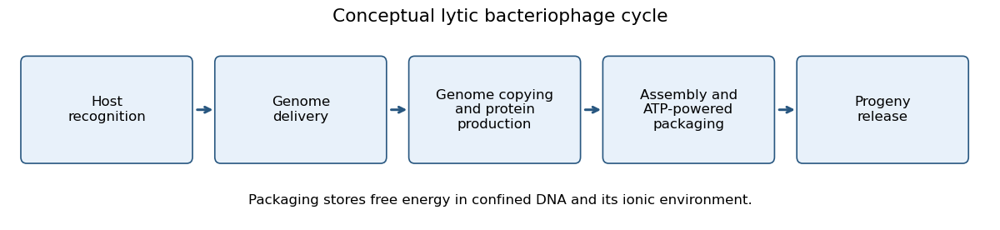
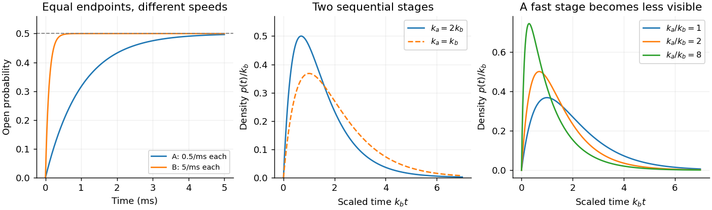

# 2021

↑ **Parent:** [Past exam of the biological physics course of the University of Oxford](../past-exam-of-the-biological-physics-course-of-the-university-of-oxford.md)

Source paper: [https://www.whatdotheyknow.com/request/oxford_physics_past_papers_2/response/2340696/attach/9/Physics%20Papers%202020.pdf?cookie_passthrough=1](https://www.whatdotheyknow.com/request/oxford_physics_past_papers_2/response/2340696/attach/9/Physics%20Papers%202020.pdf?cookie_passthrough=1)

The source bundle's filename says 2020, but the paper's cover identifies Trinity Term 2021, C7, A11050W1. All optional answers are included. The unavailable figure in [a](#1/a) is explicitly distinguished from deductions supported by the surviving text.

**Table of contents**

- [1](#1)
  - [a](#1/a)
    - [Solution](#1/a/solution)
  - [b](#1/b)
    - [Solution](#1/b/solution)
  - [c](#1/c)
    - [Solution](#1/c/solution)
  - [d](#1/d)
    - [Solution](#1/d/solution)
- [2](#2)
  - [a](#2/a)
    - [Solution](#2/a/solution)
  - [b](#2/b)
    - [Solution](#2/b/solution)
  - [c](#2/c)
    - [Solution](#2/c/solution)
  - [d](#2/d)
    - [Solution](#2/d/solution)
- [3](#3)
  - [a](#3/a)
    - [Solution](#3/a/solution)
  - [b](#3/b)
    - [Solution](#3/b/solution)
  - [c](#3/c)
    - [Solution](#3/c/solution)
  - [d](#3/d)
    - [Solution](#3/d/solution)
- [4](#4)
  - [a](#4/a)
    - [Solution](#4/a/solution)
  - [b](#4/b)
    - [Solution](#4/b/solution)
  - [c](#4/c)
    - [Solution](#4/c/solution)
  - [d](#4/d)
    - [Solution](#4/d/solution)
  - [e](#4/e)
    - [Solution](#4/e/solution)
  - [f](#4/f)
    - [Solution](#4/f/solution)
- [5](#5)
  - [a](#5/a)
    - [Solution](#5/a/solution)
  - [b](#5/b)
    - [Solution](#5/b/solution)
  - [c](#5/c)
    - [Solution](#5/c/solution)
- [6](#6)
  - [a](#6/a)
    - [Solution](#6/a/solution)
  - [b](#6/b)
    - [Solution](#6/b/solution)
  - [c](#6/c)
    - [Solution](#6/c/solution)
  - [d](#6/d)
    - [Solution](#6/d/solution)

## 1

↑ **Parent:** [2021](2021.md)

<h3 id="1/a">a</h3>

↑ **Parent:** [1](#1)

<h4 id="1/a/solution">Solution</h4>

↑ **Parent:** [A](#1/a)

At the initial negative [membrane potential](../membrane-potential.md), most [voltage-gated potassium channels](../membrane-potential.md#voltage-gated-potassium-channel) have a closed activation gate. [Depolarization](../membrane-potential.md#depolarization) moves charged residues in each [voltage-sensing domain](../membrane-potential.md#voltage-sensing-domain), particularly the S4 helices, through the [electric field](../electric-field.md). Coupling between the [voltage-sensing domains](../membrane-potential.md#voltage-sensing-domain) and the pore opens the intracellular gate. A classical [voltage-gated potassium channel](../membrane-potential.md#voltage-gated-potassium-channel) has four subunits, each with six transmembrane helices; S5, the pore loop and S6 contribute to the central pathway and [selectivity filter](../cell-membrane.md#selectivity-filter). The rising open [probability](../probability-theory.md#probability) produces increasing outward [potassium](../chemical-substance.md#potassium) [electric current](../electric-charge.md#electric-current), since the imposed positive [membrane potential](../membrane-potential.md) is above the [potassium](../chemical-substance.md#potassium) [Nernst equilibrium potential](../membrane-potential.md#nernst-equilibrium-potential). Here outward [electric current](../electric-charge.md#electric-current) is positive: $I_K=N\gamma p_O(V-E_K)$, where $N$ is channel number and $\gamma$ is single-channel [electrical conductance](../electric-charge.md#electrical-conductance).

The [electric current](../electric-charge.md#electric-current) subsequently falls because the rapidly inactivating Shaker form exhibits [ball-and-chain inactivation](../membrane-potential.md#ball-and-chain-inactivation). An intracellular N-terminal domain, tethered to the channel, blocks the open pore. The [ion channel](../cell-membrane.md#ion-channel) can therefore stop conducting while the [membrane potential](../membrane-potential.md) remains depolarized and the activation machinery remains activated. This is [ion-channel inactivation](../membrane-potential.md#ion-channel-inactivation), rather than reversal of the voltage step, loss of the ionic driving force, or ordinary gate closure. [Repolarization](../membrane-potential.md#repolarization) favors removal of the block and recovery of channel availability. Slower [C-type inactivation](../membrane-potential.md#c-type-inactivation) involving the outer pore can coexist, but is not the principal explanation of the rapid decay described here.

Several independent observations connect this functional explanation to structure. Small transient gating [electric currents](../electric-charge.md#electric-current) report movement of sensor [electric charge](../electric-charge.md) before ionic conduction; charge-neutralization studies of S4/S2 change the measured gating charge and activation. Structural studies resolve separate sensor and pore regions.[Gating-charge measurements identify voltage-sensing residues](../biochemistry-and-biophysics-bibliography.md#voltage-sensing-residues-in-the-s2-and-s4-segments-of-the-shaker-k-plus-channel-by-s-a-seoh-and-others)[Voltage-sensor and pore architecture of Kv1.2](../biochemistry-and-biophysics-bibliography.md#crystal-structure-of-a-mammalian-voltage-dependent-shaker-family-k-plus-channel-by-stephen-b-long-and-others) Historical N-terminal removal abolished rapid [ion-channel inactivation](../membrane-potential.md#ion-channel-inactivation) while preserving activation, and the corresponding free peptide restored block from the cytoplasmic side. These results separate the activation gate from the tethered blocker and identify which side of the [cell membrane](../cell-membrane.md) contains the blocking domain.[N-terminal perturbations distinguish rapid inactivation from activation](../biochemistry-and-biophysics-bibliography.md#biophysical-and-molecular-mechanisms-of-shaker-potassium-channel-inactivation-by-toshinori-hoshi-and-others)[Cytoplasmic peptide restores inactivation to channels lacking the native N-terminal domain](../biochemistry-and-biophysics-bibliography.md#restoration-of-inactivation-in-mutants-of-shaker-potassium-channels-by-a-peptide-derived-from-shb-by-william-n-zagotta-and-others)

**Source-gap TODO:** the supplied PDF's figure invokes an undefined image object, so its actual pulse duration, pulse sequence, current scale, peak amplitude, decay time and any tail-current waveform cannot be read. The account above uses only the stated change from $-60$ to $+20\,\mathrm{mV}$ and the stated rise and rapid decay; no numerical kinetic fit or reconstruction of the missing trace is claimed.

<h3 id="1/b">b</h3>

↑ **Parent:** [1](#1)

<h4 id="1/b/solution">Solution</h4>

↑ **Parent:** [B](#1/b)

For [two-state ion-channel gating](../membrane-potential.md#two-state-ion-channel-gating), write $C\mathrel{\mathop{\rightleftarrows}^{k_o}_{k_c}}O$. Gain minus loss of open [probability](../probability-theory.md#probability) gives the [ordinary differential equation](../differential-equation.md#ordinary-differential-equation)

$$
\dot p_O=k_o(1-p_O)-k_cp_O,\qquad
p_O(t)=p_\infty+[p_O(0)-p_\infty]e^{-t/\tau},\quad
p_\infty=\frac{k_o}{k_o+k_c},\quad \tau=\frac1{k_o+k_c}.
$$

Thus the ratio of the transition rates determines the final open [probability](../probability-theory.md#probability), while their sum determines the response speed. Both given channels have $p_\infty=1/2$. For an initially closed population, with $t$ measured in milliseconds,

$$
\boxed{p_A(t)=\tfrac12(1-e^{-t}),\quad \tau_A=1\,\mathrm{ms};\qquad
p_B(t)=\tfrac12(1-e^{-10t}),\quad \tau_B=0.1\,\mathrm{ms}.}
$$

The mean individual open and closed lifetimes are $1/k_c$ and $1/k_o$: both are $2\,\mathrm{ms}$ for A and $0.2\,\mathrm{ms}$ for B. With the same channel number, single-channel [electrical conductance](../electric-charge.md#electrical-conductance) and driving force, the steady macroscopic [electric currents](../electric-charge.md#electric-current) are equal, but B reaches that value ten times faster. If both populations were already at $p_O=1/2$, neither would show a mean relaxation under these fixed rates: a response also requires an initial condition or a change in rates.

The stationary [variance](../variance.md) of the number open is $N/4$ for independent channels. Its [autocovariance](../time-series.md#autocovariance) is $(N/4)e^{-|t|/\tau}$, so B's fluctuations decorrelate ten times faster even though their instantaneous [variance](../variance.md) is unchanged. Faster gating allows an [ion channel](../cell-membrane.md#ion-channel) population to follow a brief stimulus and contribute to rapid [action potential](../neuron.md#action-potential) timing. Slower gating integrates over brief changes and can provide a delayed opposing [electric current](../electric-charge.md#electric-current), useful in setting [action potential](../neuron.md#action-potential) duration or frequency selectivity. Those examples describe consequences of kinetics; the stipulated voltage-independent rates alone do not define a complete excitable [neuron](../neuron.md).

<h3 id="1/c">c</h3>

↑ **Parent:** [1](#1)

<h4 id="1/c/solution">Solution</h4>

↑ **Parent:** [C](#1/c)

Add a nonconducting inactivated state to the [continuous-time Markov chain](../continuous-time-markov-chain.md):

$$
C\mathrel{\mathop{\rightleftarrows}^{k_o(V)}_{k_c(V)}}O
\mathrel{\mathop{\rightleftarrows}^{k_i(V)}_{k_r(V)}}I,
\qquad p_C+p_O+p_I=1.
$$

For example, $\dot p_O=k_op_C-(k_c+k_i)p_O+k_rp_I$ and $\dot p_I=k_ip_O-k_rp_I$. [Depolarization](../membrane-potential.md#depolarization) first increases $p_O$, then transfers population into $I$ by [ball-and-chain inactivation](../membrane-potential.md#ball-and-chain-inactivation). A small recovery rate during the pulse permits a sustained decline of $I_K=N\gamma p_O(V-E_K)$. [Repolarization](../membrane-potential.md#repolarization) favors recovery, eventually restoring the closed but available population. Several sequential closed states can represent the cooperative movements of four [voltage-sensing domains](../membrane-potential.md#voltage-sensing-domain); three states are the minimal explanation of rise followed by decay, rather than a quantitative fit to the missing trace.

Loss of outward [potassium](../chemical-substance.md#potassium) [electric current](../electric-charge.md#electric-current) weakens [repolarization](../membrane-potential.md#repolarization) and can broaden an [action potential](../neuron.md#action-potential). Reduced residual [potassium](../chemical-substance.md#potassium) [electrical conductance](../electric-charge.md#electrical-conductance) can reduce the subsequent [hyperpolarization](../membrane-potential.md#hyperpolarization) and permit faster repeated firing. Conversely, prolonged [depolarization](../membrane-potential.md#depolarization) can maintain [sodium](../chemical-substance.md#sodium) [ion-channel inactivation](../membrane-potential.md#ion-channel-inactivation), delay recovery and lower the maximum firing frequency or cause depolarization block. The sign of the frequency change depends on the other [ion channels](../cell-membrane.md#ion-channel) and recovery kinetics; rapid [potassium](../chemical-substance.md#potassium) [ion-channel inactivation](../membrane-potential.md#ion-channel-inactivation) alone does not fix it.

<h3 id="1/d">d</h3>

↑ **Parent:** [1](#1)

<h4 id="1/d/solution">Solution</h4>

↑ **Parent:** [D](#1/d)

The passive upper limiting [membrane potential](../membrane-potential.md) for a purely [sodium](../chemical-substance.md#sodium)-selective pathway is its [Nernst equilibrium potential](../membrane-potential.md#nernst-equilibrium-potential). Equal inside and outside [electrochemical potentials](../chemical-potential.md#electrochemical-potential), using ideal [concentrations](../mathematical-physics.md#concentration), require

$$
RT\ln\frac{c_{\rm in}}{c_{\rm out}}+FV=0,
\qquad
\boxed{E_{\rm Na}=\frac{RT}{F}\ln\frac{145}{15}
=+60.6\,\mathrm{mV}\quad(T=310.15\,\mathrm K).}
$$

This is the maximum absolute inside-minus-outside voltage under the stated passive assumptions. If the reference resting [membrane potential](../membrane-potential.md) is $-60\,\mathrm{mV}$, the corresponding increase is about $121\,\mathrm{mV}$.

Actual [action potentials](../neuron.md#action-potential) usually peak below $E_{\rm Na}$ because [voltage-gated sodium channels](../membrane-potential.md#voltage-gated-sodium-channel) undergo [ion-channel inactivation](../membrane-potential.md#ion-channel-inactivation), while outward [potassium](../chemical-substance.md#potassium) and leak [electric currents](../electric-charge.md#electric-current) oppose inward [sodium](../chemical-substance.md#sodium) [electric current](../electric-charge.md#electric-current). Finite [membrane capacitance](../neuroscience.md#membrane-capacitance) and finite available time also prevent instantaneous equilibration. At $V=E_{\rm Na}$, the [sodium](../chemical-substance.md#sodium) driving force itself is zero.

## 2

↑ **Parent:** [2021](2021.md)

<h3 id="2/a">a</h3>

↑ **Parent:** [2](#2)

<h4 id="2/a/solution">Solution</h4>

↑ **Parent:** [A](#2/a)

Use the [logic approximation for gene regulation](../mathematical-biology.md#logic-approximation-for-gene-regulation), zero basal production and initially vanishing X, Y and Z. Let $K=K_{xy}=K_{xz}=K_{yz}=K_{xx}/2$, $Y_\infty=Z_\infty=\beta_y/\alpha$, and assume the activated Q level exceeds the X activation threshold. The circuit combines a [coherent feed-forward loop](../mathematical-biology.md#coherent-feed-forward-loop) with [negative autoregulation](../mathematical-biology.md#negative-autoregulation). While X is below its self-repression threshold it obeys $\dot X=\beta_x-\alpha X$, hence X first crosses $K$ at

$$
t_X=-\frac1\alpha\ln\left(1-\frac{\alpha K}{\beta_x}\right).
$$

Y production begins then. While X remains above $K$, $Y=Y_\infty[1-e^{-\alpha(t-t_X)}]$. The AND gate for Z first becomes active when Y reaches $K$, so

$$
\boxed{T_{\min}=t_X-\frac1\alpha\ln\left(1-\frac{\alpha K}{\beta_y}\right)
\simeq-\frac1\alpha\ln\left(1-\frac{\alpha K}{\beta_y}\right).}
$$

The approximation drops the short X build-up time because $\beta_x\gg\beta_y$. Strictly the input must last longer than this onset time to produce a nonzero amount of Z. This requires $\beta_y/\alpha>K$: at equality the threshold is approached only asymptotically, and below it Z never switches on. No numerical delay follows without the threshold-to-production ratio.

In the strong [negative autoregulation](../mathematical-biology.md#negative-autoregulation) limit, X is held close to $K_{xx}=2K$; a smooth repression law regularizes the rapid switching of the ideal Boolean rule. After the input disappears at $t_0$, production of X stops and $X\simeq2Ke^{-\alpha(t-t_0)}$. It takes $(\ln2)/\alpha$ for X to fall below $K$. Until then Y remains at $Y_\infty>K$ and the Z AND gate stays on, so Z stays at $Z_\infty$. After that Z decays by dilution, taking another $(\ln2)/\alpha$ to halve. Therefore

$$
\boxed{t_{Z,1/2}-t_0\simeq\frac{2\ln2}{\alpha}.}
$$

More generally replace the first $\ln2$ by $\ln[X(t_0)/K]$. This distinguishes disappearance of the external ligand from disappearance of the persistent X [transcription factor](../molecular-genetics.md#transcription-factor).

<h3 id="2/b">b</h3>

↑ **Parent:** [2](#2)

<h4 id="2/b/solution">Solution</h4>

↑ **Parent:** [B](#2/b)

Put $M=[E_m]$, $r=V_R[R]$ and $b=V_B[B]$. Saturated [CheR](../signal-transduction.md#cher) supplies a constant [receptor methylation](../signal-transduction.md#receptor-methylation) flux, while [CheB](../signal-transduction.md#cheb) removes it with [Michaelis-Menten kinetics](../mathematical-biology.md#michaelis-menten-kinetics):

$$
\dot M=r-\frac{bM}{K_B+M}.
$$

At a finite [steady state](../dynamical-systems.md#steady-state), $r(K_B+M_0)=bM_0$, giving

$$
\boxed{M_0=\frac{K_BV_R[R]}{V_B[B]-V_R[R]}=\frac{K_Br}{b-r}.}
$$

It requires $0<r<b$ and $M_0$ below the total available [receptor](../protein.md#receptor-biochemistry) pool. The [steady state](../dynamical-systems.md#steady-state) is stable because $d\dot M/dM=-bK_B/(K_B+M)^2<0$. If $r\geq b$, the ideal equation has no finite positive [steady state](../dynamical-systems.md#steady-state); actual methylatable sites would become exhausted.

Attractant binding reduces [receptor](../protein.md#receptor-biochemistry) signalling, reducing [CheA](../signal-transduction.md#chea)-dependent [phosphorylation](../chemical-reaction.md#phosphorylation) of [CheY](../signal-transduction.md#chey) and initially reducing tumbling frequency, so smooth runs become longer. A spatially uniform stimulus provides no preferred direction. [Perfect adaptation](../signal-transduction.md#perfect-adaptation) means that after this transient the tumbling frequency returns exactly to its pre-step value despite continued attractant presence.

The equation above alone does not specify attractant occupancy or its influence on activity. If binding simply changes activity from $M$ to $fM$ with $0<f<1$, without changing either modifying flux, $M$ remains $M_0$ and the output remains $fM_0$: there is no adaptation. Thus the usual fall followed by recovery requires the additional feedback mechanism developed in [c](#2/c) or [d](#2/d), rather than following from the stated [Michaelis-Menten kinetics](../mathematical-biology.md#michaelis-menten-kinetics) alone.

<h3 id="2/c">c</h3>

↑ **Parent:** [2](#2)

<h4 id="2/c/solution">Solution</h4>

↑ **Parent:** [C](#2/c)

Let attractant reduce signalling activity per methylated [receptor](../protein.md#receptor-biochemistry) by a factor $f\in(0,1)$, so the output is $A=fM$. Before stimulation take $f=1$ and $M=M_0=K_Br/(b-r)$. [Perfect adaptation](../signal-transduction.md#perfect-adaptation) requires the final methylated [receptor](../protein.md#receptor-biochemistry) [concentration](../mathematical-physics.md#concentration) $M'=M_0/f$. With $b'=V'_B[B]$, the new [steady state](../dynamical-systems.md#steady-state) condition is

$$
r=\frac{b'M'}{K_B+M'},\qquad
\boxed{V'_B=\frac{r}{[B]}\left(1+\frac{fK_B}{M_0}\right)
=V_B\frac{M_0+fK_B}{M_0+K_B}.}
$$

Equivalently $b'=fb+(1-f)r$. Since $f<1$, this reduces demethylation relative to the initial condition. Immediately after binding, activity and tumbling fall. The excess [CheR](../signal-transduction.md#cher) flux then increases [receptor methylation](../signal-transduction.md#receptor-methylation), compensating the activity loss until $fM'=M_0$. The methylated population must have sufficient remaining capacity to reach $M'$.

Increasing [CheR](../signal-transduction.md#cher) [concentration](../mathematical-physics.md#concentration) raises $r$ and the baseline activity; increasing [CheB](../signal-transduction.md#cheb) [concentration](../mathematical-physics.md#concentration) raises $b$ and lowers it. If the attractant-dependent ratio $c=V'_B/V_B$ remains fixed after such a change, the new pre- and post-step outputs are

$$
A_{\rm before}=\frac{K_Br}{b-r},\qquad
A_{\rm after}=\frac{fK_Br}{cb-r}.
$$

Their equality requires $c=f+(1-f)r/b$. Thus a ratio tuned for one $[R]/[B]$ generally loses [perfect adaptation](../signal-transduction.md#perfect-adaptation) when either [enzyme](../enzyme.md) level changes independently. For a concrete example, initially $r/b=1/2$ and $f=1/2$ require $c=3/4$; changing $r/b$ to $1/4$ requires $c=5/8$, so keeping $c=3/4$ fails. Proportionally scaling both [enzyme](../enzyme.md) levels preserves the ratio and the adaptation condition, while changing response speed. This is fine tuning, rather than [robust perfect adaptation](../signal-transduction.md#robust-perfect-adaptation).

<h3 id="2/d">d</h3>

↑ **Parent:** [2](#2)

<h4 id="2/d/solution">Solution</h4>

↑ **Parent:** [D](#2/d)

In the simplified [Barkai-Leibler model](../signal-transduction.md#barkai-leibler-model), let $M$ be the total methylated [receptor](../protein.md#receptor-biochemistry) [concentration](../mathematical-physics.md#concentration) and $A=f(S)M$ the active, unoccupied part. Ligand-bound methylated [receptors](../protein.md#receptor-biochemistry) contribute zero activity. Because [CheB](../signal-transduction.md#cheb) acts only on active [receptors](../protein.md#receptor-biochemistry),

$$
\dot M=r-\frac{bA}{K_B+A},\qquad r=V_R[R],\quad b=V_B[B].
$$

At a finite [steady state](../dynamical-systems.md#steady-state),

$$
\boxed{A_* =\frac{K_Br}{b-r},\qquad M_* =\frac{A_*}{f(S)}.}
$$

The output $A_*$ is independent of attractant [concentration](../mathematical-physics.md#concentration) $S$: attractant changes the necessary [receptor methylation](../signal-transduction.md#receptor-methylation) level, while the flux balance fixes activity. This proves [perfect adaptation](../signal-transduction.md#perfect-adaptation) for $0<r<b$, $f(S)>0$ and enough methylatable [receptors](../protein.md#receptor-biochemistry). At fixed $S$, $d\dot M/dM=-bf(S)K_B/[K_B+f(S)M]^2<0$, so this [steady state](../dynamical-systems.md#steady-state) is locally stable. If every [receptor](../protein.md#receptor-biochemistry) is permanently bound, $f=0$, or if the required $M_*$ exceeds the available pool, compensation fails.

This feedback couples demethylation directly to the output. Lower activity lowers demethylation; continuing [CheR](../signal-transduction.md#cher) action restores it. The structural dependence on active [receptors](../protein.md#receptor-biochemistry) removes the separate adjustment of $V'_B$ required in [c](#2/c).[Figure 1b and equation 1: saturated modifying flux and output-dependent reverse modification](../biochemistry-and-biophysics-bibliography.md#robustness-in-simple-biochemical-networks-by-naama-barkai-and-stanislas-leibler)

Changing [CheR](../signal-transduction.md#cher) or [CheB](../signal-transduction.md#cheb) [concentration](../mathematical-physics.md#concentration) changes $A_*$ and hence the baseline tumbling frequency, but the output still returns to that new baseline after an attractant step within the operating range. Raising [CheR](../signal-transduction.md#cher) raises $A_*$; raising [CheB](../signal-transduction.md#cheb) lowers it. Adaptation time also changes: linearization gives $\tau=(K_B+A_*)^2/[bf(S)K_B]$. Thus robustness of the return property does not mean an invariant tumbling frequency or response time across different [enzyme](../enzyme.md) abundances.

If [CheR](../signal-transduction.md#cher) instead has [Michaelis-Menten kinetics](../mathematical-biology.md#michaelis-menten-kinetics) on the unmethylated pool $U=E_T-M$, its flux is $r(M)=V_R[R](E_T-M)/(K_R+E_T-M)$. Then

$$
\frac{V_R[R](E_T-A/f)}{K_R+E_T-A/f}=\frac{bA}{K_B+A}.
$$

The left side depends on ligand through $f$, even at fixed output $A$; consequently the equilibrium output generally depends on attractant and [perfect adaptation](../signal-transduction.md#perfect-adaptation) is lost. It is recovered approximately when $E_T-M\gg K_R$ throughout the response, so the [CheR](../signal-transduction.md#cher) flux is effectively saturated.

## 3

↑ **Parent:** [2021](2021.md)

<h3 id="3/a">a</h3>

↑ **Parent:** [3](#3)

<h4 id="3/a/solution">Solution</h4>

↑ **Parent:** [A](#3/a)

Dense [DNA](../polymer.md#deoxyribonucleic-acid) packaging opposes three main physical effects. The negatively charged [DNA](../polymer.md#deoxyribonucleic-acid) backbones repel through [electrostatic interactions](../electrostatics.md#electrostatic-interaction), moderated by [electrostatic screening](../electrostatics.md#electrostatic-screening) and [counterion condensation](../electrostatics.md#counterion-condensation). At close approach, [hydration forces](../mixture.md#hydration-force) and [excluded volume](../statistical-physics.md#excluded-volume) become important. Bending a semiflexible [DNA](../polymer.md#deoxyribonucleic-acid) [polymer](../polymer.md) on a radius comparable with its [persistence length](../mathematical-biology.md#persistence-length) stores [elastic energy](../elasticity-physics.md#elastic-energy). Confinement also removes configurational [entropy](../entropy.md), and concentrating mobile [counterions](../chemistry.md#counterion) can impose an additional [osmotic pressure](../cell-membrane.md#osmotic-pressure) and [free energy](../thermodynamic-potential.md#thermodynamic-free-energy) cost. Their relative importance depends on geometry and ionic conditions.

A schematic lytic [bacteriophage](../biology.md#bacteriophage) life cycle is illustrated below.

**[Figure 1](#3/a/image-conceptual-lytic-bacteriophage-cycle-and-active-dna-packaging). Conceptual lytic bacteriophage cycle and active DNA packaging**.

Attachment recognizes a suitable host; delivery brings the genetic information into the host; host resources support production of components; assembly creates progeny that are released. Some [bacteriophages](../biology.md#bacteriophage) instead have a latent integrated phase, but that is not a necessary stage of this lytic schematic.

In many double-stranded [DNA](../polymer.md#deoxyribonucleic-acid) [bacteriophages](../biology.md#bacteriophage), a portal-associated [molecular motor](../biology.md#molecular-motor) uses [ATP hydrolysis](../chemical-reaction.md#atp-hydrolysis) to move [DNA](../polymer.md#deoxyribonucleic-acid) into a preformed [capsid](../biology.md#viral-capsid). Chemical [free energy](../thermodynamic-potential.md#thermodynamic-free-energy) pays for bending, repulsion and confinement, so the opposing [force](../force.md) rises as filling proceeds. This is active packaging rather than spontaneous equilibrium compaction. [Optical tweezers](../optics.md#optical-tweezers) can infer that opposing [force](../force.md) from displacement of a trapped bead and monitor packaging through the changing external [DNA](../polymer.md#deoxyribonucleic-acid) extension. Such measurements establish the mechanical principle without requiring any virus-handling procedure. The [inverse spool model](../polymer.md#inverse-spool-model) used below is an idealized packing geometry, not an exact structural claim for every [bacteriophage](../biology.md#bacteriophage).

<h3 id="3/b">b</h3>

↑ **Parent:** [3](#3)

<h4 id="3/b/solution">Solution</h4>

↑ **Parent:** [B](#3/b)

For an inextensible [worm-like chain](../mathematical-biology.md#worm-like-chain), the [DNA bending energy](../mathematical-biology.md#dna-bending-energy) is

$$
G_b=\frac{k_BT l_p}{2}\int \kappa(\ell)^2\,d\ell,
$$

where $\kappa$ is curvature and $\ell$ is [polymer contour length](../polymer.md#polymer-contour-length). A circle of radius $R_i$ has $\kappa=1/R_i$ and length $2\pi R_i$. Its [elastic energy](../elasticity-physics.md#elastic-energy) is therefore $(k_BT l_p/2)(2\pi R_i)/R_i^2=\pi l_pk_BT/R_i$. Adding the contributions of $n(R_i)$ rings at each radius gives

$$
\boxed{\Delta G_{\rm elastic}=\pi l_pk_BT\sum_i\frac{n(R_i)}{R_i}.}
$$

This ignores short connecting segments, twist, interactions between neighboring [DNA](../polymer.md#deoxyribonucleic-acid) segments and end effects. In a cylindrical stack with axial spacing $s$, $n(R_i)\simeq h/s$ away from the ends.

<h3 id="3/c">c</h3>

↑ **Parent:** [3](#3)

<h4 id="3/c/solution">Solution</h4>

↑ **Parent:** [C](#3/c)

**Correction of the printed limits:** ordinary positive [polymer contour length](../polymer.md#polymer-contour-length) requires integration from $R_{\rm in}$ to $R_{\rm out}$, because $R_{\rm out}>R_{\rm in}$ and the ring count is positive. For example, taking $n(R)=1$, $R_{\rm out}=2$ and $R_{\rm in}=1$ makes the printed outward-to-inward integral negative. Thus its sign cannot be retained as a physical length.

For hexagonally packed strands choose axial ring spacing $s$ and radial layer spacing $\sqrt3s/2$. With $n=h/s$ and radial layer density $2/(\sqrt3s)$,

$$
L=\frac{2}{\sqrt3s}\int_{R_{\rm in}}^{R_{\rm out}}2\pi R\frac hs\,dR
=\frac{2\pi h}{\sqrt3s^2}(R_{\rm out}^2-R_{\rm in}^2).
$$

The same continuum replacement in [b](#3/b) gives

$$
\Delta G_{\rm elastic}
=\frac{2\pi l_pk_BT h}{\sqrt3s^2}\ln\frac{R_{\rm out}}{R_{\rm in}},\qquad
R_{\rm in}^2=R_{\rm out}^2-\frac{\sqrt3s^2L}{2\pi h}.
$$

Eliminating the inner radius yields

$$
\boxed{\Delta G_{\rm elastic}
=\frac{\pi l_pk_BT h}{\sqrt3s^2}
\ln\left(\frac{R_{\rm out}^2}{R_{\rm out}^2-\sqrt3s^2L/(2\pi h)}\right).}
$$

The resisting packaging [force](../force.md) is the marginal [free energy](../thermodynamic-potential.md#thermodynamic-free-energy) per added [polymer contour length](../polymer.md#polymer-contour-length), at fixed $h$, $s$ and $R_{\rm out}$:

$$
\boxed{F_L=\left(\frac{\partial\Delta G_{\rm elastic}}{\partial L}\right)_{h,s,R_{\rm out}}
=\frac{l_pk_BT}{2R_{\rm in}^2}
=\frac{l_pk_BT}{2\left(R_{\rm out}^2-\sqrt3s^2L/(2\pi h)\right)}.}
$$

The [force](../force.md) opposing insertion is positive; its contribution to outward ejection has the same magnitude. The domain is $0\leq L<2\pi hR_{\rm out}^2/(\sqrt3s^2)$. The divergence as the inner hole closes reflects the singular curvature of ideal rings and marks breakdown of the continuum model. If spacing also relaxes, the full [free energy](../thermodynamic-potential.md#thermodynamic-free-energy) must include interstrand interactions before optimization; simply varying $s$ in this bending-only formula is insufficient.

<h3 id="3/d">d</h3>

↑ **Parent:** [3](#3)

<h4 id="3/d/solution">Solution</h4>

↑ **Parent:** [D](#3/d)

The small binding [RNA](../polymer.md#ribonucleic-acid) can serve conceptually as an [RNA aptamer](../polymer.md#rna-aptamer) recognition probe. Coupling recognition to an optical label would make a specifically bound [virus](../biology.md#virus) appear as a moving fluorescent spot. [Single-particle tracking](../biophysical-measurement.md#single-particle-tracking) estimates successive spot positions and fits their displacement statistics. Specificity is assessed by comparison with a nonbinding recognition probe or a sample without the target, while the much faster [diffusion](../thermodynamics.md#diffusion) of unbound probes distinguishes freely moving label from target-associated signal. Subnanomolar [dissociation constant](../chemical-potential.md#dissociation-constant) supports appreciable occupancy at low probe abundance, but affinity alone does not determine the dissociation lifetime because $K_d=k_{\rm off}/k_{\rm on}$. This describes detection principles, not an operational virus preparation or labelling protocol.

For a dilute spherical particle of radius $a=60\,\mathrm{nm}$ in bulk [water](../chemical-substance.md#water), the [Stokes–Einstein relation](../stokes-flow.md#stokes-einstein-relation) gives, at an explicitly assumed $T=300\,\mathrm K$,

$$
\boxed{D=\frac{k_BT}{6\pi\eta a}=3.66\,\mathrm{\mu m^2\,s^{-1}}.}
$$

A $2\,\mathrm{nm}$ free probe would have $D\simeq110\,\mathrm{\mu m^2\,s^{-1}}$, roughly thirty times larger. The recognition probe changes the target's hydrodynamic size only modestly in this estimate.

For isotropic [Brownian motion](../brownian-motion.md), the mean vector displacement is zero. In $t=0.1\,\mathrm s$, distinct measures of how far it moves are

$$
\boxed{\sqrt{\langle|\Delta\mathbf r|^2\rangle}=\sqrt{6Dt}=1.48\,\mathrm{\mu m},\qquad
\langle|\Delta\mathbf r|\rangle=4\sqrt{Dt/\pi}=1.37\,\mathrm{\mu m}.}
$$

A two-dimensional image instead gives projected root-mean-square displacement $\sqrt{4Dt}=1.21\,\mathrm{\mu m}$ and mean projected distance $\sqrt{\pi Dt}=1.07\,\mathrm{\mu m}$. The projected [mean squared displacement](../brownian-motion.md#mean-squared-displacement) is $4D\Delta t$; independent localization errors of [variance](../variance.md) $\sigma^2$ in each coordinate add $4\sigma^2$. Finite exposure blurs motion, and nearby walls reduce [diffusion](../thermodynamics.md#diffusion); those effects must be separated from particle size when interpreting a trajectory.

## 4

↑ **Parent:** [2021](2021.md)

The named [bacteriophage](../biology.md#bacteriophage), [Bacillus virus phi29](../biology.md#bacillus-virus-phi29), infects [Bacillus subtilis](../organism.md#bacillus-subtilis); the paper's identification of [Escherichia coli](../organism.md#escherichia-coli) as its host is incorrect. This correction does not alter the idealized geometry or numerical inputs used below.[Introduction identifies phi29 as a Bacillus subtilis bacteriophage](../biochemistry-and-biophysics-bibliography.md#experimental-test-of-connector-rotation-during-dna-packaging-into-bacteriophage-phi29-capsids-by-thorsten-hugel-and-others)

<h3 id="4/a">a</h3>

↑ **Parent:** [4](#4)

<h4 id="4/a/solution">Solution</h4>

↑ **Parent:** [A](#4/a)

The stipulated [DNA](../polymer.md#deoxyribonucleic-acid) [volume](../geometry-and-topology.md#volume) is $V_D=20000\,\mathrm{nm^3}$ and the spherical [capsid](../biology.md#viral-capsid) [volume](../geometry-and-topology.md#volume) is $V_c=4\pi(20\,\mathrm{nm})^3/3=33510\,\mathrm{nm^3}$. Thus

$$
\boxed{\phi=\frac{V_D}{V_c}=0.597\simeq60\%.}
$$

The packed [DNA](../polymer.md#deoxyribonucleic-acid) occupies a substantial fraction of the available space: the remaining nominal fraction is $40.3\%$. Compared with the paper's stated $0.71$ reference, it reaches about $84\%$ of that value. This indicates dense confinement, but does not prove crystalline order or specify interstrand spacing. [DNA](../polymer.md#deoxyribonucleic-acid) is a connected elongated [polymer](../polymer.md), rather than a collection of independent hard spheres.

There is also a numerical qualification: the exact densest equal-[sphere packing](../euclidean-geometry.md#sphere-packing) fraction is $\pi/(3\sqrt2)\simeq0.74048$, not $0.71$. Using it changes the comparison to about $81\%$ without changing the calculated $0.597$ [volume fraction](../continuum-mechanics.md#volume-fraction) or its physical interpretation.

<h3 id="4/b">b</h3>

↑ **Parent:** [4](#4)

<h4 id="4/b/solution">Solution</h4>

↑ **Parent:** [B](#4/b)

The [polymer contour length](../polymer.md#polymer-contour-length) and magnitude of total [electric charge](../electric-charge.md) are

$$
L=20000(0.34\,\mathrm{nm})=6.80\,\mathrm{\mu m},\qquad
Q=\lambda L=40000e=6.409\times10^{-15}\,\mathrm C.
$$

Use a uniform charged-sphere model for the packed [DNA](../polymer.md#deoxyribonucleic-acid), a homogeneous dielectric with $\epsilon=\epsilon_r\epsilon_0$, and initially neglect [electrostatic screening](../electrostatics.md#electrostatic-screening). [Gauss's law](../maxwell-equations.md#gauss-s-law) gives $E(r)=Qr/(4\pi\epsilon R^3)$ inside the sphere and $E(r)=Q/(4\pi\epsilon r^2)$ outside. Integrating the [electrostatic energy](../electrostatics.md#electrostatic-energy) both inside and outside,

$$
U_c=\frac\epsilon2\int E^2\,dV
=\frac{Q^2}{40\pi\epsilon R}+\frac{Q^2}{8\pi\epsilon R}
=\boxed{\frac{3Q^2}{20\pi\epsilon R}}.
$$

For an illustrative aqueous relative [permittivity](../permittivity.md) $\epsilon_r=80$ and $R=20\,\mathrm{nm}$,

$$
\boxed{U_c=1.384\times10^{-13}\,\mathrm J=1.384\times10^8\,\mathrm{pN\,nm}.}
$$

The question does not specify [permittivity](../permittivity.md); the result scales as $80/\epsilon_r$. Using vacuum instead would increase it eightyfold and would not describe an aqueous interior.

Strictly, the [work](../energy.md#work) of packaging is a difference of [electrostatic energies](../electrostatics.md#electrostatic-energy), rather than the packed self-energy alone. An extended charged rod also has self-energy. With a microscopic cutoff $a$ of order the [DNA](../polymer.md#deoxyribonucleic-acid) radius, the thin-rod approximation is

$$
U_{\rm rod}\simeq\frac{\lambda^2L}{4\pi\epsilon}\left[\ln\left(\frac{2L}{a}\right)-1\right].
$$

One derivation integrates the pair [Coulomb potential](../electrostatics.md#coulomb-potential-energy) along the rod, replacing separation by $\sqrt{z^2+a^2}$: the exact regularized expression is $\lambda^2[L\operatorname{arsinh}(L/a)-\sqrt{L^2+a^2}+a]/(4\pi\epsilon)$. The diagram's $1\,\mathrm{nm}$ transverse label suggests $a\simeq0.5\,\mathrm{nm}$, giving $U_{\rm rod}\simeq6.25\times10^6\,\mathrm{pN\,nm}$. Hence this explicit reference-state estimate is $\boxed{\Delta U\simeq1.32\times10^8\,\mathrm{pN\,nm}}$. The cutoff and precise initial conformation are additional model assumptions, but their correction is small compared with the unscreened sphere value.

<h3 id="4/c">c</h3>

↑ **Parent:** [4](#4)

<h4 id="4/c/solution">Solution</h4>

↑ **Parent:** [C](#4/c)

The bare packed-sphere estimate exceeds $2.1\times10^5\,\mathrm{pN\,nm}$ by approximately $659$; subtracting the estimated extended-rod self-energy still leaves a factor of about $629$. The dominant missing effect is [electrostatic screening](../electrostatics.md#electrostatic-screening): mobile positive [counterions](../chemistry.md#counterion) accompany the negatively charged [DNA](../polymer.md#deoxyribonucleic-acid), greatly reducing long-range repulsion. [Counterion condensation](../electrostatics.md#counterion-condensation) can further reduce its effective [electric charge](../electric-charge.md). Treating the genome's bare charge as uncompensated throughout and outside a $20\,\mathrm{nm}$ sphere therefore grossly overestimates its long-range [electrostatic energy](../electrostatics.md#electrostatic-energy).

An [optical tweezers](../optics.md#optical-tweezers) measurement integrates an imposed [force](../force.md) over a displacement. A reversible extraction or packaging comparison concerns a [free energy](../thermodynamic-potential.md#thermodynamic-free-energy) difference relative to the unconfined [DNA](../polymer.md#deoxyribonucleic-acid) and ionic reservoirs. It can include [entropy](../entropy.md), bending and hydration contributions; dissipative pulling can add further [work](../energy.md#work). Extraction can also be assisted by stored internal [free energy](../thermodynamic-potential.md#thermodynamic-free-energy), so the sign of externally supplied [work](../energy.md#work) requires the experimental convention. Here the supplied positive value is compared as an energy magnitude.

<h3 id="4/d">d</h3>

↑ **Parent:** [4](#4)

<h4 id="4/d/solution">Solution</h4>

↑ **Parent:** [D](#4/d)

Adding $40000$ monovalent [counterions](../chemistry.md#counterion) makes the combined genome-plus-ion [electric charge](../electric-charge.md) nominally zero. It does **not** make the local [electric field](../electric-field.md) or [free energy](../thermodynamic-potential.md#thermodynamic-free-energy) vanish: opposite charges have spatial distributions, and confining mobile [ions](../chemistry.md#ion) costs [entropy](../entropy.md).

A definite screened continuation of [b](#4/b) replaces the bare [Coulomb potential](../electrostatics.md#coulomb-potential-energy) by $e^{-\kappa r}/(4\pi\epsilon r)$, with $\kappa=1/\lambda_D$ and $\lambda_D=1\,\mathrm{nm}$. In the [Debye–Hückel approximation](../electrostatics.md#debye-huckel-approximation), a uniformly distributed fixed [charge density](../electric-charge.md#charge-density) $\rho=Q/V_c$ satisfies $(\nabla^2-\kappa^2)\varphi=-\rho/\epsilon$ inside, with zero fixed charge outside and matching potential and radial field at $R$. Its interior solution is

$$
\varphi(r)=\frac{\rho}{\epsilon\kappa^2}\left[1-(1+x)e^{-x}\frac{\sinh(\kappa r)}{\kappa r}\right],\qquad x=\kappa R.
$$

The screened charging [free energy](../thermodynamic-potential.md#thermodynamic-free-energy) $U_\kappa=\tfrac12\int\rho\varphi\,dV$ is therefore

$$
\boxed{U_\kappa=\frac{Q^2\lambda_D^2}{2\epsilon V_c}
\left\{1-\frac{3(x+1)}{2x^3}\left[(x-1)+(x+1)e^{-2x}\right]\right\}.}
$$

For $R\gg\lambda_D$, the bracket approaches one: only charges within roughly a screening length contribute appreciably, yielding the local estimate $U_\kappa\simeq Q^2\lambda_D^2/(2\epsilon V_c)$. With the same $\epsilon_r=80$ as before, $x=20$ gives bracket $0.92519$ and

$$
\boxed{U_\kappa\simeq8.00\times10^5\,\mathrm{pN\,nm},}
$$

about $173$ times smaller than the unscreened packed-sphere self-energy. This is a specified continuum estimate of packed-state charging [free energy](../thermodynamic-potential.md#thermodynamic-free-energy); a full packaging [free energy](../thermodynamic-potential.md#thermodynamic-free-energy) also subtracts the screened unpacked reference and includes ion redistribution. It should not be presented as a unique exact packaging [work](../energy.md#work) fixed by the problem's few inputs.

The supplied [counterion](../chemistry.md#counterion) count also permits an independent estimate of the entropic contribution. For $N$ ideal confined [ions](../chemistry.md#ion), $F_{\rm ion}=-Nk_BT\ln V+\text{constant}$, so compression from an accessible reference [volume](../geometry-and-topology.md#volume) $V_0$ to $V_f$ costs

$$
\boxed{\Delta F_{\rm ion}=Nk_BT\ln\frac{V_0}{V_f},\qquad Nk_BT=1.66\times10^5\,\mathrm{pN\,nm}\quad(T=300\,\mathrm K).}
$$

For example, approximate the original screening atmosphere as an annulus of thickness $\lambda_D$ around a rod. With $a=0.5\,\mathrm{nm}$, $V_0=\pi[(a+\lambda_D)^2-a^2]L=4.27\times10^4\,\mathrm{nm^3}$. Taking $V_f=V_c-V_D=1.35\times10^4\,\mathrm{nm^3}$ gives $\Delta F_{\rm ion}\simeq1.91\times10^5\,\mathrm{pN\,nm}$. This useful order-of-magnitude ion-entropy model is distinct from the screened charging model; the two estimates must not simply be added as independent terms without a consistent ionic [free energy](../thermodynamic-potential.md#thermodynamic-free-energy) functional. The rod cutoff, fixed [DNA](../polymer.md#deoxyribonucleic-acid) volume and screening-atmosphere geometry are rough geometric assumptions, not a microscopic reconstruction of the source sketch.

There is a further consistency limit. The nominal ion [number density](../statistical-physics.md#number-density) is $n=N/V_c=1.19\,\mathrm{nm^{-3}}$. For a uniform ideal monovalent screening gas, $\lambda_D^2=\epsilon k_BT/(ne^2)$ would give $\lambda_D\simeq0.309\,\mathrm{nm}$ at $300\,\mathrm K$, rather than $1\,\mathrm{nm}$; added salt would shorten it further. Thus the stated ion inventory and screening length cannot both be interpreted as a self-consistent dilute uniform screening gas with this dielectric. Bound [counterions](../chemistry.md#counterion), nonuniform distributions and an effective phenomenological screening length can change that interpretation. Linear screening is itself only an estimate near highly charged [DNA](../polymer.md#deoxyribonucleic-acid).

<h3 id="4/e">e</h3>

↑ **Parent:** [4](#4)

<h4 id="4/e/solution">Solution</h4>

↑ **Parent:** [E](#4/e)

The specified screened-sphere charging model gives $8.00\times10^5\,\mathrm{pN\,nm}$, about $3.8$ times the supplied experimental magnitude. It is much closer than the unscreened result. The separate ideal [counterion](../chemistry.md#counterion)-compression estimate gives $1.91\times10^5\,\mathrm{pN\,nm}$, within about $9\%$ of that magnitude, but this numerical proximity does not validate its rough geometry.

Remaining differences can arise from the unpacked reference self-energy, [counterion condensation](../electrostatics.md#counterion-condensation), ion exchange with the surrounding reservoir, nonuniform [charge density](../electric-charge.md#charge-density), nonlinear [electrostatic screening](../electrostatics.md#electrostatic-screening), finite [DNA](../polymer.md#deoxyribonucleic-acid) thickness and the actual [capsid](../biology.md#viral-capsid) shape. [DNA bending energy](../mathematical-biology.md#dna-bending-energy), [hydration forces](../mixture.md#hydration-force) and configurational [entropy](../entropy.md) also contribute. The experiment measures a process-dependent [work](../energy.md#work) or inferred [free energy](../thermodynamic-potential.md#thermodynamic-free-energy), whereas the simple screened sphere computes just one model contribution. Neither a zero-net-charge argument nor agreement of one approximate number establishes an exact total energy.

<h3 id="4/f">f</h3>

↑ **Parent:** [4](#4)

<h4 id="4/f/solution">Solution</h4>

↑ **Parent:** [F](#4/f)

For ideal freely mobile [counterions](../chemistry.md#counterion), their gross [osmotic pressure](../cell-membrane.md#osmotic-pressure) is

$$
\boxed{\Pi=\frac{Nk_BT}{V_c}=4.94\times10^6\,\mathrm{Pa}\simeq49\,\mathrm{bar}\quad(T=300\,\mathrm K).}
$$

If the [DNA](../polymer.md#deoxyribonucleic-acid) volume is excluded from the ion-accessible [volume](../geometry-and-topology.md#volume), use $V_f=V_c-V_D$ instead, giving $\Pi\simeq1.23\times10^7\,\mathrm{Pa}\simeq123\,\mathrm{bar}$. These are ideal-ion estimates; bound [counterions](../chemistry.md#counterion) contribute less like independent mobile particles, and the net outward [osmotic pressure](../cell-membrane.md#osmotic-pressure) also subtracts the external osmotic contribution.

Stored [free energy](../thermodynamic-potential.md#thermodynamic-free-energy) associated with this [pressure](../pressure.md), together with bending and interstrand repulsion, can favor initial genome release when a delivery pathway becomes available. This explains a possible mechanical benefit of dense packaging at a conceptual level. It does not imply that internal [pressure](../pressure.md) necessarily supplies all the [work](../energy.md#work) of complete genome delivery into a host, whose own environment and interactions also matter.

## 5

↑ **Parent:** [2021](2021.md)

<h3 id="5/a">a</h3>

↑ **Parent:** [5](#5)

<h4 id="5/a/solution">Solution</h4>

↑ **Parent:** [A](#5/a)

A major source of [ATP](../molecule.md#adenosine-triphosphate) is [chemiosmosis](../biochemistry.md#chemiosmosis): an [electron transport chain](../biochemistry.md#electron-transport-chain) uses downhill electron transfer to establish a [proton-motive force](../chemical-potential.md#proton-motive-force), and [ATP synthase](../enzyme.md#atp-synthase) converts that [electrochemical gradient](../chemical-potential.md#electrochemical-gradient) into [ATP](../molecule.md#adenosine-triphosphate) formation. In aerobic [oxidative phosphorylation](../biochemistry.md#oxidative-phosphorylation), reduced carriers supply electrons, ultimately reducing oxygen to [water](../chemical-substance.md#water); selected respiratory complexes couple the favorable [oxidation-reduction reaction](../chemical-reaction.md#redox) to uphill [proton](../physics.md#proton) translocation. In a [mitochondrion](../biological-cell.md#mitochondria), this takes place across the inner membrane, creating a relatively positive, acidic exterior side and a relatively negative, alkaline matrix. [Bacteria](../organism.md#bacteria) use their [cell membrane](../cell-membrane.md). In photosynthetic systems, light-driven electron transfer can supply the gradient instead. [Substrate-level phosphorylation](../biochemistry.md#substrate-level-phosphorylation) is another [ATP](../molecule.md#adenosine-triphosphate)-producing route, so the description is not universal to every organism and condition.

The membrane $F_O$ region of [ATP synthase](../enzyme.md#atp-synthase) contains a rotating ring of c-subunits next to subunit a. Two offset aqueous half-channels expose the ring's proton-binding sites to opposite membrane sides. [Proton](../physics.md#proton) binding and release bias ring rotation down the [electrochemical gradient](../chemical-potential.md#electrochemical-gradient). The central shaft transfers [torque](../momentum.md#torque) to the $F_1$ catalytic head, while a peripheral stator prevents the head from simply co-rotating. This is the [ATP synthase rotary mechanism](../enzyme.md#atp-synthase-rotary-mechanism), rather than unrestricted [proton](../physics.md#proton) leakage through a pore.

The three catalytic beta subunits cycle through different binding states as the shaft turns: [ADP](../molecule.md#adenosine-diphosphate) and [inorganic phosphate](../chemical-substance.md#inorganic-phosphate) bind, bound [ATP](../molecule.md#adenosine-triphosphate) is favored, then [ATP](../molecule.md#adenosine-triphosphate) is released. The binding-change mechanism uses mechanical [work](../energy.md#work) to alter binding affinities and product release as well as the chemical step. A full coupled revolution produces three [ATP](../molecule.md#adenosine-triphosphate) molecules; a ring with $n_c$ c-subunits transfers approximately $n_c$ [protons](../physics.md#proton) per revolution in the tightly coupled model, or $n_c/3$ per [ATP](../molecule.md#adenosine-triphosphate).[Proton-translocation half-channels and rotor architecture](../biochemistry-and-biophysics-bibliography.md#structure-of-a-bacterial-atp-synthase-by-hui-guo-and-others)[Rotary coupling and c-ring stoichiometry](../biochemistry-and-biophysics-bibliography.md#rotary-catalysis-of-fof1-atp-synthase-by-rikiya-watanabe)

The overall cycle must have a favorable [Gibbs free energy](../thermodynamic-potential.md#gibbs-free-energy) change. If the [proton-motive force](../chemical-potential.md#proton-motive-force) becomes too small, synthesis stops; under suitable conditions the same [molecular motor](../biology.md#molecular-motor) can reverse, using [ATP hydrolysis](../chemical-reaction.md#atp-hydrolysis) to pump [protons](../physics.md#proton) uphill. A catalyst changes kinetics, not the thermodynamic condition for synthesis.

<h3 id="5/b">b</h3>

↑ **Parent:** [5](#5)

<h4 id="5/b/solution">Solution</h4>

↑ **Parent:** [B](#5/b)

Use the supplied $-50\,\mathrm{kJ\,mol^{-1}}$ as a standard transformed [Gibbs free energy](../thermodynamic-potential.md#gibbs-free-energy) of [ATP hydrolysis](../chemical-reaction.md#atp-hydrolysis), rather than replacing it with a different commonly quoted standard value. Approximate [thermodynamic activities](../chemical-potential.md#thermodynamic-activity) by [concentrations](../mathematical-physics.md#concentration) divided by $c^\circ=1\,\mathrm M$, at an explicitly assumed $T=300\,\mathrm K$. The dimensionless reaction quotient is

$$
Q_h=\frac{([\mathrm{ADP}]/c^\circ)([P_i]/c^\circ)}{[\mathrm{ATP}]/c^\circ}
=\frac{(0.0008)(0.010)}{0.0016}=0.005.
$$

Consequently

$$
\Delta G_h=\Delta G_h^\circ+RT\ln Q_h
=-50.0-13.22=-63.22\,\mathrm{kJ\,mol^{-1}},
$$

and the reverse synthesis cost is $g_{\rm ATP}=63.22\,\mathrm{kJ\,mol^{-1}}$. Substituting bare millimolar numbers in this quotient without the [standard state](../chemical-potential.md#standard-state) would give the wrong logarithm.

For outside-to-inside [proton](../physics.md#proton) movement, the [membrane potential](../membrane-potential.md) is $\Delta\psi=-0.125\,\mathrm V$ and $\mathrm{pH}_{\rm in}-\mathrm{pH}_{\rm out}=0.5$, so $[H^+]_{\rm in}/[H^+]_{\rm out}=10^{-0.5}$. The molar [electrochemical potential](../chemical-potential.md#electrochemical-potential) change is

$$
\Delta\widetilde\mu_H=F\Delta\psi+RT\ln(10^{-0.5})
=-F\left(0.125+\frac{2.303RT}{F}0.5\right).
$$

Thus the available [proton-motive force](../chemical-potential.md#proton-motive-force) magnitude is $0.15476\,\mathrm V$, supplying $14.93\,\mathrm{kJ\,mol^{-1}}$ per transported [proton](../physics.md#proton). Assuming one [proton](../physics.md#proton) per c-subunit per revolution, three [ATP](../molecule.md#adenosine-triphosphate) per revolution and no leakage, slippage or transport overhead,

$$
\Delta G_{\rm turn}=3g_{\rm ATP}-n_cF\Delta p,\qquad
\boxed{n_c\geq\frac{3g_{\rm ATP}}{F\Delta p}=12.70.}
$$

The smallest integer permitting synthesis is therefore $\boxed{n_c=13}$ in this ideal budget. A ring of thirteen gives only a small driving margin; inefficiency or sustained finite output could require a larger ring. The result is an energetic lower bound and near-reversible estimate, not a unique structural determination from these data. Reasonable temperatures near $300$–$310\,\mathrm K$ leave the minimum integer thirteen. Additional [membrane transport](../cell-membrane.md#membrane-transport) costs have been excluded explicitly.

<h3 id="5/c">c</h3>

↑ **Parent:** [5](#5)

<h4 id="5/c/solution">Solution</h4>

↑ **Parent:** [C](#5/c)

The given [probability density function](../continuous-probability-distribution.md#probability-density-function) is the completion-time density for two independent sequential irreversible steps, with [exponential distributions](../continuous-probability-distribution.md#exponential-distribution) of waiting times at rates $k_a,k_b>0$. Let $T=T_a+T_b$. The [convolution](../fourier-analysis.md#convolution) is

$$
p_T(t)=\int_0^t k_ae^{-k_au}k_be^{-k_b(t-u)}\,du
=\boxed{\frac{k_ak_b}{k_a-k_b}(e^{-k_bt}-e^{-k_at}),\quad t\geq0.}
$$

It is a two-stage [hypoexponential distribution](../continuous-probability-distribution.md#hypoexponential-distribution). The density vanishes at zero, initially rises as $k_ak_bt$, peaks, and then decays with a tail governed by the slower rate. Setting its [derivative](../calculus.md#derivative) to zero gives

$$
\boxed{t_{\rm mode}=\frac{\ln(k_a/k_b)}{k_a-k_b},\qquad
\langle T\rangle=\frac1{k_a}+\frac1{k_b},\qquad
\operatorname{Var}(T)=\frac1{k_a^2}+\frac1{k_b^2}.}
$$

Normalization follows either from the [convolution](../fourier-analysis.md#convolution) of normalized densities or directly from $(k_ak_b/(k_a-k_b))(1/k_b-1/k_a)=1$. In the equal-rate limit $k_a=k_b=k$, the apparent singularity is removable and

$$
\boxed{p_T(t)=k^2t e^{-kt},\qquad t_{\rm mode}=1/k,\quad \langle T\rangle=2/k.}
$$

This is an [Erlang distribution](../continuous-probability-distribution.md#erlang-distribution) with shape two. If one rate is much faster, its short waiting time becomes hard to resolve and the distribution resembles a single [exponential distribution](../continuous-probability-distribution.md#exponential-distribution) after its initial rise.

The observation supports at least two kinetically resolved stages before the recorded event, rather than one memoryless rate-limiting event. Possibilities include substrate binding followed by a conformational or catalytic step. It does not identify which stage is binding, chemistry, product release or rotation. The density is unchanged by exchanging $k_a$ and $k_b$, so temporal order and chemical identity cannot be recovered from this fit alone. Other hidden-state mechanisms can also mimic the same density. Dependence of one fitted rate on [ATP](../molecule.md#adenosine-triphosphate) [concentration](../mathematical-physics.md#concentration), for example, would provide additional evidence about assignment, rather than following from the distribution by itself.

**[Figure 2](#5/c/image-computed-two-state-ion-channel-gating-and-two-stage-waiting-time-densities). Computed two-state ion-channel gating and two-stage waiting-time densities**.

The left panel illustrates [b](#1/b) for an initially closed population. The other panels are dimensionless examples of the distributions derived here; none reconstructs the missing source trace.

## 6

↑ **Parent:** [2021](2021.md)

<h3 id="6/a">a</h3>

↑ **Parent:** [6](#6)

<h4 id="6/a/solution">Solution</h4>

↑ **Parent:** [A](#6/a)

[Magnetic tweezers](../electromagnetism.md#magnetic-tweezers) apply [force](../force.md) and controlled turns to a single torsionally constrained [DNA](../polymer.md#deoxyribonucleic-acid) tether joining a surface and a magnetic bead. A magnetic-field gradient pulls the bead; rotation of the field rotates the bead and changes imposed turns. Imaging measures bead height, hence [DNA](../polymer.md#deoxyribonucleic-acid) extension. At sufficient excess twisting and suitable [force](../force.md), [DNA supercoiling](../polymer.md#dna-supercoiling) creates writhed loops that shorten the tether. The extension-versus-turn curve supplies a calibration relating the removal or addition of supercoiling to vertical motion. Multiple attachments at both ends are needed conceptually to constrain rotation; freely swivelling [DNA](../polymer.md#deoxyribonucleic-acid) would relax the signal.

During [transcription initiation](../molecular-genetics.md#transcription-initiation), [RNA polymerase](../molecular-genetics.md#rna-polymerase) binds a [promoter](../molecular-genetics.md#promoter-genetics) in a closed complex and then opens a local [DNA](../polymer.md#deoxyribonucleic-acid) bubble, exposing template for [RNA](../polymer.md#ribonucleic-acid) synthesis. In bacterial initiation a [sigma factor](../molecular-genetics.md#sigma-factor) helps recognize the [promoter](../molecular-genetics.md#promoter-genetics). Opening changes local helical twist. Because the total [linking number](../knot-theory.md#linking-number) is constrained,

$$
Lk=Tw+Wr,\qquad \Delta Tw_{\rm rest}+\Delta Wr=-\Delta Tw_{\rm bubble}.
$$

Unwinding the bubble means $\Delta Tw_{\rm bubble}<0$, so the remainder acquires a positive turn increment. A negatively supercoiled tether therefore loses some negative writhe and becomes longer; a positively supercoiled tether gains positive writhe and becomes shorter. Ordinary [DNA](../polymer.md#deoxyribonucleic-acid) compaction instead shortens both tethers. Comparing both signs separates local unwinding from compaction rather than assigning every height change to opening.

If $q$ is the number of turns unwound, $s$ the magnitude of the extension change per imposed turn, and $c$ the compaction, the symmetric-slope approximation predicts $\Delta z_-=sq-c$ and $\Delta z_+=-sq-c$. Hence

$$
\boxed{q=\frac{\Delta z_--\Delta z_+}{2s},\qquad
c=-\frac{\Delta z_-+\Delta z_+}{2}.}
$$

Measured unequal slopes can be retained in the two separate calibration equations. Multiplying $q$ by the helical repeat converts turns to an estimated number of unwound [base pairs](../polymer.md#base-pair), subject to the mechanical model and the distinction between twist and writhe.

Repeated extension transitions reveal open-complex lifetimes, closed-complex lifetimes and their dependence on mechanical [torque](../momentum.md#torque). Initial short [RNA](../polymer.md#ribonucleic-acid) synthesis can occur while [RNA polymerase](../molecular-genetics.md#rna-polymerase) remains associated with the [promoter](../molecular-genetics.md#promoter-genetics), including abortive initiation and [DNA](../polymer.md#deoxyribonucleic-acid) scrunching. Addition of nucleotides allows progression to [promoter escape](../molecular-genetics.md#promoter-escape); an unwound bubble can then persist with elongation, so loss of the bubble is not the definition of escape. Successive cumulative unwinding events can identify renewed access to the same [promoter](../molecular-genetics.md#promoter-genetics) after clearance. These are the measurement principles demonstrated by the paired-sign experiments.[Figures 1–4: extension calibration, opposite-sign opening responses and promoter-clearance readout](../biochemistry-and-biophysics-bibliography.md#promoter-unwinding-and-promoter-clearance-by-rna-polymerase-detection-by-single-molecule-dna-nanomanipulation-by-andrey-revyakin-and-others)

The experiment observes mechanics rather than directly imaging individual opened [base pairs](../polymer.md#base-pair). Drift, nonspecific binding, tether integrity, [force](../force.md)-dependent buckling and limited time resolution can mimic or obscure steps. A control lacking productive [promoter](../molecular-genetics.md#promoter-genetics) recognition and agreement of the opposite-sign responses help identify the origin of a signal.

<h3 id="6/b">b</h3>

↑ **Parent:** [6](#6)

<h4 id="6/b/solution">Solution</h4>

↑ **Parent:** [B](#6/b)

A [point mutation](../genetics.md#point-mutation) changes an individual nucleotide position, introducing heritable sequence variation. Replication errors and spontaneous chemical damage are possible origins; [mutation](../genetics.md#mutation) does not occur because a future change would be useful. [Natural selection](../evolution.md#natural-selection) changes the frequencies of variants through their effects on reproduction, while [genetic drift](../population-genetics.md#genetic-drift) causes random frequency changes, especially in small populations. A sequence difference fixed between lineages is a substitution; many new [mutations](../genetics.md#mutation) disappear and never become substitutions. Under a simple neutral diploid model, $2N_e\mu$ new neutral variants per generation times fixation [probability](../probability-theory.md#probability) $1/(2N_e)$ gives substitution rate $\mu$, motivating a [molecular clock](../evolution.md#molecular-clock) for suitable neutral sites.

To infer a [phylogenetic tree](../evolution.md#phylogenetic-tree), compare homologous, preferably orthologous sequences and align corresponding sites. A [nucleotide substitution model](../evolution.md#nucleotide-substitution-model) converts observed sequence differences into estimated evolutionary branch lengths, allowing for multiple changes at one site. For example, in the equal-frequency, equal-rate [Jukes-Cantor model](../genetics.md#jukes-cantor-model), a site changes to any alternative with rate $\mu/3$, where $\mu$ is its total substitution rate. The probability of matching its initial state after elapsed time $t$ is $1/4+(3/4)e^{-4\mu t/3}$. Thus for an evolutionary separation with expected substitutions per site $d$, the observed mismatch fraction is $p=(3/4)(1-e^{-4d/3})$ and

$$
\boxed{d=-\frac34\ln\left(1-\frac{4p}{3}\right).}
$$

For small $p$, $d\simeq p$; near saturation $p=3/4$, large evolutionary distances become difficult to distinguish. The correction does not rescue fully saturated data. Real analyses may allow unequal nucleotide frequencies, transition biases and variation of rates between sites.

Tree topology and branch lengths can be estimated using [maximum likelihood estimation](../maximum-likelihood-estimation.md) or [Bayesian phylogenetic inference](../evolution.md#bayesian-phylogenetic-inference), with support assessed from resampling or posterior uncertainty. A [gene tree](../evolution.md#gene-tree) need not equal the [species tree](../evolution.md#species-tree), because [incomplete lineage sorting](../evolution.md#incomplete-lineage-sorting), [genetic recombination](../genetics.md#genetic-recombination) and [horizontal gene transfer](../evolution.md#horizontal-gene-transfer) can produce different histories. Rooting with an appropriate [outgroup](../evolution.md#outgroup) establishes ancestral direction; pairwise differences alone do not supply a root.

Branch lengths measured in substitutions per site are not yet calendar times. Under a [strict molecular clock](../evolution.md#strict-molecular-clock) with rate $\mu$ per site per year, a branch of duration $t$ has length $\mu t$; two contemporaneously sampled descendants separated at time $t$ have total path length $d=2\mu t$, hence $\boxed{t=d/(2\mu)}$. Calibration comes from independently dated constraints such as [fossil calibration](../evolution.md#fossil-calibration), geological information or sufficiently informative sampling dates. A dated common ancestor is not automatically identical in age to the earliest observed fossil. A [relaxed molecular clock](../evolution.md#relaxed-molecular-clock) permits branch-specific rates while imposing a statistical model on them.

Without an external temporal calibration or an independently known rate, multiplying all times by a constant and dividing all rates by that constant leaves expected sequence divergence unchanged. Absolute dates are therefore unidentifiable from sequence divergence alone. A useful time-calibrated [phylogenetic tree](../evolution.md#phylogenetic-tree) reports uncertainty from sequence sampling, substitution models, rate variation, topology and calibration bounds, rather than displaying an unjustified exact date for each ancestor.

<h3 id="6/c">c</h3>

↑ **Parent:** [6](#6)

<h4 id="6/c/solution">Solution</h4>

↑ **Parent:** [C](#6/c)

An [ion channel](../cell-membrane.md#ion-channel) supplies a water-accessible pathway through the otherwise strongly insulating, [hydrophobic](../physical-chemistry.md#hydrophobicity) [lipid bilayer](../mathematical-biology.md#lipid-bilayer). Moving a hydrated [ion](../chemistry.md#ion) directly into that low-[permittivity](../permittivity.md) region is energetically expensive. The channel's polar pore and coordinating groups reduce the barrier while retaining selectivity. Transport is passive: the [electrochemical potential](../chemical-potential.md#electrochemical-potential) difference drives net movement, and the channel does not itself pump an [ion](../chemistry.md#ion) uphill. For an ideal species of charge number $z$,

$$
\Delta\widetilde\mu_{\rm out\to in}=RT\ln\frac{c_{\rm in}}{c_{\rm out}}+zFV.
$$

The net [electric current](../electric-charge.md#electric-current) of a pathway permeable only to that species reverses at its [Nernst equilibrium potential](../membrane-potential.md#nernst-equilibrium-potential). An open channel can carry zero net [electric current](../electric-charge.md#electric-current) at that voltage even while individual [ions](../chemistry.md#ion) cross both ways.

The [selectivity filter](../cell-membrane.md#selectivity-filter) balances loss of the hydration shell against favorable coordination within the pore. In a typical [potassium](../chemical-substance.md#potassium) channel, backbone carbonyl oxygen atoms create appropriately arranged binding sites for a substantially dehydrated [potassium](../chemical-substance.md#potassium) [ion](../chemistry.md#ion). The smaller [sodium](../chemical-substance.md#sodium) [ion](../chemistry.md#ion) is not automatically preferred simply because it fits geometrically: its hydration is stronger and the filter does not compensate its dehydration in the same way. Geometry, flexibility, coordination chemistry and ion occupancy all matter. [Sodium](../chemical-substance.md#sodium)-selective and [calcium](../chemical-substance.md#calcium)-selective channels use different arrangements, often involving charged side chains; a single rigid-sieve explanation is inadequate.

Rapid passage coexists with transient binding because several nearby sites have comparable [free energies](../thermodynamic-potential.md#thermodynamic-free-energy) and relatively low barriers between them. Multiple [ions](../chemistry.md#ion) occupying a pore influence one another through [electrostatic interactions](../electrostatics.md#electrostatic-interaction), enabling correlated exchange and displacement rather than irreversible trapping at one deep site. High throughput therefore requires favorable passage kinetics as well as strong discrimination against unwanted species. A more tightly bound species can even block a pathway instead of being its fastest permeant.

Gating and selectivity are distinct. A [voltage-sensing domain](../membrane-potential.md#voltage-sensing-domain) couples [membrane potential](../membrane-potential.md) to activation-gate conformation; [ligand-gated ion channels](../cell-membrane.md#ligand-gated-ion-channel) couple binding to opening; [mechanosensitive ion channels](../cell-membrane.md#mechanosensitive-ion-channel) couple membrane stress to opening. [Ion-channel inactivation](../membrane-potential.md#ion-channel-inactivation) introduces additional unavailable states. None of these mechanisms alone identifies which [ion](../chemistry.md#ion) the open pore prefers.

For $N$ similar independent channels, a local Ohmic approximation with outward-positive [electric current](../electric-charge.md#electric-current) is

$$
\boxed{I=Np_O\gamma(V-E_{\rm rev}).}
$$

Here open [probability](../probability-theory.md#probability) controls availability, single-channel [electrical conductance](../electric-charge.md#electrical-conductance) controls current per open pore, and $V-E_{\rm rev}$ is the electrical driving factor in this approximation. Nonlinear current-voltage relations and mixed-ion permeation may require a fuller model. [Single-channel recording](../neuroscience.md#single-channel-recording) resolves discrete openings; reversal shifts when ionic [concentrations](../mathematical-physics.md#concentration) change test selectivity; gating [electric currents](../electric-charge.md#electric-current) test sensor motion; structural evidence identifies the pore and its coordinating groups. Together these distinguish rapid selective permeation from the separate process of opening the gate.

<h3 id="6/d">d</h3>

↑ **Parent:** [6](#6)

<h4 id="6/d/solution">Solution</h4>

↑ **Parent:** [D](#6/d)

A small swimming member of the [bacteria](../organism.md#bacteria) samples too little spatial separation across its own body to compare weak chemical gradients accurately. [Temporal sensing in bacterial chemotaxis](../mathematical-biology.md#temporal-sensing-in-bacterial-chemotaxis) instead compares recent receptor activity with an adapted memory. Straight runs carry it between locations; tumbles reorient it. When conditions improve, tumbling becomes less frequent and favorable runs last longer. An unfavorable direction is abandoned sooner. Repetition creates a biased [random walk](../random-walk.md) without requiring the cell to identify the best direction at each tumble. [Rotational diffusion](../thermodynamics.md#rotational-diffusion) and environmental obstacles eventually destroy the benefit of maintaining a direction indefinitely.

An order-of-magnitude transport estimate compares the time $\ell/v$ to swim a distance $\ell$ with the time $\ell^2/D$ for an attractant to diffuse that distance. Their crossover is a [Péclet number](../fluid-mechanics.md#peclet-number) of order one:

$$
\frac{\ell}{v}\sim\frac{\ell^2}{D},\qquad
\boxed{\ell\sim\frac Dv=\frac{1000}{30}\,\mathrm{\mu m}\simeq33\,\mathrm{\mu m},\qquad
\tau\sim\frac{D}{v^2}\simeq1.1\,\mathrm s.}
$$

This estimates a useful run scale: over much shorter distances, nutrient [diffusion](../thermodynamics.md#diffusion) rapidly replenishes the local environment compared with the organism's displacement. Runs of order a second also permit comparison along a substantial path before reorientation. The given $D$ and $v$ determine this scale, not an exact biological mean run length or a complete sensory optimization. If a one-coordinate root-mean-square diffusion length $\sqrt{2D\tau}$ is equated with $v\tau$, the resulting prefactor is two; a three-dimensional root-mean-square convention gives six. Such constants cannot be fixed by a scaling argument alone.

For a cilium of length $d$, compare its advective time $d/u$ with the local [diffusion](../thermodynamics.md#diffusion) time $d^2/D$. Significant stirring relative to [diffusion](../thermodynamics.md#diffusion) requires $\mathrm{Pe}_d=ud/D\gtrsim1$, so

$$
\boxed{u\gtrsim\frac Dd=10^3\,\mathrm{\mu m\,s^{-1}}=1\,\mathrm{mm\,s^{-1}}\qquad(d=1\,\mathrm{\mu m}).}
$$

This is about $33$ times the stated swimming speed. If the tip travelled on a circular path of radius $d$, that speed would correspond to an illustrative frequency $u/(2\pi d)\simeq160\,\mathrm{Hz}$. That geometric conversion is not a specified beat pattern. At microscopic scales the flow has small [Reynolds number](../dynamic-viscosity.md#reynolds-number); useful transport depends on the actual nonreciprocal motion and resulting flow, and rapid motion alone does not guarantee increased uptake. The scaling explains why simply stirring with a very short appendage is demanding when molecular [diffusion](../thermodynamics.md#diffusion) is already fast.

## ↑ Ancestors (9)

1. [Past exam of the biological physics course of the University of Oxford](../past-exam-of-the-biological-physics-course-of-the-university-of-oxford.md)
2. [Biological physics course of the University of Oxford](../university-of-oxford.md#biological-physics-course-of-the-university-of-oxford)
3. [Year 4 of the physics course of the University of Oxford](../university-of-oxford.md#year-4-of-the-physics-course-of-the-university-of-oxford)
4. [Physics course of the University of Oxford](../university-of-oxford.md#physics-course-of-the-university-of-oxford)
5. [Undergraduate course of the University of Oxford](../university-of-oxford.md#undergraduate-course-of-the-university-of-oxford)
6. [Course of the University of Oxford](../university-of-oxford.md#course-of-the-university-of-oxford)
7. [University of Oxford](../university-of-oxford.md)
8. [List of universities](../README.md#list-of-universities)
9. [Codex Wiki](../README.md)
