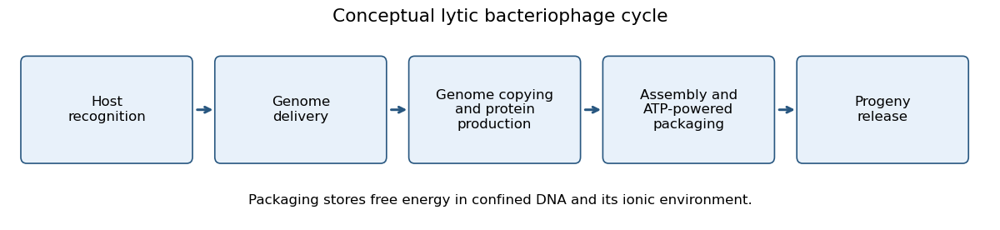

<h1 id="3/a/solution">Solution</h1>

↑ **Parent:** [A](../a.md)

Dense [DNA](../../../../deoxyribonucleic-acid.md) packaging opposes three main physical effects. The negatively charged [DNA](../../../../deoxyribonucleic-acid.md) backbones repel through [electrostatic interactions](../../../../electrostatic-interaction.md), moderated by [electrostatic screening](../../../../electrostatic-screening.md) and [counterion condensation](../../../../counterion-condensation.md). At close approach, [hydration forces](../../../../hydration-force.md) and [excluded volume](../../../../excluded-volume.md) become important. Bending a semiflexible [DNA](../../../../deoxyribonucleic-acid.md) [polymer](../../../../polymer-split.md) on a radius comparable with its [persistence length](../../../../persistence-length.md) stores [elastic energy](../../../../elastic-energy.md). Confinement also removes configurational [entropy](../../../../entropy-split.md), and concentrating mobile [counterions](../../../../counterion.md) can impose an additional [osmotic pressure](../../../../osmotic-pressure.md) and [free energy](../../../../thermodynamic-free-energy.md) cost. Their relative importance depends on geometry and ionic conditions.

A schematic lytic [bacteriophage](../../../../bacteriophage.md) life cycle is illustrated below.

**[Figure 1](#3/a/image-conceptual-lytic-bacteriophage-cycle-and-active-dna-packaging). Conceptual lytic bacteriophage cycle and active DNA packaging**.

Attachment recognizes a suitable host; delivery brings the genetic information into the host; host resources support production of components; assembly creates progeny that are released. Some [bacteriophages](../../../../bacteriophage.md) instead have a latent integrated phase, but that is not a necessary stage of this lytic schematic.

In many double-stranded [DNA](../../../../deoxyribonucleic-acid.md) [bacteriophages](../../../../bacteriophage.md), a portal-associated [molecular motor](../../../../molecular-motor.md) uses [ATP hydrolysis](../../../../atp-hydrolysis.md) to move [DNA](../../../../deoxyribonucleic-acid.md) into a preformed [capsid](../../../../viral-capsid.md). Chemical [free energy](../../../../thermodynamic-free-energy.md) pays for bending, repulsion and confinement, so the opposing [force](../../../../force-split.md) rises as filling proceeds. This is active packaging rather than spontaneous equilibrium compaction. [Optical tweezers](../../../../optical-tweezers.md) can infer that opposing [force](../../../../force-split.md) from displacement of a trapped bead and monitor packaging through the changing external [DNA](../../../../deoxyribonucleic-acid.md) extension. Such measurements establish the mechanical principle without requiring any virus-handling procedure. The [inverse spool model](../../../../inverse-spool-model.md) used below is an idealized packing geometry, not an exact structural claim for every [bacteriophage](../../../../bacteriophage.md).

## ↑ Ancestors (12)

1. [A](../a.md)
2. [3](../../3.md)
3. [2021](../../../2021-split.md)
4. [Past exam of the biological physics course of the University of Oxford](../../../split.md)
5. [Biological physics course of the University of Oxford](../../../../biological-physics-course-of-the-university-of-oxford.md)
6. [Year 4 of the physics course of the University of Oxford](../../../../year-4-of-the-physics-course-of-the-university-of-oxford.md)
7. [Physics course of the University of Oxford](../../../../physics-course-of-the-university-of-oxford.md)
8. [Undergraduate course of the University of Oxford](../../../../undergraduate-course-of-the-university-of-oxford.md)
9. [Course of the University of Oxford](../../../../course-of-the-university-of-oxford.md)
10. [University of Oxford](../../../../university-of-oxford-split.md)
11. [List of universities](../../../../list-of-universities.md)
12. [Codex Wiki](../../../../split.md)
