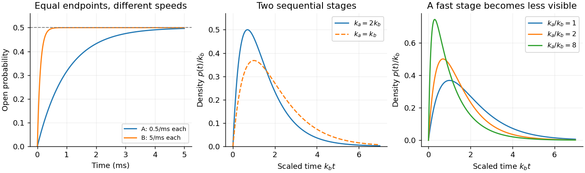

<h1 id="5/c/solution">Solution</h1>

↑ **Parent:** [C](../c.md)

The given [probability density function](../../../../probability-density-function.md) is the completion-time density for two independent sequential irreversible steps, with [exponential distributions](../../../../exponential-distribution.md) of waiting times at rates $k_a,k_b>0$. Let $T=T_a+T_b$. The [convolution](../../../../convolution.md) is

$$
p_T(t)=\int_0^t k_ae^{-k_au}k_be^{-k_b(t-u)}\,du
=\boxed{\frac{k_ak_b}{k_a-k_b}(e^{-k_bt}-e^{-k_at}),\quad t\geq0.}
$$

It is a two-stage [hypoexponential distribution](../../../../hypoexponential-distribution.md). The density vanishes at zero, initially rises as $k_ak_bt$, peaks, and then decays with a tail governed by the slower rate. Setting its [derivative](../../../../derivative.md) to zero gives

$$
\boxed{t_{\rm mode}=\frac{\ln(k_a/k_b)}{k_a-k_b},\qquad
\langle T\rangle=\frac1{k_a}+\frac1{k_b},\qquad
\operatorname{Var}(T)=\frac1{k_a^2}+\frac1{k_b^2}.}
$$

Normalization follows either from the [convolution](../../../../convolution.md) of normalized densities or directly from $(k_ak_b/(k_a-k_b))(1/k_b-1/k_a)=1$. In the equal-rate limit $k_a=k_b=k$, the apparent singularity is removable and

$$
\boxed{p_T(t)=k^2t e^{-kt},\qquad t_{\rm mode}=1/k,\quad \langle T\rangle=2/k.}
$$

This is an [Erlang distribution](../../../../erlang-distribution.md) with shape two. If one rate is much faster, its short waiting time becomes hard to resolve and the distribution resembles a single [exponential distribution](../../../../exponential-distribution.md) after its initial rise.

The observation supports at least two kinetically resolved stages before the recorded event, rather than one memoryless rate-limiting event. Possibilities include substrate binding followed by a conformational or catalytic step. It does not identify which stage is binding, chemistry, product release or rotation. The density is unchanged by exchanging $k_a$ and $k_b$, so temporal order and chemical identity cannot be recovered from this fit alone. Other hidden-state mechanisms can also mimic the same density. Dependence of one fitted rate on [ATP](../../../../adenosine-triphosphate.md) [concentration](../../../../concentration.md), for example, would provide additional evidence about assignment, rather than following from the distribution by itself.

**[Figure 2](#5/c/image-computed-two-state-ion-channel-gating-and-two-stage-waiting-time-densities). Computed two-state ion-channel gating and two-stage waiting-time densities**.

The left panel illustrates [b](../../1/b.md) for an initially closed population. The other panels are dimensionless examples of the distributions derived here; none reconstructs the missing source trace.

## ↑ Ancestors (12)

1. [C](../c.md)
2. [5](../../5.md)
3. [2021](../../../2021-split.md)
4. [Past exam of the biological physics course of the University of Oxford](../../../split.md)
5. [Biological physics course of the University of Oxford](../../../../biological-physics-course-of-the-university-of-oxford.md)
6. [Year 4 of the physics course of the University of Oxford](../../../../year-4-of-the-physics-course-of-the-university-of-oxford.md)
7. [Physics course of the University of Oxford](../../../../physics-course-of-the-university-of-oxford.md)
8. [Undergraduate course of the University of Oxford](../../../../undergraduate-course-of-the-university-of-oxford.md)
9. [Course of the University of Oxford](../../../../course-of-the-university-of-oxford.md)
10. [University of Oxford](../../../../university-of-oxford-split.md)
11. [List of universities](../../../../list-of-universities.md)
12. [Codex Wiki](../../../../split.md)
