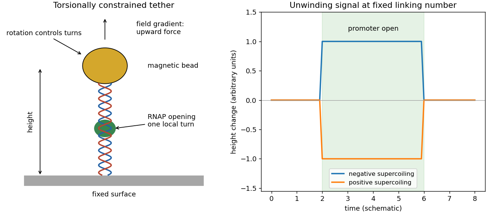
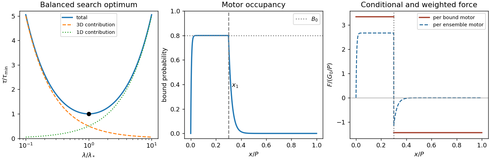
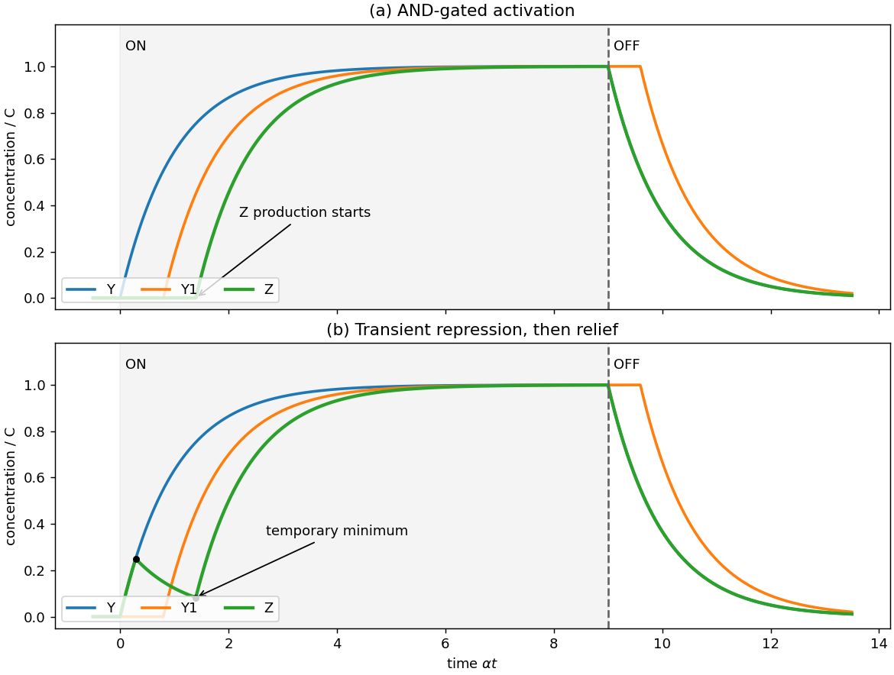
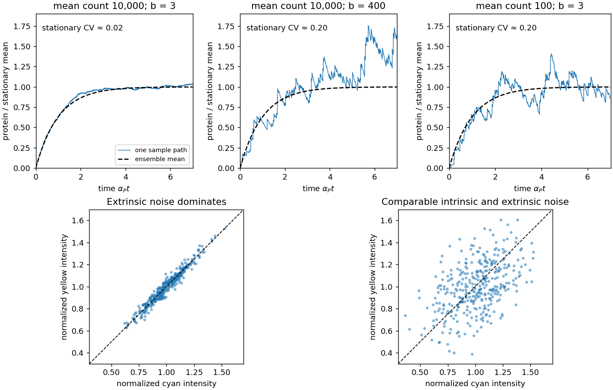

# 2022

↑ **Parent:** [Past exam of the biological physics course of the University of Oxford](../past-exam-of-the-biological-physics-course-of-the-university-of-oxford.md)

Source: [https://www.whatdotheyknow.com/request/oxford_physics_past_papers_2/response/2340696/attach/10/Physics%20Papers%202021.pdf?cookie_passthrough=1](https://www.whatdotheyknow.com/request/oxford_physics_past_papers_2/response/2340696/attach/10/Physics%20Papers%202021.pdf?cookie_passthrough=1)

Source bundle pages 55–61. The cover identifies Trinity Term 2022, C7, despite the attachment's 2021 filename. Solutions use the conventions and figures on the original pages.

**Table of contents**

- [1](#1)
  - [a](#1/a)
    - [Solution](#1/a/solution)
  - [b](#1/b)
    - [Solution](#1/b/solution)
  - [c](#1/c)
    - [Solution](#1/c/solution)
  - [d](#1/d)
    - [Solution](#1/d/solution)
- [2](#2)
  - [a](#2/a)
    - [Solution](#2/a/solution)
  - [b](#2/b)
    - [Solution](#2/b/solution)
  - [c](#2/c)
    - [Solution](#2/c/solution)
  - [d](#2/d)
    - [Solution](#2/d/solution)
- [3](#3)
  - [a](#3/a)
    - [Solution](#3/a/solution)
  - [b](#3/b)
    - [Solution](#3/b/solution)
  - [c](#3/c)
    - [Solution](#3/c/solution)
  - [d](#3/d)
    - [Solution](#3/d/solution)
  - [e](#3/e)
    - [Solution](#3/e/solution)
- [4](#4)
  - [a](#4/a)
    - [Solution](#4/a/solution)
  - [b](#4/b)
    - [Solution](#4/b/solution)
  - [c](#4/c)
    - [Solution](#4/c/solution)
- [5](#5)
  - [a](#5/a)
    - [Solution](#5/a/solution)
  - [b](#5/b)
    - [Solution](#5/b/solution)
  - [c](#5/c)
    - [Solution](#5/c/solution)
  - [d](#5/d)
    - [Solution](#5/d/solution)
  - [e](#5/e)
    - [Solution](#5/e/solution)
- [6](#6)
  - [a](#6/a)
    - [Solution](#6/a/solution)
  - [b](#6/b)
    - [Solution](#6/b/solution)
  - [c](#6/c)
    - [Solution](#6/c/solution)

## 1

↑ **Parent:** [2022](2022.md)

<h3 id="1/a">a</h3>

↑ **Parent:** [1](#1)

<h4 id="1/a/solution">Solution</h4>

↑ **Parent:** [A](#1/a)

The bacterial [RNA polymerase](../molecular-genetics.md#rna-polymerase) core associates with a [sigma factor](../molecular-genetics.md#sigma-factor) to form a holoenzyme. The [sigma factor](../molecular-genetics.md#sigma-factor) recognizes [promoter](../molecular-genetics.md#promoter-genetics) features and helps position the [DNA](../polymer.md#deoxyribonucleic-acid) and stabilize its opening. Initial binding gives a closed [promoter](../molecular-genetics.md#promoter-genetics) complex; local [DNA](../polymer.md#deoxyribonucleic-acid) unwinding creates an open [promoter](../molecular-genetics.md#promoter-genetics) complex with the template accessible. Initial [RNA](../polymer.md#ribonucleic-acid) synthesis can produce short abortive products while the [RNA polymerase](../molecular-genetics.md#rna-polymerase) remains attached to the [promoter](../molecular-genetics.md#promoter-genetics), taking in downstream [DNA](../polymer.md#deoxyribonucleic-acid) by scrunching. Growth of the [RNA](../polymer.md#ribonucleic-acid) eventually permits [promoter escape](../molecular-genetics.md#promoter-escape) and productive elongation. The [sigma factor](../molecular-genetics.md#sigma-factor) changes its interactions during this transition; immediate complete dissociation is not obligatory.

In [magnetic tweezers](../electromagnetism.md#magnetic-tweezers), torsionally constrained [DNA](../polymer.md#deoxyribonucleic-acid) joins a surface to a magnetic bead. A field gradient applies upward [force](../force.md), rotation of the magnets controls the imposed [DNA supercoiling](../polymer.md#dna-supercoiling), and optical tracking measures bead height. At suitable modest [force](../force.md), [DNA supercoiling](../polymer.md#dna-supercoiling) forms writhed loops, shortening the tether. Opening roughly one helical turn at fixed [linking number](../knot-theory.md#linking-number) makes the remaining [DNA](../polymer.md#deoxyribonucleic-acid) more positively twisted: $\Delta Tw_{\rm rest}+\Delta Wr=-\Delta Tw_{\rm bubble}$. Thus opening lengthens a negatively supercoiled tether by removing some negative writhe, but shortens a positively supercoiled tether by adding positive writhe. This opposite sign distinguishes unwinding from ordinary compaction, which shortens both tethers. Height-versus-turn calibration converts the two extension changes into an unwinding angle and a compaction contribution. Repeated height transitions give opening and closing dwell times.[Figures 1–3: torsionally constrained tether, opposite-sign extension responses, and approximately one-turn unwinding](../biochemistry-and-biophysics-bibliography.md#promoter-unwinding-and-promoter-clearance-by-rna-polymerase-detection-by-single-molecule-dna-nanomanipulation-by-andrey-revyakin-and-others)

**[Figure 1](#1/a/image-magnetic-tweezers-and-the-opposite-signs-of-the-promoter-opening-signal). Magnetic tweezers and the opposite signs of the promoter opening signal**.

The sketch is a schematic prediction, not a copy of an experimental trace. Opening must be distinguished from [promoter escape](../molecular-genetics.md#promoter-escape): an unwound [DNA](../polymer.md#deoxyribonucleic-acid) region can remain associated with an elongating [RNA polymerase](../molecular-genetics.md#rna-polymerase).

<h3 id="1/b">b</h3>

↑ **Parent:** [1](#1)

<h4 id="1/b/solution">Solution</h4>

↑ **Parent:** [B](#1/b)

Treat the target as an absorbing sphere of effective capture radius $r_0$, surrounded by a uniform dilute reservoir of [RNA polymerase](../molecular-genetics.md#rna-polymerase) with [number density](../statistical-physics.md#number-density) $C_\infty$. The steady [diffusion equation](../diffusion-equation.md), [spherical symmetry](../geometry-and-topology.md#spherical-symmetry), and boundary conditions give

$$
\nabla^2 C=0,\qquad C(r_0)=0,\quad C(\infty)=C_\infty,
\qquad C(r)=C_\infty\left(1-\frac{r_0}{r}\right).
$$

By [Fick's laws](../mathematical-physics.md#fick-s-laws), the inward capture rate per target is $4\pi r_0^2D_A C'(r_0)=4\pi D_A r_0C_\infty$. Multiplying by the target [number density](../statistical-physics.md#number-density) and comparing with the bimolecular [rate law](../chemical-kinetics.md#rate-law) therefore yields the [Smoluchowski association rate](../biology.md#smoluchowski-association-rate)

$$
\boxed{k_a=4\pi D_A r_0}.
$$

Its units here are $\mathrm{m^3\,s^{-1}}$, since the [concentrations](../mathematical-physics.md#concentration) count particles rather than [moles](../physics.md#mole-unit). The absorbing boundary assumes every encounter is productive; orientation constraints would reduce the effective [association rate constant](../chemical-kinetics.md#association-rate-constant).

The [Stokes–Einstein relation](../stokes-flow.md#stokes-einstein-relation), for [RNA polymerase](../molecular-genetics.md#rna-polymerase) radius $a=15\,\mathrm{nm}$ at an illustrative [temperature](../temperature.md) $T=300\,\mathrm K$, gives

$$
D_A=\frac{k_BT}{6\pi\eta a}=1.46\times10^{-12}\,\mathrm{m^2\,s^{-1}}.
$$

Neither cell volume nor the effective $r_0$ is specified, so a unique numerical time is unavailable. A representative [Escherichia coli](../organism.md#escherichia-coli) volume is $V=1\,\mathrm{\mu m^3}=10^{-18}\,\mathrm{m^3}$. The $40$-[base pair](../polymer.md#base-pair) target has a [DNA](../polymer.md#deoxyribonucleic-acid) contour extent of about $40(0.34)=13.6\,\mathrm{nm}$; using this as an order-of-magnitude capture radius gives $k_a\simeq2.50\times10^{-19}\,\mathrm{m^3\,s^{-1}}$. For $M=3000$ independent searchers, the target's approximately constant encounter hazard is $Mk_a/V$, hence

$$
\boxed{\tau_3\simeq\frac{V}{Mk_a}=1.33\,\mathrm{ms}
\left(\frac{V}{1\,\mathrm{\mu m^3}}\right)
\left(\frac{13.6\,\mathrm{nm}}{r_0}\right)
\left(\frac{300\,\mathrm K}{T}\right)}.
$$

Using half the target's contour extent for $r_0$ instead gives about $2.7\,\mathrm{ms}$; the spherical capture model is not exact target geometry. One searcher's mean would be about $4\,\mathrm s$ under the first convention, whereas the first arrival among $3000$ is much faster.

If only a fraction $f_3=0.1$ of each searcher's time is available for three-dimensional [diffusion](../thermodynamics.md#diffusion), and nonspecific [DNA](../polymer.md#deoxyribonucleic-acid) binding neither scans nor delivers the target, the effective searching population is $f_3M$. Thus $\boxed{\tau\simeq\tau_3/f_3=10\tau_3}$, about $13\,\mathrm{ms}$ under the stated estimate. This assumes stationarity, well-mixed searchers and no additional target-access route; nonspecific binding alone is sequestration, not [facilitated diffusion](../cell-membrane.md#facilitated-diffusion).

<h3 id="1/c">c</h3>

↑ **Parent:** [1](#1)

<h4 id="1/c/solution">Solution</h4>

↑ **Parent:** [C](#1/c)

Write $A=V/D_3$ and $B=L/D_1$. The search time is $A/\lambda+B\lambda$: it decreases from infinity at small positive $\lambda$, reaches one minimum, and increases without bound at large $\lambda$ within this idealized model.

During a [facilitated diffusion](../cell-membrane.md#facilitated-diffusion) search, roughly $L/\lambda$ separate [DNA](../polymer.md#deoxyribonucleic-acid) landing-and-sliding episodes sample a chromosome. A three-dimensional encounter with any chromosomal landing region has characteristic time $V/(D_3L)$, so the total bulk-search contribution is $(L/\lambda)V/(D_3L)=V/(D_3\lambda)$. Each one-dimensional [diffusion](../thermodynamics.md#diffusion) excursion lasts order $\lambda^2/D_1$; multiplying by $L/\lambda$ gives $L\lambda/D_1$. Longer sliding therefore reduces the number of bulk relocations but increases time spent repeatedly exploring local [DNA](../polymer.md#deoxyribonucleic-acid). Numerical constants and overlap corrections are already omitted in the given model.

Differentiating and using the positive second [derivative](../calculus.md#derivative) gives

$$
-\frac{V}{D_3\lambda^2}+\frac{L}{D_1}=0,
\qquad
\boxed{\lambda_* =\sqrt{\frac{VD_1}{LD_3}},\qquad
\tau_{\min}=2\sqrt{\frac{VL}{D_1D_3}}}.
$$

At $\lambda_*$ the two time contributions are equal. The optimum is meaningful only if $\lambda_*$ lies between the microscopic capture scale and the available chromosomal contour length.

A decrease in [DNA](../polymer.md#deoxyribonucleic-acid) concentration means a decrease in $L/V$, but its effect on the time is not determined by that ratio alone. At fixed chromosome length $L$, dilution by increasing $V$ increases $\tau$ at fixed $\lambda$ and increases $\tau_{\min}$ as $\sqrt V$; bulk relocation becomes slower. If instead $L$ decreases at fixed $V$, while the target is retained, the stated model predicts a smaller sliding contribution and a smaller optimized time, proportional to $\sqrt L$. In both cases $\lambda_*\propto(L/V)^{-1/2}$. This distinction prevents attributing a unique time trend to concentration without specifying how it changes.

**[Figure 2](#1/c/image-search-time-optimum-and-position-dependent-molecular-motor-binding-and-force). Search-time optimum and position-dependent molecular motor binding and force**.

The left panel normalizes the search law to $\tau/\tau_{\min}=(u+u^{-1})/2$, $u=\lambda/\lambda_*$. The other panels illustrate [b](#4/b) and [c](#4/c).

<h3 id="1/d">d</h3>

↑ **Parent:** [1](#1)

<h4 id="1/d/solution">Solution</h4>

↑ **Parent:** [D](#1/d)

Let $k_D$ be the donor's total decay rate without acceptors, including radiative and nonradiative decay, and let $k_T$ be its transfer rate to one acceptor. In weak excitation, independent equivalent acceptors supply additive transfer rates, so [FRET efficiency](../biophysical-measurement.md#fret-efficiency) is

$$
E=\frac{k_T}{k_D+k_T},\qquad
E_n=\frac{nk_T}{k_D+nk_T}.
$$

Eliminating $k_T/k_D=E/(1-E)$ gives

$$
\boxed{E_n=\frac{nE}{1+(n-1)E}}.
$$

This assumes the same [Förster distance](../biophysical-measurement.md#forster-distance), equivalent donor–acceptor distances and unchanged donor decay, with no acceptor saturation or other transfer pathways affecting donor de-excitation.

For [Förster resonance energy transfer](../biophysical-measurement.md#forster-resonance-energy-transfer), $k_T/k_D=(R_0/R)^6$, hence

$$
E_n=\frac{n(R_0/R)^6}{1+n(R_0/R)^6},\qquad
\boxed{R=R_0\left[\frac{n(1-E_n)}{E_n}\right]^{1/6}
=6(2/3)^{1/6}\,\mathrm{nm}\simeq5.61\,\mathrm{nm}}.
$$

Here the single-pair [FRET efficiency](../biophysical-measurement.md#fret-efficiency) would be $E=0.60$, which indeed produces $E_2=0.75$.

## 2

↑ **Parent:** [2022](2022.md)

<h3 id="2/a">a</h3>

↑ **Parent:** [2](#2)

<h4 id="2/a/solution">Solution</h4>

↑ **Parent:** [A](#2/a)

Use the [logic approximation for gene regulation](../mathematical-biology.md#logic-approximation-for-gene-regulation): production is either $\beta$ or zero, and every species has linear removal rate $\alpha$. Put $C=\beta/\alpha$ and assume zero basal expression, inactive X before time zero, and all required thresholds strictly between $0$ and $C$. The input is $u(t)=1$ for $0<t<T$ and zero otherwise. The common [ordinary differential equation](../differential-equation.md#ordinary-differential-equation) is $\dot c=\beta g-\alpha c$, with Boolean production gate $g$. Both networks therefore have

$$
Y(t)=C(1-e^{-\alpha t})\quad(0<t<T),\qquad
Y(t)=Ce^{-\alpha(t-T)}\quad(t>T),
$$

where the latter uses the stipulated attained [steady state](../dynamical-systems.md#steady-state). Define the threshold-crossing delay

$$
d(K)=-\alpha^{-1}\ln(1-K/C),\qquad
t_r=d(K_{YZ}),\quad t_1=d(K_{YY1}).
$$

Because $K_{YY1}>K_{YZ}$, $t_1>t_r$. In both networks, $Y_1$ stays zero until $t_1$ and then follows $Y_1=C[1-e^{-\alpha(t-t_1)}]$ until the OFF response. Write $K_A$ for the activation threshold of $Y_1$ on Z in diagram (a), and $K_I$ for the level of $Y_1$ that blocks Y's repression in diagram (b); these thresholds were not supplied numerically.

**Diagram (a).** All three inputs X, Y and $Y_1$ must permit Z production. Since Y has already crossed its Z threshold before $Y_1$ starts, the final permission arrives at

$$
t_a=t_1+d(K_A).
$$

Thus $Z=0$ until $t_a$ and $Z=C[1-e^{-\alpha(t-t_a)}]$ subsequently. Solving $Z=C/2$ gives

$$
\boxed{t_{Z,1/2}=d(K_{YY1})+d(K_A)+\frac{\ln2}{\alpha}}.
$$

For the frequently adopted but extra convention that both required thresholds are $C/2$, this is $3\ln2/\alpha$. At the OFF step, X's direct AND input disappears, so $Z=Ce^{-\alpha(t-T)}$ immediately. Y also decays immediately. $Y_1$ remains at $C$ while Y remains above $K_{YY1}$; it starts decaying at $T+\alpha^{-1}\ln(C/K_{YY1})$. This is a [coherent feed-forward loop](../mathematical-biology.md#coherent-feed-forward-loop) persistence response: activation is delayed, while removal of the direct required input switches production off promptly.

**Diagram (b).** The production gate is $g_Z=u\,[\neg(Y>K_{YZ})\lor(Y_1>K_I)]$. Z initially rises, Y switches Z production off at $t_r$, and $Y_1$ restores production at $t_b=t_1+d(K_I)$. The continuous solution during the ON phase is

$$
Z(t)=\begin{cases}
C(1-e^{-\alpha t}),&0<t<t_r,\\
C(1-e^{-\alpha t_r})e^{-\alpha(t-t_r)},&t_r<t<t_b,\\
C+[Z(t_b)-C]e^{-\alpha(t-t_b)},&t_b<t<T.
\end{cases}
$$

The [derivative](../calculus.md#derivative) changes from positive to negative at $t_r$, and from negative to positive at $t_b$. Consequently the first temporary minimum following the initial pulse occurs at

$$
\boxed{t_{\min}=d(K_{YY1})+d(K_I)}.
$$

Its value is $Z(t_b)=K_{YZ}e^{-\alpha(t_b-t_r)}$. At the OFF step Z again decays immediately because X is required for production, with Y and $Y_1$ behaving as above. If a required threshold is unattainable, these late switching events do not occur; equal production and removal rates alone do not fix threshold values.

**[Figure 3](#2/a/image-logic-approximation-for-gene-regulation-delayed-activation-and-a-transient-repression-window). Logic approximation for gene regulation: delayed activation and a transient repression window**.

The plotted thresholds are explicitly illustrative, with $K_{YZ}/C=0.25$, $K_{YY1}/C=0.55$ and $K_A/C=K_I/C=0.45$.

<h3 id="2/b">b</h3>

↑ **Parent:** [2](#2)

<h4 id="2/b/solution">Solution</h4>

↑ **Parent:** [B](#2/b)

The protein production rate is proportional to the current [messenger RNA](../polymer.md#messenger-rna) [concentration](../mathematical-physics.md#concentration), not an independently constant $\beta_P$: $\beta_P(t)=rX_R(t)$. Setting the two coupled rate equations to zero gives

$$
X_{R,\mathrm{st}}=\frac{\beta_R}{\alpha_R},\qquad
\boxed{X_{P,\mathrm{st}}=\frac{r\beta_R}{\alpha_R\alpha_P}
=\frac{b\beta_R}{\alpha_P}}.
$$

With first-order removal, a [messenger RNA](../polymer.md#messenger-rna) molecule has mean lifetime $1/\alpha_R$. At [biological translation](../molecular-genetics.md#translation-biology) rate $r$ per molecule, it produces an expected $r/\alpha_R=b$ [proteins](../protein.md) before its removal. Thus the [translational burst size](../molecular-genetics.md#translational-burst-size) is a dimensionless mean number of offspring [proteins](../protein.md) per [messenger RNA](../polymer.md#messenger-rna), not a concentration and not a fixed number produced in every event. When production and removal are independent Poisson events, mixing a Poisson number of [biological translation](../molecular-genetics.md#translation-biology) events over an exponentially distributed lifetime makes the burst count geometrically distributed on the nonnegative integers. Its [mean](../expected-value.md) is $b$ and its [variance](../variance.md) is $b(1+b)$.

<h3 id="2/c">c</h3>

↑ **Parent:** [2](#2)

<h4 id="2/c/solution">Solution</h4>

↑ **Parent:** [C](#2/c)

Convert [number density](../statistical-physics.md#number-density) into molecule count: $\bar n=X_{P,\mathrm{st}}V$. For the explicitly assumed representative cell volume $V=1\,\mathrm{\mu m^3}$, the two densities correspond to $\bar n=10^4$ and $10^2$. The [concentrations](../mathematical-physics.md#concentration) alone do not fix fluctuation sizes without a volume.

For activation from zero [messenger RNA](../polymer.md#messenger-rna) and [protein](../protein.md), solving the two mean rate equations gives

$$
\frac{\langle n_P(t)\rangle}{\bar n}
=1-\frac{\alpha_R e^{-\alpha_Pt}-\alpha_Pe^{-\alpha_Rt}}{\alpha_R-\alpha_P}
\simeq1-e^{-\alpha_Pt}\qquad(t\gg1/\alpha_R).
$$

Thus all three normalized mean curves are almost identical. Sample paths differ. For Poisson [transcription](../molecular-genetics.md#transcription-biology) with [biological translation](../molecular-genetics.md#translation-biology) bursts, the stationary [Fano factor](../variance.md#fano-factor) and squared [coefficient of variation](../variance.md#coefficient-of-variation) are

$$
\frac{\operatorname{Var}n_P}{\bar n}=1+\frac{r}{\alpha_R+\alpha_P}
\simeq1+b,\qquad
\mathrm{CV}^2\simeq\frac{1+b}{\bar n}.
$$

One way to obtain the fast-[messenger RNA](../polymer.md#messenger-rna) limit is to use burst arrivals at rate $a$, a geometrically distributed burst $B$ with $\langle B\rangle=b$ and $\langle B^2\rangle=b+2b^2$, and independent unit [protein degradation](../protein.md#protein-degradation) at rate $\alpha_Pn$. The first stationary moment gives $ab=\alpha_P\bar n$; the second gives $\operatorname{Var}n=\bar n(1+b)$.

At $\bar n=10^4,b=3$, typical relative fluctuations are $\sqrt{4/10^4}=0.02$ and many small bursts make the trajectory smooth. At $\bar n=10^4,b=400$, they are $\sqrt{401/10^4}\simeq0.20$; individual bursts have mean normalized height $0.04$, with only about $25$ bursts per [protein](../protein.md) lifetime. At $\bar n=100,b=3$, the relative fluctuations are again $0.20$, but the typical burst height is $0.03$ and about $33$ bursts occur per lifetime. The latter two examples can look similarly noisy after normalization even though their mean molecule counts differ by two orders of magnitude. Burst arrival times and sizes fluctuate: a high-burst trace is not a periodic sawtooth.

**[Figure 4](#2/c/image-stochastic-gene-expression-trajectories-and-dual-reporter-intrinsic-gene-expression-noise-and-extrinsic-gene-expression-noise). Stochastic gene expression trajectories and dual-reporter intrinsic gene-expression noise and extrinsic gene-expression noise**.

The upper panels are independently simulated burst-arrival and unit-removal processes, shown alongside the common mean. The lower panels illustrate [d](#2/d); their point clouds are schematic, not experimental data.

<h3 id="2/d">d</h3>

↑ **Parent:** [2](#2)

<h4 id="2/d/solution">Solution</h4>

↑ **Parent:** [D](#2/d)

Normalize each reporter by its mean intensity, after correcting background and unequal brightness, so equal expression lies on $y=x$. Write $x=1+e+i_C$, $y=1+e+i_Y$, where the common fluctuation $e$ is [extrinsic gene-expression noise](../molecular-genetics.md#extrinsic-gene-expression-noise) and the independent reporter-specific fluctuations $i_C,i_Y$ are [intrinsic gene-expression noise](../molecular-genetics.md#intrinsic-gene-expression-noise). The [extrinsic gene-expression noise](../molecular-genetics.md#extrinsic-gene-expression-noise) includes shared variation in cell size, expression machinery and growth state; [intrinsic gene-expression noise](../molecular-genetics.md#intrinsic-gene-expression-noise) includes independent molecular production and removal events at each reporter.

If [intrinsic gene-expression noise](../molecular-genetics.md#intrinsic-gene-expression-noise) is much smaller, points form a narrow elongated cloud along $y=x$: a cell that is bright in cyan is usually bright in yellow. If the two contributions have comparable magnitude, the cloud is still positively correlated but has substantial width perpendicular to $y=x$, because the two reporters can differ within the same cell. With [variance](../variance.md) $\sigma_e^2$ in $e$ and equal [variance](../variance.md) $\sigma_i^2$ in each independent intrinsic term,

$$
\operatorname{Cov}(x,y)=\sigma_e^2,\qquad
\operatorname{Var}(y-x)=2\sigma_i^2,\qquad
\operatorname{Corr}(x,y)=\frac{\sigma_e^2}{\sigma_e^2+\sigma_i^2}.
$$

Equal intrinsic and extrinsic [variances](../variance.md) therefore give [correlation coefficient](../variance.md#pearson-correlation-coefficient) $1/2$, rather than an uncorrelated circular cloud. For mean-normalized reporters, $\eta_{\rm int}^2=\langle(x-y)^2\rangle/2$ and $\eta_{\rm ext}^2=\langle xy\rangle-1$. Measurement noise must be separately estimated before assigning perpendicular scatter to expression itself. These are the geometric diagnostics of the original dual-reporter experiment.[Figure 1 and definition of intrinsic and extrinsic noise: within-cell reporter differences versus correlated cell-to-cell variation](../biochemistry-and-biophysics-bibliography.md#stochastic-gene-expression-in-a-single-cell-by-michael-b-elowitz-and-others)

The lower panels of [c](#2/c) show these two cases. Repeated observations of one cell can move both along and across the diagonal; a static population cloud alone does not determine the time scales of the fluctuations.

## 3

↑ **Parent:** [2022](2022.md)

<h3 id="3/a">a</h3>

↑ **Parent:** [3](#3)

<h4 id="3/a/solution">Solution</h4>

↑ **Parent:** [A](#3/a)

In the continuum cylindrical-pore estimate, the [electrical resistance](../electric-charge.md#electrical-resistance) is $R_p=\rho\ell/(\pi a^2)$, with radius $a=0.075\,\mathrm{nm}$, length $\ell=0.5\,\mathrm{nm}$ and [electrical resistivity](../electric-charge.md#electrical-resistivity) $\rho=80\,\Omega\,\mathrm{cm}=0.80\,\Omega\,\mathrm m$. Therefore

$$
R_p=2.26\times10^{10}\,\Omega,\qquad
\boxed{g_p=R_p^{-1}=44.2\,\mathrm{pS}}.
$$

Unrestricted approach from the reservoirs removes access barriers, but still permits a continuum spreading or [access resistance of a circular pore](../electric-charge.md#access-resistance-of-a-circular-pore). Including $\rho/(4a)$ on each side gives

$$
R_{\rm access}=\frac{\rho}{2a}=5.33\times10^9\,\Omega,\qquad
\boxed{g_{\rm total}=\left[\frac{\rho\ell}{\pi a^2}+\frac{\rho}{2a}\right]^{-1}\simeq35.8\,\mathrm{pS}}.
$$

Thus the usual estimate neglecting the access contribution is about $44\,\mathrm{pS}$, or about $36\,\mathrm{pS}$ with spreading resistance. A $1.5$-ångström diameter is at the molecular scale, smaller than hydrated [ions](../chemistry.md#ion); bulk [electrical resistivity](../electric-charge.md#electrical-resistivity) cannot quantitatively describe dehydration, selectivity or discrete-ion transport. These values are the requested continuum estimates, not evidence that such a pore freely passes hydrated [potassium](../chemical-substance.md#potassium) [ions](../chemistry.md#ion).

<h3 id="3/b">b</h3>

↑ **Parent:** [3](#3)

<h4 id="3/b/solution">Solution</h4>

↑ **Parent:** [B](#3/b)

The rising sigmoid shows activation by [depolarization](../membrane-potential.md#depolarization): $P_o$ is almost zero at very negative [membrane potential](../membrane-potential.md), rises steeply around $-20\,\mathrm{mV}$, and approaches about $0.8$ at positive [membrane potential](../membrane-potential.md). The graph describes the fraction of time a single [ion channel](../cell-membrane.md#ion-channel) is open, not a continuously variable opening amplitude. A convenient phenomenological fit is

$$
P_o(V)=\frac{P_{\max}}{1+\exp[-z_{\rm eff}e(V-V_{1/2})/(k_BT)]},
\qquad P_{\max}\simeq0.8,\quad V_{1/2}\simeq-20\,\mathrm{mV}.
$$

Here $V_{1/2}$ refers to half the maximum, about $0.4$, not absolute $P_o=0.5$. The effective gating charge describes the steepness; a sigmoid alone does not identify the microscopic gating sequence or explain why the observed maximum is below one.

A [voltage-gated potassium channel](../membrane-potential.md#voltage-gated-potassium-channel) has four pore-forming subunits. Each canonical subunit contains an S1–S4 [voltage-sensing domain](../membrane-potential.md#voltage-sensing-domain) and S5–S6 pore elements. Positive charges in S4 respond to the [electric field](../electric-field.md); their displacement during [depolarization](../membrane-potential.md#depolarization) changes the energetic preference of sensor conformations. Coupling through the sensor–pore interface favors opening of the intracellular pore gate. The [potassium](../chemical-substance.md#potassium) selectivity filter is structurally distinct from this voltage sensor.

Several independent observations support this account. [Voltage clamp](../neuroscience.md#voltage-clamp) detects transient gating [electric currents](../electric-charge.md#electric-current) before pore conduction, even when ionic conduction is blocked: charge movement precedes opening. Charge-neutralization studies change total gating charge and voltage dependence, with contributions from charged S4 residues and an S2 residue. Accessibility and voltage-sensitive optical measurements support conformational motion rather than permeating [potassium](../chemical-substance.md#potassium) itself acting as the sensor. Structural measurements locate the charged sensor beside the pore. These observations constrain a coupled moving-sensor mechanism, while the exact displacement cannot be deduced from this $P_o$ curve alone.[Abstract: gating-charge measurements identify contributions from S2 and S4 charged residues](../biochemistry-and-biophysics-bibliography.md#voltage-sensing-residues-in-the-s2-and-s4-segments-of-the-shaker-k-plus-channel-by-s-a-seoh-and-others)[Structure of Kv1.2: separate voltage-sensor and pore domains and their coupling](../biochemistry-and-biophysics-bibliography.md#crystal-structure-of-a-mammalian-voltage-dependent-shaker-family-k-plus-channel-by-stephen-b-long-and-others)

<h3 id="3/c">c</h3>

↑ **Parent:** [3](#3)

<h4 id="3/c/solution">Solution</h4>

↑ **Parent:** [C](#3/c)

An open [ion channel](../cell-membrane.md#ion-channel) carries the [electric current](../electric-charge.md#electric-current)

$$
i=g(V-E_K)=(90\,\mathrm{pS})(60\,\mathrm{mV})=5.4\,\mathrm{pA}.
$$

The macroscopic mean is $I=NP_oi$, so $I/i\simeq204$ is the mean number open, not the total number present. Reading $P_o(-20\,\mathrm{mV})\simeq0.40$ from the original graph gives

$$
\boxed{N=\frac{1.1\,\mathrm{nA}}{(0.40)(5.4\,\mathrm{pA})}\simeq5.1\times10^2}.
$$

The graph reading is approximate, so a precision of hundreds is appropriate. Only a few hundred active [ion channels](../cell-membrane.md#ion-channel) generate a nanoampere-scale cellular [electric current](../electric-charge.md#electric-current); molecular discreteness and stochastic gating therefore matter. For independent identical [ion channels](../cell-membrane.md#ion-channel), the open-count [standard deviation](../variance.md#standard-deviation) is $\sqrt{NP_o(1-P_o)}\simeq11$, corresponding to a [coefficient of variation](../variance.md#coefficient-of-variation) in [electric current](../electric-charge.md#electric-current) of about $5.4\%$. This is an instantaneous ideal independent-gating estimate, before temporal filtering and other noise sources, and requires the [single-channel recording](../neuroscience.md#single-channel-recording) $P_o$ to apply to the cellular recording conditions.

<h3 id="3/d">d</h3>

↑ **Parent:** [3](#3)

<h4 id="3/d/solution">Solution</h4>

↑ **Parent:** [D](#3/d)

In [ball-and-chain inactivation](../membrane-potential.md#ball-and-chain-inactivation), also called [N-type inactivation](../membrane-potential.md#ball-and-chain-inactivation), a flexible intracellular N-terminal region carries an inactivation particle. Once a [voltage-gated potassium channel](../membrane-potential.md#voltage-gated-potassium-channel) opens, this tethered particle can enter and occlude the inner pore, stopping [electric current](../electric-charge.md#electric-current) even while the activation machinery favors an open configuration. Recovery requires the particle to leave, after which the activation gate can return to its resting conformation. This supplies an additional unavailable state, not merely reversal of activation.

The decisive evidence separates necessity from sufficiency. Removing the relevant N-terminal region greatly reduces fast [ion-channel inactivation](../membrane-potential.md#ion-channel-inactivation) while preserving activation. Applying a peptide corresponding to the missing N-terminal region on the cytoplasmic side restores blocking with similar properties. Changes in the blocking region alter blocking kinetics, and altering the tether affects the rate at which the particle reaches the pore. Open-pore access and competition with intracellular pore blockers support occlusion of the inner cavity. A tether makes the particle's local effective concentration high, explaining rapid intramolecular block.[N-terminal perturbations separate rapid inactivation from activation](../biochemistry-and-biophysics-bibliography.md#biophysical-and-molecular-mechanisms-of-shaker-potassium-channel-inactivation-by-toshinori-hoshi-and-others)[Cytoplasmic N-terminal peptide restores inactivation in deletion mutants](../biochemistry-and-biophysics-bibliography.md#restoration-of-inactivation-in-mutants-of-shaker-potassium-channels-by-a-peptide-derived-from-shb-by-william-n-zagotta-and-others)

This mechanism is distinct from slower filter-associated [C-type inactivation](../membrane-potential.md#c-type-inactivation). An N-terminal particle is a mechanism for certain [potassium](../chemical-substance.md#potassium) [ion channels](../cell-membrane.md#ion-channel), not a universal explanation of all [ion-channel inactivation](../membrane-potential.md#ion-channel-inactivation).

<h3 id="3/e">e</h3>

↑ **Parent:** [3](#3)

<h4 id="3/e/solution">Solution</h4>

↑ **Parent:** [E](#3/e)

In a classical [action potential](../neuron.md#action-potential), delayed activation of [voltage-gated potassium channels](../membrane-potential.md#voltage-gated-potassium-channel) supplies outward [electric current](../electric-charge.md#electric-current) that drives [repolarization](../membrane-potential.md#repolarization). In the [Hodgkin-Huxley model](../neuroscience.md#hodgkin-huxley-model), for example, $I_K=\bar g_Kn^4(V-E_K)$ and $\dot n=\alpha_n(V)(1-n)-\beta_n(V)n$. Increasing the opening rate at depolarized [membrane potential](../membrane-potential.md), other properties fixed, recruits outward [electric current](../electric-charge.md#electric-current) earlier: the [action potential](../neuron.md#action-potential) generally becomes narrower and may have a smaller peak. Slower opening delays [repolarization](../membrane-potential.md#repolarization) and broadens the [action potential](../neuron.md#action-potential).

Slower closing after [repolarization](../membrane-potential.md#repolarization) retains excess [potassium](../chemical-substance.md#potassium) [electrical conductance](../electric-charge.md#electrical-conductance), lengthening the after-[hyperpolarization](../membrane-potential.md#hyperpolarization) and often the interval of reduced excitability. Faster closing shortens this tail and permits earlier recovery. If activation or the available [electrical conductance](../electric-charge.md#electrical-conductance) is insufficient, normal [repolarization](../membrane-potential.md#repolarization) may fail; changing rates can also change the steady open fraction. Duration is therefore determined by the whole balance of inward and outward [electric currents](../electric-charge.md#electric-current), not by a closing rate in isolation.

## 4

↑ **Parent:** [2022](2022.md)

<h3 id="4/a">a</h3>

↑ **Parent:** [4](#4)

<h4 id="4/a/solution">Solution</h4>

↑ **Parent:** [A](#4/a)

[Detailed balance](../markov-chain.md#detailed-balance) means that at [thermodynamic equilibrium](../thermodynamics.md#thermodynamic-equilibrium) each elementary transition and its reverse carry equal [probability](../probability-theory.md#probability) flux. For normalized state [probabilities](../probability-theory.md#probability) $A_{\rm eq}$ and $B_{\rm eq}$,

$$
k_1A_{\rm eq}=k_2B_{\rm eq},\qquad
\frac{B_{\rm eq}}{A_{\rm eq}}=e^{-(G_B-G_A)/(k_BT)}.
$$

With the printed convention $\Delta G_{AB}=G_A-G_B$, the sign is therefore

$$
\boxed{\frac{k_1}{k_2}=e^{\Delta G_{AB}/(k_BT)}}.
$$

The $G$ values are free energies per system, including internal degeneracies; for molar [Gibbs free energies](../thermodynamic-potential.md#gibbs-free-energy), replace $k_BT$ by $RT$. If B has lower [free energy](../thermodynamic-potential.md#thermodynamic-free-energy), its forward-to-reverse rate ratio exceeds one, as it should.

For constant rates, conservation gives $A=1-B$, so the [master equation](../continuous-time-markov-chain.md#master-equation) is $\dot B=k_1(1-B)-k_2B$. Its [steady state](../dynamical-systems.md#steady-state) is $B_0=k_1/(k_1+k_2)$, and separation of the decaying deviation yields

$$
B(t)=B_0+[B(0)-B_0]e^{-(k_1+k_2)t},\qquad
\boxed{B(t)=\frac{k_1}{k_1+k_2}(1-e^{-(k_1+k_2)t})}
$$

for the specified initial state A. The relaxation [time constant](../analysis.md#time-constant) is $(k_1+k_2)^{-1}$.

<h3 id="4/b">b</h3>

↑ **Parent:** [4](#4)

<h4 id="4/b/solution">Solution</h4>

↑ **Parent:** [B](#4/b)

Take $v>0$ and the displayed [potential energy](../energy.md#potential-energy) to be the position-dependent mechanical [free energy](../thermodynamic-potential.md#thermodynamic-free-energy) $G(x)$ of a bound motor. On the descending ramp $G'= -G_0/x_1$, and on the ascending ramp $G'=G_0/(P-x_1)$. Thus the [force](../force.md) conditional on being bound is

$$
\boxed{F_{\rm bound}(x)=-G'(x)=\begin{cases}
G_0/x_1,&0<x<x_1,\\
-G_0/(P-x_1),&x_1<x<P.
\end{cases}}
$$

It is periodic, piecewise constant and undefined at idealized sharp corners; the corners have zero measure in averages. An unbound motor has zero [force](../force.md).

A cohort transported through position $x$ obeys $d/dt=v\,d/dx$. Its bound [probability](../probability-theory.md#probability) therefore satisfies

$$
vB'=k_1(1-B)-k_2B\quad(0<x<x_1),\qquad
vB'=-k_2B\quad(x_1<x<P).
$$

Define $B_0=k_1/(k_1+k_2)$, $\alpha=(k_1+k_2)/v$, $\beta=k_2/v$, $a=e^{-\alpha x_1}$ and $q=e^{-\beta(P-x_1)}$. The exact periodic [steady state](../dynamical-systems.md#steady-state) includes a small carry-over $b_{\rm in}=B(0)=B(P)$:

$$
b_{\rm in}=\frac{qB_0(1-a)}{1-aq},\qquad
B(x)=\begin{cases}
B_0+(b_{\rm in}-B_0)e^{-\alpha x},&0<x<x_1,\\
\displaystyle\frac{B_0(1-a)}{1-aq}e^{-\beta(x-x_1)},&x_1<x<P.
\end{cases}
$$

These expressions follow by solving each first-order [ordinary differential equation](../differential-equation.md#ordinary-differential-equation), requiring continuity at $x_1$, and imposing periodicity.

The stipulated $v\ll k_2(P-x_1)$ implies $q\ll1$, so the incoming bound fraction is exponentially small. Dropping it gives the simpler intended forms

$$
\boxed{B(x)\simeq\begin{cases}
B_0(1-e^{-\alpha x}),&0<x<x_1,\\
B_0(1-e^{-\alpha x_1})e^{-\beta(x-x_1)},&x_1<x<P.
\end{cases}}
$$

The occupancy rises towards $B_0$ on the binding interval, then decays over length $v/k_2$ outside it. The mean [force](../force.md) per member of the full ensemble at a given position is $B(x)F_{\rm bound}(x)$, distinct from the [force](../force.md) per bound motor. The right panels of [c](#1/c) show both the occupancy and the conditional [force](../force.md).

<h3 id="4/c">c</h3>

↑ **Parent:** [4](#4)

<h4 id="4/c/solution">Solution</h4>

↑ **Parent:** [C](#4/c)

For a uniform distribution of phases along one period, average the ensemble [force](../force.md) $BF_{\rm bound}$:

$$
\langle F\rangle=\frac{G_0}{P}\left[
\frac1{x_1}\int_0^{x_1}B(x)\,dx-
\frac1{P-x_1}\int_{x_1}^P B(x)\,dx\right].
$$

Using the negligible-carry-over form in [b](#4/b) gives

$$
\int_0^{x_1}B\,dx=B_0\left[x_1-\frac{1-e^{-\alpha x_1}}\alpha\right],\qquad
\int_{x_1}^PB\,dx=\frac{B_0(1-e^{-\alpha x_1})}{\beta}
\left[1-e^{-\beta(P-x_1)}\right].
$$

Consequently

$$
\boxed{\langle F\rangle\simeq\frac{G_0B_0}{P}\left[
1-\frac{1-e^{-\alpha x_1}}{\alpha x_1}
-\frac{1-e^{-\alpha x_1}}{\beta(P-x_1)}
\left(1-e^{-\beta(P-x_1)}\right)\right]},
$$

where $\boxed{B_0=k_1/(k_1+k_2),\ \alpha=(k_1+k_2)/v,\ \beta=k_2/v}$. This is the printed expression to the accuracy justified by the velocity condition.

It is not an exact identity for the periodic problem at arbitrary $v$. Keeping $b_{\rm in}$ instead gives

$$
\langle F\rangle_{\rm exact}=\frac{G_0B_0}{P}\left[
1-\frac{(1-a)(1-q)}{(1-aq)\alpha x_1}
-\frac{(1-a)(1-q)}{(1-aq)\beta(P-x_1)}\right].
$$

For a concrete counterexample outside the small-velocity approximation, choose $k_1=k_2=P=G_0=v=1$ and $x_1=1/2$. Then the exact periodic value is about $+0.01976$, whereas the printed reset expression is about $-0.06478$. The discrepancy is due to nonzero incoming occupancy, not an integration sign change.

As $v\to0^+$, both $\alpha$ and $\beta$ diverge, and both formulas give

$$
\boxed{\lim_{v\to0^+}\langle F\rangle=\frac{G_0}{P}\frac{k_1}{k_1+k_2}}.
$$

The bound population occupies the downhill binding region, while occupancy on the uphill region is confined to a vanishing boundary layer. A nonzero limiting stall [force](../force.md) is compatible with zero mechanical power $v\langle F\rangle$. The spatially restricted binding and uniform unbinding do not obey local [detailed balance](../markov-chain.md#detailed-balance) for this sawtooth [free energy](../thermodynamic-potential.md#thermodynamic-free-energy): a passive equilibrium model would require $k_1(x)/k_2(x)$ to reflect the local energy difference and not vanish on an interval of finite energy. This is a driven or prescribed-kinetics motor model; the equilibrium relation in [a](#4/a) cannot be imposed on it without an energy supply and additional states.

## 5

↑ **Parent:** [2022](2022.md)

<h3 id="5/a">a</h3>

↑ **Parent:** [5](#5)

<h4 id="5/a/solution">Solution</h4>

↑ **Parent:** [A](#5/a)

Write the end-to-end [random vector](../random-variable.md#random-vector) as $\mathbf r=\sum_{j=1}^N b\mathbf u_j$, with independent isotropically distributed unit vectors. At zero applied [force](../force.md), $\langle\mathbf u_j\rangle=0$, $\mathbf u_j\cdot\mathbf u_j=1$, and for $i\ne j$ independence gives $\langle\mathbf u_i\cdot\mathbf u_j\rangle=0$. Therefore

$$
\langle\mathbf r\rangle=0,\qquad
\langle r^2\rangle=b^2\sum_{i,j}\langle\mathbf u_i\cdot\mathbf u_j\rangle=Nb^2,
\qquad\boxed{r_{\rm rms}=b\sqrt N}.
$$

Here “size” is the [root mean square](../analysis.md#root-mean-square) [end-to-end distance of a polymer chain](../polymer.md#end-to-end-distance-of-a-polymer-chain). It is not the magnitude of the mean [random vector](../random-variable.md#random-vector), which is zero, nor the mean distance $\langle r\rangle$. In the long-chain [Gaussian limit of the end-to-end distribution of a freely jointed chain](../mathematical-biology.md#gaussian-limit-of-the-end-to-end-distribution-of-a-freely-jointed-chain), $\langle r\rangle\simeq b\sqrt{8N/(3\pi)}$, illustrating why these definitions cannot be interchanged.

<h3 id="5/b">b</h3>

↑ **Parent:** [5](#5)

<h4 id="5/b/solution">Solution</h4>

↑ **Parent:** [B](#5/b)

Each Cartesian component of one link has zero [mean](../expected-value.md) and [variance](../variance.md) $b^2/3$, with zero cross-component [covariance](../variance.md#covariance). By the multivariate [central limit theorem](../convergence-of-random-variables.md#central-limit-theorem), for large $N$ on the coil scale the vector [probability density](../wave-function.md#probability-density) is

$$
\boxed{p(\mathbf r)=\left(\frac{3}{2\pi Nb^2}\right)^{3/2}
\exp\left(-\frac{3r^2}{2Nb^2}\right)}.
$$

It is normalized with respect to $d^3r$; the radial [probability density](../wave-function.md#probability-density) is $4\pi r^2p(\mathbf r)$. The [Gaussian limit of the end-to-end distribution of a freely jointed chain](../mathematical-biology.md#gaussian-limit-of-the-end-to-end-distribution-of-a-freely-jointed-chain) is an approximation, not the exact finite-$N$ law near $r=Nb$.

At prescribed vector separation the configurational [entropy](../entropy.md) is $S(\mathbf r)=k_B\ln p(\mathbf r)+\text{constant}$. The [ideal chain](../mathematical-biology.md#ideal-chain) has no extension-dependent internal energy, so its [Helmholtz free energy](../thermodynamic-potential.md#helmholtz-free-energy) is

$$
A(\mathbf r)=A(0)+\frac{3k_BT r^2}{2Nb^2}.
$$

The externally required [force](../force.md) is $\nabla_{\mathbf r}A$, while the chain's restoring [force](../force.md) has the opposite sign. Thus

$$
\boxed{\mathbf f_{\rm restore}=-\frac{3k_BT}{Nb^2}\mathbf r,\qquad
k_{\rm spring}=\frac{3k_BT}{Nb^2},\qquad
\langle z\rangle=\frac{Nb^2}{3k_BT}f}.
$$

The last equation also follows by multiplying $p(\mathbf r)$ by the [Boltzmann factor](../canonical-ensemble.md#boltzmann-factor) $e^{fz/(k_BT)}$ and completing the square. This [entropic spring](../mathematical-biology.md#entropic-spring) resists extension because fewer link configurations realize a stretched chain. At the same small applied [force](../force.md), increasing [temperature](../temperature.md) reduces extension; at the same extension it increases the required [force](../force.md). Do not differentiate $-k_BT\ln[4\pi r^2p(\mathbf r)]$ to obtain the fixed-vector Hooke law, since that radial measure includes an additional geometric multiplicity. The low-force condition is $fb/(k_BT)\ll1$, equivalently $\langle z\rangle\ll Nb$.

<h3 id="5/c">c</h3>

↑ **Parent:** [5](#5)

<h4 id="5/c/solution">Solution</h4>

↑ **Parent:** [C](#5/c)

In [atomic force microscopy](../engineering.md#atomic-force-microscopy), one end of the [polyacrylic acid](../polymer.md#polyacrylic-acid) chain is attached to the substrate and the other to a compliant cantilever tip. Controlled separation displaces the cantilever; calibrated cantilever stiffness converts its deflection into [force](../force.md). The molecular extension is the tip–surface separation after correcting for cantilever deflection and instrumental offsets. A quasi-static interpretation requires relaxation to be fast compared with the pulling motion.

At low [force](../force.md) a coiled [polymer](../polymer.md) has many available configurations and extends mainly by changing segment orientations. This is the [entropic spring](../mathematical-biology.md#entropic-spring) regime. As the available contour is aligned, the loss of configurational [entropy](../entropy.md) becomes steep. For an inextensible three-dimensional [freely jointed chain](../mathematical-biology.md#ideal-chain),

$$
\frac{\langle z\rangle}{Nb}=\mathcal L\!\left(\frac{fb}{k_BT}\right),\qquad
\mathcal L(x)=\coth x-\frac1x,
$$

where $\mathcal L$ is the [Langevin function](../mathematical-biology.md#langevin-function). The limiting extension is the [polymer contour length](../polymer.md#polymer-contour-length) $Nb$; the ideal model approaches it only as $f\to\infty$. Real [polymer backbone](../polymer.md#polymer-backbone) stretching permits extension beyond the fitted rigid-link contour, explaining why the experimental curve lies on the more extensible side at high [force](../force.md).

The original trace has a sharp force drop after its peak. Finite contour length explains the steep preceding rise, but does not itself cause that drop: release of an attachment, desorption or mechanical failure ends tensile loading. The graph alone does not distinguish these possibilities. If the intact chain is released from tension, thermal motion restores a coil with characteristic [end-to-end distance of a polymer chain](../polymer.md#end-to-end-distance-of-a-polymer-chain) of order $b\sqrt N$, because this macrostate has many more configurations. Recoil is reversible for an intact equilibrating chain; irreversible [chain scission](../polymer.md#chain-scission) or attachment loss can prevent repetition of the same pulling curve.

<h3 id="5/d">d</h3>

↑ **Parent:** [5](#5)

<h4 id="5/d/solution">Solution</h4>

↑ **Parent:** [D](#5/d)

Identifying the fitted limiting extension with the [polymer contour length](../polymer.md#polymer-contour-length) gives

$$
\boxed{N\simeq\frac{500\,\mathrm{nm}}{0.64\,\mathrm{nm}}=781.25\simeq7.8\times10^2}.
$$

These are statistical links of the [freely jointed chain](../mathematical-biology.md#ideal-chain), not necessarily chemical [polymer repeat units](../polymer.md#polymer-repeat-unit). A measured maximum just before detachment need not equal the true contour length exactly, so the identification is itself an estimate.

The stated temperature request mixes two distinct quantities. At unchanged $N$ and $b$, the true [freely jointed chain](../mathematical-biology.md#ideal-chain) maximum is geometric:

$$
\boxed{r_{\max}(100^\circ\mathrm C)=Nb\simeq500\,\mathrm{nm}}.
$$

In contrast, the low-force relation $\langle z\rangle=Nb^2f/(3k_BT)$ predicts a ratio at the _same small force_, not a new maximum:

$$
\boxed{\frac{\langle z\rangle_{373.15}}{\langle z\rangle_{298.15}}
=\frac{298.15}{373.15}\simeq0.799}.
$$

Formally multiplying $500\,\mathrm{nm}$ by this ratio gives about $400\,\mathrm{nm}$, but $500\,\mathrm{nm}=Nb$ is outside the small-extension domain, so that is not a justified maximum-extension prediction. A concrete internally consistent counterexample uses the same chain at $f=0.10\,\mathrm{pN}$: the low-force extensions are about $2.59\,\mathrm{nm}$ and $2.07\,\mathrm{nm}$, while both contour lengths remain $500\,\mathrm{nm}$. Any temperature dependence of the segment length, solvent interactions, attachment strength or rupture force needs information absent from the model.

<h3 id="5/e">e</h3>

↑ **Parent:** [5](#5)

<h4 id="5/e/solution">Solution</h4>

↑ **Parent:** [E](#5/e)

The rigid-link [freely jointed chain](../mathematical-biology.md#ideal-chain) stores extension entirely in orientation. It predicts $\langle z\rangle\to L=Nb$ and a divergent [force](../force.md) as that limit is approached. Real chemical bonds and bond angles can deform, adding energetic compliance. This permits the measured chain to stretch farther at the same large [force](../force.md) and removes the rigid-link vertical asymptote over the experimentally accessible range. Other limitations include segment correlations, solvent effects and eventual failure; a fit alone does not isolate their contributions.

Introduce one axial stretch modulus $S$ with units of [force](../force.md). A useful phenomenological [extensible freely jointed chain](../mathematical-biology.md#extensible-freely-jointed-chain) law adds a linear strain contribution:

$$
\boxed{\langle z\rangle=L\left[\coth\left(\frac{fb}{k_BT}\right)-\frac{k_BT}{fb}\right]+\frac{L}{S}f}.
$$

Equivalently, if each aligned segment is a spring of stiffness $k_s$ in [force](../force.md) per length, $S=bk_s$ and the additional extension is $Nf/k_s$. At high [force](../force.md), $\langle z\rangle\simeq L-Nk_BT/f+Lf/S$; the extra term supplies finite axial compliance. At small [force](../force.md), the compliances add: $d\langle z\rangle/df=Nb^2/(3k_BT)+L/S$.

This additive law is a simple requested one-term modification, rather than an exact angular average for harmonic links. Another common approximation is $L\mathcal L(fb/(k_BT))(1+f/S)$, which couples stretching to orientation. Neither should be extrapolated through bond rupture or claimed to predict a universal finite maximum for an extensible chain. A positive fitted $S$ could improve the high-force extension while leaving the entropic part largely intact.

## 6

↑ **Parent:** [2022](2022.md)

<h3 id="6/a">a</h3>

↑ **Parent:** [6](#6)

<h4 id="6/a/solution">Solution</h4>

↑ **Parent:** [A](#6/a)

**Position from many photons.** An isolated [fluorophore](../fluorescence.md#fluorophore) produces a diffraction-broadened [point spread function](../point-spread-function.md), but its unknown center can be inferred much more precisely than the width of that function. Fit a calibrated two-dimensional [Gaussian function](../calculus.md#gaussian-function) plus background to the detected photon positions or pixel intensities. If the [point spread function](../point-spread-function.md) has width $s$ and $N_\gamma$ independent photons are detected, negligible background gives [localization precision](../fluorescence.md#localization-precision) approximately $s/\sqrt{N_\gamma}$. Pixelation and background worsen it; a commonly useful approximate [variance](../variance.md) is

$$
\sigma_x^2\simeq\frac{s^2+a^2/12}{N_\gamma}
+\frac{8\pi s^4\sigma_{\rm bg}^2}{a^2N_\gamma^2},
$$

where $a$ is pixel size in the specimen plane and $\sigma_{\rm bg}$ is background noise per pixel in photon units. Bright, isolated emitters can therefore have nanometre [localization precision](../fluorescence.md#localization-precision) despite a spot hundreds of nanometres wide. Stage drift, finite exposure motion, incorrect fitting, label displacement and [photobleaching](../fluorescence.md#photobleaching) can dominate the photon limit.[Localization-error analysis: photon number, pixel size and background contributions](../biochemistry-and-biophysics-bibliography.md#precise-nanometer-localization-analysis-for-individual-fluorescent-probes-by-russell-e-thompson-and-others)

**Walking mechanism.** [Myosin V](../protein.md#myosin-v) is a two-headed, processive [molecular motor](../biology.md#molecular-motor) that advances along [actin](../protein.md#actin) with center-of-mass steps of about $37\,\mathrm{nm}$. A simple inchworm model retains the identity of the leading head, so a label fixed to one head would move approximately $37\,\mathrm{nm}$ on every cycle. In a hand-over-hand model the heads exchange lead: a label close to one head alternates a displacement near $74\,\mathrm{nm}$ with a near-zero displacement while the other head passes. For a label at offset $x$ from the midpoint, the more general alternating pair is $37-2x$ and $37+2x$ nanometres. The pair sums to $74\,\mathrm{nm}$; individual steps need not always equal $74\,\mathrm{nm}$.

Single-label imaging records a moving spot on a camera while the motor travels along surface-associated [actin](../protein.md#actin). Fitting the spot in successive frames resolves plateaus and jumps much smaller than the diffraction width. The observed alternating displacements distinguish a passing-head mechanism from uniform inchworm steps. This experiment combines a specific geometric prediction with [single-molecule fluorescence microscopy](../fluorescence.md#single-molecule-fluorescence-microscopy); the center-of-mass stride alone would not make that distinction.[Science 300, pp. 2061–2065: single-label tracking, 1.5-nm localization and alternating displacement predictions](../cell-biology-bibliography.md#myosin-v-walks-hand-over-hand-single-fluorophore-imaging-with-1-5-nm-localization-by-ahmet-yildiz-and-others)

**Resolving a labelled structure.** Accurate localization of one emitter does not automatically resolve two simultaneously overlapping emitters. [Stochastic optical reconstruction microscopy](../fluorescence.md#stochastic-optical-reconstruction-microscopy) overcomes this by activating or switching on only a sparse subset at a time, localizing the well-separated spots, turning them off and repeating. The accumulated coordinates reconstruct a densely labelled structure at scales below the diffraction limit. The original demonstration used repeated photoswitching and localization of individual dyes to reconstruct subdiffraction features.[Nature Methods 3, pp. 793–796: sequential localization of photoswitchable fluorophores](../biochemistry-and-biophysics-bibliography.md#sub-diffraction-limit-imaging-by-stochastic-optical-reconstruction-microscopy-storm-by-michael-j-rust-and-others)

The useful structural resolution depends on both [localization precision](../fluorescence.md#localization-precision) and label sampling density, as well as drift, fluorophore blinking, optical aberrations and linkage error. Sparse activation separates emitters in time; it does not shrink the diffraction-limited [point spread function](../point-spread-function.md). A reconstructed image must have enough independent labels to represent its finest claimed feature.

<h3 id="6/b">b</h3>

↑ **Parent:** [6](#6)

<h4 id="6/b/solution">Solution</h4>

↑ **Parent:** [B](#6/b)

**An ionic atmosphere.** A negatively charged [molecule](../molecule.md) attracts positive [counterions](../chemistry.md#counterion) and repels negative [co-ions](../electrostatics.md#co-ion); signs reverse for a positive [molecule](../molecule.md). The resulting [electric double layer](../electrostatics.md#electric-double-layer) partially screens the bare [electric field](../electric-field.md). Far from an isolated molecule, the [electrolyte](../electrochemistry.md#electrolyte) recovers its neutral bulk composition. At [thermodynamic equilibrium](../thermodynamics.md#thermodynamic-equilibrium), spatial uniformity of each species' [electrochemical potential](../chemical-potential.md#electrochemical-potential) requires

$$
\mu_i=\mu_i^0+k_BT\ln n_i(\mathbf r)+z_i e\psi(\mathbf r),\qquad
\boxed{n_i(\mathbf r)=n_i^\infty e^{-z_ie\psi(\mathbf r)/(k_BT)}}.
$$

The logarithm implicitly uses a common reference density. This result for [Boltzmann ion densities in a symmetric electrolyte](../electrostatics.md#boltzmann-ion-densities-in-a-symmetric-electrolyte) neglects ion correlations, finite size and nonideal activities, but shows immediately why equal concentrations of the two signs do not persist close to a charged surface.

**Self-consistent screening.** Insert these densities into [Poisson's equation](../partial-differential-equation.md#poisson-s-equation), with solvent permittivity $\epsilon$ and fixed charge density $\rho_f$:

$$
-\epsilon\nabla^2\psi=\rho_f+\sum_i z_ie n_i^\infty
 e^{-z_ie\psi/(k_BT)}.
$$

This is the [Poisson-Boltzmann equation](../electrostatics.md#poisson-boltzmann-equation). For a symmetric monovalent salt with bulk density $n_s$ of _each_ sign, outside the fixed charge it becomes

$$
\nabla^2\psi=\frac{2en_s}{\epsilon}\sinh\left(\frac{e\psi}{k_BT}\right).
$$

For $|z_i e\psi|\ll k_BT$, linearizing and using bulk neutrality gives the [Debye–Hückel approximation](../electrostatics.md#debye-huckel-approximation)

$$
\nabla^2\psi=\kappa^2\psi,\qquad
\boxed{\kappa^2=\frac{e^2}{\epsilon k_BT}\sum_i z_i^2n_i^\infty,
\quad\lambda_D=\kappa^{-1}}.
$$

Thus added salt shortens the [Debye length](../physics.md#debye-length): [electrostatic screening](../electrostatics.md#electrostatic-screening) becomes stronger over a shorter distance. The factor of two in a $1{:}1$ salt comes from two ionic species, not from double-counting the density of salt pairs.

For example, a charged sphere of radius $a$ and total charge $Q$ has the exterior linearized solution

$$
\psi(r)=\frac{Q}{4\pi\epsilon(1+\kappa a)}\frac{e^{-\kappa(r-a)}}r,
\qquad r\ge a,
$$

assuming fixed uniform surface charge and no ions inside. It follows from the decaying spherical solution and $-\epsilon\psi'(a)=Q/(4\pi a^2)$. At zero salt it reduces to the [Coulomb potential](../electrostatics.md#coulomb-potential-energy); at finite salt it decays exponentially as well as geometrically. The excess mobile charge integrates to $-Q$ in an infinite neutralizing reservoir, although a finite sphere surrounding the molecule generally contains only part of that ionic atmosphere.

**Biophysical scales and limitations.** In [water](../chemical-substance.md#water) at room [temperature](../temperature.md), the monovalent formula is approximately $\lambda_D=0.304\,\mathrm{nm}/\sqrt{I/(\mathrm{mol\,L^{-1}})}$, with $I$ the [ionic strength](../mixture.md#ionic-strength). It gives about $0.79\,\mathrm{nm}$ at $0.15\,\mathrm{mol\,L^{-1}}$ and $9.6\,\mathrm{nm}$ at $1\,\mathrm{mmol\,L^{-1}}$. Consequently the same charged [protein](../protein.md) can exert very different long-range interactions mediated by [electrostatics](../electrostatics.md) at different salt concentrations. Close to strongly charged [DNA](../polymer.md#deoxyribonucleic-acid), the linear approximation fails; nonlinear screening, [counterion condensation](../electrostatics.md#counterion-condensation), ion-specific adsorption and changes of surface ionization through [charge regulation](../electrostatics.md#charge-regulation) may matter. [Mean-field theory](../statistical-physics.md#mean-field-theory) also misses strong multivalent-ion correlations and finite-size saturation: the exponential law cannot be extrapolated to arbitrarily large near-surface concentrations.

<h3 id="6/c">c</h3>

↑ **Parent:** [6](#6)

<h4 id="6/c/solution">Solution</h4>

↑ **Parent:** [C](#6/c)

An [ion channel](../cell-membrane.md#ion-channel) can disturb cellular electrical activity by changing unitary [electrical conductance](../electric-charge.md#electrical-conductance), open [probability](../probability-theory.md#probability), gating kinetics or the number delivered to the [cell membrane](../cell-membrane.md). A useful organizing relation is

$$
I_j=N_j\gamma_jP_{o,j}(V,t)(V-E_j),\qquad
C_m\dot V=I_{\rm applied}-\sum_jI_j.
$$

Here outward [electric current](../electric-charge.md#electric-current) is positive. Altering one channel's biophysical behavior changes the balance governing [membrane potential](../membrane-potential.md) and hence the timing or recurrence of [action potentials](../neuron.md#action-potential).

**[Long QT syndrome](../biology.md#long-qt-syndrome), type 3.** Certain disease-associated SCN5A variants impair fast [ion-channel inactivation](../membrane-potential.md#ion-channel-inactivation) of the cardiac [voltage-gated sodium channel](../membrane-potential.md#voltage-gated-sodium-channel) NaV1.5. Instead of vanishing promptly after the upstroke, a small persistent inward sodium [electric current](../electric-charge.md#electric-current) remains during the plateau and [repolarization](../membrane-potential.md#repolarization). Because $V<E_{\rm Na}$ in this phase, the residual [electric current](../electric-charge.md#electric-current) is inward and opposes the outward [electric currents](../electric-charge.md#electric-current) that would terminate the cardiac [action potential](../neuron.md#action-potential). The ventricular [action potential](../neuron.md#action-potential) lasts longer, extending the QT interval on the [electrocardiogram](../biology.md#electrocardiogram). Excessively prolonged or uneven [repolarization](../membrane-potential.md#repolarization) permits early afterdepolarizations and dangerous ventricular rhythm disturbances.

Genetic association identifies the channel, while [voltage clamp](../neuroscience.md#voltage-clamp) distinguishes defective [ion-channel inactivation](../membrane-potential.md#ion-channel-inactivation) from a mere increase in channel abundance. Recordings of disease-associated channels show persistent or bursting openings; coupling measured mutant sodium [electric current](../electric-charge.md#electric-current) into an otherwise modeled cardiac membrane through [dynamic clamp](../neuroscience.md#dynamic-clamp) tests whether that kinetic defect prolongs the [action potential](../neuron.md#action-potential). The phenotype is variant-specific: not every SCN5A variant increases late [electric current](../electric-charge.md#electric-current) or causes [long QT syndrome](../biology.md#long-qt-syndrome).[Human Molecular Genetics 4, pp. 1603–1607: familial variants affecting the inactivation machinery](../biochemistry-and-biophysics-bibliography.md#cardiac-sodium-channel-mutations-in-patients-with-long-qt-syndrome-an-inherited-cardiac-arrhythmia-by-qing-wang-and-others)[Measured mutant-channel currents coupled to a ventricular-cell model test action-potential prolongation](../biochemistry-and-biophysics-bibliography.md#long-qt-syndrome-related-sodium-channel-mutations-probed-by-the-dynamic-action-potential-clamp-technique-by-geza-berecki-and-others)

**[Myotonia congenita](../biology.md#myotonia-congenita).** CLCN1 encodes the skeletal-muscle ClC-1 [chloride channel](../cell-membrane.md#chloride-channel), which normally supplies a large resting stabilizing [electrical conductance](../electric-charge.md#electrical-conductance). Because the chloride [reversal potential](../membrane-potential.md#reversal-potential) is near the resting [membrane potential](../membrane-potential.md), that pathway resists small depolarizing disturbances. Loss of functional channels, reduced [electrical conductance](../electric-charge.md#electrical-conductance), or a shift in opening toward more positive [membrane potential](../membrane-potential.md) reduces the resting electrical shunt. [Potassium](../chemical-substance.md#potassium) accumulation in the transverse-tubule space during activity can then produce larger depolarizing afterpotentials and trigger further muscle [action potentials](../neuron.md#action-potential) after the intended stimulus has ceased. Continued electrical firing sustains contraction and delays relaxation: this is myotonia, rather than a primary inability of the contractile apparatus to relax.

Patient-family linkage and variant analysis connect the disease to ClC-1. Functional recordings of disease-associated channels demonstrate shifted voltage dependence and reduced availability near resting [membrane potential](../membrane-potential.md); single-channel and noise measurements also resolve two conductive protopores and their gating behavior. Different variants can act through different mechanisms, so a gating shift is an example rather than an explanation of every case.[Science 257, pp. 797–800: familial disease linked to the muscle chloride-channel gene](../biochemistry-and-biophysics-bibliography.md#the-skeletal-muscle-chloride-channel-in-dominant-and-recessive-human-myotonia-by-manuela-c-koch-and-others)[Neuron 15, pp. 1455–1463: disease-associated changes in voltage dependence](../biochemistry-and-biophysics-bibliography.md#mutations-in-dominant-human-myotonia-congenita-drastically-alter-the-voltage-dependence-of-the-clc-1-chloride-channel-by-michael-pusch-and-others)[Single-channel and fluctuation analysis of ClC-1 and myotonia-associated gating changes](../biochemistry-and-biophysics-bibliography.md#the-muscle-chloride-channel-clc-1-has-a-double-barreled-appearance-that-is-differentially-affected-in-dominant-and-recessive-myotonia-by-caterina-saviane-and-others)

These examples connect contrasting current defects to their consequences: persistent inward sodium [electric current](../electric-charge.md#electric-current) prolongs cardiac [action potentials](../neuron.md#action-potential), whereas loss of stabilizing resting chloride [electrical conductance](../electric-charge.md#electrical-conductance) permits repetitive skeletal-muscle [action potentials](../neuron.md#action-potential). Both causal chains require functional channel measurements in addition to a disease-associated sequence change.

## ↑ Ancestors (9)

1. [Past exam of the biological physics course of the University of Oxford](../past-exam-of-the-biological-physics-course-of-the-university-of-oxford.md)
2. [Biological physics course of the University of Oxford](../university-of-oxford.md#biological-physics-course-of-the-university-of-oxford)
3. [Year 4 of the physics course of the University of Oxford](../university-of-oxford.md#year-4-of-the-physics-course-of-the-university-of-oxford)
4. [Physics course of the University of Oxford](../university-of-oxford.md#physics-course-of-the-university-of-oxford)
5. [Undergraduate course of the University of Oxford](../university-of-oxford.md#undergraduate-course-of-the-university-of-oxford)
6. [Course of the University of Oxford](../university-of-oxford.md#course-of-the-university-of-oxford)
7. [University of Oxford](../university-of-oxford.md)
8. [List of universities](../README.md#list-of-universities)
9. [Codex Wiki](../README.md)
